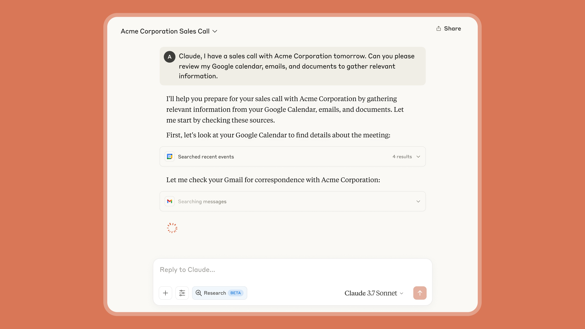
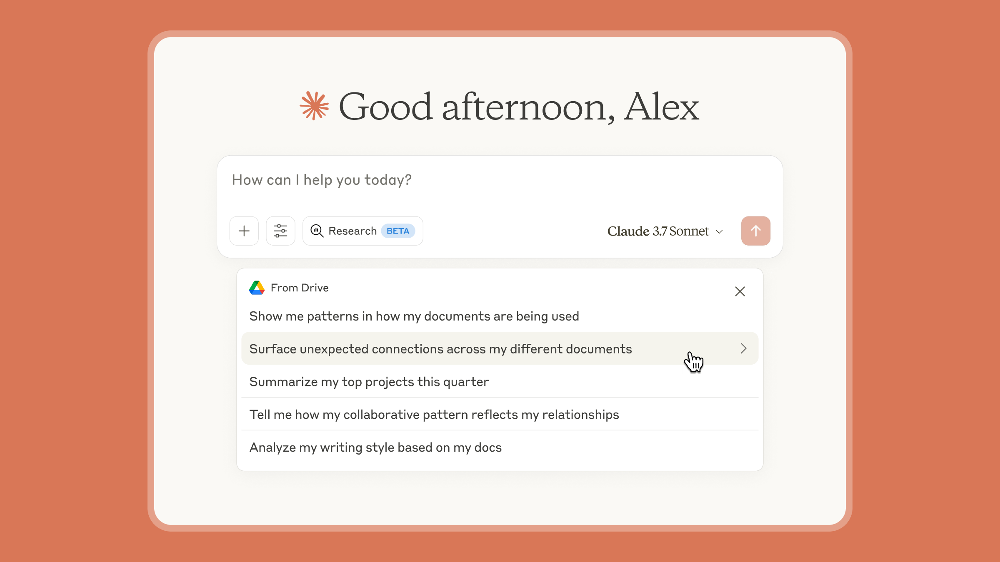

# B03_Claude takes research to new places_Claude 把研究带向新的疆域

> 原文：https://claude.com/blog/research
> 来源：Anthropic Claude Blog（分类：Product ｜ 产品：Claude app / Research）｜发布日期：2025-04-15
> 原文存档：[Markdown](原文/B03_research_原文.md)

## 📌 本篇速览

- 📅 2025-04-15　｜　⏱ 原文约 800 词（逐句精读约 10 分钟）
- 🏷 Research 产品、agentic search、多轮递进检索、引用可核查、Google Workspace、RAG cataloging
- 🗂 [返回目录](00_目录与阅读进度.md)

⚠️ 注意：这是 **Research 产品功能的发布公告**（2025-04），不是多智能体研究系统的工程文章——那篇是 [Engineering 06_multi-agent-research-system](../Engineering全集_逐句对照/06_multi-agent-research-system_逐句对照.md)（本篇产品背后的系统正是那篇所述架构）。本篇价值：官方对 **agentic search 行为的产品化描述**——「多次搜索层层递进（searches that build on each other）、自主决定接下来查什么、自动探索问题的不同角度、系统性处理开放问题、带易核查引用」——这五个短语就是 agentic search 的产品语言版本。另外两块：Google Workspace 集成（邮件/日历/文档进入工作上下文）；企业版 **cataloging**（组织文档专用索引 + 安全 RAG，不用指定具体文件也能检索全组织文档）——注意这与 Claude Code 弃用 RAG（B19）不矛盾：企业文档海量、无 grep 可用，索引式检索仍是正解，场景决定检索形态。

---

Earlier this year, we introduced our vision for Claude as your collaborative partner that delivers hours of work in minutes.

今年早些时候，我们提出了 Claude 的愿景：一个能在几分钟内交付数小时工作量的协作伙伴。

In line with this vision, we're continuing to expand the context that Claude has access to, as well as the kinds of outputs you can generate with Claude to support your personal and professional work.

沿着这个愿景，我们持续扩展 Claude 能访问的上下文，以及你能用 Claude 生成的产出类型，以支持你的个人与职业工作。

Today, we're introducing two new capabilities that make Claude a more informed and capable collaborator — Research and a Google Workspace integration that connects your email, calendar, and documents to Claude.

今天，我们推出两项让 Claude 更「知情」也更能干的新能力——Research（研究），以及把你的邮件、日历和文档连接到 Claude 的 Google Workspace 集成。

With Research, Claude can search across both your internal work context and the web to help you make decisions and take action faster than before.

借助 Research，Claude 能同时搜索你的内部工作上下文和网页，帮你比以往更快地做决定、采取行动。

### Research

### Research（研究）

Research transforms how Claude finds and reasons with information.

Research 改变了 Claude 查找信息和基于信息推理的方式。

Claude operates agentically, conducting multiple searches that build on each other while determining exactly what to investigate next.

Claude 以智能体的方式运作：进行多次层层递进的搜索，同时自主判断接下来到底该调查什么。

It explores different angles of your question automatically and works through open questions systematically.

它会自动探索你问题的不同角度，系统性地处理尚未解决的疑问。

This approach delivers thorough answers, complete with easy-to-check citations so you can trust Claude's findings.

这种方式产出周全的答案，并附上便于核查的引用，让你可以信任 Claude 的结论。

Research delivers high-quality, comprehensive answers in minutes, making it practical for the multiple research tasks you tackle throughout your workday.

Research 能在几分钟内给出高质量、全面的答案，让它对你一天中要处理的多个研究任务都切实可用。

It's this balance of speed and quality that sets it apart.

正是这种速度与质量的平衡让它与众不同。

### Google Workspace

### Google Workspace

Claude now integrates with Gmail and Calendar, in addition to Google Docs – helping it gain deeper insight into your work context.

Claude 现在除 Google Docs 外还集成了 Gmail 和 Calendar——帮助它更深入地理解你的工作上下文。

By connecting Google Workspace, Claude can securely search emails, review documents, and see your calendar commitments – eliminating the need to manually upload files or repeatedly provide context about your work and schedule.

连接 Google Workspace 后，Claude 可以安全地搜索邮件、查阅文档、查看你的日程安排——不再需要手动上传文件，或反复解释你的工作和日程背景。

Ask Claude to pull together meeting notes from last week, identify action items from follow-up email threads, and search relevant documents for additional context.

让 Claude 汇总上周的会议记录、从后续邮件线程里找出行动项、并搜索相关文档补充上下文。

Claude brings these insights directly to you, eliminating hours of manual work and letting you focus on strategic planning instead of information gathering.

Claude 把这些洞见直接带到你面前，省去数小时手工劳动，让你专注于战略规划而不是信息收集。

Claude will provide inline citations that you can use to verify the source, so that you can trust Claude is working from the most recent context.

Claude 会提供行内引用供你核实来源，让你确信它是基于最新的上下文在工作。

Using Research with Google Workspace:

Research 搭配 Google Workspace 的用法：

- **Marketing teams** can plan for product launches faster by having Claude gather competitive intelligence from the web while pulling relevant product specs, positioning, and strategy documents to create comprehensive launch plans.

- **市场团队**：让 Claude 从网上收集竞争情报，同时拉取相关的产品规格、定位和战略文档，生成完整的发布计划，从而更快筹备产品发布。

- **Sales teams** can prepare for client meetings more efficiently by having Claude search through correspondence history, calendar invitations with meeting notes, and the latest updates about the prospect's company to create detailed briefing documents.

- **销售团队**：让 Claude 搜索往来邮件历史、带会议记录的日历邀请、以及潜在客户公司的最新动态，生成详细的会前简报，更高效地准备客户会议。

- **Engineers** can create technical solutions that integrate with existing systems by having Claude analyze design documents and system specifications alongside external API documentation, implementation patterns, and security best practices.

- **工程师**：让 Claude 同时分析设计文档、系统规格与外部 API 文档、实现模式和安全最佳实践，创建能与现有系统集成的技术方案。

- **University students** can learn new topics by working with Claude to analyze learning materials and notes from past courses, while searching for the latest academic research, interactive learning resources, and expert explanations to create personalized study plans.

- **大学生**：与 Claude 一起分析学习材料和过往课程笔记，同时搜索最新学术研究、交互式学习资源和专家讲解，生成个性化学习计划。

- **Parents** can streamline personal organization by having Claude scan emails and calendar events to highlight important commitments, while searching the web for updated school calendars, local community events, and weather forecasts that might affect family plans.

- **家长**：让 Claude 扫描邮件和日历事件、标出重要安排，同时上网查最新的学校日历、本地社区活动和可能影响家庭计划的天气预报，简化个人事务管理。

### Google Docs cataloging

### Google Docs 编目（cataloging）

In addition to Research and Google Workspace, Claude Enterprise administrators can activate cataloging to improve Claude's retrieval quality and accuracy.

除 Research 和 Google Workspace 外，Claude Enterprise 管理员还可以启用编目（cataloging）来提升 Claude 检索的质量和准确性。

When cataloging is enabled, Claude leverages a specialized index of your organization's documents to find the information you need—even when it's buried in lengthy documents or scattered across multiple files.

启用编目后，Claude 会利用为你组织文档建立的专用索引来找到你需要的信息——即使它埋在冗长文档里、或散落在多个文件中。

This technology utilizes secure retrieval augmented generation techniques to enable Claude to search across your document ecosystem, without requiring you to specify exact files.

这项技术利用安全的检索增强生成（RAG）技术，让 Claude 能在你的文档生态中搜索，而不需要你指定具体文件。

With enterprise-grade security that keeps your data within your control, Claude maintains the confidentiality of your organization's knowledge while delivering precise answers.

凭借让数据始终处于你掌控之下的企业级安全，Claude 在给出精确答案的同时维护组织知识的机密性。

### Getting started

### 快速上手

This is just the beginning of updates to make Claude an even better collaborator.

这只是让 Claude 成为更好协作者的一系列更新的开始。

In the coming weeks, we'll expand the range of content sources available and the ability for Claude to do research in more depth.

未来几周，我们会扩展可用的内容来源范围，以及 Claude 更深入做研究的能力。

**Research** is now available in early beta for Max, Team, and Enterprise plans in the United States, Japan, and Brazil.

**Research** 现已在美国、日本和巴西向 Max、Team、Enterprise 计划开放早期测试。

Simply toggle on the Research setting in chat.

在聊天中打开 Research 开关即可。

**Web search**, which launched in the United States in March, is now available in Brazil and Japan and is automatically enabled for paid plans in these regions.

**网页搜索**已于三月在美国上线，现已扩展到巴西和日本，并对这些地区的付费计划自动启用。

**The Google Workspace** integration is available in beta to all paid users in profile settings.

**Google Workspace** 集成已在个人资料设置中向所有付费用户开放测试。

Team and Enterprise plan admins must enable Google Workspace access domain-wide before individual users connect their accounts.

Team 和 Enterprise 计划的管理员须先在全域启用 Google Workspace 访问，个人用户才能连接自己的账号。

Claude Enterprise plan admins can enable Google Docs cataloging for the entire organization.

Claude Enterprise 计划的管理员可以为整个组织启用 Google Docs 编目。

---

## 术语中英对照表

| 英文 | 中文 | 备注 |
|---|---|---|
| Research | 研究功能 | agentic search 的产品化（背后是多智能体研究系统） |
| operate agentically | 以智能体方式运作 | 自主决定「接下来查什么」 |
| searches that build on each other | 层层递进的搜索 | 与一次性检索的本质区别 |
| open questions | 开放问题 / 未解疑问 | 系统性逐个处理 |
| easy-to-check citations | 易核查的引用 | 可信度的产品机制 |
| inline citations | 行内引用 | Workspace 检索的溯源方式 |
| cataloging | 编目 | 企业文档专用索引 |
| retrieval augmented generation (RAG) | 检索增强生成 | 企业场景仍是正解（与 B19 弃 RAG 不矛盾） |
