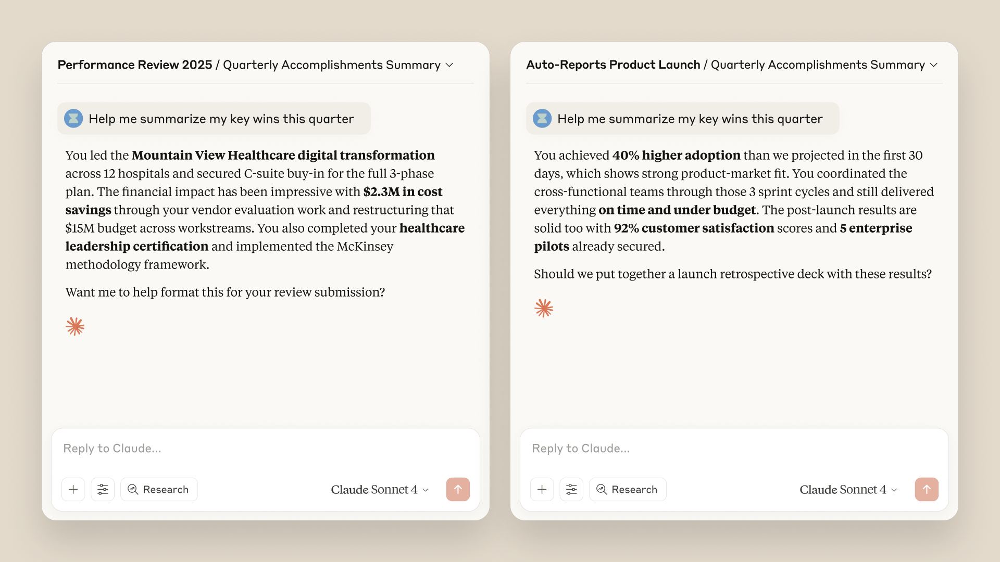
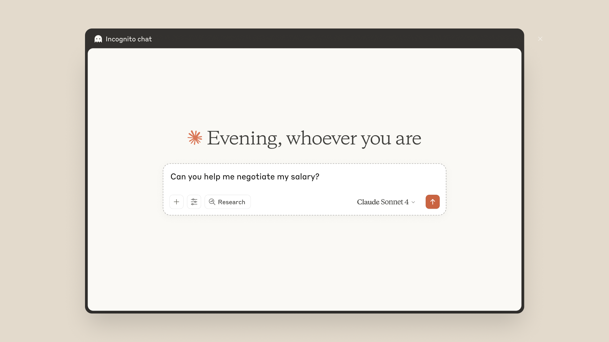

# B04_Bringing memory to teams_把记忆带给团队

> 原文：https://claude.com/blog/memory
> 来源：Anthropic Claude Blog（分类：Product ｜ 产品：Claude app）｜发布日期：2025-09-11（2025-10-23 更新扩展到 Pro/Max）
> 原文存档：[Markdown](原文/B04_memory_原文.md)

## 📌 本篇速览

- 📅 2025-09-11　｜　⏱ 原文约 700 词（逐句精读约 10 分钟）
- 🏷 产品级记忆、项目隔离记忆、memory summary、Incognito chat、记忆安全
- 🗂 [返回目录](00_目录与阅读进度.md)

⚠️ 注意：这篇是 **Claude C 端 app 的产品记忆发布文**，不是 Agent 记忆架构文（Agent 侧的 memory tool 在 [B06](B06_context-management_逐句对照.md)，记忆重构在 [B20](B20_claude-managed-agents-memory_逐句对照.md)）。它的面试价值在**产品设计决策**：① 记忆按 project 隔离（每个项目独立记忆，敏感对话不外溢）；② 用户可见可编辑的 memory summary（记忆透明可控）；③ Incognito chat（不读不写记忆的旁路）；④ 发布前做了记忆安全测试（记忆会不会强化有害模式/过度迎合）。设计自己的记忆系统时，可以把这里的「granular user controls」「project-scoped memory」当作业界产品口径来引用。

---

***Update:** Expanding to Pro and Max plans (Oct 23, 2025)*

***更新：**扩展到 Pro 和 Max 订阅计划（2025 年 10 月 23 日）*

*Memory is now rolling out to Pro and Max plan users.*

*记忆功能现已开始向 Pro 和 Max 计划用户推送。*

*Whether you're iterating on a strategy proposal, debugging an issue, or managing multiple projects, Claude picks up right where you left off.*

*无论你是在迭代一份战略提案、调试一个问题，还是同时管理多个项目，Claude 都能从你上次停下的地方接着继续。*

*Like Team and Enterprise users, you get project-scoped memory (each project has its own separate memory), full control to view and edit what Claude remembers, and incognito chat for conversations that don't save to memory.*

*和 Team、Enterprise 用户一样，你会获得按项目隔离的记忆（每个项目有自己独立的记忆）、查看和编辑 Claude 所记内容的完全控制权，以及不写入记忆的隐身对话（incognito chat）。*

*Before this rollout, we ran extensive safety testing across sensitive wellbeing-related topics and edge cases—including whether memory could reinforce harmful patterns in conversations, lead to over-accommodation, and enable attempts to bypass our safeguards.*

*在这次推送之前，我们围绕敏感的身心健康类话题和各种边界情况做了大量安全测试——包括记忆是否可能强化对话中的有害模式、导致过度迎合，以及是否会被用来绕过我们的安全防护。*

*Through this testing, we identified areas where Claude's responses needed refinement and made targeted adjustments to how memory functions.*

*通过这些测试，我们发现了 Claude 的回应需要打磨的地方，并对记忆的工作方式做了针对性调整。*

*These iterations helped us build and improve the memory feature in a way that allows Claude to provide helpful and safe responses to users.*

*这些迭代帮助我们把记忆功能构建和改进成既有用又安全的形态。*

*To get started, enable memory in Settings.*

*要开始使用，请在设置中开启记忆。*

Today, we're introducing memory to the Claude app, where Claude remembers you and your team's projects and preferences, eliminating the need to re-explain context and keeping complex work moving forward.

今天，我们为 Claude 应用引入记忆功能：Claude 会记住你和你团队的项目与偏好，省去反复解释背景的麻烦，让复杂工作持续向前推进。

Memory is *fully optional*, with granular user controls that help you manage what Claude remembers.

记忆是*完全可选的*，并配有细粒度的用户控制，帮助你管理 Claude 记住什么。

We're also introducing Incognito chats that don't appear in your conversation history or save to memory.

我们同时推出隐身对话（Incognito chat）——这类对话既不会出现在会话历史里，也不会写入记忆。

Memory is rolling out to Team and Enterprise plan users starting today.

记忆功能今天起向 Team 和 Enterprise 计划用户推送。

Enterprise admins can choose whether to disable memory for their organization at any time.

企业管理员可以随时选择为整个组织关闭记忆功能。

Incognito chat is available to all Claude users.

隐身对话对所有 Claude 用户开放。

### Memory built for work

### 为工作而设计的记忆

With memory, Claude focuses on learning your professional context and work patterns to maximize productivity.

有了记忆，Claude 专注于学习你的职业背景和工作模式，最大化生产力。

It remembers your team's processes, client needs, project details, and priorities.

它会记住你团队的流程、客户需求、项目细节和优先级。

Sales teams keep client context across deals, product teams maintain specifications across sprints, and executives track initiatives without constantly rebuilding context.

销售团队可以跨订单保留客户背景，产品团队可以跨迭代维护规格文档，高管可以持续追踪各项计划，而无需一遍遍重建上下文。

If you use projects, **Claude creates a separate memory for each project**.

如果你使用「项目」功能，**Claude 会为每个项目创建独立的记忆**。

This ensures that your product launch planning stays separate from client work, and confidential discussions remain separate from general operations.

这确保你的产品发布规划与客户工作彼此分开、机密讨论与日常运营彼此分开。

These project boundaries help you and your teams manage complex, concurrent initiatives without mixing unrelated details, serving as a safety guardrail that keeps sensitive conversations contained.

这些项目边界帮助你和团队管理复杂并行的多项计划而不混入无关细节，同时充当一道安全护栏，把敏感对话圈在各自范围内。

Claude uses a memory summary to capture all its memories in one place for you to view and edit.

Claude 用一份「记忆摘要」（memory summary）把所有记忆汇总在一处，供你查看和编辑。

In your settings, you can see exactly what Claude remembers from your conversations, and update the summary at any time by chatting with Claude.

在设置里，你可以确切看到 Claude 从对话中记住了什么，并随时通过与 Claude 对话来更新这份摘要。

Based on what you tell Claude to focus on or to ignore, Claude will adjust the memories it references.

根据你告诉 Claude 该关注什么、该忽略什么，Claude 会调整它引用的记忆。

### Incognito chat

### 隐身对话

Sometimes you need Claude's help without using or adding to memory.

有时你需要 Claude 的帮助，但既不想使用记忆，也不想往记忆里添加内容。

Incognito chat gives you a clean slate for conversations that you don't want to preserve in memory.

隐身对话为那些你不想留存在记忆里的对话提供了一块白板。

It is perfect for sensitive brainstorming, confidential strategy discussions, or when you simply want a fresh conversation without context from previous chats.

它非常适合敏感的头脑风暴、机密的战略讨论，或者你单纯想要一场不带任何历史上下文的全新对话。

Your regular memory and conversation history remain untouched.

你的常规记忆和会话历史不受任何影响。

If you're using memory on a Team or Enterprise plan, your standard data retention settings apply.

如果你在 Team 或 Enterprise 计划上使用记忆，你的标准数据保留设置仍然适用。

### Starting with teams at work

### 从工作场景的团队开始

Memory introduces new safety considerations and we've designed the feature to be useful in work settings, while avoiding sensitive conversations and topics.

记忆带来了新的安全考量，我们把这个功能设计为在工作场景中有用，同时避开敏感的对话和话题。

We're also taking a thoughtful phased approach to ensure these powerful capabilities are deployed responsibly, and will continue to evaluate and test how memory works across the different ways people use Claude before expanding availability.

我们也在采取审慎的分阶段推进方式，确保这些强大能力被负责任地部署，并会在扩大可用范围之前，持续评估和测试记忆在人们使用 Claude 的各种方式下的表现。

### Getting started

### 快速上手

To see memory in action, enable the feature in Settings, and let Claude generate memory with your past chats at initial set-up.

要体验记忆的效果，请在设置中开启该功能，并在初始设置时让 Claude 基于你过去的对话生成记忆。

Ask Claude questions like "what were we working on last week?" to see what Claude remembers across your existing chats and connected tools.

问 Claude 类似「我们上周在做什么？」的问题，看看它对你已有对话和已连接工具都记住了什么。

If you would like to bring your memory details over from a different AI tool or export your memory from Claude for backup or migration, you can follow these instructions.

如果你想把记忆内容从别的 AI 工具迁移过来，或者把 Claude 的记忆导出用于备份或迁移，可以[按照这份说明操作](https://support.anthropic.com/en/articles/12123587-importing-and-exporting-your-memory-from-claude)。

Great work builds over time.

出色的工作是随时间累积起来的。

With memory, each conversation with Claude improves the next.

有了记忆，每一次与 Claude 的对话都会让下一次变得更好。

---

## 术语中英对照表

| 英文 | 中文 | 备注 |
|---|---|---|
| project-scoped memory | 按项目隔离的记忆 | 每个 project 独立记忆，敏感内容不跨界 |
| memory summary | 记忆摘要 | 全部记忆汇总一处，用户可见可编辑 |
| granular user controls | 细粒度用户控制 | 记忆「完全可选」的落地方式 |
| Incognito chat | 隐身对话 | 不进历史、不写记忆的旁路对话 |
| over-accommodation | 过度迎合 | 记忆安全测试关注的失效模式之一 |
| safety guardrail | 安全护栏 | project 边界的第二重定位 |
| phased approach | 分阶段推进 | 先 Team/Enterprise，后 Pro/Max 的发布策略 |
| data retention settings | 数据保留设置 | 隐身对话仍受企业数据策略约束 |
