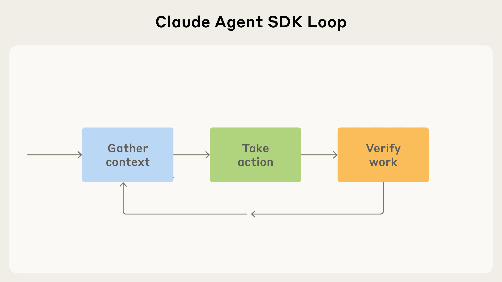
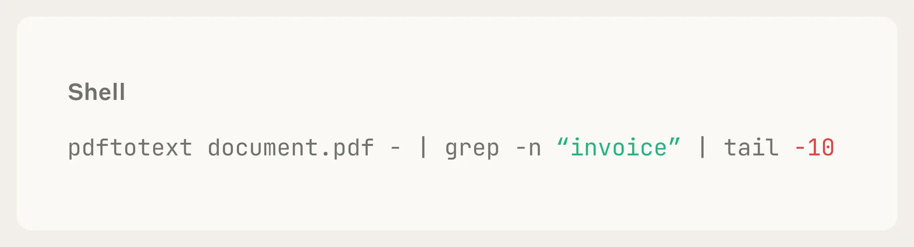
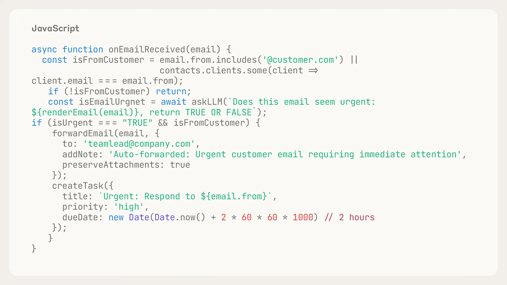
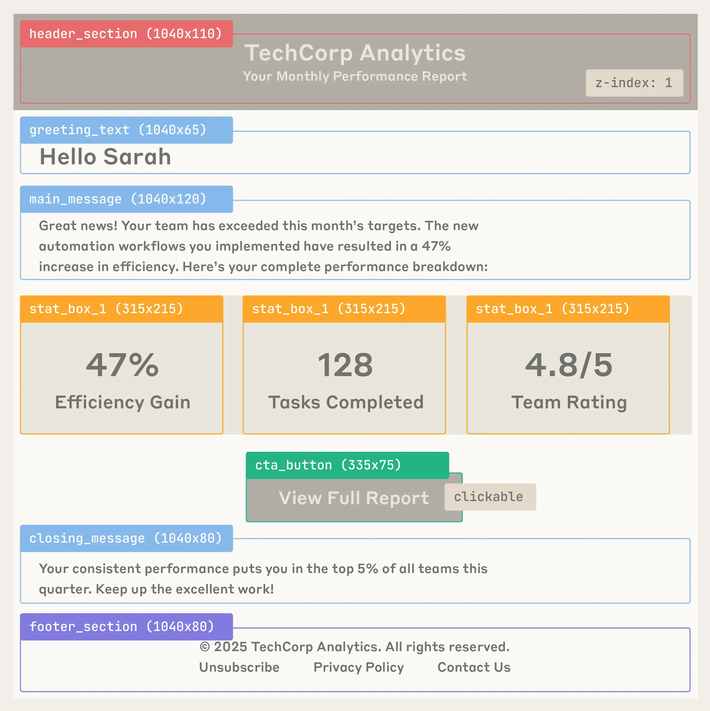
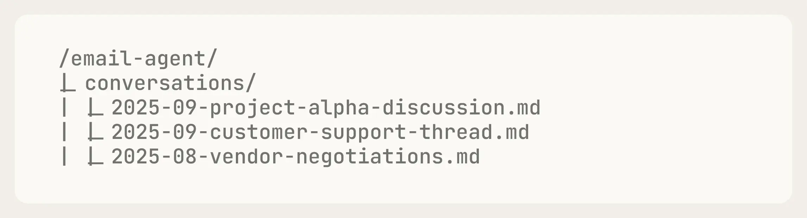

# Building agents with the Claude Agent SDK：面试速记

> 2025-09-29 · [官方原文](https://claude.com/blog/building-agents-with-the-claude-agent-sdk)
> ⚠️ **这篇原属 anthropic.com/engineering，现已 308 永久重定向到 claude.com/blog，因此不在你收录的 25 篇里。它是 Anthropic Agent 方法论最基础的一块拼图。**

## 一句话讲明白

**Anthropic 把「怎么造一个 Agent」压缩成一句话——给 Claude 一台电脑，然后让它在「收集上下文 → 采取行动 → 验证成果」这个循环里转起来。Claude Code SDK 更名为 Claude Agent SDK，正是因为这套循环跟写不写代码无关：金融分析、私人助理、客服、深度研究，用的是同一个骨架。**

## 为什么值得读 / 能用在哪

- 它是后面所有 Anthropic Agent 文章（harness 设计、上下文工程、多智能体、Managed Agents）的**共同底座**。不读这篇，后面那些文章的术语是悬空的。
- **四阶段 agent loop 是面试最好用的答题框架**：任何「你怎么设计一个 Agent」的问题，都可以按 gather → act → verify → repeat 拆开答，每一阶段再挂具体技术选型。
- 它明确回答了一个高频追问：**为什么 Agent 要用文件系统而不是向量库**。
- 「给 Claude 一台电脑」这个比喻本身很有杀伤力——它解释了为什么 bash + 文件编辑这两个最土的工具反而是最强的工具。

## 核心要点

### 1. 核心比喻：给 Claude 一台电脑



设计哲学是**通过终端把用户的电脑交给 Claude**——因为这正是程序员干活的方式。一旦 Claude 有了终端、文件读写、bash 执行，它就不只能写代码：

| Agent 类型 | 靠「电脑」做什么 |
|---|---|
| 金融 Agent | 拉取行情 API、跑 Python 算模型、生成 Excel |
| 私人助理 | 读日历/邮件文件、写脚本批量处理 |
| 客服 Agent | 查工单系统、按规则归类、生成回复 |
| 深度研究 Agent | 搜索、抓取、交叉验证、产出报告 |

**面试可用的一句话总结**：通用工具（bash / 文件编辑）的表达力上限，比任何专用工具集都高，因为它把「组合」这件事留给了模型。

### 2. Agent Loop：四个阶段

```
        ┌──────────────────┐
        │  Gather Context  │  收集上下文
        └────────┬─────────┘
                 ↓
        ┌──────────────────┐
        │   Take Action    │  采取行动
        └────────┬─────────┘
                 ↓
        ┌──────────────────┐
        │   Verify Work    │  验证成果
        └────────┬─────────┘
                 ↓
              Repeat ──────┐
                 ↑─────────┘
```

这个循环是全文骨架，下面三节分别展开。

### 3. Gather Context：四种拿上下文的方式

| 方式 | 机制 | 代价 / 适用 |
|---|---|---|
| ⭐ **Agentic search（文件系统）** | 用 bash 脚本（`grep`、`tail`、`find`）在文件系统里翻 | **更准**，但更慢、更耗 token。Anthropic 的默认选择 |
| **Semantic search（语义检索）** | 切块 + 向量化 + 查询 | **更快，但更不准**。原文明确指出准确度不如 agentic search |
| ⭐ **Subagents（子智能体）** | 派生有**独立上下文窗口**的子 Agent 并行处理 | 主上下文不被污染，代价是通信只能走返回值 |
| **Compaction（压缩）** | 自动总结历史，防止上下文溢出 | 保连续性，但没有「干净开局」 |

> **这里是本文最反直觉、也最容易在面试拿分的一点**：Anthropic 在自己的 Agent 里**优先用文件系统搜索而不是向量检索**。理由是准确度。RAG 不是 Agent 的默认答案——「让 Agent 自己去 grep」往往更好。这也解释了为什么 Claude Code 里没有内置向量库。

### 4. Take Action：四种干活的方式



| 方式 | 说明 |
|---|---|
| **Tools（工具）** | 主要执行单元。原文强调工具要设计成**上下文里的显眼元素**——它在上下文里的呈现方式直接决定被调用的正确率 |
| **Bash & scripts** | 通用、灵活的电脑操作，覆盖长尾需求 |
| ⭐ **Code generation（代码生成）** | 让 Claude 写 Python 脚本去生成 Excel / PowerPoint / Word。**比给它一堆专用工具更通用** |
| **MCP** | 标准化外部集成：Slack、GitHub、Google Drive、Asana |



**层级关系值得记住**：Tools 是原语 → Bash 是通用逃生舱 → Code generation 是「用代码表达任意组合」→ MCP 是「接入外部世界的标准接口」。后面那篇 *Agent Harness Design 3 Patterns* 会进一步论证「Skills / 编程式工具调用 / 记忆工具其实都是 bash + 文件编辑的组合」。

### 5. Verify Work：三种验证手段（按可靠性排序）

| 手段 | 机制 | 可靠性 |
|---|---|---|
| ⭐ **Rules-based feedback（规则反馈）** | 代码 lint，能指出具体的 error/warning 位置 | **最高**——确定性、可定位 |
| **Visual feedback（视觉反馈）** | 截图 / 渲染后让模型看 UI 对不对 | 中 |
| **LLM-as-judge** | 用另一个模型评判 | 原文**明确承认这个最不 robust** |



> **面试要点**：Anthropic 自己承认 LLM-as-judge 不够 robust，**优先级是「有确定性规则就别用模型评判」**。这跟 `21_harness-design-long-running-apps` 里「主观任务不得不用评估器，但要把主观标准写成带阈值的打分标准」是同一个思路的两端——能确定性验证就确定性验证，实在不能才退到模型评判，且要给它可量化的标尺。

### 6. 实战案例：邮件 Agent



全文用一个邮件 Agent 走通完整流程，值得注意的设计：**用文件夹结构组织会话历史**——这就是「文件系统即状态」的具体形态，也是后来 Managed Agents 内置记忆（memory 挂载文件系统）的前身。

### 7. 迭代改进 Agent 的五个自查问题

原文给了一组诊断问题，排查 Agent 表现不佳时按这个顺序问：

1. 任务被误解，是不是因为**缺信息**？
2. **API 结构**能不能改得更好搜索？
3. 能不能把失败模式**写成形式化规则**（转成确定性验证）？
4. 换一套工具，是不是能让它用**完全不同的路径**解题？
5. 加了新功能之后，**表现有没有退化**？

> 这五问很适合背下来。面试被问「Agent 效果不好你怎么排查」，按这个顺序答，显得有方法论而不是撞运气。

## 术语中英对照

| 英文 | 中文 | 说明 |
|---|---|---|
| agent loop | 智能体循环 | gather → act → verify → repeat |
| agentic search | 智能体式搜索 | 用 bash 在文件系统里翻，对应 semantic search |
| semantic search | 语义检索 | 向量切块检索，更快但更不准 |
| subagent | 子智能体 | 有独立上下文窗口的委派 Agent |
| compaction | 压缩 | 自动总结历史以防上下文溢出 |
| rules-based feedback | 规则反馈 | lint 之类的确定性验证 |
| LLM-as-judge | 模型评判 | 用另一个模型打分，可靠性最低 |
| MCP (Model Context Protocol) | 模型上下文协议 | 标准化外部集成协议 |

## 和已读文章的关系

| 关联文章 | 关系 |
|---|---|
| `02_building-effective-agents` | 那篇讲「要不要用 Agent」，这篇讲「Agent 内部长什么样」 |
| `08_writing-tools-for-agents` | 展开本文 Take Action 里「工具是上下文里的显眼元素」这条 |
| `10_effective-context-engineering` | 展开本文 Gather Context 一节 |
| `11_agent-skills` | Skills 是本文 Take Action 的高阶封装 |
| [B16 Agent Harness Design 3 Patterns](B16_harnessing-claudes-intelligence_学习笔记.md) | 论证 Skills/记忆/编程式调用都是 bash+文件编辑的组合 |
| [B26 新上下文工程规则](B26_new-rules-of-context-engineering_学习笔记.md) | ⚠️ Claude 5 世代下，本文部分建议已更新 |

## 面试怎么用

**被问「你怎么设计一个 Agent 系统」**：
先给四阶段循环骨架 → 每阶段给出选型与取舍（gather 用 agentic search 而非向量库，理由是准确度；act 优先 code generation 而非堆专用工具；verify 优先确定性规则，LLM-as-judge 是最后手段）→ 再补一句「每个 harness 组件都在补模型的某个缺口，模型升级要回头重测」（衔接 harness 系列）。

**被问「为什么不用 RAG」**：
答 Anthropic 官方立场——agentic search 准确度高于 semantic search，Claude Code 本身就没有内置向量库；向量检索的价值在于快，在 Agent 场景里准确度权重更高。
