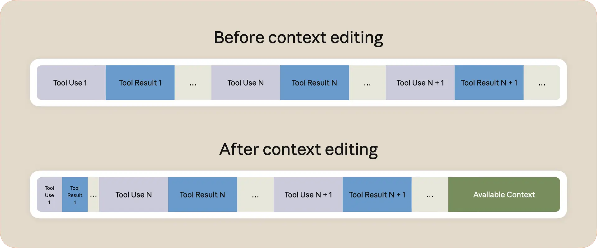

# B06_Managing context on the Claude Developer Platform_在 Claude 开发者平台上管理上下文

> 原文：https://claude.com/blog/context-management
> 来源：Anthropic Claude Blog（分类：Platform ｜ 产品：Claude Developer Platform）｜发布日期：2025-09-29
> 原文存档：[Markdown](原文/B06_context-management_原文.md)

## 📌 本篇速览

- 📅 2025-09-29　｜　⏱ 原文约 630 词（逐句精读约 10 分钟）
- 🏷 Context Editing、Memory Tool、长时任务、token 预算、上下文管理
- 🗂 [返回目录](00_目录与阅读进度.md)

本篇是「上下文管理」两大官方原语的发布文：**context editing**（接近 token 上限时自动清除过期 tool call 与结果，保留对话流）与 **memory tool**（完全 client-side 的文件式记忆目录，跨会话持久）。两个关键数字：agentic search 内部评测中 memory + context editing 相对 baseline **提升 39%**、仅 context editing 提升 29%；100 轮 web search 评测中 context editing 让本会因上下文耗尽而失败的任务跑通，同时 **token 消耗降低 84%**。面试对照：你的「baseline 注入 + 按需 tool recall」= memory tool 思路；你的窗口式反思抽取对应「valuable insights get preserved across sessions」。官方术语记两个：*context editing* 和 *memory tool*。

---

Today, we're introducing new capabilities for managing your agents' context on the Claude Developer Platform: context editing and the memory tool.

今天，我们在 Claude 开发者平台上推出管理智能体上下文的新能力：上下文编辑（context editing）和记忆工具（memory tool）。

With our latest model, Claude Sonnet 4.5, these capabilities enable developers to build AI agents capable of handling long-running tasks at higher performance and without hitting context limits or losing critical information.

配合我们最新的模型 Claude Sonnet 4.5，这些能力让开发者能够构建可以处理长时任务的 AI 智能体——性能更高，且不会撞上上下文上限或丢失关键信息。

## Context windows have limits, but real work doesn't

## 上下文窗口有上限，但真实工作没有

As production agents handle more complex tasks and generate more tool results, they often exhaust their effective context windows—leaving developers stuck choosing between cutting agent transcripts or degrading performance.

随着生产环境中的智能体处理越来越复杂的任务、产生越来越多的工具结果，它们常常会耗尽自己的有效上下文窗口——让开发者被迫在「截断智能体的对话记录」和「接受性能退化」之间二选一。

Context management solves this in two ways, helping developers ensure only relevant data stays in context and valuable insights get preserved across sessions.

上下文管理从两个方向解决这个问题：帮助开发者确保只有相关数据留在上下文里，同时有价值的洞察能够跨会话保留下来。

**Context editing** automatically clears stale tool calls and results from within the context window when approaching token limits.

**上下文编辑（context editing）**会在接近 token 上限时，自动清除上下文窗口内过期的工具调用和工具结果。

As your agent executes tasks and accumulates tool results, context editing removes stale content while preserving the conversation flow, effectively extending how long agents can run without manual intervention.

当你的智能体执行任务、不断累积工具结果时，上下文编辑会在保留对话流的前提下移除过期内容，实际上延长了智能体无需人工干预就能持续运行的时间。

This also increases the effective model performance as Claude focuses only on relevant context.

这也提升了模型的有效性能，因为 Claude 只需要关注相关的上下文。

**The memory tool** enables Claude to store and consult information outside the context window through a file-based system.

**记忆工具（memory tool）**让 Claude 能通过一套基于文件的系统，在上下文窗口之外存储和查阅信息。

Claude can create, read, update, and delete files in a dedicated memory directory stored in your infrastructure that persists across conversations.

Claude 可以在一个专用的记忆目录中创建、读取、更新和删除文件，这个目录存放在你自己的基础设施上，并跨对话持久保存。

This allows agents to build up knowledge bases over time, maintain project state across sessions, and reference previous learnings without having to keep everything in context.

这让智能体能够随时间累积知识库、跨会话维护项目状态、引用先前学到的东西，而不必把所有内容都留在上下文里。

The memory tool operates entirely client-side through tool calls.

记忆工具完全通过工具调用在 client-side（客户端一侧）运行。

Developers manage the storage backend, giving them complete control over where the data is stored and how it's persisted.

存储后端由开发者管理，因此数据存在哪里、如何持久化，完全由开发者掌控。

Claude Sonnet 4.5 enhances both capabilities with built-in context awareness—tracking available tokens throughout conversations to manage context more effectively.

Claude Sonnet 4.5 用内建的上下文感知（context awareness）强化了这两项能力——在整个对话过程中追踪可用 token 数，从而更高效地管理上下文。

Together, these updates create a system that improves agent performance:

这些更新合在一起，构成了一套提升智能体性能的系统：

- Enable longer conversations by automatically removing stale tool results from context

- 通过自动从上下文中移除过期的工具结果，支持更长的对话

- Boost accuracy by saving critical information to memory—and bring that learning across successive agentic sessions

- 通过把关键信息保存到记忆中来提升准确率——并把这些学到的东西带到后续的智能体会话中

## Building long-running agents

## 构建长时运行的智能体

Claude Sonnet 4.5 is the best model in the world for building agents.

Claude Sonnet 4.5 是世界上最适合构建智能体的模型。

These features unlock new possibilities for long-running agents—processing entire codebases, analyzing hundreds of documents, or maintaining extensive tool interaction histories.

这些特性为长时运行的智能体解锁了新的可能——处理整个代码库、分析数百份文档、维护大量的工具交互历史。

Context management builds on this foundation, ensuring agents can leverage this expanded capacity efficiently while still handling workflows that extend beyond any fixed limit.

上下文管理建立在这个基础之上，确保智能体既能高效利用这种扩展后的容量，又能处理那些超出任何固定上限的工作流。

Use cases include:

用例包括：

- **Coding:** Context editing clears old file reads and test results while memory preserves debugging insights and architectural decisions, enabling agents to work on large codebases without losing progress.

- **编程：**上下文编辑清掉旧的文件读取和测试结果，记忆则保留调试洞察和架构决策，让智能体能在大型代码库上工作而不丢失进度。

- **Research:** Memory stores key findings while context editing removes old search results, building knowledge bases that improve performance over time.

- **研究：**记忆存储关键发现，上下文编辑移除旧的搜索结果，构建起随时间推移而提升性能的知识库。

- **Data processing:** Agents store intermediate results in memory while context editing clears raw data, handling workflows that would otherwise exceed token limits.

- **数据处理：**智能体把中间结果存进记忆，上下文编辑清除原始数据，从而处理那些原本会超出 token 上限的工作流。

## Performance improvements with context management

## 上下文管理带来的性能提升

On an internal evaluation set for agentic search, we tested how context management improves agent performance on complex, multi-step tasks.

在一个面向智能体搜索（agentic search）的内部评测集上，我们测试了上下文管理如何提升智能体在复杂多步任务上的表现。

The results demonstrate significant gains: combining the memory tool with context editing improved performance by 39% over baseline.

结果显示了显著的收益：记忆工具与上下文编辑组合使用，相对 baseline 性能提升了 39%。

Context editing alone delivered a 29% improvement.

仅使用上下文编辑也带来了 29% 的提升。

In a 100-turn web search evaluation, context editing enabled agents to complete workflows that would otherwise fail due to context exhaustion—while reducing token consumption by 84%.

在一个 100 轮的网页搜索评测中，上下文编辑让智能体完成了那些本会因上下文耗尽而失败的工作流——同时把 token 消耗降低了 84%。

## Getting started

## 快速上手

These capabilities are available today in public beta on the Claude Developer Platform, natively and in Amazon Bedrock and Google Cloud's Vertex AI.

这些能力今天起在 Claude 开发者平台以公开测试版提供，原生可用，也可在 Amazon Bedrock 和 Google Cloud 的 Vertex AI 上使用。

Explore the documentation for context editing and the memory tool, or visit our cookbook to learn more.

请查阅 [context editing](https://docs.claude.com/en/docs/build-with-claude/context-editing) 和 [memory tool](https://docs.claude.com/en/docs/agents-and-tools/tool-use/memory-tool) 的文档，或访问我们的 [cookbook](https://platform.claude.com/cookbook/tool-use-memory-cookbook) 了解更多。

---

## 术语中英对照表

| 英文 | 中文 | 备注 |
|---|---|---|
| context editing | 上下文编辑 | 接近 token 上限时自动清除过期 tool call/result，保留对话流 |
| memory tool | 记忆工具 | 文件式记忆目录，client-side，通过 tool call 增删改查 |
| effective context window | 有效上下文窗口 | 性能开始退化前真正可用的上下文长度 |
| stale tool calls/results | 过期的工具调用/结果 | context editing 的清除对象 |
| context awareness | 上下文感知 | Sonnet 4.5 起模型内建的可用 token 追踪 |
| agentic search | 智能体搜索 | 39%/29% 提升数字所在的内部评测场景 |
| context exhaustion | 上下文耗尽 | 100 轮评测里失败的原因；context editing 的解题对象 |
| client-side | 客户端侧 | 记忆存储后端完全由开发者掌控 |
