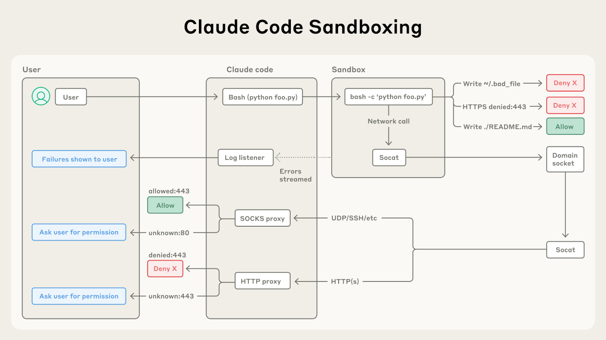
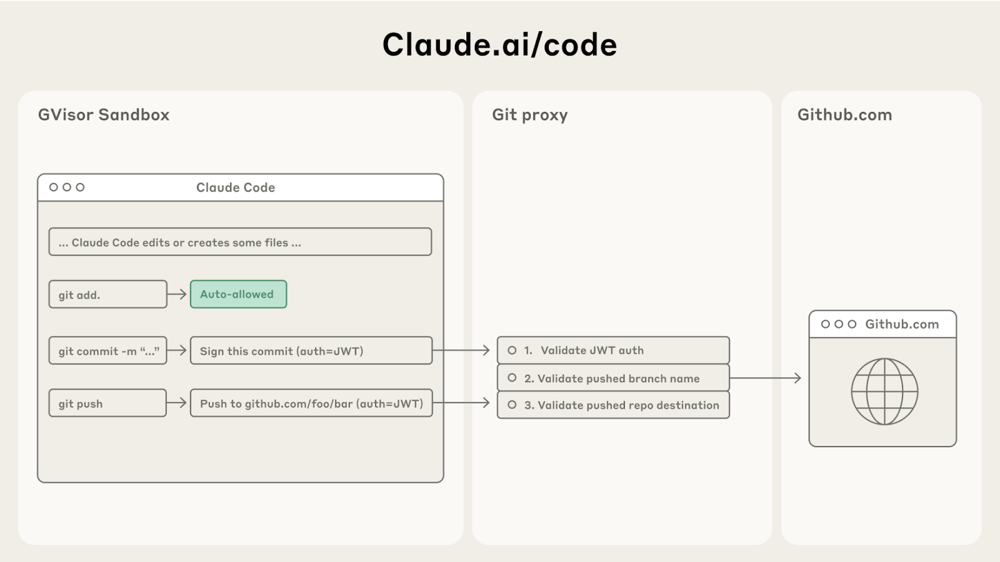

# B07_Beyond permission prompts: making Claude Code more secure and autonomous_超越权限弹窗：让 Claude Code 更安全也更自主

> 原文：https://claude.com/blog/beyond-permission-prompts-making-claude-code-more-secure-and-autonomous
> 来源：Anthropic Claude Blog（分类：Security ｜ 产品：Claude Code）｜发布日期：2025-10-08
> 原文存档：[Markdown](原文/B07_beyond-permission-prompts-making-claude-code-more-secure-and-autonomous_原文.md)
> ⚠️ 原文页面本身存在若干编辑残留（未删净的改稿痕迹、"[Github link?]" "[XXX]" 占位符），逐句稿按可读版本整理并在对应处注明。

## 📌 本篇速览

- 📅 2025-10-08　｜　⏱ 原文约 1030 词（逐句精读约 14 分钟）
- 🏷 沙箱、权限弹窗疲劳、文件系统隔离、网络隔离、代理式 git 凭据、prompt injection 防护
- 🗂 [返回目录](00_目录与阅读进度.md)

Agent 安全从「逐操作审批」升级为「**画定边界内自由行动**」的宣言文。**问题**：权限弹窗拖慢开发且导致「审批疲劳」（approval fatigue）——用户不再细看批了什么。**方案：沙箱两大隔离缺一不可**——文件系统隔离（防被注入的 Agent 改敏感文件）+ 网络隔离（防外泄数据/下载恶意软件）；**只有其一会互相击穿**：没有网络隔离，泄密（SSH key 外传）；没有文件系统隔离，逃逸后获得网络。实现基于 OS 原语（Linux bubblewrap / macOS seatbelt），覆盖命令派生的一切子进程；网络出口走沙箱外的代理（unix domain socket），域名白名单+新域名请求用户确认。**Claude Code on the web 的凭据设计是亮点**：git 凭据**从不进入沙箱**——沙箱内用自定义 scoped credential 向代理认证，代理校验操作内容（如只允许 push 到指定分支）后再附真实 token 转发 GitHub。结论：即使 prompt injection 成功，也被完全隔离。

---

To help address this, we've introduced two new features in Claude Code built on top of sandboxing, both of which are designed to provide a more secure place for developers to work, while also allowing Claude to run more autonomously and with fewer permission prompts.

为了解决这个问题，我们在 Claude Code 中引入了两个建立在沙箱（sandboxing）之上的新特性——都旨在给开发者提供一个更安全的工作场所，同时让 Claude 能更自主地运行、更少弹权限确认。

These features are examples of **native sandboxing**: defining set boundaries within which Claude can work freely, they increase security and agency.

这些特性是**原生沙箱**的例子：划定边界、让 Claude 在边界内自由工作，同时提升安全性与自主性。

## Our current approach to keeping users secure

## 我们目前保护用户安全的方式

Claude Code runs on a permission-based model: by default, it's read-only, which means it asks for permission before making modifications or running any commands.

Claude Code 运行在基于权限的模型上：默认只读，也就是说做任何修改或运行任何命令之前都要请求许可。

There are some exceptions to this: we use static analysis to auto-allow safe commands like echo or cat, but most operations still need explicit approval.

有一些例外：我们用静态分析自动放行 echo、cat 这类安全命令，但大多数操作仍需要显式批准。

But constantly clicking "approve" slows down development and can lead to 'approval fatigue', where users might not pay close attention to what they're approving.

但不停点「批准」会拖慢开发，还可能导致「审批疲劳」——用户不再仔细看自己批的是什么。

To make Claude Code both safer and more effective, we wanted to find a better method.

为了让 Claude Code 既更安全又更高效，我们想找一个更好的办法。

## Sandboxing: a safer and more autonomous approach

## 沙箱：更安全也更自主的方式

Sandboxing creates pre-defined boundaries within which Claude can work more freely, instead of asking for permission for each action.

沙箱创建预先定义的边界，Claude 在边界内可以更自由地工作，而不是每个动作都要请求许可。

With our update to Claude Code, we're shifting to this approach.

这次 Claude Code 更新，我们正转向这种方式。

Our approach to sandboxing is built on top of operating system-level features, based on two main sets of boundaries:

我们的沙箱建立在操作系统级特性之上，基于两组主要边界：

1. **Filesystem isolation**, which ensures that Claude can only access or modify specific directories. This is particularly important in preventing a prompt-injected Claude from modifying sensitive system files.

1. **文件系统隔离**：确保 Claude 只能访问或修改特定目录。这对防止被提示注入（prompt injection）的 Claude 篡改敏感系统文件尤其重要。

2. **Network isolation**, which ensures that Claude can only connect to approved servers. This prevents a prompt-injected Claude from leaking sensitive information or downloading malware.

2. **网络隔离**：确保 Claude 只能连接被批准的服务器。这防止被注入的 Claude 外泄敏感信息或下载恶意软件。

It is worth noting that effective sandboxing requires *both* filesystem and network isolation.

值得注意的是，有效的沙箱*同时*需要文件系统隔离和网络隔离。

Without network isolation, a compromised agent could exfiltrate sensitive files like SSH keys; without filesystem isolation, a compromised agent could easily escape the sandbox and gain network access.

没有网络隔离，被攻陷的智能体可以外传 SSH key 之类的敏感文件；没有文件系统隔离，被攻陷的智能体可以轻易逃出沙箱、获得网络访问。

It's by using both techniques that we can provide a safer agentic experience for Claude Code users.

正是两种技术并用，我们才能为 Claude Code 用户提供更安全的智能体体验。

### Two new sandboxing features in Claude Code

### Claude Code 的两个沙箱新特性

#### Sandboxed bash tool: safe bash execution without permission prompts

#### 沙箱化 bash 工具：无需权限弹窗的安全 bash 执行

We're introducing a new sandbox runtime, available in research preview, that lets you define exactly which directories and network hosts your agent can access, without the overhead of spinning up and managing a container.

我们推出一个新的沙箱运行时（研究预览版），让你精确定义智能体能访问哪些目录和网络主机——而无需承担启动和管理容器的开销。

This can be used to sandbox arbitrary processes, agents and MCP servers.

它可以用来给任意进程、智能体和 MCP 服务器加沙箱。

It is now available as an open source research preview.

它现已作为开源研究预览版提供。（原文此处留有 "[Github link?]" 占位符——发布时的编辑残留。）

In Claude Code, we use this runtime to sandbox the bash tool, which allows Claude to run commands within the defined limits you set.

在 Claude Code 里，我们用这个运行时给 bash 工具加沙箱，让 Claude 在你设定的边界内运行命令。

These commands are safer by default, they require fewer user permission prompts, so Claude can run more autonomously.

这些命令默认更安全、需要的权限弹窗更少，因此 Claude 可以更自主地运行。

If Claude tries to access something *outside* of the sandbox, you'll be notified immediately, and can choose whether or not to allow it.

如果 Claude 试图访问沙箱*之外*的东西，你会立刻收到通知，并可以选择是否放行。

We've built this on top of OS level primitives such as Linux bubblewrap and MacOS seatbelt to enforce these restrictions at the OS level.

我们把它建在 Linux bubblewrap、macOS seatbelt 这类操作系统级原语之上，在 OS 层面强制执行这些限制。

They cover not just Claude Code's direct interactions, but also any scripts, programs, or subprocesses that are spawned by the command.

它们不仅覆盖 Claude Code 的直接交互，也覆盖命令派生出的任何脚本、程序或子进程。

As described above, this sandbox enforces both:

如上所述，这个沙箱同时强制执行：

1. **Filesystem isolation,** by allowing read and write access to the current working directory, but blocking the modification of any files outside of it.

1. **文件系统隔离**：允许读写当前工作目录，但阻止修改目录之外的任何文件。

2. **Network isolation,** by only allowing internet access through a unix domain socket connected to a proxy server running outside the sandbox.

2. **网络隔离**：只允许通过一个 unix domain socket 连到运行在沙箱之外的代理服务器来访问互联网。

This proxy server enforces restrictions on the domains that a process can connect to, and handles user confirmation for newly requested domains.

这个代理服务器对进程可连接的域名施加限制，并处理新请求域名的用户确认。

And if you'd like further-increased security, we even support customizing this proxy to enforce arbitrary rules on outgoing traffic.

如果你想要更进一步的安全，我们还支持自定义这个代理，对出站流量施加任意规则。

Both components are configurable: you can easily choose to allow or disallow specific file paths or domains.

两个组件都可配置：你可以轻松地允许或禁止特定的文件路径或域名。

Sandboxing ensures that even a successful prompt injection is fully isolated, and cannot impact overall user security.

沙箱确保：即使提示注入成功，也被完全隔离，无法影响用户的整体安全。

This way, a compromised Claude Code can't steal your SSH keys, or phone home to an attacker's server.

这样，被攻陷的 Claude Code 既偷不走你的 SSH key，也无法回连攻击者的服务器。

To get started with this feature, run: `claude --sandbox`, and read more technical details about our security model here.

要开始使用这个特性，运行 `claude --sandbox`，并阅读我们安全模型的更多技术细节。

To make it easier for other teams to build safer agents, we have open sourced [our sandboxing runtime].

为了让其他团队更容易构建更安全的智能体，我们已将沙箱运行时开源。（原文此处留有 "[XXX]" 占位符。）

We believe that other AI companies should consider adopting this technology for their own agents in order to enhance the security posture of their agents.

我们认为其他 AI 公司也应考虑在自己的智能体中采用这项技术，提升其智能体的安全水位。

#### Claude Code on the web: running Claude Code securely in the cloud

#### 网页版 Claude Code：在云端安全运行 Claude Code

Today, we're also releasing Claude Code on the web, enabling users to run Claude Code in an isolated sandbox in the cloud.

今天我们同时发布网页版 Claude Code，让用户在云端的隔离沙箱里运行 Claude Code。

Claude Code on the web executes each Claude Code session in an isolated sandbox where it has full access to its server in a safe and secure way.

网页版把每个 Claude Code 会话放在一个隔离沙箱里执行——在安全可控的前提下，它对自己的服务器拥有完全访问权。

We've designed this sandbox to ensure that sensitive credentials (such as git credentials or signing keys) never enter the sandbox environment.

我们把这个沙箱设计成：敏感凭据（如 git 凭据或签名密钥）**永远不进入沙箱环境**。

This way, even if the code running in the sandbox is compromised, the user is kept safe from further harm.

这样，即使沙箱里运行的代码被攻陷，用户也不会受到进一步伤害。

Claude Code on the web uses a custom proxy service that transparently handles all git interactions.

网页版 Claude Code 用一个自定义代理服务，透明地处理所有 git 交互。

Inside the sandbox, the git client authenticates to this service with a custom-built scoped credential.

在沙箱内部，git 客户端用一个定制的受限凭据（scoped credential）向这个服务认证。

The proxy verifies this credential and the contents of the git interaction (e.g. ensuring it is only pushing to the configured branch), then attaches the right authentication token before sending the request to GitHub.

代理校验这个凭据以及 git 交互的内容（例如确保只 push 到配置的分支），然后附上正确的认证 token，再把请求发给 GitHub。

## Getting started

## 快速上手

Our new sandboxed bash tool and Claude Code on the web offer substantial improvements in both security and productivity for developers using Claude for their engineering work.

新的沙箱化 bash 工具和网页版 Claude Code，为用 Claude 做工程工作的开发者在安全性和生产力上都带来了实质提升。

To get started with these tools:

上手方式：

1. Run `claude --sandbox` and check out our docs on how to configure this sandbox.

1. 运行 `claude --sandbox`，并查阅沙箱配置文档。

2. Go to claude.com/code to try out Claude Code on the web.

2. 访问 claude.com/code 试用网页版 Claude Code。

Or, if you're building your own agents, check out our open-sourced sandboxing code, and consider integrating it into your work.

或者，如果你在构建自己的智能体，看看我们开源的沙箱代码，考虑把它集成到你的工作中。

We look forward to seeing what you build.

我们期待看到你构建的东西。

---

## 术语中英对照表

| 英文 | 中文 | 备注 |
|---|---|---|
| permission-based model | 基于权限的模型 | 默认只读、逐操作审批的旧模式 |
| approval fatigue | 审批疲劳 | 弹窗太多导致用户不细看的安全失效 |
| native sandboxing | 原生沙箱 | 边界内自由 = 同时提升安全与自主 |
| filesystem isolation | 文件系统隔离 | 只能读写指定目录 |
| network isolation | 网络隔离 | 只能连白名单主机；出口走沙箱外代理 |
| prompt injection | 提示注入 | 沙箱的核心假想敌 |
| exfiltrate | 外泄/外传 | 无网络隔离时的攻击路径（SSH key） |
| bubblewrap / seatbelt | Linux/macOS 沙箱原语 | OS 级强制，覆盖所有子进程 |
| unix domain socket | Unix 域套接字 | 沙箱内唯一网络出口通道 |
| scoped credential | 受限凭据 | 沙箱内的替身凭据，真 token 在代理侧 |
| security posture | 安全水位/态势 | 行业通用表述 |
