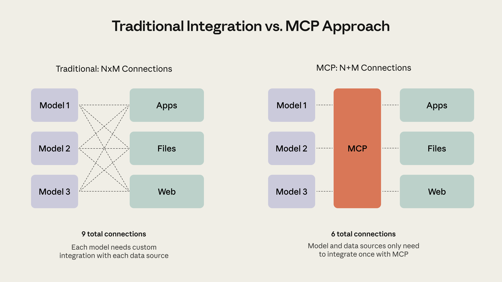
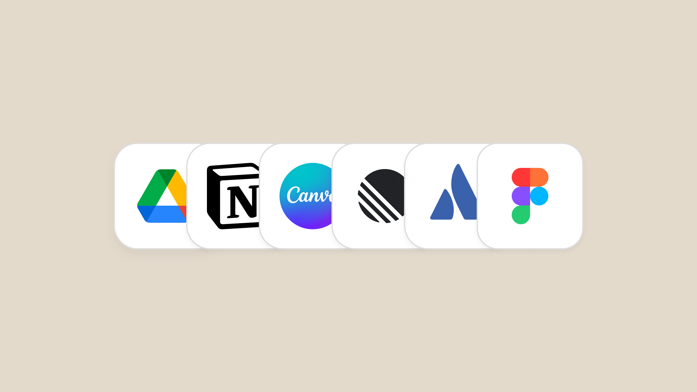

# B08_What is Model Context Protocol? Connect AI to your world_什么是模型上下文协议（MCP）？把 AI 连接到你的世界

> 原文：https://claude.com/blog/what-is-model-context-protocol
> 来源：Anthropic Claude Blog（分类：Platform ｜ 产品：MCP / Connectors）｜发布日期：2025-10-31
> 原文存档：[Markdown](原文/B08_what-is-model-context-protocol_原文.md)

## 📌 本篇速览

- 📅 2025-10-31　｜　⏱ 原文约 1440 词（逐句精读约 18 分钟）
- 🏷 MCP、USB-C 类比、M×N 问题、MCP Client/Server、Connectors、开放标准
- 🗂 [返回目录](00_目录与阅读进度.md)

MCP 的官方科普定义文（面试一句话答案的标准出处）。**定义**：MCP 是定义 LLM 如何与外部系统通信的开放标准；**类比**：LLM 的 USB-C——统一连接器取代每家一根线；**起源**：Anthropic 的 David Soria Parra 受「在 Claude Desktop 和 IDE 之间反复复制代码」之苦，识别出经典 **M×N 问题**（M 个应用 × N 个集成），与 Justin Spahr-Summers 参照 **Language Server Protocol** 设计，2024 年 11 月开源；**结构**：两侧——AI 应用实现 **MCP Client**，工具方提供 **MCP Server**，一次实现、全生态互通（M×N → M+N）；**价值三层**：通用兼容、开放生态（社区数千 servers）、Agent 的基础设施（端到端任务自动化的地基）。Claude 里的产品化形态叫 **Connectors**。

---

AI models are only as good as the context provided to them.

AI 模型的好坏，取决于提供给它的上下文。

AI assistants like Claude can answer questions and perform an impressive range of tasks, but if they can't access the data or tools they need, they're limited in what they can do for you.

像 Claude 这样的 AI 助手能回答问题、完成种类惊人的任务，但如果拿不到需要的数据或工具，它们能为你做的事就很有限。

You typically solve this by copying and pasting context from one tab to another, whether it's editing a document in Google Drive, replying to a thread in Slack, or updating code in an IDE.

你通常的解决办法是在标签页之间复制粘贴上下文——不管是在 Google Drive 编辑文档、在 Slack 回复讨论串，还是在 IDE 里改代码。

This process is slow, manual, and risks leaving out important context.

这个过程缓慢、纯手动，还容易漏掉重要上下文。

The **Model Context Protocol (MCP)** offers a solution that is open and widely available across all AI apps and assistants.

**模型上下文协议（Model Context Protocol，MCP）**提供了一个开放的、在所有 AI 应用和助手间广泛可用的解决方案。

In this article, you'll learn what MCP is, how it works and why it matters, and who it's for.

本文将带你了解 MCP 是什么、如何工作、为什么重要、为谁而生。

You'll see examples of MCP in action and understand how you can start using or building with MCP today.

你会看到 MCP 的实际应用案例，并了解今天就能怎样开始使用或基于 MCP 构建。

## What is the Model Context Protocol (MCP)?

## 什么是模型上下文协议（MCP）？

The **Model Context Protocol** is an open standard that defines how LLMs communicate with external systems.

**模型上下文协议**是一个开放标准，定义 LLM 如何与外部系统通信。

Think of MCP as **USB-C for LLMs**.

可以把 MCP 想成 **LLM 的 USB-C**。

Just as USB-C provides a universal connector for your phone, laptop, and other devices, MCP provides a universal format for LLMs to connect with external systems.

正如 USB-C 为手机、笔记本和其他设备提供通用接口，MCP 为 LLM 连接外部系统提供了通用格式。

Before USB-C, every electronic gadget had its own cable: Lightning for iPhone, micro-USB for Android, proprietary connectors for cameras.

USB-C 之前，每个电子设备都有自己的线：iPhone 用 Lightning，Android 用 micro-USB，相机用各家私有接口。

As more devices adopted USB-C, connectivity became seamless across the ecosystem.

随着越来越多设备采用 USB-C，整个生态的连接变得无缝。

MCP brings this same simplicity to AI integrations.

MCP 把同样的简单性带给了 AI 集成。

Before MCP, every application and database required custom code to connect with LLMs.

MCP 之前，每个应用和数据库都需要定制代码才能连接 LLM。

Google Drive needed its own integration, Slack needed another, Figma yet another.

Google Drive 要一套集成，Slack 要另一套，Figma 又是一套。

Now, MCP provides a single, standardized format for connecting these tools to Claude and other AI applications.

现在，MCP 提供了单一的标准化格式，把这些工具连接到 Claude 和其他 AI 应用。

## Where did MCP come from?

## MCP 从哪来？

MCP was created at Anthropic by David Soria Parra and Justin Spahr-Summers.

MCP 由 Anthropic 的 David Soria Parra 和 Justin Spahr-Summers 创造。

The idea originated from David's frustration with constantly copying code between Claude Desktop and his Integrated Development Environment (IDE).

想法源自 David 的一个烦恼：不停地在 Claude Desktop 和 IDE 之间复制代码。

Recognizing this as a classic M×N problem where multiple applications need multiple integrations, David pitched building a protocol to solve this to Justin.

David 意识到这是经典的 M×N 问题——多个应用需要多套集成——于是向 Justin 提议做一个协议来解决它。

They designed MCP based on the popular Language Server Protocol and open-sourced it in November 2024 with Anthropic's support to ensure the entire AI ecosystem could benefit.

他们参照广受欢迎的语言服务器协议（Language Server Protocol）设计了 MCP，并在 Anthropic 支持下于 2024 年 11 月开源，确保整个 AI 生态都能受益。

## How does MCP work?

## MCP 如何工作？

MCP works through a two-sided approach.

MCP 采用双边结构。

AI agents and chatbots like Claude create **MCP Clients**, so they can connect to applications like Notion, Canva, or Figma, who make their tools and data available through **MCP Servers**.

Claude 这类 AI 智能体和聊天机器人实现 **MCP 客户端（Client）**，以便连接 Notion、Canva、Figma 这类应用——后者通过 **MCP 服务器（Server）**开放自己的工具和数据。

By building an **MCP Client**, AI agents and chatbots can access thousands of MCP Servers built by the community, giving them a straightforward path to extend their capabilities.

实现一个 **MCP 客户端**，AI 智能体就能访问社区构建的数千个 MCP 服务器，获得一条直接扩展能力的路径。

Agents can also reach MCP servers behind your firewall through MCP tunnels.

智能体还能通过 MCP 隧道（tunnels）访问你防火墙后面的 MCP 服务器。

By building an **MCP Server**, companies and developers can make their products readily available to AI, creating a new avenue to provide value.

构建一个 **MCP 服务器**，公司和开发者就能让自己的产品对 AI 随取随用，开辟提供价值的新渠道。

As MCP is open-source, anyone can build an MCP Server or Client.

由于 MCP 开源，任何人都可以构建 MCP 服务器或客户端。

## Why is MCP important?

## MCP 为什么重要？

MCP allows LLMs to go beyond chat and perform real-world tasks: reading an email thread and sending a reply, accessing a codebase and deploying an update, or reviewing a design brief and generating a first draft.

MCP 让 LLM 超越聊天、执行真实世界的任务：读邮件线程并回复、访问代码库并部署更新、审阅设计简报并生成初稿。

The protocol creates a foundation for LLMs to connect with external systems, tools, and applications to access data and take actions.

这个协议为 LLM 连接外部系统、工具和应用（获取数据并采取行动）打下了地基。

This provides:

它带来：

### Universal compatibility for AI

### AI 的通用兼容性

**AI assistants gain access to thousands of tools** — Once an AI assistant implements MCP (via an MCP client), it can instantly connect to thousands of MCP-compatible applications, from specialized coding tools to enterprise workflow platforms, without building custom integrations for each one.

**AI 助手获得数千个工具的访问权**——AI 助手一旦实现 MCP（通过 MCP 客户端），就能立刻连接数千个 MCP 兼容应用，从专业编程工具到企业工作流平台，无需为每个单独定制集成。

**Tools and applications connect to every AI assistant at once** — Companies like Notion, Figma, or Asana build a single MCP server that works with any AI assistant that's compatible (i.e. has implemented an MCP client).

**工具和应用一次接入所有 AI 助手**——Notion、Figma、Asana 这类公司只需构建一个 MCP 服务器，就能兼容任何实现了 MCP 客户端的 AI 助手。

Developers only need to build one integration for all AI connections.

开发者只需构建一次集成，就覆盖所有 AI 连接。

### An Open, AI-native ecosystem

### 开放的 AI 原生生态

**Anyone can build and share** — As an open standard, MCP servers published by developers or companies are compatible with any MCP client.

**任何人都能构建和分享**——作为开放标准，开发者或公司发布的 MCP 服务器与任何 MCP 客户端兼容。

This openness has created a thriving ecosystem of thousands of community-built servers, accelerating the availability of tools and applications for AI assistants.

这种开放性催生了繁荣的生态：数千个社区构建的服务器，加速了 AI 助手可用工具和应用的丰富。

**Makes software AI-accessible by design** — Traditional software is built for humans using web interfaces.

**让软件在设计上就对 AI 可用**——传统软件是为使用网页界面的人类构建的。

MCP provides a parallel interface designed for AI interaction, allowing applications to become truly AI-native.

MCP 提供了一个专为 AI 交互设计的并行接口，让应用变得真正 AI 原生。

This means better, more reliable integrations between AI models and the tools people already use.

这意味着 AI 模型与人们已在使用的工具之间，有了更好、更可靠的集成。

### A foundational protocol for agents

### 智能体的基础协议

MCP creates the infrastructure for AI agents to access any number of services and tools, creating true end-to-end task automation.

MCP 为 AI 智能体访问任意数量的服务和工具创建了基础设施，实现真正的端到端任务自动化。

As more applications adopt the protocol, the vision of AI agents that can independently handle complex, multi-step workflows becomes increasingly practical.

随着更多应用采纳该协议，「AI 智能体独立处理复杂多步工作流」的愿景越来越接近现实。

## Who is MCP for?

## MCP 为谁而生？

Developers get a standardized way to build integrations once and have them work with any compatible AI.

开发者获得一种标准化方式：集成只建一次，任何兼容的 AI 都能用。

Enterprises gain secure, IT-controlled AI connectivity that scales across their organization.

企业获得安全、由 IT 管控、可在组织内扩展的 AI 连接能力。

Consumers can connect their favorite tools to AI instantly, with no technical knowledge required.

普通用户可以把喜欢的工具即刻连接到 AI，无需任何技术知识。

### For developers: one standard for connecting AI to applications

### 对开发者：连接 AI 与应用的统一标准

Developers can follow a single standard to connect external products to your AI applications and agents.

开发者可以遵循单一标准，把外部产品连接到自己的 AI 应用和智能体。

This simplifies the process of building integrations, grows the number of available products to connect to, and improves the overall quality and security of connectivity in the ecosystem.

这简化了集成构建流程、扩大了可连接产品的数量，并提升了整个生态连接的质量与安全。

Building an agent that will connect to many applications? Building an application that will connect to many agents?

在构建一个要连接许多应用的智能体？还是在构建一个要连接许多智能体的应用？

MCP provides you with access to an ecosystem of compatible tools with streamlined integration.

MCP 都能让你以顺畅的集成方式接入一个兼容工具的生态。

### For enterprises: secure, scalable AI connectivity across your organization

### 对企业：安全、可扩展的组织级 AI 连接

Enterprises can drive internal adoption of AI tools and applications more effectively, as MCP simplifies the process of connecting your systems to AI.

MCP 简化了「把你的系统连上 AI」的过程，企业因此能更有效地推动内部 AI 工具和应用的采纳。

This helps make AI more connected within your organization, expanding its capabilities and usefulness for your staff.

这让 AI 在组织内更加互联，扩展它对员工的能力与用处。

### For consumers: instant access to your favorite tools

### 对普通用户：即刻连接你喜欢的工具

MCP provides end-users with seamless connectivity between their favorite AI assistants and work tools.

MCP 为最终用户提供了喜爱的 AI 助手与工作工具之间的无缝连接。

It makes it easier to automate tasks and avoid copying and pasting across tabs.

它让自动化任务更容易，免去跨标签页的复制粘贴。

In short, MCP gives AI greater access and connectivity to your world.

简言之，MCP 让 AI 对你的世界有了更大的访问与连接能力。

In Claude, you can instantly connect to MCP Servers, known as **Connectors**.

在 Claude 里，你可以即刻连接 MCP 服务器——产品化形态叫 **Connectors（连接器）**。

This provides you with a straightforward way to connect Claude to your favorite work apps.

它给你提供了把 Claude 连上常用工作应用的直接方式。

## Connectors (MCP) in action

## Connectors（MCP）实战

The real value of MCP becomes clear when you see it in action with the tools you already use.

当你看到 MCP 与你已在用的工具协同工作时，它的真正价值就清楚了。

Here are some examples of MCP being used to power integrations in Claude, known as **Connectors**:

以下是 MCP 在 Claude 中驱动集成（即 **Connectors**）的一些例子：

### Canva in Claude

### Claude 里的 Canva

The Canva Connector allows Claude to generate new designs directly within Canva.

Canva 连接器让 Claude 能直接在 Canva 里生成新设计。

Using MCP, Claude can connect to the tools Canva provides to generate designs on the canvas.

通过 MCP，Claude 可以连接 Canva 提供的工具，在画布上生成设计。

### Notion and Linear in Claude

### Claude 里的 Notion 与 Linear

Using the Notion and Linear Connectors, Claude can access your pages in Notion and use them to update tickets in Linear.

通过 Notion 和 Linear 连接器，Claude 能访问你在 Notion 的页面，并用它们更新 Linear 里的工单。

Here MCP creates a seamless transfer of unstructured context into organized tickets in a separate project management system.

在这里，MCP 把非结构化上下文无缝转化为另一个项目管理系统里条理清晰的工单。

### Figma in Claude Code

### Claude Code 里的 Figma

The Figma Connector allows Claude to access designs within Figma.

Figma 连接器让 Claude 能访问 Figma 里的设计。

This lets Claude Code create working prototypes of websites, applications, or user interfaces based on designs created in Figma.

这让 Claude Code 能基于 Figma 里的设计，做出网站、应用或用户界面的可运行原型。

### Available Claude Connectors

### 可用的 Claude 连接器

Claude Connectors include integrations for:

Claude 连接器包括这些集成：

- **Notion** for workspace documentation

- **Notion**：工作区文档

- **Linear** for issue tracking

- **Linear**：问题追踪

- **Stripe** for payment data

- **Stripe**：支付数据

- **Canva** and **Figma** for design assistance

- **Canva** 与 **Figma**：设计辅助

- **Hubspot** for automating CRM tasks

- **Hubspot**：CRM 任务自动化

- **Sentry** for error tracking

- **Sentry**：错误追踪

- ...and many more

- ……以及更多

Each connector takes just a few seconds to configure to become part of Claude's working context.

每个连接器只需几秒配置，就能成为 Claude 工作上下文的一部分。

Outside of Claude, there is an ecosystem of MCP servers on the open-source MCP Registry.

在 Claude 之外，开源的 MCP Registry 上还有一个 MCP 服务器生态。

## Start exploring MCP

## 开始探索 MCP

Two paths exist based on your needs.

按需求有两条路径。

### Connectors in Claude

### Claude 里的 Connectors

Connectors are pre-built, giving Claude instant access to tools, databases, and applications, and providing you with a new set of capabilities.

Connectors 是预构建的，让 Claude 即刻访问工具、数据库和应用，为你提供一组新能力。

Open Claude, browse available connectors, and click to add them.

打开 Claude，浏览可用连接器，点击添加即可。

### Build custom MCP connections

### 构建自定义 MCP 连接

MCP is open-source, meaning that anyone can adopt MCP to connect AI to applications.

MCP 是开源的，任何人都可以采用 MCP 把 AI 连接到应用。

The Model Context Protocol documentation walks through how to build with MCP.

MCP 官方文档详细讲解了如何基于 MCP 构建。

## Getting started

## 快速上手

If you want to try MCP, start by browsing for a Claude Connector you can immediately start using with Claude.

想试 MCP，先从浏览可以立刻在 Claude 里用起来的连接器开始。

If an existing MCP server doesn't already exist, creating your own takes some work, but isn't too complex if you know TypeScript or Python.

如果还不存在现成的 MCP 服务器，自己写一个需要一些工作量，但只要你会 TypeScript 或 Python，并不算复杂。

The Model Context Protocol quickstart has working examples you can modify for your needs.

MCP 快速上手指南里有可以按需修改的可运行示例。

---

## 术语中英对照表

| 英文 | 中文 | 备注 |
|---|---|---|
| Model Context Protocol (MCP) | 模型上下文协议 | 定义 LLM 与外部系统通信的开放标准 |
| USB-C for LLMs | LLM 的 USB-C | 官方标准类比 |
| M×N problem | M×N 问题 | M 个应用 × N 个集成 → MCP 化为 M+N |
| Language Server Protocol (LSP) | 语言服务器协议 | MCP 的设计参照 |
| MCP Client / MCP Server | MCP 客户端 / 服务器 | 双边结构：AI 侧实现 Client，工具侧提供 Server |
| MCP tunnels | MCP 隧道 | 访问防火墙后服务器的通道 |
| Connectors | 连接器 | MCP 在 Claude 里的产品化名称 |
| MCP Registry | MCP 注册表 | 开源服务器目录（modelcontextprotocol.io） |
| AI-native | AI 原生 | 为 AI 交互专门设计的并行接口 |
