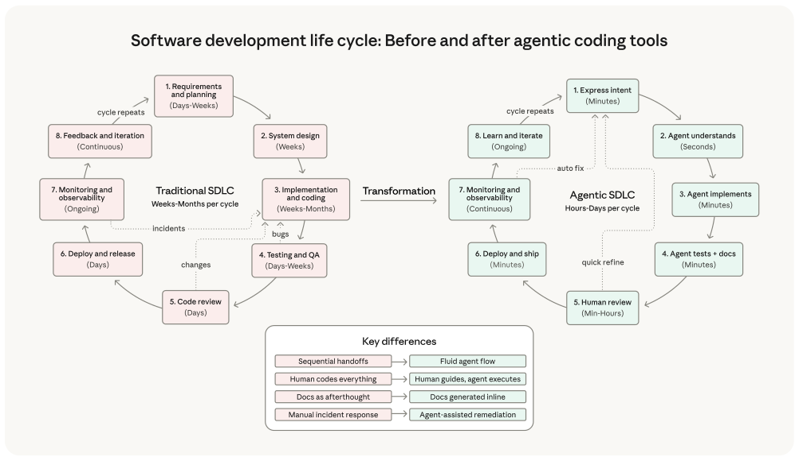
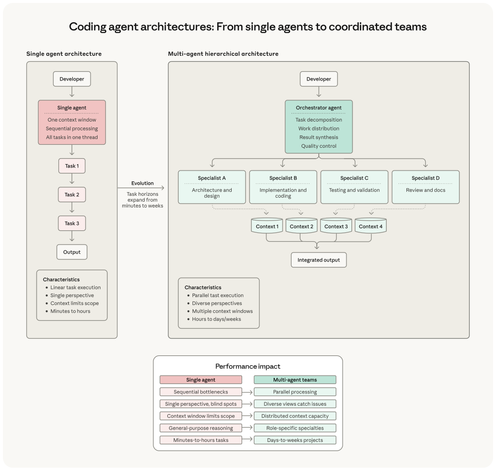

# B11_2026 Agentic Coding Trends Report_2026 智能体编码趋势报告

> 原文落地页：https://resources.anthropic.com/2026-agentic-coding-trends-report
> PDF：https://resources.anthropic.com/hubfs/2026%20Agentic%20Coding%20Trends%20Report.pdf
> 来源：Anthropic 官方年度报告（18 页）｜发布：2026

## 📌 本篇速览

- 📅 2026　｜　⏱ 约 12 分钟　｜　📄 约 2,100 词 / 18 页 PDF
- 🏷 Agentic Coding、多智能体协同、长时程 Agent、人机协作、委派鸿沟、软件开发经济学
- 🗂 [返回目录](00_目录与阅读进度.md)

Anthropic 官方年度报告，预测 2026 年定义智能体编码（agentic coding）的八大趋势，分三层展开：基础趋势（软件开发生命周期剧变）、能力趋势（单 Agent 演进为协同团队、长时程 Agent 构建完整系统、人工监督智能扩展、扩展到新界面与新用户）、影响趋势（生产力重塑开发经济学、非技术场景全组织扩散、安全攻防双刃剑）。全文最关键的数据是「委派鸿沟」：开发者约 60% 的工作用到 AI，但能「完全委派」的任务只有 0–20%——官方定调是「高度协作，而非完全委派」。报告穿插 Augment Code、Fountain、Rakuten、CRED、Legora、TELUS、Zapier 及 Anthropic 法务团队等一手案例数据，结尾给出组织 2026 年的四项优先事项。

---

## 2026 Agentic Coding Trends Report|2026 智能体编码趋势报告

How coding agents are reshaping software development

编码智能体（coding agent）如何重塑软件开发

## Foreword: From assistance to collaboration|前言：从辅助到协作

In 2025, coding agents moved from experimental tools to production systems that ship real features to real customers.

2025 年，编码智能体从实验性工具变成了向真实客户交付真实特性的生产系统。

Engineering teams discovered that AI can now handle entire implementation workflows: writing tests, debugging failures, generating documentation, and navigating increasingly complex codebases.

工程团队发现，AI 如今已能接管完整的实现工作流：编写测试、调试失败、生成文档，以及在日益复杂的代码库中导航。

In 2026, we predict these gains will extend far beyond incremental improvements to existing tools or models.

我们预测，到 2026 年，这些收益将远远超出对现有工具或模型的增量改进。

We expect single agents to become coordinated teams of agents.

我们预期单个智能体将演变为协同运作的智能体团队。

Tasks that took hours or days may now be completed with minimal human intervention.

过去需要数小时甚至数天的任务，现在可能只需极少的人工介入即可完成。

And engineers who, only a few years ago, wrote every line of code will increasingly orchestrate long-running systems of agents that handle implementation details so they can focus on architecture and strategy.

而几年前还在逐行编写代码的工程师，将越来越多地编排（orchestrate）长时程运行的智能体系统，让它们处理实现细节，自己则专注于架构与战略。

Yet a critical nuance has emerged from studying how developers actually work with AI: this transformation is fundamentally collaborative.

然而，通过研究开发者与 AI 的实际协作方式，一个关键的细微差别浮现出来：这场变革本质上是协作式的。

Research from our Societal Impacts team reveals that while developers use AI in roughly 60% of their work, they report being able to "fully delegate" only 0-20% of tasks.

我们社会影响团队（Societal Impacts team）的研究显示：开发者约 60% 的工作用到了 AI，但他们报告能「完全委派」（fully delegate）的任务只有 0–20%。

AI serves as a constant collaborator, but using it effectively requires thoughtful set-up and prompting, active supervision, validation, and human judgment—especially for high-stakes work.

AI 是一个常驻协作者（constant collaborator），但要用好它，需要周到的设置与提示、主动监督、验证，以及人的判断——尤其是在高风险工作中。

Inspired by our own experiences working with customers, this report identifies eight trends we predict will define agentic coding in 2026.

基于我们服务客户的一手经验，本报告提出了我们预测将在 2026 年定义智能体编码的八个趋势。

These predictions fall into three categories: foundation trends that we believe will reshape how development work happens, capability trends that look to expand what agents can accomplish, and impact trends that we anticipate will affect business outcomes and organizational structures.

这些预测分为三类：基础趋势（foundation trends）——我们认为将重塑开发工作的运作方式；能力趋势（capability trends）——着眼于扩展智能体能完成的事情；影响趋势（impact trends）——我们预期将影响业务成果与组织结构。

These predictions reflect what we're seeing with customers today, not certainties about tomorrow.

这些预测反映的是我们今天在客户身上看到的情况，而不是对明天的确定性断言。

We offer them as a framework for thinking about the year ahead, knowing the future will surprise us.

我们把它们作为思考来年的一个框架呈现，同时深知未来总会让我们意外。

Significantly, these trends illustrate how the gap between early adopters and late movers is widening.

值得注意的是，这些趋势表明，早期采用者与后来者之间的差距正在拉大。

Organizations that figure out how to scale human oversight without creating bottlenecks are better positioned to maintain quality while moving faster.

那些想明白如何在不制造瓶颈的前提下规模化人工监督的组织，更有条件在提速的同时保住质量。

Teams that master agent coordination across the software development lifecycle today can ship features in hours instead of days.

今天就掌握了跨软件开发生命周期（software development lifecycle，SDLC）智能体协调的团队，交付特性可以从「天」缩短到「小时」。

Companies that extend agentic coding beyond engineering teams to less technical roles stand to unlock productivity gains across their entire organization.

把智能体编码从工程团队扩展到技术含量较低岗位的公司，有望在整个组织范围内解锁生产力收益。

The patterns emerging in 2026 suggest software development is evolving toward a model where human expertise focuses on defining the problems worth solving while AI handles the tactical work of implementation.

2026 年正在浮现的模式表明，软件开发正在演化为一种新范式：人的专长聚焦于定义值得解决的问题，而 AI 处理实现层面的战术工作。

Let's dive in.

让我们展开来看。

## Foundation trends: The tectonic shift|基础趋势：构造性变动

### Trend 1: The software development lifecycle changes dramatically|趋势一：软件开发生命周期剧变

The way we interact with computers is undergoing one of its most significant changes since the graphical user interface.

我们与计算机交互的方式，正在经历自图形用户界面（graphical user interface）以来最重大的变化之一。

From machine code to assembly to C to modern high-level languages, each abstraction layer reduced the gap between human thought and machine execution.

从机器码到汇编，到 C，再到现代高级语言，每一个抽象层都在缩小人类思维与机器执行之间的鸿沟。

The most recent step in this evolution was human/machine conversation.

这一演化中最近的一步，是人机对话。

In 2025, agentic AI changed how a large swath of developers write code.

2025 年，智能体式 AI（agentic AI）改变了一大批开发者编写代码的方式。

2026 is poised to be the year when the systemic effects of this evolutionary shift reconfigure the software development lifecycle and reshape software engineering roles.

2026 年很可能就是这场演化转变的系统性效应重构软件开发生命周期、重塑软件工程角色的一年。

Traditional SDLC stages remain, but agent-driven implementation, automated testing, and inline documentation collapse cycle time from weeks to hours.

传统 SDLC 各阶段仍然存在，但智能体驱动的实现、自动化测试和内联文档，把周期时间从数周压缩到数小时。

Monitoring feeds directly back into rapid iteration.

监控则直接回流到快速迭代中。

#### Predictions|预测

- Evolution of abstraction: Most of the tactical work of writing, debugging, and maintaining code shifts to AI while engineers focus on higher-level work like architecture, system design, and strategic decisions about what to build.

- 抽象层的演进：编写、调试和维护代码的战术性工作大多转移给 AI，工程师则专注于更高层次的工作，如架构、系统设计，以及「该构建什么」的战略决策。

- Engineering role transformation: Building software used to mean primarily writing code, although software engineering roles always involved many other skills. Now, being a software engineer increasingly means orchestrating agents that write code, evaluating their output, providing strategic direction, and ensuring the system as a whole solves the right problems correctly.

- 工程角色转型：构建软件过去主要意味着写代码，尽管软件工程岗位向来涉及许多其他技能。如今，做一名软件工程师越来越意味着编排写代码的智能体、评估它们的产出、提供战略方向，并确保系统作为一个整体正确地解决了正确的问题。

- Expedited onboarding to dynamic project staffing: Traditional timelines for onboarding to a new codebase or project will collapse from weeks to hours, changing how companies think about talent deployment and project resourcing.

- 从加速上手到动态项目配员：熟悉新代码库或新项目的传统时间线将从数周坍缩到数小时，从而改变公司对人才调配与项目资源分配的思考方式。

#### The collaborative reality|协作的现实

While agents handle more implementation work, the nature of this shift reveals something important: engineers are becoming more "full-stack" in their capabilities rather than being replaced.

虽然智能体承担了更多实现工作，但这一转变的本质揭示了一个重要事实：工程师的能力正在变得更「全栈」（full-stack），而不是被取代。

Our research shows engineers can now work effectively across frontend, backend, databases, and infrastructure—areas where they may have previously lacked expertise—because AI fills in knowledge gaps while humans provide oversight and direction.

我们的研究显示，工程师现在能够有效地跨足前端、后端、数据库和基础设施——这些可能是他们此前并不擅长的领域——因为 AI 补上了知识缺口，而人则提供监督和方向。

This capability expansion enables tighter feedback loops and faster learning.

这种能力扩展带来了更紧密的反馈回路和更快的学习。

Tasks that once required weeks of cross-team coordination can become focused working sessions.

过去需要数周跨团队协调的任务，可以变成几场专注的工作会话。

Engineers describe using AI for tasks that are easily verifiable, well-defined, or repetitive, while keeping high-level design decisions and anything requiring organizational context or "taste" for themselves.

工程师们描述说，他们把容易验证、定义明确或重复性的任务交给 AI，而把高层设计决策，以及任何需要组织上下文或「品味」（taste）的事情留给自己。

#### Role transformation: From implementer to orchestrator|角色转型：从实现者到编排者

In 2026, the value of an engineer's contributions shifts to system architecture design, agent coordination, quality evaluation, and strategic problem decomposition.

2026 年，工程师贡献的价值转向系统架构设计、智能体协调、质量评估和战略性问题分解。

The primary human role in building software is orchestrating AI agents that write code, evaluating their output, providing strategic direction, and ensuring the system solves the right problems for the right stakeholders.

在构建软件中，人的首要角色是编排写代码的 AI 智能体、评估它们的产出、提供战略方向，并确保系统为正确的利益相关者解决了正确的问题。

Engineers who master orchestration can shepherd multiple features through development simultaneously, applying their judgment across a broader scope than individual implementation previously allowed.

掌握编排的工程师可以同时护送多个特性走完开发流程，把自己的判断力施展在比过去逐个实现宽广得多的范围上。

#### Onboarding revolution|上手方式的革命

In 2025, the traditional timeline for onboarding to a new codebase or project began to collapse from weeks to hours.

2025 年，熟悉新代码库或新项目的传统时间线已经开始从数周坍缩到数小时。

In 2026, we anticipate organizations learning how to use this capability to its fullest, changing how companies think about talent deployment and project resourcing.

2026 年，我们预期各组织将学会把这一能力用到极致，从而改变公司对人才调配与项目资源分配的思考方式。

One manifestation we envision is dynamic "surge" staffing.

我们设想的一种表现形式是动态的「涌入式」（surge）配员。

Businesses will be able to surge engineers on-demand onto tasks requiring deep codebase knowledge.

企业将能够按需把工程师快速投入到需要深度代码库知识的任务上。

Organizations can start staffing projects dynamically, bringing in specialists for specific challenges and shifting resources without the traditional productivity dip.

组织可以开始动态地为项目配员，针对特定挑战引入专家、调动资源，而不会出现传统上的生产力低谷。

Augment Code, a startup building AI-powered software development tools for systems like networking platforms, databases, and storage infrastructure, flattened the learning curve for engineers joining a new codebase or project by using Claude to provide contextual code understanding.

Augment Code 是一家为网络平台、数据库、存储基础设施等系统构建 AI 驱动软件开发工具的创业公司，它通过用 Claude 提供上下文化的代码理解，抹平了工程师加入新代码库或新项目时的学习曲线。

One enterprise customer finished a project that their CTO had initially estimated would take 4 to 8 months in just two weeks using Augment Code, powered by Claude.

一家企业客户使用由 Claude 驱动的 Augment Code，仅用两周就完成了一个其 CTO 最初预估需要 4 到 8 个月的项目。

## Capability trends: What agents can do|能力趋势：智能体能做什么

### Trend 2: Single agents evolve into coordinated teams|趋势二：单个智能体演进为协同团队

We predict that organizations in 2026 will be able to harness multiple agents acting together to handle task complexity that was difficult to imagine just a year ago.

我们预测，2026 年各组织将能够驾驭多个协同运作的智能体，处理仅一年前还难以想象的任务复杂度。

This ability will require new skills in task decomposition, agent specialization, and coordination protocols, along with development environments that show the status of multiple concurrent agent sessions and version control workflows that handle simultaneous agent-generated contributions.

这一能力将需要任务分解、智能体专业化和协调协议方面的新技能，同时还需要能展示多个并发智能体会话状态的开发环境，以及能处理智能体同时产出贡献的版本控制工作流。

#### Prediction|预测

- Multi-agent systems replace single-agent workflows: Organizations adopt multi-agent workflows that maximize performance gains through parallel reasoning across separate context windows.

- 多智能体系统取代单智能体工作流：组织采用多智能体（multi-agent）工作流，通过在相互独立的上下文窗口中并行推理，把性能收益最大化。

Fountain, a frontline workforce management platform, achieved 50% faster screening, 40% quicker onboarding, and 2x candidate conversions using Claude for hierarchical multi-agent orchestration.

Fountain 是一个一线劳动力管理平台，它使用 Claude 进行分层多智能体编排，实现了筛选提速 50%、入职提速 40%、候选人转化率翻倍。

Their Fountain Copilot serves as the central orchestration agent to coordinate specialized sub-agents for candidate screening, automated document generation, and sentiment analysis.

他们的 Fountain Copilot 充当中央编排智能体，协调负责候选人筛选、自动文档生成和情感分析的各个专业化子智能体（sub-agent）。

This architecture enabled one logistics customer to cut the time required to fully staff a new fulfillment center from one or more weeks to less than 72 hours.

这一架构让一家物流客户把为新履约中心配齐人手所需的时间，从一周以上缩短到不足 72 小时。

Single-agent workflows process tasks sequentially through one context window.

单智能体工作流通过单一上下文窗口顺序地处理任务。

Multi-agent architectures use an orchestrator to coordinate specialized agents working in parallel—each with dedicated context—then synthesize results into integrated output.

多智能体架构则使用一个编排器（orchestrator）来协调并行工作的专业化智能体——每个都拥有专属上下文——然后把结果综合成整合后的输出。

### Trend 3: Long-running agents build complete systems|趋势三：长时程智能体构建完整系统

Early agents handled one-shot tasks that took a few minutes at most: fix this bug, write this function, generate this test.

早期的智能体处理的是最多几分钟的一次性任务：修这个 bug、写这个函数、生成这个测试。

By late 2025, increasingly adept AI agents were producing full feature sets over the course of several hours.

到 2025 年末，日益娴熟的 AI 智能体已经能在几个小时内产出完整的特性集。

In 2026, agents will be able to work for days at a time, building entire applications and systems with minimal human intervention focused on providing strategic oversight at key decision points.

2026 年，智能体将能够一次连续工作数天，构建完整的应用与系统，人工介入极少，且集中在关键决策点上提供战略性监督。

#### Predictions|预测

- Task horizons expand from minutes to days or weeks: Agents evolve from handling discrete tasks that complete in minutes to working autonomously for extended periods, building and testing entire applications and systems with periodic human checkpoints.

- 任务时程从分钟扩展到数天甚至数周：智能体从处理几分钟内完成的离散任务，演进为长时间自主工作，在周期性的人工检查点配合下构建并测试完整的应用与系统。

- Agents handle the messy reality of software development: Long-running agents plan, iterate, and refine across dozens of work sessions, adapting to discoveries, recovering from failures, and maintaining coherent state throughout complex projects.

- 智能体应对软件开发中混乱的现实：长时程运行的智能体在数十个工作会话中规划、迭代、打磨，适应新发现、从失败中恢复，并在复杂项目全程保持连贯的状态。

- Economics of software development change: When agents can work autonomously for extended periods, formerly non-viable projects become feasible. Technical debt that accumulated for years because no one had time to address it gets systematically eliminated by agents working through backlogs.

- 软件开发的经济学发生变化：当智能体能长时间自主工作时，原本不可行的项目变得可行。因为没人有时间处理而积累多年的技术债（technical debt），会被逐项清理积压工作的智能体系统性地消除。

- Path to market accelerates: Entrepreneurs use agents to go from ideas to deployed applications in days instead of months.

- 上市路径加速：创业者借助智能体，从想法到部署上线的应用只需数天，而非数月。

At Rakuten, engineers tested Claude Code's capabilities with a complex technical task: implement a specific activation vector extraction method in vLLM, a massive open-source library with 12.5 million lines of code in multiple programming languages.

在乐天（Rakuten），工程师用一个复杂的技术任务测试了 Claude Code 的能力：在 vLLM——一个拥有 1250 万行代码、涉及多种编程语言的大型开源库——中实现一种特定的激活向量提取方法。

Claude Code finished the entire job in seven hours of autonomous work in a single run.

Claude Code 在单次运行中，用七个小时的自主工作完成了全部任务。

The implementation achieved 99.9% numerical accuracy compared to the reference method.

与参考方法相比，该实现达到了 99.9% 的数值精度。

### Trend 4: Human oversight scales through intelligent collaboration|趋势四：人工监督通过智能协作实现规模化

Perhaps the most valuable capability developments in 2026 will be agents learning when to ask for help, rather than blindly attempting every task, and humans stepping into the loop only when required.

2026 年最有价值的能力进展，也许是智能体学会何时求助，而不是盲目尝试每个任务；而人只在必要时才介入回路。

This isn't about removing humans from the process—it's about making human attention count where it matters most.

这并不是要把人从流程中移除，而是要让人的注意力用在最要紧的地方。

#### Predictions|预测

- Agentic quality control becomes standard: Organizations use AI agents to review large-scale AI-generated output, analyzing code for security vulnerabilities, architectural consistency, and quality issues that would overwhelm human capacity.

- 智能体化的质量控制成为标配：组织使用 AI 智能体来审查大规模 AI 生成的产出，分析代码中的安全漏洞、架构一致性和质量问题——这些工作量早已超出人力所及。

- Agents learn when to ask for help: Rather than blindly attempting every task, sophisticated agents recognize situations requiring human judgment, flagging areas of uncertainty and elevating decisions with potential business impact.

- 智能体学会何时求助：成熟的智能体不再盲目尝试每个任务，而是识别出需要人类判断的情形，标记不确定的地方，并把可能有业务影响的决策上报。

- Human oversight shifts from reviewing everything to reviewing what matters: Teams maintain quality and velocity simultaneously by building intelligent systems that handle routine verification while escalating genuinely novel situations, boundary cases, and strategic decisions for human input.

- 人工监督从「审一切」转向「审要紧的」：团队通过构建智能系统来同时保住质量与速度——让系统处理例行验证，而把真正新颖的情形、边界情况和战略决策上报给人来处理。

#### The collaboration paradox|协作悖论

Research from Anthropic's internal studies reveals an important pattern: while engineers report using AI in roughly 60% of their work and achieving significant productivity gains, they also report being able to "fully delegate" only a small fraction of their tasks.

Anthropic 的内部研究揭示了一个重要模式：工程师报告约 60% 的工作用到了 AI 并获得显著的生产力提升，但他们同时也报告，能「完全委派」的任务只占很小一部分。

The apparent contradiction resolves when you understand that effective AI collaboration requires active human participation.

一旦理解了有效的 AI 协作本身就需要人的主动参与，这个表面上的矛盾就迎刃而解。

Engineers describe developing intuitions for AI delegation over time.

工程师们描述说，他们对「什么可以委派给 AI」的直觉是随时间练出来的。

As models improve, this is shifting quickly, but historically, they tended to delegate tasks that are easily verifiable—where they "can relatively easily sniff-check on correctness"—or are low-stakes, like quick scripts to track down a bug.

随着模型进步，这条界线正在快速移动；但从既往看，他们倾向于委派那些容易验证的任务——也就是「能比较轻松地嗅出对不对」的——或者低风险的任务，比如用来追查 bug 的临时脚本。

The more conceptually difficult or design-dependent a task, the more likely engineers keep it for themselves or work through it collaboratively with AI rather than handing it off entirely.

任务在概念上越难、越依赖设计判断，工程师就越可能自己留着做，或者与 AI 协作着推进，而不是整个交出去。

This pattern has important implications: even as AI capabilities expand, the human role remains central.

这个模式有重要的启示：即便 AI 能力不断扩展，人的角色依然处于中心位置。

The shift is from writing code to reviewing, directing, and validating AI-generated code.

转变在于：从写代码，变为审查、指导和验证 AI 生成的代码。

As one of our engineers put it: "I'm primarily using AI in cases where I know what the answer should be or should look like.

正如我们一位工程师所说：「我主要在自己知道答案应该是什么、或者应该长什么样的场景里用 AI。

I developed that ability by doing software engineering 'the hard way.'"

这种能力，是我当年『用笨办法』做软件工程练出来的。」

At CRED, a fintech platform serving over 15 million users across India, engineers implemented Claude Code across their entire development lifecycle to accelerate delivery while maintaining quality standards essential for financial services.

CRED 是一家在印度服务超过 1500 万用户的金融科技平台，其工程师在整个开发生命周期中部署了 Claude Code，在加速交付的同时保持金融服务所必需的质量标准。

The Claude-powered development system has doubled their execution speed—not by eliminating human involvement, but by shifting developers toward higher-value work.

这套由 Claude 驱动的开发系统让他们的执行速度翻倍——不是靠去掉人的参与，而是把开发者转移到更高价值的工作上。

### Trend 5: Agentic coding expands to new surfaces and users|趋势五：智能体编码扩展到新界面与新用户

The earliest wave of agentic coding focused on helping professional software engineers work faster within familiar environments.

智能体编码的最早一波浪潮，聚焦于帮助专业软件工程师在熟悉的环境里更快地工作。

In 2026, agentic coding is poised to expand into contexts and use cases that traditional development tools could not reach, from legacy languages to new form factors that democratize access beyond traditional developers.

2026 年，智能体编码将扩展到传统开发工具触及不到的场景和用例——从遗留语言，到让传统开发者之外的人也能用上的新形态产品（form factor）。

#### Predictions|预测

- Language barriers disappear: Support expands to less-common and legacy languages like COBOL, Fortran, and domain-specific languages, enabling maintenance of legacy systems and removing adoption barriers for specialized use cases.

- 语言壁垒消失：支持范围扩展到 COBOL、Fortran 等不常见的遗留语言以及领域特定语言（domain-specific language），使遗留系统的维护成为可能，并为专门化用例扫除采用障碍。

- Coding democratizes beyond engineering: New form factors and interfaces open up agentic coding to non-traditional developers in fields like cybersecurity, operations, design, and data science. Tools like Cowork, designed for non-developers to automate file and task management, signal this shift is already underway.

- 编码在工程之外走向大众化：新的产品形态和界面，把智能体编码开放给网络安全、运营、设计、数据科学等领域的非传统开发者。像 Cowork 这样为非开发者自动化文件与任务管理而设计的工具，表明这一转变已经在发生。

#### Everyone becomes more full-stack|每个人都变得更全栈

Analysis of how different teams use AI reveals a consistent pattern: people use AI to augment their core expertise while expanding into adjacent domains.

对不同团队如何使用 AI 的分析揭示了一个一致的模式：人们用 AI 增强自己的核心专长，同时向相邻领域扩展。

Security teams use it to analyze unfamiliar code.

安全团队用它分析陌生的代码。

Research teams use it to build frontend visualizations of their data.

研究团队用它为自己的数据构建前端可视化。

Non-technical employees use it for debugging network issues or performing data analysis.

非技术员工用它调试网络问题或做数据分析。

This expansion challenges the long-held assumption that serious development work can only happen in an IDE or that only professional engineers with specialized tools can use code to solve problems.

这种扩展挑战了两个长期以来的假设：正经的开发工作只能发生在 IDE 里；只有拿着专业工具的职业工程师才能用代码解决问题。

The barrier that separates "people who code" from "people who don't" is becoming more permeable.

把「会写代码的人」和「不会写代码的人」分隔开的那道屏障，正在变得越来越容易穿透。

At Legora, an AI-powered legal platform, agentic workflows are integrated throughout their legal technology platform, demonstrating how coding agents extend into domain-specific applications.

Legora 是一个 AI 驱动的法律平台，智能体工作流被整合进其法律科技平台的方方面面，展示了编码智能体如何延伸到领域特定的应用中。

"We have found Claude to be brilliant at instruction following, and at building agents and agentic workflows," said Max Junestrand, CEO of Legora.

「我们发现 Claude 在指令遵循、以及构建智能体和智能体工作流方面表现出色，」Legora 的 CEO Max Junestrand 说。

The company uses Claude Code to accelerate their own development while providing agentic capabilities to lawyers who need to create sophisticated automations without engineering expertise.

该公司使用 Claude Code 加速自身的开发，同时把智能体能力提供给那些需要在没有工程背景的情况下创建复杂自动化的律师。

## Impact trends: What agents may change in 2026|影响趋势：2026 年智能体可能改变什么

### Trend 6: Productivity gains reshape software development economics|趋势六：生产力提升重塑软件开发经济学

Organizations that intelligently integrate agents into their software development lifecycle will see timeline compression that affects what projects are viable and how quickly companies can respond to market opportunities.

聪明地把智能体整合进软件开发生命周期的组织，会看到时间线的压缩——这将影响哪些项目是可行的，以及公司能多快响应市场机会。

#### Predictions|预测

- Three multipliers drive acceleration: Agent capabilities, orchestration improvements, and better use of human experience compound to create step-function improvements rather than linear gains as each enables the others.

- 三个乘数驱动加速：智能体能力、编排改进、以及对人类经验的更好利用，三者相互赋能、复合叠加，带来阶跃式（step-function）改进，而非线性增益。

- Timeline compression changes project viability: Development that once took weeks now takes days, making previously unviable projects feasible and enabling organizations to respond to market opportunities more quickly.

- 时间线压缩改变项目可行性：过去要数周的开发现在只需数天，让原本不可行的项目变得可行，也让组织能更快地响应市场机会。

- Economics of software development shift: Total cost of ownership decreases as agents augment engineer capacity, project timelines shorten, and faster time to value improves return on investment.

- 软件开发的经济学发生转变：随着智能体扩充工程师产能、项目时间线缩短、更快的价值兑现时间（time to value）改善投资回报率，总拥有成本（total cost of ownership）随之下降。

#### Productivity through output volume, not just speed|生产力来自产出总量，而不只是速度

Internal research at Anthropic reveals an interesting productivity pattern: engineers report a net decrease in time spent per task category, but a much larger net increase in output volume.

Anthropic 的内部研究揭示了一个有趣的生产力模式：工程师报告每类任务的耗时净减少，但产出总量的净增加要大得多。

This suggests that AI enables increased productivity primarily through greater output—more features shipped, more bugs fixed, more experiments run—rather than simply doing the same work faster.

这表明，AI 提升生产力主要靠的是更大的产出——交付更多特性、修复更多 bug、跑更多实验——而不只是把同样的工作做得更快。

Notably, about 27% of AI-assisted work consists of tasks that wouldn't have been done otherwise: scaling projects, building nice-to-have tools like interactive dashboards, and exploratory work that wouldn't be cost-effective if done manually.

值得注意的是，约 27% 的 AI 辅助工作是那些没有 AI 就根本不会去做的任务：扩展项目规模、构建交互式仪表盘这类「有了更好」的工具，以及手工去做根本不划算的探索性工作。

Engineers report fixing more "papercuts"—minor issues that improve quality of life but are typically deprioritized—because AI makes addressing them feasible.

工程师们报告说，他们修复了更多「小刺」（papercuts）——那些能改善体验但通常被降级搁置的小问题——因为 AI 让处理它们变得可行。

At TELUS, a leading communications technology company, teams created over 13,000 custom AI solutions while shipping engineering code 30 percent faster.

在领先的通信科技公司 TELUS，各团队创建了超过 13,000 个定制 AI 解决方案，同时工程代码交付速度提升 30%。

The company has saved over 500,000 hours with an average of 40 minutes saved per AI interaction.

该公司已累计节省超过 50 万小时，平均每次 AI 交互节省 40 分钟。

### Trend 7: Non-technical use cases expand across organizations|趋势七：非技术用例在组织中全面扩散

We anticipate that one of the most significant trends in 2026 will be steady growth in agentic coding used by functional and business-process teams to create their own solutions to problems they experience, and improvements to processes they use every day.

我们预计，2026 年最重要的趋势之一，将是职能与业务流程团队使用智能体编码的稳步增长——他们为自己亲历的问题创建解决方案，改进自己每天使用的流程。

#### Predictions|预测

- Coding capabilities democratize beyond engineering: Non-technical teams across sales, marketing, legal, and operations gain the ability to automate workflows and build tools with little or no engineering intervention or coding expertise.

- 编码能力在工程之外走向大众化：销售、市场、法务、运营等非技术团队获得自动化工作流和构建工具的能力，几乎或完全不需要工程介入或编码专长。

- Domain experts implement solutions directly: The hands-on experts who understand problems deeply gain confidence in using agents to initiate solutions themselves, removing the bottleneck of filing a ticket and then waiting for development teams.

- 领域专家直接落地解决方案：对问题理解最深的一线专家，有信心自己动手用智能体启动解决方案，消除「提工单、等开发团队」的瓶颈。

- Productivity gains extend across entire organizations: Problems not worth engineering time get solved, experimental workflows become trivial to attempt, and manual processes get automated.

- 生产力收益延伸到整个组织：不值得占用工程时间的问题得到解决，实验性的工作流变得随手可试，手工流程被自动化。

Zapier, a leading AI orchestration platform, has made agents accessible to all their employees.

Zapier 是一家领先的 AI 编排平台，它让全体员工都能使用智能体。

Design teams use Claude artifacts to rapidly prototype during customer interviews, showing design concepts in real-time that would normally take weeks to develop.

设计团队在客户访谈中使用 Claude artifacts 快速做原型，把通常需要数周才能开发出来的设计概念实时展示出来。

The company achieved 89 percent AI adoption across the entire organization with 800-plus AI agents deployed internally.

该公司在整个组织内实现了 89% 的 AI 采用率，内部部署了超过 800 个 AI 智能体。

#### How Anthropic uses Claude Code|Anthropic 如何使用 Claude Code

Our legal team reduced marketing review turnaround from two to three days down to 24 hours by building Claude-powered workflows that automate repetitive tasks like contract redlining and content review.

我们的法务团队通过构建 Claude 驱动的工作流，把合同批注修订（redlining）、内容审查等重复性任务自动化，将营销审查的周转时间从两到三天缩短到 24 小时。

Using Claude Code, a lawyer with no coding experience built self-service tools that triage issues before they hit the legal queue, freeing attorneys to focus on strategic counsel instead of tactical busywork.

一位毫无编码经验的律师用 Claude Code 构建了自助工具，在问题进入法务队列之前就完成分流，让律师们得以专注于战略性法律顾问工作，而不是战术性杂务。

The result: lawyers reduced the potential for being a bottleneck and could devote their time to other, more pressing matters.

结果是：律师们降低了自己成为瓶颈的可能，能把时间投入到其他更紧迫的事务上。

### Trend 8: Agentic coding improves security defenses—but also offensive uses|趋势八：智能体编码增强安全防御——但也助长攻击性用途

Agentic coding is transforming security in two directions at once.

智能体编码正在同时朝两个方向改变安全格局。

As models become more powerful and better aligned, building security into products becomes easier.

随着模型变得更强大、对齐（aligned）得更好，把安全性内建到产品中变得更容易。

Now, any engineer can leverage AI to perform security reviews, hardening, and monitoring that previously required specialized expertise.

现在，任何工程师都可以借助 AI 执行安全审查、加固和监控——这些工作过去需要专门的专业知识。

But the same capabilities that help defenders are also capable of helping attackers scale their efforts.

但帮助防御者的这些能力，同样也能帮助攻击者扩大攻击规模。

#### Predictions|预测

- Security knowledge becomes democratized: With improved agents, any engineer can become a security engineer capable of delivering in-depth security reviews, hardening, and monitoring. Engineers will still need to consider security and consult with specialists, but it will become easier to build hardened and secure applications.

- 安全知识走向大众化：随着智能体的改进，任何工程师都能成为有能力交付深度安全审查、加固和监控的安全工程师。工程师仍然需要考虑安全问题并咨询专家，但构建经过加固的安全应用会变得更容易。

- Threat actors scale attacks: While agents will benefit defensive uses, they will also benefit offensive uses too. In order to defend against this dual-use technology, it will become more important for engineers to build in security from the start.

- 威胁行为者扩大攻击规模：智能体在助益防御性用途的同时，也会助益攻击性用途。为了防御这种军民两用（dual-use）技术，工程师从一开始就把安全内建进去将变得更加重要。

- Agentic cyber defense systems rise: Automated agentic systems enable security responses at machine speed, automating detection and response to match the pace of autonomous threats.

- 智能体化网络防御系统兴起：自动化的智能体系统让安全响应达到机器速度，把检测与响应自动化，以匹配自主化威胁的节奏。

The balance favors prepared organizations.

天平偏向有准备的组织。

Teams that use agentic tools to bake security in from the start will be better positioned to defend against adversaries using the same technology.

从一开始就用智能体工具把安全烤进产品里的团队，将更有能力防御使用同样技术的对手。

## Priorities for the year ahead|来年的优先事项

These eight trends are poised to define agentic coding in 2026 all converge on a central theme: software development is shifting from an activity centered on writing code to an activity grounded in orchestrating agents that write code—while maintaining the human judgment, oversight, and collaboration that ensures quality outcomes.

这八个将定义 2026 年智能体编码的趋势，全部汇聚到一个中心主题上：软件开发正从一项以写代码为中心的活动，转变为一项以编排写代码的智能体为根基的活动——同时保持确保高质量结果所需的人类判断、监督与协作。

The research is clear: AI is a constant collaborator, but using it effectively requires active supervision and validation, especially in high-stakes work.

研究结论很清楚：AI 是一个常驻协作者，但要用好它，需要主动的监督和验证，尤其是在高风险工作中。

While more routine coding tasks can be delegated to AI, humans are still reviewing the code.

虽然较为常规的编码任务可以委派给 AI，但代码仍然由人来审查。

It's not "fully delegated" but highly collaborative.

这不是「完全委派」，而是高度协作。

This distinction matters for how organizations approach AI adoption and how they think about the evolving role of engineers.

这个区分很重要——它关系到组织如何推进 AI 采用，以及如何思考工程师角色的演变。

For organizations planning their 2026 priorities, four areas demand immediate attention:

对于正在规划 2026 年优先事项的组织来说，有四个领域需要立即关注：

1. Mastering multi-agent coordination to handle complexity that single-agent systems cannot address

1. 掌握多智能体协调，以应对单智能体系统无法处理的复杂度

2. Scaling human-agent oversight through AI-automated review systems that focus human attention where it matters most

2. 通过 AI 自动化审查系统规模化人对智能体的监督，把人的注意力集中在最要紧的地方

3. Extending agentic coding beyond engineering to empower domain experts across departments

3. 把智能体编码扩展到工程之外，为各部门的领域专家赋能

4. Embedding security architecture as a part of agentic system design from the earliest stages

4. 从最早期阶段起，就把安全架构嵌入为智能体系统设计的一部分

Organizations that treat agentic coding as a strategic priority in 2026 will define what becomes possible, while those that treat it as an incremental productivity tool will discover they are competing in a game with new rules.

在 2026 年把智能体编码当作战略优先事项的组织，将定义什么会成为可能；而把它仅仅当作增量生产力工具的组织，将发现自己正在一场规则已变的游戏里竞争。

The key to success lies in understanding that the goal isn't to remove humans from the loop—it's to make human expertise count where it matters most.

成功的关键在于理解：目标不是把人从回路中移除，而是让人的专长用在最要紧的地方。

---

## 术语中英对照表

| 英文 | 中文 | 说明 |
|---|---|---|
| agentic coding | 智能体编码 | 由 AI 智能体驱动的编码方式，本报告主题 |
| constant collaborator | 常驻协作者 | 报告对 AI 角色的定性：始终在场，但需要人参与 |
| fully delegate / delegation gap | 完全委派 / 委派鸿沟 | 60% 使用率 vs 0–20% 完全委派率的矛盾 |
| foundation / capability / impact trends | 基础 / 能力 / 影响趋势 | 报告三层结构 |
| SDLC (software development lifecycle) | 软件开发生命周期 | Trend 1 的重构对象 |
| orchestrator (agent) | 编排者（智能体） | 多智能体架构中负责分解、分工、综合、质控的中心智能体 |
| task decomposition | 任务分解 | 多智能体协作三项新技能之一 |
| agent specialization | 智能体专精化 | 多智能体协作三项新技能之二 |
| coordination protocols | 协调协议 | 多智能体协作三项新技能之三 |
| parallel reasoning across separate context windows | 跨独立上下文窗口的并行推理 | 多智能体性能收益的来源 |
| task horizon | 任务时长（时间跨度） | 从分钟扩展到天/周 |
| periodic human checkpoints | 周期性人工检查点 | 长时程智能体的监督形态 |
| agentic quality control | 智能体质检 | 用 AI 审查大规模 AI 产出 |
| sniff-check | 嗅检（快速验对） | 工程师判断可委派性的标准：能否快速嗅出对错 |
| surge staffing | 涌入式配人 | 按需把工程师投到需要深度代码库知识的任务 |
| onboarding | 上手/入职 | 熟悉新代码库的过程，从周坍缩到小时 |
| full-stack | 全栈 | 报告反复出现的判断：人人变得更全栈 |
| step-function improvements | 阶跃式提升 | 三个乘数复合的结果，与线性提升相对 |
| total cost of ownership (TCO) | 总拥有成本 | Trend 6：智能体使其下降 |
| papercuts | 小痛点 | 改善体验但通常被降优先级的小问题 |
| contract redlining | 合同批注（红线修订） | Anthropic 法务自动化的任务之一 |
| dual-use risk | 双用途风险 | 同一能力既助防守也助进攻 |
| security-first architecture | 安全优先架构 | 应对双用途风险的要求 |
| agentic cyber defense | 智能体网络防御 | 机器速度的自动检测与响应 |
| domain-specific languages (DSL) | 领域特定语言 | Trend 5 语言壁垒消失的对象之一 |
| Cowork | Cowork | Anthropic 面向非开发者的文件/任务自动化工具，被报告点名为民主化信号 |

---

## 原文配图｜Figures from the original report

