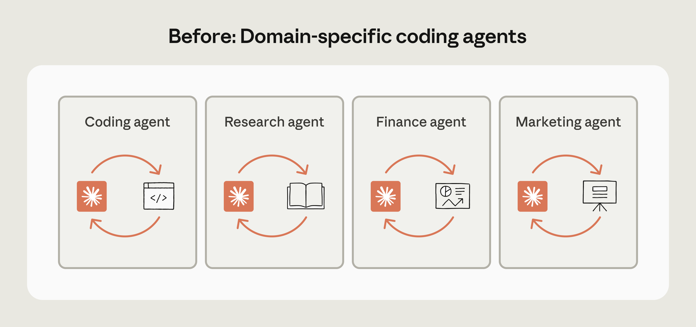
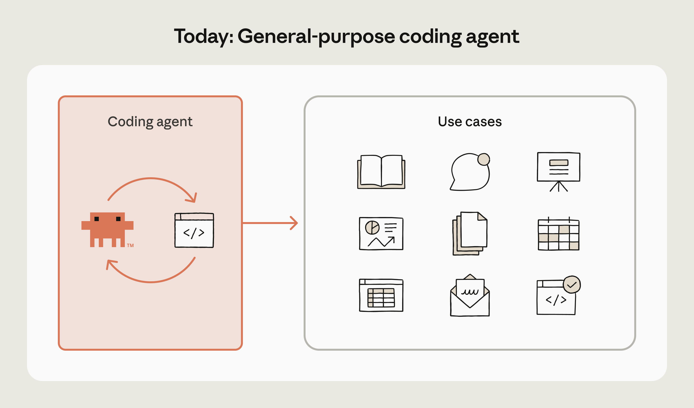
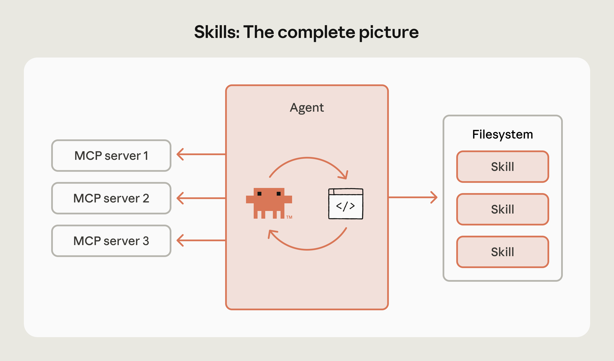

# B12_Building Agents with Skills: Equipping Agents for Specialized Work_用 Skills 构建智能体：为专业工作装备智能体

> 原文：https://claude.com/blog/building-agents-with-skills-equipping-agents-for-specialized-work
> 来源：Anthropic Claude Blog（分类：Agents ｜ 产品：Agent Skills）｜发布日期：2026-01-22 ｜ 致谢：Barry Zhang、Mahesh Murag、Keith Lazuka、Ryan Whitehead
> 原文存档：[Markdown](原文/B12_building-agents-with-skills-equipping-agents-for-specialized-work_原文.md)

## 📌 本篇速览

- 📅 2026-01-22　｜　⏱ 原文约 1740 词（逐句精读约 25 分钟）
- 🏷 Agent Skills、渐进式披露、code as interface、脚本即工具、四层 Agent 架构、开放标准
- 🗂 [返回目录](00_目录与阅读进度.md)

Skills 范式的纲领性文章。核心论断：**「我们不再构建专用 Agent，改为构建 skills」**——代码是 Agent 做几乎一切数字工作的通用接口（Claude Code 是「恰好通过代码工作的通用 Agent」），脚手架简化为 bash + 文件系统；而通用能力 ≠ 专业知识（数学天才 vs 报税专家的比喻），skills 用文件打包领域专长来补这个缺口。**渐进式披露三层 token 预算**：metadata ~50 tokens → SKILL.md 全文 ~500 tokens → references/ 2000+ tokens 按需加载，因此可以挂几百个 skills 不压垮上下文。**脚本即工具**：与传统工具相比，代码自文档化、可修改、不必常驻上下文（例子：Claude 反复写同一个 PPT 样式脚本，干脆让它存成自己的工具）。**四层完整架构**：Agent loop（推理）+ Agent runtime（执行：代码/文件系统）+ MCP（连接）+ Skills library(引导）——各层职责单一、独立演进。Skills 已发布为开放标准（agentskills.io），对标 MCP 的地位。

---

A lot has changed in the past year.

过去一年变化很大。

MCP became the standard for agent connectivity with rapid adoption from industry leaders and the developer community.

MCP 成了智能体连接的标准，被行业头部公司和开发者社区快速采纳。

Claude Code launched as a general-purpose coding agent.

Claude Code 作为通用编程智能体发布。

And we launched the Claude Agent SDK, which now provides a production-ready agent out of the box.

我们还发布了 Claude Agent SDK，现在开箱即提供一个可用于生产的智能体。

But as we've built and deployed these agents, we keep running into the same gap: agents have intelligence and capabilities, but not always the expertise to effectively tackle real work.

但在构建和部署这些智能体的过程中，我们不断撞上同一个缺口：智能体有智力、有能力，却不总是具备高效解决真实工作所需的**专业知识**。

This led us to create Agent Skills.

这促使我们创造了 Agent Skills。

Skills are organized collections of files that package domain expertise - workflows, best practices, scripts - in a format agents can access and apply.

Skills 是有组织的文件集合，用智能体能访问、能应用的格式打包领域专长——工作流、最佳实践、脚本。

They turn a capable generalist into a knowledgeable specialist.

它们把一个能干的通才变成一个懂行的专家。

In this post, we'll explain why we stopped building specialized agents and started building skills instead, and how this shift is changing how we think about extending agent capabilities.

本文将解释我们为什么不再构建专用智能体、转而构建 skills，以及这个转变如何改变我们对扩展智能体能力的思考方式。

## The new paradigm: code is all you need

## 新范式：代码就是一切

We used to think agents in different domains would look very different.

我们过去以为不同领域的智能体会长得非常不同。

A coding agent, a research agent, one for finance, one for marketing—each seemed to need its own tools and scaffolding.

编程智能体、研究智能体、金融的一个、市场的一个——每个似乎都需要自己的工具和脚手架。

The industry initially embraced this model of domain-specific agents.

业界最初也拥抱了这种「领域专用智能体」的模式。

But as models improved in intelligence and agent capabilities progressed, we converged on a different approach.

但随着模型智力提升、智能体能力进步，我们收敛到了另一条路上。



We came to see code less as just a use case and more as an interface for agents to do almost any digital work.

我们逐渐把代码看作不只是一个用例，而是智能体完成几乎任何数字工作的**接口**。

Claude Code is a coding agent, but also a general-purpose agent that happens to work through code.

Claude Code 是一个编程智能体，但也是一个**恰好通过代码来工作**的通用智能体。



Consider working with Claude Code to generate a financial report.

设想用 Claude Code 生成一份财务报告。

It can call APIs for research, store data in the filesystem, analyze it with Python, and synthesize insights.

它可以调 API 做调研、把数据存进文件系统、用 Python 分析、再综合出洞见。

All of that happens through code.

这一切都通过代码完成。

The scaffolding becomes as simple as bash and a filesystem.

脚手架简化到只剩 bash 和一个文件系统。

But general capability isn't the same as expertise.

但通用能力不等于专业知识。

When we started using Claude Code for real work, a gap emerged.

当我们开始用 Claude Code 做真实工作时，一个缺口显现了出来。

## The missing piece: domain expertise

## 缺失的一环：领域专长

Who would you want filing your taxes: a math genius figuring it out from first principles, or an experienced tax professional who's filed thousands of returns?

你想让谁帮你报税：一个从第一性原理现场推导的数学天才，还是一个报过几千份税表的资深税务专家？

Most people would choose the tax professional.

大多数人会选税务专家。

Not because they're smarter, but because they have the right expertise.

不是因为他们更聪明，而是因为他们有对口的专业经验。

Agents today are like that math genius: brilliant at reasoning through novel situations, but often lacking the accumulated expertise of a seasoned professional.

今天的智能体就像那个数学天才：面对新情况推理能力出色，却常常缺少资深从业者积累下来的专业经验。

They can do amazing things with proper guidance.

有恰当的引导，它们能做出惊人的事情。

However, they're often missing important context, can't easily absorb your organization's expertise, and don't automatically learn from repeated tasks.

然而它们经常缺少重要上下文、难以吸收你组织内部的专业知识、也不会自动从重复任务中学习。

Skills bridge this gap by packaging domain expertise in a format that agents can progressively access and apply.

Skills 通过把领域专长打包成智能体可以**渐进访问和应用**的格式，弥合了这个缺口。

## What are Agent Skills?

## 什么是 Agent Skills？

Skills package domain expertise and procedural knowledge for agents.

Skills 为智能体打包领域专长和过程性知识。

```
anthropic_brand/
├── SKILL.md
├── docs.md
├── slide-decks.md
└── apply_template.py
```

（一个 skill 就是一个目录：SKILL.md 主文件 + 补充文档 + 可执行脚本。）

The simplicity of skills is deliberate.

skills 的简单是刻意为之。

Files are a universal primitive that works with what you already have.

文件是一种通用原语，与你已有的一切兼容。

You can version them with Git, store them in Google Drive, and share them with your team.

你可以用 Git 做版本管理、存在 Google Drive、分享给团队。

This simplicity also means skill creation isn't limited to engineers.

这种简单也意味着创建 skill 不再是工程师的专利。

Product managers, analysts, and domain experts are already building skills to codify their workflows.

产品经理、分析师和各领域专家已经在构建 skills，把自己的工作流固化下来。

## Progressive disclosure

## 渐进式披露

Skills can contain extensive information.

skills 可以包含大量信息。

To protect the context window and make skills composable, they use progressive disclosure: at runtime, only the metadata (name and description from the YAML frontmatter) is shown to the model.

为了保护上下文窗口并让 skills 可组合，它们采用渐进式披露（progressive disclosure）：运行时只有元数据（YAML frontmatter 里的 name 和 description）会展示给模型。

```
---
name: Anthropic Brand Style Guidelines
description: Anthropic's official brand colors and typography…
---
```

If Claude determines a skill is needed, it reads the full SKILL.md file.

如果 Claude 判断需要某个 skill，它才去读完整的 SKILL.md 文件。

For additional detail, skills can include a references/ directory with supporting documentation loaded only on demand.

需要更多细节时，skills 还可以带一个 references/ 目录，里面的支撑文档只在按需时加载。

This three-tier approach means you can equip an agent with hundreds of skills without overwhelming its context window—metadata uses ~50 tokens, full SKILL.md files ~500 tokens, and reference files 2,000+ tokens and only when specifically needed.

这套三层结构意味着你可以给智能体装配数百个 skills 而不压垮它的上下文窗口——元数据约 50 token，完整 SKILL.md 约 500 token，参考文件 2000+ token 且只在确实需要时加载。

## Skills can include scripts as tools

## Skills 可以把脚本当工具

Traditional tools have problems: some have poorly written instructions, the model can't always modify or extend them, and they often bloat the context window.

传统工具有几个问题：有些工具的说明写得糟糕；模型不总是能修改或扩展它们；它们还经常让上下文窗口膨胀。

Code, on the other hand, is self-documenting, modifiable, and doesn't need to be in context at all times.

而代码是自文档化的、可修改的，也不需要一直待在上下文里。

Here's a real example: we kept seeing Claude write the same script to apply Anthropic styling to slides.

举个真实例子：我们不断看到 Claude 写同一个脚本，用来给幻灯片套 Anthropic 的样式。

So we asked Claude to save it as a tool for itself:

于是我们让 Claude 把它存下来，当作自己的工具：

```
# anthropic/brand_styling/apply_template.py
import sys
from pptx import Presentation

if len(sys.argv) != 2:
    print("USAGE: apply_template.py <pptx>")
    sys.exit(1)

prs = Presentation(sys.argv[1])
for slide in prs.slides:
    ...
```

The corresponding documentation in slide-decks.md simply references this script:

slide-decks.md 里对应的文档只需引用这个脚本：

```
## Anthropic Slide Decks
- Intro/outro slides
  - background color: `#141413`
  - foreground color: oat
- Section slides:
  - background color: `#da7857`
  - foreground color: `#141413`

Use the `./apply_template.py` script to update a pptx file in-place.
```

（文档只写品牌规范 + 一句「用 ./apply_template.py 原地更新 pptx」。）

## The skills ecosystem

## Skills 生态

The skills ecosystem has emerged quickly, and so far we've seen three major types of skills being built:

skills 生态迅速成形，目前我们看到三大类 skills 在被构建：

### Foundational skills

### 基础型 skills

These provide core capabilities everyone needs: working with documents, spreadsheets, presentations, etc.

它们提供人人都需要的核心能力：处理文档、电子表格、演示文稿等。

They encode best practices for document generation and manipulation.

它们固化了文档生成与处理的最佳实践。

You can see what this looks like in practice by exploring the foundational skills in our public repository.

想看实际长什么样，可以浏览我们[公开仓库里的基础 skills](https://github.com/anthropics/skills/tree/main/skills/public)。

### Partner skills

### 伙伴型 skills

As skills standardize how agents interact with specialized capabilities, companies are building skills to make their services agent-accessible.

随着 skills 把「智能体如何与专业能力交互」标准化，各公司开始构建 skills，让自家服务对智能体可用。

K-Dense, Browserbase, Notion, and many others are creating skills that integrate their services directly, extending Claude's capabilities in specific domains while maintaining the simplicity of the skills format.

K-Dense、Browserbase、Notion 等许多公司正在创建直接集成自家服务的 skills，在保持 skills 格式简单性的同时，扩展 Claude 在特定领域的能力。

### Enterprise skills

### 企业型 skills

Organizations build proprietary skills encoding their internal processes and domain expertise.

企业构建私有 skills，把内部流程和领域专长编码进去。

Skills help capture the specific workflows, compliance requirements, and institutional knowledge that make an agent useful for enterprise work.

skills 帮助沉淀那些让智能体真正胜任企业工作的特定工作流、合规要求和组织知识。

## Trends we see

## 我们看到的趋势

As skills adoption grows, several patterns are emerging that point to where this paradigm may be heading.

随着 skills 的采纳增长，一些模式正在浮现，指向这个范式可能的走向。

These trends shape how we think about skill design and the tooling we're building to support skill developers.

这些趋势塑造着我们对 skill 设计的思考，以及我们为 skill 开发者构建的工具。

### Increasing complexity

### 复杂度上升

Early skills were simple documentation references.

早期的 skills 只是简单的文档引用。

Now we're seeing sophisticated multi-step workflows that coordinate data retrieval, complex calculations, and formatted output across multiple tools.

现在我们看到的是精巧的多步工作流，跨多个工具协调数据获取、复杂计算和格式化输出。

- **Simple**: "Status report writer" (~100 lines) - Templates and formatting

- **简单级**：「状态报告撰写器」（约 100 行）——模板与排版

- **Intermediate**: "Financial model builder" (~800 lines) - Data retrieval, Excel modeling with Python

- **中级**：「财务模型构建器」（约 800 行）——数据获取、用 Python 做 Excel 建模

- **Complex**: "RNA sequencing pipeline" (2,500+ lines) - Coordinates HISAT2, StringTie, DESeq2 analysis

- **复杂级**：「RNA 测序流水线」（2500+ 行）——协调 HISAT2、StringTie、DESeq2 分析

### Skills and MCP

### Skills 与 MCP

Skills and MCP servers work together naturally.

Skills 和 MCP 服务器天然协同。

A competitive analysis skill might coordinate web search, internal databases via MCP, Slack message history, and Notion pages to synthesize a comprehensive report.

一个竞品分析 skill 可能会协调网页搜索、经 MCP 接入的内部数据库、Slack 消息历史和 Notion 页面，最终综合出一份完整报告。

### Non-developer adoption

### 非开发者的采纳

Skill creation is expanding beyond engineers to product managers, analysts, and domain experts across disciplines.

创建 skill 的人群正在从工程师扩展到产品经理、分析师和各学科的领域专家。

They can create and test their first skill in under 30 minutes using the skill-creator tool, which guides them through the process interactively.

借助交互式引导的 skill-creator 工具，他们可以在 30 分钟内创建并测试自己的第一个 skill。

We're working to make skill creation even more accessible, with improved tooling and templates that let anyone capture and share expertise.

我们还在努力让 skill 创建更加低门槛——用更好的工具和模板，让任何人都能沉淀并分享专业知识。

## The complete architecture

## 完整架构

Putting it all together, the emerging agent architecture looks like a combination of:

综合起来，正在成形的智能体架构由以下部分组合而成：

1. **Agent loop**: The core reasoning system that decides what to do next

1. **智能体循环（Agent loop）**：决定下一步做什么的核心推理系统

2. **Agent runtime**: Execution environment (code, filesystem)

2. **智能体运行时（Agent runtime）**：执行环境（代码、文件系统）

3. **MCP servers**: Connections to external tools and data sources

3. **MCP 服务器**：与外部工具和数据源的连接

4. **Skills library**: Domain expertise and procedural knowledge

4. **Skills 库**：领域专长与过程性知识



Each layer has a clear purpose: the loop reasons, the runtime executes, MCP connects, and skills guide.

每一层职责清晰：loop 负责推理，runtime 负责执行，MCP 负责连接，skills 负责引导。

This separation makes the system comprehensible and allows each piece to evolve independently.

这种分离让系统易于理解，也让每个部分可以独立演进。

Consider what happens when you add a single skill to this architecture.

想想往这套架构里加一个 skill 会发生什么。

The frontend design skill transforms Claude's frontend capabilities instantly.

前端设计 skill 能瞬间改变 Claude 的前端能力。

It provides specialized guidance on typography, color theory, and animation, activating only when building web interfaces.

它提供关于排版、色彩理论和动画的专业指引，且只在构建网页界面时激活。

Progressive disclosure means it loads only when relevant.

渐进式披露意味着它只在相关时才加载。

Adding new capabilities is straightforward.

添加新能力就是这么直接。

## Deploying skills to new verticals

## 把 skills 部署到新的垂直领域

This emerging pattern of general agents equipped with MCP servers and skills is already helping us deploy Claude to new verticals.

「通用智能体 + MCP + skills」这一新兴模式，已经在帮助我们把 Claude 部署到新的垂直领域。

### Financial Services

### 金融服务

Just after launching skills, we enhanced Claude for the financial services sector with skills that make Claude more useful for finance professionals:

skills 发布后不久，我们就用一批 skills 强化了金融行业版 Claude，让它对金融从业者更有用：

- **DCF model builder**: Constructs discounted cash flow models with proper WACC calculations and sensitivity analysis

- **DCF 模型构建器**：构建带正确 WACC 计算和敏感性分析的现金流折现模型

- **Comparable company analysis**: Generates comps tables with relevant multiples and benchmarking

- **可比公司分析**：生成带相关估值倍数和基准对比的 comps 表

- **Earnings analysis**: Processes quarterly results and creates investment update reports

- **财报分析**：处理季度业绩并生成投资更新报告

- **Initiation coverage**: Builds comprehensive research reports with financial models

- **首次覆盖报告**：构建带财务模型的完整研究报告

- **Due diligence**: Structures M&A analysis with standardized frameworks

- **尽职调查**：用标准化框架组织并购分析

- **Pitch materials**: Creates client presentations following industry standards

- **路演材料**：按行业标准制作客户演示文稿

### Healthcare & Life Sciences

### 医疗与生命科学

We've also enhanced our healthcare and life sciences offerings with skills that make Claude more useful for researchers, clinicians, and healthcare developers:

我们也用 skills 强化了医疗与生命科学产品，让 Claude 对研究者、临床医生和医疗开发者更有用：

- **Bioinformatics bundles**: Skills for scVI-tools and Nextflow deployments, essential for managing genomic pipelines and single-cell RNA sequencing

- **生物信息学套件**：面向 scVI-tools 和 Nextflow 部署的 skills，是管理基因组流水线与单细胞 RNA 测序的必备

- **Clinical trial protocol generation**: Accelerates protocol development for clinical research

- **临床试验方案生成**：加速临床研究的方案制定

- **Scientific problem selection**: Helps researchers identify and frame impactful research questions

- **科学选题**：帮助研究者识别并界定有影响力的研究问题

- **FHIR development**: Helps developers write more accurate code for health data interoperability, connecting healthcare systems faster with fewer errors

- **FHIR 开发**：帮助开发者为健康数据互操作写出更准确的代码，更快、更少出错地连接医疗系统

- **Prior authorization review**: Cuts administrative burden and accelerates patient access to needed care by cross-referencing coverage requirements, clinical guidelines, and patient records

- **事前授权审查**：交叉比对保险覆盖要求、临床指南和患者记录，削减行政负担，加速患者获得所需医疗

## Standardizing Agent Skills

## 把 Agent Skills 标准化

To enable this vision, we're publishing Agent Skills as an open standard.

为实现这一愿景，我们将 Agent Skills 发布为开放标准。

Like MCP, we believe skills should be portable across tools and platforms.

和 MCP 一样，我们相信 skills 应该在工具和平台之间可移植。

The same skill should work whether you're using Claude or other AI platforms.

同一个 skill，不管你用的是 Claude 还是其他 AI 平台，都应该能工作。

We've been collaborating with members of the ecosystem on the standard, and we're excited to see early adoption.

我们一直在与生态伙伴共同打磨这个标准，也很高兴看到早期采纳。

When someone starts using an AI agent for the first time, it should already know what you and your team care about because skills capture and transfer that expertise.

当一个人第一次使用 AI 智能体时，它就应该已经知道你和你的团队在意什么——因为 skills 沉淀并传递了这些专业知识。

As this ecosystem grows, a skill built by someone else in the community can make your agent more useful, reliable, and capable - regardless of which AI platform they're using.

随着生态成长，社区里其他人构建的 skill 也能让你的智能体更有用、更可靠、更有能力——无论对方用的是哪家 AI 平台。

## Getting started

## 快速上手

We're converging on an architecture for general agents, and skills provide a paradigm for shipping and sharing new capabilities.

我们正在向一套通用智能体架构收敛，而 skills 提供了交付与分享新能力的范式。

The real value emerges from the collective knowledge base we build together: capturing expertise, transferring it across teams, and making every agent more capable than the last.

真正的价值来自我们共同构建的集体知识库：沉淀专业知识、在团队之间传递，让每一个智能体都比上一个更有能力。

---

## 术语中英对照表

| 英文 | 中文 | 备注 |
|---|---|---|
| Agent Skills | 智能体技能 | 打包领域专长的文件集合，已发布为开放标准 |
| code as an interface | 代码即接口 | Claude Code = 「恰好通过代码工作的通用 Agent」 |
| domain expertise | 领域专长 | 数学天才 vs 税务专家比喻要补的缺口 |
| procedural knowledge | 过程性知识 | skills 打包的第二类内容 |
| progressive disclosure | 渐进式披露 | 50 → 500 → 2000+ token 三层按需加载 |
| YAML frontmatter | YAML 前置元数据 | 运行时唯一常驻的部分（name + description） |
| references/ directory | 参考目录 | 第三层，只在确实需要时加载 |
| scripts as tools | 脚本即工具 | 代码自文档化、可修改、不占常驻上下文 |
| foundational / partner / enterprise skills | 基础型/伙伴型/企业型 | 生态三大类 |
| Agent loop / runtime / MCP / Skills | 循环/运行时/连接/引导 | 四层架构：loop 推理、runtime 执行、MCP 连接、skills 引导 |
| skill-creator | 技能创建器 | 30 分钟做出第一个 skill 的引导工具 |
| open standard | 开放标准 | agentskills.io，对标 MCP 的定位 |
