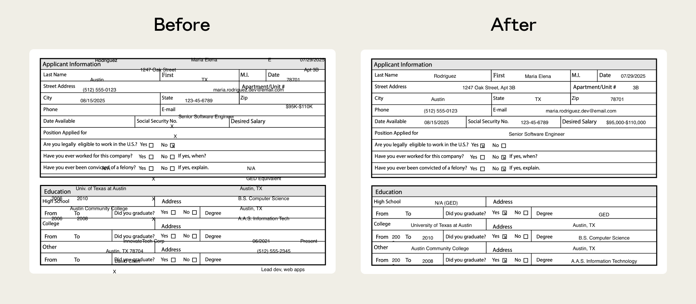
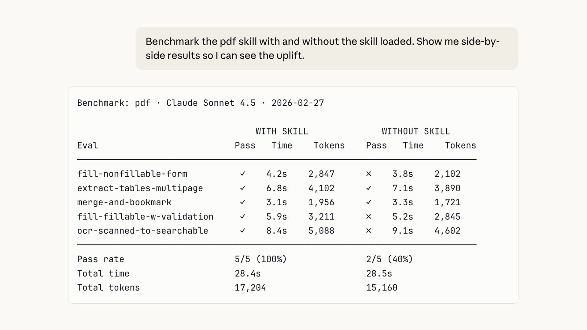
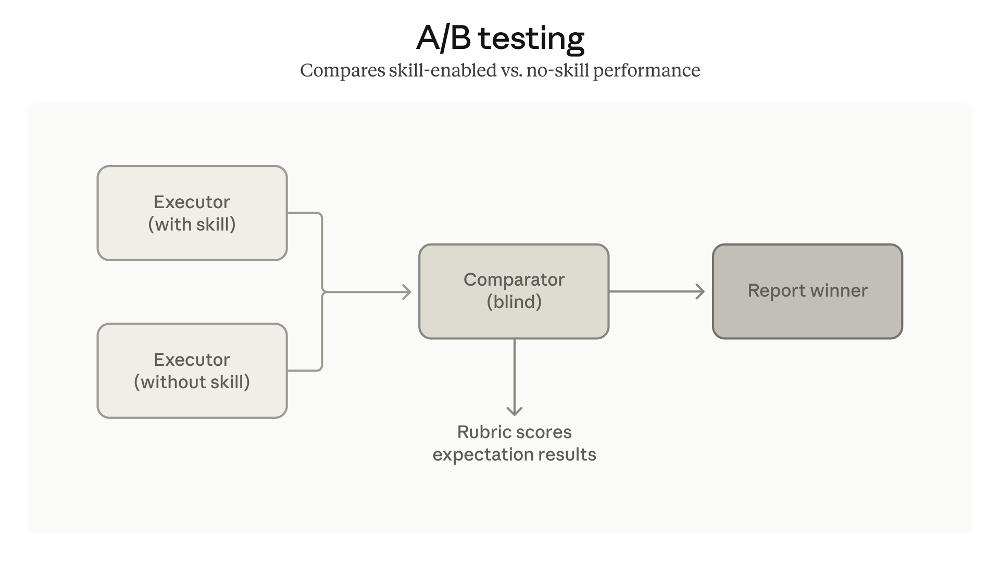

# B13_Improving skill-creator: Test, measure, and refine Agent Skills_改进 skill-creator：测试、度量、打磨 Agent Skills

> 原文：https://claude.com/blog/improving-skill-creator-test-measure-and-refine-agent-skills
> 来源：Anthropic Claude Blog（分类：Agents ｜ 产品：Agent Skills / skill-creator）｜发布日期：2026-03-03
> 原文存档：[Markdown](原文/B13_improving-skill-creator-test-measure-and-refine-agent-skills_原文.md)

## 📌 本篇速览

- 📅 2026-03-03　｜　⏱ 原文约 880 词（逐句精读约 12 分钟）
- 🏷 skill 评测（evals）、benchmark 模式、多智能体并行评测、盲测 comparator、description 调优、触发率
- 🗂 [返回目录](00_目录与阅读进度.md)

Agent 评测方法论的小而全样本。**skills 分两类**：能力增强型（capability uplift，模型本身做不到/做不稳的）与偏好编码型（encoded preference，模型都会做、skill 负责按你的流程串起来）——两类的测试目的不同：前者要盯「模型是否已经进化到不需要这个 skill」（**基座模型不带 skill 也能通过 evals = skill 该退役**），后者要验证「对真实工作流的忠实度」。**评测基建三件套**：evals（定义测试 prompt + 好的标准）、benchmark 模式（追踪通过率/耗时/token 消耗）、多智能体并行评测（每个 eval 独立干净上下文，防止测试间上下文串染）+ **盲测 comparator agents**（A/B 两版输出、评审者不知道哪个是哪个）。**触发调优**：description 太宽→误触发，太窄→永不触发；工具自动分析并建议修改，6 个公开文档 skill 中 5 个触发率提升。结尾的前瞻判断值得记：**skill 与 spec 的界限会模糊——今天 SKILL.md 写 how，将来只写 what（evals 描述的就是 what），最终 eval 描述本身可能就是 skill**。

---

Skill-creator now helps you write evals, run benchmarks, and keep your skills working as models evolve.

skill-creator 现在能帮你编写评测（evals）、运行基准测试，并让你的 skills 在模型演进时保持有效。

These updates are available now in Claude.ai and Cowork, as a plugin for Claude Code, and within our repo.

这些更新现已在 Claude.ai 和 Cowork 上可用，也提供 Claude Code 插件版本，并收录在我们的仓库里。

Since launching Agent Skills last October, we've noticed that most authors are subject matter experts, not engineers.

自去年十月发布 Agent Skills 以来，我们注意到大多数作者是领域专家，而不是工程师。

They know their workflows but don't have the tools to tell whether a skill still works with a new model, triggers when it should, or if it actually improved after an edit.

他们了解自己的工作流，却没有工具去判断：一个 skill 在新模型上是否还有效、该触发时是否触发了、一次修改之后它是不是真的变好了。

Today we're announcing skill-creator enhancements that help authors build with more confidence.

今天我们发布 skill-creator 的增强功能，帮助作者更有信心地构建。

We are bringing some of the rigor of software development (testing, benchmarking, iterative improvement) to skill authoring without requiring anyone to write code.

我们把软件开发的部分严谨性（测试、基准、迭代改进）带进 skill 创作，而且不要求任何人写代码。

## Two kinds of skills

## 两类 skills

Skills generally fall into two categories:

skills 大体分两类：

**Capability uplift** skills help Claude do something the base model either can't do or can't do consistently.

**能力增强型（capability uplift）**skills 帮 Claude 做基座模型做不到、或做不稳定的事。

Our document creation skills are good examples.

我们的文档创建 skills 就是好例子。

They encode techniques and patterns that produce better output than prompting alone.

它们编码了一些技巧和模式，产出比单纯提示词更好的结果。

**Encoded preference** skills document workflows where Claude can already do each piece, but the skill sequences them according to your team's process.

**偏好编码型（encoded preference）**skills 记录的是这样的工作流：每个环节 Claude 都会做，但 skill 按你团队的流程把它们串起来。

Examples: a skill that walks through NDA review against set criteria, or one that drafts weekly updates with data from various MCPs.

例子：按既定标准走一遍 NDA 审查的 skill，或用多个 MCP 的数据起草周报的 skill。

This distinction matters because these two types of skills may need testing for different reasons:

这个区分很重要，因为两类 skills 需要测试的理由不同：

- Capability uplift skills may become less necessary as models improve. Evals tell you when that's happened.

- 能力增强型 skills 会随模型进步而变得不那么必要。评测会告诉你这一刻什么时候到来。

- Encoded preference skills are more durable, but only as valuable as their fidelity to your actual workflow. Evals verify that fidelity.

- 偏好编码型 skills 更持久，但其价值完全取决于它对你真实工作流的忠实度。评测验证的就是这份忠实度。

Either way, testing turns a skill that *seems* to work into one you *know* works.

无论哪类，测试都能把一个「*看起来*能用」的 skill，变成一个「你*确知*能用」的 skill。

## Using evals to test and improve skills

## 用评测来测试和改进 skills

Skill-creator now helps you write evals, which are tests that check Claude does what you expect for a given prompt.

skill-creator 现在能帮你编写评测——检查 Claude 在给定提示词下是否做出你期待的行为的测试。

If you've written software tests, this will feel familiar: define some test prompts (plus files if needed), describe what good looks like, and skill-creator tells you whether the skill holds up.

如果你写过软件测试，这会很熟悉：定义一些测试提示词（需要的话再加文件），描述「好」长什么样，skill-creator 告诉你这个 skill 是否经得住。

Our PDF skill, for instance, previously struggled with non-fillable forms.

比如我们的 PDF skill，之前在不可填写的表单上表现挣扎。

Claude had to place text at exact coordinates with no defined fields to guide it.

Claude 必须在没有既定字段引导的情况下，把文字放到精确坐标上。

Evals isolated the failure, and we shipped a fix that anchors positioning to extracted text coordinates.

评测把这个失败点隔离了出来，我们随后上线修复：把定位锚定到提取出的文字坐标上。

Evals help in many ways, but two important uses are to catch quality regressions and understand model progress.

评测的用处很多，但两个重要用途是：抓质量回归、理解模型进步。

First, **catching regressions in quality.**

第一，**抓质量回归。**

As models and the infrastructure around them evolve, a skill that worked well last month might behave differently today.

随着模型及其周边基础设施的演进，上个月还好用的 skill，今天的行为可能就不一样了。

Running evals against a new model gives you an early signal when something shifts before it impacts your team's work.

在新模型上跑评测，能在变化影响你团队工作之前给你一个早期信号。

Second, **knowing when general model capabilities have outgrown your skill.**

第二，**知道通用模型能力何时已经超过了你的 skill。**

This applies mainly to capability uplift skills.

这主要适用于能力增强型 skills。

If the base model starts passing your evals *without* the skill loaded, that's a signal the skill's techniques may have been incorporated into the model's default behavior.

如果基座模型在*不加载* skill 的情况下就开始通过你的评测，这是一个信号：这个 skill 的技巧可能已经被吸收进模型的默认行为。

The skill isn't broken; it's just no longer necessary.

skill 没坏，只是不再必要了。

We've also added a **benchmark mode** that runs a standardized assessment using your evals.

我们还加入了**基准模式（benchmark mode）**，用你的评测跑一套标准化评估。

This is something you can run after model updates or as you iterate on the skill itself.

你可以在模型更新后、或迭代 skill 本身时运行它。

It tracks eval pass rate, elapsed time, and token usage.

它追踪评测通过率、耗时和 token 消耗。

Your evals and results stay with you.

你的评测和结果归你所有。

Store them locally, integrate them with a dashboard, or plug them into a CI system.

可以本地存储、接进仪表盘，或接入 CI 系统。

## Faster, more consistent evaluation with multi-agent support

## 多智能体支持：更快、更一致的评测

Running evals sequentially can be slow, and accumulating context can bleed between test runs.

顺序跑评测会很慢，而且累积的上下文会在测试之间互相渗漏。

Skill-creator now spins up independent agents to run evals in parallel with **multi-agent support**— each in a clean context with its own token and timing metrics.

skill-creator 现在借助**多智能体支持**，起多个独立智能体并行跑评测——每个都在干净的上下文里，带各自的 token 和耗时指标。

Faster results, no cross-contamination.

结果更快，且没有交叉污染。

We've also added **comparator agents** for A/B comparisons: two skill versions, or skill vs. no skill.

我们还加入了做 A/B 对比的**比较者智能体（comparator agents）**：两个 skill 版本对比，或有 skill 对比没 skill。

They judge outputs without knowing which is which, so you can tell whether a change actually helped.

它们在不知道哪个输出来自哪一边的情况下评判，因此你能判断一次修改是否真的有帮助。

## Getting skills to trigger at the right time

## 让 skills 在正确的时机触发

Evals measure output quality, but that only matters if your skill triggers when it should.

评测度量的是输出质量，但前提是你的 skill 在该触发时触发了。

As your skill count grows, description precision becomes critical: too broad and you get false triggers, too narrow and it never fires.

随着 skill 数量增长，description 的精确度变得关键：写太宽会误触发，写太窄则永远不触发。

Skill-creator now helps you tune descriptions for more reliable triggering — it analyzes your current description against sample prompts and suggests edits that cut both false positives and false negatives.

skill-creator 现在能帮你调优 description 以获得更可靠的触发——它把你当前的 description 对照样例提示词做分析，并建议能同时减少误报和漏报的修改。

We ran it across our document-creation skills and saw improved triggering on 5 out of 6 public skills.

我们在文档创建类 skills 上跑了一遍，6 个公开 skills 中 5 个的触发表现得到改善。

## Looking ahead

## 展望

As models improve, the line between "skill" and "specification" may blur.

随着模型进步，「skill」和「规格说明（specification）」的界限可能会模糊。

Today, a SKILL.md file is essentially an implementation plan, providing detailed instructions telling Claude *how* to do something.

今天的 SKILL.md 本质上是一份实现计划，用详细指令告诉 Claude *怎么*做某件事。

Over time, a natural-language description of *what* the skill should do may be enough, with the model figuring out the rest.

随着时间推移，一段描述 skill *该做什么*的自然语言可能就够了，剩下的模型自己想清楚。

The eval framework we're releasing today is a step in that direction.

我们今天发布的评测框架就是朝这个方向迈出的一步。

Evals already describe the "what."

评测描述的已经是那个「what」。

Eventually, that description may be the skill itself.

最终，这份描述本身可能就是 skill。

## Getting Started

## 快速上手

All skill-creator updates are available now on Claude.ai and Cowork.

skill-creator 的所有更新现已在 Claude.ai 和 Cowork 上可用。

Ask Claude to use the skill-creator to get started.

让 Claude 使用 skill-creator 即可开始。

Claude Code users can install the plugin or download from our repo.

Claude Code 用户可以安装插件，或从我们的仓库下载。

---

## 术语中英对照表

| 英文 | 中文 | 备注 |
|---|---|---|
| evals | 评测 | 测试 prompt + 「好」的标准，检验 skill 行为 |
| capability uplift | 能力增强型 | 模型做不到/做不稳的；随模型进步会「毕业」 |
| encoded preference | 偏好编码型 | 模型都会做、skill 负责按流程串；价值=忠实度 |
| regression | 回归 | 模型/基建演进导致 skill 行为漂移 |
| outgrown | （能力）超过 | 基模不带 skill 也通过 evals = skill 可退役 |
| benchmark mode | 基准模式 | 追踪通过率、耗时、token 消耗 |
| cross-contamination | 交叉污染 | 顺序评测中上下文串染问题；并行独立上下文解决 |
| comparator agents | 比较者智能体 | 盲测 A/B：评审者不知道输出来自哪个版本 |
| false positives / negatives | 误报 / 漏报 | description 太宽 / 太窄的两种触发失败 |
| specification | 规格说明 | 前瞻：SKILL.md 从 how 演化为 what，eval 即 skill |
