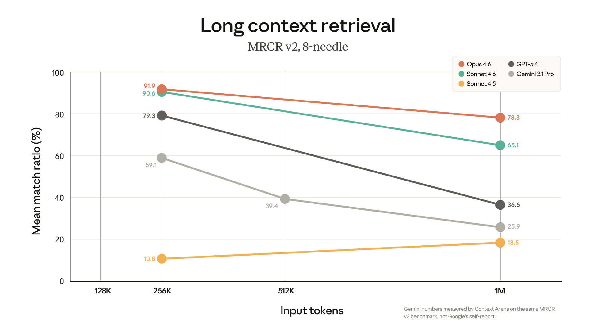

# B15_1M context is now generally available for Opus 4.6 and Sonnet 4.6_百万上下文在 Opus 4.6 与 Sonnet 4.6 正式可用

> 原文：https://claude.com/blog/1m-context-ga
> 来源：Anthropic Claude Blog（分类：Platform ｜ 产品：Claude Platform / Claude Code）｜发布日期：2026-03-13
> 原文存档：[Markdown](原文/B15_1m-context-ga_原文.md)

## 📌 本篇速览

- 📅 2026-03-13　｜　⏱ 原文约 380 词（逐句精读约 5 分钟）
- 🏷 1M 上下文、无长上下文加价、MRCR v2 78.3%、compaction 减少
- 🗂 [返回目录](00_目录与阅读进度.md)

1M 上下文 GA 公告。要点：**全窗口统一定价**（Opus 4.6 $5/$25、Sonnet 4.6 $3/$15 每百万 token，90 万 token 请求与 9 千 token 单价相同，无乘数）；全窗口不降速率限制；单请求媒体量 ×6（600 张图/PDF 页）；超 200K 不再需要 beta header。**质量数字：Opus 4.6 在 MRCR v2 上 78.3%**，是该上下文长度下前沿模型最高分。与 B06（context editing）对照读很有意思：官方话术从「主动管理上下文」演进为「整个长程 Agent trace 直接装下、不再需要有损摘要和上下文清理」——面试可以答成一对权衡：**窗口扩张降低了压缩的必要性，但注意力质量和成本仍然让「只留相关内容」有价值**（B26 减法哲学并未过时）。

---

Claude Opus 4.6 and Sonnet 4.6 now include the full 1M context window at standard pricing on the Claude Platform.

Claude Opus 4.6 和 Sonnet 4.6 现在在 Claude 平台上以标准定价提供完整的 100 万 token 上下文窗口。

Standard pricing applies across the full window — $5/$25 per million tokens for Opus 4.6 and $3/$15 for Sonnet 4.6.

标准定价覆盖整个窗口——Opus 4.6 每百万 token 输入 $5 / 输出 $25，Sonnet 4.6 则是 $3/$15。

There's no multiplier: a 900K-token request is billed at the same per-token rate as a 9K one.

没有乘数：一个 90 万 token 的请求与一个 9 千 token 的请求按同样的单 token 费率计费。

**What's new with general availability:**

**GA 带来的新变化：**

- **One price, full context window.** No long-context premium.

- **一个价格，整个上下文窗口。**没有长上下文加价。

- **Full rate limits at every context length.** Your standard account throughput applies across the entire window.

- **任何上下文长度下都是完整速率限制。**你的标准账户吞吐适用于整个窗口。

- **6x more media per request.** Up to 600 images or PDF pages, up from 100. Available today on Claude Platform natively, Microsoft Foundry, and Google Cloud's Vertex AI.

- **单请求媒体量提升 6 倍。**最多 600 张图片或 PDF 页，此前是 100。今天起在 Claude 平台原生、Microsoft Foundry 和 Google Cloud Vertex AI 上可用。

- **No beta header required.** Requests over 200K tokens work automatically. If you're already sending the beta header, it's ignored so no code changes are required.

- **不再需要 beta header。**超过 20 万 token 的请求自动生效。如果你还在发 beta header，它会被忽略，无需改代码。

**1M context is now included in Claude Code for Max, Team, and Enterprise users with Opus 4.6.**

**Max、Team 和 Enterprise 用户在 Claude Code 中使用 Opus 4.6 时，现已包含 1M 上下文。**

Opus 4.6 sessions can use the full 1M context window automatically, meaning fewer compactions and more of the conversation kept intact.

Opus 4.6 会话可以自动使用完整的 1M 上下文窗口，意味着更少的压缩（compaction）、更多对话被完整保留。

1M context previously required extra usage.

1M 上下文此前需要额外用量。

### Long context that holds up

### 经得住考验的长上下文

A million tokens of context only matters if the model can recall the right details and reason across them.

一百万 token 的上下文，只有在模型能召回正确细节并跨越它们推理时才有意义。

Opus 4.6 scores 78.3% on MRCR v2, the highest among frontier models at that context length.

Opus 4.6 在 MRCR v2 上得分 78.3%，是该上下文长度下前沿模型中的最高分。

*图注：Claude Opus 4.6 与 Sonnet 4.6 在整个 1M 窗口内保持准确率。长上下文检索能力随每一代模型持续提升。*

That means you can load an entire codebase, thousands of pages of contracts, or the full trace of a long-running agent — tool calls, observations, intermediate reasoning — and use it directly.

这意味着你可以装入整个代码库、数千页合同，或一个长时运行智能体的完整轨迹——工具调用、观察结果、中间推理——并直接使用。

The engineering work, lossy summarization, and context clearing that long-context work previously required are no longer needed.

以前长上下文工作所需要的工程投入、有损摘要和上下文清理，都不再需要了。

The full conversation stays intact.

完整对话原样保留。

### Getting started

### 快速上手

1M context is available today on the Claude Platform natively and through Amazon Bedrock, Google Cloud's Vertex AI, and Microsoft Foundry.

1M 上下文今天起在 Claude 平台原生可用，也可通过 Amazon Bedrock、Google Cloud Vertex AI 和 Microsoft Foundry 使用。

Claude Code Max, Team, and Enterprise users on Opus 4.6 will default to 1M context automatically.

Claude Code 的 Max、Team、Enterprise 用户在 Opus 4.6 上会自动默认使用 1M 上下文。

See our documentation and pricing for details.

详情见文档与定价页。

---

## 术语中英对照表

| 英文 | 中文 | 备注 |
|---|---|---|
| 1M context window | 百万 token 上下文窗口 | GA 后全窗口统一价、全速率 |
| long-context premium | 长上下文加价 | GA 取消的东西（此前 >200K 有乘数） |
| beta header | 测试版请求头 | 不再需要；发了也被忽略 |
| compaction | （对话）压缩 | 1M 窗口减少其触发频率 |
| MRCR v2 | 多轮共指检索基准 | Opus 4.6 得 78.3%，长上下文质量证据 |
| lossy summarization | 有损摘要 | 官方称不再需要——注意与 B06/B26 的张力 |
| agent trace | 智能体轨迹 | 工具调用+观察+中间推理的完整记录 |
