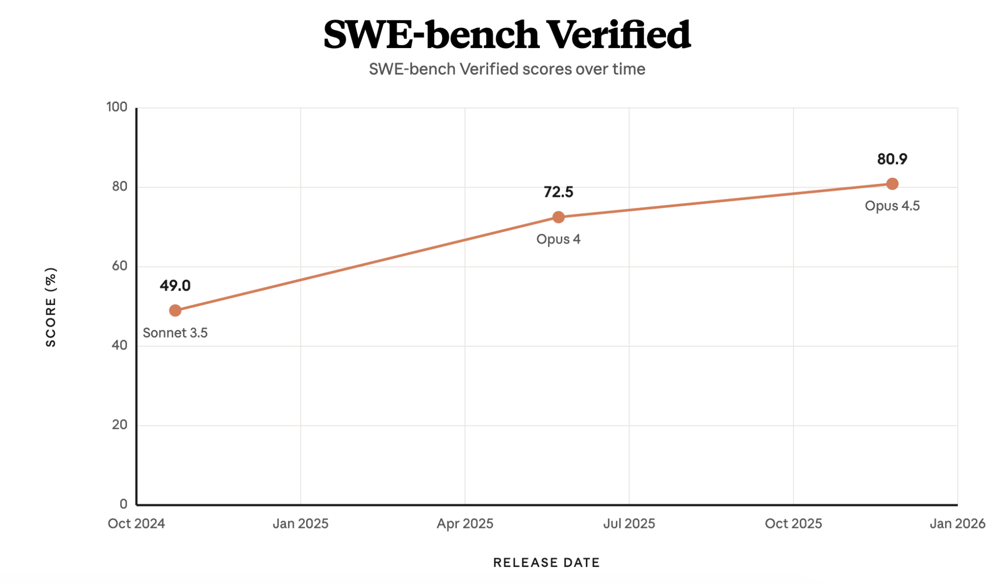
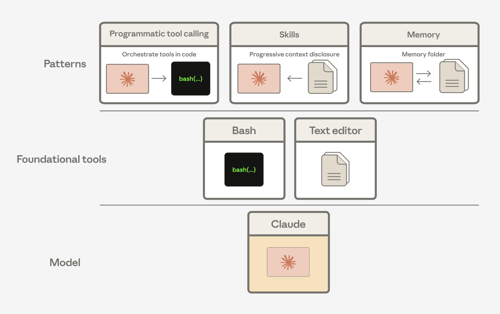
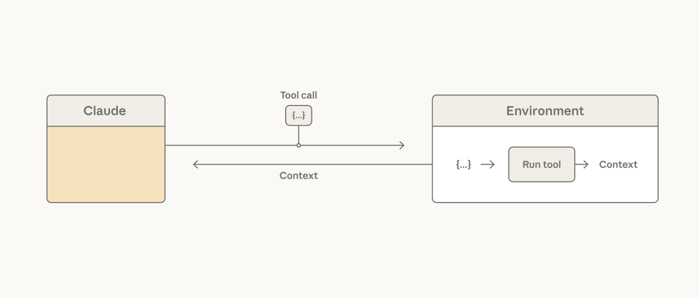
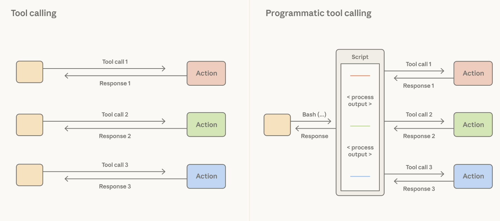
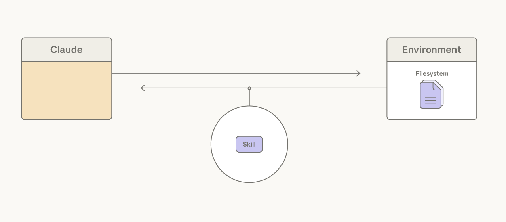
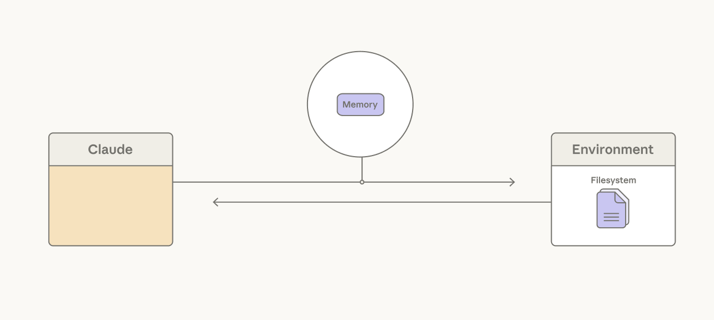
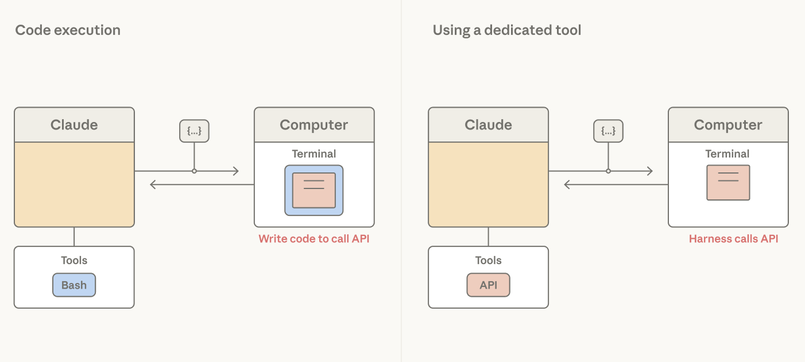

# Agent Harness Design: 3 Patterns for Harnessing Claude's Intelligence：面试速记

> 2026-04-02 · [官方原文](https://claude.com/blog/harnessing-claudes-intelligence)
> 是本仓库《Agent Harness 最佳实践现状综述（2026-08）》的直接上游，也是 `15_effective-harnesses` / `21_harness-design` 的方法论提炼版。

## 一句话讲明白

**Harness 的每一行代码，都是在补当前模型的某个能力缺口。缺口会随模型升级消失，补丁却留在原地成为束缚。所以 harness 设计的核心问题不是「我还能加什么」，而是反复问「我还能停掉什么」——只在 UX、成本、安全这三处真正需要的地方，才刻意设边界。**

## 为什么值得读 / 能用在哪

- **它把 harness 设计从「怎么搭」重构成「怎么拆」**，这个视角转换是面试里最能体现深度的部分。
- 全文给了**大量实测数字**（SWE-bench 49%、BrowseComp 45.3%→61.6%、84% vs 43%、缓存省 90%），都是可直接引用的弹药。
- 宝可梦记忆文件那个对比案例极具画面感，是讲「模型判断力差距」的最佳素材。
- 模式 3 的**缓存命中五原则**是纯工程干货，很多人不知道，说出来立刻显专业。

---

## 模式 1：Lean on the model, not the harness（靠模型，别靠 harness）

**定义**：用 Claude **已经很懂**的工具，而不是造专用基础设施。

**核心论据**：只给 bash + 文本编辑器两个工具，就在 SWE-bench Verified 上拿到 **49%**。Claude Code 本身**也只用这两个工具**。

⭐ **最关键的结构性洞察**：Agent Skills、编程式工具调用（programmatic tool calling）、记忆工具——**这些高阶模式全都是 bash + 文本编辑器的组合**，不是新原语。

| 取舍 | |
|---|---|
| ✅ | 模型变强，你的应用自动变强，不用改 harness |
| ⚠️ | 通用工具要求 Claude 智能地编排；你对具体行为的控制力更弱 |

**适用**：做长期应用，希望模型能力增长直接转化为产品性能。

> 面试可用：「为什么 Claude Code 只有 bash 和文本编辑器？」——因为通用工具的能力上限跟着模型走，专用工具的上限被写死在你设计它的那一天。

---

## 模式 2：Strip your agent harness down（把 harness 拆薄）

**定义**：随着能力提升，**拿掉「Claude 做不到 X」这类假设**。分三个子模式。

### 2A. 让 Claude 编排自己的行动

**做法**：给代码执行工具（bash、REPL），让 **Claude 自己决定哪些工具结果进入上下文窗口**。

**例子**：读一张大表——不是把整个结果加载进上下文，而是让 Claude 写代码去过滤、在工具之间管道传递数据，**这个过程不消耗 token**。

⭐ **实测**：BrowseComp 上给 Opus 4.6 输出过滤能力，准确率 **45.3% → 61.6%**。

| 取舍 | |
|---|---|
| ✅ | 延迟和成本都更好 |
| ⚠️ | 中间步骤的可观测性下降；需要信任 Claude 的决策 |

### 2B. 让 Claude 管理自己的上下文

**做法**：用 **Skills 的渐进披露** + **上下文编辑**，而不是预加载所有指令。

具体手段三样：
1. **Skills**：YAML frontmatter 提供概览进上下文，完整内容按需读取
2. **上下文编辑（context editing）**：移除过期的结果
3. **Subagents**：任务隔离

⭐ **实测**：BrowseComp 上，Opus 4.6 配压缩达到 **84%**；Sonnet 则**平在 43%** 不动。

> **这组对比是全文最重要的数字**：同样的 harness 能力，强模型能吃下去（84%），弱模型吃不下（43% 不动）。**说明 harness 能力和模型成熟度是耦合的——不是给了工具就有效。**

| 取舍 | |
|---|---|
| ✅ | 在先进模型上收益巨大 |
| ⚠️ | 需要模型足够成熟才能有效使用这些资源；老模型会把记忆当成**逐字记录**而不是**战略性总结** |

### 2C. 让 Claude 持久化自己的上下文

**做法**：让 Claude 自己决定长时程该存什么、取什么。两种机制：
- **压缩（compaction）**：Claude 总结过去的上下文以保持连续性
- **记忆文件夹（memory folders）**：Claude 按需写文件、读文件

⭐ **宝可梦案例（全文最有画面感的对比，务必记住）**：

| 模型 | 走到 14,000 步时 | 进度 |
|---|---|---|
| Sonnet 3.5 | **31 个记忆文件**，里面是关于毛毛虫的**重复内容** | 还在第二个城镇 |
| Opus 4.6 | **10 个组织良好的文件**，装的是**战术性经验** | 已拿 **3 个道馆徽章** |

**这个案例证明的不是「新模型更强」，而是「记忆质量的差距不在存储机制，在判断力」**——同样的记忆文件夹，一个用成了流水账，一个用成了作战笔记。

| 取舍 | |
|---|---|
| ✅ | 大幅减少手工记忆工程 |
| ⚠️ | 完全依赖模型对「什么算相关」的判断；新老模型表现差距巨大 |

---

## 模式 3：Set boundaries carefully（谨慎设边界）

**定义**：只在 **UX、成本、安全** 这三处 Claude 的自主性会出问题的地方，才刻意设结构性约束。

### 3A. ⭐ 设计上下文以最大化缓存命中（纯工程干货）

**机制**：提示词在断点（breakpoint）处缓存；**缓存 token 只要基础输入 token 的 10%**（省 90%）。

| 原则 | 说明 |
|---|---|
| **静态在前，动态在后** | 稳定内容排在可变内容之前 |
| **更新走消息** | 在消息里追加 `<system-reminder>`，**不要改提示词** |
| **别换模型** | 缓存是模型专属的，切换即失效 |
| **谨慎管理工具** | 增删工具会**打断缓存**——改用 tool search |
| **更新断点** | 多轮应用里把断点移到最新消息；或用自动缓存 |

> 「增删工具会破坏缓存，所以用 tool search 而不是动态改工具列表」——这条细节非常能体现工程深度，很少有人讲得出来。

### 3B. 用声明式工具划出安全/UX 边界

**定义**：把特定动作提升为**带类型参数的专用工具**，以便拦截、把关或审计。

四类该上专用工具的场景：

| 场景 | 理由 |
|---|---|
| **难以撤销的动作** | 调外部 API 前需要用户确认 |
| **写操作** | 陈旧性检查（staleness check）防止覆盖已变更的文件 |
| **面向用户的交互** | 渲染弹窗、给多个选项 |
| **可观测性** | 结构化日志与追踪 |

⭐ **反例很有意思**：Claude Code 的 auto-mode 用**第二个 Claude 读 bash 命令来判断安全性**——这说明模型能力提升可以**减少**对专用工具的需求，而不只是扩大。

| 取舍 | |
|---|---|
| ✅ | 更强的控制力与可观测性 |
| ⚠️ | **削弱 Claude 的杠杆**；能力提升后应该重新评估是否还需要 |

---

## ⭐ 全文的元结论

> Claude 智能的前沿一直在移动。**每一次能力的阶跃，都需要重新测试你关于「Claude 做不到什么」的假设。**

设计模式应该持续追问的问题是：**我还能停掉什么？（What can I stop doing?）**

## 术语中英对照

| 英文 | 中文 | 说明 |
|---|---|---|
| harness | 执行框架 | 包裹模型的那层工程代码 |
| programmatic tool calling | 编程式工具调用 | 用代码表达工具调用与逻辑 |
| context editing | 上下文编辑 | 主动移除过期结果 |
| compaction | 压缩 | 总结历史保持连续性 |
| memory folder | 记忆文件夹 | Claude 自主读写的持久化目录 |
| cache breakpoint | 缓存断点 | 提示词缓存的分界位置 |
| staleness check | 陈旧性检查 | 写操作前确认文件未被改动 |
| declarative tool | 声明式工具 | 带类型参数、可拦截审计的专用工具 |
| tool search | 工具搜索 | 替代动态增删工具，避免破坏缓存 |

## 关键数字速查（面试弹药）

| 数字 | 出处 |
|---|---|
| **49%** | 仅 bash + 文本编辑器的 SWE-bench Verified 成绩 |
| **45.3% → 61.6%** | BrowseComp，给 Opus 4.6 加输出过滤 |
| **84% vs 43%** | BrowseComp，Opus 4.6 配压缩 vs Sonnet 平在 43% |
| **90%** | 提示词缓存的 token 成本节省（缓存 token = 基础的 10%） |
| **31 文件 vs 10 文件** | 宝可梦 14,000 步：Sonnet 3.5 流水账 vs Opus 4.6 战术笔记 |
| **0 vs 3** | 同上，道馆徽章数 |

## 和已读文章的关系

| 关联 | 关系 |
|---|---|
| `15_effective-harnesses` / `21_harness-design` | 那两篇是案例，这篇是从案例里提炼的三条通用模式 |
| `22_claude-code-auto-mode` | 本文 3B 的反例（用第二个 Claude 判断 bash 安全性）出自那篇 |
| `14_advanced-tool-use` | tool search、编程式工具调用的细节在那篇 |
| `11_agent-skills` | Skills 的渐进披露机制 = 本文 2B |
| [B26 新上下文工程规则](B26_new-rules-of-context-engineering_学习笔记.md) | 同一个元方法论作用在提示词上（unhobbling） |
| `02_Agent-Harness最佳实践现状综述_2026-08.md` | 本仓库的 Harness 综述，本文是它的上游 |

## 面试怎么用

**被问「Agent harness 该怎么设计」**：
给三模式骨架 → **靠模型别靠 harness**（bash+编辑器拿 49%，Skills/记忆/编程式调用都是这俩的组合）→ **持续做减法**（三个子模式 + BrowseComp 数字）→ **只在 UX/成本/安全设边界**（缓存五原则 + 声明式工具四场景）。收尾给元结论：「每次模型阶跃都要重测你的假设，问自己还能停掉什么。」

**被问「你怎么做成本优化」**：
直接上缓存五原则，特别是「增删工具破坏缓存，改用 tool search」这条——很少有人讲得出来。

**被问「记忆系统怎么做」**：
用宝可梦对比切入——记忆质量的瓶颈不在存储机制，在模型的判断力；同样的记忆文件夹，弱模型写成流水账（31 个重复文件、卡在第二个城镇），强模型写成战术笔记（10 个文件、3 个徽章）。所以记忆系统设计要**给判断力留出空间**，而不是把「存什么」写死成规则。
