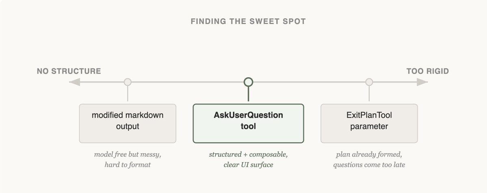
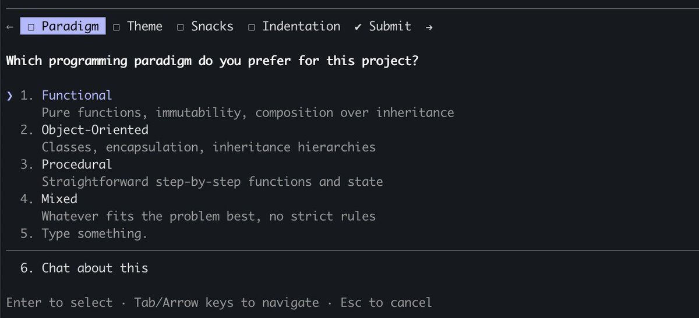
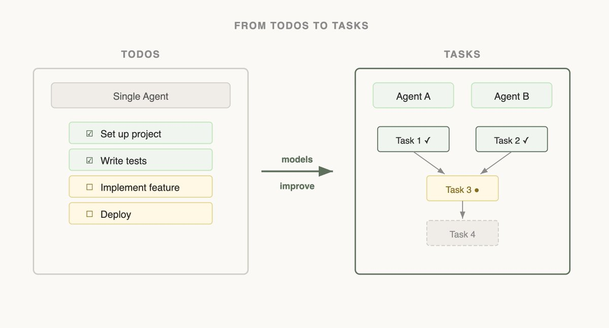

# B19_Seeing like an agent: how we design tools in Claude Code_像智能体一样看世界：我们在 Claude Code 里如何设计工具

> 原文：https://claude.com/blog/seeing-like-an-agent
> 来源：Anthropic Claude Blog（分类：Agents ｜ 产品：Claude Code）｜发布日期：2026-04-10 ｜ 作者：Thariq Shihipar（Anthropic 技术团队，Claude Code）
> 原文存档：[Markdown](原文/B19_seeing-like-an-agent_原文.md)

## 📌 本篇速览

- 📅 2026-04-10　｜　⏱ 原文约 1580 词（逐句精读约 25 分钟）
- 🏷 工具设计、elicitation、AskUserQuestion、TodoWrite→Task、RAG→Grep、渐进式披露、subagent
- 🗂 [返回目录](00_目录与阅读进度.md)

Claude Code 团队讲工具设计方法论的一手复盘，核心命题：**工具要贴合模型自身的能力形状（shaped to its abilities），而判断能力的方法是"像智能体一样看"——读输出、做实验**。四个案例：① AskUserQuestion 工具三次尝试（改 ExitPlanTool 参数→失败；改输出格式→不可靠；独立工具+阻塞 loop 的模态框→成功，因为"Claude 喜欢调它"）；② TodoWrite→Task 的演进（模型变强后，5 轮一次的 reminder 反而让它死守清单不敢改；subagent 无法共享 todo，于是换成带依赖关系、可增删改的 Task）；③ 检索接口从 RAG（预索引+被动喂上下文）换成 Grep（模型自己搜、自己建上下文），再由 Skills 形式化成渐进式披露；④ Claude Code Guide subagent——文档搜索放进子智能体独立上下文，只交回答案，主上下文保持干净，「不加新工具也能扩大行动空间」。三条原则：加工具的门槛要高（每多一个工具就多一个思考负担，Claude Code 只有 ~20 个）；模型升级后要重新审视旧工具是否已成约束；工具设计是艺术不是科学。

---

One of the hardest parts about building an agent harness is constructing its tools.

构建智能体 harness 最难的部分之一，就是构造它的工具。

Claude acts completely through tool calling, but there are a number of ways tools can be constructed in the Claude API with primitives like bash, skills and code execution.

Claude 完全通过工具调用（tool calling）来行动，但在 Claude API 中，工具可以用多种原语来构造，比如 bash、skills 和代码执行（code execution）。

(You can read more about programmatic tool calling on the Claude API in @RLanceMartin's new article).

（关于 Claude API 上的编程式工具调用，可以阅读 @RLanceMartin 的新文章。）

So how do you design your agents' tools?

那么，你该如何设计智能体的工具？

Do you give it one general-purpose tool like bash or code execution?

是给它一个像 bash 或代码执行这样的通用工具？

Or fifty specialized tools, one for each use case?

还是给五十个专用工具，每个用例一个？

To put yourself in the mind of the model, imagine being given a difficult math problem.

要把自己放进模型的思维里，想象你被布置了一道很难的数学题。

What tools would you want in order to solve it?

为了解它，你想要什么工具？

It would depend on your own skill set!

这取决于你自己的技能水平！

Paper would be the minimum, but you'd be limited by manual calculations.

纸是最低配置，但你会被手工计算拖累。

A calculator would be better, but you would need to know how to operate the more advanced options.

计算器更好一些，但你得会用那些高级功能。

The fastest and most powerful option would be a computer, but you would have to know how to use it to write and execute code.

最快、最强的选项是一台电脑，但前提是你得会用它写代码并执行。

This is a useful framework for designing your agent.

这是设计智能体时一个很有用的框架。

You want to give it tools that are shaped to its own abilities.

你要给它的是**贴合它自身能力形状**的工具。

But how do you know what those abilities are?

但你怎么知道它的能力到底是什么样？

You pay attention, read its outputs, experiment.

你得持续观察、读它的输出、做实验。

You learn to see like an agent.

你要学会像智能体一样看世界。

If you're building an agent, you'll face the same questions we did: when to add a tool, when to remove one, and how to tell the difference.

如果你在构建智能体，你会遇到和我们一样的问题：什么时候加一个工具、什么时候删一个工具，以及如何分辨这两种时机。

Here's how we've answered them while building Claude Code, including where we got it wrong first.

下面是我们在构建 Claude Code 过程中给出的回答——包括我们最初做错的地方。

## Improving elicitation with the AskUserQuestion tool

## 用 AskUserQuestion 工具改进「提问」

When building the AskUserQuestion tool, our goal was to improve Claude's ability to ask questions (often called elicitation).

构建 AskUserQuestion 工具时，我们的目标是改进 Claude 提问的能力（这通常被称为 elicitation，需求引出）。

While Claude could just ask questions in plain text, we found answering those questions felt like they took an unnecessary amount of time.

虽然 Claude 完全可以用纯文本提问，但我们发现回答这些问题给人的感觉是花了不必要的时间。

How could we lower this friction and increase the bandwidth of communication between the user and Claude?

我们怎样才能降低这种摩擦、提高用户与 Claude 之间的沟通带宽？

### Attempt 1: Editing the ExitPlanTool

### 尝试一：改造 ExitPlanTool

The first approach we tried was adding a parameter to the ExitPlanTool to have an array of questions alongside the plan.

我们尝试的第一个方案，是给 ExitPlanTool 加一个参数，让它在输出计划的同时附带一组问题。

This was the easiest fix to implement, but it confused Claude because we were simultaneously asking for a plan and a set of questions about the plan.

这是实现上最省事的改法，但它把 Claude 搞糊涂了——因为我们同时在要一份计划，又在要一组关于这份计划的问题。

What if the user's answers conflicted with what the plan said?

如果用户的回答和计划的内容冲突了怎么办？

Would Claude need to call the ExitPlanTool twice?

Claude 需要把 ExitPlanTool 调两次吗？

We knew this tactic wouldn't work, so we went back to the drawing board.

我们知道这条路走不通，于是推倒重来。

(You can read more about why we made an ExitPlanTool in our post on prompt caching)

（关于我们为什么要做 ExitPlanTool，可以读我们那篇讲 prompt caching 的文章。）

### Attempt 2: Changing output format

### 尝试二：改输出格式

Next, we tried updating Claude's output instructions to serve a slightly modified markdown format that it could use to ask questions.

接着，我们尝试更新 Claude 的输出指令，让它用一种稍作修改的 markdown 格式来提问。

For example, we could ask it to output a list of bullet point questions with alternatives in brackets.

比如，我们可以要求它输出一列带括号备选项的 bullet 问题。

We could then parse and format that question as UI for the user.

然后我们把这些问题解析出来，格式化成给用户看的 UI。

Claude could usually produce this format, but not reliably.

Claude 通常能产出这种格式，但并不可靠。

It would append extra sentences, drop options, or abandon the structure altogether.

它会附加多余的句子、漏掉选项，或者干脆完全抛弃这个结构。

Onto the next approach.

于是进入下一个方案。

### Attempt 3: The AskUserQuestion Tool

### 尝试三：AskUserQuestion 工具

Finally, we landed on creating a tool that Claude could call at any point, but it was particularly prompted to do so during plan mode.

最终，我们落在了创建一个 Claude 随时可以调用的工具上，并特别提示它在计划模式（plan mode）下调用。

When the tool triggered we would show a modal to display the questions and block the agent's loop until the user answered.

工具触发时，我们会弹出一个模态框展示问题，并**阻塞智能体的循环**，直到用户作答。

This tool allowed us to prompt Claude for a structured output and it helped us ensure that Claude gave the user multiple options.

这个工具让我们可以向 Claude 要求结构化输出，也帮助我们确保 Claude 给用户提供多个选项。

It also gave users ways to compose this functionality, for example calling it in the Agent SDK or using referring to it in skills.

它还让用户能够组合这项功能，比如在 Agent SDK 里调用它，或在 skills 里引用它。

Most importantly, Claude seemed to like calling this tool and we found its outputs worked well.

最重要的是，Claude 看起来**喜欢**调用这个工具，而且我们发现它的输出效果很好。

After all, even the best designed tool doesn't work if Claude doesn't understand how to call it.

毕竟，设计得再好的工具，如果 Claude 不理解怎么调用，也是白搭。

Is this the final form of elicitation in Claude Code?

这是 Claude Code 里「提问」的最终形态吗？

We doubt it.

我们对此表示怀疑。

As Claude gets more capable, the tools that serve it have to evolve too.

随着 Claude 能力增强，服务它的工具也必须随之演进。

The next section shows a case where a tool that once helped started getting in the way.

下一节讲的就是一个「曾经有用的工具开始碍事」的案例。

### Updating with capabilities: tasks & todos

### 随能力更新工具：Task 与 Todo

When we first launched Claude Code, we realized that the model needed a todo list to keep it on track.

我们最初发布 Claude Code 时，发现模型需要一个待办清单（todo list）来保持在正轨上。

Todos could be written at the start and checked off as the model did work.

待办事项可以在开始时写下，随着模型完成工作逐项勾掉。

To do this we gave Claude the TodoWrite tool, which would write or update Todos and display them to the user.

为此我们给了 Claude 一个 TodoWrite 工具，用来写入或更新待办事项，并展示给用户。

But even then, we often saw Claude forgetting what it had to do.

但即便如此，我们还是经常看到 Claude 忘记自己要做什么。

To adapt, we inserted system reminders every 5 turns that reminded Claude of its goal.

作为应对，我们每 5 轮插入一次系统提醒（system reminder），提醒 Claude 它的目标。

As models improved, they found To-do lists limiting.

随着模型变强，它们开始觉得待办清单是种限制。

Being sent reminders of the todo list made Claude think that it had to stick to the list instead of modifying it when it realized it needed to change course.

不断收到待办清单的提醒，让 Claude 以为自己必须死守这份清单——而不是在意识到需要改变方向时去修改它。

We also saw Opus 4.5 also get much better at using subagents, but how could subagents coordinate on a shared todo list?

我们也看到 Opus 4.5 在使用子智能体（subagent）上进步明显，但子智能体们要怎么在一份共享的待办清单上协同呢？

Seeing this, we replaced the TodoWrite feature with the Task tool.

看到这些之后，我们把 TodoWrite 功能替换成了 Task 工具。

Whereas todos are focused on keeping the model on track, tasks help agents communicate with each other.

如果说 todo 的重心是让模型保持在正轨上，那 task 的重心是帮助智能体之间互相沟通。

Tasks could include dependencies, share updates across subagents and the model could alter and delete them.

Task 可以携带依赖关系、在子智能体之间共享更新，模型也可以修改和删除它们。

As model capabilities increase, the tools that your models once needed might now be constraining them.

随着模型能力提升，你的模型曾经需要的工具，现在可能正在束缚它们。

It's important to constantly revisit previous assumptions on what tools are needed.

持续重新审视「需要哪些工具」的既有假设非常重要。

This is also why it's useful to stick to a small set of models to support that have a fairly similar capabilities profile.

这也是为什么只支持一小组能力画像相近的模型是有好处的。

## Designing a search interface

## 设计检索接口

The most consequential tools we've built are the ones that let Claude find its own context.

我们构建过的影响最深远的工具，是那些让 Claude **自己寻找上下文**的工具。

When Claude Code was first released internally, we used RAG: a vector database would pre-index the codebase, and the harness would retrieve relevant snippets and hand them to Claude before each response.

Claude Code 最早在内部发布时，我们用的是 RAG：向量数据库预先索引代码库，harness 在每次回复前检索相关片段并递给 Claude。

While RAG was powerful and fast, it required indexing and setup and could be fragile across a host of different environments.

RAG 虽然强大且快速，但它需要索引和前置配置，而且在各种不同环境下可能很脆弱。

Most importantly, Claude was *given* this context instead of finding the context itself.

最重要的是，这些上下文是*喂给* Claude 的，而不是它自己找到的。

But if Claude could search on the web, why couldn't it also search your codebase?

可既然 Claude 能搜索网页，为什么不能搜索你的代码库？

By giving Claude a Grep tool, we could let it search for files and build context itself.

给 Claude 一个 Grep 工具，我们就能让它自己搜索文件、自己构建上下文。

As Claude gets smarter, it becomes increasingly good at building its context when given the right tools.

Claude 越聪明，在拿到合适工具时自建上下文的能力就越强。

When we introduced Agent Skills, we formalized the idea of progressive disclosure, which allows agents to incrementally discover relevant context through exploration.

我们推出 Agent Skills 时，把「渐进式披露」（progressive disclosure）这一理念形式化了——它允许智能体通过探索，逐步发现相关上下文。

Claude could now read skill files and those files could then reference other files that the model could read recursively.

Claude 现在可以读取 skill 文件，而这些文件又可以引用其他文件，模型可以递归地读下去。

In fact, a common use of skills is to add more search capabilities to Claude like giving it instructions on how to use an API or query a database.

事实上，skills 的一个常见用法就是给 Claude 增加更多检索能力，比如教它如何使用某个 API 或查询某个数据库。

Over the course of a year, Claude went from not really being able to build its own context to being able to do nested search across several layers of files to find the exact context it needed.

一年时间里，Claude 从基本不会自建上下文，进化到能跨好几层文件做嵌套检索、找到它需要的精确上下文。

Progressive disclosure is now a common technique we use to add new functionality without adding a tool.

渐进式披露如今是我们**不加新工具就能添加新功能**的常用技术。

In the next section, we explain why.

下一节解释为什么。

## Progressive disclosure: the Claude Code Guide agent

## 渐进式披露：Claude Code Guide 子智能体

Claude Code currently has ~20 tools, and our team frequently revisits if we need all of them for Claude to be most effective.

Claude Code 目前有约 20 个工具，我们团队经常重新审视：为了让 Claude 发挥最佳效果，这些工具是否都还需要。

The bar to add a new tool is high, because this gives the model one more option to think about.

加新工具的门槛很高，因为每加一个，模型就多一个需要考虑的选项。

For example, we noticed that Claude did not know enough about how to use Claude Code.

举个例子，我们注意到 Claude 对「如何使用 Claude Code 本身」了解不足。

If you asked it how to add a MCP or what a slash command did, it would not be able to reply.

如果你问它怎么添加一个 MCP、某个斜杠命令是干什么的，它答不上来。

We could have put all of this information in the system prompt, but given that users rarely asked about this, it would have added context rot and interfered with Claude Code's main job: writing code.

我们本可以把这些信息全塞进系统提示词，但考虑到用户很少问这类问题，那样做只会增加上下文腐化（context rot），干扰 Claude Code 的主业：写代码。

Instead, we tried progressive disclosure: we gave Claude a link to its docs that it could load and search when needed.

我们改用渐进式披露：给 Claude 一个指向其文档的链接，需要时它可以自行加载和搜索。

This worked, but Claude would pull large chunks of documentation into context to find an answer the user could have gotten in one sentence.

这有效，但 Claude 会把大段大段的文档拉进上下文，只为找一个本来一句话就能回答的问题。

So we built the Claude Code Guide — a subagent Claude calls whenever a user asks about Claude Code itself.

于是我们做了 Claude Code Guide——一个每当用户问到 Claude Code 本身时 Claude 就会调用的子智能体。

The subagent does the doc-searching in its own context, follows detailed instructions on how to search and what to extract, and hands back only the answer.

这个子智能体在自己独立的上下文里做文档检索，遵循「怎么搜、提取什么」的详细指令，最后**只把答案交回来**。

The main agent's context stays clean.

主智能体的上下文保持干净。

While this isn't a perfect solution (Claude can still get confused when you ask it about how to set itself up), we were able to add things to Claude's action space without adding a new tool.

虽然这不是完美方案（当你问 Claude 如何配置它自己时，它仍可能犯迷糊），但我们做到了在**不增加新工具**的前提下扩大 Claude 的行动空间。

### Seeing like an agent is an art, not a science

### 像智能体一样看，是艺术不是科学

Designing the tools for your models is as much an art as it is a science.

为模型设计工具，是艺术，也是科学。

It depends heavily on the model you're using, the goal of the agent and the environment it's operating in.

它高度依赖你所用的模型、智能体的目标，以及它运行的环境。

Our best advice?

我们最好的建议？

Experiment often, read your outputs, try new things.

多做实验、读你的输出、尝试新东西。

And most importantly, try to see like an agent.

最重要的是：试着像智能体一样去看。

---

## 术语中英对照表

| 英文 | 中文 | 备注 |
|---|---|---|
| agent harness | 智能体运行框架 | 模型外围的工具、循环与调度系统 |
| elicitation | 需求引出 / 提问 | AskUserQuestion 要解决的问题 |
| plan mode | 计划模式 | AskUserQuestion 被特别提示调用的场景 |
| block the agent's loop | 阻塞智能体循环 | 模态框弹出后等待用户作答 |
| system reminder | 系统提醒 | 早期每 5 轮提醒一次 todo 的机制 |
| TodoWrite → Task tool | 待办工具 → 任务工具 | todo 管「不跑偏」，task 管「智能体间通信」 |
| capabilities profile | 能力画像 | 建议只支持能力相近的一小组模型 |
| progressive disclosure | 渐进式披露 | 通过探索逐步发现上下文；不加工具加功能 |
| context rot | 上下文腐化 | 塞进系统提示词的低频信息带来的负担 |
| action space | 行动空间 | 子智能体方案扩大它而不加工具 |
| nested search | 嵌套检索 | skill 文件递归引用文件的多层搜索 |
