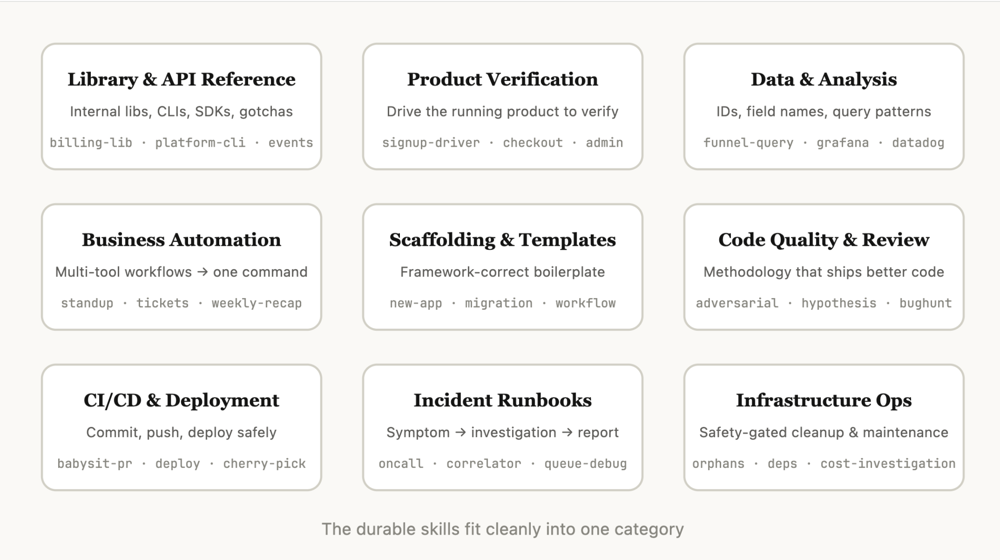
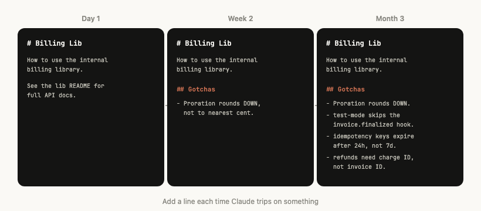
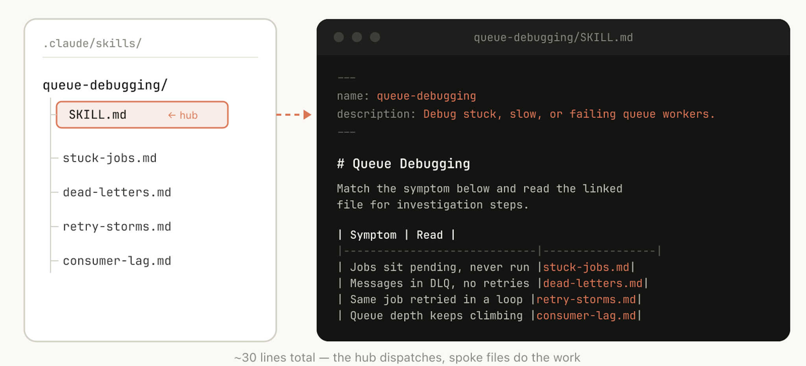
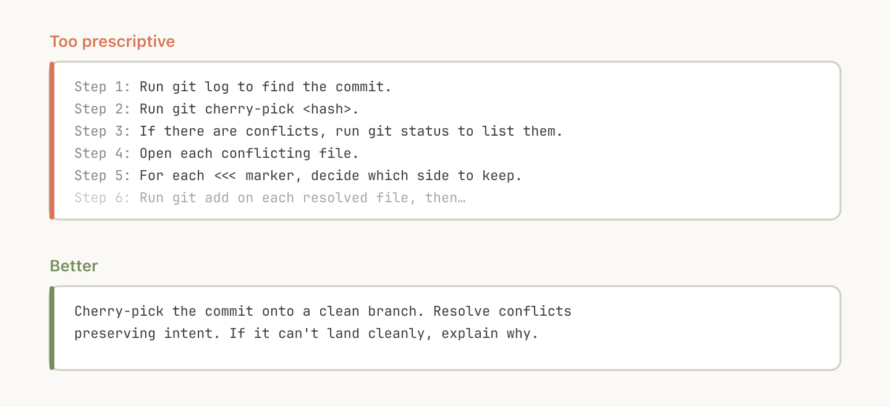
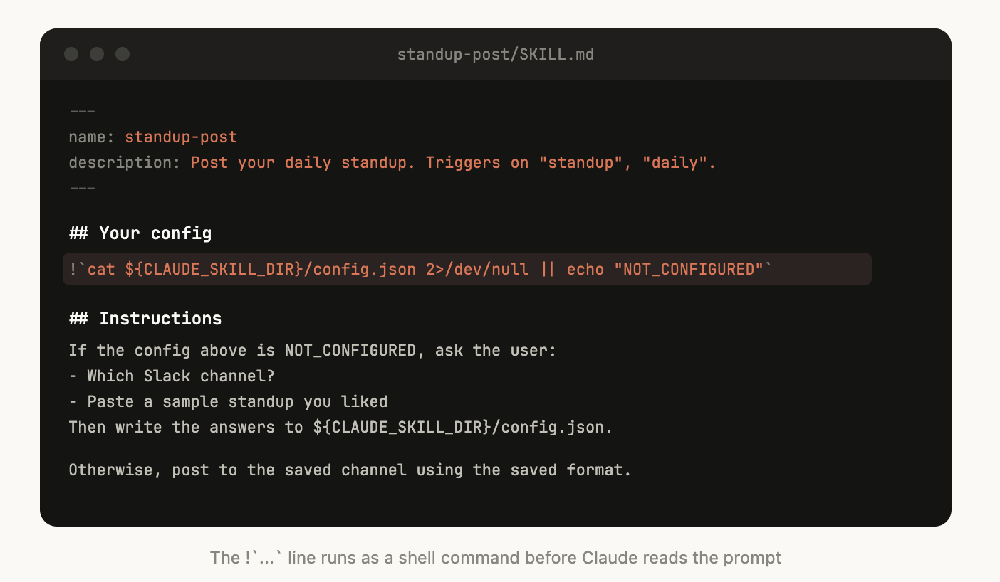
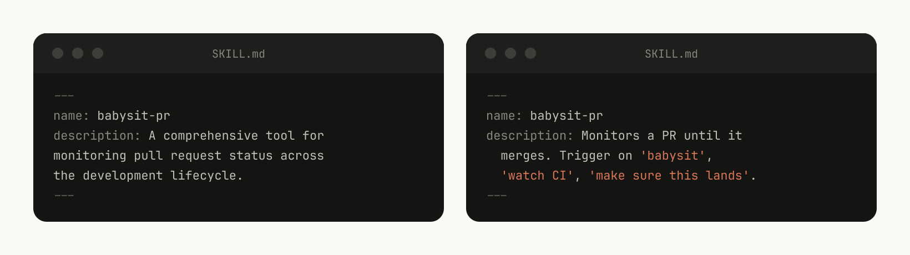
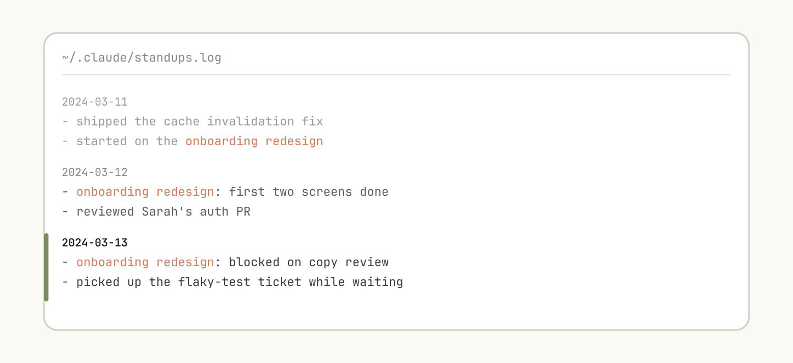
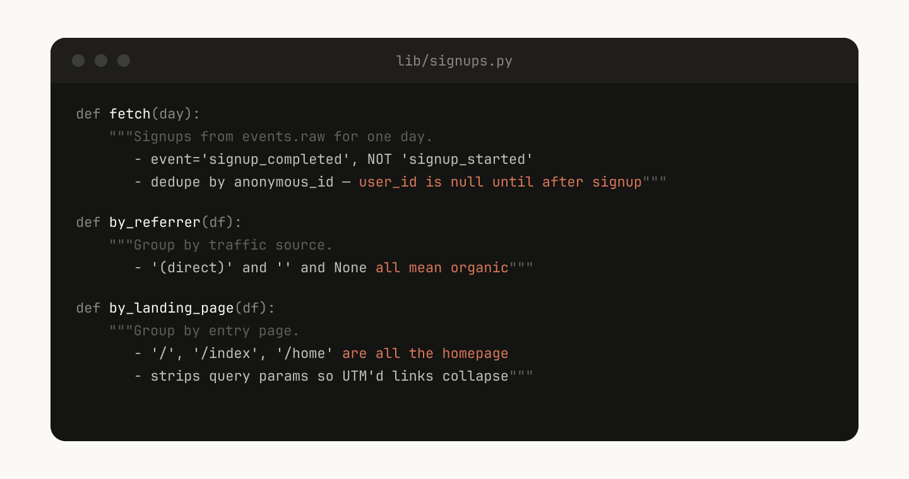
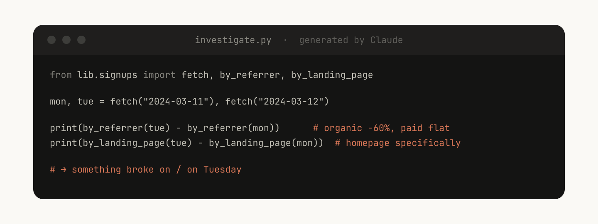

# B22_Lessons from building Claude Code: How we use skills_构建 Claude Code 的经验：我们如何使用 skills

> 原文：https://claude.com/blog/lessons-from-building-claude-code-how-we-use-skills
> 来源：Anthropic Claude Blog（分类：Agents ｜ 产品：Claude Code）｜发布日期：2026-06-03 ｜ 作者：Thariq Shihipar（Anthropic 技术团队，Claude Code）
> 原文存档：[Markdown](原文/B22_lessons-from-building-claude-code-how-we-use-skills_原文.md)

## 📌 本篇速览

- 📅 2026-06-03　｜　⏱ 原文约 2630 词（逐句精读约 35 分钟）
- 🏷 skills 九大类、gotchas、渐进式披露、railroading、skill 记忆、on-demand hooks、marketplace、skill 度量
- 🗂 [返回目录](00_目录与阅读进度.md)

Anthropic 内部「数百个 skills 在用」的实战经验总结。**九类 skills**：库/API 参考、产品验证、数据获取与分析、业务流程自动化、脚手架模板、代码质量评审、CI/CD 部署、runbook、基础设施运维——好 skill 只落在一类里，跨几类的会把模型搞糊涂。**最有可测量影响的是验证类 skills**（值得让工程师专门花一周打磨）。**写 skill 八条技巧**：别写模型本来就会的（要写把模型推出默认思维的信息）；gotchas 段是信号密度最高的内容；把文件系统当渐进式披露用；别把 Claude 钉死在轨道上（railroading）；setup 信息存 config.json、缺了就问用户；**description 写给模型看，写触发时机不写摘要**；skill 内可存日志/JSON/SQLite 作为记忆；给脚本让模型把回合花在组合而非重写样板上。分发：小团队 checked into repo，规模化走 plugin marketplace（自下而上、靠自然吸引力晋级）。度量：PreToolUse hook 记录使用量，找出「低于预期触发」的 skill。

---

Skills have become one of the most used extension points in Claude Code.

Skills 已经成为 Claude Code 里使用最多的扩展点之一。

They're flexible, easy to make, and easy to distribute.

它们灵活、易做、易分发。

But this flexibility also makes it hard to know what works best.

但这种灵活性也让人难以判断怎么用效果最好。

What type of skills are worth making?

什么类型的 skill 值得做？

How do you structure a skill?

一个 skill 该怎么组织结构？

When do you share them with others?

什么时候该分享给别人？

We've been using skills in Claude Code extensively at Anthropic with hundreds of them in active use.

在 Anthropic 内部，我们大量使用 Claude Code 的 skills，活跃使用中的有数百个。

These are the lessons we've learned about using skills to accelerate our development.

以下是我们用 skills 加速开发所学到的经验。

## What are skills?

## 什么是 skills？

Skills are folders of instructions, scripts, and resources that agents can discover and use to do things more accurately and efficiently.

Skills 是由指令、脚本和资源组成的文件夹，智能体可以发现并使用它们，把事情做得更准确、更高效。

This blog post assumes familiarity with skills basics; if you're new, start with our Introduction to agent skills course on Skilljar.

本文假设你已了解 skills 基础；如果是新手，请先看我们在 Skilljar 上的 Agent Skills 入门课程。

A common misconception we hear about skills is that they are "just markdown files."

关于 skills，我们常听到的一个误解是它们「只是 markdown 文件」。

They're actually folders that can include scripts, assets, data, etc. that the agent can discover, explore and manipulate.

它们实际上是文件夹，可以包含脚本、素材、数据等，智能体能够发现、探索和操作这些内容。

In Claude Code, skills also have a wide variety of configuration options including registering dynamic hooks.

在 Claude Code 里，skills 还有丰富的配置选项，包括注册动态 hooks。

We've found that some of the most effective skills in Claude Code use these configuration options and folder structure effectively.

我们发现 Claude Code 里最有效的一些 skills，正是把这些配置选项和文件夹结构用得很好的那些。

## Types of skills

## Skills 的类型

After cataloging all of our internal skills at Anthropic, we noticed they cluster into nine categories.

把 Anthropic 内部所有 skills 归类之后，我们发现它们聚成九个类别。

The best skills fit cleanly into one; the ones that try to do too much straddle several and confuse the agent.

最好的 skills 干净地落在一个类别里；想做太多事的那些横跨好几类，反而把智能体搞糊涂。

This isn't a definitive list, but it is a useful framework for identifying gaps in your own skills library.

这不是一份权威清单，但它是一个有用的框架，帮你识别自己 skills 库里的空缺。

*图注：Claude Code 团队对内部 skills 归类后发现它们可以装进九个不同的桶。*

### 1. Library and API reference

### 1. 库与 API 参考

These are skills that explain how to correctly use a library, CLI, or SDKs.

这类 skills 讲解如何正确使用某个库、CLI 或 SDK。

They could be both for internal libraries or common libraries that Claude Code sometimes struggles to handle.

对象既可以是内部库，也可以是 Claude Code 有时处理不好的常见公共库。

These skills often included a folder of reference code snippets and a list of gotchas for Claude to avoid when writing a script.

这类 skills 通常带一个参考代码片段的文件夹，以及一份「坑清单」（gotchas），让 Claude 写脚本时避开。

Examples include:

例子包括：

- `billing-lib` — your internal billing library: edge cases, footguns, etc.

- `billing-lib`——你的内部计费库：边界情况、容易踩的坑等。

- `internal-platform-cli` — every subcommand of your internal CLI wrapper with examples on when to use them.

- `internal-platform-cli`——内部 CLI 封装的每个子命令，以及各自何时使用的示例。

- `sandbox-proxy` — configuring your org's egress gateway for dev work: which hosts are reachable, how to debug "connection refused" errors, how to add an allowlist entry.

- `sandbox-proxy`——为开发工作配置组织的出网网关：哪些主机可达、怎么排查 "connection refused"、怎么加白名单。

### 2. Product verification

### 2. 产品验证

These are skills that describe how to test or verify that your code is working.

这类 skills 描述如何测试或验证你的代码确实在工作。

They are often paired with playwright, tmux, or other external tools for verification.

它们常与 playwright、tmux 或其他外部验证工具搭配使用。

Verification skills have had the most measurable impact on Claude's output quality internally.

在内部，验证类 skills 对 Claude 输出质量的影响是**最可测量**的。

It can be worth having an engineer spend a week just making your verification skills excellent.

值得让一位工程师专门花一周时间，把你的验证 skills 打磨到优秀。

Consider techniques like having Claude record a video of its output so you can see exactly what it tested, or enforcing programmatic assertions on state at each step.

可以考虑这些技巧：让 Claude 录一段自己输出的视频，这样你能确切看到它测了什么；或者在每一步对状态强制执行程序化断言。

These are often done by including a variety of scripts in the skill.

这些通常通过在 skill 里放各种脚本来实现。

Examples include:

例子包括：

- `signup-flow-driver` — runs through signup → email verify → onboarding in a headless browser, with hooks for asserting state at each step

- `signup-flow-driver`——在无头浏览器里跑通注册→邮箱验证→引导流程，每一步都有断言状态的钩子

- `checkout-verifier` — drives the checkout UI with Stripe test cards, verifies the invoice actually lands in the right state

- `checkout-verifier`——用 Stripe 测试卡驱动结账界面，验证发票真的落在正确状态

- `tmux-cli-driver` — for interactive CLI testing where the thing you're verifying needs a TTY

- `tmux-cli-driver`——用于交互式 CLI 测试，适合被验证对象需要 TTY 的场景

### 3. Data fetching and analysis

### 3. 数据获取与分析

These are skills that connect to your data and monitoring stacks.

这类 skills 连接你的数据栈和监控栈。

These skills might include libraries to fetch your data with credentials, specific dashboard ids, etc., as well as instructions on common workflows or ways to get data.

它们可能包含带凭据取数的库、特定 dashboard 的 id 等，还有常见工作流或取数方式的说明。

Examples include:

例子包括：

- `funnel-query` — "which events do I join to see signup → activation → paid" plus the table that actually has the canonical user_id

- `funnel-query`——「要看注册→激活→付费漏斗该 join 哪些事件」，外加真正存有规范 user_id 的那张表

- `cohort-compare` — compare two cohorts' retention or conversion, flag statistically significant deltas, link to the segment definitions

- `cohort-compare`——比较两个用户群的留存或转化，标记统计显著的差异，并链接到分群定义

- `grafana` — datasource UIDs, cluster names, problem → dashboard lookup table

- `grafana`——数据源 UID、集群名，以及「问题 → dashboard」的查找表

- `datadog` — field reference (@request_id vs trace_id), service list, metric prefix conventions

- `datadog`——字段参考（@request_id 与 trace_id 的区别）、服务清单、指标前缀约定

### 4. Business process and team automation

### 4. 业务流程与团队自动化

These are skills that automate repetitive workflows into one command.

这类 skills 把重复性工作流自动化成一条命令。

These skills are usually fairly simple instructions but might have more complicated dependencies on other skills or MCPs.

它们的指令通常相当简单，但可能对其他 skills 或 MCP 有更复杂的依赖。

For these skills, saving previous results in log files can help the model stay consistent and reflect on previous executions of the workflow.

对这类 skills，把历史结果存进日志文件，能帮模型保持一致性，并回顾之前几次执行的情况。

Examples include:

例子包括：

- `standup-post` — aggregates your ticket tracker, GitHub activity, and prior Slack → formatted standup, delta-only

- `standup-post`——聚合工单系统、GitHub 活动和之前的 Slack 记录 → 输出只含增量的格式化站会帖

- `create-<ticket-system>-ticket` — enforces schema (valid enum values, required fields) plus post-creation workflow (ping reviewer, link in Slack)

- `create-<ticket-system>-ticket`——强制 schema（合法枚举值、必填字段），外加创建后的流程（ping 评审人、在 Slack 里贴链接）

- `weekly-recap` — merged PRs + closed tickets + deploys → formatted recap post

- `weekly-recap`——已合并 PR + 已关闭工单 + 部署记录 → 格式化的周报帖

### 5. Code scaffolding and templates

### 5. 代码脚手架与模板

These are skills that generate framework boilerplates for a specific function in a codebase.

这类 skills 为代码库里的特定功能生成框架样板代码。

You might combine these skills with scripts that can be composed.

你可以把这类 skills 与可组合的脚本结合使用。

They are especially useful when your scaffolding has natural language requirements that can't be purely covered by code.

当你的脚手架带有纯代码覆盖不了的自然语言要求时，它们尤其有用。

Examples include:

例子包括：

- `new-<framework>-workflow` — scaffolds a new service/workflow/handler with your annotations

- `new-<framework>-workflow`——按你的注解规范搭一个新服务/工作流/handler

- `new-migration` — your migration file template plus common gotchas

- `new-migration`——你的数据库迁移文件模板，外加常见的坑

- `create-app` — new internal app with your auth, logging, and deploy config pre-wired

- `create-app`——预接好鉴权、日志和部署配置的新内部应用

### 6. Code quality and review

### 6. 代码质量与评审

These are skills that enforce code quality inside of your org and help review code.

这类 skills 在组织内部强制执行代码质量标准并辅助评审代码。

These can include deterministic scripts or tools for maximum robustness.

它们可以包含确定性的脚本或工具，以获得最大的稳健性。

You may want to run these skills automatically as part of hooks or inside of a GitHub Action.

你可能想让这些 skills 作为 hooks 的一部分或在 GitHub Action 里自动运行。

- `adversarial-review` — spawns a fresh-eyes subagent to critique, implements fixes, iterates until findings degrade to nitpicks

- `adversarial-review`——派生一个「新眼睛」子智能体来批判，实施修复，迭代到发现的问题只剩鸡毛蒜皮为止

- `code-style` — enforces code style, especially styles that Claude does not do well by default.

- `code-style`——强制代码风格，尤其是 Claude 默认做不好的那些

- `testing-practices` — instructions on how to write tests and what to test.

- `testing-practices`——怎么写测试、该测什么的指引

### 7. CI/CD and deployment

### 7. CI/CD 与部署

These are skills that help you fetch, push, and deploy code inside of your codebase.

这类 skills 帮你在代码库里拉取、推送和部署代码。

These skills may reference other skills to collect data.

它们可能引用其他 skills 来收集数据。

Examples include:

例子包括：

- `babysit-pr` — monitors a PR → retries flaky CI → resolves merge conflicts → enables auto-merge

- `babysit-pr`——盯着一个 PR → 重试不稳定的 CI → 解决合并冲突 → 开启自动合并

- `deploy-<service>` — build → smoke test → gradual traffic rollout with error-rate comparison → auto-rollback on regression

- `deploy-<service>`——构建 → 冒烟测试 → 带错误率对比的灰度放量 → 出现回归自动回滚

- `cherry-pick-prod` — isolated worktree → cherry-pick → conflict resolution → PR with template

- `cherry-pick-prod`——隔离 worktree → cherry-pick → 解决冲突 → 按模板发 PR

### 8. Runbooks

### 8. 运维手册（Runbooks）

These are skills that take a symptom (such as a Slack thread, alert, or error signature), walk through a multi-tool investigation, and produce a structured report.

这类 skills 接收一个症状（比如一条 Slack 讨论、一个告警或一个错误签名），走完一套跨工具的排查流程，产出结构化报告。

Examples include:

例子包括：

- `<service>-debugging` — maps symptoms → tools → query patterns for your highest-traffic services

- `<service>-debugging`——为你流量最高的服务建立「症状 → 工具 → 查询模式」的映射

- `oncall-runner` — fetches the alert → checks the usual suspects → formats a finding

- `oncall-runner`——拉取告警 → 检查常见嫌疑对象 → 格式化输出结论

- `log-correlator` — given a request ID, pulls matching logs from every system that might have touched it

- `log-correlator`——给定一个请求 ID，从每个可能经手它的系统里拉出匹配日志

### 9. Infrastructure operations

### 9. 基础设施运维

These are skills that perform routine maintenance and operational procedures, some of which involve destructive actions that benefit from guardrails.

这类 skills 执行例行维护和运维流程，其中一些涉及破坏性操作，需要护栏保护。

These make it easier for engineers to follow best practices in critical operations.

它们让工程师在关键操作中更容易遵循最佳实践。

Examples include:

例子包括：

- `<resource>-orphans` — finds orphaned pods/volumes → posts to Slack → soak period → user confirms → cascading cleanup

- `<resource>-orphans`——找出孤儿 pod/存储卷 → 发到 Slack → 观察期 → 用户确认 → 级联清理

- `dependency-management` — your org's dependency approval workflow

- `dependency-management`——组织的依赖审批流程

- `cost-investigation` — "why did our storage/egress bill spike" with the specific buckets and query patterns

- `cost-investigation`——「存储/出网账单为什么飙了」，带具体的 bucket 和查询模式

## Tips for making skills

## 写 skill 的技巧

Once you've decided on the skill to make, how do you write it?

决定了要做哪个 skill 之后，怎么写？

These are some of the Claude Code team's best practices, tips, and tricks for making skills

以下是 Claude Code 团队做 skills 的最佳实践与技巧。

### Don't state the obvious

### 别写显而易见的东西

Claude already knows how to code and can read your codebase.

Claude 本来就会写代码，也能读你的代码库。

A skill that restates what Claude would do by default adds context without adding value.

一个复述 Claude 默认就会去做的事的 skill，只增加上下文、不增加价值。

If you're publishing a skill that is primarily about knowledge, focus on information that pushes Claude out of its normal way of thinking.

如果你要发布的 skill 主要是知识型的，请聚焦在那些能把 Claude **推出它默认思维方式**的信息上。

The frontend design skill is a great example; it was built by an engineer at Anthropic by iterating with customers on improving Claude's design taste, avoiding classic patterns like the Inter font and purple gradients.

前端设计 skill 是个好例子：它由 Anthropic 一位工程师与客户一起迭代打磨，专注提升 Claude 的设计品味——避开 Inter 字体、紫色渐变这类烂大街的模式。

### Build a gotchas section

### 建一个「坑」区

The highest-signal content in any skill is the Gotchas section.

任何 skill 里信号密度最高的内容都是 Gotchas（坑）区。

These sections should be built up from common failure points that Claude runs into when using your skill.

这一区应该由 Claude 使用你的 skill 时反复踩到的失败点累积而成。

Ideally, you will update your skill over time to capture these gotchas.

理想情况下，你会随时间持续更新 skill，把这些坑收录进去。

For example:

例如：

"The `subscriptions` table is append-only. The row you want is the one with the highest version, not the most recent `created_at`."

「`subscriptions` 表是只追加的。你要的那一行是 version 最大的那行，不是 `created_at` 最新的那行。」

"This field is called `@request_id` in the API gateway and `trace_id` in the billing service. They're the same value."

「这个字段在 API 网关里叫 `@request_id`，在计费服务里叫 `trace_id`。它们是同一个值。」

"Staging returns 200 even when the Stripe webhook didn't actually process. Check `payment_events` for the real state."

「即使 Stripe webhook 实际没处理，staging 环境也会返回 200。真实状态要查 `payment_events`。」

### Use the file system and progressive disclosure

### 用好文件系统与渐进式披露

*图注：SKILL.md 指向若干其他文件，供 Claude 在特定情境下查阅。例如任务卡在 pending 时，应查 stuck-jobs.md。*

Like we said earlier, a skill is a folder, not just a markdown file.

如前所述，skill 是一个文件夹，不只是一个 markdown 文件。

You should think of the entire file system as a form of context engineering and progressive disclosure.

你应该把整个文件系统都看作一种上下文工程与渐进式披露的形式。

Tell Claude what files are in your skill, and it will read them at appropriate times.

告诉 Claude 你的 skill 里有哪些文件，它会在合适的时机去读。

The simplest form of progressive disclosure is to point to other markdown files for Claude to use.

渐进式披露最简单的形式，就是指向其他 markdown 文件让 Claude 使用。

For example, you may split detailed function signatures and usage examples into `references/api.md`.

比如，你可以把详细的函数签名和用法示例拆到 `references/api.md` 里。

Another example: if your end output is a markdown file, you might include a template file for it in `assets/` to copy and use.

再比如：如果最终输出是一个 markdown 文件，可以在 `assets/` 里放一个模板文件供复制使用。

You can have folders of references, scripts, examples, etc., which help Claude work more effectively.

你可以有参考、脚本、示例等各种文件夹，帮 Claude 更高效地工作。

### Avoid railroading Claude

### 别把 Claude 钉死在轨道上

Claude will generally try to stick to your instructions, and because skills are so reusable you'll want to be careful of being too specific in your instructions.

Claude 通常会尽力遵守你的指令，而正因为 skills 被大量复用，你要小心指令写得过于具体。

Give Claude the information it needs, but give it the flexibility to adapt to the situation.

给 Claude 它需要的信息，但也给它随机应变的灵活性。

For example:

例如：

### Think through the setup

### 想清楚初始配置

*图注：上面这个 skill 在配置里没写 Slack 频道时，会去询问用户。*

Some skills may need to be set up with context from the user.

有些 skills 需要用户提供上下文来完成初始配置。

For example, if you are making a skill that posts your standup to Slack, you may want Claude to ask which Slack channel to post it in.

比如你在做一个把站会帖发到 Slack 的 skill，你可能希望 Claude 先问一句发到哪个频道。

A good pattern to do this is to store this setup information in a config.json file in the skill directory like the above example.

一个好模式是像上面例子那样，把配置信息存在 skill 目录下的 config.json 里。

If the config is not set up, the agent can then ask the user for information.

如果配置还没建立，智能体就去向用户询问。

If you want the agent to present structured, multiple choice questions you can instruct Claude to use the AskUserQuestion tool.

如果想让智能体提出结构化的多选题，可以指示 Claude 使用 AskUserQuestion 工具。

### Write descriptions for the model, not for humans

### description 写给模型看，不是写给人看

When Claude Code starts a session, it builds a listing of every available skill with its description.

Claude Code 启动会话时，会构建一份所有可用 skills 及其 description 的清单。

This listing is what Claude scans to decide "is there a skill for this request?"

Claude 扫描的就是这份清单，来判断「这个请求有对应的 skill 吗？」

Which means the description field is not a summary, it's a description of when to trigger this skill.

这意味着 description 字段不是摘要，而是**这个 skill 何时该被触发**的描述。

*图注：在 description 里写上触发词（比如 "babysit"）会很有帮助。*

### Help Claude remember

### 帮 Claude 记住

*图注：这个文本日志文件帮 Claude 记住过去的事件，比如评审过 Sarah 的鉴权 PR。*

Some skills can include a form of memory by storing data within them.

有些 skills 可以通过在内部存数据来拥有某种形式的记忆。

You could store data in anything as simple as an append only text log file or JSON files, or as complicated as a SQLite database.

存储载体可以简单到一个只追加的文本日志或 JSON 文件，也可以复杂到一个 SQLite 数据库。

For example, a `standup-post` skill might keep a standups.log with every post it's written, which means the next time you run it, Claude reads its own history and can tell what's changed since yesterday.

比如 `standup-post` skill 可以维护一个 standups.log，记下它写过的每一篇；下次运行时，Claude 读自己的历史，就能说出昨天以来变了什么。

You can use the env variable `${CLAUDE_PLUGIN_DATA}` to get a stable directory where you can store data, read more persisting data in skills here.

可以用环境变量 `${CLAUDE_PLUGIN_DATA}` 拿到一个稳定的数据存储目录；skill 数据持久化详见[文档](https://code.claude.com/docs/en/plugins-reference#persistent-data-directory)。

### Store scripts and generate code

### 存脚本、生成代码

One of the most powerful tools you can give Claude is code.

你能给 Claude 的最强大的工具之一就是代码。

Giving Claude scripts and libraries lets Claude spend its turns on composition, deciding what to do next rather than reconstructing boilerplate.

给 Claude 脚本和库，能让它把回合花在**组合**上——决定下一步做什么，而不是重造样板代码。

For example, in your `data-science` skill you might have a library of functions to fetch data from your event source.

比如在你的 `data-science` skill 里，可以放一个从事件源取数的函数库。

In order for Claude to do complex analysis, you could give it a set of helper functions like this:

为了让 Claude 做复杂分析，你可以给它一组这样的辅助函数：

Claude can then generate scripts on the fly to compose this functionality to do more advanced analysis for prompts like "What happened on Tuesday?"

之后 Claude 就能即兴生成脚本、组合这些功能，来回答「周二发生了什么？」这类提示词背后的高级分析需求。

### Use on-demand hooks

### 使用按需 hooks

Skills can include hooks that are only activated when the skill is called, and that only last for the duration of the session.

Skills 可以包含只在 skill 被调用时才激活、只持续本次会话的 hooks。

Use this for more opinionated hooks that you don't want to run all the time, but are extremely useful sometimes.

把它用于那些立场更强硬、你不想常开、但某些时刻极其有用的 hooks。

For example:

例如：

- `/careful` — blocks rm -rf, DROP TABLE, force-push, kubectl delete via PreToolUse matcher on Bash. You only want this when you know you're touching prod — having it always on would drive you insane.

- `/careful`——通过 Bash 上的 PreToolUse 匹配器拦截 rm -rf、DROP TABLE、force-push、kubectl delete。只有你知道自己在碰生产环境时才需要它——常开会把人逼疯。

- `/freeze` — blocks any Edit/Write that's not in a specific directory. Useful during debugging: "I want to add logs but I keep accidentally 'fixing' unrelated code."

- `/freeze`——拦截特定目录之外的一切 Edit/Write。调试时很有用：「我只想加日志，但总是不小心顺手『修』了无关代码。」

## Distributing skills

## 分发 skills

One of the biggest benefits of skills is that you can share them with the rest of your team.

skills 最大的好处之一，是可以分享给团队其他人。

There are two ways you might want to share skills with others:

分享方式有两种：

- check your skills into your repo (under `./.claude/skills`)

- 把 skills 提交进仓库（放在 `./.claude/skills` 下）

- make a **plugin** and have a Claude Code Plugin marketplace where users can upload and install plugins

- 做成**插件**，通过 Claude Code 插件市场让大家上传和安装

For smaller teams working across relatively few repos, checking your skills into repos works well.

对仓库不多的小团队，把 skills 提交进仓库效果不错。

But every skill that is checked in also adds a little bit to the context of the model.

但每个提交进仓库的 skill，也都会给模型的上下文增加一点点负担。

As you scale, an internal plugin marketplace allows you to distribute skills and let your team decide which ones to install, as well as include a setup flow.

规模扩大后，内部插件市场让你可以分发 skills、让团队自行决定装哪些，还能内置配置流程。

## Managing a skills marketplace

## 管理 skills 市场

How do you decide which skills go in a marketplace?

怎么决定哪些 skills 进市场？

How do people submit them?

大家怎么提交？

At Anthropic, we don't have a centralized team that decides; instead we try to find the most useful skills organically.

在 Anthropic，没有一个中心化团队来决定；我们靠自然生长找出最有用的 skills。

If someone has a skill that they want people to try out, they can upload it to a sandbox folder in GitHub and point people to it in Slack or other forums.

如果有人想让大家试用自己的 skill，可以传到 GitHub 的沙箱文件夹，再在 Slack 或其他论坛里指给大家。

Once a skill has gotten traction (which is up to the skill owner to decide), they can put in a PR to move it into the marketplace.

一旦 skill 有了吸引力（由 skill 拥有者自行判断），就可以提 PR 把它挪进市场。

## Composing skills

## 组合 skills

You may want to have skills that depend on each other.

你可能想让 skills 之间相互依赖。

For example, you may have a file upload skill that uploads a file, and a CSV generation skill that makes a CSV and uploads it.

比如有一个上传文件的 skill，和一个生成 CSV 并上传它的 skill。

This sort of dependency management is not natively built into marketplaces or skills yet, but you can just reference other skills by name, and the model will invoke them if they are installed.

这种依赖管理目前还没有原生内置到市场或 skills 里，但你可以直接按名字引用其他 skills——只要装了，模型就会去调用。

## Measuring skills

## 度量 skills

To understand how a skill is doing, we use a PreToolUse hook that lets us log skill usage within the company.

为了了解一个 skill 表现如何，我们用一个 PreToolUse hook 在公司内记录 skill 的使用情况。

This means we can find skills that are popular or are undertriggering compared to our expectations.

这样我们就能发现哪些 skills 很受欢迎，哪些的触发频率低于预期。

## Get started

## 开始动手

Skills best practices are still evolving.

skills 的最佳实践仍在演进。

Most of our best skills began as a few lines and a single gotcha, then got better because people kept adding to them as Claude hit new edge cases.

我们最好的那些 skills，大多始于寥寥几行加一个坑；随着 Claude 撞上新的边界情况、大家不断往里加内容，它们才变得越来越好。

The best way to understand skills is to get started, experiment, and see what works for you.

理解 skills 的最好方式就是开始动手、做实验、看什么对你有效。

---

## 术语中英对照表

| 英文 | 中文 | 备注 |
|---|---|---|
| extension point | 扩展点 | skills 在 Claude Code 中的定位 |
| gotchas | 坑 / 陷阱清单 | skill 里信号密度最高的内容，从失败点累积 |
| verification skills | 验证类 skills | 对输出质量影响最可测量的一类 |
| programmatic assertions | 程序化断言 | 验证技巧：每步对状态强制断言 |
| railroading | 钉死在轨道上 | 指令过于具体、剥夺模型应变空间的反模式 |
| description field | 描述字段 | 不是摘要，是触发时机说明（含触发词） |
| on-demand hooks | 按需钩子 | 随 skill 激活、随会话结束的强硬型 hook |
| PreToolUse matcher | 工具调用前匹配器 | /careful 拦截危险命令的机制 |
| `${CLAUDE_PLUGIN_DATA}` | 插件数据目录 | skill 持久化数据的稳定路径 |
| plugin marketplace | 插件市场 | 规模化分发方案；自下而上晋级机制 |
| undertriggering | 触发不足 | 度量要抓的问题：低于预期的触发率 |
| composition | 组合 | 给脚本后模型把回合花在组合而非样板重写 |
