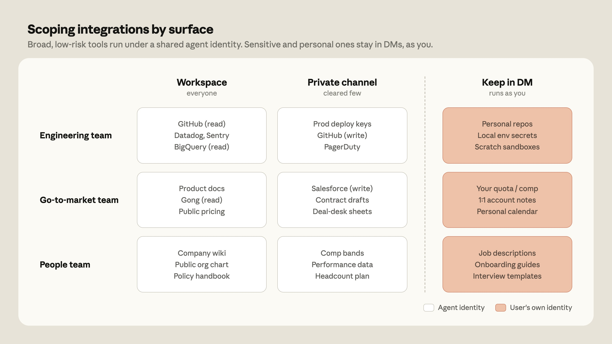

# B23_Agent identity: a new access model for autonomous, team-wide AI_Agent 身份：面向自治、团队级 AI 的新访问模型

> 原文：https://claude.com/blog/agent-identity-access-model
> 来源：Anthropic Claude Blog（分类：Security / Agents ｜ 产品：Claude Tag）｜发布日期：2026-06-24 ｜ 作者：Noah Zweben（Claude Code 团队）
> 原文存档：[Markdown](原文/B23_agent-identity-access-model_原文.md)

## 📌 本篇速览

- 📅 2026-06-24　｜　⏱ 原文约 1390 词（逐句精读约 18 分钟）
- 🏷 agent identity、act as itself、per-channel 权限、单人→多人 AI、审计、JIT 授权
- 🗂 [返回目录](00_目录与阅读进度.md)

Agent 权限模型的关键一篇。**核心转变**：从「代表用户行动（act as the user）」到「**作为它自己行动（acts as itself）**」——Agent 在每个系统里有自己的账号（Slack 里是 Claude app、GitHub 里是 Claude App、数仓里是 admin 开的 service account）。**「act as the user」失效的两个原因**：① Agent 自治时长每 ~4 个月翻倍，任务在提出者下线后很久才执行；② 多人频道里「用谁的权限」无解。**访问模型**：问题从「这个用户能做什么」变成「**这个 Agent 在这个隔间（compartment）里能做什么**」——workspace 级定义基线身份，channel 级覆写；私有频道各有独立身份，记忆和访问都不跨界。**安全机制**：凭据独立存储、请求时在网络边界注入、未允许的外呼直接拦截；撤销身份=一处切断全部访问。**实操建议**：先给宽访问（价值随互联系统数复利增长），读审计日志，再逐项收紧。未来：JIT（just-in-time）单次敏感操作授权 + 身份感知叠加层（channel 权限 ∧ 用户权限）。

---

For an AI agent to do its best work on a human-agent team, it needs access to the same tools, documents, and context humans have.

要让 AI 智能体在人机协作团队里发挥最佳水平，它需要访问人类拥有的同样的工具、文档和上下文。

In a "single player" AI experience (where one person chats with one assistant), that's straightforward: you connect your own accounts and the agent acts on your behalf.

在「单人」AI 体验里（一个人和一个助手聊天），这很直接：你连上自己的账号，智能体代表你行动。

But in a "multiplayer" AI experience like Claude Tag, Claude sits in a shared channel alongside many people at once, and it draws on the tools and context that belong to the *workspace*, rather than any one individual.

但在 Claude Tag 这样的「多人」AI 体验里，Claude 同时和许多人待在一个共享频道里，它调用的是属于*工作区*的工具和上下文，而不是某一个人的。

To make multiplayer experiences work, Claude needs its own accounts for those tools, set up by an admin and tied to the workspace.

要让多人体验成立，Claude 需要在这些工具里拥有自己的账号——由管理员创建、绑定到工作区。

We call this access model ***agent identity***.

我们把这种访问模型叫做 ***agent identity（智能体身份）***。

In this post, we explain how agent identity works, how it moves permissions from per-user to per-channel, and how to scope it well in your own workspace.

本文解释 agent identity 如何工作、它如何把权限从按用户改为按频道，以及如何在你自己的工作区里把范围划好。

## Why "act as the user" breaks down

## 「代表用户行动」为什么会失效

When you use AI as a personal assistant, you can connect platforms like Google Drive, GitHub, and your calendar, and let the model use *your* access permissions to read and write in them.

把 AI 当个人助手用时，你可以连上 Google Drive、GitHub、日历这些平台，让模型用*你的*访问权限在里面读写。

This model doesn't work for Claude Tag for two reasons:

这个模式在 Claude Tag 上不成立，原因有二：

- **Increasing agent autonomy.** The length of a task that an AI agent can reliably complete on its own has been doubling roughly every four months.

- **智能体自治能力在增长。**AI 智能体能独立可靠完成的任务时长，大约每四个月翻一倍。

Agents now schedule their own tasks for later and respond to events long after the person who asked has logged off.

智能体现在会给自己安排以后执行的任务，并在提出请求的人下线很久之后响应事件。

While users set up routines that trigger them to act given certain situations, the agent works largely autonomously.

用户设置的是「什么情况触发行动」的例行规则，而智能体在很大程度上自主工作。

- **Multiplayer teams.** Claude Tag places Claude in shared spaces where teams are already working—e.g., a channel where three engineers and a PM are debugging together.

- **多人团队。**Claude Tag 把 Claude 放进团队已经在协作的共享空间——比如三个工程师和一个 PM 一起排查问题的频道。

But when more than one person is steering, whose permissions apply?

但当掌舵的人不止一个时，该套用谁的权限？

There's no single choice of person that'd be right all of the time.

不存在一个在所有时刻都正确的「选某个人」的答案。

This gives admins the ability to define what an agent can do in Slack independent from the humans involved, and a distinct tracking of what is done in Slack.

因此这套模型让管理员可以独立于在场的人来定义智能体在 Slack 里能做什么，并对 Slack 中的操作进行独立追踪。

### Claude acts as itself

### Claude 作为它自己行动

In a channel where Claude Tag is active, Claude isn't acting on behalf of a single user.

在启用了 Claude Tag 的频道里，Claude 不是在代表某一个用户行动。

It has its own account in each system it touches: it posts in Slack as the Claude app, opens pull requests as the Claude GitHub App, and queries your warehouse under a service account provisioned by an admin.

它在触达的每个系统里都有自己的账号：在 Slack 里以 Claude 应用的身份发言，以 Claude GitHub App 的身份开 PR，用管理员开通的服务账号查询你的数据仓库。

And because there are no personal user credentials in play, a shared channel can never become a side door into someone's private documents.

而且因为不涉及任何个人用户凭据，共享频道永远不会变成通往某人私人文档的侧门。

### Inheriting permissions

### 权限继承

In the agent identity model, admins define an identity—the baseline set of connections and skills Claude holds everywhere—at the workspace level, and every channel inherits it by default.

在 agent identity 模型里，管理员在工作区层面定义一个身份——Claude 在所有地方持有的基线连接和 skills 集合——每个频道默认继承它。

Then, where it makes sense, they can override it at the channel level, such as by granting the engineering channel access to GitHub and the data warehouse, or confining a CRM connection to a single private channel.

然后在合理的地方做频道级覆写，比如给工程频道授予 GitHub 和数仓的访问权，或把 CRM 连接限制在某个私有频道里。

In addition to credentials, admins also define:

除了凭据，管理员还定义：

- **Repository access:** which repos Claude can read and write to.

- **仓库访问：**Claude 能读写哪些代码仓库。

- **Connectors:** the tools and API keys that Claude uses to do its job.

- **连接器：**Claude 完成工作要用的工具和 API key。

Across an organization, different API keys can connect to the same service at different permission levels (e.g., Claude might be given read-only warehouse access in a general channel, and write access in the data team's private one).

在一个组织内，不同 API key 可以以不同权限级别连接同一个服务（例如 Claude 在公共频道里只有数仓只读权限，在数据团队私有频道里才有写权限）。

- **Skills and plugins:** folders of instructions, scripts, and resources Claude loads dynamically to improve performance on specialized tasks.

- **Skills 与插件：**Claude 动态加载、用于提升专项任务表现的指令、脚本和资源文件夹。

- **Standing instructions:** custom instructions and context for each channel.

- **常设指令：**每个频道的自定义指令和上下文。

Because this model works around distinct Claude identities, revoking the identity ends Claude's access everywhere that the identity was used.

由于这套模型围绕独立的 Claude 身份运作，撤销身份就能终止该身份在所有使用之处的访问。

This takes much less effort to manage than auditing individual agent actions across dozens of user accounts.

这比在几十个用户账号之间逐一审计智能体操作省力得多。

## How the agent identity model works

## agent identity 模型如何工作

Agent identity replaces the question "what can this user do?" with "what can this agent do in this compartment?"

agent identity 把「这个用户能做什么？」这个问题，换成了「**这个智能体在这个隔间里能做什么？**」

That's a departure from per-user Access Control Lists: it means that a channel member without direct access to the repo can ask Claude to read that repo, if the channel's profile grants Claude that permission.

这与按用户的访问控制列表（ACL）分道扬镳：一个没有仓库直接访问权的频道成员，也可以让 Claude 去读那个仓库——只要频道的配置授予了 Claude 这个权限。

This is unusual, but we think it is a necessary step toward an access model that works for autonomous, multiplayer agents.

这很不寻常，但我们认为这是走向「适用于自治、多人智能体的访问模型」的必要一步。

Below, we sketch out how to think about setting those boundaries.

下面我们勾勒如何思考这些边界的设定。

### How identity boundaries work

### 身份边界如何运作

Claude Tag creates a distinct identity for each private channel; public channels in a workspace share a workspace-level identity.

Claude Tag 为每个私有频道创建独立身份；工作区内的公共频道共享一个工作区级身份。

Claude's identity in a legal channel can't reach code that wasn't granted there, and its identity in an engineering channel can't read legal documents that weren't granted there.

Claude 在法务频道的身份，够不到没有在那里授予的代码；它在工程频道的身份，读不了没有在那里授予的法务文件。

Memory and access respect those boundaries: what Claude learns in a private channel never appears in the wider workspace.

记忆和访问都遵守这些边界：Claude 在私有频道里学到的东西，永远不会出现在更大的工作区里。

The identity belongs to the channel, so anyone in it can tag Claude by default, and admins can scope each channel's profile to the least-privileged member.

身份属于频道，所以频道里的任何人默认都能 @Claude；管理员可以把每个频道的配置按最低权限成员来收紧。

On Enterprise plans, role-based access control lets admins go further and decide which members can invoke Claude at all, so a channel governs both what the agent can reach and who can ask.

在企业版上，基于角色的访问控制（RBAC）让管理员更进一步，决定哪些成员有资格调用 Claude——于是一个频道同时管辖「智能体能触达什么」和「谁能发起请求」。

### Broad default access to tools and context

### 默认给工具和上下文较宽的访问

*图注：Claude Tag 中团队划分工具访问的方式：宽泛低风险的集成在共享频道里以 agent identity 运行，个人或团队专属工具留在 DM 里、以用户身份运行。*

Running Claude Tag inside Anthropic, we found that its value compounds with tool and context access.

在 Anthropic 内部运行 Claude Tag 时，我们发现它的价值随工具和上下文访问呈复利式增长。

Each connected system makes every other one more useful, because Claude can combine context across them—pulling a thread from Slack, a doc from Drive, a ticket from a tracker, and a query from a warehouse into one answer that no single tool could provide.

每接入一个系统，其他所有系统都变得更有用——因为 Claude 能跨系统组合上下文：从 Slack 拉一条讨论、从 Drive 拉一份文档、从工单系统拉一张票、从数仓跑一个查询，合成任何单一工具都给不出的答案。

The teams that get the most out of Claude are the ones that grant it generous access from the start, and pare access back depending on their organization's admin preferences.

从 Claude 身上获益最多的团队，是那些一开始就给它慷慨访问、再按组织管理偏好逐步收紧的团队。

Agent identity gives admins broad enough scope for Claude to do useful cross-system work, with boundaries firm enough that the access never travels somewhere it wasn't granted.

agent identity 给管理员的范围足够宽，让 Claude 能做有用的跨系统工作；边界又足够硬，访问权永远不会溜到未授予的地方。

Our advice is to start with a baseline profile in a few channels, read the audit trail, and then extend access where the work justifies it, one deliberate grant at a time.

我们的建议：先在少数频道用基线配置起步，读审计记录，然后在工作确有需要的地方扩展访问——一次一个深思熟虑的授权。

For organizations that require even more granularity, admins can disable Claude Tag in specific channels.

需要更细粒度的组织，管理员可以在特定频道禁用 Claude Tag。

Admins can also apply role-based access controls (RBAC) to limit access to Claude Tag to specific users.

管理员还可以用 RBAC 把 Claude Tag 的使用权限定到特定用户。

### Direct messages

### 私信（DM）

With Claude Tag, direct messages work differently than in shared channels.

在 Claude Tag 里，私信的工作方式与共享频道不同。

DMs run on users' individual claude.ai accounts—their connectors, credentials, and name on the result.

DM 跑在用户各自的 claude.ai 账号上——用他们自己的连接器、凭据，结果也署他们的名。

This makes DMs the right place to work with Claude on tasks and with tools that should never live in a channel, like email drafts or software only you have a license for.

这让 DM 成为处理那些不该出现在频道里的任务和工具的正确场所——比如邮件草稿，或只有你有许可证的软件。

### Security and audit

### 安全与审计

When an admin adds a connection to a channel's profile, the credential is stored independently and mapped to that channel's identity, then injected at the network boundary at request time.

管理员往频道配置里添加连接时，凭据被独立存储、映射到该频道的身份，然后在请求时于**网络边界处注入**。

Outbound traffic to any host an admin hasn't allowed is blocked outright.

任何流向管理员未允许主机的出站流量都被直接拦截。

On the audit side, every routine, memory write, and network call made with agent credentials is recorded, and because Claude acts under its own service accounts, those actions also land in each connected system's own logs.

审计侧，凡是用智能体凭据发起的例行任务、记忆写入和网络调用都会被记录；又因为 Claude 用自己的服务账号行动，这些操作也会落进每个被连接系统自己的日志里。

## What's next

## 接下来

Agent identity is the foundation of Claude Tag's access model.

agent identity 是 Claude Tag 访问模型的地基。

In the future, we plan to strengthen our Claude Tag's security offerings to include just-in-time credential grants—so that a user can approve a single sensitive action in the moment without permanently widening the agent's scope—and an identity-aware overlay for organizations with more complex clearance structures.

未来我们计划强化 Claude Tag 的安全能力，包括即时（just-in-time）凭据授权——用户可以当场批准单次敏感操作，而无需永久扩大智能体的权限范围——以及面向复杂涉密结构组织的身份感知叠加层。

This will add user-level checks on top of an agent's scope, so Claude only acts when both the channel's profile and the requesting user's own permissions allow it.

这将在智能体权限之上叠加用户级检查：只有频道配置**和**请求用户自身权限都允许时，Claude 才会行动。

The shift from single player to multiplayer AI in products like Claude Tag makes long-running, team-based work possible.

Claude Tag 这类产品从单人到多人 AI 的转变，让长时运行、以团队为单位的工作成为可能。

Agent identity ensures that Claude's access to tools is broad enough to be useful, but scoped enough to be secure at enterprise scale.

agent identity 确保 Claude 的工具访问宽到有用，又窄到能在企业规模上保持安全。

---

## 术语中英对照表

| 英文 | 中文 | 备注 |
|---|---|---|
| agent identity | 智能体身份 | Agent 拥有自己的账号体系，而非借用户凭据 |
| act as the user / act as itself | 代表用户行动 / 作为自己行动 | 访问模型的根本转变 |
| single player / multiplayer | 单人 / 多人（AI 体验） | 一人一助手 vs 共享频道多人一 Agent |
| service account | 服务账号 | Agent 在数仓等系统里的独立身份载体 |
| compartment | 隔间 | 新问题范式：「Agent 在这个隔间里能做什么」 |
| per-user ACL | 按用户的访问控制列表 | 被替代的旧模型 |
| workspace-level / channel-level | 工作区级 / 频道级 | 基线身份 + 频道覆写的继承结构 |
| least-privileged member | 最低权限成员 | 频道配置的一种收紧基准 |
| RBAC | 基于角色的访问控制 | 管「谁能调用 Agent」 |
| injected at the network boundary | 网络边界注入 | 凭据不进模型上下文，请求时注入 |
| audit trail | 审计记录 | 双份：Agent 侧日志 + 各系统自身日志 |
| just-in-time credential grants | 即时凭据授权 | 未来方向：单次敏感操作当场批准 |
