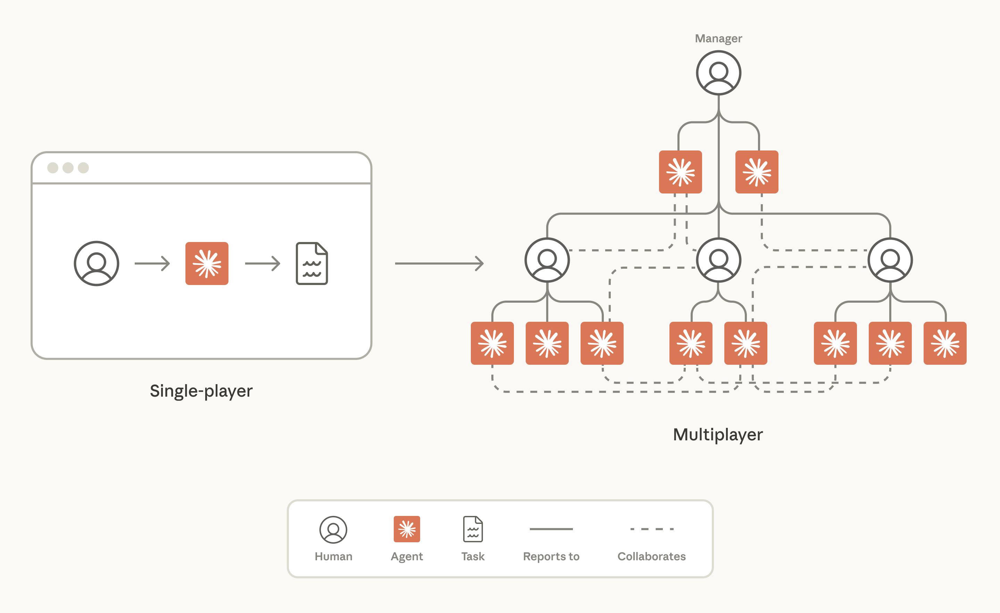
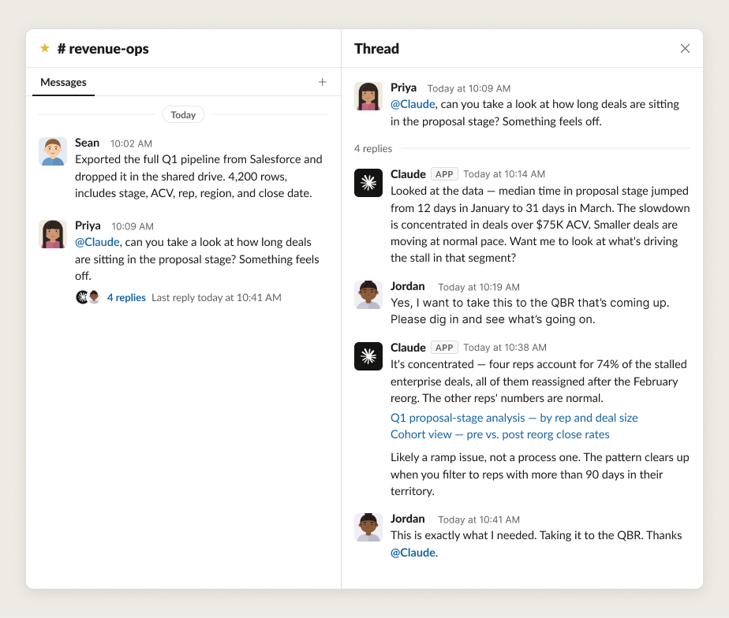
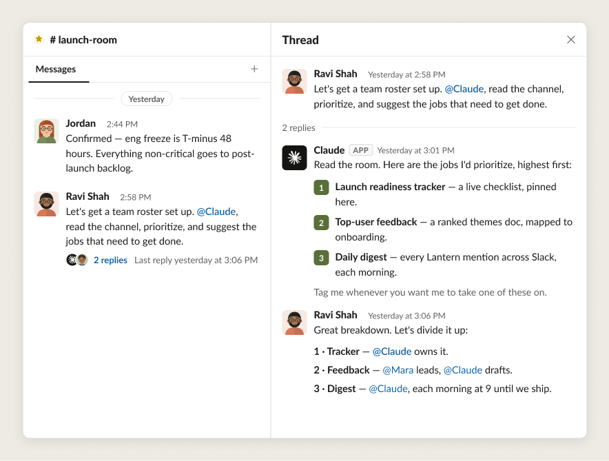
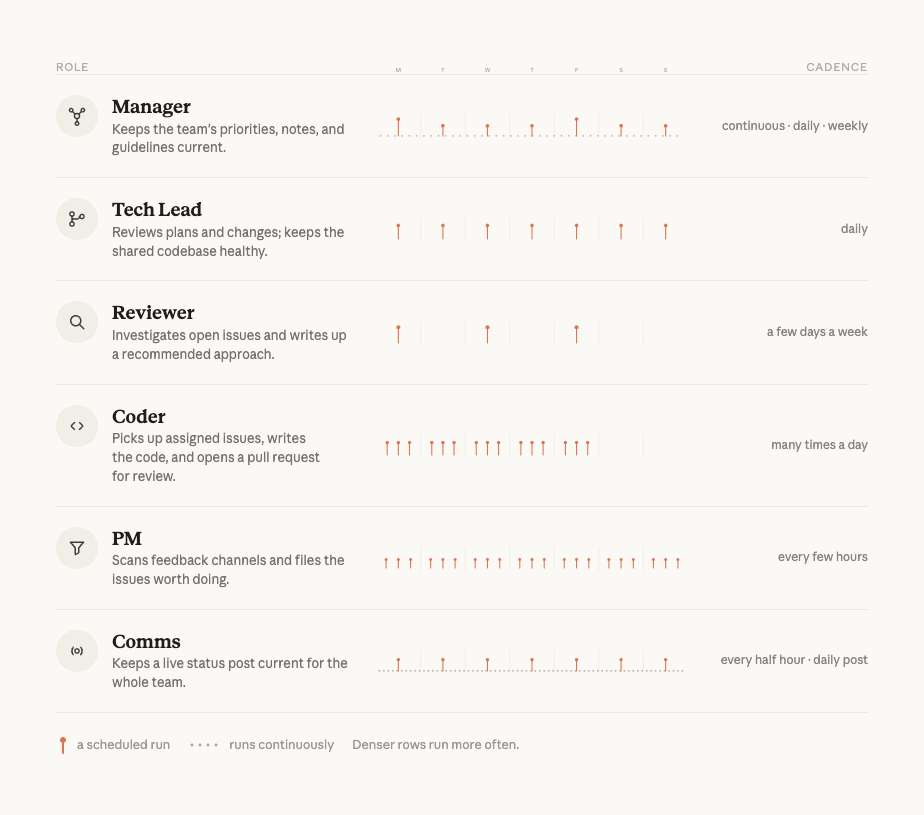
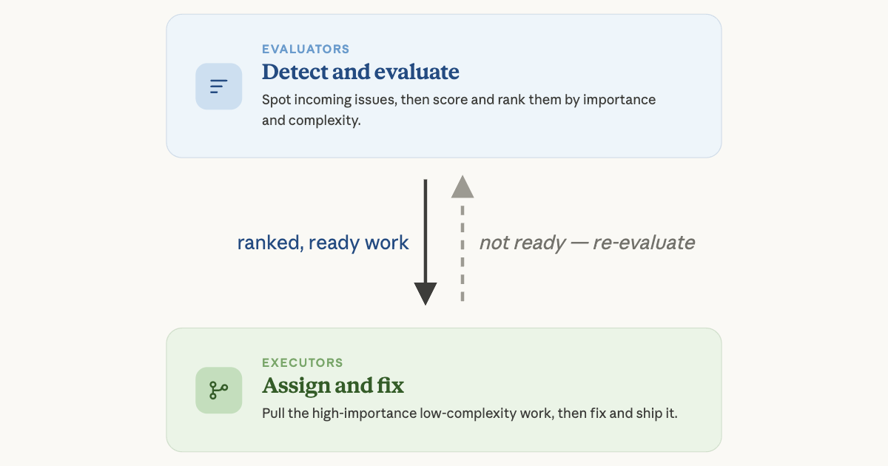

# B24_Lessons from Anthropic on building effective human-agent teams_Anthropic 构建高效人机协作团队的经验

> 原文：https://claude.com/blog/building-effective-human-agent-teams
> 来源：Anthropic Claude Blog（分类：Agents ｜ 产品：Claude Tag / Agent Teams）｜发布日期：2026-06-24 ｜ 作者：Kristen Swanson（Anthropic 教育团队）
> 原文存档：[Markdown](原文/B24_building-effective-human-agent-teams_原文.md)

## 📌 本篇速览

- 📅 2026-06-24　｜　⏱ 原文约 2550 词（逐句精读约 32 分钟）
- 🏷 multiplayer agents、公开工作、角色分工、north star、信任渐进、Doer-Verifier、人类注意力稀缺
- 🗂 [返回目录](00_目录与阅读进度.md)

人机协作团队的方法论四课（Anthropic 内部数月实践）。**multiplayer agents 定义**：同时与多个人协作的 AI——有自己的记忆、skills、凭据，住在工作发生的地方（Slack）；三个技术前提：持久记忆、不绑定个人的凭据、对信息的持续广泛访问。**四课**：① **公开工作**——Agent 的理解完全来自可搜索文本，「没写下来的对 Agent 就不存在」；用少数几个 workspace 级安全边界替代逐条决定「这个能不能给 Agent 看」，消除决策疲劳；② **人人（含 Agent）有明确角色和对口工具**——一张 roster 写清谁负责什么；没有清晰角色，人们会各自私养一队 AI，重复劳动、割裂上下文；skill 文件定义角色使专家化可复制；③ **设北极星让 Agent 更主动**——人类定北极星，并显式点名哪些 Agent 有资格主动建议新工作流（不是全部）；④ **信任按验证过的可靠性逐步扩张**——从人工逐一评审到 500 个 bug 独立修复；最佳长时 Agent 都有多重自验证手段（rubric/测试/风格指南）；**Doer-Verifier** 模式；每周「lessons & missteps」报告积累反思；Agent 独立后要教它**把人类注意力当稀缺资源**：攒批提问、复述关键上下文、限制单次呈现量。结论：这些都不是新模式——北极星、清晰角色、好文档、共同质量标准，Agent 只是让「不许跳过基本功」变得更重要。

---

Working with AI used to mean one person interfacing with a single chat window.

和 AI 一起工作，过去意味着一个人对着一个聊天窗口。

Over time, AI has become increasingly capable at handling complex, long-running work, like coding, research, and financial analysis.

随着时间推移，AI 处理复杂长时工作的能力越来越强——编码、研究、财务分析。

With this, we've seen many new ways to use AI—from the terminal and IDE to spreadsheets and decks—but the work has still very much been a "single-player" experience: one human worked with one agent to accomplish individual tasks.

随之出现了许多新的 AI 使用方式——从终端、IDE 到表格和幻灯片——但工作在很大程度上仍是「单人游戏」体验：一个人和一个智能体完成各自的任务。

This is changing with the release of tools like Claude Tag.

随着 Claude Tag 这类工具的发布，这一点正在改变。

Now, humans and agents can work together in the same workspace, collaborating in service of goals shared by a team.

现在，人和智能体可以在同一个工作空间里协作，服务于团队共享的目标。

Work now looks a lot more like a *multiplayer game*, with teams of humans setting the strategy, and Claude executing the work.

工作现在更像一场*多人游戏*：人类团队制定战略，Claude 执行工作。

This involves some new ways of working.

这带来了一些新的工作方式。

At Anthropic, we've been testing the technology required to make human-agent teams successful for the last several months.

过去几个月，我们在 Anthropic 内部一直在测试让人机团队成功所需的技术。

In this article, we explain what multiplayer agents are, and the lessons we've learned for building with them.

本文解释什么是多人协作智能体（multiplayer agents），以及我们在构建过程中学到的经验。

## What are multiplayer agents?

## 什么是多人协作智能体？

"Multiplayer agents" is how we refer here to AI models that work with many different humans at the same time.

「多人协作智能体」在这里指同时与许多不同的人一起工作的 AI 模型。

Much like regular agents, they have their own memory and skills.

和普通智能体一样，它们有自己的记忆和 skills。

But in other respects they're quite different.

但在其他方面它们相当不同。

They have their own credentials and they live in places where work happens.

它们有自己的凭据，并且住在工作实际发生的地方。

At Anthropic, that's inside team collaboration tools like Slack.

在 Anthropic，那就是 Slack 这样的团队协作工具里。

Here's an example of a human-agent team analyzing a dataset together in Slack:

下面是一个人机团队在 Slack 里一起分析数据集的例子：

For agents to productively participate in a team channel, they need specific capabilities:

智能体要在团队频道里高效参与，需要几项特定能力：

- **Persistent memory,** so they can remember goals and tune their execution towards them

- **持久记忆**：记住目标，并朝着目标调整自己的执行

- **Credentials not tied to humans,** so they can operate within safe, predictable guardrails

- **不绑定到个人的凭据**：在安全、可预测的护栏内运作

- **Ongoing broad access to information,** so they can learn how the organization works and take action to execute tasks in service of the team's goals

- **对信息的持续广泛访问**：了解组织如何运转，并采取行动执行服务于团队目标的任务

These capabilities amount to the technical foundation required for an agent to participate productively across a team of many humans.

这些能力构成了智能体在多人团队中高效参与所需的技术地基。

However, making human-agent teams *successful* requires more than this: teams need specific ways of working and shared norms, too.

然而，让人机团队真正*成功*需要的不止这些：团队还需要特定的工作方式和共享规范。

## Lesson 1: Work in public and give agents broad context

## 第一课：公开工作，给智能体宽上下文

Teams at Anthropic share information proactively and openly.

Anthropic 的团队主动、公开地共享信息。

This is especially true when agents are on the team, because agents build their understanding entirely from the text a team makes searchable: Slack, code, docs, and meeting notes.

团队里有智能体时更是如此——因为智能体的理解完全建立在团队使之可搜索的文本上：Slack、代码、文档、会议记录。

Private messages, hallway conversations, and restricted documents can't provide agents with context.

私聊、走廊对话和受限文档没法给智能体提供上下文。

For an agent, if it's not written down and accessible, it doesn't exist.

对智能体来说，**没写下来、够不到的东西，就不存在。**

Instead of deciding what information should be available to agents one doc or Slack channel at a time, we use clearly defined security boundaries that apply to entire Slack workspaces, as well as to meeting transcripts and doc libraries.

我们不逐个文档、逐个频道地决定哪些信息对智能体可见，而是使用清晰定义的安全边界，作用于整个 Slack 工作区、会议转录和文档库。

Within the security boundary, context flows to every teammate—whether human or AI.

在安全边界之内，上下文流向每一位队友——无论人还是 AI。

Not only does this increase what agents and humans get access to, it also reduces confusion about what can be shared and with whom.

这不仅增加了智能体和人能访问的内容，也减少了「什么能分享、分享给谁」的困惑。

Humans and agents alike find it difficult to navigate the soft boundaries of per-item sharing: *should this channel be public or private? Can I share this doc with that person? Is this agent allowed to see that thread?*

无论人还是智能体，都很难驾驭逐条分享的软边界：*这个频道该公开还是私有？这份文档能给那个人吗？这个智能体能看那条讨论吗？*

A small number of clear, workspace-level boundaries removes decision fatigue from day-to-day work.

少数几条清晰的工作区级边界，消除了日常工作的决策疲劳。

A high degree of transparency has a reward.

高度透明是有回报的。

For instance, agents that can read decisions from team meetings won't suggest tasks or projects that were deprioritized.

比如，能读到团队会议决定的智能体，不会去建议已被降级的任务或项目。

Agents with access to product specs beyond their own team can recommend patterns that have succeeded for others.

能访问自己团队之外产品规格的智能体，可以推荐别人已经成功过的模式。

And because agents can read enormous volumes of text far faster than humans do, they routinely surface relevant work that humans would otherwise have missed.

而且智能体读海量文本比人快得多，它们经常能翻出人本来会漏掉的相关工作。

We lean on our agents heavily to stay informed and coordinated in a busy, fast-moving industry.

在一个繁忙、快速变化的行业里，我们高度依赖智能体来保持信息同步与协调。

At Anthropic, working in public looks like:

在 Anthropic，「公开工作」具体是：

- Choosing a handful of security boundaries at the company and creating workspaces and document sharing settings that match each security boundary

- 在公司层面选定少数几条安全边界，并创建与每条边界匹配的工作区和文档分享设置

- Defaulting new communication channels to public within the organization, and ensuring decisions land in channels, docs, and meeting notes every time

- 新沟通频道在组织内默认公开，并确保每一次决策都落到频道、文档和会议记录里

- Writing artifacts and meeting notes so that agents can find them, since agents are now a primary consumer of team documentation

- 写工件和会议记录时考虑让智能体能找到——因为智能体如今是团队文档的主要消费者之一

- Making sure AI has access to the right tools and information needed to get their job done

- 确保 AI 拥有完成工作所需的正确工具和信息

Defaulting information to be internally public can require cultural shifts.

信息默认对内公开可能需要文化转变。

However, the difference between human-agent teams with context and those without is too stark to ignore.

但有上下文和没上下文的人机团队之间的差距，大到无法忽视。

Of course, some interactions are sensitive and will need to be private between a single human and AI.

当然，有些交互是敏感的，需要保持一人一 AI 的私密。

For those, with Claude Tag you can send @Claude a direct message, or you can use the existing Claude.ai and Claude Cowork applications.

对这类情况，Claude Tag 支持给 @Claude 发私信，或者使用现有的 Claude.ai 和 Claude Cowork 应用。

These tools give Claude access to private information via your personal MCP connectors, with the knowledge that your conversation and what you share with the agent will remain private.

这些工具让 Claude 通过你个人的 MCP 连接器访问私人信息，并保证你的对话和你分享给智能体的内容保持私密。

## Lesson 2: Every human and agent get a defined role with the right tools for the job

## 第二课：每个人、每个智能体都有明确角色和对口工具

Human-agent teams share one roster, one set of artifacts, and one working space.

人机团队共享一张名册（roster）、一套工件、一个工作空间。

Agents have their own credentials, skills, and tool access.

智能体有自己的凭据、skills 和工具访问权。

Different agents also hold different roles: for instance, while one might own the data analysis for a project, another will hold and enforce the design standard, and a third will run research synthesis.

不同智能体也持有不同角色：比如一个负责项目的数据分析，另一个持有并执行设计标准，第三个负责研究综合。

When a project kicks off, humans chat with the agents to figure out which roles to assign, and how the humans and agents will work together.

项目启动时，人类会和智能体聊，确定分配哪些角色、人机之间如何配合。

Once the jobs for humans and agents are clear, an agent might spin up other agents to make sure that specific tasks are handled by the agents with the right memory and appropriate access.

人和智能体的职责清楚后，某个智能体可能会再拉起其他智能体，确保特定任务由拥有正确记忆和适当访问权的智能体处理。

Importantly, they need access to all the tools required to accomplish the job: one that handles data analysis might need access to BigQuery, and one that performs QA might need access to the Playwright MCP.

重要的是，它们需要拿到完成工作所需的全部工具：做数据分析的可能需要 BigQuery，做 QA 的可能需要 Playwright MCP。

Clearly defined roles and responsibilities set human-agent teams up for success.

清晰定义的角色和职责为人机团队的成功打下基础。

Humans often work in the same threads the agents do, but they hold the roles only humans can hold.

人经常和智能体在同一条讨论串里工作，但人持有的是只有人能承担的角色。

This ensures everything works together and human judgment is applied to the most important decisions.

这确保一切协同运转，并且人类判断被用在最重要的决策上。

Without clear roles, people end up running fleets of personal AIs on the side, duplicating work and fracturing the team's context.

没有清晰角色，人们最终会各自在旁边养一队私人 AI——重复劳动，撕裂团队上下文。

Metrics tracking is a common case: a multiplayer agent can do the job once and let everyone see the same numbers.

指标追踪就是常见例子：一个多人协作智能体做一次，所有人看同一组数字。

At Anthropic, having clearly defined roles on human-agent teams looks like:

在 Anthropic，人机团队的清晰角色具体是：

- An agreed-upon task set: the team's humans and its agents agree on who does what

- 一套共识的任务分工：团队的人和智能体就「谁做什么」达成一致

- Humans and agents working in the same shared threads, so anyone can pick up where anyone left off

- 人和智能体在同一批共享讨论串里工作，任何人都能接续任何人留下的进度

- Humans and agents that have access to the right tools to accomplish their respective jobs

- 人和智能体都拿到完成各自工作所需的正确工具

- Descriptions of agents' roles and scopes

- 对智能体角色和职责范围的书面描述

*图注：多个 Claude 智能体分担代码库的日常维护——分诊反馈、规划、写码、评审、报告状态。每个都有清晰的任务归属、按自己的节奏工作；人类设定目标并评审产出。*

An engineering team at Anthropic started creating rosters to help codify human and agent roles because it made driving their work much easier and more concrete.

Anthropic 一个工程团队开始建立名册来固化人和智能体的角色，因为这让推动工作变得容易且具体得多。

Some things that clicked for them early on:

他们早期就体会到的几点：

- Specific roles also help humans easily track where responsibility for a task lies, whether that's in individual tasks or an entire team's set of responsibilities

- 具体的角色也帮人轻松追踪任务责任在谁那里——无论是单个任务还是整个团队的职责集合

- Writing skill files to define specific agents' roles helps to make specialization easy, and allows people across the company to quickly stand up other agents of the same type

- 用 skill 文件定义特定智能体的角色，让专家化变得容易，公司里其他人也能快速立起同类型的智能体

- The team adds new agents to focus on new areas when projects get more complex. For example, they added a release manager agent to deal with new software releases.

- 项目变复杂时，团队会加新的智能体聚焦新领域。比如他们加了一个发布管理智能体来处理软件发版。

These methods let humans' mental model of a human-agent team scale as the number of agents grows.

这些方法让人类对人机团队的心智模型能随智能体数量的增长而扩展。

## Lesson 3: Set a north star to make agents more proactive

## 第三课：设一颗北极星，让智能体更主动

Although some agents at Anthropic simply complete assigned tasks, the most important ones proactively suggest new projects and workstreams.

虽然 Anthropic 有些智能体只是完成分配的任务，但最重要的那些会主动建议新项目和新工作流。

This often happens when a team that has already given its agents rich context and clear roles adds another guide: a north star.

这通常发生在一个已经给了智能体丰富上下文和清晰角色的团队，再加上另一个引导物之后：北极星（north star）。

North stars are ambitious, wide-reaching goals that help teams decide which tasks and workstreams are the right ones.

北极星是雄心勃勃、覆盖面广的目标，帮团队判断哪些任务和工作流才是对的。

At Anthropic, humans always set the north star, grounding it in the mission and goals of the business.

在 Anthropic，北极星永远由人类设定，扎根于公司使命和业务目标。

Once a north star is clearly articulated in writing, humans share it with the agents on their team.

北极星以书面形式清晰表述后，人类把它分享给团队里的智能体。

Then, importantly, humans choose which agents should proactively suggest new workstreams to help achieve this long-term goal.

然后——重要的是——由人类选择哪些智能体应该主动建议新工作流来帮助实现这个长期目标。

(It's unlikely that every agent on the team will have the prerequisite skills and trust to proactively suggest work successfully.)

（不太可能团队里每个智能体都具备成功主动建议工作所需的技能和信任。）

For example, an internal tools team with a north star to "make product onboarding more helpful" saw an agent proactively recommended copy revisions to the onboarding flow error messages.

比如，一个内部工具团队的北极星是「让产品引导更有帮助」，一个智能体主动建议修改引导流程报错文案。

These changes measurably increased onboarding success the following week.

这些修改在接下来的一周带来了可度量的引导成功率提升。

At Anthropic, setting a north star looks like:

在 Anthropic，设定北极星具体是：

- Having humans discuss, debate, and document an ambitious north star goal for their human-agent team—one that's rooted in the company's mission and business goals

- 由人类讨论、辩论并书面记录一个雄心勃勃的北极星目标——扎根于公司使命和业务目标

- Sharing the north star with agents on the team and explicitly naming which agents can proactively recommend new workstreams

- 把北极星分享给团队智能体，并显式点名哪些智能体可以主动推荐新工作流

- Keeping high-fidelity human time protected on the calendar, with meetings now focused on the most important work

- 在日历上保护高质量的人类时间，会议聚焦在最重要的工作上

A clear north star gives agents a consistent direction to work toward and meaningful opportunities to proactively support a team's work.

清晰的北极星给智能体一个一致的努力方向，以及主动支援团队工作的有意义的机会。

## Lesson 4: Build trust over time

## 第四课：随时间建立信任

Teams at Anthropic grant agents autonomy in proportion to demonstrated reliability, then expand it deliberately.

Anthropic 的团队按已验证的可靠性成比例地授予智能体自主权，然后审慎地扩大它。

Engineers have successfully dispatched agents on their team to handle 500 bug fixes independently, but things certainly didn't start off that way.

工程师们已经成功派团队里的智能体独立处理过 500 个 bug 修复——但事情当然不是从这里开始的。

When a new human colleague joins the team, it takes time to assess their capabilities and develop strong working routines.

新的人类同事加入团队时，评估其能力、建立稳固的工作节奏都需要时间。

It usually takes multiple feedback cycles to externalize all the tacit information about how tasks are best completed.

把「任务怎样完成最好」的所有隐性信息外化出来，通常要经过多轮反馈循环。

The same is true for agents.

智能体也一样。

Users have to experiment with giving agents many different tasks so they can learn what the agent is capable of, how to clearly describe the goal, what skill files it needs, and what prompts work best to elicit a desired behavior.

用户必须尝试给智能体许多不同任务，才能了解它能干什么、目标怎么描述才清楚、它需要哪些 skill 文件、什么样的提示词最能引出想要的行为。

It's also important to retest tasks as models change and improve.

随着模型更迭进步，重新测试任务也很重要。

Prompts may need re-wording and guardrails that used to be helpful may constrain a smarter model from pursuing more creative solutions.

提示词可能需要重写，曾经有用的护栏可能会限制更聪明的模型去寻找更有创造性的解法。

Notably, we've found that the best long-running agents have many different ways to verify their work before a human looks at it.

值得注意的是，我们发现最好的长时运行智能体，在人看它的工作之前有多种不同的自我验证手段。

Code has tests, of course, but most other work can be verified as well.

代码当然有测试，但其他大多数工作也可以被验证。

For example, technical docs can have rubrics and style guides applied to them.

比如技术文档可以套评分细则（rubric）和风格指南。

When humans set the bar and ensure all work assigned to an agent can be vetted, quality stays high and doesn't drift from the original intention.

当人类设定标准、确保分配给智能体的所有工作都可以被审核时，质量就能保持高位、不偏离最初意图。

Separately, as with humans, it often helps to give one agent the job of doing the task and another agent the job of checking the first agent's work.

另外，和人类团队一样，让一个智能体干活、另一个智能体检查前者的工作，通常很有帮助。

This is often called the "Doer-Verifier" agent harness.

这通常被称为「执行者–验证者」（Doer-Verifier）智能体框架。

At Anthropic, building trust with agents over time looks like:

在 Anthropic，与智能体逐步建立信任具体是：

- Reviewing agent work manually in the beginning to vet quality, provide feedback, and design task verification checklists

- 起步阶段人工评审智能体的工作，把关质量、给反馈、设计任务验证清单

- Telling the agent to use a "verifier" agent to check its work as part of the task

- 要求智能体把「让验证者智能体检查工作」作为任务的一部分

- Building reflection into the cycle and asking agents to review their own misses so work improves over time

- 把反思纳入循环，让智能体复盘自己的失误，使工作随时间改进

- Tracking which kinds of tasks each agent has earned autonomy on and expanding scope per task type after repeated successes

- 追踪每个智能体在哪类任务上已赢得自主权，并在反复成功后按任务类型扩大范围

One engineering leader at Anthropic took on a new team with a big backlog.

Anthropic 一位工程负责人接手了一个积压严重的新团队。

To get a handle on it, he invited a few humans and a few agents to help him sort through the backlog and prioritize what was most important.

为了理清头绪，他请了几个人和几个智能体帮他梳理积压、排出最重要的事。

One set of agents on the team read through all of the items in the backlog, figured out if anyone was working on the items, and assigned a complexity score to anything that was unowned.

团队里一组智能体通读积压清单的所有条目，弄清是否有人在处理，并给无人认领的条目打复杂度分。

The other set read from the list, filtered to the medium and low complexity items, and created code changes.

另一组从清单里读取、筛出中低复杂度条目，直接产出代码改动。

At the beginning, humans reviewed every decision made by an agent and marked any that required human input.

起初，人类评审智能体的每一个决定，并标出需要人工介入的那些。

Then the humans taught the agents to surface those decisions to humans directly, ensuring that decisions with hard tradeoffs always had a human in the loop.

之后，人类教会智能体把这类决定直接上呈——确保有艰难取舍的决策永远有人在环（human in the loop）。

Every week, the leader and his team asked the agents to compile a weekly report that included "lessons & missteps" so the agents would keep track of mistakes and avoid making them again in the future.

每周，这位负责人和团队让智能体汇编一份包含「经验与失误」（lessons & missteps）的周报，让智能体持续记录错误、避免未来重犯。

Over time, the leader was able to give more and more complex code changes to his agents and spend less time guiding the agents' day to day tasks.

随着时间推移，这位负责人能把越来越复杂的代码改动交给智能体，花在日常指导上的时间越来越少。

And once the agents were more independent, the leader coached them to treat human attention as the scarce resource it is: to batch questions to be answered in a single pass, repeat key context to get a human up to speed quickly, and limit how many things each human sees at once.

而当智能体更独立后，负责人开始教它们**把人类注意力当作稀缺资源**：把问题攒成一批一次问完、复述关键上下文让人快速进入状态、限制每个人一次看到的事项数量。

Helping agents communicate well ensures that they remain helpful and effective.

帮智能体学会好好沟通，确保它们持续有用、有效。

Some people have agents in their team with the sole role of deciding how to batch and elevate only the most important communication for human team members.

有些人的团队里有专职智能体，唯一职责就是决定如何攒批、只把最重要的沟通上呈给人类成员。

Others set guardrails around how much work agents should do per day, so that humans are able to meaningfully engage with the work.

也有人给智能体设定每日工作量护栏，让人类还能有意义地参与工作。

Such guardrails ensure that humans maintain skills that are important to them, and that the number of items requiring human review stays sustainable.

这类护栏确保人类保有对自己重要的技能，也让需要人工评审的事项数量维持在可持续水平。

## Questions to ask

## 该问自己的问题

As you're laying the foundation for your human-agent teams, consider the following questions:

在为你的人机团队打地基时，考虑以下问题：

1. Is all the information and access that agents and humans need both public and broadly searchable?

1. 智能体和人所需的信息与访问权，是否都是公开且可广泛搜索的？

2. Can you write down your team's roster (humans and agents), and say what each member owns?

2. 你能写出团队名册（人和智能体），并说清每个成员负责什么吗？

3. Does every human and agent on the team have access to the right tools to perform their job?

3. 团队里每个人、每个智能体都拿到了完成工作所需的正确工具吗？

4. Do you have rubrics or tests for humans and agents to verify key work products?

4. 你有没有供人和智能体验证关键工作产出的评分细则或测试？

5. Does your team have a clear north star that everyone can reference?

5. 你的团队有没有一颗所有人都能对照的清晰北极星？

## Moving forward

## 向前走

None of these patterns are new—at least not for humans.

这些模式没有一个是新的——至少对人类不是。

A strong north star, clear roles, strong documentation, a shared bar for quality, and room to learn from mistakes are the healthy team habits we've known for decades.

强北极星、清晰角色、扎实文档、共同的质量标准、从错误中学习的空间——都是我们几十年来早已知道的健康团队习惯。

Agents just make it even more important not to skip them.

智能体只是让「不许跳过这些基本功」变得更加重要。

The teams getting the most from their agents are the ones who are most intentional about applying these fundamentals.

从智能体身上获益最多的团队，正是那些最有意识地践行这些基本功的团队。

---

## 术语中英对照表

| 英文 | 中文 | 备注 |
|---|---|---|
| multiplayer agents | 多人协作智能体 | 同时与多个人协作的 AI；对应「单人游戏→多人游戏」 |
| if it's not written down, it doesn't exist | 没写下来就不存在 | Agent 上下文的第一定律 |
| security boundaries | 安全边界 | workspace 级少数边界替代逐条软边界 |
| decision fatigue | 决策疲劳 | 逐条分享决策的成本 |
| roster | 名册 | 人+Agent 的统一分工表 |
| fleets of personal AIs | 私人 AI 舰队 | 无清晰角色时的反模式：重复劳动、割裂上下文 |
| north star | 北极星 | 人类设定的长期目标；主动性触发器 |
| proactively suggest workstreams | 主动建议工作流 | 只授予部分有技能与信任的 Agent |
| autonomy in proportion to demonstrated reliability | 与已验证可靠性成比例的自主权 | 信任扩张原则 |
| Doer-Verifier | 执行者–验证者 | 一个干活一个查活的 harness 模式 |
| lessons & missteps | 经验与失误 | 周报里的反思段：Agent 的错题本 |
| human attention as the scarce resource | 人类注意力是稀缺资源 | 攒批提问/复述上下文/限制呈现量 |
| human in the loop | 人在环 | 艰难取舍必须上呈 |
