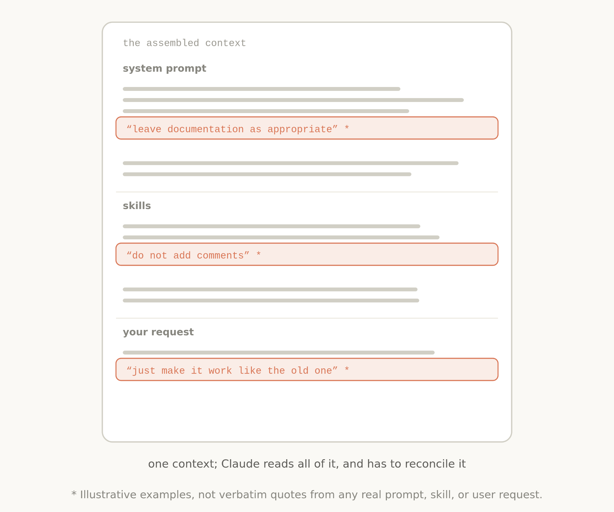
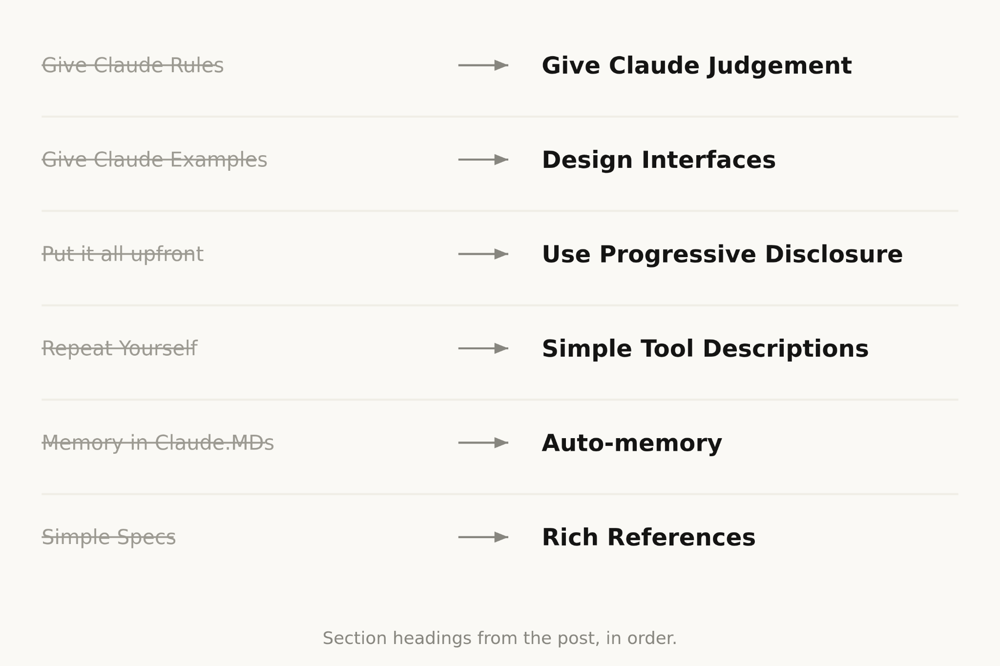
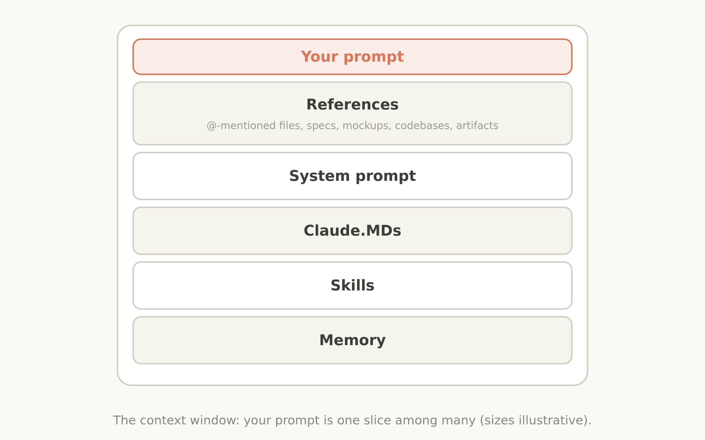

# B26_The new rules of context engineering for Claude 5 generation models_Claude 5 世代模型的上下文工程新规则

> 原文：https://claude.com/blog/the-new-rules-of-context-engineering-for-claude-5-generation-models
> 来源：Claude 官方博客｜发布日期：2026-07-24｜作者：Thariq Shihipar（Anthropic member of technical staff）

## 📌 本篇速览

- 📅 2026-07-24　｜　⏱ 约 8 分钟　｜　📄 约 1,300 词 / 5 图
- 🏷 上下文工程、系统提示词、渐进披露、CLAUDE.md、Skills
- 🗂 [返回目录](00_目录与阅读进度.md)

本文讲述 Anthropic 针对 Claude 5 世代模型（Claude Opus 5、Claude Fable 5）对上下文工程的重新思考：他们删掉了 Claude Code 系统提示词的 80% 以上，编码评估没有任何可测量的损失。作者用六组「过去 → 现在」的对照拆解已经变成迷思的旧最佳实践——从给规则改为让模型用判断力、从堆示例改为设计接口、从全部前置改为渐进披露、从重复指令改为简洁的工具描述、从手动记 CLAUDE.md 改为自动记忆、从简单 spec 改为丰富引用——并给出系统提示词、CLAUDE.md、Skills、References 四个层面的具体建议，最后推荐用 `claude doctor` 命令自动为自己的上下文做减法。

---

> We removed over 80% of Claude Code's system prompt for more advanced models.

> 我们为更先进的模型删掉了 Claude Code 系统提示词的 80% 以上。

> How to apply the lessons we learned to your own context engineering in Claude Code and with your own agents.

> 本文讲如何把我们学到的经验，应用到你自己在 Claude Code 中以及自建 Agent 时的上下文工程里。

I’ve written previously about how to best [prompt the newest generation of Claude 5 models](https://claude.com/blog/a-field-guide-to-claude-fable-finding-your-unknowns) and work with them iteratively to discover what you want to build.

我之前写过一篇文章，讲如何更好地[给最新一代 Claude 5 模型写提示词](https://claude.com/blog/a-field-guide-to-claude-fable-finding-your-unknowns)，以及如何与它们迭代协作、逐步发现你真正想构建的东西。

But when you send a message to Claude, the prompt is only a small part of the context it gets.

但当你给 Claude 发送一条消息时，提示词（prompt）只是它所收到的上下文中很小的一部分。

Much of your context is assembled from your system prompt, Skills, CLAUDE.md files, memory, and other sources.

你的上下文大部分是由系统提示词（system prompt）、Skills、CLAUDE.md 文件、记忆（memory）以及其他来源组装而成的。

We call this [context engineering](https://www.anthropic.com/engineering/effective-context-engineering-for-ai-agents), and it makes a big impact on the results you generate when using Claude Code or in building your own agents.

我们把这个过程称为[上下文工程](https://www.anthropic.com/engineering/effective-context-engineering-for-ai-agents)（context engineering），无论是使用 Claude Code 还是构建你自己的 Agent，它都会对最终结果产生很大影响。

Unlike a prompt, context is used generally across many requests, so it cannot be as specific.

与提示词不同，上下文要在许多请求之间通用，因此不可能写得那么具体。

How do you build these general prompts and guidance for Claude, especially when you don’t know what a user’s prompt might be?

那么，尤其是在你根本不知道用户会输入什么提示词的情况下，该怎么为 Claude 编写这些通用的提示和指导呢？

This can be surprisingly difficult as Claude’s own capabilities evolve.

随着 Claude 自身能力的进化，这件事会出乎意料地困难。

Most recently, we noticed a large jump in the way we prompt the newest generation of Claude models.

最近，我们注意到给最新一代 Claude 模型写提示词的方式发生了一次大跳变。

We removed over 80% of Claude Code’s system prompt for models like Claude Opus 5 and Claude Fable 5 with no measurable loss on our coding evaluations.

我们为 Claude Opus 5、Claude Fable 5 这类模型删掉了 Claude Code 系统提示词的 80% 以上，而在编码评估上没有任何可测量的损失。

Here’s what we’ve learned about prompting this new class of models, and how you can utilize it to update your context engineering.

下面就是我们在给这一类新模型写提示词的过程中学到的东西，以及你可以如何利用这些经验来更新自己的上下文工程。

We’ve put these best practices in `claude doctor;` use the command /doctor in Claude Code to rightsize your skills, and CLAUDE.md files.

我们已经把这些最佳实践做进了 `claude doctor`；在 Claude Code 里运行 /doctor 命令，就能把你的 skills 和 CLAUDE.md 文件「合身化」（rightsize）。

## Unhobbling Claude｜解除对 Claude 的束缚

Overall, we found that we were overconstraining Claude Code, both through our system prompt and in our CLAUDE.md files and skills.

总体而言，我们发现自己此前过度约束（overconstraining）了 Claude Code——束缚既来自系统提示词，也来自 CLAUDE.md 文件和 skills。

For example, when we read transcripts of our own internal usage of Claude Code, we see several conflicting messages in a single request like “leave documentation as appropriate,” or “DO NOT add comments” as our system prompt, skills, and user requests clash with each other.

例如，当我们翻阅内部使用 Claude Code 的会话记录时，会看到单个请求里出现多条互相冲突的指令——比如一处写着「酌情保留文档」（leave documentation as appropriate），另一处却写着「不要添加注释」（DO NOT add comments）——系统提示词、skills 和用户请求在互相打架。

Generally, Claude can interpret the user’s intent to get to the right answer, but Claude must think more carefully about these overlapping and conflicting messages before deciding what to do.

通常情况下，Claude 能通过解读用户意图得到正确答案，但面对这些重叠且冲突的消息，它必须先花更多心思去权衡，才能决定该怎么做。

And while these constraints were once needed to avoid worst case scenarios, we have since found we can delete many of them and let the model use surrounding context and judgement instead.

虽然这些约束在过去是避免最坏情况（worst case scenarios）所必需的，但我们后来发现，其中许多都可以删掉，转而让模型依靠周围上下文和自己的判断力（judgement）。

Additionally, Claude Code now has many more tools.

此外，Claude Code 现在拥有的工具比以前多得多。

Claude used to rely on CLAUDE.md as a source of memory, information, and guidance.

过去，Claude 依赖 CLAUDE.md 作为记忆、信息和指导的来源。

Now we have memory, artifacts, and skills, which Claude can use to create new ways of loading and sharing context across sessions.

现在我们有了 memory、artifacts 和 skills，Claude 可以用它们创造出在会话之间加载与共享上下文的新方式。

## Then and now｜过去与现在

There were a number of previous context engineering best practices that had become myths.

过去的一批上下文工程「最佳实践」，如今已经变成了迷思（myths）。

Including:.

其中包括：

### Then: Give Claude rules｜过去：给 Claude 定规则

### Now: Let Claude use judgement｜现在：让 Claude 用判断力

When we first rolled out Claude Code, we needed to be sure that Claude avoided worst case scenarios, such as deleting files.

我们最初推出 Claude Code 时，必须确保 Claude 避开最坏情况，比如删除文件。

This meant we would give particularly strong guidance that might not always be true,

这意味着我们会给出一些格外强硬、但并非永远正确的指导，

For example, in the system prompt we used to say:

例如，我们过去在系统提示词里是这样写的：

*In code: default to writing no comments.*

*在代码中：默认不写注释。*

*Never write multi-paragraph docstrings or multi-line comment blocks — one short line max.*

*绝不写多段 docstring 或多行注释块——最多一行短注释。*

*Don't create planning, decision, or analysis documents unless the user asks for them — work from conversation context, not intermediate files.*

*除非用户要求，不要创建规划、决策或分析文档——依据对话上下文工作，而不是靠中间文件。*

But for a certain subset of prompts, this guidance would be wrong.

但对某一部分提示词来说，这条指导就是错的。

In the case of documentation, the user may have their own preferences, or specific parts of very complex code might need multi-line comment blocks.

以文档为例，用户可能有自己的偏好，或者特别复杂的代码中的某些部分可能确实需要多行注释块。

Still, without these guardrails for older models, the comments Claude wrote would be incorrect in many cases and we had to accept this tradeoff.

尽管如此，对旧模型来说，没有这些护栏（guardrails），Claude 写出的注释在很多情况下都会不对，所以我们只能接受这个折衷（tradeoff）。

But newer models have better judgement and can handle these decisions well without explicit rules.

但更新的模型判断力更好，不需要显式规则也能把这些决策处理得很好。

In the new system prompt we say: *Write code that reads like the surrounding code: match its comment density, naming, and idiom.*

在新的系统提示词里，我们只说：*写出来的代码要读起来像周围的代码：匹配它的注释密度、命名和惯用法（idiom）。*

### Then: Give Claude examples｜过去：给 Claude 示例

### Now: Design interfaces｜现在：设计接口

The number one rule for tool usage was to give Claude examples on how to use them.

工具使用的头号守则曾经是：给 Claude 提供用法示例。

With our newest models, we’ve found that giving examples actually constrains them to a certain exploration space.

但对我们最新的模型，我们发现给示例反而会把它们约束在某个特定的探索空间里。

Instead of using examples, think more about the design of your tools, scripts and files- what parameters does Claude have and how can they be more expressive?

与其使用示例，不如在工具、脚本和文件的设计上多花心思——Claude 有哪些参数可用？这些参数怎样才能更有表达力（expressive）？

For example, in the Todo tool example, just listing status as an enumeration between pending, in_progress, and completed, hints to Claude about how to use it.

例如，在 Todo 工具的例子里，仅仅把 status 列成 pending、in_progress、completed 三个值的枚举，就已经在向 Claude 暗示该怎么使用它了。

The instruction on keeping one item in_progress helps define our requested behavior.

再加上一条「保持只有一项处于 in_progress」的说明，就把我们期望的行为定义清楚了。

### Then: Put it all upfront｜过去：全部前置

### Now: Use progressive disclosure｜现在：使用渐进披露

Because Claude Code was focused on coding, our system prompt included detailed information on how to do code review and verification.

由于 Claude Code 聚焦于编码，我们的系统提示词里曾包含关于如何做代码审查（code review）和验证（verification）的详细信息。

These were not always needed, but when they were, it was crucial information.

这些信息并非每次都用得上，但一旦用得上，就是至关重要的信息。

Since then, Claude Code has gotten very competent at using progressive disclosure- loading the right context at the right times.

此后，Claude Code 已经非常擅长运用渐进披露（progressive disclosure）——在正确的时机加载正确的上下文。

For example, we moved verification and code review into their own skills that Claude Code could selectively call.

例如，我们把验证和代码审查拆成了独立的 skills，让 Claude Code 可以按需选择性调用。

But progressive disclosure is not just for skills, we also use it for tools.

但渐进披露不只用于 skills，我们也把它用在工具上。

Some of our tools are ‘deferred loading,’ which means the agent must search for their full definitions using ToolSearch before using them.

我们的一些工具是「延迟加载」（deferred loading）的，也就是说，Agent 必须先用 ToolSearch 搜出它们的完整定义，才能使用它们。

This allows us to have more tools (such as our Task tools) that don’t take up context until they’re needed.

这让我们可以挂载更多工具（比如 Task 类工具），它们在被需要之前不会占用任何上下文。

The same can be applied to your own CLAUDE.md and Skill.md files.

同样的思路也可以应用到你自己的 CLAUDE.md 和 Skill.md 文件上。

A common myth is that you want to make these a central repository for every known practice that you *might* run into, because Claude would not find it otherwise.

一个常见的迷思是：要把它们做成一个中央仓库，收录你*可能*遇到的每一条已知实践，否则 Claude 就找不到。

Instead, [consider having a tree of files that can be loaded at the right time](https://claude.com/blog/a-harness-for-every-task-dynamic-workflows-in-claude-code).

正确做法恰恰相反：[考虑构建一棵能在正确时机按需加载的文件树](https://claude.com/blog/a-harness-for-every-task-dynamic-workflows-in-claude-code)。

### Then: Repeat yourself｜过去：重复指令

### Now: Simple tool descriptions｜现在：简洁的工具描述

Earlier Claude models could sometimes need repeated instructions or be more likely to listen to instructions at the end of their context window than at the start.

早期的 Claude 模型有时需要重复指令，而且相比上下文窗口开头的指令，它们更容易听从末尾的指令。

This meant our system prompt would sometimes have references to tools in the main system prompt as well as instructions in the tool description.

这意味着我们有时会在主系统提示词里提及某个工具，同时又在工具描述（tool description）里再写一遍指令。

We found we could delete these repeat examples and put instructions on how to use tools in the tool descriptions rather than the system prompt.

我们发现可以删掉这些重复的内容，把工具的使用说明放进工具描述里，而不是系统提示词里。

### Then: Memory in CLAUDE.md files｜过去：把记忆存在 CLAUDE.md 里

### Now: Auto-memory｜现在：自动记忆

We used to encourage users to save things to Claude’s memory, by using the # hotkey to write to their [CLAUDE.md](http://claude.md) automatically.

我们过去鼓励用户把东西存进 Claude 的记忆——用 # 快捷键自动写入他们的 [CLAUDE.md](http://claude.md)。

Instead, Claude now automatically saves memories that are relevant to the work and to you.

而现在，Claude 会自动保存与当前工作、与你本人相关的记忆。

### Then: Simple specs｜过去：简单的 spec

### Now: Rich references｜现在：丰富的引用

In plan mode, Claude Code has heavily relied on markdown files with plans.

在规划模式（plan mode）下，Claude Code 曾严重依赖存放计划的 Markdown 文件。

Storing these files as plans helped Claude refer to them when needed.

把这些文件存成计划，方便了 Claude 在需要时回头查阅。

Another similar best practice was to store specs in the codebase for Claude to refer to while working across longer projects.

另一条类似的最佳实践是：把规格说明（spec）存在代码库里，供 Claude 在跨越较长周期的项目中随时参考。

But we’ve found that Claude can handle increasingly more complicated references.

但我们发现，Claude 能处理的引用（references）正变得越来越复杂。

Instead of simple markdown files, Claude can reference HTML artifacts created by our new artifacts feature.

不再局限于简单的 Markdown 文件，Claude 可以引用由我们新的 artifacts 功能创建的 HTML 工件。

You may also give Claude references in the form of code.

你也可以用代码的形式给 Claude 提供引用。

A spec may also be a detailed test suite, or a function in a different codebase that Claude might port.

一份 spec 也可以是一套详细的测试套件（test suite），或者另一个代码库中一个供 Claude 移植的函数。

Rubrics are another form of references.

评分标准（rubrics）是另一种形式的引用。

Rubrics allow Claude to try and verify your taste in a particular field (e.g. what does a good API design look like) by using [dynamic workflows](https://claude.com/blog/a-harness-for-every-task-dynamic-workflows-in-claude-code) and spinning up verifier agents with those rubrics.

借助[动态工作流](https://claude.com/blog/a-harness-for-every-task-dynamic-workflows-in-claude-code)（dynamic workflows），并用这些评分标准启动验证者 Agent（verifier agents），rubrics 能让 Claude 去尝试并验证你在某个特定领域的品味（例如：好的 API 设计长什么样）。

## Applying this to your context｜把这些应用到你的上下文

Pulling this all together, what does this look like when you assemble your context?

把以上内容汇总起来，当你组装自己的上下文时，实际会是什么样子？

### System Prompt｜系统提示词

A system prompt is heavily tied to the product context.

系统提示词与产品语境（product context）深度绑定。

It tells Claude what product it’s operating in and what it’s doing.

它告诉 Claude 自己运行在什么产品里、在做什么。

For Claude Code, you will likely never modify this, but if you are building your own agent harness, this is where you should spend a lot of time.

对 Claude Code 来说，你大概率永远不会修改它；但如果你在构建自己的 Agent 执行框架（agent harness），这里正是你应该投入大量时间的地方。

### CLAUDE.md｜CLAUDE.md 文件

Keep your CLAUDE.md lightweight and briefly describe what your repo is for, but spend most of the tokens on gotchas inside of the codebase.

保持你的 CLAUDE.md 轻量，简要说明这个仓库是做什么的，但把大部分 token 花在代码库内部的「坑」（gotchas）上。

For example, you may organize your code to keep types in one monolithic file and nowhere else.

例如，你的代码组织方式可能是把所有类型定义集中在一个单体文件里，其他任何地方都不放。

Avoid stating ‘the obvious’ things Claude should know by looking at your file system or your repo.

避免陈述那些「显而易见」的东西——Claude 看一眼你的文件系统或仓库就该知道的事。

Use progressive disclosure heavily, for example if you have several unique instructions on how to verify your work, create a verification skill and reference it from your CLAUDE.md.

大量使用渐进披露。例如，如果你有好几条关于如何验证工作成果的独特指令，就创建一个验证 skill，然后在 CLAUDE.md 里引用它。

### Skills｜Skills（技能）

Think of skills as lightweight guides to let Claude find information when needed.

把 skills 看作轻量级的指南，让 Claude 在需要时能找到信息。

Avoid making them overconstrained, except in highly important areas.

除了极其重要的领域，避免把它们写得约束过度。

For long skills, try and use progressive disclosure as much as possible- divide it into many files and split them out.

对于长 skill，尽可能使用渐进披露——把它分成多个文件，拆分出去。

It’s best when skills encode particular opinions, knowledge, or best practices that are particular to you, your team, or product.

skills 的最佳用法是编码那些专属于你、你的团队或你的产品的特定观点、知识或最佳实践。

### References｜引用（References）

You can @ mention files to include them as references.

你可以用 @ 提及文件，把它们作为引用包含进来。

References allow Claude to refer to in-depth information about the current plan.

引用让 Claude 能够查阅关于当前计划的深度信息。

This might be in specs files, mockups, or even entire codebases.

它们可以是 spec 文件、设计稿（mockups），甚至是整个代码库。

Generally you should prefer files that are in code as it provides clear, high-fidelity instructions to Claude in a language it knows very well.

一般来说，你应该优先选择代码形式的文件，因为它用一种 Claude 极为熟悉的语言，提供了清晰、高保真（high-fidelity）的指令。

For example, a HTML mockup of a design will generally produce better results than a description of the design or a screenshot.

例如，一份设计的 HTML 原型通常会比这份设计的文字描述或截图产出更好的结果。

## Try simplifying｜试着做减法

Across your system prompt, skills, and CLAUDE.md files, you may need to simplify just like we did.

在你的系统提示词、skills 和 CLAUDE.md 文件之间，你也许需要像我们一样做一次减法。

We rolled out a new command called `claude doctor,` which will help you do this automatically as well.

我们推出了一个名为 `claude doctor` 的新命令，它也能帮你自动完成这件事。

For more details on prompting more advanced models specifically, check out our [Fable field guide](https://claude.com/blog/a-field-guide-to-claude-fable-finding-your-unknowns).

想进一步了解专门针对更先进模型的提示词技巧，请阅读我们的 [Fable field guide](https://claude.com/blog/a-field-guide-to-claude-fable-finding-your-unknowns)。

*This article was written by Thariq Shihipar, member of technical staff, Anthropic.*

*本文作者：Thariq Shihipar，Anthropic 技术团队成员（member of technical staff）。*

---

## 术语中英对照表

| 英文                     | 中文       | 说明                                                     |
| ---------------------- | -------- | ------------------------------------------------------ |
| context engineering    | 上下文工程    | 组装 prompt 之外全部上下文的工程实践                                 |
| unhobbling             | 解除束缚     | 拿掉强加给模型的过度约束，本文核心概念                                    |
| overconstraining       | 过度约束     | 旧系统提示词/CLAUDE.md/skills 的共同病症                          |
| judgement              | （模型的）判断力 | 新一代模型可以替代显式规则的能力                                       |
| progressive disclosure | 渐进披露     | 在正确时机加载正确上下文；本世代默认策略                                   |
| deferred loading       | 延迟加载     | 工具先只挂名字，用 ToolSearch 取完整定义                             |
| tool description       | 工具描述     | 工具使用说明的唯一正确归属地                                         |
| auto-memory            | 自动记忆     | 取代 `#` 手工写 CLAUDE.md 的自动机制                             |
| rich references        | 富引用      | HTML artifacts、测试套件、代码、rubrics 等高保真规格                  |
| rubric                 | 评分标准     | 编码「品味」供 verifier agents 验证的引用形式                        |
| verifier agents        | 验证者智能体   | 带着 rubric 拉起的核验用子智能体                                   |
| gotchas                | 坑 / 陷阱   | CLAUDE.md 应该聚焦的仓库特有约定                                  |
| rightsize              | 合身化      | `claude doctor` / `/doctor` 对 skills 与 CLAUDE.md 的自动瘦身 |
| worst case scenarios   | 最坏情况     | 旧规则存在的历史理由（如误删文件）                                      |
| plan mode              | 计划模式     | Claude Code 中依赖计划文件的工作模式                               |
| mockup                 | 设计稿      | HTML mockup 优于文字描述与截图                                  |
