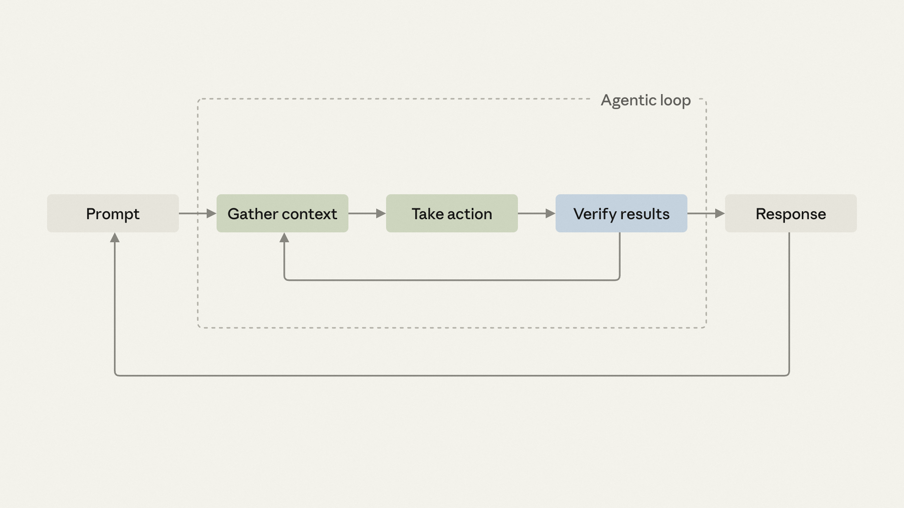

# B27_Building verification loops in Claude Code with skills_用 skills 在 Claude Code 中构建验证闭环

> 原文：https://claude.com/blog/building-verification-loops-in-claude-code-with-skills
> 来源：Anthropic Claude Blog（分类：Agents ｜ 产品：Claude Code）｜发布日期：2026-07-22 ｜ 作者：Delba de Oliveira（Claude Code 团队）
> 原文存档：[Markdown](原文/B27_building-verification-loops-in-claude-code-with-skills_原文.md)

## 📌 本篇速览

- 📅 2026-07-22　｜　⏱ 原文约 1790 词（逐句精读约 25 分钟）
- 🏷 验证闭环、agent loop 的 verify 阶段、skills 化、standalone/embedded/chained/PR 四种挂载方式
- 🗂 [返回目录](00_目录与阅读进度.md)

Agent loop「verify 阶段」的实操指南。**定义**：验证闭环 = Agent 自查自纠的重复循环（跑测试/linter/自定义检查→修复失败项→再检查），打包成 skill 后每个会话自动执行，不再依赖人记得去查。**方法论**：把「每次都要手工做的修正」写成白话流程（像交给新同事的第一天手册），交给 skill-creator 或手写 SKILL.md；检查不必是定性的——「拒绝任何没有 backfill 的删列迁移」这类项目特定的确定性规则正是最值得沉淀的。**四种挂载方式与升级信号**：standalone（手动调用，适合跨工作流的横切检查）→ 发现每次改完都在跑它 = 该升级 → embedded（内嵌进生产型 skill 末尾，只适用于你能改的 skill）→ chained（skill 链式调用：/code-review 找 bug → /simplify 清理 → /verify 端到端 → /design 查规范——「习惯变成契约」）→ PR 级（同一套关卡对全团队生效，个人基建变团队基建）。**成本提醒**：链式会加 token 消耗，先小范围测试再推广；链还在频繁调整时别上 PR 级门禁。

---

Most agentic coding sessions follow a loop: you ask for a change, Claude gathers context, takes action, verifies the results, and if needed, loops back to gather additional context.

大多数智能体编码会话都遵循一个循环：你提出修改请求，Claude 收集上下文、采取行动、验证结果，必要时再绕回去收集更多上下文。

Verification is how agents check their work before responding.

验证（verification）是智能体在给出回应前检查自己工作的方式。

Claude already does some of this from observing the deterministic signals in your codebase, including type checkers, linters, tests, and runtime errors.

Claude 已经会通过观察代码库里的确定性信号做一部分验证——类型检查器、linter、测试、运行时错误。

Whatever Claude can't infer becomes the steps you take to manually check a feature.

Claude 推断不出来的部分，就变成了你手工检查功能时要做的那些步骤。

These manual steps, however, can be transformed into verification loops.

而这些手工步骤，是可以被转化为验证闭环的。

In Claude Code, a verification loop is an iterative process where Claude checks and attempts to fix the work.

在 Claude Code 里，验证闭环是一个迭代过程：Claude 检查工作成果，并尝试修复问题。



*图注：智能体循环：1. 收集上下文，2. 采取行动，3. 验证结果。*

In this article, we cover the most common types of verification loops and show you what we use inside Anthropic.

本文介绍最常见的几类验证闭环，并展示我们在 Anthropic 内部的用法。

Then we'll show how to encode the manual checks you already do as skills, so Claude can close its own feedback loop and you can work on something else while it iterates.

然后我们会展示如何把你已经在做的手工检查编码成 skills——让 Claude 自己闭合反馈回路，而你可以在它迭代时去做别的事。

New to agent loops? Start with getting started with loops.

刚接触 agent loop？先看《getting started with loops》。

## What is a verification loop?

## 什么是验证闭环？

A verification loop is a repeating cycle where an AI agent checks its own work — running tests, linters, or custom checks — and fixes what fails before moving on.

验证闭环是一个重复的循环：AI 智能体检查自己的工作——跑测试、linter 或自定义检查——并在继续之前修复失败的部分。

In Claude Code, verification loops can be packaged as skills, so every session applies the same checks automatically instead of relying on a human to remember them.

在 Claude Code 里，验证闭环可以打包成 skills，让每个会话都自动应用同样的检查，而不是依赖人去记得。

## Built-in verification loops

## 内置的验证闭环

Before diving into designing custom verification loops, it can be helpful to understand the built-in support Claude has for a number of different verification loops.

在动手设计自定义验证闭环之前，了解 Claude 对各类验证闭环的内置支持会很有帮助。

Common features and approaches include:

常见特性与方式包括：

- **/verify skill**: builds, runs, and observes the changes in your application.

- **/verify skill**：构建、运行并观察你应用中的改动。

- **Toolchain**: Claude aims to catch and act on error codes and warnings from any tool you provide such as a linter. A good practice is to list your exact build and test commands in CLAUDE.md so Claude doesn't have to infer them.

- **工具链**：Claude 会捕获并响应你提供的任何工具（比如 linter）的错误码和警告。一个好习惯是把确切的构建和测试命令写进 CLAUDE.md，让 Claude 不用去猜。

- **Code Review (research preview)**: A managed multi-agent service that runs an automated review pass on PRs in the repos you enable. You can manually fix the finding and push, or close the loop by commenting @claude on the finding (if you've already set up and configured GitHub Actions, below).

- **Code Review（研究预览）**：托管的多智能体服务，对启用仓库的 PR 自动跑一轮评审。你可以手工修复发现的问题再推送，也可以在问题下评论 @claude 来闭环（前提是已配置好下述 GitHub Actions）。

- **GitHub Actions**: Define a job that invokes Claude with a verification skill, and the same checks you run locally fire on every push or PR.

- **GitHub Actions**：定义一个用验证 skill 调用 Claude 的任务，你在本地跑的同一套检查就会在每次 push 或 PR 上自动触发。

- **Spec validation**: A skill that helps verify each change against a markdown spec in the repo and looks to fix violations.

- **规格校验（Spec validation）**：一个把每次改动对照仓库内 markdown 规格做校验、并尝试修复违规的 skill。

- **Rubrics in Claude Managed Agents (beta)**: A managed agentic service that allows you to verify outcomes against a rubric using a separate grader agent. Failures loop back for rework automatically.

- **Claude Managed Agents 的 Rubrics（beta）**：托管智能体服务，用一个独立的评分智能体按评分细则（rubric）验证结果，失败自动打回重做。

## Writing verification loops

## 编写验证闭环

When you have an existing project and you find yourself making the same small corrections every time Claude implements a new feature for you, it's time to turn those steps into your own custom verification loop.

如果在既有项目里，每次 Claude 实现新功能后你都在做同样的小修正——那就是时候把这些步骤变成你自己的自定义验证闭环了。

The first step is to write down everything that you find yourself doing every time.

第一步：把你每次都在做的事情全部写下来。

The same goes if you're starting a new project and need to figure out how the project should behave.

新项目也一样——你需要先想清楚项目应有的行为。

Write the best-practices version in plain English, the way you'd hand it to a new teammate on day one.

用白话写出最佳实践版本，就像入职第一天交给新同事的那样。

If you're struggling to articulate the verification check itself, ask Claude for best practices first and edit from there.

如果说不清验证检查本身该是什么，先问 Claude 要一份最佳实践，再在那之上编辑。

Your version probably differs on a few specific points, and those differences are exactly what you want to capture.

你的版本大概率在几个具体点上与通用版不同——而这些差异恰恰是你要捕捉的东西。

**Pro tip**: The check doesn't have to be qualitative to belong here.

**技巧**：能放进来的检查不必是定性的。

"Reject any migration that drops a column without a backfill step" is a deterministic rule no generic linter will catch but a project-specific one will.

「拒绝任何没有 backfill 步骤就删列的数据库迁移」是一条通用 linter 抓不到、但项目专属检查能抓到的确定性规则。

Anything you keep having to enforce by hand as a manual check qualifies for capture as a loop.

任何你不得不反复手工执行的检查，都有资格被沉淀成闭环。

## Make it a skill

## 做成 skill

The most common way to encode repetitive steps into a verification loop is to write it as a skill, and the fastest way to create a skill is to install the skill-creator plugin and let Claude interview you:

把重复步骤编码成验证闭环最常见的方式是写成 skill；而创建 skill 最快的方式是装上 skill-creator 插件，让 Claude 来采访你：

```
/skill-creator Create a skill for verifying frontend changes end-to-end. Interview me about my workflow.
```

（示例：/skill-creator 创建一个端到端验证前端改动的 skill，就我的工作流采访我。）

You can also hand-write a skill by dropping a markdown file in .claude/skills/ inside your project.

你也可以手写：往项目的 .claude/skills/ 里放一个 markdown 文件。

The simplest possible verification skill is a few lines of frontmatter plus a body:

最简单的验证 skill 就是几行 frontmatter 加一个正文：

```
# .claude/skills/verify-log-hygiene/SKILL.md
---
name: verify-log-hygiene
description: Check that error logs include the request ID and never
  include the request body. Use when the diff touches error handling
  or logging.
allowed-tools: [Read, Edit, Grep]
---
Read the error-handling paths in the current diff.

For each log call on an error path, confirm it includes the request ID
and does not pass the request body, headers, or any user-supplied payload.

Report each violation with file:line, then fix it: add the request ID
where it's missing and strip the payload from the log call.
```

（示例 skill：检查错误日志必须带 request ID、绝不能带请求体；description 写明触发时机「diff 涉及错误处理或日志时」；工具限定 Read/Edit/Grep；正文要求逐个违规点按 file:line 报告并修复。）

The full schema and the philosophy behind it are in our complete guide to building skills.

完整的 schema 与背后的理念见我们的《构建 skills 完全指南》。

## Match the check to where it runs

## 让检查匹配它运行的位置

The next thing to determine will be how the verification loop kicks off: standalone, embedded, chained, or tied to PR.

接下来要确定验证闭环怎么启动：独立（standalone）、内嵌（embedded）、链式（chained），还是绑定 PR。

### Standalone

### 独立式

You invoke it deliberately, after the artifact exists.

产物已经存在之后，你有意地手动调用它。

A standalone skill earns its place for cross-cutting checks that don't apply every time: a pre-commit security scan, a pre-PR accessibility audit, license-header verification across a repo.

独立式 skill 的用武之地是那些不必每次都跑的横切检查：提交前安全扫描、发 PR 前无障碍审计、全仓库 license 头校验。

Anything you want available across many workflows but don't want firing on every code change.

任何你想在多个工作流里随取随用、但不想每次代码变更都触发的检查。

The cost is that each invocation is still a turn you have to remember to take.

代价是：每次调用仍然是一个你得记得去走的回合。

The signal that you've outgrown standalone is when you're running it after every change.

「独立式已经不够用」的信号是：你发现自己每次改完都在跑它。

At that point, the procedure has earned a permanent home: embed it or chain it.

到那时，这套流程就配得上一个永久的家了：内嵌它，或者链上它。

### Embedded

### 内嵌式

Fires automatically as part of the producing skill.

作为生产型 skill 的一部分自动触发。

The check belongs to one specific workflow, and the workflow now runs it without you asking.

这个检查专属于某一个工作流，工作流现在会自动跑它，无需你开口。

The simplest version is a one-line append to the producing skill's body:

最简单的版本是在生产型 skill 的正文末尾追加一行：

```
After creating the component file, run eslint on it and
address any errors before reporting completion.
```

（示例：脚手架 skill 末尾追加——创建组件文件后先跑 eslint 并解决所有报错，再报告完成。）

Verify the embed works by invoking the skill on a fresh task and confirming the new step runs as part of the output.

验证内嵌是否生效：在新任务上调用这个 skill，确认新步骤确实作为输出的一部分被执行了。

If it doesn't, the skill's description or earlier instructions aren't pulling the appended check in.

如果没有，说明 skill 的 description 或前面的指令没有把追加的检查带进来。

Embedded only works on skills you can edit: ones you wrote yourself, or ones installed at a project level where the SKILL.md file is under your control.

内嵌只适用于你能编辑的 skill：自己写的，或安装在项目级、SKILL.md 在你控制之下的。

Built-in skills and plugin-managed skills (the kind that get overwritten on update) are off-limits for this pattern; for those, chain instead.

内置 skills 和插件托管的 skills（更新时会被覆盖的那种）不适用此模式——对它们，用链式。

Skip embedded for checks that span workflows; those want standalone, so you can invoke them from any context.

跨工作流的检查也别用内嵌——那种要用独立式，才能从任何上下文调用。

### Chained

### 链式

One skill calls another at its end, and several verified handoffs run end-to-end.

一个 skill 在结束时调用另一个，多次经过验证的交接端到端地跑完。

Members of Anthropic's Claude Code team use this pattern in their day-to-day: /code-review hunts for bugs, /simplify cleans up the diff, a /verify skill confirms end-to-end behavior, and a custom /design skill checks against guidelines in a DESIGN.md file if the change touched UI.

Anthropic Claude Code 团队的成员日常就在用这个模式：/code-review 找 bug，/simplify 清理 diff，/verify 确认端到端行为，如果改动碰了 UI，还有自定义的 /design skill 对照 DESIGN.md 里的规范检查。

Chaining is also how you add verification to a skill you can't modify: build a custom wrapper skill that invokes the original, then invokes your verification skill, as depicted below:

链式也是给「你改不了的 skill」加验证的方式：写一个自定义包装 skill，先调原 skill，再调你的验证 skill，如下：

```
# .claude/skills/safe-refactor/SKILL.md
Run /simplify on the current diff first.
When /simplify finishes, invoke /verify-no-public-api-changes.
```

（示例：safe-refactor 包装 skill——先对当前 diff 跑 /simplify，跑完调用 /verify-no-public-api-changes。）

What started as a habit ("I always run /verify after /simplify") becomes a contract ("/simplify always runs /verify when it finishes").

原来的习惯（「我 /simplify 之后总会跑 /verify」）变成了契约（「/simplify 结束时总会跑 /verify」）。

The chain runs the whole dev cycle on its own.

这条链自己跑完整个开发周期。

You only step in when something escalates back to you.

只有当有事升级上报到你这里时，你才介入。

You can skip chaining when the steps are independent enough that you sometimes want to run one without the others; chaining trades flexibility for automation.

如果各步骤足够独立、你有时想单独跑其中一个，可以不用链式——链式是用灵活性换自动化。

Chained verification loops can increase token spend, so it's best to test these loops before deploying them broadly.

链式验证闭环会增加 token 开销，最好先测试，再大范围部署。

### On every PR

### 每个 PR 上

Once the chain is solid for your own changes, the same procedure can run on every PR.

一旦这条链在你自己的改动上足够稳固，同一套流程就可以跑在每一个 PR 上。

A teammate's change passes the same gates yours did, whether they remembered to invoke the chain or not.

同事的改动会通过和你一样的关卡——不管他们有没有记得去调那条链。

The infrastructure is the same kind of thing as the chain you already wrote, one step further along: the same skills, the same rubrics, the same standards, applied without depending on the author's diligence.

这套基础设施和你已经写好的链是同一种东西，只是更进一步：同样的 skills、同样的 rubrics、同样的标准，不再依赖提交者的自觉。

This is where verification stops being personal infrastructure and becomes team infrastructure.

这就是验证从个人基建变成团队基建的时刻。

The check you wrote down to save yourself two minutes a week is now saving everyone two minutes a week, on every change.

你为了每周给自己省两分钟写下的那条检查，现在在每一次变更上为每个人省两分钟。

Hold off on PR-wide gates while the chain is still in flux; every adjustment becomes a team-visible event.

链还在频繁调整时，先别上 PR 级门禁——每次调整都会变成全团队可见的事件。

Once you have the process down, you're ready to expand your loop engineering.

流程掌握后，你就可以扩展你的「闭环工程」了。

The verification loop creation process is consistent, no matter what you're automating or in what environment:

无论你在自动化什么、在什么环境里，验证闭环的创建流程是一致的：

1. Pick the manual follow-up you did most often this week.

1. 挑出你这周做得最频繁的手工善后步骤。

2. Try out the built-in /verify skill first and see if it helps your process.

2. 先试内置的 /verify skill，看它是否已经帮到你的流程。

3. Write the procedure in plain English, the way you'd hand it to a new teammate on day one.

3. 用白话写出流程，像交给新同事第一天的手册那样。

4. Hand it to skill-creator, or drop the markdown file in .claude/skills/ yourself.

4. 交给 skill-creator，或自己把 markdown 文件放进 .claude/skills/。

5. Invoke it on a new task and confirm the check runs as part of the output, iterate if needed.

5. 在新任务上调用，确认检查确实作为输出的一部分在跑，必要时迭代。

6. Experiment with skill chaining to create an end-to-end verification flow.

6. 尝试 skill 链式调用，构建端到端的验证流。

The more you can encode for Claude to follow, the more often Claude's response will land closer to what you want on the very first try.

你能编码给 Claude 遵循的东西越多，Claude 的回应第一次就接近你想要结果的频率就越高。

The corrections you no longer have to fiddle with now free up your attention for the individual and exclusive work that no skill can write down for you.

那些你不用再费神的修正，把你的注意力释放给了那些任何 skill 都无法替你写下来的、独属于你的工作。

---

## 术语中英对照表

| 英文 | 中文 | 备注 |
|---|---|---|
| verification loop | 验证闭环 | Agent 自查自纠的重复循环，skill 化后自动执行 |
| deterministic signals | 确定性信号 | 类型检查/linter/测试/运行时错误 |
| /verify skill | 内置验证技能 | 构建、运行并观察改动 |
| spec validation | 规格校验 | 对照仓库内 markdown 规格验证改动 |
| rubric / grader agent | 评分细则 / 评分智能体 | Managed Agents 的独立验证通道 |
| standalone / embedded / chained | 独立 / 内嵌 / 链式 | 三种挂载方式 + PR 级 = 四层递进 |
| producing skill | 生产型 skill | 被内嵌验证步骤的宿主 |
| wrapper skill | 包装 skill | 给改不了的 skill 加验证的手段 |
| habit → contract | 习惯 → 契约 | 链式化的本质：个人自觉变系统保证 |
| team infrastructure | 团队基建 | PR 级门禁：验证不再依赖提交者自觉 |
