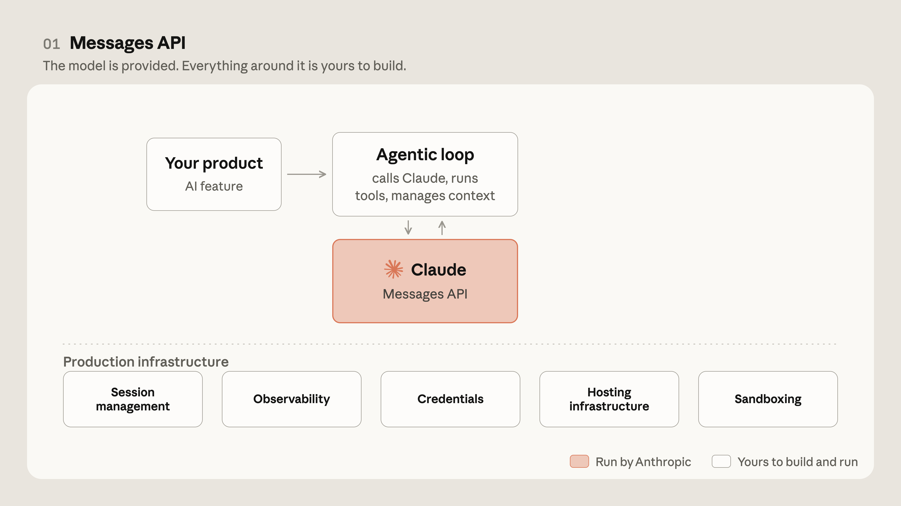
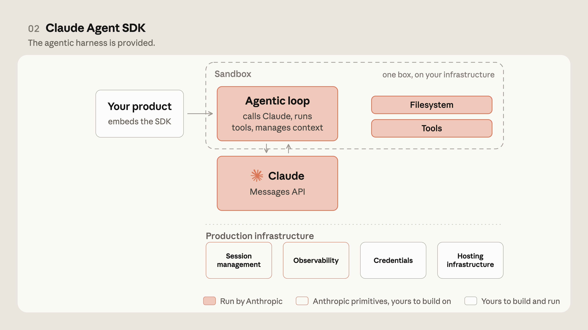
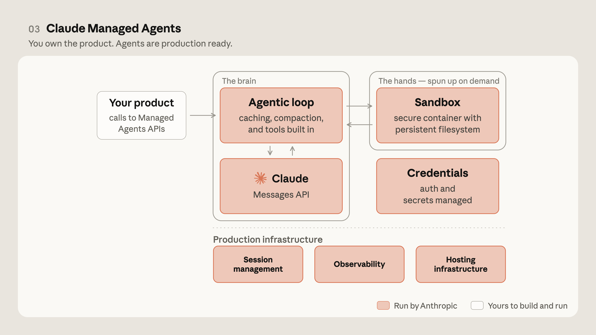
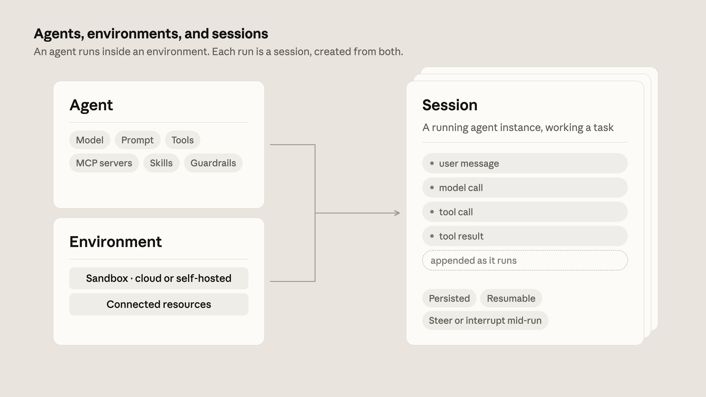
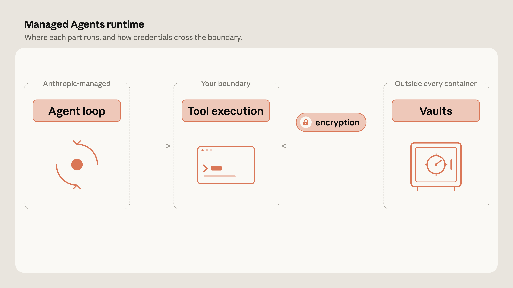
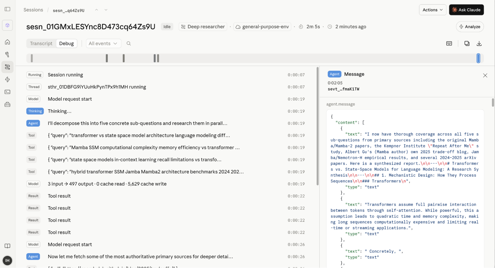
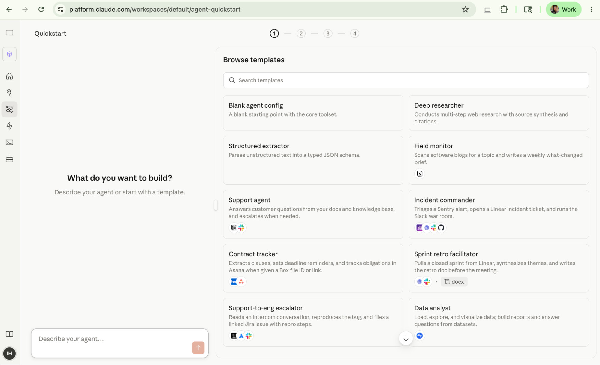
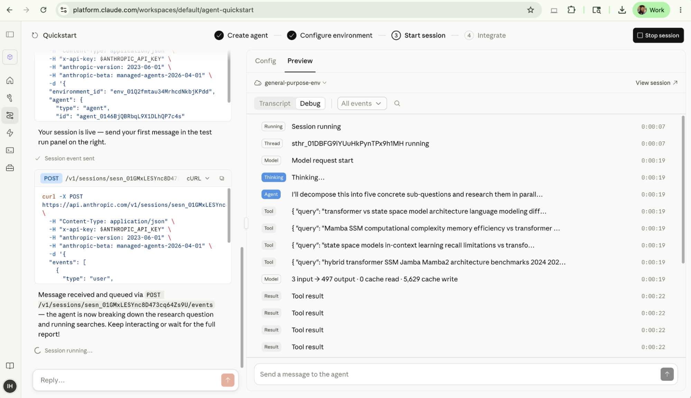
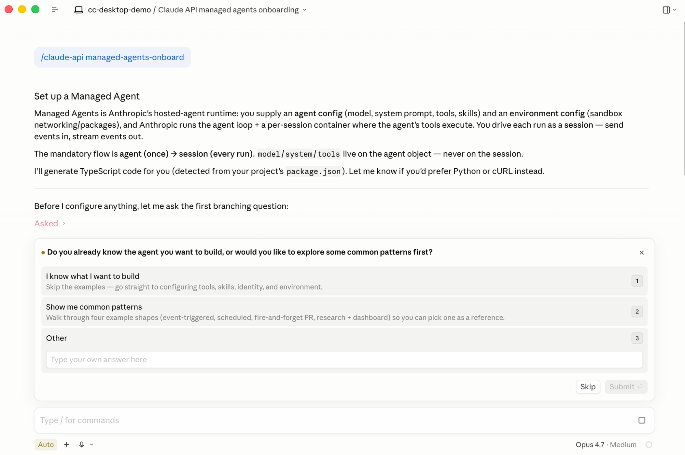

# B28_The evolution of agentic surfaces: building with Claude Managed Agents_智能体表面的演进：用 Claude Managed Agents 构建

> 原文：https://claude.com/blog/building-with-claude-managed-agents
> 来源：Anthropic Claude Blog（分类：Platform ｜ 产品：Claude Managed Agents）｜发布日期：2026-06-10 ｜ 作者：Gagan Bhat、Isabella He（Applied AI 团队）
> 原文存档：[Markdown](原文/B28_building-with-claude-managed-agents_原文.md)

## 📌 本篇速览

- 📅 2026-06-10　｜　⏱ 原文约 2540 词（逐句精读约 32 分钟）
- 🏷 agentic surface 三代演进、Messages API→Agent SDK→Managed Agents、brain/hands 解耦、agents/environments/sessions、Vaults、Dreaming、context anxiety
- 🗂 [返回目录](00_目录与阅读进度.md)

Agent 基础设施三代演进的官方叙事（与 [Engineering 23](../Engineering全集_逐句对照/23_managed-agents_逐句对照.md) 是同一系统的博客版，本篇补了演进史与客户数据）。**三代表面**：Messages API（tokens in/out，自己搭 loop）→ Agent SDK（复用 Claude Code 的 harness 机器）→ Managed Agents（连基础设施也托管）。**核心判断**：「基础设施是原型与生产 Agent 的分水岭」；对多数组织，维护 harness 是不产生差异化的负担——harness 该随模型一起演进，团队专注真正差异化的两样：**上下文管理与领域专长**。**经典案例 context anxiety**：Sonnet 4.5 接近上下文末尾会赶工截短任务，团队加了 context reset 补丁；Opus 4.5 上该行为消失，补丁沦为纯开销——「补丁随模型升级变束缚」的第一手实例。**三资源抽象**：agent（配置：模型+提示词+工具+护栏）/ environment（执行上下文：沙箱+网络规则+预装包）/ session（一次运行=append-only 事件日志，可暂停恢复可回溯）。**四大生产优势**：凭据出沙箱（Vaults 信封加密+按需解密）；TTFT p50 -60% / p95 -90%+（brain 先推理、容器并行起）；事件流会话（观测/记忆/Dreaming 全靠它）；托管或自带 VPC 沙箱 + MCP tunnels。客户数据：Notion 12 小时→20 分钟；Rakuten 每个专家 Agent 约一周上线；Sentry 单工程师数周完成。

---

Getting an agent into production takes more than a good prompt.

把一个智能体推向生产，需要的不只是一段好提示词。

The agent needs somewhere to run the code it writes, credentials to reach your data, observable sessions, and infrastructure that scales with usage.

它需要一个运行自己所写代码的地方、访问你数据的凭据、可观测的会话，以及随用量扩展的基础设施。

On the Applied AI team, we work at the intersection of product, research, and the customers building on Claude—and we see the same pattern repeatedly: infrastructure is what separates a prototype from a production agent.

在 Applied AI 团队，我们工作在产品、研究和 Claude 客户的交汇处——我们反复看到同一个模式：**基础设施是原型与生产级智能体的分水岭**。

All too often, teams burn development cycles on security, state management, permissioning, and harness tuning.

太多团队把开发周期烧在了安全、状态管理、权限和 harness 调优上。

Claude Managed Agents, our suite of composable APIs for building and deploying production-grade agents, pairs an agent harness tuned for performance with production infrastructure, allowing teams to go from prototype to launch in days rather than months.

Claude Managed Agents 是我们用于构建和部署生产级智能体的可组合 API 套件，把针对性能调优的 agent harness 与生产基础设施配对，让团队从原型到上线只需数天而非数月。

In this post, we'll cover the evolution of Anthropic's agentic building blocks, why we built Claude Managed Agents, and how teams are using it in production today.

本文将介绍 Anthropic 智能体积木的演进、我们为什么构建 Claude Managed Agents，以及各团队今天在生产中的用法。

## Evolving the agent architecture

## 智能体架构的演进

When we opened up Claude to developers in 2023, the API was deliberately simple: tokens in, tokens out.

2023 年我们向开发者开放 Claude 时，API 刻意保持简单：token 进，token 出。

You sent a prompt, Claude returned a completion, and you built the harness and underlying infrastructure.

你发一段提示词，Claude 返回一段补全，harness 和底层基础设施由你自己搭。

The API grew steadily richer over the years, but the contract underneath never changed: one request, one model turn, and your application decides what happens next.

这些年 API 稳步变丰富，但底层契约从未改变：一个请求、一轮模型调用，接下来发生什么由你的应用决定。

For a long time, that was enough.

在很长时间里，这就够了。

Summarizing a document, classifying a support ticket, rewriting a block of text—the kind of work that fits comfortably in a single turn.

总结文档、给工单分类、改写一段文字——这类工作在单轮里就能舒服地完成。

Over time, however, the tasks people wanted to hand off stopped fitting.

但随着时间推移，人们想交出去的任务开始装不下了。

They wanted Claude to carry a task all the way through, look something up, act on it, see what changed, and decide what to do next.

他们想让 Claude 把任务从头带到尾：查点东西、基于它行动、看看发生了什么变化、再决定下一步。

And they wanted it to operate *in* the systems their work already ran on, like a codebase, internal wiki, or ticketing system.

而且他们想让它*在*工作已经运转其上的那些系统里操作——代码库、内部 wiki、工单系统。

With the API, turning Claude into an agent meant building your own loop: ask the model what to do, run the tool, feed the result back, and repeat.

用裸 API 把 Claude 变成智能体，意味着自建循环：问模型下一步做什么、运行工具、把结果喂回去、重复。

You were responsible for building and deploying the agent scaffolding, which may need tuning as models evolve.

搭建和部署智能体脚手架的责任在你，而且随模型演进它可能需要不断调优。

For agents that require full customization, this approach makes sense.

对需要完全定制的智能体，这条路是合理的。

For agentic workloads that are more predictable and less complex, optimizing harnesses as models and products evolved became tedious.

但对更可预测、复杂度更低的智能体工作负载，随模型和产品演进不停优化 harness 就变成了苦差。

Claude Code, the agentic coding tool we launched in 2025 that lets Claude interact directly with your codebase, contained our own version of that harness: the loop, tool execution, subagents, context management, and rich capabilities that made it an effective agent.

Claude Code——我们 2025 年发布、让 Claude 直接与代码库交互的智能体编码工具——内含我们自己的那套 harness：循环、工具执行、子智能体、上下文管理，以及让它成为高效智能体的丰富能力。

Developers naturally wanted similar harness machinery for their own agents across various domains.

开发者自然想为自己各领域的智能体获得类似的 harness 机器。

To enable teams to build agents on top of the Claude Code harness, we released Claude Agent SDK.

为了让团队能在 Claude Code 的 harness 之上构建智能体，我们发布了 Claude Agent SDK。

Claude Agent SDK gives developers tools to build their own agents on the same machinery that runs Claude Code instead of maintaining a homegrown loop.

Claude Agent SDK 让开发者在驱动 Claude Code 的同一套机器上构建自己的智能体，而不用维护土造的循环。

For a lot of teams, this is when agents became practical: the harness arrived already tuned for Claude with infrastructure primitives and it kept improving as Claude Code did.

对很多团队来说，智能体正是从这时起变得可行：harness 到手时已针对 Claude 调优、带着基础设施原语，并随 Claude Code 一起持续改进。

Even with a harness, though, deploying agents in production environments can be challenging for several reasons:

不过即使有了 harness，把智能体部署到生产环境仍有几重挑战：

- **Hosting and scaling.** Where does the agent run, how long can a process stay alive for a multi-hour task, and what scales it when usage grows?

- **托管与扩展。**智能体在哪运行？一个进程能为数小时的任务存活多久？用量增长时靠什么扩展？

- **Session management.** Where does an agent's history and progress live? Can a run survive an interruption and resume unencumbered? Can you go back and inspect what happened in previous sessions?

- **会话管理。**智能体的历史和进度存在哪？一次运行能否挺过中断并轻装恢复？能否回头检查之前会话里发生了什么？

- **Filesystem management.** Doing real work means producing artifacts: editing code, writing files, building outputs. Where does the agent get a workspace to act on, and what happens to that workspace between runs?

- **文件系统管理。**干真活意味着产出工件：改代码、写文件、构建产物。智能体从哪获得工作区？两次运行之间工作区怎么办？

- **Execution isolation.** The code Claude writes has to execute somewhere. What's the blast radius if it's wrong, and what boundary would you actually trust in production?

- **执行隔离。**Claude 写的代码总要在某处执行。写错了爆炸半径多大？生产里你真正敢信的边界是什么？

- **Credentials.** The agent needs access to your systems. How does it get that access without exposing proprietary information to the code it generates?

- **凭据。**智能体需要访问你的系统。怎么给它访问权，又不把专有信息暴露给它生成的代码？

- **Observability.** When an agent works autonomously for an hour and does something surprising, can you reconstruct every step it took?

- **可观测性。**当智能体自主工作一小时后做了件出人意料的事，你能重建它走过的每一步吗？

With the Agent SDK, many elements of the aforementioned production infrastructure are provided through Claude Code's machinery.

有了 Agent SDK，上述生产基础设施的许多要素由 Claude Code 的机器提供。

The agent gets a real filesystem to work in, session state is persisted locally or on external storage, and observability is exportable through OpenTelemetry into whatever monitoring stack you already run.

智能体获得真实的文件系统作为工作区，会话状态持久化在本地或外部存储，可观测性可经 OpenTelemetry 导出到你已有的任何监控栈。

However, as teams increasingly built agents that moved out of local development into production, they needed a way to deploy them at scale and with managed infrastructure.

然而，随着越来越多团队把智能体从本地开发推向生产，他们需要一种以托管基础设施规模化部署的方式。

And as models and their surrounding harnesses become more advanced–running longer, executing more code, touching more systems, and taking more actions–scaling, security, and sandboxing became more challenging.

而随着模型及其周边 harness 越来越先进——跑得更久、执行更多代码、触达更多系统、采取更多行动——扩展、安全和沙箱都变得更难。

Several of these hurdles stem from a common architectural choice: agent harnesses often run *inside the same container* as the filesystem it works on.

其中好几道坎源自同一个架构选择：agent harness 常常与它操作的文件系统跑在*同一个容器里*。

A container has to spin up (paying a startup cost) before Claude can think, the agent along with code execution lives right next to your credentials, and when the container dies, the run dies with it.

Claude 开始思考前必须先起容器（付启动成本）；智能体和代码执行就住在你的凭据旁边；容器一死，这次运行也跟着死。

Managed Agents solves these problems by decoupling the brain from the hands.

Managed Agents 用「大脑与双手解耦」解决这些问题。

The harness that calls Claude runs separately from the sandbox where code executes, and the session–an append-only log of every model call, tool call, and result–connects the two.

调用 Claude 的 harness 与执行代码的沙箱分开运行，二者由 session——记录每次模型调用、工具调用和结果的只追加日志——连接。

Claude can start reasoning before any container exists, the sandbox stays far away from your credentials, and a whole run can be reconstructed from its session at any point.

Claude 可以在任何容器存在之前就开始推理；沙箱离你的凭据远远的；整次运行随时可以从它的 session 重建出来。

## When and why to use Claude Managed Agents

## 何时以及为何使用 Claude Managed Agents

When building with Managed Agents, users define the task, the tools, and the guardrails, and Anthropic runs the agent on our infrastructure and handles the agentic loop underneath: how to give an agent an execution environment to call tools, how to recover when something fails, multi-agent orchestration, and more.

用 Managed Agents 构建时，用户定义任务、工具和护栏，Anthropic 在我们的基础设施上运行智能体并处理底层的智能体循环：怎么给智能体一个调用工具的执行环境、失败时怎么恢复、多智能体编排，等等。

When the harness doesn't evolve alongside model intelligence, the agent breaks down.

当 harness 不随模型智能一起演进时，智能体就会崩坏。

On Claude Sonnet 4.5, an agent would rush to finish as it neared the end of its context, cutting work short rather than using the room it had left—a pattern called "context anxiety."

在 Claude Sonnet 4.5 上，智能体接近上下文末尾时会赶着收尾，宁可把工作截短也不用完剩余空间——这个模式叫「上下文焦虑」（context anxiety）。

Our fix was to add context resets to the harness, baking in an assumption that Claude needed help staying coherent near the limit.

我们的修复是给 harness 加上下文重置，其中固化了一个假设：Claude 在接近上限时需要帮助来保持连贯。

That assumption didn't survive the next model.

这个假设没能活过下一代模型。

On Claude Opus 4.5, the behavior was gone, and the resets we'd added were just overhead.

在 Claude Opus 4.5 上，这个行为消失了，我们加的重置成了纯粹的开销。

For most organizations, maintaining a harness is overhead that doesn't differentiate their product.

对大多数组织来说，维护 harness 是不能为产品带来差异化的负担。

Harnesses have to be tuned for certain model behaviors; primitives like compaction, tool execution, and caching works differently on Claude than other models.

harness 必须针对特定模型行为调优；compaction、工具执行、缓存这些原语在 Claude 上与在其他模型上的工作方式不同。

With Claude Managed Agents, the harness evolves alongside the model, allowing teams to focus on what will differentiate their agents: **context management and domain expertise.**

有了 Claude Managed Agents，harness 随模型一起演进，团队得以专注于真正让智能体差异化的东西：**上下文管理和领域专长**。

To enable developers to configure the context and tools necessary to build effective agents, Managed Agents is built around three primary resources: agents, environments, and sessions.

为了让开发者配置构建高效智能体所需的上下文和工具，Managed Agents 围绕三个主要资源构建：agents、environments、sessions。

An *agent* is a configuration: a model, a prompt, a set of tools, and the guardrails around them.

*agent* 是一份配置：一个模型、一段提示词、一组工具，以及围绕它们的护栏。

An *environment* is the execution context the agent runs in: the sandbox container, its networking rules, and the packages pre-installed in it, hosted on our cloud or on infrastructure you control.

*environment* 是智能体运行其中的执行上下文：沙箱容器、网络规则、预装的软件包——托管在我们的云上，或你掌控的基础设施上。

Each run is a *session*, which pairs an agent with an environment and gets its own isolated sandbox instance.

每次运行是一个 *session*：把一个 agent 与一个 environment 配对，并获得自己的隔离沙箱实例。

Sessions persist their full event history, sandbox state, and outputs server-side, so long-running work can pause, resume cleanly, and be traced step by step after the fact.

session 在服务端持久化完整事件历史、沙箱状态和产出，因此长时工作可以暂停、干净地恢复，并在事后逐步回溯。

With Managed Agents, you can define an agent and an environment once, then run many sessions against the same configuration as your workload grows.

用 Managed Agents，agent 和 environment 定义一次，随着工作负载增长，可对同一配置跑任意多个 session。

## Building for production and scale on Managed Agents

## 在 Managed Agents 上做生产与规模化

Within Applied AI, we see agents go from prototype to production both inside Anthropic and across our customers' systems, across coding, finance, support, legal, and a dozen other domains.

在 Applied AI，我们看着智能体从原型走向生产——既在 Anthropic 内部，也在客户系统里，横跨编码、金融、客服、法务等十多个领域。

This gives us a clear view of what separates a demo from a production-ready agent and where teams often get stuck.

这让我们清楚地看到 demo 与生产级智能体的分界在哪、团队常卡在哪。

Below, we share the most common reasons to build on a managed service like Claude Managed Agents:

以下是选择 Claude Managed Agents 这类托管服务的最常见理由：

**1. Credentials are kept out of the sandbox.**

**1. 凭据被挡在沙箱之外。**

When everything runs in one container, the code Claude generates sits right next to your credentials, so prompt injections could lead the model to leak a token by convincing the model to read its own environment.

当一切跑在一个容器里时，Claude 生成的代码就坐在你的凭据旁边——提示注入可能说服模型去读自己的环境变量，从而泄漏 token。

We can protect against this by setting up robust guardrails within the same container, but decoupling the architecture enables a much more secure approach by keeping credentials out of the sandbox entirely.

在同一容器里设置坚固护栏可以做部分防护，但解耦架构给出了安全得多的方案：让凭据完全不进沙箱。

Tokens for tools like MCPs, CLIs, and GitHub repos live in a separate vault, and a proxy fetches them and decrypts them only on demand.

MCP、CLI、GitHub 仓库等工具的 token 存放在独立的保险库（vault）里，由一个代理按需取出并解密。

Managed Agents provides Vaults that handle credentials out-of-the-box, so you don't need to run your own secret store, transmit tokens on every call, or lose track of which end user an agent acted on behalf of.

Managed Agents 提供开箱即用的 Vaults 来管理凭据——你不用自己跑密钥仓库、不用每次调用都传输 token，也不会搞不清智能体是在替哪个最终用户行动。

Vault credentials are protected with envelope encryption before storage, and retrieval requires a signed request token for verification.

Vault 凭据在存储前经信封加密（envelope encryption）保护，取回时需要签名的请求 token 做验证。

**2. Lower latency from eliminated sandbox overhead.**

**2. 消除沙箱开销带来的更低延迟。**

Latency is a metric that is top-of-mind for many enterprise teams, since users acutely feel when they're waiting for Claude to respond.

延迟是许多企业团队最在意的指标——用户对「等 Claude 回复」的感知非常敏锐。

Without the Managed Agents architecture, a container has to be spun up for every session, even the ones where the agent only needs to think and never runs a tool.

没有 Managed Agents 架构时，每个 session 都得起一个容器——哪怕这个 session 里智能体只需要思考、从不运行工具。

That setup time is wasted, and the user feels it as a delay before the first response.

那段启动时间被浪费了，用户把它感受为首个回复前的延迟。

With Managed Agents, Claude begins reasoning immediately while the environment spins up in parallel, and sessions that never run a tool skip the container entirely.

有了 Managed Agents，Claude 立刻开始推理，环境并行启动；从不运行工具的 session 则完全跳过容器。

This means the user sees the first token without waiting on container startup, and the environment is ready by the time the agent needs to run something.

这意味着用户看到首个 token 时无需等待容器启动，而当智能体需要运行什么时，环境已经就绪。

In our testing, that cut the time-to-first-token by roughly 60% in the median case (p50) and by over 90% in the slowest cases (p95).

在我们的测试中，这让首 token 时间中位数（p50）降低约 60%，最慢情形（p95）降低超过 90%。

**3. Reliable, persistent sessions that enable session management, observability, and memory.**

**3. 可靠、持久的会话，支撑会话管理、可观测性与记忆。**

Instead of request/response, Managed Agents thinks in terms of *events.*

Managed Agents 的思考单位不是请求/响应，而是*事件*。

A session is an ongoing stream of events: every model call, tool call, and result, are appended to a log that lives outside the process running the agent.

session 是持续的事件流：每次模型调用、工具调用和结果都被追加到一份日志里，这份日志活在运行智能体的进程之外。

With this architecture, you get real-time updates as events stream in while the agent works, and you can resume any session later with no database or save-points to manage.

在这个架构下，智能体工作时你能随事件流入获得实时更新，之后可以恢复任何 session——没有数据库或存档点要管理。

History is preserved between interactions unless you delete the session, and when a session goes idle its container is checkpointed so you can pick up cleanly from where it paused.

除非你删除 session，历史在交互之间一直保留；session 空闲时容器会做检查点（checkpoint），你可以从暂停处干净地接续。

And because the whole run is already a record of events, observability and memory come with it: the Claude Developer Console offers a native visual timeline view of your agent sessions, and a debugging experience that allows you to examine any transcript in-depth.

而且既然整次运行本身就是一份事件记录，可观测性和记忆随之而来：Claude 开发者控制台原生提供智能体会话的可视化时间线视图，以及可深入检查任意转录的调试体验。

Managed Agents also comes with features like Memory and Dreaming that also use this session durability.

Managed Agents 还带有同样依托这种会话持久性的 Memory 和 Dreaming 等特性。

Dreaming is a scheduled process that reviews your agent sessions and memory stores, extracts patterns, and curates memories so your agents improve over time.

Dreaming 是一个定时进程：回顾你的智能体会话和记忆存储、提取模式、策展记忆，让智能体随时间变好。

Dreaming refines memory between sessions so that it can improve from recurring mistakes and user preferences by reading from the persistent session logs.

Dreaming 在会话之间打磨记忆——通过读取持久化的会话日志，从反复出现的错误和用户偏好中改进。

**4. Flexibility in Anthropic-managed or self-hosted cloud containers.**

**4. Anthropic 托管或自托管云容器的灵活性。**

By default, with Managed Agents, you can delegate both orchestration and tool execution to Anthropic-managed cloud containers.

默认情况下，你可以把编排和工具执行都委托给 Anthropic 托管的云容器。

This makes hosting and scaling simple and easy, delivering a faster path to production.

这让托管和扩展变得简单，通往生产的路径更快。

Because the brain is decoupled from the hands in Managed Agents, the hands can live anywhere, including inside your Virtual Private Cloud (VPC).

由于 Managed Agents 里大脑与双手解耦，「双手」可以住在任何地方——包括你的虚拟私有云（VPC）里。

Thus, we also offer self-hosted sandboxes for teams that want control over tool execution, so the agent's code, filesystem, and network egress never leave their environment.

因此我们也为想掌控工具执行的团队提供自托管沙箱：智能体的代码、文件系统和网络出口永不离开他们的环境。

We also provide MCP tunnels, which let you connect Claude to Model Context Protocol (MCP) servers that run inside your private network.

我们还提供 MCP 隧道，让你把 Claude 连接到运行在私有网络内的 MCP 服务器。

So self-hosted sandboxes control *where the agent's code executes*, and MCP tunnels control *how Anthropic reaches MCP servers in your network*, giving you the ability to control exactly what stays inside your boundary.

自托管沙箱控制的是*智能体的代码在哪执行*，MCP 隧道控制的是 *Anthropic 如何触达你网络内的 MCP 服务器*——让你能精确控制什么留在你的边界之内。

*图注：Claude Managed Agents 内置的可观测控制台记录每个事件——可以拖动时间线、打开任意步骤、读取原始载荷。*

Beyond these features, additional capabilities include outcomes that let an agent grade its own work against a rubric, multiagent orchestration, permission policies, and webhooks.

除以上特性外，还有让智能体按评分细则给自己工作打分的 outcomes、多智能体编排、权限策略和 webhooks 等能力。

### How customers are building on Managed Agents today

### 客户今天怎么用 Managed Agents

Across industries, customers are already shipping agents in production with Claude Managed Agents.

各行业客户已经在用 Claude Managed Agents 向生产交付智能体。

Here are a few examples:

几个例子：

- Notion runs its Custom Agents on Managed Agents: teams assign work to Claude straight from a task board, Claude picks up the docs, meeting notes, and connected data around each task, and the finished code, decks, and sites land back in the workspace for review. Dozens of tasks run in parallel, and their team has described an early prototype turning roughly twelve hours of work into twenty minutes.

- Notion 把 Custom Agents 跑在 Managed Agents 上：团队直接从任务板给 Claude 派活，Claude 捡起每个任务周边的文档、会议记录和已连接数据，完成的代码、幻灯片和网站落回工作区待审。数十个任务并行运行；他们的团队描述早期原型把约 **12 小时的工作变成了 20 分钟**。

- Rakuten used Managed Agents to ship specialist agents across product, sales, marketing, and finance, each live within about a week.

- Rakuten 用 Managed Agents 在产品、销售、市场和财务各条线上交付专家智能体——每个约一周内上线。

- Sentry paired its Seer debugging agent with a Claude agent that writes the patch and opens the PR, built in weeks instead of months by a single engineer.

- Sentry 把自家的 Seer 调试智能体和一个写补丁、开 PR 的 Claude 智能体配对——由一名工程师用数周（而非数月）建成。

- Asana built AI Teammates that pick up tasks inside projects, and Atlassian put developer agents into Jira workflows.

- Asana 构建了在项目内捡任务的 AI Teammates，Atlassian 把开发者智能体放进了 Jira 工作流。

## Getting started with Claude Managed Agents

## 快速上手 Claude Managed Agents

We built Managed Agents to make it as easy as possible to spin up agents through Claude Code and the Claude Developer Console at platform.claude.com.

我们把 Managed Agents 做到尽可能容易——通过 Claude Code 和 platform.claude.com 的开发者控制台即可起一个智能体。

The Console's quickstart, for example, lets you start from an agent template or describe an agent in plain language, then turn it into a production-ready agent you can secure and deploy in minutes.

比如控制台的快速开始：从模板起步，或用白话描述一个智能体，然后在几分钟内把它变成可加固、可部署的生产级智能体。

*图注：platform.claude.com 的智能体快速开始：从模板起步，或描述你想构建什么。*

*图注：几步之后：智能体已创建、环境已配置、一个 session 正在运行。控制台实时流式展示这次运行。*

In Claude Code, the /claude-api skill is provided by default and provides Claude with detailed, up-to-date reference material for building applications on Claude Managed Agents.

在 Claude Code 里，/claude-api skill 默认提供，为 Claude 准备了构建 Managed Agents 应用的详细、最新参考材料。

We highly recommend that you utilize it for the best practices on setting up your Managed Agents application.

强烈建议用它获取搭建 Managed Agents 应用的最佳实践。

Get started by running /claude-api managed-agents-onboard for an interview-driven walkthrough for setting up a new Managed Agent from scratch.

运行 /claude-api managed-agents-onboard，即可获得从零搭建新 Managed Agent 的访谈式引导。

## The future of building managed agents

## 构建托管智能体的未来

As teams share what they're building with Managed Agents, we see that the time they used to spend on production infrastructure now goes to what differentiates their agents: managing context and tailoring the experience to users.

从各团队分享的构建经历看，他们过去花在生产基础设施上的时间，如今投向了让智能体差异化的东西：管理上下文、为用户打磨体验。

Now, when a new model comes out, you update your agent to use it, rerun your evals, and ship the improvement without touching the architecture underneath.

现在，新模型发布时，你只需把智能体切到新模型、重跑评测、交付改进——底层架构一点不用动。

We're excited to see what you build.

我们期待看到你构建的东西。

---

## 术语中英对照表

| 英文 | 中文 | 备注 |
|---|---|---|
| agentic surface | 智能体表面 | 三代：Messages API → Agent SDK → Managed Agents |
| tokens in, tokens out | token 进 token 出 | 第一代 API 的契约 |
| homegrown loop | 土造循环 | 裸 API 时代自建 agent loop 的负担 |
| decoupling the brain from the hands | 大脑与双手解耦 | harness 与沙箱分离，session 连接二者 |
| context anxiety | 上下文焦虑 | Sonnet 4.5 接近上限赶工截短；补丁在 Opus 4.5 变纯开销 |
| agents / environments / sessions | 配置 / 执行上下文 / 一次运行 | 三资源抽象；session = append-only 事件日志 |
| Vaults / envelope encryption | 保险库 / 信封加密 | 凭据出沙箱、代理按需解密 |
| checkpointed | 检查点化 | session 空闲时容器可冻结再续 |
| Dreaming | 梦境（离线重构） | 定时回顾会话与记忆、提取模式、策展记忆 |
| self-hosted sandboxes / MCP tunnels | 自托管沙箱 / MCP 隧道 | 前者管代码在哪执行，后者管如何触达私网 MCP |
| outcomes | 结果评分 | Agent 按 rubric 给自己工作打分 |
