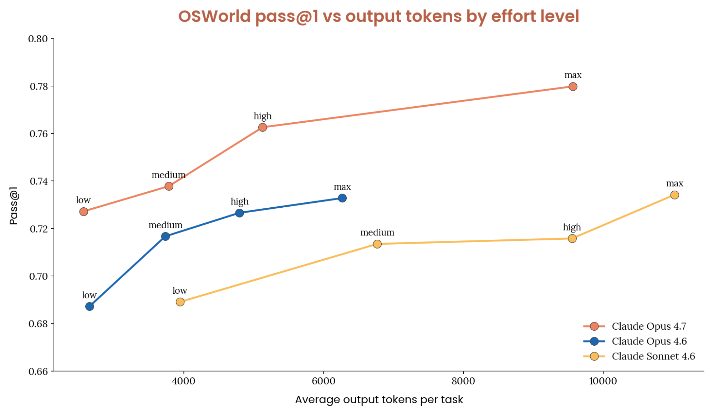
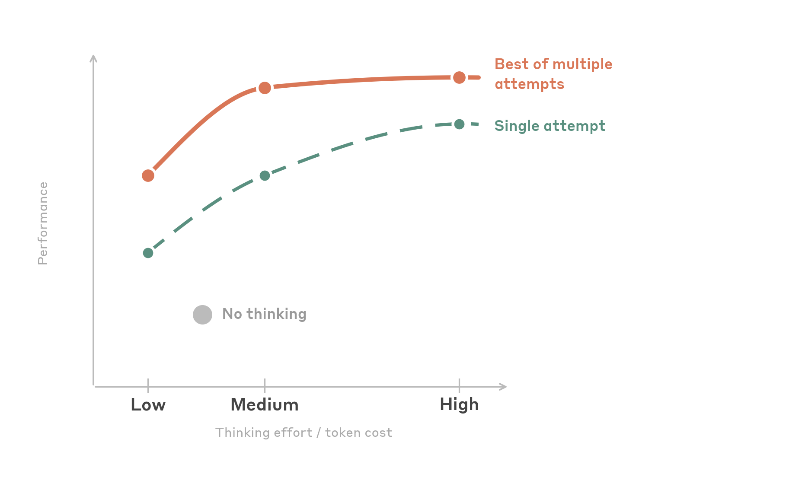

# B29_Best practices for computer and browser use with Claude_Claude 计算机与浏览器使用最佳实践

> 原文：https://claude.com/blog/best-practices-for-computer-and-browser-use-with-claude
> 来源：Anthropic Claude Blog（分类：Agents ｜ 产品：Computer Use / Browser Use）｜发布日期：2026-05-13 ｜ 作者：Lucas Gonzalez、Luca Weihs
> 原文存档：[Markdown](原文/B29_best-practices-for-computer-and-browser-use-with-claude_原文.md)
> 注：原文页面开头混入了一段网页排版 CSS（抓取残留），非文章内容，逐句稿从正文起译。

## 📌 本篇速览

- 📅 2026-05-13　｜　⏱ 原文约 8,900 词（逐句精读约 70 分钟，全集最长篇之一）
- 🏷 分辨率与缩放、坐标回缩、thinking effort 调优、prompt injection 分类器、截图上下文管理、batch tools、advisor tool、Teach Mode
- 🗂 [返回目录](00_目录与阅读进度.md)

计算机/浏览器使用的**工程手册级**长文，六大板块：**① 分辨率**——点击准确率的地基：API 有内部图像上限（4.6 家族长边 1568px / 1.15MP；Opus 4.7 长边 2576px / 3.75MP），超限会被静默降采样导致模型看到的图与你的坐标系错位——**预先降采样是单项收益最大的优化**；默认 1280×720（4.7 用 1080p）；坐标必须按比例缩回原生分辨率；messages 里**文字指令放图片前**。**② thinking effort**——4.6 家族甜点位是 medium（重试可追平 high、token 减半），low 反而比关思考更省（错误少→重试少）；4.7 默认 high；UI 任务本质是感知型而非深度逻辑型，max 不推荐。**③ 安全**——三层防注入（训练时 RL 加固、实时分类器（官方工具默认零延迟零成本开启）、持续红队），外加四条与分类器无关的实践：高危操作人审、权限收窄、全程日志、网页内容一律视为不可信。**④ 上下文管理**——截图每张 1000–1800 token，三层组合：缓存断点（1 个放稳定前缀 + 3 个滚动放最近工具结果）、**缓存友好的批量剪枝**（keep_n=3、interval=25，成批替换旧截图使前缀在多轮间字节级一致）、LLM compaction（8 段式摘要提示词，服务端触发约 150k token，客户端要镜像截断）。**⑤ 实验性**——batch tools（子动作互不依赖时一次调用省 N 轮往返）、advisor tool（Sonnet 执行 + Opus 顾问，服务端单请求内咨询）、周期性提醒 nudge、孤儿 advisor 块清理。**⑥ Teach Mode**——「演示而非描述」：录制截图+动作+语音旁白作为可复用规范回放，蓝圈标注点击位，三种回放严格度（strict/adaptive/goal-oriented）。

---

Claude's latest models represent a significant step forward in computer and browser use capabilities.

Claude 的最新模型在计算机与浏览器使用能力上迈出了一大步。

Because of these features, LLMs are now able to power increasingly complex agentic systems that power real work, like building software applications and automating workflows across multiple, disparate technologies.

凭借这些特性，LLM 现在能够驱动越来越复杂的智能体系统去做真实工作，比如构建软件应用、跨多种异构技术自动化工作流。

In this blog post, we share best practices for using Claude with computer and browser use, ranging from simple configuration changes to more advanced integration patterns.

本文分享 Claude 计算机与浏览器使用的最佳实践，从简单的配置修改到更高级的集成模式。

We hope this piece helps as you start integrating Claude's computer and browser use capabilities into your product.

希望这篇文章能在你把 Claude 的计算机与浏览器使用能力集成进产品时有所帮助。

We are also releasing a new demo implementation which encapsulates some of these best practices and provides additional tools useful for developing on top of Claude's computer use capabilities.

我们同时发布了一个新的[示例实现](https://github.com/anthropics/claude-quickstarts/tree/main/computer-use-best-practices)，封装了其中部分最佳实践，并提供了在 Claude 计算机使用能力之上开发的额外工具。

*Note that these recommendations apply to the Claude 4.6 family (Opus 4.6, Sonnet 4.6, Haiku 4.5) and Claude Opus 4.7 unless otherwise noted.*

*注意：除非另行说明，这些建议适用于 Claude 4.6 家族（Opus 4.6、Sonnet 4.6、Haiku 4.5）与 Claude Opus 4.7。*

*Where guidance differs between the 4.6 family and Opus 4.7, we call it out inline. Our findings are based on internal experimentation and may be updated in the future as new models and techniques emerge.*

*4.6 家族与 Opus 4.7 建议不同之处会在行内标注。这些结论基于内部实验，未来可能随新模型和新技术更新。*

# Getting started: resolution and scaling

# 入门：分辨率与缩放

Click accuracy is the foundation of any computer use integration.

点击准确率是一切计算机使用集成的地基。

If clicks don't land where they should, nothing downstream works: forms don't get filled, buttons don't get pressed, and workflows fail.

点击落不到该落的地方，下游一切都失灵：表单填不上、按钮按不到、工作流失败。

The single highest impact optimization is also one of the simplest: pre downscale your screenshots before sending them to the API.

单项影响最大的优化恰好也是最简单的之一：**把截图发给 API 之前先降采样**。

## Ensure proper scaling

## 确保正确缩放

When you send a screenshot to Claude's Computer Use API, the model sees it and returns click coordinates in the display_width_px / display_height_px coordinate space you specified.

把截图发给 Claude 的 Computer Use API 时，模型看到它，并在你指定的 display_width_px / display_height_px 坐标空间里返回点击坐标。

But there's an important constraint: the API has internal processing limits on image size.

但有个重要约束：API 对图像尺寸有内部处理上限。

Images that exceed these limits get downscaled before the model sees them, which means the model is clicking based on a degraded version of the image while your harness expects coordinates aligned to the original resolution.

超限的图像会在模型看到之前被降采样——这意味着模型是基于降质版图像在点击，而你的 harness 却期望坐标对齐原始分辨率。

For our Claude 4.6 model family, the API's limits are:

对 Claude 4.6 模型家族，API 上限是：

- **Max long edge**: 1568 pixels

- **最长边上限**：1568 像素

- **Max total pixels**: 1.15 megapixels

- **总像素上限**：115 万像素

- Images exceeding **either** limit get internally downscaled

- 超过**任一**上限的图像会被内部降采样

Our Opus 4.7 model supports higher resolution. The limits are:

Opus 4.7 支持更高分辨率，上限是：

- **Max long edge**: 2576 pixels

- **最长边上限**：2576 像素

- **Max total pixels**: 3.75 megapixels

- **总像素上限**：375 万像素

- Images exceeding **either** limit get internally downscaled

- 超过**任一**上限的图像会被内部降采样

When the coordinate space and the model's perceived image don't match, the model's predicted clicks land on a display scale different from the image it's actually seeing.

坐标空间与模型实际感知的图像不匹配时，模型预测的点击就落在了与它所见图像不同的显示比例上。

This is the primary cause of click inaccuracy at high resolutions.

这是高分辨率下点击不准的头号原因。

The fix is straightforward: always downscale your screenshots to fit within these limits before sending them to the API.

修复很直接：发送前永远把截图降采样到上限以内。

We consistently observe significant accuracy degradation when images exceed the limits, and this single change is worth more than almost any other optimization.

图像超限时我们持续观察到显著的准确率退化——这一项改动的价值超过几乎所有其他优化。

## Recommended resolutions

## 推荐分辨率

**Start with 1280x720.**

**从 1280×720 开始。**

This is a safe, practical default for most use cases.

对大多数用例这是安全、实用的默认值。

It uses about 80% of the pixel budget, stays well within both the long edge and total pixel limits, and is a standard resolution that models have seen during training.

它用掉约 80% 的像素预算，稳稳落在长边和总像素两条上限之内，而且是模型训练时见过的标准分辨率。

It works well for both modern web UIs and legacy desktop applications.

对现代网页 UI 和老式桌面应用都表现良好。

**If you are using Opus 4.7, we recommend starting with 1080p**, as this brings a meaningful quality lift over 720p and provides a good balance between token use and performance.

**如果用 Opus 4.7，建议从 1080p 开始**——相对 720p 有实质性质量提升，并在 token 消耗与性能之间取得好的平衡。

**For developers who want to maximize the visual information the model receives**, we also recommend a "max API fit" approach: computing the optimal resolution per-image based on the source's native aspect ratio:

**想让模型接收最多视觉信息的开发者**，可以用「最大 API 适配」法：按源图原生宽高比逐图计算最优分辨率：

```
import math

# 1568 for 4.6 family, 2576 for Opus 4.7
MAX_LONG_EDGE = 1568
# 1.15MP for 4.6 family, 3.75MP for Opus 4.7
MAX_PIXELS = 1_150_000

def compute_max_api_fit(native_w, native_h):
    """Compute the largest resolution that fits API limits
    while preserving aspect ratio."""
    aspect = native_w / native_h
    h_from_pixels = math.sqrt(MAX_PIXELS / aspect)
    w_from_pixels = h_from_pixels * aspect
    if native_w >= native_h:
        w = min(w_from_pixels, MAX_LONG_EDGE)
        h = w / aspect
    else:
        h = min(h_from_pixels, MAX_LONG_EDGE)
        w = h * aspect
    w = min(w, native_w)
    h = min(h, native_h)
    return int(w), int(h)
```

（代码：在保持宽高比的前提下，计算装满像素预算且不超长边限制的最大分辨率；绝不放大超过原生尺寸。）

This approach is slightly more complex but avoids aspect ratio distortion and uses the full pixel budget available for each image.

这个方法稍复杂，但避免了宽高比畸变，并为每张图用满可用像素预算。

The accuracy improvement over a fixed 1280x720 is modest, but it's a straightforward implementation that avoids the distortion that occurs when forcing a 16:9 source into a 4:3 display resolution.

相对固定 1280×720 的准确率提升不大，但实现直接，且避免了把 16:9 源图硬塞进 4:3 显示分辨率时的畸变。

**Resolutions to avoid:**

**要避开的分辨率：**

- **Native resolution (unscaled)**: Unless your source images happen to be below the resolution limits, sending native resolution screenshots is the most common cause of poor click accuracy.

- **原生分辨率（未缩放）**：除非源图恰好低于上限，直接发原生分辨率截图是点击不准最常见的原因。

- **Very low resolutions (below 960x540)**: With low resolution images, too much detail is lost for the model to accurately identify small UI elements.

- **过低分辨率（低于 960×540）**：细节丢失太多，模型无法准确识别小 UI 元素。

- **If on MacOS:** A common issue for browser use is that the screenshots on MacOS are often captured with a device pixel ratio of 2, which means that you can end up with images that are 2x the resolution of the screen coordinates.

- **macOS 用户注意**：浏览器使用的常见问题是 macOS 截图往往按设备像素比 2 捕获——你拿到的图像分辨率是屏幕坐标的 2 倍。

- **If you are on the 4.6 family, avoid 1920x1080 and above:** These exceed the pixel limit and will be silently downscaled. On Opus 4.7 the ceiling is higher (3.75 MP), so 1080p and 1440p is within budget; still avoid native 4K without downscaling.

- **4.6 家族避免 1920×1080 及以上**：超过像素上限、会被静默降采样。Opus 4.7 上限更高（3.75MP），1080p 和 1440p 在预算内；但原生 4K 不降采样仍然要避免。

## Coordinate scaling

## 坐标缩放

When you resize a screenshot before sending it, the model returns click coordinates in the display resolution you specified.

发送前缩放了截图，模型返回的点击坐标就在你指定的显示分辨率里。

You must scale these back to your actual screen resolution before executing the click:

执行点击前，必须把坐标缩回你实际的屏幕分辨率：

```
scale_x = screen_w / display_w
scale_y = screen_h / display_h
screen_x = int(api_returned_x * scale_x)
screen_y = int(api_returned_y * scale_y)
```

This is straightforward but critical, because if you forget to scale or `display_width_px` / `display_height_px` don't match the actual dimensions of the image you sent, every click will be consistently offset.

简单但关键：忘了缩回，或 `display_width_px` / `display_height_px` 与实际发送的图像尺寸不符，每次点击都会稳定地偏移。

## Content ordering in the messages array

## messages 数组里的内容顺序

When constructing your messages content array, place the text instruction *before* the image, as depicted in the code snippet below.

构造 messages 的 content 数组时，把文字指令放在图像*之前*。

This lets the model know what it's looking for as it processes the screenshot, which improves click accuracy.

这让模型在处理截图时就知道自己在找什么，从而提升点击准确率。

```
# 推荐 —— 先文字指令，后截图：
content = [
    {"type": "text", "text": "Click on the Submit button"},
    {"type": "image", "source": {...}},
]
# 不推荐 —— 先图后文
```

## Diagnosing click issues

## 排查点击问题

If clicks are missing their targets, it often boils down to one of the causes, below:

点击脱靶通常归结为以下原因之一：

| 症状 | 可能原因 | 尝试 |
|---|---|---|
| 点击朝同一方向稳定偏移 | display 尺寸与实际发送图像不符；截图超限被静默降采样；图在文前 | display 尺寸严格等于缩放后截图；预降采样到 1280×720 或用 compute_max_api_fit；文字指令放图前 |
| 落点大致对但脱靶 | 目标太小（复选框/图标/开关）；4K+ 源图降采样丢细节；宽高比畸变 | 密集 UI 开 `enable_zoom: True`；低 DPI 捕获或先裁剪相关区域；缩放时保持原宽高比 |
| 点错元素 | 指令有歧义（多个类似按钮）；目标附近有视觉相似元素；UI 太复杂 | 用带位置上下文的更具体提示（「表单右下角蓝色 Submit 按钮」）；拆小步骤；补充页面布局信息 |
| 全面性不准 | 截图超限发送；4K+ 源图极端压缩比；分辨率太低丢关键细节 | 全部预降采样；4.6 家族上 Sonnet 对重度降采样比 Opus 4.6 更稳，4.7 差距基本抹平（且预算更大）；先试 1280×720，太损则 compute_max_api_fit |

## Model selection for clicking tasks

## 点击任务的模型选择

Based on our internal testing, Claude Sonnet 4.6 tends to be more mechanically precise at clicking (better spatial accuracy, fewer near misses) while Claude Opus 4.6 brings stronger reasoning.

内部测试显示：Claude Sonnet 4.6 的点击机械精度更高（空间准确率更好、擦边脱靶更少），Claude Opus 4.6 则推理更强。

Sonnet 4.6 is also more robust when source images require heavy downscaling.

源图需要重度降采样时，Sonnet 4.6 也更稳健。

Opus 4.7 narrows this gap: Through testing, we have found its clicking precision is roughly on par with Sonnet 4.6, and its higher resolution budget reduces the amount of downscaling needed in the first place, making it a strong choice when you want Opus-level reasoning paired with strong click accuracy.

Opus 4.7 缩小了这个差距：测试发现它的点击精度与 Sonnet 4.6 大体持平，而且更高的分辨率预算从源头减少了降采样需求——想要 Opus 级推理配上强点击准确率时是好选择。

For most tasks, we recommend starting with Sonnet 4.6, which provides the best balance of clicking accuracy, reasoning, and cost.

多数任务建议从 Sonnet 4.6 起步——点击准确率、推理与成本的最佳平衡。

Choose Opus 4.7 when you want stronger reasoning, particularly if using high-resolution source images.

想要更强推理（尤其是高分辨率源图）时选 Opus 4.7。

Haiku 4.5 remains an excellent option when latency is the priority.

延迟优先时 Haiku 4.5 仍是出色选项。

Advanced workflows may still benefit from an orchestrator + sub-agent pattern where a reasoning model handles planning and decision-making while Sonnet or Haiku executes the mechanical clicking steps.

高级工作流仍可受益于「编排者 + 子智能体」模式：推理模型管规划与决策，Sonnet 或 Haiku 执行机械点击。

## Handling small targets

## 处理小目标

Click accuracy degrades as targets get smaller.

目标越小，点击准确率越低。

Large and medium UI elements (buttons, input fields, and standard menu items) are reliable across all resolutions within the safe zone.

大中型 UI 元素（按钮、输入框、标准菜单项）在安全区分辨率下都可靠。

The challenge is with small and tiny targets, like checkboxes, system tray icons, dropdown arrows, small toggle switches, and tree view expand/collapse buttons.

难的是小微目标：复选框、系统托盘图标、下拉箭头、小开关、树视图展开/折叠按钮。

If your application involves clicking small targets frequently, consider these strategies:

如果你的应用要频繁点击小目标，考虑这些策略：

**Use zoom for dense UIs.**

**密集 UI 用 zoom。**

Claude 4.6 and 4.7 models support a zoom capability that lets the model inspect specific screen regions at higher resolution before clicking.

Claude 4.6 和 4.7 支持 zoom 能力：模型可以在点击前以更高分辨率查看特定屏幕区域。

Enable it in your tool configuration:

在工具配置里启用：

```
{
    "type": "computer_20251124",
    "name": "computer",
    "display_width_px": 1280,
    "display_height_px": 720,
    "enable_zoom": True
}
```

**Make targets larger.**

**把目标做大。**

If you control the UI being automated, increasing the size of click targets (even modestly) has a disproportionate impact on reliability.

如果被自动化的 UI 在你控制之下，把点击目标做大（哪怕一点点）对可靠性有不成比例的提升。

This might mean using a lower system DPI, zooming in the browser, or adjusting UI scaling settings.

方式可以是降低系统 DPI、浏览器放大、或调 UI 缩放设置。

**Use keyboard alternatives for tiny targets.**

**微小目标改用键盘。**

For very small elements, such as system tray icons or tiny checkboxes, keyboard shortcuts or tab-based navigation can be more reliable than clicking.

对系统托盘图标、微型复选框这类极小元素，键盘快捷键或 Tab 导航可能比点击更可靠。

If your workflow allows it, prompting the model to use keyboard interactions for specific steps can improve success rates.

工作流允许的话，提示模型在特定步骤用键盘交互能提高成功率。

**Consider source image resolution.**

**考虑源图分辨率。**

Screenshots from 4K+ displays that get compressed down to 720p lose significant detail (for example, a 16px checkbox at 3840x2160 native becomes roughly 5px at 1280x720 display resolution, which makes the target much smaller and therefore more difficult to hit).

4K+ 显示器的截图压到 720p 会丢大量细节（例如 3840×2160 原生下 16px 的复选框，到 1280×720 只剩约 5px——目标小得多、更难命中）。

If you're working with very high-resolution displays, consider using Opus 4.7, which has a higher resolution limit than previous models.

用超高分辨率显示器的话，考虑分辨率上限更高的 Opus 4.7。

If using 4.6 models, consider capturing at a lower DPI, using display scaling to enlarge UI elements, or focusing the screenshot on the relevant portion of the screen rather than the full display.

用 4.6 模型的话，考虑低 DPI 捕获、用显示缩放放大 UI 元素、或只截相关屏幕区域而非全屏。

Because these models represent more information with less pixels, we've observed that performance degrades as source image scale increases, meaning more compression is needed.

由于这些模型要用更少像素表示更多信息，我们观察到源图尺寸越大（压缩比越高）性能越差。

## Approaches we tested that didn't help

## 我们试过但没用的方法

We experimented on internal evaluations with several popular optimization techniques and did not find consistent uplift from these approaches, though results may vary depending on the specific situation:

我们在内部评测中试了几种流行的优化技巧，没有发现稳定收益（具体情形可能有差异）：

- **Breaking the image into smaller tiles**: Splitting a screenshot into quadrants or regions and sending them separately did not improve click accuracy.

- **把图切小块**：把截图切成象限或区域分别发送，并没有提升点击准确率。

- **Overlaying a grid pattern with coordinates**: Adding a visual coordinate grid to screenshots to help the model localize targets did not produce reliable gains.

- **叠加坐标网格**：给截图加视觉坐标网格帮模型定位，没有可靠收益。

- **Resize algorithm choice**: PIL LANCZOS, sips, and other common resize algorithms produced identical results. Use whatever is convenient for your stack.

- **缩放算法选择**：PIL LANCZOS、sips 等常见算法结果一致——用你技术栈里方便的那个就行。

## Inspecting failures

## 检查失败

If the model acts unpredictably after trying the fixes above, log the full transcripts and overlay the predicted clicks on the source screenshots to understand what the model is actually seeing and deciding.

上述修复都试过模型仍行为异常时，记录完整转录，并把预测点击叠加到源截图上，搞清模型实际看到了什么、决定了什么。

Some failures aren't about click accuracy at all.

有些失败根本与点击准确率无关。

For example, certain dropdown menus may invoke system-level UI that the browser viewport doesn't capture—the model appears to be failing the task, but it simply can't see the menu it needs to interact with.

比如某些下拉菜单会唤起浏览器视口捕获不到的系统级 UI——模型看似任务失败，其实只是看不见它要交互的菜单。

In cases like these, the model should rely on alternative methods such as JavaScript execution, keyboard navigation, or direct document object model (DOM) manipulation rather than clicking.

这类情况下，模型应改用替代手段：执行 JavaScript、键盘导航、或直接操作 DOM，而不是点击。

## Quick reference

## 快速参考

*How to scale and prepare an image for computer use*

*如何为计算机使用缩放并准备图像*（完整代码见原文存档：`prepare_screenshot`（固定 720p 或 max-api-fit 两种选项，LANCZOS 缩放，输出 base64+display 尺寸）、`scale_coordinates`（API 坐标缩回原生屏幕）、`compute_max_api_fit`；调用示例展示「文字在前、图在后」的 content 组装与工具声明。）

# Tuning thinking effort for computer use

# 为计算机使用调优思考力度

Claude's latest models support adaptive thinking, a setting which lets Claude decide how much to reason through intermediate steps before acting.

Claude 最新模型支持自适应思考（adaptive thinking）：让 Claude 自己决定行动前对中间步骤推理多少。

Instead of manually setting a thinking token budget, adaptive thinking lets Claude dynamically determine when and how much to use extended thinking based on the complexity of each request.

不用手工设思考 token 预算，自适应思考让 Claude 按每个请求的复杂度动态决定何时、用多少扩展思考。

For computer use, this means Claude can think through what it's seeing on screen, plan multi-step interactions, and self-correct before committing to a click or keystroke.

对计算机使用而言，这意味着 Claude 能想清楚屏幕上看到的内容、规划多步交互，并在敲下点击或按键之前自我纠正。

With adaptive thinking, Claude's thinking depth is controlled via the thinking parameter with an effort level: low, medium, high, xhigh (with Opus 4.7), and max.

自适应思考下，思考深度由 thinking 参数的 effort 档位控制：low、medium、high、xhigh（Opus 4.7 才有）和 max。

More thinking means more reasoning per action, but also more output tokens, higher latency, and higher cost.

思考越多，每个动作的推理越充分，但输出 token、延迟和成本也越高。

The natural question: depending on the model, how much thinking is optimal for computer use?

自然的问题是：不同模型上，计算机使用的最优思考量是多少？

## Claude Opus 4.7

## Claude Opus 4.7

We tested each thinking effort level across a suite of end to end UI automation tasks spanning desktop applications, browsers, and multi-application workflows.

我们在一套端到端 UI 自动化任务（桌面应用、浏览器、多应用工作流）上测试了每个思考档位。



**Opus 4.7 outperforms the 4.6 family.**

**Opus 4.7 全面超过 4.6 家族。**

On the OSWorld Verified benchmark, we find that Opus outperforms all 4.6 family models at equivalent token usage and effort settings.

在 OSWorld Verified 基准上，同等 token 用量和 effort 设置下，Opus 4.7 超过所有 4.6 家族模型。

Opus 4.7 on low effort scores similarly to Sonnet 4.6 on max, while using ~1/10th the tokens per task.

Opus 4.7 的 low 档得分与 Sonnet 4.6 的 max 档相当，而每任务 token 只有约 1/10。

For difficult tasks, Opus 4.7 is the obvious choice.

难任务上，Opus 4.7 是显然之选。

**Setting effort to `high`** achieves close to the highest task success rate while using roughly half the output tokens of `max`.

**effort 设为 `high`** 能拿到接近最高的任务成功率，输出 token 约为 `max` 的一半。

Compared to Opus 4.6, low, medium and high all use approximately the same amount of tokens while improving score on OSWorld.

与 Opus 4.6 相比，low/medium/high 的 token 用量大致相同，OSWorld 分数却都更高。

During our internal testing, Max effort used more tokens and provided the best score.

内部测试中，max 档 token 最多、分数最好。

### Recommendations for effort levels

### effort 档位建议（Opus 4.7）

| 场景            | 思考档位           | 原因                                     |
| ------------- | -------------- | -------------------------------------- |
| 多数用例的默认       | `high`         | 足够的推理规划复杂多步交互，token 增幅不大               |
| 高吞吐 / 成本敏感    | `low`          | token 更低，质量介于 Opus 4.6 的 high 与 max 之间 |
| 简单明确的工作流 / 最快 | 建议试 Sonnet 4.6 | 延迟最优先时用；适合 UI 稳定、流程已知的短任务              |
| 复杂的一次成型任务     | `max`          | 任务极难、必须第一次就做对时                         |

## Claude 4.6 models

## Claude 4.6 模型

We tested each thinking effort level across a suite of end to end UI automation tasks spanning desktop applications, browsers, and multi-application workflows.

我们同样在端到端 UI 自动化任务套件上测试了各档位。



Two patterns stand out:

两个突出模式：

**Medium effort is the sweet spot.**

**medium 是甜点位。**

Setting effort to medium achieves close to the highest task success rate while using roughly half the output tokens of high.

medium 档接近最高成功率，输出 token 约为 high 的一半。

Beyond medium, performance somewhat plateaus.

medium 之上，性能趋于平台期。

Notably, when tasks are retried, medium and high converge to the same success rate.

值得注意：允许重试时，medium 和 high 收敛到同一成功率。

This means high effort may help the model get a difficult task right on the first try, but given multiple attempts, medium may get there as reliably at lower cost.

也就是说 high 帮模型第一次就做对难任务，但多次尝试下，medium 能以更低成本同样可靠地到达。

**A little thinking goes a long way.**

**一点思考就走得很远。**

low effort is a surprisingly strong option.

low 档是出人意料的强选项。

It actually uses *fewer* total output tokens than disabling thinking entirely (the model makes fewer mistakes and needs fewer retry cycles), while matching or slightly exceeding no-thinking accuracy.

它的总输出 token 竟然比完全关闭思考*更少*（错误更少→重试循环更少），准确率还持平或略超无思考。

This makes it the best option for cost-sensitive, high-throughput workloads.

这让它成为成本敏感、高吞吐工作负载的最佳选项。

### Recommendations for effort levels

### effort 档位建议（4.6 家族）

| 场景            | 思考档位     | 原因                                |
| ------------- | -------- | --------------------------------- |
| 多数用例的默认       | `medium` | 准确率/成本比最佳；带重试时追平 high、token 减半    |
| 高吞吐 / 成本敏感    | `low`    | 比无思考更准，且因错误和重试更少 token 反而更低       |
| 简单明确的工作流 / 最快 | 关闭思考     | 延迟最优先；适合 UI 稳定、流程已知的短任务           |
| 复杂的一次成型任务     | `high`   | 必须第一次做对时；若系统支持重试，medium 最终成功率可能相同 |

We don't recommend `max` effort for computer use.

计算机使用不推荐 `max` 档。

In our testing, it provides no accuracy benefit over `high` while further increasing output token cost.

测试中它相对 `high` 没有准确率收益，还进一步推高输出 token 成本。

UI tasks are primarily perceptual rather than deeply logical, and the additional reasoning budget goes unused or leads to overthinking.

UI 任务主要是感知型而非深度逻辑型——多出来的推理预算要么闲置，要么导致过度思考。

Keep in mind that this advice will change as models evolve.

记住：这条建议会随模型演进而变化。

## Example configuration of medium setting effort level

## medium 档位配置示例

```
response = client.beta.messages.create(
    model="claude-sonnet-4-6",
    max_tokens=16000,
    betas=["computer-use-2025-11-24"],
    thinking={"type": "adaptive"},
    output_config={"effort": "medium"},
    messages=[...],
    tools=[{"type": "computer_20251124", "name": "computer",
            "display_width_px": 1280, "display_height_px": 720}],
)
```

## Why more thinking doesn't always help

## 为什么更多思考不总是有用

UI automation tasks are fundamentally different from coding or math problems.

UI 自动化任务与编码或数学问题有根本不同。

Most computer use actions are perceptual and mechanical: identifying the right element, clicking in the right place, rather than deeply logical.

大多数计算机使用动作是感知性、机械性的：认出正确元素、点在正确位置——而非深度逻辑推演。

Thinking helps most when the model needs to:

思考最有用的时刻是模型需要：

- Plan a multi-step sequence before starting (e.g., "I need to open Settings, navigate to Privacy, then disable tracking")

- 开始前规划多步序列（如「先开设置，进隐私，再关追踪」）

- Recover from an unexpected UI state (e.g., a dialog appeared that wasn't anticipated)

- 从意外 UI 状态恢复（如弹出了没预料到的对话框）

- Cross-reference information between what's on screen and the task instructions

- 在屏幕内容与任务指令之间交叉核对信息

- Complete challenging projects on professional software

- 在专业软件上完成有挑战性的项目

# Improving safety: leveraging prompt injection classifiers

# 提升安全：利用提示注入分类器

*This section covers prompt injection protection, which is offered by default and for free if you use our official computer use tool header.*

*本节讲提示注入防护——使用官方计算机使用工具头时默认免费提供；自定义工具想启用请填官方意向表单。*

Computer use agents interact with untrusted content by design.

计算机使用智能体在设计上就要与不可信内容交互。

Every screenshot, webpage, or application UI that Claude processes could contain adversarial instructions, including hidden text, manipulated images, deceptive UI elements, or social engineering attempts that try to hijack the agent's behavior.

Claude 处理的每张截图、每个网页、每个应用 UI 都可能包含对抗性指令：隐藏文字、篡改图像、欺骗性 UI 元素、试图劫持智能体行为的社会工程。

This attack surface is fundamentally different from a typical API integration where you control the inputs.

这个攻击面与你能控制输入的典型 API 集成有根本不同。

With computer use, the inputs to the model are the open internet and whatever software the agent is navigating.

计算机使用下，模型的输入是开放互联网和智能体正在浏览的任何软件。

As computer use agents become more capable and more widely deployed, prompt injection becomes a correspondingly more serious risk.

计算机使用智能体越能干、部署越广，提示注入的风险就相应越严重。

An agent that can click, type, and navigate can be manipulated into taking real-world actions such as filling out forms, downloading files, or navigating to malicious URLs.

能点击、能输入、能导航的智能体，可能被操纵去做真实世界的动作：填表、下载文件、访问恶意 URL。

Building robust defenses against these attacks is essential for any production deployment.

对任何生产部署，构建针对这些攻击的坚固防御都是必需的。

## How we approach prompt injection defense

## 我们的提示注入防御思路

We've written in detail about our approach to prompt injection defenses for browser and computer use.

我们详细写过针对浏览器与计算机使用的提示注入防御思路。

Our defense strategy operates at multiple layers:

防御策略分多层运作：

**Training-time robustness.**

**训练时加固。**

We use reinforcement learning to build prompt injection resistance directly into Claude's capabilities.

我们用强化学习把抗提示注入能力直接构建进 Claude。

During training, Claude is exposed to injected content embedded in simulated web pages and application UIs, and rewarded when it correctly identifies and refuses to follow malicious instructions.

训练时 Claude 会接触嵌在模拟网页和应用 UI 里的注入内容，正确识别并拒绝执行恶意指令时获得奖励。

This means Claude's first line of defense is the model itself as it has learned to distinguish between legitimate user instructions and adversarial content encountered during task execution.

也就是说第一道防线是模型本身——它学会了区分合法用户指令与任务执行中遇到的对抗内容。

**Real-time classifiers.**

**实时分类器。**

We run probes that scan content entering Claude's context window and flag potential prompt injection attempts.

我们运行探针，扫描进入 Claude 上下文窗口的内容并标记潜在注入企图。

These probes detect adversarial commands across multiple modalities such as text hidden in page content, instructions embedded in images, and deceptive UI elements designed to trick the agent and then adjust Claude's behavior when they identify an attack.

这些探针跨多模态检测对抗性命令——页面隐藏文字、图像内嵌指令、欺骗性 UI 元素——识别到攻击时调整 Claude 的行为。

**Continuous red teaming.**

**持续红队。**

Our security researchers continuously probe these defenses, and we participate in external adversarial evaluations to benchmark robustness against evolving attack techniques.

我们的安全研究员持续攻击这些防御，并参加外部对抗评测，以对不断演化的攻击技术做鲁棒性基准。

We've continued to invest heavily in all three layers since our initial computer use research preview.

自最初的计算机使用研究预览以来，我们在三层上都持续重投入。

Each new model generation incorporates stronger training-time defenses and more capable classifiers, and we've expanded the range of attack techniques our red team evaluates against.

每一代新模型都带来更强的训练时防御和更能干的分类器，红队评估的攻击手法范围也在扩大。

## Using Claude's built-in classifiers

## 使用 Claude 内置分类器

When you use Claude's official computer use tool via the API, prompt injection classifiers run automatically on every request.

通过 API 使用官方计算机使用工具时，提示注入分类器在每个请求上自动运行。

These classifiers operate in parallel with the main model inference, adding approximately zero additional latency and no additional cost to your requests.

分类器与主模型推理并行运行，几乎零额外延迟、零额外成本。

There is nothing you need to configure to enable this protection.

启用这层防护不需要任何配置。

It's on by default when you use the official `computer_20251124` tool type.

用官方 `computer_20251124` 工具类型时默认开启。

The classifiers evaluate screenshots and other content for signs of prompt injection and influence Claude's responses accordingly.

分类器评估截图等内容中的注入迹象，并相应影响 Claude 的回应。

## If you're not using the official computer use tool

## 如果你没用官方计算机使用工具

Many developers build computer use integrations using custom tool definitions rather than the official `computer_20251124` tool type, for example, defining their own screenshot and click tools.

许多开发者用自定义工具定义（自己的截图和点击工具）而非官方工具类型构建集成。

If this describes your setup, the built-in classifiers described above don't currently run on your requests.

如果你是这种情况，上述内置分类器目前不会在你的请求上运行。

We're actively exploring how to extend prompt injection protection to these custom implementations.

我们在积极探索把注入防护扩展到这些自定义实现。

If you're building a computer use or browser use integration without the official tool type and are interested in prompt injection classifiers, fill out this interest form and we'll follow up as this capability becomes available.

不用官方工具类型、又对注入分类器感兴趣的话，请填意向表单，能力可用时我们会跟进。

## Best practices regardless of classifier use

## 无论是否用分类器都该做的实践

Classifiers are one layer of defense, not a complete solution.

分类器是一层防御，不是完整解法。

We recommend the following practices for any computer use deployment:

任何计算机使用部署都建议：

**Implement human-in-the-loop for high-stakes actions.**

**高危操作人在环。**

Have the agent pause and request user confirmation before performing irreversible actions such as submitting forms, making purchases, sending messages, or modifying data.

在执行不可逆操作（提交表单、购买、发消息、改数据）前，让智能体暂停并请求用户确认。

This is the single most effective mitigation against prompt injection regardless of classifier performance.

无论分类器表现如何，这是对提示注入**单项最有效**的缓解。

**Scope the agent's permissions.**

**收窄智能体权限。**

Limit what the agent can do.

限制智能体能做什么。

If your workflow doesn't require file downloads, don't give the agent access to download files.

工作流不需要下载文件，就别给下载权限。

If it doesn't need to send emails, don't give it access to an email client.

不需要发邮件，就别给邮件客户端。

Reducing the blast radius of a successful injection is as important as preventing the injection itself.

缩小注入成功后的爆炸半径，与阻止注入本身同等重要。

**Monitor and log agent actions.**

**监控并记录智能体动作。**

Log the full sequence of actions the agent takes, including screenshots at each step.

记录智能体的完整动作序列，包括每步截图。

This allows you to detect anomalous behavior, audit what happens when something goes wrong, and build a feedback loop to improve your system's robustness over time.

这让你能发现异常行为、在出事时审计经过，并建立随时间提升系统鲁棒性的反馈回路。

**Treat all web content as untrusted.**

**把所有网页内容视为不可信。**

Design your agent's system prompt to clearly distinguish between the user's instructions and content encountered during task execution.

在系统提示词里明确区分「用户的指令」与「任务执行中遇到的内容」。

Remind the model that text found on web pages, in emails, or in application UIs is not from the user and should not be treated as instructions.

提醒模型：网页、邮件、应用 UI 里的文字不是来自用户，不应被当作指令。

# Context management for computer use

# 计算机使用的上下文管理

When building computer use agents, screenshots accumulate fast.

构建计算机使用智能体时，截图积累得飞快。

Every action generates a new image, and each image consumes roughly 1,000–1,800 tokens depending on resolution.

每个动作生成一张新图，每张图按分辨率消耗约 1,000–1,800 token。

After accounting for the system prompt, tool definitions, and text content, a 200k context window can fill up in well under 100 screenshots.

算上系统提示词、工具定义和文字内容，一个 200k 上下文窗口不到 100 张截图就能装满。

Managing this context well has two goals: 1) keeping total tokens bounded and 2) keeping prompt caching effective so you don't repeatedly pay full price for the same prefix.

管好这些上下文有两个目标：① 总 token 有界；② 提示词缓存持续有效——不为同一前缀反复付全价。

We've found that effective context management has more impact on long-running-agent cost and latency than almost any other optimization.

我们发现有效的上下文管理对长时运行智能体的成本与延迟的影响，超过几乎所有其他优化。

This section covers three layers that compose cleanly: placing cache breakpoints, pruning old screenshots without breaking the cache, and summarizing history when pruning isn't enough.

本节讲三个能干净组合的层：放置缓存断点、不破坏缓存地剪枝旧截图、剪枝不够时摘要历史。

## Placing cache breakpoints

## 放置缓存断点

Prompt caching only helps if breakpoints land on content that will recur across turns.

只有断点落在会跨轮复现的内容上，提示词缓存才有用。

The API supports four cache breakpoints total.

API 总共支持 4 个缓存断点。

Putting all four on a stable prefix (system prompt, tool definitions) wastes them as that prefix is already hit once and never invalidates, so one breakpoint is enough.

把 4 个全放在稳定前缀（系统提示词、工具定义）上是浪费——前缀命中一次后永不失效，一个断点就够。

The other three are better spent on recent history, where invalidation risk is highest and savings compound on long sessions.

其余三个花在最近历史上更值——那里失效风险最高，长会话里节省会复利放大。

We recommend:

我们建议：

- **One breakpoint on the system prompt or trailing tool definitions.** This prefix rarely changes within a session.

- **一个断点放在系统提示词或工具定义末尾。**会话内这段前缀几乎不变。

- **Up to three additional breakpoints on the most recent tool results**, advancing each turn and clearing the previous iteration's breakpoints so you don't overrun the four-breakpoint limit.

- **最多三个断点放在最近的工具结果上**，每轮向前推进并清掉上一轮的断点，避免超出 4 个上限。

Spreading breakpoints across recent positions gives you graceful degradation.

把断点分布在多个最近位置能带来优雅降级。

If your most recent breakpoint is invalidated, e.g. by an image prune, a compaction, or a tool-definition change, an earlier breakpoint can still hit, and you keep paying 10% of the full input cost instead of 100%.

如果最近的断点被打破（图片剪枝、compaction、工具定义变更），更早的断点仍能命中——你继续付全额输入价的 10%，而不是 100%。

*（代码 `set_trailing_cache_control`：先清除全部旧 cache_control 标记，再从消息尾部往前给最近 3 个 tool_result 打 ephemeral 标记。）*

## Approach 1: Rolling buffer (cache-aware)

## 方法一：缓存友好的滚动缓冲

The simplest way to keep token counts bounded is to keep only the N most recent screenshots and drop the rest.

让 token 有界最简单的方式：只保留最近 N 张截图，其余丢弃。

Before each API call, walk the message array and replace older image blocks with a short placeholder (e.g., a text block saying "[Image omitted]").

每次调用 API 前扫描消息数组，把较旧的图像块换成简短占位符（如文本块「[Image omitted]」）。

The naive version of this pattern is dropping screenshots one at a time as they age out, which changes the prefix on every turn and invalidates the prompt cache continuously.

这个模式的朴素版是逐张淘汰过期截图——每一轮都改变前缀，持续打破提示词缓存。

This is how rolling buffers got their reputation for breaking caching.

滚动缓冲「破坏缓存」的名声就是这么来的。

The fix is to prune in batches so the prefix stays byte-identical for several turns at a time, then invalidates once, then stays stable again.

修复：**成批剪枝**——让前缀在连续多轮间字节级一致，然后一次性失效，再进入下一段稳定期。

A concrete pattern that we have tested is to:

我们测试过的具体模式：

1. Keep the most recent keep_n screenshots in full resolution.

1. 最近 keep_n 张截图保持全分辨率。

2. Once the total screenshot count exceeds keep_n + interval, replace the oldest interval screenshots with placeholders in a single pass.

2. 截图总数超过 keep_n + interval 时，一次性把最旧的 interval 张换成占位符。

3. Between pruning events, the message array is byte-identical across turns, so your cache breakpoints keep hitting.

3. 两次剪枝之间，消息数组跨轮字节级一致，缓存断点持续命中。

Reasonable defaults to start with: keep_n = 3, interval = 25.

合理的起步默认值：keep_n = 3，interval = 25。

These are tunable, and a higher interval means fewer prune events (better cache efficiency) but a larger tail of full-resolution screenshots in context (more tokens).

参数可调：interval 越大剪枝事件越少（缓存效率更好），但上下文里全分辨率截图的尾巴越长（token 越多）。

Measure cache hit rate and total input tokens on a representative trajectory and adjust.

在有代表性的轨迹上度量缓存命中率和总输入 token，再调整。

*（代码 `prune_old_screenshots`：收集全部图像位置，总数超过 keep_n+interval 才动手，单趟把最旧 interval 张换成 "[Image omitted]" 文本块。）*

Rolling buffers still have one real limitation: anything outside the buffer is gone.

滚动缓冲仍有一个真实局限：缓冲之外的一切都没了。

The original instructions, what the agent already tried, and where it is in the task all disappear with the pruned screenshots.

最初的指令、智能体已经试过什么、任务进行到哪——都随被剪掉的截图一起消失。

For short tasks (under ~50 actions), that's fine.

短任务（约 50 个动作以内）没问题。

For anything longer, combine this with compaction.

更长的任务，要和 compaction 组合使用。

## Approach 2: LLM-based compaction

## 方法二：基于 LLM 的压缩（compaction）

Instead of silently dropping old images, summarize the full conversation before discarding it.

不是悄悄丢掉旧图，而是在丢弃前给整个对话做摘要。

The summary preserves what happened, what the user asked for, what's been completed, and where to resume.

摘要保留发生了什么、用户要什么、完成了什么、从哪继续。

A few recent screenshots are kept alongside it so the agent can see what it's currently looking at.

旁边保留几张最近截图，让智能体能看到自己当前面对的画面。

Compaction and the cache-aware rolling buffer are complementary.

compaction 与缓存友好滚动缓冲互补。

Use the rolling buffer turn-to-turn to keep token growth manageable; use compaction occasionally to reclaim the rest of the window without losing earlier context.

滚动缓冲逐轮控制 token 增长；compaction 偶尔运行，在不丢失早期上下文的前提下收回窗口其余部分。

Each compaction event is a cache invalidation by design, so you want it to happen rarely, not every few turns.

每次 compaction 天然就是一次缓存失效，所以它应该罕见地发生，而不是每几轮一次。

### The summarization prompt

### 摘要提示词

This example prompt provides a scaffold where each section targets a specific failure mode.

这份示例提示词提供了一个脚手架，每个小节针对一种特定失败模式。

The prompt must capture everything the agent needs to continue the task without re-reading the original conversation, as depicted in the example below:

提示词必须捕获智能体在不重读原对话的情况下继续任务所需的一切：

*（COMPACT_PROMPT 八段式结构：1. 用户指令（逐字保留全部要求、所有 DO NOT/ALWAYS/MUST、改变方向的反馈）；2. 任务模板（可重复工作流的模式、每次迭代的判断标准、一个已完成迭代示例）；3. 约束与规则；4. 已执行动作；5. 错误与修复（失败过的方法，防止重试）；6. 进度追踪（已完成 vs 剩余）；7. 当前状态（应用/URL/登录态/表单进度）；8. 下一步（明确的续作入口）。）*

In the prompt above, **User Instructions** prevents task drift: without them, the agent deviates after compaction.

上面提示词里，**用户指令**段防任务漂移：没有它，压缩后智能体会偏离任务。

**Task Template** captures the repeatable pattern so the agent can continue iterating after compaction without re-deriving the workflow from scratch.

**任务模板**捕获可重复的模式，压缩后智能体不用从头重新推导工作流。

**Constraints and Rules** preserves restrictions and edge cases set before or discovered during the task, so the agent doesn't violate existing rules it knew to abide by.

**约束与规则**保留任务前设定或任务中发现的限制与边界情况，防止智能体违反它本已遵守的规则。

**Actions Taken** helps track past progress.

**已执行动作**帮助追踪过往进度。

**Errors and Fixes** prevents retrying failed approaches ("I already tried clicking Submit; it doesn't work until the Terms checkbox is checked").

**错误与修复**防止重试失败过的方法（「我试过点 Submit 了；不勾条款复选框它不生效」）。

**Progress Tracking** prevents restarts and skipped items.

**进度追踪**防止重头再来和漏项。

**Current State** & **Next Step** gives an unambiguous entry point to resume.

**当前状态**与**下一步**给出无歧义的续作入口。

### Server-side compaction (beta)

### 服务端压缩（beta）

The simplest way to use this prompt is to let the API handle compaction via server-side compaction (beta).

用这份提示词最简单的方式是让 API 做服务端压缩（beta）。

Pass your custom summarization prompt as the `instructions` parameter in `context_management`, and the API automatically summarizes when input tokens exceed a trigger threshold.

把自定义摘要提示词作为 `context_management` 的 `instructions` 参数传入，输入 token 超过触发阈值时 API 自动摘要。

The `instructions` parameter completely replaces the default summarization prompt, so the sections above are what the model will follow.

`instructions` 会完全替换默认摘要提示词——模型遵循的就是上面那些小节。

Set `pause_after_compaction` to attach the most recent messages (including screenshots) across compaction events.

设置 `pause_after_compaction` 可在压缩事件间保留最近消息（含截图）。

*（配置示例：betas 加 "compact-2026-01-12"；`context_management.edits` 里声明 `compact_20260112`，可自定义 `trigger`（如 input_tokens 150,000）与 `instructions`。）*

### Truncate client-side to match the server

### 客户端截断以对齐服务端

When the API runs a server-side compaction, it replaces pre-compaction content on its side, but your local messages array still holds the full history.

API 做服务端压缩时会替换它那侧的压缩前内容，但你本地的消息数组仍持有完整历史。

If you keep sending the full history on every subsequent turn, you'll pay for tokens the server no longer needs, plus your rolling-buffer pruner will operate on a different message slice than the server actually sees, which can break the cache-stable prefix you carefully maintained above.

如果之后每轮仍发完整历史，你会为服务端已不需要的 token 付费；而且你的滚动缓冲剪枝器操作的消息切片与服务端实际所见不同，可能打破你精心维护的缓存稳定前缀。

The fix is to mirror the server's truncation on the client, as depicted by the code snippet below.

修复：在客户端镜像服务端的截断。

When the response reports that compaction occurred, drop everything before the compaction marker from your local messages array before the next turn.

响应报告发生了压缩时，在下一轮前把本地消息数组中压缩标记之前的一切丢掉。

This keeps client and server views aligned and lets the rolling buffer keep working correctly.

这保持客户端与服务端视图对齐，滚动缓冲也能继续正确工作。

*（代码 `truncate_to_last_compaction`：检查 response.context_management.applied_edits 里的 compact 事件，按 message_index_after_compaction 截断本地数组。）*

## Client-side compaction

## 客户端压缩

If you're using a model that doesn't support server-side compaction, or you want full control, implement compaction client-side with the same prompt.

模型不支持服务端压缩、或你想要完全控制时，用同一份提示词在客户端实现压缩。

After each API call, check the total input token count from the response usage field.

每次 API 调用后，从响应的 usage 字段检查总输入 token 数。

When that crosses a threshold (e.g., 90% of the context window), send the conversation to a summarizer model with COMPACT_PROMPT as the system prompt.

超过阈值（如上下文窗口的 90%）时，把对话发给摘要模型，以 COMPACT_PROMPT 为系统提示词。

Replace the message history with the summary plus a few recent screenshots, then continue the agent loop.

用摘要加几张最近截图替换消息历史，然后继续智能体循环。

## Putting it together

## 组合起来

A good default for a long-running computer use agent looks like this:

长时运行计算机使用智能体的一个好默认配置：

- One cache breakpoint on the stable prefix, three on trailing tool results, cleared and re-placed each turn.

- 稳定前缀 1 个缓存断点，最近工具结果 3 个，每轮清除重放。

- Cache-aware rolling buffer with keep_n = 3 and interval = 25, replacing older screenshots with placeholders in batches.

- 缓存友好滚动缓冲：keep_n=3、interval=25，成批把旧截图换成占位符。

- Server-side compaction triggered around 150k input tokens with a custom prompt, plus a client-side truncation pass to keep the two views aligned.

- 服务端压缩约 150k 输入 token 触发、用自定义提示词，外加客户端截断保持两侧视图对齐。

With these three layers in place, a typical long-horizon CU session will hit the prompt cache on the vast majority of turns, keep total input tokens bounded well below the context window, and preserve enough history through compaction events that the agent doesn't lose track of the task.

三层就位后，典型的长程计算机使用会话在绝大多数轮次命中提示词缓存、总输入 token 稳定低于窗口上限，并通过压缩事件保留足够历史——智能体不会跟丢任务。

# Experimental settings for improving computer and browser use

# 改进计算机与浏览器使用的实验性设置

The patterns below are techniques we've been testing in our implementations that show promise but aren't yet blanket recommendations.

以下模式是我们在实现中测试过、有前景但还不作为普适推荐的技巧。

Each trades off complexity or cost for a potential lift on specific kinds of workloads.

每个都以复杂度或成本换取特定工作负载上的潜在提升。

We include them here so you can try them on your workflow, but expect the guidance in this section to evolve quickly.

列在这里供你在自己工作流上尝试——但预期本节指引会快速演变。

## Batch tools

## 批量工具

In the updated reference implementation we expose two tools alongside the standard computer and browser tools: `computer_batch` and `browser_batch`.

在更新后的参考实现里，我们在标准工具之外提供两个工具：`computer_batch` 和 `browser_batch`。

Each accepts a list of sub-actions and executes them in a single tool call.

各自接受一组子动作，在单次工具调用中执行。

For example, instead of separate click, type, and press key turns, the model can emit one computer_batch call containing all three actions.

例如，不用分三轮点击、输入、按键，模型可以发一个包含三个动作的 computer_batch 调用。

The appeal is efficiency: a workflow with N mechanical actions is a single round trip instead of N round trips, which on long-horizon tasks meaningfully reduces wall-clock time and output token spend.

吸引力在效率：N 个机械动作的工作流从 N 次往返变成 1 次——长程任务上显著减少墙钟时间和输出 token。

The risk is compounding error, if action 2 depends on visual state that action 1 changed, and action 1 misses, the rest of the batch operates on stale assumptions and the agent can drift without ever seeing a screenshot of the actual state.

风险是误差复利：若动作 2 依赖动作 1 改变的视觉状态而动作 1 脱靶，批里其余动作就在过期假设上运行——智能体可能在从未看到实际状态截图的情况下越走越偏。

We recommend batch tools when the sub-actions are self-contained and don't depend on each other's visual outcomes (filling multiple fields in a form, chaining keyboard shortcuts, scrolling and clicking a known target).

建议在子动作自足、互不依赖视觉结果时用批量工具（填表单多个字段、连按快捷键、滚动后点击已知目标）。

We'd avoid them in exploratory navigation, error-recovery sequences, or any workflow where "if action 1 fails I need to re-plan" is a real state.

探索式导航、错误恢复序列、或任何「动作 1 失败就得重新规划」真实存在的工作流，都应避免。

Because batch tools are your own custom definitions, they stack cleanly with the standard computer or browser tools.

批量工具是你自己的自定义定义，与标准工具干净叠加。

Keep both available and let the model choose.

两者都保留，让模型自己选。

## The advisor tool (beta)

## 顾问工具（beta）

The advisor tool pairs an executor model with a higher-intelligence advisor model that the executor can consult mid-generation for strategic guidance.

顾问工具把执行者模型与一个更高智能的顾问模型配对——执行者可以在生成中途向它咨询战略指引。

The executor runs the loop and when it hits something that needs deeper reasoning, it calls the advisor, receives a plan or course correction, and continues.

执行者跑循环；遇到需要更深推理的事时调用顾问，收到计划或纠偏，然后继续。

This happens server-side inside a single request, no extra round trips on your side.

这发生在服务端的单个请求内——你这侧没有额外往返。

For computer use specifically, this pattern is most useful on long-horizon tasks where most turns are mechanical clicking but occasional planning moments (choosing which tab to open, recovering from an unexpected modal, deciding whether to abandon a strategy) benefit from Opus-level reasoning.

对计算机使用，这个模式最适合长程任务：大多数轮次是机械点击，偶尔的规划时刻（选开哪个标签页、从意外弹窗恢复、决定是否放弃某策略）受益于 Opus 级推理。

You get close to advisor-solo quality while the bulk of token generation happens at executor rates.

你获得接近纯顾问模型的质量，而大部分 token 生成按执行者费率计费。

*（配置示例：tools 里同时声明 `advisor_20260301`（model 指向 claude-opus-4-7）与 `computer_20251124`。）*

Useful controls for the advisor tool include:

顾问工具的实用控制项：

- **`max_uses`:** cap advisor calls per request. Helpful when you want to bound the worst-case cost.

- **`max_uses`**：限制单请求内顾问调用次数，用于封顶最坏成本。

- **Conversation-wide cap in your harness:** the advisor bills at Opus 4.7 rates for each consult, so on very long sessions you may want to stop offering the advisor after some number of uses.

- **harness 里的会话级上限**：每次咨询按 Opus 4.7 费率计费，超长会话里可在若干次后停止提供顾问。

- **Advisor-side caching:** on multi-call conversations, caching the advisor's prefix pays off after roughly three consults. In the reference implementation we default to 5-minute ephemeral caching.

- **顾问侧缓存**：多次咨询的对话中，缓存顾问前缀约三次咨询后回本；参考实现默认 5 分钟 ephemeral 缓存。

Two non-obvious things worth knowing: the advisor runs without tools and without context management, so it can't click or browse on your behalf, it only returns text advice.

两个不显然的点：顾问不带工具、不带上下文管理——它不能替你点击或浏览，只返回文字建议。

And because the executor model doesn't always remember the advisor exists on long-horizon tasks, see the reminder nudges section below.

而且长程任务里执行者不总记得顾问的存在——见下面的提醒 nudge 一节。

## Cleaning up orphaned advisor blocks

## 清理孤儿顾问块

When the advisor tool fires, the executor emits a `server_tool_use` block with name: "advisor" followed by an `advisor_tool_result` block in the returned content.

顾问工具触发时，执行者会在返回内容里产生 name 为 "advisor" 的 `server_tool_use` 块和随后的 `advisor_tool_result` 块。

These blocks live in your messages array alongside everything else.

这些块和其他内容一起活在你的消息数组里。

If you later drop the advisor tool from your tools array — because you hit a conversation-wide cap, changed config, or switched models — those prior `server_tool_use` / `advisor_tool_result` blocks become orphaned.

如果之后你把顾问工具从 tools 数组里去掉（触到会话级上限、改了配置、换了模型），那些历史块就成了孤儿。

The API will return a 400 on the next request because the referenced tool is no longer declared.

下一个请求 API 会返回 400——被引用的工具不再被声明。

The fix is a simple pre-send pass: whenever the advisor is disabled for a turn, walk the message history and strip any content blocks of type `server_tool_use` (with name == "advisor") and `advisor_tool_result`.

修复是发送前的简单一趟：某轮禁用顾问时，扫描消息历史，剔除 advisor 相关的 `server_tool_use` 与 `advisor_tool_result` 内容块。

## Periodic reminder nudges

## 周期性提醒

On long sessions, the executor model can forget which tools are available or which ones it should prefer.

长会话里，执行者模型会忘记哪些工具可用、该优先用哪个。

Two short reminder patterns have helped in our testing:

测试中两个简短提醒模式有效：

**Batch reminder.** If you expose `computer_batch` or `browser_batch` alongside the standard tools and observe the model chaining single-action calls when a batch would be appropriate, append a short system-level nudge after the next tool result.

**批量提醒**：如果观察到模型在该用批量时仍连发单动作调用，在下一个工具结果后追加一句系统级提示（「记得可用 computer_batch 把不依赖中间截图的连续动作合并成一次调用」）。

**Advisor reminder.** The advisor tool is easy for the executor to forget exists, especially if it hasn't been called in many turns.

**顾问提醒**：顾问工具很容易被执行者遗忘，尤其是很多轮没被调用后。

On sessions longer than ~20 turns without an advisor call, append a brief reminder that the advisor is available for planning or course-correction moments.

超过约 20 轮没调用顾问的会话，追加一句「顾问可用于规划或纠偏时刻」的简短提醒。

Both nudges are light-touch context injections, not system-prompt rewrites.

两种提醒都是轻触式上下文注入，不是系统提示词重写。

They cost a few tens of input tokens per append.

每次追加只花几十个输入 token。

If your system prompt is already long or your cache breakpoints are precisely placed, weigh whether the lift is worth the added invalidation risk.

如果系统提示词已经很长、或缓存断点摆放精确，要权衡这点提升是否值得额外的缓存失效风险。

## Debugging patterns in the reference implementation

## 参考实现里的调试模式

When something misbehaves and you're not sure whether the problem is your harness, your screenshots, or the model, three side utilities in the reference implementation are worth reaching for before you start adding logging:

出问题又不确定是 harness、截图还是模型的锅时，参考实现里三个附带工具值得先用起来：

- **Trajectory viewer (streamlit run viewer/app.py).** Loads a recorded trajectory and lets you step through the agent's turns with screenshots, thinking, tool calls, and usage per step. Best for answering "what did the model actually see, and what did it decide?" after a failed run.

- **轨迹查看器**：加载录制的轨迹，逐轮查看截图、思考、工具调用和每步用量——回答「模型实际看到了什么、决定了什么」。

- **Tool debug panel (uvicorn debug.server:app --reload).** A small web UI that lets you exercise each tool individually: take a screenshot, capture click coordinates, type, scroll, zoom. Useful for confirming that your capture pipeline and coordinate scaling are actually producing what you expect.

- **工具调试面板**：小型 Web UI，逐个演练工具（截图、取点击坐标、输入、滚动、缩放）——确认捕获管线和坐标缩放确实产出预期结果。

- **Localization playground (uvicorn localize.server:app --reload --port 8001).** Upload any image and ask the model to point at a target. Renders the predicted coordinates back on your image at both display and native resolution. This is the fastest way to diagnose whether a click miss is a resize bug, a coordinate-scaling bug, or a genuine model error.

- **定位试验场**：上传任意图片让模型指认目标，把预测坐标以显示与原生两种分辨率回渲到图上——诊断「脱靶是缩放 bug、坐标换算 bug 还是模型真错了」的最快方式。

None of these are required to build a working integration; they're debugging aids for when the default feedback loop (log, re-run, squint at transcripts) isn't fast enough.

这些都不是构建可用集成的必需品——它们是「记日志、重跑、眯眼看转录」这套默认反馈回路不够快时的调试辅助。

## Improving reliability: teaching Claude

## 提升可靠性：教 Claude

Instead of iterating on text prompts until Claude gets a workflow right, you can show it the correct behavior directly.

与其在文字提示词上反复迭代直到 Claude 做对某个工作流，不如直接演示正确行为给它看。

Record yourself performing the task, capturing screenshots, actions, and optionally voice narration at each step, then replay that demonstration as context when Claude executes the same workflow.

录下你自己执行任务的过程——每一步的截图、动作、可选的语音旁白——然后在 Claude 执行同一工作流时把这份演示作为上下文回放。

The recording becomes a reusable specification Claude can follow, adapting to differences in the live UI state.

录制成为 Claude 可以遵循的可复用规范，并能适应实时 UI 状态的差异。

We use this pattern internally in Claude in Chrome (where we call it "Teach Mode") and are sharing it here because the underlying approach is broadly useful for anyone building computer use or browser use products.

我们在 Claude in Chrome 内部就在用这个模式（我们叫它「Teach Mode」）——分享出来是因为底层方法对任何构建计算机/浏览器使用产品的人都广泛有用。

It helps in two ways: improving reliability on workflows Claude can mostly handle but occasionally gets wrong, and unlocking entirely new workflows that Claude can't complete from a text prompt alone.

它在两方面有帮助：提升「Claude 基本会做但偶尔出错」工作流的可靠性；解锁「仅靠文字提示词完不成」的全新工作流。

The core idea (capture a demonstration, feed it back as context) is straightforward to implement and adapts well to both browser and desktop environments.

核心想法（录制演示、作为上下文喂回）实现直接，对浏览器和桌面环境都适配良好。

### The core concept: show, don't tell

### 核心理念：演示，而非描述

Traditional prompt engineering asks users to describe what they want in words, then iterate when the AI misunderstands.

传统提示词工程让用户用文字描述想要什么，AI 理解错了再迭代。

This pattern inverts that: users demonstrate the task while the system records their actions, screenshots, and (optionally) voice narration.

这个模式反过来：用户演示任务，系统录制他们的动作、截图和（可选）语音旁白。

During playback, Claude receives the full demonstration as context and follows the same sequence of steps, adapting to any differences in the current UI state.

回放时，Claude 收到完整演示作为上下文，按同样的步骤序列执行，并适应当前 UI 状态的任何差异。

The key insight is that playback isn't strict replay.

关键洞察：回放不是严格重放。

Claude uses the demonstration as a guide while reasoning about the live environment.

Claude 把演示当作指南，同时对实时环境进行推理。

If a button has moved or a menu has been reorganized, Claude can find the equivalent element in the current UI rather than blindly clicking at recorded coordinates.

按钮挪了位置、菜单重组了，Claude 能在当前 UI 里找到等价元素，而不是盲目点击录制时的坐标。

### The data model

### 数据模型

The fundamental unit is a "workflow step", a single action captured during recording.

基本单元是「工作流步骤」——录制期间捕获的单个动作。

Each step bundles what was done, where it happened, and what the screen looked like:

每一步捆绑：做了什么、在哪发生、屏幕当时什么样。

*（数据类 `WorkflowStep`：action（click/type/navigate/scroll/select）、人类可读 description、时间戳、CSS selector/XPath、坐标、URL、base64 截图、视口尺寸、语音转录、输入值。`SavedWorkflow`：id、名称、步骤列表、AI 生成的摘要、起始 URL、使用计数。）*

Capturing both selectors and coordinates is intentional: selectors are more robust to layout changes, but coordinates provide a visual fallback Claude can use when selectors break.

同时捕获 selector 和坐标是有意为之：selector 对布局变化更稳健，坐标则是 selector 失效时 Claude 可用的视觉兜底。

Viewport dimensions are stored so coordinates can be scaled when the playback environment differs from the recording environment.

存视口尺寸是为了回放环境与录制环境不同时能缩放坐标。

### Recording: what to capture

### 录制：捕获什么

At minimum, capture click events, keyboard input, navigation changes, and a screenshot at each action.

至少捕获：点击事件、键盘输入、导航变化，以及每个动作时的截图。

For each click, generate a human-readable description (from aria-labels, text content, or via a quick Claude call) and annotate the screenshot with a visual marker at the click position:

每次点击生成人类可读描述（来自 aria-label、文本内容、或快速调一次 Claude），并在截图的点击位置加视觉标注。

The annotation (a colored circle at the click location) serves two purposes: it helps users verify the recording captured the right element, and during playback it shows Claude exactly where the action occurred.

标注（点击位置的彩色圆圈）有两个用途：帮用户确认录制抓对了元素；回放时向 Claude 精确展示动作发生在哪。

Your playback prompt should clarify that these markers are recording artifacts, not part of the live UI.

回放提示词要说明这些标记是录制痕迹，不是实时 UI 的一部分。

### Playback: constructing the prompt

### 回放：构造提示词

This is the most important piece.

这是最重要的一环。

When a user triggers a saved workflow, you construct a message to Claude containing three things: the user's intent, a context block explaining the demonstration format, and the recorded screenshots.

用户触发已存工作流时，给 Claude 构造包含三样东西的消息：用户意图、解释演示格式的上下文块、录制的截图。

The context block tells Claude how to interpret annotated screenshots and how to adapt when the live UI differs:

上下文块告诉 Claude 如何解读带标注的截图、实时 UI 不同时如何适应。

*（`generate_playback_context` 生成的 demonstration_context 要点：列出录制步骤；说明蓝圈是录制标注、不属于实际界面、Claude 自己的截图不会有；使用方法五步——先看全部步骤与截图理解完整工作流→自己截图看当前页面状态→蓝圈指示交互元素、在当前视图中找到它→按同一动作序列执行并适应差异→UI 变化太大时自行判断找等价元素。之后把每步截图作为 image 逐条附上。）*

### Playback modes

### 回放模式

Not every workflow needs the same level of adherence to the recorded demonstration.

不是每个工作流都需要同等程度地贴合录制演示。

Some workflows are too long, consuming a significant amount of input tokens which ultimately degrades latency and increases cost.

有些工作流太长，消耗大量输入 token，最终拖慢延迟、推高成本。

Consider supporting a strictness parameter that you include in the context prompt:

考虑支持一个写进上下文提示词的严格度参数：

**Strict:** follow steps exactly; stop and report if the UI has changed too much. Good for compliance-sensitive workflows where the exact sequence matters.

**严格（Strict）**：完全按步骤执行；UI 变化太大就停下报告。适合序列本身重要的合规敏感工作流。

**Adaptive:** use the demonstration as a guide but adapt to UI changes. This is the best default for most use cases — it handles minor layout shifts, updated button labels, and reorganized menus gracefully.

**自适应（Adaptive）**：演示作指南、适应 UI 变化。多数用例的最佳默认——从容处理小幅布局移动、按钮改名、菜单重组。

**Goal-oriented:** focus on the end result; treat the recorded steps as hints rather than instructions. Useful when the UI changes frequently but the goal stays the same.

**目标导向（Goal-oriented）**：聚焦最终结果，录制步骤只作提示不作指令。适合 UI 频繁变化但目标不变的场景。

Use a model to summarize the recorded demonstration, using strategies similar to the one described in the next section, then pass that summary to the CU model.

可以先用模型摘要录制的演示（策略类似前文 compaction），再把摘要传给计算机使用模型。

### Example: end-to-end expense report workflow

### 示例：端到端报销工作流

Here's what a saved workflow looks like in practice.

一个已保存工作流的实际样子。

The workflow captures five steps: navigating to the expense form, selecting an expense type, choosing "Travel" from the dropdown, entering an amount, and clicking Submit.

工作流捕获五步：导航到报销表单、点开报销类型下拉框、选「Travel」、输入金额、点击 Submit。

When a user later says "Submit my expense report for the team lunch ($85.50)", the playback service constructs a prompt with the demonstration context, all five annotated screenshots, and the specific values from the new request.

之后用户说「帮我提交团队午餐的报销（$85.50）」时，回放服务构造提示词：演示上下文 + 五张带标注截图 + 新请求的具体数值。

Claude sees exactly where to click, what sequence to follow, and adapts the amounts and descriptions to match the current task.

Claude 确切看到点哪里、按什么顺序，并把金额和描述适配到当前任务。

If your workflow is too long for this approach to be practical due to input token count, then consider first compacting the workflow before using it as an example.

工作流太长、输入 token 不可承受时，考虑先压缩工作流再作为示例使用。

# Getting started with computer and browser use

# 开始使用计算机与浏览器能力

These practices reflect our current best understanding of what makes computer use integrations reliable in production.

这些实践反映了我们当前对「什么让计算机使用集成在生产中可靠」的最佳理解。

They apply to the Claude 4.6 model family and Opus 4.7, and will be updated as new models and techniques emerge.

它们适用于 Claude 4.6 家族与 Opus 4.7，并会随新模型和新技术更新。

As your integration matures, the patterns that matter most will depend on your specific environment, target applications, and reliability requirements.

随着集成走向成熟，最重要的模式将取决于你的具体环境、目标应用和可靠性要求。

---

## 术语中英对照表

| 英文 | 中文 | 备注 |
|---|---|---|
| pre-downscale | 预降采样 | 单项收益最大的优化；4.6 上限 1568px/1.15MP，4.7 上限 2576px/3.75MP |
| silently downscaled | 静默降采样 | 超限图像坐标错位的根源 |
| coordinate scaling | 坐标缩放 | API 坐标必须缩回原生屏幕分辨率 |
| text before image | 文先图后 | messages 内容顺序对点击准确率有影响 |
| enable_zoom | 缩放能力 | 密集 UI 里点击前高分辨率查看局部 |
| adaptive thinking / effort | 自适应思考 / 力度档位 | 4.6 甜点位 medium；4.7 默认 high；UI 任务感知型、max 不推荐 |
| prompt injection classifiers | 提示注入分类器 | 官方工具默认开启、零延迟零成本；三层防御之一 |
| blast radius | 爆炸半径 | 权限收窄与阻止注入同等重要 |
| cache breakpoints | 缓存断点 | 共 4 个：1 稳定前缀 + 3 滚动最近工具结果 |
| cache-aware rolling buffer | 缓存友好滚动缓冲 | 成批剪枝（keep_n=3, interval=25）保持前缀字节级稳定 |
| compaction | 压缩 | 8 段式摘要提示词；服务端 ~150k 触发；客户端须镜像截断 |
| batch tools | 批量工具 | 子动作互不依赖时一次调用；探索/恢复场景禁用 |
| advisor tool | 顾问工具 | 执行者+顾问单请求内协作；顾问无工具只给文字建议 |
| orphaned advisor blocks | 孤儿顾问块 | 禁用顾问后须剔除历史块防 400 |
| reminder nudges | 提醒轻推 | 长会话防模型遗忘工具；几十 token 的轻触注入 |
| Teach Mode / show don't tell | 教学模式 / 演示而非描述 | 录制演示作可复用规范；回放非严格重放 |
| strict / adaptive / goal-oriented | 严格 / 自适应 / 目标导向 | 三档回放严格度 |
