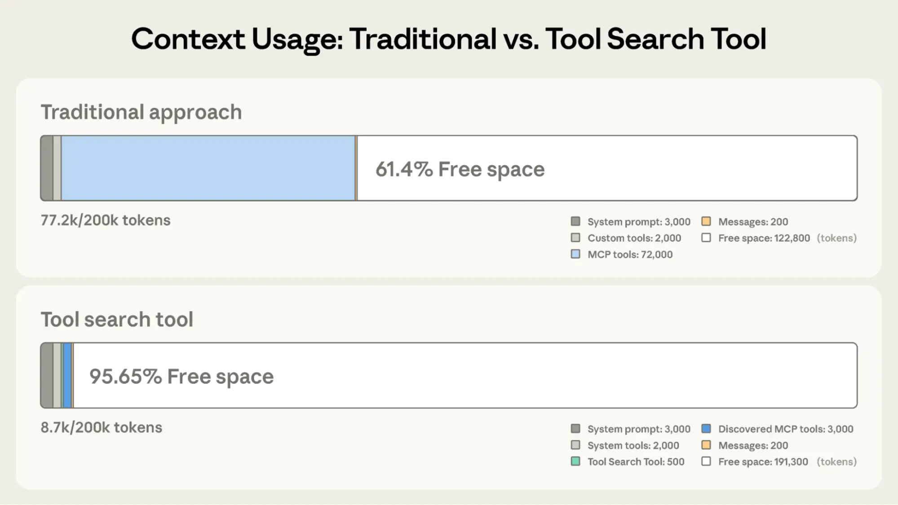

# B30_Building agents that reach production systems with MCP_用 MCP 让智能体触达生产系统

> 原文：https://claude.com/blog/building-agents-that-reach-production-systems-with-mcp
> 来源：Anthropic Claude Blog（分类：Platform ｜ 产品：MCP）｜发布日期：2026-04-22
> 原文存档：[Markdown](原文/B30_building-agents-that-reach-production-systems-with-mcp_原文.md)

## 📌 本篇速览

- 📅 2026-04-22　｜　⏱ 原文约 1820 词（逐句精读约 25 分钟）
- 🏷 API/CLI/MCP 三路对比、按意图分组工具、code orchestration、MCP Apps、elicitation、CIMD、tool search、programmatic tool calling、skills×MCP
- 🗂 [返回目录](00_目录与阅读进度.md)

MCP 生产落地的模式汇编。**三条连接路径**：直连 API（起步之选，规模化后回到 M×N 问题）、CLI（快而轻但只到有 shell 的地方、auth 靠磁盘凭据文件）、MCP（协议化公共层：auth/发现/富语义标准化，一个远程 server 达所有兼容客户端）；成熟集成三条全上——API 打底、CLI 管本地、MCP 管云端。**Server 侧五模式**：建远程 server（唯一覆盖 web/移动/云端的形态）；**按意图分组工具而非镜像 API**（create_issue_from_thread 一个胜过四个原语拼接）；大表面积走 **code orchestration**（Cloudflare 参考案例：search+execute 两个工具、约 1K token 覆盖 ~2500 端点）；MCP Apps（工具返回交互式 UI，采用率留存率显著更高）与 elicitation（form mode 要参数/确认危险操作，URL mode 走浏览器完成 OAuth/支付）；auth 用 CIMD + Managed Agents Vaults。**Client 侧两模式**：tool search（按需加载工具定义，省 85%+ 定义 token）+ programmatic tool calling（工具结果在沙箱代码里过滤聚合，复杂多步工作流省约 37%）。**Skills×MCP**：MCP 给工具、skills 给用法；插件打包（Cowork data 插件=10 skills+8 MCP servers）或从 server 分发 skill（社区扩展进行中）。数据点：MCP SDK 月下载 3 亿（年初 1 亿）。

---

Agents are only as useful as the systems they can reach.

智能体的用处，取决于它能触达的系统。

Teams tend to converge on three approaches for connecting them to external systems—direct API calls, CLIs, and MCP.

团队连接外部系统的方式往往收敛为三种：直连 API、CLI 和 MCP。

This post lays out where each fits, why production agents tend to land on MCP, and the patterns for building those integrations effectively.

本文讲清各自适用的位置、生产智能体为何最终多落在 MCP 上，以及把这些集成建好的模式。

## Connecting agents to external systems

## 把智能体连接到外部系统

We generally see three paths for connecting agents to external systems: direct API calls, CLIs, and MCP.

我们通常看到三条路径：直连 API、CLI、MCP。

Each makes sense somewhere, depending on what you're building.

各有各的适用场景，取决于你在构建什么。

The key distinction is whether there's a common layer between agents and services, and how far that layer reaches.

关键区别在于：智能体与服务之间有没有公共层，以及这层能延伸多远。

### Direct API calls

### 直连 API

The agent calls your API directly—either by writing code that issues HTTP requests inside a code-execution sandbox, or through a generic function-calling tool.

智能体直接调用你的 API——要么在代码执行沙箱里写发 HTTP 请求的代码，要么通过通用的函数调用工具。

This is where most teams start, and it works fine for one agent talking to one service, or a small number of integrations that don't need to be reused across agent platforms.

大多数团队从这里起步；一个智能体对一个服务、或少量无需跨平台复用的集成，这样就够了。

The challenges start to hit at scale.

挑战在规模化时出现。

With no common layer between agents and services, each agent–service pair becomes a bespoke integration with its own auth handling, tool descriptions, and edge cases—the M×N integration problem.

智能体与服务之间没有公共层，每一对组合都成了带各自 auth 处理、工具描述和边界情况的定制集成——M×N 集成问题。

### Command-line interface (CLI)

### 命令行界面（CLI）

The agent runs your command-line tool in a shell.

智能体在 shell 里运行你的命令行工具。

This is fast, lightweight, and leans on pre-existing tooling.

快、轻，还能借力既有工具链。

It works great for local environments and sandboxed containers—anywhere there's a filesystem and a shell.

在本地环境和沙箱容器里都很好用——只要有文件系统和 shell 的地方。

This provides a common layer, but it's thin.

它提供了公共层，但很薄。

CLIs hit hard limits reaching mobile, web, or cloud-hosted platforms that don't expose a container, and auth is handled by the CLI's own mechanism—usually a credential file on disk.

CLI 在触达不暴露容器的移动端、网页端或云端平台时撞上硬性限制；auth 靠 CLI 自己的机制——通常是磁盘上的凭据文件。

This is best suited to quick, permissive integrations in local environments.

它最适合本地环境里快速、宽松的集成。

### Model Context Protocol (MCP)

### 模型上下文协议（MCP）

MCP provides the common layer as a protocol.

MCP 把公共层做成了协议。

The agent connects to a server that exposes your system's capabilities, with auth, discovery, and rich semantics standardized.

智能体连接到一个暴露你系统能力的服务器，auth、发现和富语义都已标准化。

One remote server reaches any compatible client (Claude, ChatGPT, Cursor, VS Code, and more), in any deployment environment.

一个远程服务器触达任何兼容客户端（Claude、ChatGPT、Cursor、VS Code 等），在任何部署环境。

It requires a little bit more upfront investment.

它需要多一点前期投入。

The return is that the integration is portable, and provides the semantics needed for a feature-rich agent integration.

回报是集成可移植，并提供功能丰富的智能体集成所需的语义。

## Production agents run in the cloud

## 生产智能体跑在云端

Production agents increasingly run in the cloud, so they can scale and operate continuously.

生产智能体越来越多跑在云端——为了扩展、为了持续运转。

The systems they need to reach are cloud-hosted too: where your data lives, work is tracked, and your infrastructure runs.

它们要触达的系统也在云端：你的数据、工作追踪、基础设施都在那。

Often these systems are remote and behind auth, where MCP provides the common layer.

这些系统往往是远程的、在鉴权之后——MCP 正是这里的公共层。

And when those systems live inside a private network rather than on the public internet, MCP tunnels in Claude Managed Agents connect agents to them over an outbound-only connection — no exposed ports or public endpoints required.

而当系统在私有网络而非公网时，Claude Managed Agents 的 MCP 隧道通过仅出站连接把智能体连过去——无需暴露端口或公共端点。

We're already seeing this in adoption.

采用数据已经说明了这一点。

The MCP SDKs recently surpassed 300 million downloads a month, up from 100 million at the start of the year, with strong adoption across enterprises and popular agentic platforms.

MCP SDK 月下载最近突破 3 亿次（年初还是 1 亿），企业与主流智能体平台都在大量采用。

Millions of people use MCP with Claude every day, and the protocol underpins much of what we've shipped recently, including Claude Cowork, Claude Managed Agents, and channels in Claude Code.

每天有数百万人在 Claude 里使用 MCP；我们最近发布的许多东西——Claude Cowork、Claude Managed Agents、Claude Code 的 channels——底层都是这个协议。

As MCP continues to support production agentic systems, we're sharing patterns for building these integrations well: from building advanced servers to context-efficient clients, and where skills complement the protocol.

随着 MCP 持续支撑生产智能体系统，我们分享把这些集成建好的模式：从高级服务器到上下文高效的客户端，以及 skills 在哪补足协议。

## Building effective MCP servers

## 构建高效的 MCP 服务器

We have over 200 MCP servers in our directory, used by millions of people every day.

我们的目录里有 200 多个 MCP 服务器，每天被数百万人使用。

From working closely with enterprises and developers building on the protocol, we've spotted a handful of design patterns that determine how reliably agents can use a server.

与在协议上构建的企业和开发者密切合作后，我们发现了几个决定「智能体能多可靠地使用一个服务器」的设计模式。

### Build remote servers for maximum reach

### 建远程服务器，触达最大化

A remote server is what gives you distribution—it's the only configuration that runs across web, mobile, and cloud-hosted agents, and it's what every major client is optimized to consume.

远程服务器给你的是分发能力——它是唯一能覆盖网页、移动和云端智能体的形态，也是每个主流客户端都为之优化的消费对象。

Build remote servers so agents can use your system wherever they run.

建远程服务器，让智能体无论跑在哪都能用你的系统。

### Group tools around intent, not endpoints

### 工具按意图分组，不按端点

Fewer, well-described tools consistently outperform exhaustive API mirrors.

更少、描述更好的工具，稳定胜过面面俱到的 API 镜像。

Don't wrap your API into an MCP server one-to-one—group tools around intent, so the agent can accomplish a task in a couple of calls instead of stitching many primitives together.

别把 API 一对一包装成 MCP 服务器——按意图分组工具，让智能体两三次调用就完成任务，而不是把一堆原语缝起来。

A single create_issue_from_thread tool beats get_thread + parse_messages + create_issue + link_attachment.

一个 create_issue_from_thread 工具，胜过 get_thread + parse_messages + create_issue + link_attachment 四件套。

See writing effective tools for agents to learn more about the full pattern.

完整模式见《为智能体编写高效工具》。

### Design for code orchestration when your surface is large

### 表面积大时，为代码编排而设计

If your service requires hundreds of distinct operations, such as Cloudflare, AWS, or Kubernetes, an intent-grouped toolset likely won't cover it.

如果你的服务需要几百种不同操作（如 Cloudflare、AWS、Kubernetes），按意图分组的工具集大概率覆盖不了。

Instead, expose a thin tool surface that accepts code: the agent writes a short script, your server runs it in a sandbox against your API, and only the result returns.

改为暴露一个接受代码的薄工具面：智能体写一小段脚本，你的服务器在沙箱里对着你的 API 运行它，只有结果返回。

Cloudflare's MCP server is the reference example—two tools (search and execute) cover ~2,500 endpoints in roughly 1K tokens.

Cloudflare 的 MCP 服务器是参考范例——两个工具（search 和 execute）用约 1K token 覆盖约 2500 个端点。

### Ship rich semantics where they help

### 在有用的地方交付富语义

MCP Apps is the first official protocol extension and lets a tool return an interactive interface, such as a chart, form, or dashboard, all rendered inline in the chat interface.

MCP Apps 是第一个官方协议扩展：工具可以返回交互式界面——图表、表单、仪表盘——直接内联渲染在聊天界面里。

Servers that ship MCP apps tend to see meaningfully higher adoption and retention than those that return text alone.

交付 MCP Apps 的服务器，其采用率和留存显著高于只返回文本的。

Use it to put your product's UI in front of agents or end-users at the moment it matters—the extension is supported in Claude.ai, Claude Cowork, and many other top AI tools.

用它在关键时刻把你产品的 UI 送到智能体或最终用户面前——该扩展已被 Claude.ai、Claude Cowork 及许多头部 AI 工具支持。

Elicitation lets your server pause mid-tool call to ask the user for input.

Elicitation（询问）让你的服务器在工具调用中途暂停、向用户要输入。

Form mode sends a simple schema and the client renders a native form—use it to request a missing parameter, confirm a destructive action, or disambiguate options.

表单模式发送一个简单 schema，客户端渲染原生表单——用于索要缺失参数、确认破坏性操作、或消除选项歧义。

URL mode hands the user to a browser—use it to complete downstream OAuth, take a payment, or collect any credential that should never transit the MCP client.

URL 模式把用户交给浏览器——用于完成下游 OAuth、收取付款、或收集任何不应经过 MCP 客户端传输的凭据。

Both keep the user in the flow instead of sending them to a settings page.

两种模式都让用户留在流程里，而不是被打发去设置页。

Form mode is supported broadly; URL mode is supported in Claude Code, with more clients in progress.

表单模式已广泛支持；URL 模式已在 Claude Code 支持，更多客户端在路上。

### Lean on standardized auth

### 依靠标准化鉴权

Standardized auth makes MCP practical for cloud-hosted agents.

标准化鉴权让 MCP 对云端智能体真正可用。

If your server requires OAuth, the latest MCP spec supports CIMD (Client ID Metadata Documents) for client registration—it gives users a fast first-time auth flow and far fewer surprise re-auth prompts.

如果服务器需要 OAuth，最新 MCP 规范支持 CIMD（客户端 ID 元数据文档）做客户端注册——首次授权流程快，意外的重复授权提示少得多。

This is our recommended approach for auth, the capability is supported in MCP SDKs, Claude.ai, and Claude Code, and is being broadly adopted across the industry.

这是我们推荐的鉴权方式；能力已被 MCP SDK、Claude.ai 和 Claude Code 支持，业界正在广泛采纳。

Once a user has authorized, the next question is how a cloud-hosted agent holds and reuses those tokens at runtime.

用户授权之后，下一个问题是云端智能体运行时如何持有和复用这些 token。

Vaults in Claude Managed Agents covers this: register a user's OAuth tokens once, reference the vault by ID at session creation, and the platform injects the right credentials into each MCP connection and refreshes them on your behalf—no secret store to build, no tokens to pass around per call.

Claude Managed Agents 的 Vaults 解决这个问题：用户的 OAuth token 注册一次，创建会话时按 ID 引用 vault，平台把正确凭据注入每个 MCP 连接并代你刷新——不用自建密钥仓库，不用每次调用传 token。

## Making MCP clients more context-efficient

## 让 MCP 客户端更省上下文

MCP standardizes how AI agents (*clients*) connect to and work with tools and data sources they need (*servers*).

MCP 标准化了 AI 智能体（*客户端*）如何连接并使用所需的工具和数据源（*服务器*）。

The server securely exposes a range of capabilities, while the client orchestrates them and manages context.

服务器安全地暴露能力，客户端负责编排它们并管理上下文。

If you're building an MCP client, make it context-efficient with patterns for progressive disclosure.

如果你在构建 MCP 客户端，用渐进式披露的模式让它省上下文。

### Load tool definitions on demand with tool search

### 用工具搜索按需加载工具定义

Tool search defers loading all tools into context, rather than loading them upfront.

工具搜索（tool search）把「全部工具进上下文」推迟了——不再预先全量加载。

This allows the agent to search the catalog at runtime, pulling in the relevant tools when needed.

智能体在运行时搜索目录，需要时拉入相关工具。

In our testing, tool search tends to cut tool-definition tokens by 85%+ while maintaining high selection accuracy.

测试中，工具搜索通常削减 85% 以上的工具定义 token，同时保持高选择准确率。

*图注：用工具搜索降低上下文用量。来源：advanced tool use。*

### Process tool results in code with programmatic tool calling

### 用编程式工具调用在代码里处理工具结果

Programmatic tool calling processes tool results in a code-execution sandbox, rather than returning them raw to the model.

编程式工具调用（programmatic tool calling）在代码执行沙箱里处理工具结果，而不是原样返回给模型。

This lets the agent loop, filter, and aggregate across calls in code, with only the final output reaching context.

智能体可以在代码里跨调用循环、过滤、聚合——只有最终产出进入上下文。

In our testing, this reduces token usage by roughly 37% on complex multi-step workflows.

测试中，复杂多步工作流的 token 用量因此减少约 37%。

Together, these patterns compose naturally across multiple servers: leaner context, fewer round-trips, faster responses.

这两个模式在多服务器场景天然组合：更瘦的上下文、更少的往返、更快的响应。

See *advanced tool use* for the full breakdown.

完整拆解见《高级工具使用》。

## Pairing MCP servers with skills

## MCP 服务器与 skills 配对

Skills and MCP are complementary.

Skills 与 MCP 互补。

MCP gives an agent access to tools and data from external systems, while skills teach an agent the procedural knowledge of *how* to use those tools to accomplish real work.

MCP 给智能体外部系统的工具和数据访问权，skills 则教会它*如何*用这些工具完成真实工作的过程性知识。

The most capable agents use both, and skills make MCP servers scale beyond a handful of connections.

最能干的智能体两者都用；skills 让 MCP 服务器的规模化超越寥寥几个连接。

There are two general patterns for combining them:

组合它们有两个通用模式：

### Bundle skills and MCP servers as a plugin

### 把 skills 和 MCP 服务器打包成插件

Plugins for Claude are a useful abstraction that allow developers to bundle skills, MCP servers, hooks, LSP servers, and specialized subagents in one easily-consumable distribution method.

Claude 的插件是个有用的抽象：开发者把 skills、MCP 服务器、hooks、LSP 服务器和专用子智能体捆成一个易于消费的分发单元。

Using this approach is the best way to unify multiple context providers with minimal friction.

这是用最小摩擦统一多个上下文提供者的最佳方式。

Combining MCP servers with skills allows Claude to act more like a domain-specialist.

MCP 服务器加 skills，让 Claude 更像一个领域专家。

Grab your tools via MCP, and give Claude the skills to orchestrate workflows end-to-end.

工具经 MCP 拿到，再给 Claude 端到端编排工作流的 skills。

See our data plugin for Cowork as an example, which consists of 10 skills and 8 MCP servers for apps like Snowflake, Databricks, BigQuery, Hex and more.

参考我们为 Cowork 做的 data 插件：10 个 skills + 8 个 MCP 服务器，覆盖 Snowflake、Databricks、BigQuery、Hex 等应用。

*图注：skills 与 MCP 的组合。来源：Extending Claude's capabilities with skills and MCP servers。*

### Distribute skills from an MCP server

### 从 MCP 服务器分发 skills

It's increasingly common for providers to publish a skill alongside their MCP server, so the agent gets both the raw capabilities and an opinionated playbook for using them well.

越来越多提供方在 MCP 服务器旁一并发布 skill——智能体同时拿到原始能力和一份用好它们的意见鲜明的手册。

Canva, Notion, Sentry, and more do this today in Claude, listing the skill next to their connector in our web directory.

Canva、Notion、Sentry 等今天已在 Claude 里这么做——在目录里把 skill 列在自家连接器旁边。

To make that pairing portable across every client, the MCP community is actively working on an extension for delivering skills directly from servers.

为了让这个配对跨所有客户端可移植，MCP 社区正在开发直接从服务器交付 skills 的扩展。

This way the client inherits the relevant expertise automatically, versioned with the API it depends on.

这样客户端自动继承相关专长，并与其依赖的 API 一起版本化。

We expect this pattern to see broad adoption as the extension stabilizes.

随着扩展稳定，我们预期该模式会被广泛采纳。

## The compounding layer

## 复利层

We opened with three paths for connecting agents to external systems.

开头讲了连接外部系统的三条路径。

In practice, mature integrations will ship all three: the API as the foundation, a CLI for local-first environments, and MCP for cloud-based agents.

实践中，成熟的集成三条全上：API 打底、CLI 服务本地优先环境、MCP 服务云端智能体。

As production agents move to the cloud, MCP becomes the critical layer, and it's the one that compounds.

随着生产智能体上云，MCP 成为关键层——而且是会复利的那一层。

Today, a remote server reaches every compatible client across any deployment environment, with auth, interactivity, and rich semantics handled by the protocol.

今天，一个远程服务器触达任何部署环境下的所有兼容客户端，auth、交互性和富语义都由协议处理。

As more clients adopt the spec and more extensions land in it, that same server gets more capable without you shipping anything new.

随着更多客户端采纳规范、更多扩展落地，同一个服务器不用你发布任何新东西就变得更能干。

When building an integration, if your goal is to have production agents in the cloud reach your system, build an MCP server and make it excellent using the patterns above.

构建集成时，如果目标是让云端生产智能体触达你的系统——建一个 MCP 服务器，并用上述模式把它做到优秀。

Every integration built on MCP strengthens the ecosystem: fewer edge cases to solve alone, fewer bespoke integrations to maintain.

每个建在 MCP 上的集成都在强化生态：更少要独自解决的边界情况，更少要维护的定制集成。

---

## 术语中英对照表

| 英文 | 中文 | 备注 |
|---|---|---|
| common layer | 公共层 | 三路径的关键区别：有没有、够不够厚 |
| M×N integration problem | M×N 集成问题 | 直连 API 规模化的宿命 |
| remote server | 远程服务器 | 唯一覆盖 web/移动/云端的形态 |
| group tools around intent | 按意图分组工具 | 反模式是 API 一对一镜像 |
| code orchestration | 代码编排 | 大表面积方案：search+execute 两工具覆盖 ~2500 端点 |
| MCP Apps | MCP 应用扩展 | 工具返回交互式 UI；采用率留存显著更高 |
| elicitation (form / URL mode) | 询问（表单/URL 模式） | 中途要参数/确认；OAuth 与支付走浏览器 |
| CIMD | 客户端 ID 元数据文档 | 推荐的 OAuth 客户端注册方式 |
| Vaults | 凭据保险库 | token 注册一次、平台注入并代刷新 |
| tool search | 工具搜索 | 按需加载定义，省 85%+ token |
| programmatic tool calling | 编程式工具调用 | 结果在沙箱代码中过滤聚合，省约 37% |
| plugins | 插件 | skills+MCP+hooks+子智能体的打包分发 |
| the compounding layer | 复利层 | 生态扩展让同一 server 免费变强 |
