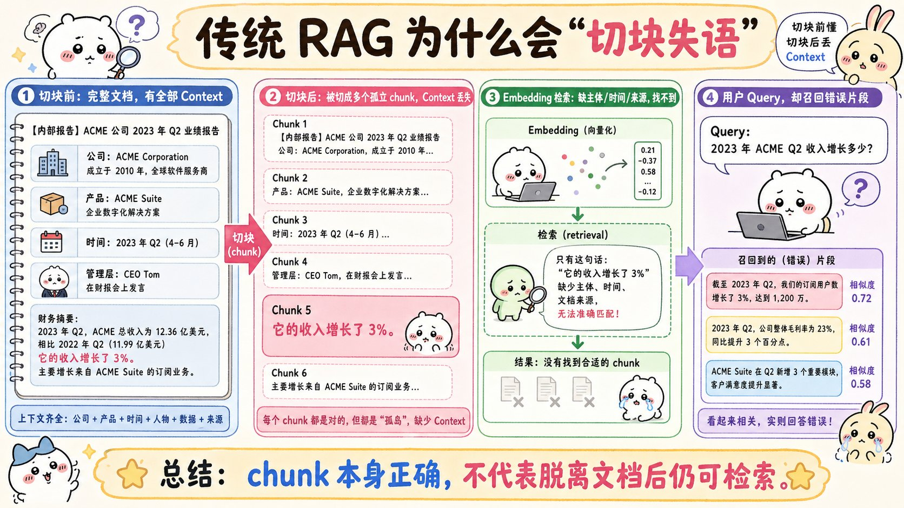
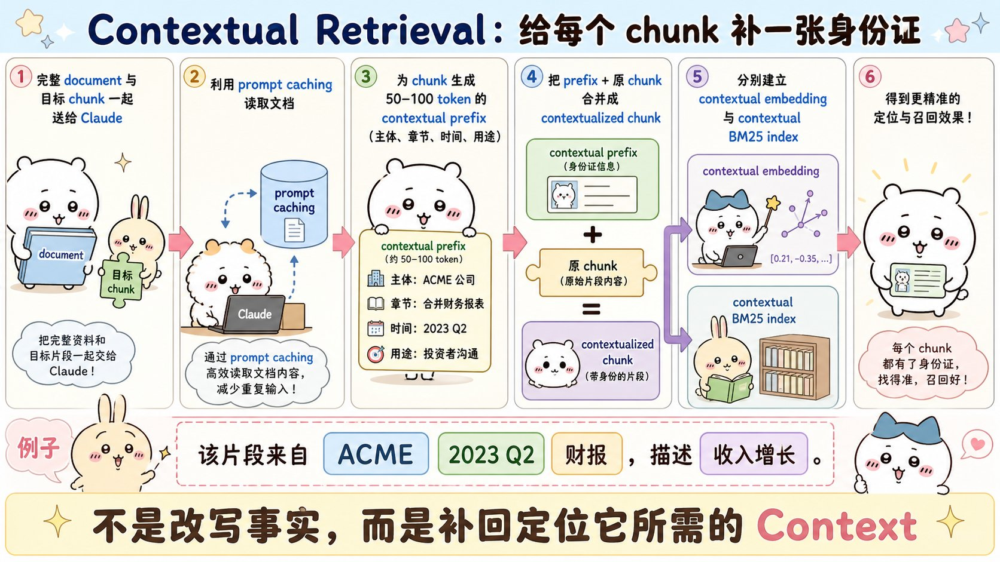
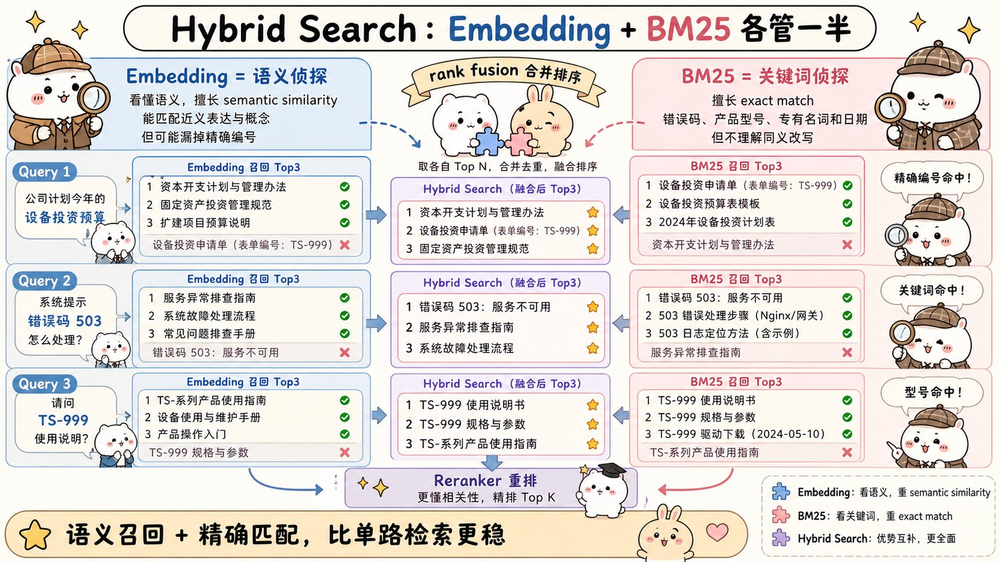
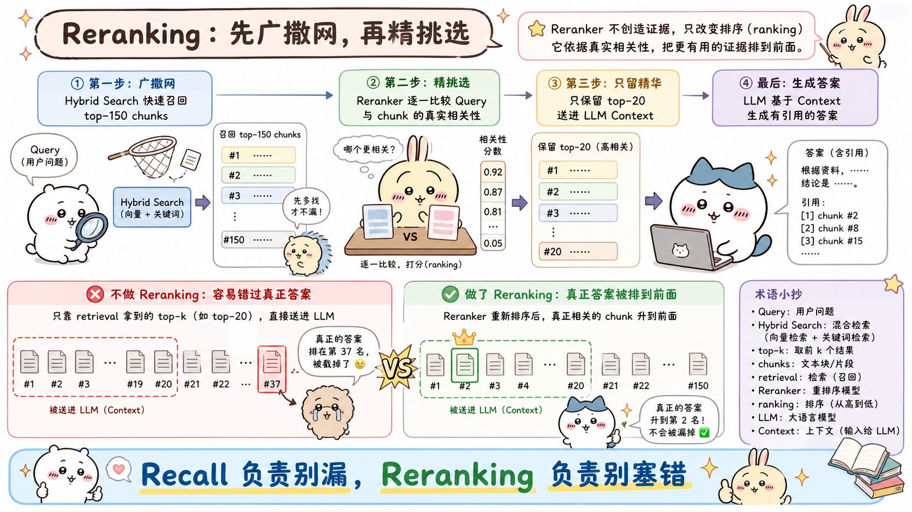
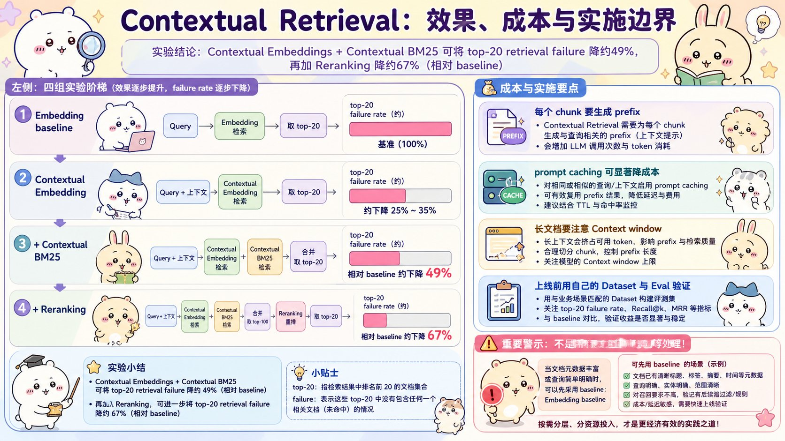

# Introducing Contextual Retrieval：面试速记

> Anthropic Engineering · 2024-09-19 · [官方原文](https://www.anthropic.com/engineering/contextual-retrieval) · [本地逐句对照](01_contextual-retrieval_逐句对照.md)

## 一句话讲明白

**传统检索增强生成（Retrieval-Augmented Generation，RAG）把文档切成小块时，会顺手把"这段话在讲谁、哪一年、出自哪份文件"一起切掉，于是检索阶段找不到它；上下文检索（Contextual Retrieval）的做法是——在建索引之前，先让模型对照整篇文档给每个文本块补一句定位说明，再拿"说明 + 原文块"同时去做语义嵌入和 BM25 关键词索引，最后叠加重排序。三招叠起来，前 20 块检索失败率相对下降 67%。**

## 为什么值得读 / 能用在哪

- RAG 是面试必问题，而**大多数人只会答"切块 → 向量化 → 相似度召回"**，答不出为什么会检索不到。这篇给了一个既能讲清楚原理、又带完整实验数字的标准答案。
- 落地上它属于"改造成本极低、收益极高"的那类方案：**不用换向量数据库、不用微调、不改查询链路**，只在离线建索引这一步插一个便宜模型的调用。
- 数字够硬：**失败率降 49%（叠加重排序 67%）、成本约每百万文档 token 1.02 美元**。在自己项目里可以直接照抄这套指标口径去做实验对比。

## 核心要点

### 一、传统 RAG 为什么会「切块失语」

原文的例子非常适合背下来。知识库里存了一批美国证券交易委员会（SEC）备案文件，用户问：**"ACME 公司 2023 年第二季度的营收增长是多少？"**

相关的那个文本块（chunk）里写着：

> "公司营收较上一季度增长了 3%。"

这句话**没有任何事实错误**，但它自己没说是哪家公司、哪个季度、出自哪份文件。而用户查询里的关键信息恰恰是"ACME""2023 Q2""营收"——两边**没有可对齐的信号**，无论是语义相似度还是关键词匹配都可能把它漏掉。

丢的不是文字，是**定位信息**：主体、时间、章节、来源。切块把每块压到几百 token 以内是为了检索效率，代价就是每块都变成了一句悬空的话，代词和数字失去了指代对象。

**要死记的一句区分：生成阶段能读懂一个文本块 ≠ 检索阶段能找到它。** 面试里能把这句说出来，基本就说明你真做过 RAG——很多人排查"模型答错了"，其实错在证据压根没被召回，跟生成模型无关。

顺带一个前提判断：**如果知识库小于 20 万 token（约 500 页），根本不需要 RAG**，直接把全部内容塞进提示词，配合提示词缓存（prompt caching）即可——缓存能把延迟降低 2 倍以上、成本最多降 90%。RAG 是知识库大到装不下上下文窗口之后才被迫上的方案，别一上来就套。

### 二、上下文块是怎么生成的

做法朴素得几乎不像论文：**把整篇文档和目标文本块一起丢给模型，让它写一小段"这块在整篇文档里处于什么位置"的说明，拼到块的前面，再去建索引。** 原文用的是 Claude 3 Haiku（便宜、快），提示词大意是"请给出一小段简明的上下文，用于说明该文本块在整篇文档中的位置，目的是改善检索；只回答这段上下文，不要说别的"。

改造效果：

> **原始块**：公司营收较上一季度增长了 3%。
>
> **上下文块**：〔补的说明〕本文本块出自一份关于 ACME 公司 2023 年第二季度业绩的 SEC 备案文件，上一季度的营收为 3.14 亿美元。〔+ 原文照抄〕公司营收较上一季度增长了 3%。

关键细节，面试官爱追问的都在这里：

- 生成的上下文通常 **50–100 个 token**，是"补说明"不是"改写事实"——原始文字一个字不动，只在前面加。
- 这段说明会**同时进入两套索引**：语义嵌入索引和 BM25 关键词索引。所以叫上下文嵌入（Contextual Embeddings）+ 上下文 BM25（Contextual BM25）。
- 这是**离线预处理**，不是查询时做的，所以不增加线上延迟。
- 同一篇文档要为几十个块反复生成说明，靠**提示词缓存**把整篇文档只加载进缓存一次、后续直接复用，成本才压得下来。
- 成本账（原文口径）：假设块 800 token、文档 8k token、指令 50 token、每块生成 100 token 上下文，**一次性成本约为每百万文档 token 1.02 美元**。

原文还特意划清了界限：**给块附加"通用文档摘要"（试过，收益非常有限）、假设性文档嵌入（hypothetical document embedding）、基于摘要的索引（summary-based indexing，评估后性能不佳）——这几种早年方案都跟本文的做法不同。** 差别在于本文生成的是**每块专属**的上下文，不是全篇共用一份摘要。

### 三、语义嵌入和 BM25 为什么必须一起用

- **嵌入（embedding）** 擅长语义相似度，能把"设备投资"和"资本开支"关联起来，但**会漏掉精确匹配**。
- **BM25** 是基于词法匹配的排序函数，建立在 TF-IDF（词频-逆文档频率）之上，额外考虑了文档长度、并对词频施加饱和函数，防止常见词霸榜。它擅长错误码、型号、专名、日期这类**必须一字不差**的查询。
- **混合检索（hybrid search）** 用排序融合（rank fusion）把两路结果合并去重，取前 K 个进提示词。

经典反例背下来：用户查"错误码 `TS-999`"，嵌入模型会找回一堆泛泛谈论错误码的内容，却偏偏漏掉 `TS-999` 这个精确串；BM25 直接按字符串命中相关文档。反过来只用 BM25，又理解不了近义表达。**两者的盲区正好互补，所以原文的结论是"嵌入 + BM25 优于单独使用嵌入"。**

### 四、重排序在流水线里干什么

大知识库的初始检索一次可能返回**几百个**相关性参差不齐的块。全塞给模型有三个坏处：信息过多干扰判断、成本上升、延迟上升。重排序（reranking）就是一道**过滤**。

原文的四步流程（数字要记）：

1. 初始检索捞回可能相关的块，**原文取前 150 个**；
2. 把这些块连同用户查询一起送进重排序模型；
3. 重排序模型逐块打相关性分，**选出前 20 个**；
4. 把前 20 个块作为上下文送给生成模型。

要点：

- **重排序器不创造新证据，只改变顺序。** 第一阶段漏掉的东西，重排序永远救不回来。
- 记忆口诀：**第一阶段负责"别漏"（召回率），第二阶段负责"别塞错"（精度）。**
- 权衡：重排的块越多性能越好，但延迟和成本越高——即便重排序器是并行打分，也不可避免地增加少量延迟。**这个平衡点必须在自己的用例上试出来。**
- 原文用的是 Cohere 的重排序器测试；Voyage 也有重排序器，原文没来得及测。

### 五、实验数字与实施边界

**指标口径（面试被追问必答）**：用 **1 减去前 20 块召回率（1 − recall@20）** 作为评估指标，也就是"相关文档未能进入前 20 块的比例"，即前 20 块检索失败率。数据横跨代码库、小说、ArXiv 论文、科学论文多个领域，取表现最好的嵌入配置（Gemini Text 004）下的平均值。

三档结果，从 **5.7%** 的基线出发：

| 方案 | 失败率 | 相对降幅 |
| --- | --- | --- |
| 仅嵌入（基线） | 5.7% | — |
| + 上下文嵌入 | 3.7% | **35%** |
| + 上下文嵌入 + 上下文 BM25 | 2.9% | **49%** |
| + 再叠加重排序 | 1.9% | **67%** |

**注意这三个数是相对降幅，不是准确率，也不是任何业务上的固定值。** 说成"准确率提升 67%"就露怯了。

其余结论：

- **收益可以叠加**——上下文嵌入（Voyage 或 Gemini）+ 上下文 BM25 + 重排序 + 前 20 块进提示词，是原文的最优组合。
- 传前 **20** 块比传 10 块、5 块都更好；但块数不是越多越好，信息过量会干扰模型，这条路有上限。
- 在测过的**每一种"嵌入模型 × 数据源"组合**上，上下文化都带来了提升；其中 Gemini 和 Voyage 的嵌入模型效果尤其突出。

实施时要盯的四件事：

1. **分块边界**：块大小、切分位置、块重叠都会影响检索性能。
2. **嵌入模型选型**：都能受益，但受益幅度不同。
3. **定制上下文生成提示词**：通用提示词够用，但针对自己领域定制会更好——比如附一份关键术语表，因为这些术语的定义可能只存在于知识库的其他文档里。
4. **永远要跑评估（eval）**：另外，把上下文块传给生成环节时，**区分开"哪部分是补的上下文、哪部分是原始文本块"**，可能会进一步改善生成质量。

## 面试高频问答

**Q：我的 RAG 检索不准，你会怎么排查？**
A：先分清是**检索没召回**还是**生成没用好**。看一眼命中的块，如果正确证据压根不在前 20 里，那是检索问题，跟换生成模型无关。检索问题里最常见的一类是切块丢了定位信息——块本身事实正确，但没写是谁、哪一年，跟查询对不上。这时候上下文检索是性价比最高的解法，离线给每块补一句定位说明就行。

**Q：为什么已经有向量检索了，还要保留 BM25 这种老技术？**
A：因为嵌入擅长近义、不擅长精确匹配。用户查 `TS-999` 这种错误码或型号时，嵌入会返回一堆泛泛谈错误码的内容却漏掉精确串，BM25 则直接按字符串命中。两者盲区互补，用排序融合合并即可。原文实验也验证了嵌入 + BM25 优于单用嵌入。

**Q：上下文检索的成本能接受吗？会拖慢线上响应吗？**
A：不会拖慢线上——它是**离线预处理**，只在建索引时跑一次。成本方面原文给了口径：块 800 token、文档 8k token 的假设下，约**每百万文档 token 1.02 美元**。之所以这么便宜，是用了便宜的小模型（Claude 3 Haiku）加提示词缓存——整篇文档只加载进缓存一次，后面几十个块复用，不必每块重传全文。

**Q：那 49% 和 67% 到底是什么口径？**
A：指标是 **1 − recall@20**，即相关文档没能进入前 20 块的比例。基线 5.7%：上下文嵌入降到 3.7%（降 35%），再加上下文 BM25 降到 2.9%（降 49%），再叠加重排序降到 1.9%（降 67%）。**都是相对降幅，是原文数据集上的结果，不能当成自己业务的承诺值。**

**Q：什么情况下不该上 RAG / 不该上这套？**
A：知识库小于 20 万 token（约 500 页）时直接全塞进提示词，配提示词缓存就够了，没必要引入 RAG。已经有 RAG 的话，如果文档本身元数据完备、每块自带标题和时间、查询也简单，基线可能就够用。**结论只能靠在自己数据集上跑评估得出**，对比检索失败率、前 k 块召回率（recall@k）、延迟和成本，不能照搬别人的数字。

## 必须记住的 8 句话

1. 传统 RAG 切块丢的不是文字，是**定位信息**——主体、时间、章节、来源。
2. **生成阶段能读懂一个块 ≠ 检索阶段能找到它**，排查时先分清是召回问题还是生成问题。
3. 上下文检索 = 建索引前，对照整篇文档给每块**补 50–100 token 的定位说明**，只补不改。
4. 补的说明要**同时进语义嵌入和 BM25 两套索引**，这才叫上下文嵌入 + 上下文 BM25。
5. 嵌入管语义近义，BM25 管精确匹配（`TS-999` 这类），混合检索用排序融合合并两路。
6. 重排序只**重排已有证据**，不创造证据——第一阶段漏了就永远找不回来；原文是召回 150 → 精选 20。
7. 数字：基线 5.7% → 上下文嵌入 3.7%（-35%）→ 加 BM25 2.9%（**-49%**）→ 加重排序 1.9%（**-67%**），指标是 1 − recall@20，都是相对降幅。
8. 成本约**每百万文档 token 1.02 美元**，靠提示词缓存把整篇文档只加载一次撑下来；上线前一定要在自己数据集上跑评估。

## 30 秒口述版

> 上下文检索解决的是传统 RAG 的「切块失语」。文档切成几百 token 的小块后，"公司营收较上季度增长 3%"这种句子事实没错，但不知道是哪家公司、哪个季度，用户问 ACME 2023 Q2 的营收时压根检索不到。Anthropic 的做法是在建索引之前，把整篇文档和这个块一起交给一个便宜的小模型，生成 50 到 100 token 的定位说明拼到块前面，然后拿"说明 + 原文"同时去建语义嵌入索引和 BM25 关键词索引——嵌入负责近义、BM25 负责错误码型号这类精确匹配，查询时用排序融合合并。最后再加一层重排序，先召回 150 个、精选 20 个送进模型。指标用 1 减 recall@20，也就是前 20 块检索失败率：基线 5.7%，上下文嵌入加上下文 BM25 降到 2.9%，相对降 49%；再叠加重排序降到 1.9%，相对降 67%。成本大约每百万文档 token 一美元出头，因为用了提示词缓存，整篇文档只加载一次就能给几十个块复用。它是纯离线预处理，不增加线上延迟，改造成本很低，但这些数字是原文数据集上的相对结果，自己上线前必须跑自己的评估。

## 自测

- [ ] 能用 ACME 的例子解释为什么"事实正确的块"仍然检索不到。
- [ ] 能说出补的上下文放在哪一步、长度多少、要不要改原文。
- [ ] 能各举一个例子说明嵌入失效和 BM25 失效的场景。
- [ ] 能说清重排序的四步流程和 150 / 20 这两个数。
- [ ] 能背出 5.7% → 3.7% → 2.9% → 1.9% 这条链和对应的 35% / 49% / 67%。
- [ ] 能解释 1 − recall@20 是什么，以及为什么不能说成"准确率提升 67%"。
- [ ] 能算出为什么成本只要每百万文档 token 1.02 美元（小模型 + 提示词缓存）。
- [ ] 能说出至少两个"不该上这套"的边界条件。

> 插图为学习用途的非官方同人式教学图，角色与文章版权归各自权利人。
