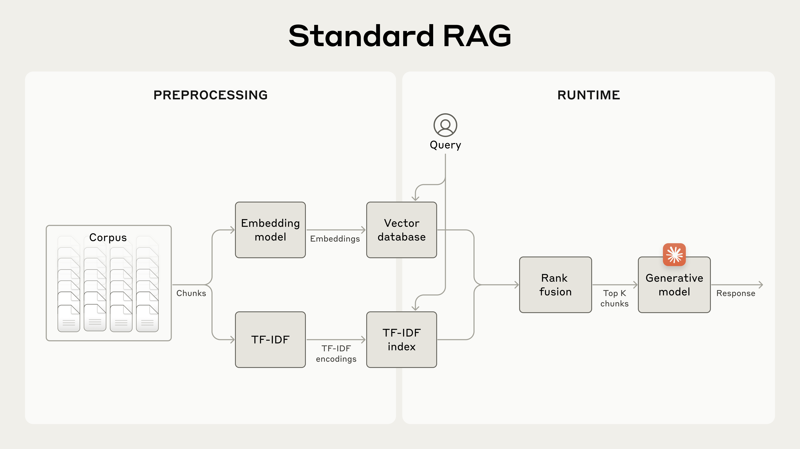
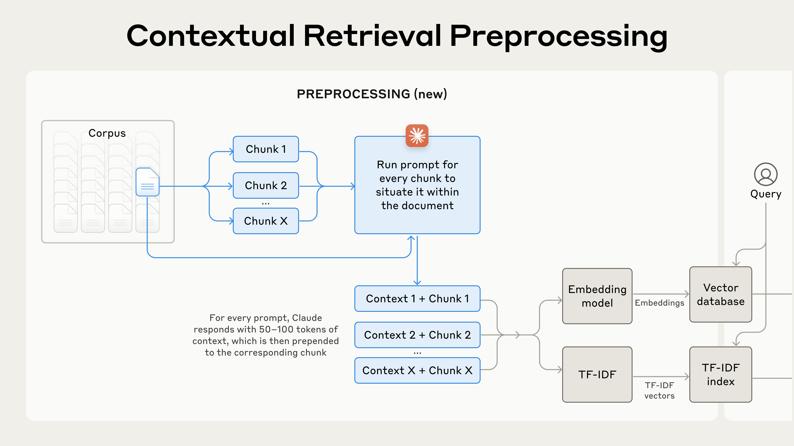
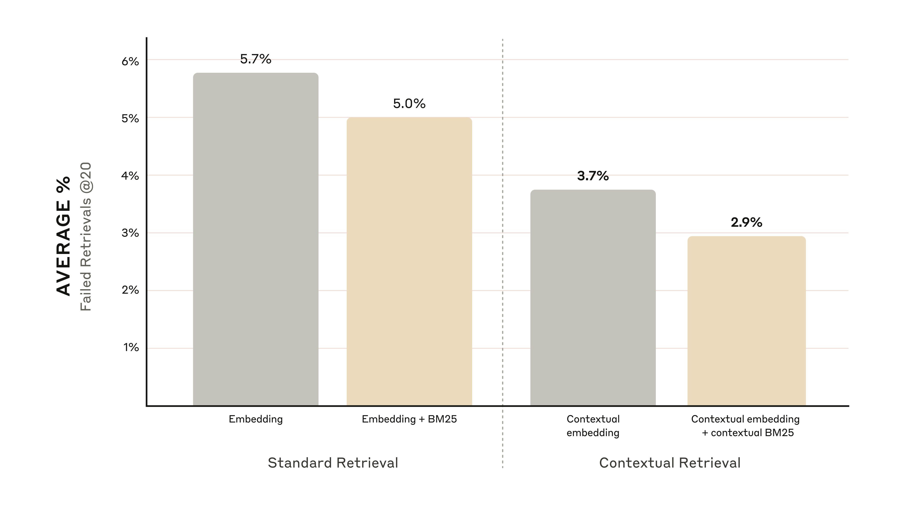
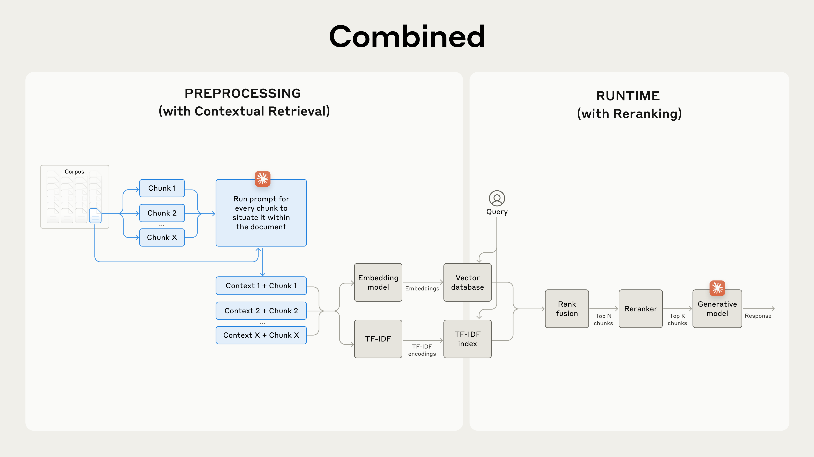
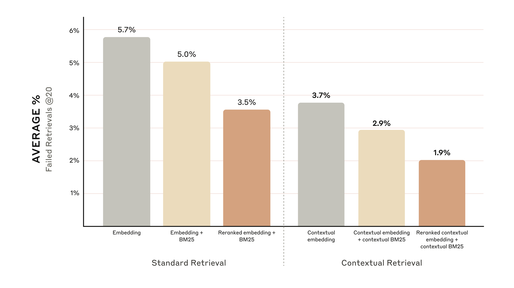
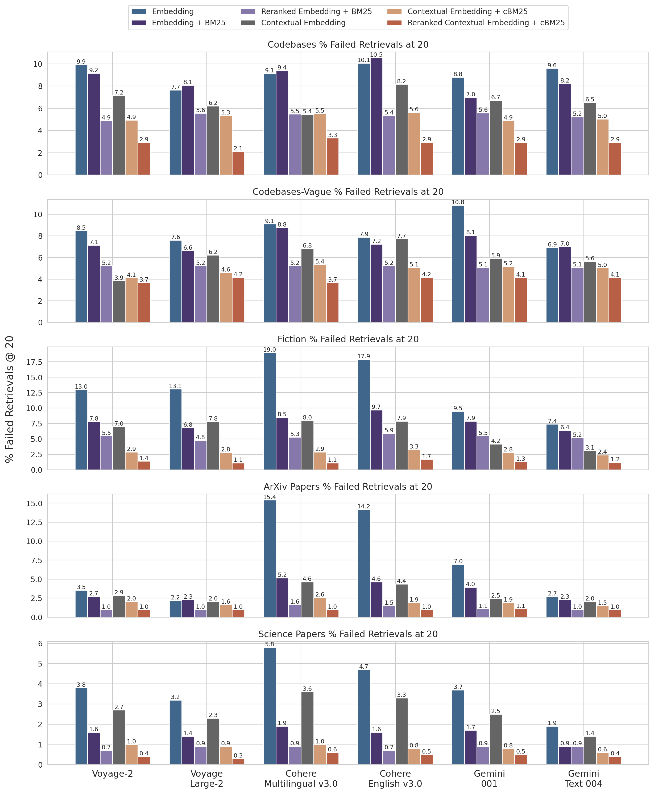

# 01_Introducing Contextual Retrieval_上下文检索（Contextual Retrieval）简介

> 原文：https://www.anthropic.com/engineering/contextual-retrieval
> 作者：Anthropic Engineering｜发布日期：2024-09-19

## 📌 本篇速览

- 📅 2024-09-19　｜　⏱ 约 15 分钟　｜　📄 2,318 词 / 6 图
- ⭐ ★★★★☆ **强烈推荐** —— RAG／记忆检索的经典方法，出处权威、实验数据完整、可直接落地，但属 Agent 时代之前的技术层。
- 🏷 RAG、Contextual Retrieval、BM25、嵌入模型、重排序
- 🖼 [图解笔记（面试速记）](01_contextual-retrieval_直观图解与学习笔记.md)　·　🗂 [返回总目录](00_目录与阅读进度.md)

本文介绍了 Anthropic 提出的 Contextual Retrieval 方法：在嵌入和建立 BM25 索引前，用 Claude 为每个文本块自动生成并拼接块级解释性上下文（上下文嵌入 + 上下文 BM25），解决传统 RAG 分块丢失上下文的问题。实验显示该方法可将 top-20 检索失败率降低 49%，叠加重排序后降低 67%，并借助提示词缓存把上下文生成成本压到每百万文档 token 约 1.02 美元。文末给出分块、嵌入模型选择、块数量、评估等实现建议及完整实验数据。

---

For an AI model to be useful in specific contexts, it often needs access to background knowledge.

AI 模型要想在特定场景中真正有用，往往需要获取背景知识。

For example, customer support chatbots need knowledge about the specific business they're being used for, and legal analyst bots need to know about a vast array of past cases.

例如，客服聊天机器人需要了解它所服务的那家具体企业的知识，法律分析机器人则需要掌握海量的过往判例。

Developers typically enhance an AI model's knowledge using Retrieval-Augmented Generation (RAG).

开发者通常使用检索增强生成（Retrieval-Augmented Generation，RAG）来增强 AI 模型的知识。

RAG is a method that retrieves relevant information from a knowledge base and appends it to the user's prompt, significantly enhancing the model's response.

RAG 是一种从知识库（knowledge base）中检索相关信息并将其附加到用户提示词后面的方法，能显著提升模型响应的质量。

The problem is that traditional RAG solutions remove context when encoding information, which often results in the system failing to retrieve the relevant information from the knowledge base.

问题在于，传统 RAG 方案在编码信息时会丢掉上下文，这常常导致系统无法从知识库中检索到相关信息。

In this post, we outline a method that dramatically improves the retrieval step in RAG.

在本文中，我们介绍一种能大幅改进 RAG 检索环节的方法。

The method is called “Contextual Retrieval” and uses two sub-techniques: Contextual Embeddings and Contextual BM25.

这个方法叫作"上下文检索"（Contextual Retrieval），它包含两项子技术：上下文嵌入（Contextual Embeddings）与上下文 BM25（Contextual BM25）。

This method can reduce the number of failed retrievals by 49% and, when combined with reranking, by 67%.

该方法能把检索失败的次数降低 49%；如果再结合重排序（reranking），可降低 67%。

These represent significant improvements in retrieval accuracy, which directly translates to better performance in downstream tasks.

这是检索准确率的显著提升，会直接转化为下游任务（downstream task）性能的改善。

You can easily deploy your own Contextual Retrieval solution with Claude with [our cookbook](https://platform.claude.com/cookbook/capabilities-contextual-embeddings-guide).

借助[我们的 cookbook](https://platform.claude.com/cookbook/capabilities-contextual-embeddings-guide)，你可以用 Claude 轻松部署属于自己的上下文检索方案。

### A note on simply using a longer prompt｜关于"直接用更长的提示词"的说明

Sometimes the simplest solution is the best.

有时候，最简单的方案就是最好的方案。

If your knowledge base is smaller than 200,000 tokens (about 500 pages of material), you can just include the entire knowledge base in the prompt that you give the model, with no need for RAG or similar methods.

如果你的知识库小于 20 万 token（约 500 页材料），你完全可以把整个知识库直接塞进给模型的提示词里，根本不需要 RAG 或类似方法。

A few weeks ago, we released [prompt caching](https://docs.anthropic.com/en/docs/build-with-claude/prompt-caching) for Claude, which makes this approach significantly faster and more cost-effective.

几周前，我们为 Claude 发布了[提示词缓存](https://docs.anthropic.com/en/docs/build-with-claude/prompt-caching)（prompt caching），它让这种做法在速度和成本上都划算得多。

Developers can now cache frequently used prompts between API calls, reducing latency by > 2x and costs by up to 90% (you can see how it works by reading our [prompt caching cookbook](https://platform.claude.com/cookbook/misc-prompt-caching)).

开发者现在可以在多次 API 调用之间缓存常用的提示词，把延迟降低 2 倍以上、成本降低最多 90%（想了解它的工作原理，可以阅读我们的[提示词缓存 cookbook](https://platform.claude.com/cookbook/misc-prompt-caching)）。

However, as your knowledge base grows, you'll need a more scalable solution.

不过，随着知识库不断变大，你就需要一个更具可扩展性的方案。

That’s where Contextual Retrieval comes in.

这正是上下文检索的用武之地。

## A primer on RAG: scaling to larger knowledge bases｜RAG 入门：扩展到更大的知识库

For larger knowledge bases that don't fit within the context window, RAG is the typical solution.

对于装不进上下文窗口（context window）的更大知识库，RAG 是典型的解决方案。

RAG works by preprocessing a knowledge base using the following steps:

RAG 的工作方式是按以下步骤对知识库做预处理：

1. Break down the knowledge base (the “corpus” of documents) into smaller chunks of text, usually no more than a few hundred tokens;

1. 把知识库（即文档"语料库"，corpus）拆分成较小的文本块（chunk），通常每块不超过几百个 token；

2. Use an embedding model to convert these chunks into vector embeddings that encode meaning;

2. 用嵌入模型（embedding model）把这些文本块转换成编码了语义的向量嵌入（vector embedding）；

3. Store these embeddings in a vector database that allows for searching by semantic similarity.

3. 把这些嵌入存入向量数据库（vector database），以便按语义相似度进行搜索。

At runtime, when a user inputs a query to the model, the vector database is used to find the most relevant chunks based on semantic similarity to the query.

在运行时，当用户向模型输入查询（query）时，系统会用向量数据库根据与查询的语义相似度找出最相关的文本块。

Then, the most relevant chunks are added to the prompt sent to the generative model.

然后，把这些最相关的文本块添加到发送给生成模型的提示词中。

While embedding models excel at capturing semantic relationships, they can miss crucial exact matches.

虽然嵌入模型擅长捕捉语义关系，但它们可能会漏掉关键的精确匹配。

Fortunately, there’s an older technique that can assist in these situations.

幸运的是，有一项更古老的技术可以在这类情况下帮上忙。

BM25 (Best Matching 25) is a ranking function that uses lexical matching to find precise word or phrase matches.

BM25（Best Matching 25）是一种利用词法匹配（lexical matching）来寻找精确单词或短语匹配的排序函数（ranking function）。

It's particularly effective for queries that include unique identifiers or technical terms.

对于包含唯一标识符或专业术语的查询，它尤其有效。

BM25 works by building upon the TF-IDF (Term Frequency-Inverse Document Frequency) concept.

BM25 建立在 TF-IDF（Term Frequency-Inverse Document Frequency，词频-逆文档频率）这一概念之上。

TF-IDF measures how important a word is to a document in a collection.

TF-IDF 衡量的是一个词对于文档集合中某篇文档的重要程度。

BM25 refines this by considering document length and applying a saturation function to term frequency, which helps prevent common words from dominating the results.

BM25 在此基础上做了改进：它考虑了文档长度，并对词频施加一个饱和函数（saturation function），从而防止常见词主导检索结果。

Here’s how BM25 can succeed where semantic embeddings fail: Suppose a user queries "Error code TS-999" in a technical support database.

来看一个 BM25 能在语义嵌入失灵之处成功的例子：假设用户在技术支持数据库中查询"Error code TS-999"（错误码 TS-999）。

An embedding model might find content about error codes in general, but could miss the exact "TS-999" match.

嵌入模型可能会找到一堆泛泛谈论错误码的内容，却漏掉"TS-999"这个精确匹配。

BM25 looks for this specific text string to identify the relevant documentation.

而 BM25 会直接查找这个具体的文本字符串，从而定位到相关文档。

RAG solutions can more accurately retrieve the most applicable chunks by combining the embeddings and BM25 techniques using the following steps:

RAG 方案可以把嵌入和 BM25 两种技术结合起来，按以下步骤更精准地检索出最适用的文本块：

1. Break down the knowledge base (the "corpus" of documents) into smaller chunks of text, usually no more than a few hundred tokens;

1. 把知识库（即文档"语料库"）拆分成较小的文本块，通常每块不超过几百个 token；

2. Create TF-IDF encodings and semantic embeddings for these chunks;

2. 为这些文本块创建 TF-IDF 编码和语义嵌入；

3. Use BM25 to find top chunks based on exact matches;

3. 用 BM25 基于精确匹配找出排名靠前的文本块；

4. Use embeddings to find top chunks based on semantic similarity;

4. 用嵌入基于语义相似度找出排名靠前的文本块；

5. Combine and deduplicate results from (3) and (4) using rank fusion techniques;

5. 用排序融合（rank fusion）技术合并第 (3)、(4) 步的结果并去重；

6. Add the top-K chunks to the prompt to generate the response.

6. 把前 K 个（top-K）文本块加入提示词，生成响应。

By leveraging both BM25 and embedding models, traditional RAG systems can provide more comprehensive and accurate results, balancing precise term matching with broader semantic understanding.

同时利用 BM25 和嵌入模型，传统 RAG 系统就能给出更全面、更准确的结果，在精确词条匹配与更宽泛的语义理解之间取得平衡。



*A Standard Retrieval-Augmented Generation (RAG) system that uses both embeddings and Best Match 25 (BM25) to retrieve information. TF-IDF (term frequency-inverse document frequency) measures word importance and forms the basis for BM25.*

*图注：一个同时使用嵌入和 Best Match 25（BM25）来检索信息的标准检索增强生成（RAG）系统。TF-IDF（词频-逆文档频率）用于衡量词的重要性，是 BM25 的基础。*

This approach allows you to cost-effectively scale to enormous knowledge bases, far beyond what could fit in a single prompt.

这种做法让你能以较低成本扩展到超大规模的知识库——远超单个提示词所能容纳的范围。

But these traditional RAG systems have a significant limitation: they often destroy context.

但这些传统 RAG 系统有一个重大局限：它们常常破坏上下文。

### The context conundrum in traditional RAG｜传统 RAG 的上下文难题

In traditional RAG, documents are typically split into smaller chunks for efficient retrieval.

在传统 RAG 中，为了高效检索，文档通常会被切分成较小的文本块。

While this approach works well for many applications, it can lead to problems when individual chunks lack sufficient context.

虽然这种做法在很多应用中效果不错，但当单个文本块缺乏足够上下文时，就会出问题。

For example, imagine you had a collection of financial information (say, U.S. SEC filings) embedded in your knowledge base, and you received the following question: *"What was the revenue growth for ACME Corp in Q2 2023?"*

举个例子：假设你的知识库中嵌入了一批财务信息（比如美国 SEC 备案文件），然后你收到了这样一个问题：*"ACME 公司 2023 年第二季度的营收增长是多少？"*

A relevant chunk might contain the text: *"The company's revenue grew by 3% over the previous quarter."*

一个相关的文本块可能包含这样的文字：*"公司营收较上一季度增长了 3%。"*

However, this chunk on its own doesn't specify which company it's referring to or the relevant time period, making it difficult to retrieve the right information or use the information effectively.

然而，这个文本块本身并没有说明指的是哪家公司、对应哪个时间段，这使得系统很难检索到正确的信息，也很难有效利用这条信息。

## Introducing Contextual Retrieval｜上下文检索登场

Contextual Retrieval solves this problem by prepending chunk-specific explanatory context to each chunk before embedding (“Contextual Embeddings”) and creating the BM25 index (“Contextual BM25”).

上下文检索解决这个问题的方式是：在做嵌入之前（"上下文嵌入"）和建立 BM25 索引之前（"上下文 BM25"），给每个文本块前面拼接上专属于该块的解释性上下文。

Let’s return to our SEC filings collection example.

我们回到刚才 SEC 备案文件集合的例子。

Here's an example of how a chunk might be transformed:

下面是一个文本块可能被转换成什么样的示例：

```plaintext
original_chunk = "The company's revenue grew by 3% over the previous quarter."

contextualized_chunk = "This chunk is from an SEC filing on ACME corp's performance in Q2 2023; the previous quarter's revenue was $314 million. The company's revenue grew by 3% over the previous quarter."
```

It is worth noting that other approaches to using context to improve retrieval have been proposed in the past.

值得一提的是，过去也有人提出过其他利用上下文来改进检索的方法。

Other proposals include: [adding generic document summaries to chunks](https://aclanthology.org/W02-0405.pdf) (we experimented and saw very limited gains), [hypothetical document embedding](https://arxiv.org/abs/2212.10496), and [summary-based indexing](https://www.llamaindex.ai/blog/a-new-document-summary-index-for-llm-powered-qa-systems-9a32ece2f9ec) (we evaluated and saw low performance).

其他方案包括：[给文本块附加通用的文档摘要](https://aclanthology.org/W02-0405.pdf)（我们试验过，收益非常有限）、[假设性文档嵌入](https://arxiv.org/abs/2212.10496)（hypothetical document embedding），以及[基于摘要的索引](https://www.llamaindex.ai/blog/a-new-document-summary-index-for-llm-powered-qa-systems-9a32ece2f9ec)（summary-based indexing，我们评估后发现性能不佳）。

These methods differ from what is proposed in this post.

这些方法都与本文提出的方案不同。

### Implementing Contextual Retrieval｜实现上下文检索

Of course, it would be far too much work to manually annotate the thousands or even millions of chunks in a knowledge base.

当然，靠人工去为知识库里成千上万甚至数百万个文本块添加注释，工作量实在太大了。

To implement Contextual Retrieval, we turn to Claude.

为了实现上下文检索，我们求助于 Claude。

We’ve written a prompt that instructs the model to provide concise, chunk-specific context that explains the chunk using the context of the overall document.

我们写了一个提示词，指示模型基于整篇文档的上下文，为每个文本块生成简明、专属于该块的解释性上下文。

We used the following Claude 3 Haiku prompt to generate context for each chunk:

我们使用下面这个 Claude 3 Haiku 提示词来为每个文本块生成上下文：

```plaintext
<document> 
{{WHOLE_DOCUMENT}} 
</document> 
Here is the chunk we want to situate within the whole document 
<chunk> 
{{CHUNK_CONTENT}} 
</chunk> 
Please give a short succinct context to situate this chunk within the overall document for the purposes of improving search retrieval of the chunk. Answer only with the succinct context and nothing else. 
```

The resulting contextual text, usually 50-100 tokens, is prepended to the chunk before embedding it and before creating the BM25 index.

生成的上下文文本通常为 50–100 个 token，会在做嵌入和建立 BM25 索引之前，被拼接到文本块的前面。

Here’s what the preprocessing flow looks like in practice:

实际的预处理流程如下图所示：



*Contextual Retrieval is a preprocessing technique that improves retrieval accuracy.*

*图注：上下文检索是一种能提升检索准确率的预处理技术。*

If you’re interested in using Contextual Retrieval, you can get started with [our cookbook](https://platform.claude.com/cookbook/capabilities-contextual-embeddings-guide).

如果你有兴趣使用上下文检索，可以从[我们的 cookbook](https://platform.claude.com/cookbook/capabilities-contextual-embeddings-guide) 上手。

### Using Prompt Caching to reduce the costs of Contextual Retrieval｜用提示词缓存降低上下文检索的成本

Contextual Retrieval is uniquely possible at low cost with Claude, thanks to the special prompt caching feature we mentioned above.

得益于前面提到的提示词缓存这一特色功能，用 Claude 实现低成本的上下文检索具有独特优势。

With prompt caching, you don’t need to pass in the reference document for every chunk.

有了提示词缓存，你不需要为每个文本块都重复传入参考文档。

You simply load the document into the cache once and then reference the previously cached content.

你只需把文档加载进缓存一次，之后直接引用先前缓存的内容即可。

Assuming 800 token chunks, 8k token documents, 50 token context instructions, and 100 tokens of context per chunk, **the one-time cost to generate contextualized chunks is $1.02 per million document tokens**.

假设文本块为 800 token、文档为 8k token、上下文指令为 50 token、每块生成 100 token 的上下文，那么**生成上下文化文本块的一次性成本仅为每百万文档 token 1.02 美元**。

#### Methodology｜实验方法

We experimented across various knowledge domains (codebases, fiction, ArXiv papers, Science Papers), embedding models, retrieval strategies, and evaluation metrics.

我们在多种知识领域（代码库、小说、ArXiv 论文、科学论文）、多种嵌入模型、多种检索策略和多种评估指标上进行了实验。

We’ve included a few examples of the questions and answers we used for each domain in [Appendix II](https://assets.anthropic.com/m/1632cded0a125333/original/Contextual-Retrieval-Appendix-2.pdf).

我们在[附录 II](https://assets.anthropic.com/m/1632cded0a125333/original/Contextual-Retrieval-Appendix-2.pdf) 中给出了每个领域所用问答的几个示例。

The graphs below show the average performance across all knowledge domains with the top-performing embedding configuration (Gemini Text 004) and retrieving the top-20-chunks.

下面的图表展示了在表现最好的嵌入配置（Gemini Text 004）下、检索前 20 个文本块时，所有知识领域的平均性能。

We use 1 minus recall@20 as our evaluation metric, which measures the percentage of relevant documents that fail to be retrieved within the top 20 chunks.

我们用 1 减去 recall@20（1 minus recall@20）作为评估指标，它衡量的是未能进入前 20 个文本块的相关文档所占的百分比。

You can see the full results in the appendix - contextualizing improves performance in every embedding-source combination we evaluated.

完整结果见附录——在我们评估的每一种"嵌入模型 × 数据源"组合中，上下文化都带来了性能提升。

#### Performance improvements｜性能提升

Our experiments showed that:

我们的实验表明：

- **Contextual Embeddings reduced the top-20-chunk retrieval failure rate by 35%** (5.7% → 3.7%).

- **上下文嵌入将前 20 块（top-20-chunk）检索失败率降低了 35%**（5.7% → 3.7%）。

- **Combining Contextual Embeddings and Contextual BM25 reduced the top-20-chunk retrieval failure rate by 49%** (5.7% → 2.9%).

- **上下文嵌入与上下文 BM25 结合，将前 20 块检索失败率降低了 49%**（5.7% → 2.9%）。



**Combining Contextual Embedding and Contextual BM25 reduce the top-20-chunk retrieval failure rate by 49%.**

**图注：上下文嵌入与上下文 BM25 结合，将前 20 块检索失败率降低 49%。**

#### Implementation considerations｜实现时的注意事项

When implementing Contextual Retrieval, there are a few considerations to keep in mind:

在实现上下文检索时，有几点需要注意：

1. **Chunk boundaries:** Consider how you split your documents into chunks. The choice of chunk size, chunk boundary, and chunk overlap can affect retrieval performance1.

1. **分块边界（chunk boundary）：** 认真考虑如何把文档切分成块。块大小、分块边界和块重叠（chunk overlap）的选择都会影响检索性能1。

2. **Embedding model:** Whereas Contextual Retrieval improves performance across all embedding models we tested, some models may benefit more than others. We found [Gemini](https://ai.google.dev/gemini-api/docs/embeddings) and [Voyage](https://www.voyageai.com/) embeddings to be particularly effective.

2. **嵌入模型：** 虽然上下文检索在我们测试的所有嵌入模型上都能提升性能，但有些模型的受益可能比其他模型更大。我们发现 [Gemini](https://ai.google.dev/gemini-api/docs/embeddings) 和 [Voyage](https://www.voyageai.com/) 的嵌入模型效果尤其好。

3. **Custom contextualizer prompts:** While the generic prompt we provided works well, you may be able to achieve even better results with prompts tailored to your specific domain or use case (for example, including a glossary of key terms that might only be defined in other documents in the knowledge base).

3. **自定义上下文生成提示词（contextualizer prompt）：** 虽然我们提供的通用提示词已经很好用，但针对你的特定领域或用例定制提示词，可能会取得更好的效果（例如，附上一份关键术语表——这些术语可能只在知识库的其他文档中有定义）。

4. **Number of chunks:** Adding more chunks into the context window increases the chances that you include the relevant information. However, more information can be distracting for models so there's a limit to this. We tried delivering 5, 10, and 20 chunks, and found using 20 to be the most performant of these options (see appendix for comparisons) but it’s worth experimenting on your use case.

4. **文本块数量：** 往上下文窗口里放更多文本块，能提高包含相关信息的概率。但信息过多也会干扰模型，所以这条路是有上限的。我们尝试了传入 5、10、20 个文本块，发现在这些选项中传 20 个效果最好（对比见附录），但仍然值得在你自己的用例上做实验。

**Always run evals:** Response generation may be improved by passing it the contextualized chunk and distinguishing between what is context and what is the chunk.

**永远要跑评估（evals）：** 把上下文化后的文本块传给生成环节，并区分哪部分是上下文、哪部分是原始文本块，可能会进一步改善响应生成。

## Further boosting performance with Reranking｜用重排序进一步提升性能

In a final step, we can combine Contextual Retrieval with another technique to give even more performance improvements.

最后一步，我们可以把上下文检索与另一项技术结合，获得更大的性能提升。

In traditional RAG, the AI system searches its knowledge base to find the potentially relevant information chunks.

在传统 RAG 中，AI 系统会搜索其知识库，找出可能相关的信息块。

With large knowledge bases, this initial retrieval often returns a lot of chunks—sometimes hundreds—of varying relevance and importance.

在大型知识库场景下，这次初始检索往往会返回大量文本块——有时多达数百个——它们的相关性和重要性参差不齐。

Reranking is a commonly used filtering technique to ensure that only the most relevant chunks are passed to the model.

重排序（reranking）是一种常用的过滤技术，用来确保只有最相关的文本块被传给模型。

Reranking provides better responses and reduces cost and latency because the model is processing less information.

重排序既能带来更好的响应，也因为模型处理的信息变少而降低了成本和延迟。

The key steps are:

关键步骤如下：

1. Perform initial retrieval to get the top potentially relevant chunks (we used the top 150);

1. 执行初始检索，取出可能相关的排名靠前的文本块（我们取了前 150 个）；

2. Pass the top-N chunks, along with the user's query, through the reranking model;

2. 把前 N 个（top-N）文本块连同用户查询一起传给重排序模型；

3. Using a reranking model, give each chunk a score based on its relevance and importance to the prompt, then select the top-K chunks (we used the top 20);

3. 用重排序模型根据每个文本块与提示词的相关性和重要性打分，然后选出前 K 个文本块（我们取了前 20 个）；

4. Pass the top-K chunks into the model as context to generate the final result.

4. 把前 K 个文本块作为上下文传给模型，生成最终结果。



**Combine Contextual Retrieva and Reranking to maximize retrieval accuracy.**

**图注：把上下文检索与重排序结合，最大化检索准确率。**

### Performance improvements｜性能提升

There are several reranking models on the market.

市面上有好几种重排序模型。

We ran our tests with the [Cohere reranker](https://cohere.com/rerank).

我们用 [Cohere 重排序器](https://cohere.com/rerank)做了测试。

Voyage [also offers a reranker](https://docs.voyageai.com/docs/reranker), though we did not have time to test it.

Voyage [也提供了重排序器](https://docs.voyageai.com/docs/reranker)，不过我们没来得及测试。

Our experiments showed that, across various domains, adding a reranking step further optimizes retrieval.

我们的实验表明，在各个领域中，加入重排序步骤都能进一步优化检索效果。

Specifically, we found that Reranked Contextual Embedding and Contextual BM25 reduced the top-20-chunk retrieval failure rate by 67% (5.7% → 1.9%).

具体来说，我们发现"重排序 + 上下文嵌入 + 上下文 BM25"把前 20 块检索失败率降低了 67%（5.7% → 1.9%）。



**Reranked Contextual Embedding and Contextual BM25 reduces the top-20-chunk retrieval failure rate by 67%.**

**图注：重排序后的上下文嵌入与上下文 BM25 将前 20 块检索失败率降低 67%。**

#### Cost and latency considerations｜成本与延迟考量

One important consideration with reranking is the impact on latency and cost, especially when reranking a large number of chunks.

使用重排序时，一个重要的考量是它对延迟和成本的影响，尤其是在需要重排大量文本块的时候。

Because reranking adds an extra step at runtime, it inevitably adds a small amount of latency, even though the reranker scores all the chunks in parallel.

由于重排序在运行时增加了一个额外步骤，即便重排序器是并行地给所有文本块打分，也不可避免地会增加少量延迟。

There is an inherent trade-off between reranking more chunks for better performance vs. reranking fewer for lower latency and cost.

"重排更多文本块以获得更好性能"与"重排更少文本块以降低延迟和成本"之间存在固有的权衡（trade-off）。

We recommend experimenting with different settings on your specific use case to find the right balance.

我们建议在你的具体用例上试验不同的设置，找到合适的平衡点。

## Conclusion｜结论

We ran a large number of tests, comparing different combinations of all the techniques described above (embedding model, use of BM25, use of contextual retrieval, use of a reranker, and total # of top-K results retrieved), all across a variety of different dataset types.

我们跑了大量测试，比较了上述所有技术的不同组合（嵌入模型、是否使用 BM25、是否使用上下文检索、是否使用重排序器，以及检索的 top-K 结果总数），并覆盖了多种不同类型的数据集。

Here’s a summary of what we found:

以下是我们的发现总结：

1. Embeddings+BM25 is better than embeddings on their own;

1. 嵌入 + BM25 优于单独使用嵌入；

2. Voyage and Gemini have the best embeddings of the ones we tested;

2. 在我们测试的模型中，Voyage 和 Gemini 的嵌入效果最好；

3. Passing the top-20 chunks to the model is more effective than just the top-10 or top-5;

3. 把前 20 个文本块传给模型，比只传前 10 个或前 5 个更有效；

4. Adding context to chunks improves retrieval accuracy a lot;

4. 给文本块添加上下文能大幅提升检索准确率；

5. Reranking is better than no reranking;

5. 有重排序优于没有重排序；

6. **All these benefits stack**: to maximize performance improvements, we can combine contextual embeddings (from Voyage or Gemini) with contextual BM25, plus a reranking step, and adding the 20 chunks to the prompt.

6. **所有这些收益是可以叠加的**：要最大化性能提升，可以把上下文嵌入（用 Voyage 或 Gemini）与上下文 BM25 结合，再加一个重排序步骤，并把 20 个文本块加入提示词。

We encourage all developers working with knowledge bases to use [our cookbook](https://platform.claude.com/cookbook/capabilities-contextual-embeddings-guide) to experiment with these approaches to unlock new levels of performance.

我们鼓励所有基于知识库开发应用的开发者使用[我们的 cookbook](https://platform.claude.com/cookbook/capabilities-contextual-embeddings-guide) 来试验这些方法，解锁新的性能水平。

## Appendix I｜附录 I

Below is a breakdown of results across datasets, embedding providers, use of BM25 in addition to embeddings, use of contextual retrieval, and use of reranking for Retrievals @ 20.

下面是 Retrievals @ 20（检索前 20 条）场景下，按数据集、嵌入提供商、是否在嵌入之外叠加 BM25、是否使用上下文检索、是否使用重排序细分的结果明细。

See [Appendix II](https://assets.anthropic.com/m/1632cded0a125333/original/Contextual-Retrieval-Appendix-2.pdf) for the breakdowns for Retrievals @ 10 and @ 5 as well as example questions and answers for each dataset.

Retrievals @ 10 和 @ 5 的细分结果，以及每个数据集的示例问答，见[附录 II](https://assets.anthropic.com/m/1632cded0a125333/original/Contextual-Retrieval-Appendix-2.pdf)。



**1 minus recall @ 20 results across data sets and embedding providers.**

**图注：各数据集与各嵌入提供商的 1 minus recall @ 20 结果。**

## Acknowledgements｜致谢

Research and writing by Daniel Ford.

研究与撰稿：Daniel Ford。

Thanks to Orowa Sikder, Gautam Mittal, and Kenneth Lien for critical feedback, Samuel Flamini for implementing the cookbooks, Lauren Polansky for project coordination and Alex Albert, Susan Payne, Stuart Ritchie, and Brad Abrams for shaping this blog post.

感谢 Orowa Sikder、Gautam Mittal 和 Kenneth Lien 提出的关键反馈，感谢 Samuel Flamini 实现了配套 cookbook，感谢 Lauren Polansky 的项目协调，以及 Alex Albert、Susan Payne、Stuart Ritchie 和 Brad Abrams 对本文成稿的帮助。
