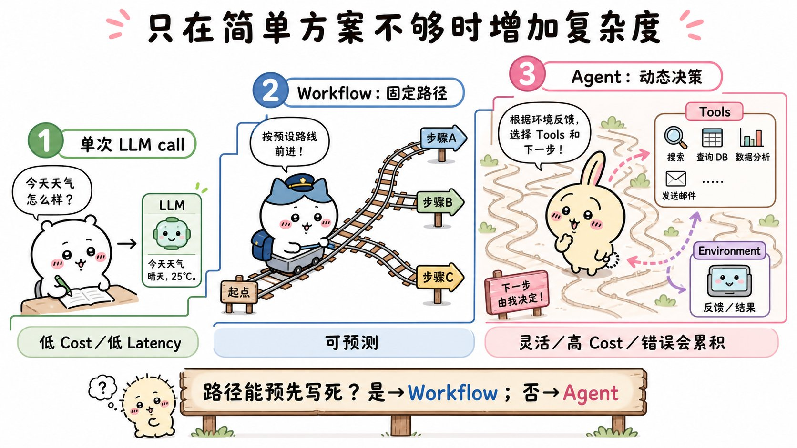
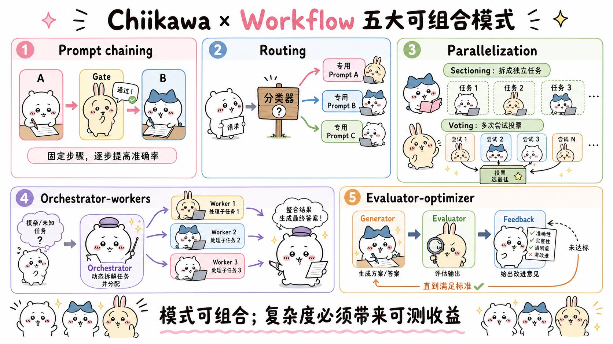
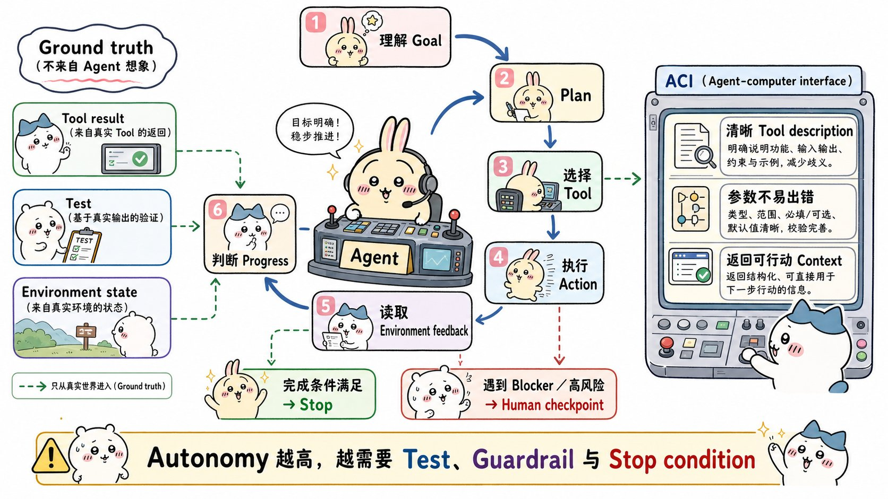
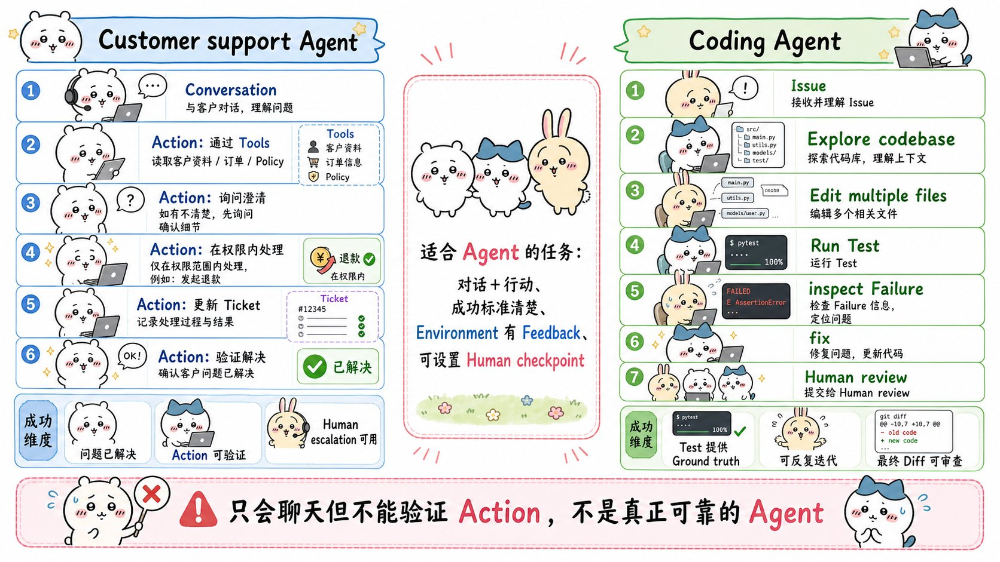
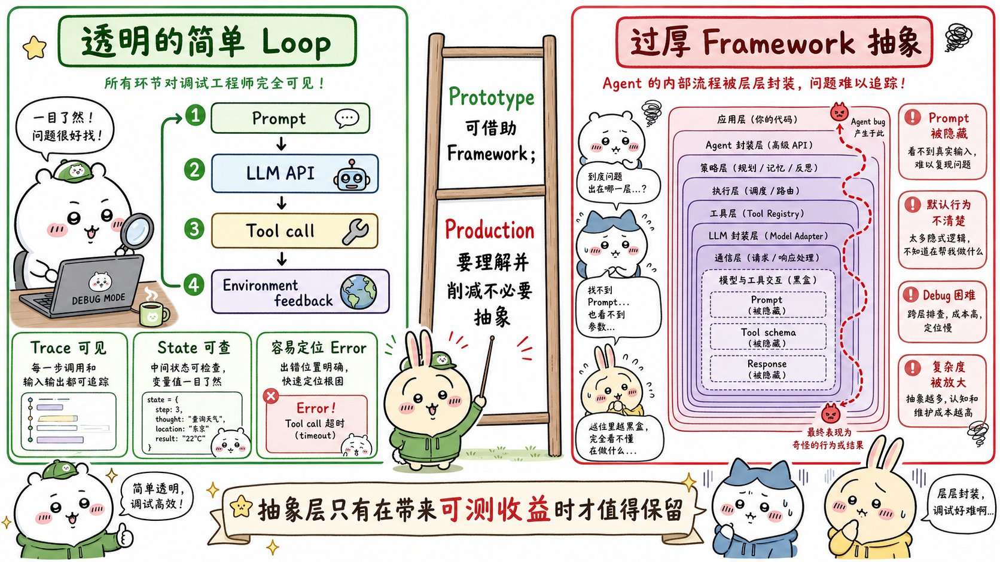

# Building effective agents：面试速记

> Anthropic Engineering · 2024-12-19 · [官方原文](https://www.anthropic.com/engineering/building-effective-agents) · [本地逐句对照](02_building-effective-agents_逐句对照.md)

## 一句话讲明白

**Anthropic 跟数十个团队一起做智能体（agent）之后发现：最成功的实现都没用复杂框架，而是用一组简单、可组合的模式搭出来的。所以别一上来就上智能体——先做单次大语言模型（LLM）调用，只有当简单方案确实不够用、而且增加复杂度能被评估数据证明有收益时，才逐级加上工作流（workflow），最后才加智能体。**

这篇文章不推销任何框架，它给的是一张「复杂度阶梯」和五种可以拆开单用、也可以拼起来用的工作流模式。

## 为什么值得读 / 能用在哪

- 这是整个智能体领域被引用最多的奠基文章，几乎所有后续讨论都在用它的词汇（工作流与智能体之分、编排者-工作者、评估者-优化者）。面试官问「你怎么设计这个系统」，他脑子里的参照系大概率就是这套分类。
- 它解决的真实痛点是**过度设计**：很多团队一上来就搭多智能体，结果成本高、延迟高、还查不出问题出在哪。
- 落到自己项目里最直接的用法：先把手上的功能对号入座到下面那张「模式选择表」，能用低一档的方案就别用高一档的，并且**每加一层复杂度都要拿评估（eval）证明它值**。

## 核心要点

### 1. 工作流和智能体：唯一那条架构分界线

Anthropic 把所有变体统称为**智能体系统**（agentic systems），但在架构上只划一条线——**执行路径由谁决定**：

| 类型 | 谁决定执行路径 | 适合什么任务 | 主要代价 |
|---|---|---|---|
| 工作流（workflow） | 开发者在代码里预先写死的路径 | 定义清晰的任务，要可预测性与一致性 | 灵活性有限 |
| 智能体（agent） | 大模型自己动态主导流程与工具使用 | 需要大规模灵活性、由模型驱动决策 | 成本高、延迟高、错误会累积放大 |

判断口诀：

> 路径能预先写死，就用工作流；路径必须边做边定，才用智能体。

原文还专门补了一句：**很多应用连工作流都不需要**——用检索（retrieval）和上下文内示例（in-context examples）优化好的单次大模型调用，通常就够了。智能体系统本质上是**拿延迟和成本换任务表现**，你得先想清楚这笔买卖划不划算。

### 2. 所有模式的基础构件：增强型大模型

一切模式都建立在**增强型大模型**（augmented LLM）之上，也就是给模型加三样东西：

- **检索**：从外部知识库按需取信息；
- **工具**（tools）：读数据、执行动作、改变环境；
- **记忆**（memory）：保留跨轮次的重要信息。

关键在于：模型不是被动接受这些能力，它会**自己生成搜索查询、自己挑工具、自己决定哪些信息留下**。

工程上原文只强调两点：

1. 这些能力要**贴合你的具体用例**，不要通用大礼包；
2. 要给模型一个**简单易用、文档完善的接口**。

实现方式之一是模型上下文协议 `MCP`——写一个简单的客户端，就能接入不断壮大的第三方工具生态。

### 3. 五种工作流（上）：提示词链 / 路由 / 并行化

**① 提示词链（prompt chaining）**——把任务拆成一串固定步骤，每次调用处理上一次的输出，中间可以插入程序化检查（原文图里叫「门控」（gate））。

- 适用：任务能**轻松、干净地拆成固定子任务**，且你愿意用延迟换准确率。
- 本质：让每一次调用都只干一件更简单的事。
- 例子：先写营销文案→再翻译成另一种语言；先写大纲→检查大纲是否达标→再基于大纲写正文。

**② 路由（routing）**——先给输入分类，再导向专门的后续处理。

- 适用：任务里存在**明显不同、更适合分开处理的类别**，而且**分类本身能做准**（用大模型或传统分类模型都行）。
- 收益：关注点分离，每类输入能配专门的提示词——否则为一类输入做的优化会伤害另一类。
- 例子：客服问题按「常规咨询 / 退款请求 / 技术支持」分流；简单问题路由给更便宜的 `Claude Haiku 4.5`，困难问题路由给能力更强的 `Claude Sonnet 4.5`。

**③ 并行化（parallelization）**——多次调用同时跑，结果用程序聚合。两种变体：

- **分块（sectioning）**：拆成互相独立的子任务并行跑。例子：一个模型实例回答用户，另一个专门做内容安全甄别（护栏）——比让同一次调用既管安全又管回答效果更好；自动化评估时每次调用只评一个维度。
- **投票（voting）**：同一任务跑多次拿多样化结果。例子：多个提示词分别审查同一段代码找漏洞；内容是否违规用多个提示词投票，靠调阈值平衡误报和漏报。
- 原文的普适结论：**涉及多重考量的复杂任务，让每个考量点单独一次调用，模型表现更好**。

### 4. 五种工作流（下）：编排者-工作者 / 评估者-优化者

**④ 编排者-工作者（orchestrator-workers）**——一个中心大模型动态拆任务、派给工作者模型、再综合结果。

- 适用：**你事先根本预测不出需要哪些子任务**。
- 和并行化的区别（面试爱考）：拓扑结构很像，**关键差别是灵活性**——并行化的子任务是预先定义好的，编排者-工作者的子任务是编排者看到具体输入后临场决定的。
- 例子：每次要改多个文件的编码产品（改几个文件、每个改什么，完全取决于任务）；需要从多个来源收集分析信息的搜索任务。

**⑤ 评估者-优化者（evaluator-optimizer）**——一次调用负责生成，另一次调用负责评估并给反馈，在循环里反复打磨。

- 适用：**有明确的评估标准**，且迭代打磨能带来可度量的价值。
- 两个「适配信号」，原文说得很具体：其一，人类把反馈明确讲出来时，模型的回答确实能明显变好；其二，**模型自己也能给出这类反馈**。两条都成立才值得上。
- 类比：人类作者反复修改打磨一篇稿子的过程。
- 例子：文学翻译（翻译模型抓不到的微妙处，评估模型能提出批评）；需要多轮搜索分析的复杂检索任务（由评估者决定还要不要再搜）。

**模式选择表（面试可直接背）：**

| 任务特征 | 该选什么 |
|---|---|
| 一次生成就能完成 | 单次大模型调用（配检索和示例） |
| 步骤固定、可以顺序拆解 | 提示词链 |
| 输入类别清晰、需要分开处理 | 路由 |
| 子任务互相独立，或要多次尝试提高置信度 | 并行化（分块 / 投票） |
| 子任务无法提前预测 | 编排者-工作者 |
| 有明确评估标准、结果可迭代改善 | 评估者-优化者 |
| 步骤数和路径都无法预知 | 智能体 |

这些构件**不是硬性规定**，可以自由组合、改造——但每次组合都要靠度量表现来证明收益。

### 5. 自主智能体的本质：就是一个循环

原文的原话是：智能体能处理复杂精深的任务，但实现往往**相当直接**——它们通常就只是**在循环中根据环境反馈使用工具的大模型**。

一轮完整流程：

1. 从人类的指令或一段交互式讨论开始；
2. 任务明确后，独立规划并执行；
3. **每一步都要从环境拿到「真实信号」（ground truth）**——工具调用结果、代码执行结果；
4. 用这个信号评估自己的进展；
5. 在检查点或遇到阻碍时暂停，回来找人类要信息或要判断；
6. 任务完成即终止，另外通常还会加**停止条件**（比如最大迭代次数）保持可控。

这里最容易被面试追问的一句：**关键不是智能体「想得多好」，而是它每一步能不能拿到真实信号**。编码智能体必须真的跑测试，客服智能体必须真的读到订单状态——拿不到真实信号，它就只能顺着自己写的文字继续猜。

代价也要背清楚：自主性意味着**更高的成本**和**错误累积放大**的风险。所以原文明确建议：**在沙箱（sandbox）环境里做充分测试，并配上适当的护栏（guardrail）**。

附录点名了两个最适合智能体的领域，共同点是：**既需要对话又需要行动、有明确成功标准、能形成反馈循环、能纳入有效的人工监督**。

- **客户支持**：交互天然是对话流；能集成工具拉客户数据、订单历史、知识库；退款、改工单都能程序化执行；成功与否可以清晰度量。已有公司敢用「**只对成功解决的问题收费**」的按用量计价来验证这条路。
- **编码智能体**：方案可以用自动化测试验证，测试结果直接当反馈迭代，问题空间结构良好，输出质量可客观度量。Anthropic 自己的实现已能**仅凭PR（pull request）的描述，解决 `SWE-bench Verified` 基准里的真实 `GitHub` 缺陷单（issue）**——但确保方案符合更宏观的系统要求，**人工评审依然不可少**。

### 6. 工具接口（ACI）比框架更值得你投入

**先说框架。** 它确实能简化调用模型、定义与解析工具、串联多次调用这些底层活儿，上手快。但两个坑：

- 它引入的**额外抽象层会遮住底层的提示词和响应**，让系统更难调试；
- 它会**诱使你在更简单的方案本已够用时增加复杂度**。

原文建议：**先直接用大模型 API**——很多模式只要几行代码。真要用框架，**必须理解它底层的代码**：对框架内部机制的错误假设，是客户出错的常见根源。走向生产环境时，不要犹豫削减抽象层、改用基础组件。

**再说 ACI，这才是真正的杠杆。** 智能体-计算机接口（agent-computer interface，ACI）指智能体与工具、文件、系统之间的接口。原文那条经验法则很好背：**人们在人机界面（human-computer interface，HCI）上投入了多少精力，你就该在 ACI 上投入同样多**。

同一个动作往往有多种表达方式，对人来说只是表面差异，**对模型来说难度天差地别**：写差异补丁（`diff`）要求在写出新代码之前就先在块头里算准有多少行会变；把代码塞进 `JSON`（相比 `markdown`）要额外转义换行和引号。

选定工具格式的三条建议：

- 给模型**足够的 token 去「思考」**，别让它把自己写进死胡同；
- 格式尽量贴近**模型在互联网文本里自然见过的样子**；
- 确保没有格式上的「额外负担」，比如要精确数清上千行代码的行数、或给写出的每段代码做字符串转义。

写好工具定义的做法：

- **把自己放到模型的位置上**——只看描述和参数，用法是否一目了然？你要是也得琢磨，模型多半也一样。好的工具定义包含使用示例、边界情况、输入格式要求，以及与其他工具的清晰边界；
- 改参数名和描述，**当成给团队里的初级开发者写函数说明文档（`docstring`）**。同时存在很多相似工具时尤其重要；
- **实测**：跑大量示例输入，看模型会犯什么错，然后迭代；
- **防呆设计（Poka-yoke）**：改参数本身，让犯错变难。

最有说服力的数字是这句：做 `SWE-bench` 智能体时，Anthropic **花在优化工具上的时间比花在整体提示词上还多**。经典案例——智能体离开根目录后，用相对文件路径的工具就会出错；把工具改成**强制要求绝对路径**之后，模型用得完美无缺。

## 面试高频问答

**Q：工作流和智能体到底怎么区分？什么时候该从工作流升级到智能体？**
A：唯一的分界是执行路径由谁决定：工作流的路径是开发者在代码里预定义的，智能体是大模型自己动态主导流程和工具使用。任务定义清晰、要可预测性和一致性，就用工作流；只有当所需步骤数难以甚至无法预测、也没法硬编码一条固定路径时，才用智能体，而且你必须对模型的多轮决策有一定信任。

**Q：并行化和编排者-工作者拓扑结构很像，区别在哪？**
A：区别只有一个词——灵活性。并行化的子任务是你预先定义死的（比如固定评估五个维度）；编排者-工作者的子任务是编排者看到具体输入之后临场拆出来的。所以「要改哪几个文件」这种事先不知道的任务只能用后者。

**Q：评估者-优化者听起来很美，什么时候真的能用？**
A：要同时满足两个信号：一是人类把反馈明确表述出来时，模型的输出确实能明显变好；二是模型自己也能产出这类反馈。再加上有明确的评估标准、多轮打磨的收益盖得过多花的成本。文学翻译和多轮深度检索是典型，很多任务其实卡在第二条——模型说不出有用的批评意见。

**Q：你怎么防止智能体跑飞？**
A：四件事。一是每一步都要从环境拿到真实信号来判断进展，而不是让它信自己的总结；二是设停止条件，比如最大迭代次数；三是在检查点和遇到阻碍时暂停等人类反馈；四是在沙箱里充分测试并配护栏。自主性越高，错误累积放大的风险越大，成本也越高。

**Q：为什么 Anthropic 不建议一上来就用框架？**
A：框架简化了调用模型、定义解析工具、串联调用这些底层工作，但会引入抽象层遮住底层的提示词和响应，让调试变难，还会诱使你在简单方案够用时加复杂度。他们建议先直接用 API——很多模式几行代码就能实现；要用框架就必须理解底层代码，因为对内部机制的错误假设是客户出错的常见根源；上生产前该削减抽象层。

## 必须记住的 8 句话

1. 工作流走预定义的代码路径，智能体自己动态主导流程和工具使用——这是唯一的架构分界线。
2. 成功不是构建最精巧复杂的系统，而是构建**适合你需求**的系统。
3. 智能体系统是拿延迟和成本换任务表现，先想清楚这笔交易划不划算。
4. 只有当增加复杂度**能被证明确实改善结果**时，才增加复杂度。
5. 所有模式的地基是增强型大模型：检索 + 工具 + 记忆，而且是模型主动调用它们。
6. 并行化的子任务预先定义，编排者-工作者的子任务由编排者临场决定。
7. 智能体本质上就是「在循环里根据环境反馈使用工具的大模型」，命门是每一步能否拿到真实信号。
8. 三条核心原则：保持**简单**、优先**透明**（明确展示规划步骤）、用完善的文档和测试打磨 **ACI**。

## 30 秒口述版

> Anthropic 这篇文章把智能体系统分成工作流和智能体两类：工作流的执行路径由代码预先规定，智能体则由大模型根据环境反馈动态决定步骤和工具。核心主张是从最简单的方案开始——很多场景一次优化过的大模型调用就够了，只有在简单方案不够用时才逐级增加复杂度。中间这一层给了五种工作流：任务能干净拆成固定步骤用提示词链，输入类别清晰用路由，子任务独立或要多次尝试用并行化，子任务无法提前预测用编排者-工作者，有明确评估标准且能迭代改善用评估者-优化者。真正的智能体其实很简单，就是在循环里用工具的大模型，关键是每一步都要从环境拿到真实信号，并配上停止条件、人工检查点、沙箱和护栏。最后一个反直觉的结论：他们做 SWE-bench 智能体时，花在优化工具接口上的时间比花在提示词上还多——ACI 值得你像做人机界面一样认真对待。

## 自测

- [ ] 能不看笔记说出工作流和智能体的区别，以及各自的代价。
- [ ] 能说出五种工作流的名字，并给每种举一个原文里的例子。
- [ ] 能一句话讲清并行化和编排者-工作者的关键差别。
- [ ] 能说出评估者-优化者适用的两个判断信号。
- [ ] 能复述自主智能体的循环，并解释真实信号为什么是命门。
- [ ] 能说明什么是 ACI，以及绝对路径那个案例说明了什么。
- [ ] 能说出为什么不建议一上来就用框架，以及用框架时的底线要求。
- [ ] 能说出实现智能体的三条核心原则。

---

> 插图为学习用途的非官方同人式教学图，角色与文章版权归各自权利人。
