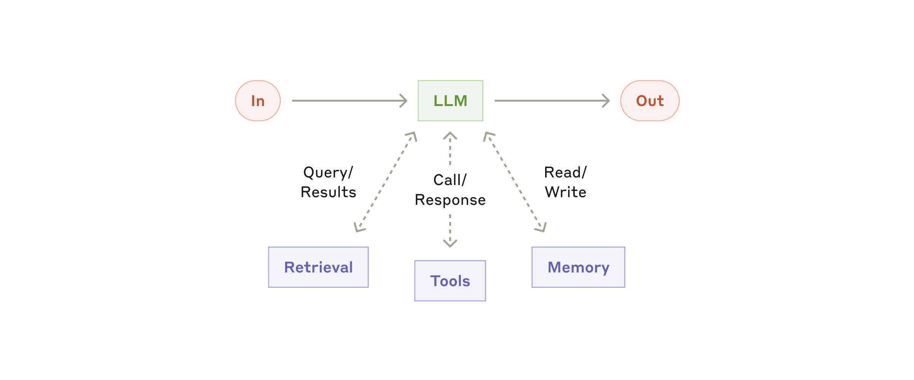
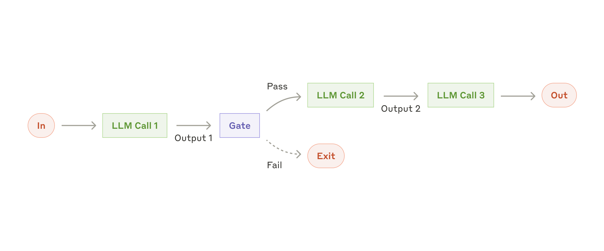
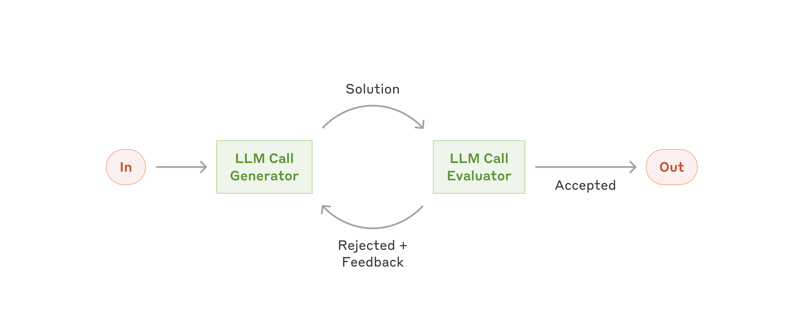
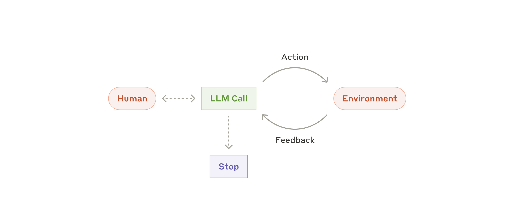
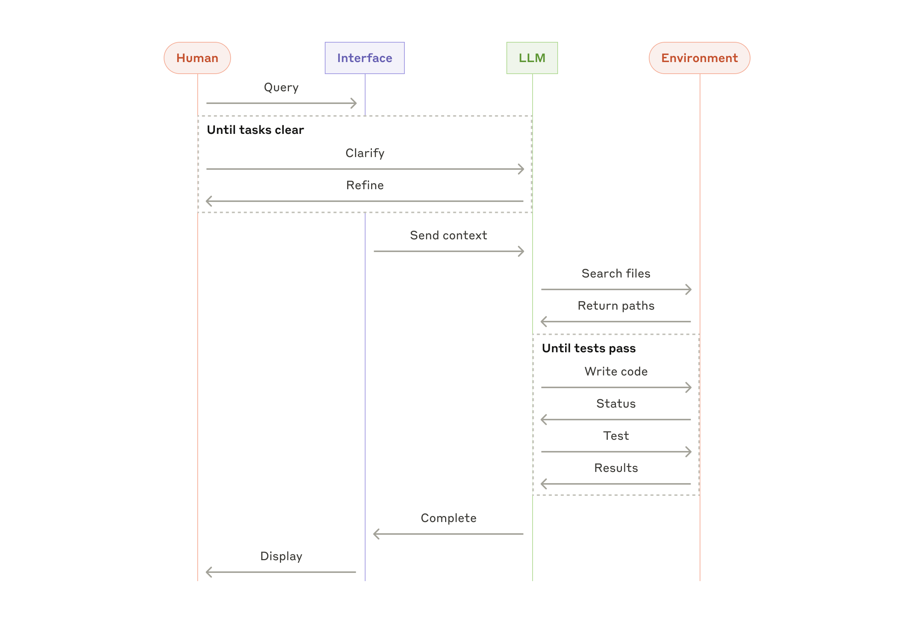

# 02_Building effective agents_构建高效的智能体

> 原文：https://www.anthropic.com/engineering/building-effective-agents
> 作者：Anthropic Engineering｜发布日期：2024-12-19

## 📌 本篇速览

- 📅 2024-12-19　｜　⏱ 约 15 分钟　｜　📄 2,724 词 / 8 图
- ⭐ ★★★★★ **必读** —— 这是 Agent 领域引用最广的奠基性文章，定义了 workflow 与 agent 的区分和一整套通用模式词汇，是 Agent 工程师面试与实践的必读起点。
- 🏷 智能体架构、工作流模式、增强型LLM、ACI/工具设计、简单性原则
- 🖼 [图解笔记（面试速记）](02_building-effective-agents_直观图解与学习笔记.md)　·　🗂 [返回总目录](00_目录与阅读进度.md)

Anthropic 总结与数十个跨行业团队合作构建 LLM 智能体的经验：最成功的实现都采用简单、可组合的模式，而非复杂框架。文章区分了工作流与智能体，系统梳理了增强型 LLM、提示词链、路由、并行化、编排者-工作者、评估者-优化者等模式及自主智能体的适用场景，并在附录中给出客户支持、编码智能体两大落地方向和工具提示词工程（ACI 设计）的实践建议。

---

Over the past year, we've worked with dozens of teams building large language model (LLM) agents across industries.

过去一年里，我们与各行各业数十个构建大语言模型（LLM）智能体（agent）的团队开展了合作。

Consistently, the most successful implementations weren't using complex frameworks or specialized libraries.

我们反复看到同一个现象：最成功的实现并没有使用复杂的框架（framework）或专门的库。

Instead, they were building with simple, composable patterns.

相反，它们都是用简单、可组合（composable）的模式构建的。

In this post, we share what we’ve learned from working with our customers and building agents ourselves, and give practical advice for developers on building effective agents.

在本文中，我们分享从服务客户以及自己构建智能体的过程中学到的经验，并为开发者提供构建高效智能体的实用建议。

## What are agents?｜什么是智能体？

"Agent" can be defined in several ways.

「Agent（智能体）」可以有多种定义方式。

Some customers define agents as fully autonomous systems that operate independently over extended periods, using various tools to accomplish complex tasks.

一些客户把智能体定义为完全自主的系统：它们能长时间独立运行，使用各种工具完成复杂任务。

Others use the term to describe more prescriptive implementations that follow predefined workflows.

另一些人则用这个词来描述遵循预定义工作流（workflow）的、更具规范性的实现。

At Anthropic, we categorize all these variations as **agentic systems**, but draw an important architectural distinction between **workflows** and **agents**:

在 Anthropic，我们把所有这些变体统称为**智能体系统**（agentic systems），但在架构上对**工作流**（workflows）和**智能体**（agents）做出一个重要区分：

- **Workflows** are systems where LLMs and tools are orchestrated through predefined code paths.

- **工作流**是通过预定义代码路径来编排（orchestrate）LLM 与工具的系统。

- **Agents**, on the other hand, are systems where LLMs dynamically direct their own processes and tool usage, maintaining control over how they accomplish tasks.

- **智能体**则是由 LLM 动态主导自身流程与工具使用、并始终掌控任务完成方式的系统。

Below, we will explore both types of agentic systems in detail.

下文我们将详细探讨这两类智能体系统。

In Appendix 1 (“Agents in Practice”), we describe two domains where customers have found particular value in using these kinds of systems.

在附录 1（"智能体实践"）中，我们介绍客户在使用这类系统时发现特别有价值的两个领域。

## When (and when not) to use agents｜何时（以及何时不）使用智能体

When building applications with LLMs, we recommend finding the simplest solution possible, and only increasing complexity when needed.

用 LLM 构建应用时，我们建议先找到尽可能简单的方案，只在必要时才增加复杂度。

This might mean not building agentic systems at all.

这可能意味着完全不构建智能体系统。

Agentic systems often trade latency and cost for better task performance, and you should consider when this tradeoff makes sense.

智能体系统往往以更高的延迟（latency）和成本换取更好的任务表现，你应该想清楚这种取舍在什么情况下才划算。

When more complexity is warranted, workflows offer predictability and consistency for well-defined tasks, whereas agents are the better option when flexibility and model-driven decision-making are needed at scale.

当确实需要更高复杂度时，对于定义清晰的任务，工作流能提供可预测性与一致性；而当需要大规模的灵活性和由模型驱动的决策时，智能体是更好的选择。

For many applications, however, optimizing single LLM calls with retrieval and in-context examples is usually enough.

不过对许多应用来说，用检索（retrieval）和上下文内示例（in-context examples）优化单次 LLM 调用，通常就已足够。

## When and how to use frameworks｜何时以及如何使用框架

There are many frameworks that make agentic systems easier to implement, including:

有许多框架能让智能体系统更容易实现，包括：

- The [Claude Agent SDK](https://platform.claude.com/docs/en/agent-sdk/overview);

- [Claude Agent SDK](https://platform.claude.com/docs/en/agent-sdk/overview)；

- [Strands Agents SDK by AWS](https://strandsagents.com/latest/);

- AWS 出品的 [Strands Agents SDK](https://strandsagents.com/latest/)；

- [Rivet](https://rivet.ironcladapp.com/), a drag and drop GUI LLM workflow builder; and

- [Rivet](https://rivet.ironcladapp.com/)，一个拖拽式 GUI 的 LLM 工作流构建器；以及

- [Vellum](https://www.vellum.ai/), another GUI tool for building and testing complex workflows.

- [Vellum](https://www.vellum.ai/)，另一个用于构建和测试复杂工作流的 GUI 工具。

These frameworks make it easy to get started by simplifying standard low-level tasks like calling LLMs, defining and parsing tools, and chaining calls together.

这些框架简化了调用 LLM、定义与解析工具、串联多次调用等标准的底层工作，让上手变得容易。

However, they often create extra layers of abstraction that can obscure the underlying prompts ​​and responses, making them harder to debug.

然而，它们往往会引入额外的抽象层，遮蔽底层的提示词（prompt）与响应，使系统更难调试。

They can also make it tempting to add complexity when a simpler setup would suffice.

它们还容易诱使你在更简单的方案本已足够时增加不必要的复杂度。

We suggest that developers start by using LLM APIs directly: many patterns can be implemented in a few lines of code.

我们建议开发者先从直接使用 LLM API 开始：很多模式只需几行代码就能实现。

If you do use a framework, ensure you understand the underlying code.

如果你确实要用框架，请确保理解其底层代码。

Incorrect assumptions about what's under the hood are a common source of customer error.

对框架内部机制的错误假设，是客户出错的一个常见根源。

See our [cookbook](https://platform.claude.com/cookbook/patterns-agents-basic-workflows) for some sample implementations.

一些示例实现可参见我们的 [cookbook](https://platform.claude.com/cookbook/patterns-agents-basic-workflows)。

## Building blocks, workflows, and agents｜基础构件、工作流与智能体

In this section, we’ll explore the common patterns for agentic systems we’ve seen in production.

在这一节中，我们将探讨在生产环境中见到的智能体系统常见模式。

We'll start with our foundational building block—the augmented LLM—and progressively increase complexity, from simple compositional workflows to autonomous agents.

我们会从基础构件——增强型 LLM（augmented LLM）——讲起，逐步增加复杂度，从简单的组合式工作流一直讲到自主智能体。

### Building block: The augmented LLM｜基础构件：增强型 LLM

The basic building block of agentic systems is an LLM enhanced with augmentations such as retrieval, tools, and memory.

智能体系统的基本构件，是一个用检索、工具、记忆（memory）等增强能力强化过的 LLM。

Our current models can actively use these capabilities—generating their own search queries, selecting appropriate tools, and determining what information to retain.

我们当前的模型已能主动运用这些能力——自行生成搜索查询、选择合适的工具、决定保留哪些信息。

*The augmented LLM*

*图注：增强型 LLM*

We recommend focusing on two key aspects of the implementation: tailoring these capabilities to your specific use case and ensuring they provide an easy, well-documented interface for your LLM.

我们建议在实现时重点关注两个方面：一是让这些能力贴合你的具体用例，二是确保它们为你的 LLM 提供一个简单易用、文档完善的接口。

While there are many ways to implement these augmentations, one approach is through our recently released [Model Context Protocol](https://www.anthropic.com/news/model-context-protocol), which allows developers to integrate with a growing ecosystem of third-party tools with a simple [client implementation](https://modelcontextprotocol.io/tutorials/building-a-client#building-mcp-clients).

实现这些增强能力的方式有很多，其中一种是通过我们最近发布的[模型上下文协议（Model Context Protocol）](https://www.anthropic.com/news/model-context-protocol)：开发者只需一个简单的[客户端实现](https://modelcontextprotocol.io/tutorials/building-a-client#building-mcp-clients)，就能接入持续壮大的第三方工具生态。

For the remainder of this post, we'll assume each LLM call has access to these augmented capabilities.

在本文余下的部分，我们假定每次 LLM 调用都能使用这些增强能力。

### Workflow: Prompt chaining｜工作流：提示词链

Prompt chaining decomposes a task into a sequence of steps, where each LLM call processes the output of the previous one.

提示词链（prompt chaining）把任务分解为一系列步骤，每次 LLM 调用都处理上一次调用的输出。

You can add programmatic checks (see "gate” in the diagram below) on any intermediate steps to ensure that the process is still on track.

你可以在任意中间步骤加入程序化检查（见下图中的「gate」（门控）），确保流程仍在正轨上。

*The prompt chaining workflow*

*图注：提示词链工作流*

**When to use this workflow:** This workflow is ideal for situations where the task can be easily and cleanly decomposed into fixed subtasks.

**何时使用这种工作流：**当任务能被轻松、干净地分解为固定子任务时，这种工作流最为理想。

The main goal is to trade off latency for higher accuracy, by making each LLM call an easier task.

其主要目标是用延迟换取更高的准确率——让每次 LLM 调用都只处理一个更简单的任务。

**Examples where prompt chaining is useful:**

**提示词链适用的例子：**

- Generating Marketing copy, then translating it into a different language.

- 先生成营销文案，再把它翻译成另一种语言。

- Writing an outline of a document, checking that the outline meets certain criteria, then writing the document based on the outline.

- 先写出文档大纲，检查大纲是否满足特定标准，再基于大纲撰写文档。

### Workflow: Routing｜工作流：路由

Routing classifies an input and directs it to a specialized followup task.

路由（routing）先对输入进行分类，再把它导向专门的后续任务。

This workflow allows for separation of concerns, and building more specialized prompts.

这种工作流实现了关注点分离（separation of concerns），也便于构建更有针对性的提示词。

Without this workflow, optimizing for one kind of input can hurt performance on other inputs.

如果不用这种工作流，针对某一类输入做优化，可能会损害在其他输入上的表现。

*The routing workflow*

*图注：路由工作流*

**When to use this workflow:** Routing works well for complex tasks where there are distinct categories that are better handled separately, and where classification can be handled accurately, either by an LLM or a more traditional classification model/algorithm.

**何时使用这种工作流：**当复杂任务中存在明显不同、更适合分开处理的类别，且分类本身能够被准确完成（无论是靠 LLM 还是更传统的分类模型/算法）时，路由的效果很好。

**Examples where routing is useful:**

**路由适用的例子：**

- Directing different types of customer service queries (general questions, refund requests, technical support) into different downstream processes, prompts, and tools.

- 把不同类型的客服问题（常规咨询、退款请求、技术支持）导向不同的下游流程、提示词与工具。

- Routing easy/common questions to smaller, cost-efficient models like Claude Haiku 4.5 and hard/unusual questions to more capable models like Claude Sonnet 4.5 to optimize for best performance.

- 把简单/常见的问题路由给 Claude Haiku 4.5 这类更小、更具成本效益的模型，把困难/罕见的问题路由给 Claude Sonnet 4.5 这类能力更强的模型，以取得最优的整体表现。

### Workflow: Parallelization｜工作流：并行化

LLMs can sometimes work simultaneously on a task and have their outputs aggregated programmatically.

有时可以让多个 LLM 同时处理一个任务，再以程序化方式聚合它们的输出。

This workflow, parallelization, manifests in two key variations:

这种工作流即并行化（parallelization），主要体现为两种变体：

- **Sectioning**: Breaking a task into independent subtasks run in parallel.

- **分块（Sectioning）**：把任务拆成相互独立、并行运行的子任务。

- **Voting:** Running the same task multiple times to get diverse outputs.

- **投票（Voting）**：把同一个任务运行多次，获得多样化的输出。

*The parallelization workflow*

*图注：并行化工作流*

**When to use this workflow:** Parallelization is effective when the divided subtasks can be parallelized for speed, or when multiple perspectives or attempts are needed for higher confidence results.

**何时使用这种工作流：**当拆分出的子任务可以并行执行以提升速度，或需要多个视角、多次尝试来获得置信度更高的结果时，并行化很有效。

For complex tasks with multiple considerations, LLMs generally perform better when each consideration is handled by a separate LLM call, allowing focused attention on each specific aspect.

对于涉及多重考量的复杂任务，让每个考量点由单独一次 LLM 调用来处理、从而把注意力集中在每个具体方面上，LLM 通常表现更好。

**Examples where parallelization is useful:**

**并行化适用的例子：**

- **Sectioning**:

- **分块**：

    - Implementing guardrails where one model instance processes user queries while another screens them for inappropriate content or requests. This tends to perform better than having the same LLM call handle both guardrails and the core response.

    - 实现护栏（guardrails）：一个模型实例处理用户查询，另一个负责甄别其中是否包含不当内容或请求。这通常比让同一次 LLM 调用既做护栏又生成核心回复效果更好。

    - Automating evals for evaluating LLM performance, where each LLM call evaluates a different aspect of the model’s performance on a given prompt.

    - 自动化评估（eval）LLM 的表现：每次 LLM 调用分别评估模型在给定提示词上表现的不同方面。

- **Voting**:

- **投票**：

    - Reviewing a piece of code for vulnerabilities, where several different prompts review and flag the code if they find a problem.

    - 审查一段代码是否存在漏洞：多个不同的提示词分别审查代码，一旦发现问题就把它标记出来。

    - Evaluating whether a given piece of content is inappropriate, with multiple prompts evaluating different aspects or requiring different vote thresholds to balance false positives and negatives.

    - 评估某段内容是否不当：多个提示词分别评估不同方面，或设置不同的投票阈值，以平衡误报（false positive）与漏报（false negative）。

### Workflow: Orchestrator-workers｜工作流：编排者-工作者

In the orchestrator-workers workflow, a central LLM dynamically breaks down tasks, delegates them to worker LLMs, and synthesizes their results.

在编排者-工作者（orchestrator-workers）工作流中，一个中心 LLM 动态地分解任务，把子任务委派给工作者 LLM，并综合它们的结果。

*The orchestrator-workers workflow*

*图注：编排者-工作者工作流*

**When to use this workflow:** This workflow is well-suited for complex tasks where you can’t predict the subtasks needed (in coding, for example, the number of files that need to be changed and the nature of the change in each file likely depend on the task).

**何时使用这种工作流：**当复杂任务所需的子任务无法提前预测时（例如在编码场景中，需要修改多少个文件、每个文件要改什么，很可能都取决于具体任务），这种工作流非常合适。

Whereas it’s topographically similar, the key difference from parallelization is its flexibility—subtasks aren't pre-defined, but determined by the orchestrator based on the specific input.

尽管它在拓扑结构上与并行化相似，但两者的关键区别在于灵活性——子任务不是预先定义好的，而是由编排者根据具体输入来决定。

**Example where orchestrator-workers is useful:**

**编排者-工作者适用的例子：**

- Coding products that make complex changes to multiple files each time.

- 每次都要对多个文件做复杂修改的编码产品。

- Search tasks that involve gathering and analyzing information from multiple sources for possible relevant information.

- 需要从多个来源收集并分析信息、寻找可能相关内容的搜索任务。

### Workflow: Evaluator-optimizer｜工作流：评估者-优化者

In the evaluator-optimizer workflow, one LLM call generates a response while another provides evaluation and feedback in a loop.

在评估者-优化者（evaluator-optimizer）工作流中，一次 LLM 调用负责生成响应，另一次调用则在循环中提供评估与反馈。

*The evaluator-optimizer workflow*

*图注：评估者-优化者工作流*

**When to use this workflow:** This workflow is particularly effective when we have clear evaluation criteria, and when iterative refinement provides measurable value.

**何时使用这种工作流：**当我们有明确的评估标准、且迭代打磨能带来可度量的价值时，这种工作流尤其有效。

The two signs of good fit are, first, that LLM responses can be demonstrably improved when a human articulates their feedback; and second, that the LLM can provide such feedback.

判断是否适用有两个标志：其一，当人类明确表述反馈时，LLM 的响应确实能得到明显改进；其二，LLM 自己也能够给出这类反馈。

This is analogous to the iterative writing process a human writer might go through when producing a polished document.

这类似于人类写作者在打磨一篇文档时可能经历的迭代写作过程。

**Examples where evaluator-optimizer is useful:**

**评估者-优化者适用的例子：**

- Literary translation where there are nuances that the translator LLM might not capture initially, but where an evaluator LLM can provide useful critiques.

- 文学翻译：翻译 LLM 一开始可能捕捉不到某些微妙之处，而评估 LLM 能提出有用的批评意见。

- Complex search tasks that require multiple rounds of searching and analysis to gather comprehensive information, where the evaluator decides whether further searches are warranted.

- 需要多轮搜索与分析才能收集到全面信息的复杂搜索任务：由评估者决定是否还有必要继续搜索。

### Agents｜智能体

Agents are emerging in production as LLMs mature in key capabilities—understanding complex inputs, engaging in reasoning and planning, using tools reliably, and recovering from errors.

随着 LLM 在关键能力上日趋成熟——理解复杂输入、进行推理与规划、可靠地使用工具、从错误中恢复——智能体正在生产环境中崭露头角。

Agents begin their work with either a command from, or interactive discussion with, the human user.

智能体的工作始于人类用户下达的一条指令，或与用户的一段交互式讨论。

Once the task is clear, agents plan and operate independently, potentially returning to the human for further information or judgement.

一旦任务明确，智能体就会独立地规划和执行，必要时再回到人类那里获取更多信息或请其判断。

During execution, it's crucial for the agents to gain “ground truth” from the environment at each step (such as tool call results or code execution) to assess its progress.

在执行过程中，智能体在每一步都要从环境中获取「真实信号」（ground truth）（例如工具调用结果或代码执行结果）来评估自身进展，这一点至关重要。

Agents can then pause for human feedback at checkpoints or when encountering blockers.

之后，智能体可以在检查点（checkpoint）处或遇到阻碍时暂停，等待人类反馈。

The task often terminates upon completion, but it’s also common to include stopping conditions (such as a maximum number of iterations) to maintain control.

任务通常在完成时结束，但为了保持可控，加入停止条件（例如最大迭代次数）也是常见做法。

Agents can handle sophisticated tasks, but their implementation is often straightforward.

智能体能够处理复杂精深的任务，但其实现往往相当直接。

They are typically just LLMs using tools based on environmental feedback in a loop.

它们通常就只是在循环中根据环境反馈使用工具的 LLM。

It is therefore crucial to design toolsets and their documentation clearly and thoughtfully.

因此，清晰而用心地设计工具集及其文档至关重要。

We expand on best practices for tool development in Appendix 2 ("Prompt Engineering your Tools").

我们在附录 2（"为你的工具做提示词工程"）中详细展开工具开发的最佳实践。

*Autonomous agent*

*图注：自主智能体*

**When to use agents:** Agents can be used for open-ended problems where it’s difficult or impossible to predict the required number of steps, and where you can’t hardcode a fixed path.

**何时使用智能体：**智能体适用于开放式问题——所需步骤数难以甚至无法预测、也没法硬编码一条固定路径的场景。

The LLM will potentially operate for many turns, and you must have some level of trust in its decision-making.

LLM 可能会连续运行很多轮，你必须对它的决策能力有一定程度的信任。

Agents' autonomy makes them ideal for scaling tasks in trusted environments.

智能体的自主性使其非常适合在可信环境中规模化地执行任务。

The autonomous nature of agents means higher costs, and the potential for compounding errors.

智能体的自主特性意味着更高的成本，以及错误不断累积放大的可能。

We recommend extensive testing in sandboxed environments, along with the appropriate guardrails.

我们建议在沙箱（sandbox）环境中进行充分测试，并配以适当的护栏。

**Examples where agents are useful:**

**智能体适用的例子：**

The following examples are from our own implementations:

以下例子来自我们自己的实现：

- A coding Agent to resolve [SWE-bench tasks](https://www.anthropic.com/research/swe-bench-sonnet), which involve edits to many files based on a task description;

- 一个用于解决 [SWE-bench 任务](https://www.anthropic.com/research/swe-bench-sonnet)的编码智能体，这类任务需要根据任务描述对许多文件进行修改；

- Our [“computer use” reference implementation](https://github.com/anthropics/anthropic-quickstarts/tree/main/computer-use-demo), where Claude uses a computer to accomplish tasks.

- 我们的[「计算机使用」（computer use）参考实现](https://github.com/anthropics/anthropic-quickstarts/tree/main/computer-use-demo)，让 Claude 操作计算机来完成任务。

*High-level flow of a coding agent*

*图注：编码智能体的高层流程*

## Combining and customizing these patterns｜组合与定制这些模式

These building blocks aren't prescriptive.

这些基础构件并不是硬性规定。

They're common patterns that developers can shape and combine to fit different use cases.

它们是一些常见模式，开发者可以根据不同用例加以调整和组合。

The key to success, as with any LLM features, is measuring performance and iterating on implementations.

与任何 LLM 功能一样，成功的关键在于度量表现，并对实现持续迭代。

To repeat: you should consider adding complexity *only* when it demonstrably improves outcomes.

再强调一遍：*只有*当增加复杂度能被证明确实改善结果时，你才应该考虑增加复杂度。

## Summary｜总结

Success in the LLM space isn't about building the most sophisticated system.

在 LLM 领域取得成功，靠的不是构建最精巧复杂的系统。

It's about building the *right* system for your needs.

而是构建*适合*你需求的系统。

Start with simple prompts, optimize them with comprehensive evaluation, and add multi-step agentic systems only when simpler solutions fall short.

从简单的提示词开始，用全面的评估来优化它们，只有在更简单的方案不够用时，才加入多步骤的智能体系统。

When implementing agents, we try to follow three core principles:

在实现智能体时，我们尽量遵循三条核心原则：

1. Maintain **simplicity** in your agent's design.

1. 保持智能体设计的**简单**（simplicity）。

2. Prioritize **transparency** by explicitly showing the agent’s planning steps.

2. 通过明确展示智能体的规划步骤，把**透明**（transparency）放在优先位置。

3. Carefully craft your agent-computer interface (ACI) through thorough tool **documentation and testing**.

3. 通过完善的工具**文档与测试**，精心打造你的智能体-计算机接口（agent-computer interface，ACI）。

Frameworks can help you get started quickly, but don't hesitate to reduce abstraction layers and build with basic components as you move to production.

框架能帮你快速起步，但在走向生产环境时，不要犹豫去削减抽象层、改用基础组件来构建。

By following these principles, you can create agents that are not only powerful but also reliable, maintainable, and trusted by their users.

遵循这些原则，你打造出的智能体将不仅强大，还会可靠、可维护，并赢得用户的信任。

### Acknowledgements｜致谢

Written by Erik S. and Barry Zhang.

本文由 Erik S. 与 Barry Zhang 撰写。

This work draws upon our experiences building agents at Anthropic and the valuable insights shared by our customers, for which we're deeply grateful.

这项工作基于我们在 Anthropic 构建智能体的经验，以及客户们分享的宝贵洞见，对此我们深表感谢。

## Appendix 1: Agents in practice｜附录 1：智能体实践

Our work with customers has revealed two particularly promising applications for AI agents that demonstrate the practical value of the patterns discussed above.

与客户的合作让我们发现了 AI 智能体两个特别有前景的应用方向，它们印证了上文所讨论各种模式的实用价值。

Both applications illustrate how agents add the most value for tasks that require both conversation and action, have clear success criteria, enable feedback loops, and integrate meaningful human oversight.

这两个应用都说明：对于既需要对话又需要行动、有明确成功标准、能形成反馈循环（feedback loop）、并纳入有效人工监督的任务，智能体能创造最大价值。

### A. Customer support｜A. 客户支持

Customer support combines familiar chatbot interfaces with enhanced capabilities through tool integration.

客户支持把人们熟悉的聊天机器人界面与通过工具集成获得的增强能力结合在一起。

This is a natural fit for more open-ended agents because:

这天然适合更开放式的智能体，原因在于：

- Support interactions naturally follow a conversation flow while requiring access to external information and actions;

- 客服交互天然遵循对话流程，同时又需要访问外部信息、执行外部操作；

- Tools can be integrated to pull customer data, order history, and knowledge base articles;

- 可以集成工具来拉取客户数据、订单历史和知识库文章；

- Actions such as issuing refunds or updating tickets can be handled programmatically; and

- 发起退款、更新工单等操作可以用程序化方式处理；以及

- Success can be clearly measured through user-defined resolutions.

- 成功与否可以通过用户定义的解决标准来清晰度量。

Several companies have demonstrated the viability of this approach through usage-based pricing models that charge only for successful resolutions, showing confidence in their agents' effectiveness.

已有多家公司通过「只对成功解决的问题收费」的按用量计价模式验证了这条路线的可行性，也显示出他们对自家智能体效果的信心。

### B. Coding agents｜B. 编码智能体

The software development space has shown remarkable potential for LLM features, with capabilities evolving from code completion to autonomous problem-solving.

软件开发领域已经展现出 LLM 功能的巨大潜力，相关能力从代码补全一路演进到自主解决问题。

Agents are particularly effective because:

智能体在这里格外有效，因为：

- Code solutions are verifiable through automated tests;

- 代码方案可以通过自动化测试来验证；

- Agents can iterate on solutions using test results as feedback;

- 智能体可以把测试结果当作反馈来迭代方案；

- The problem space is well-defined and structured; and

- 问题空间定义清晰、结构良好；以及

- Output quality can be measured objectively.

- 输出质量可以客观度量。

In our own implementation, agents can now solve real GitHub issues in the [SWE-bench Verified](https://www.anthropic.com/research/swe-bench-sonnet) benchmark based on the pull request description alone.

在我们自己的实现中，智能体如今已能仅凭 pull request 描述，解决 [SWE-bench Verified](https://www.anthropic.com/research/swe-bench-sonnet) 基准中的真实 GitHub issue。

However, whereas automated testing helps verify functionality, human review remains crucial for ensuring solutions align with broader system requirements.

不过，自动化测试虽然有助于验证功能正确性，但要确保方案符合更宏观的系统要求，人工评审仍然至关重要。

## Appendix 2: Prompt engineering your tools｜附录 2：为你的工具做提示词工程

No matter which agentic system you're building, tools will likely be an important part of your agent.

无论你在构建哪种智能体系统，工具都很可能是你智能体的重要组成部分。

[Tools](https://www.anthropic.com/news/tool-use-ga) enable Claude to interact with external services and APIs by specifying their exact structure and definition in our API.

[工具](https://www.anthropic.com/news/tool-use-ga)让 Claude 能与外部服务和 API 交互——方式是在我们的 API 中指定工具的精确结构与定义。

When Claude responds, it will include a [tool use block](https://docs.anthropic.com/en/docs/build-with-claude/tool-use#example-api-response-with-a-tool-use-content-block) in the API response if it plans to invoke a tool.

Claude 作出响应时，如果打算调用某个工具，就会在 API 响应中包含一个[工具使用块（tool use block）](https://docs.anthropic.com/en/docs/build-with-claude/tool-use#example-api-response-with-a-tool-use-content-block)。

Tool definitions and specifications should be given just as much prompt engineering attention as your overall prompts.

工具的定义与规格（specification）应当获得与整体提示词同等程度的提示词工程投入。

In this brief appendix, we describe how to prompt engineer your tools.

在这个简短的附录里，我们介绍如何对你的工具做提示词工程。

There are often several ways to specify the same action.

同一个操作往往有好几种指定方式。

For instance, you can specify a file edit by writing a diff, or by rewriting the entire file.

例如，指定一次文件编辑，既可以写一个 diff，也可以重写整个文件。

For structured output, you can return code inside markdown or inside JSON.

对于结构化输出，你可以把代码放在 markdown 里返回，也可以放在 JSON 里返回。

In software engineering, differences like these are cosmetic and can be converted losslessly from one to the other.

在软件工程中，这类差异只是表面形式的不同，彼此之间可以无损转换。

However, some formats are much more difficult for an LLM to write than others.

然而对 LLM 来说，有些格式写起来要比另一些难得多。

Writing a diff requires knowing how many lines are changing in the chunk header before the new code is written.

写 diff 需要在写出新代码之前，就在块头（chunk header）里写清有多少行将要变化。

Writing code inside JSON (compared to markdown) requires extra escaping of newlines and quotes.

而在 JSON 里写代码（相比 markdown）则需要对换行符和引号做额外的转义。

Our suggestions for deciding on tool formats are the following:

关于如何选定工具格式，我们的建议如下：

- Give the model enough tokens to "think" before it writes itself into a corner.

- 给模型足够的 token 去「思考」，别让它把自己写进死胡同。

- Keep the format close to what the model has seen naturally occurring in text on the internet.

- 让格式尽量贴近模型在互联网文本中自然见过的样子。

- Make sure there's no formatting "overhead" such as having to keep an accurate count of thousands of lines of code, or string-escaping any code it writes.

- 确保没有格式上的「额外负担」，比如必须精确数清成千上万行代码的行数，或者要对写出的所有代码做字符串转义。

One rule of thumb is to think about how much effort goes into human-computer interfaces (HCI), and plan to invest just as much effort in creating good *agent*-computer interfaces (ACI).

一条经验法则是：想想人们在人机界面（human-computer interface，HCI）上投入了多少精力，然后计划在打造优秀的*智能体*-计算机接口（ACI）上投入同样多的精力。

Here are some thoughts on how to do so:

关于具体怎么做，这里有一些想法：

- Put yourself in the model's shoes. Is it obvious how to use this tool, based on the description and parameters, or would you need to think carefully about it? If so, then it’s probably also true for the model. A good tool definition often includes example usage, edge cases, input format requirements, and clear boundaries from other tools.

- 把自己放到模型的位置上。仅凭描述和参数，这个工具的用法是否一目了然？还是说你自己也得仔细琢磨一番？如果是后者，那模型多半也一样。好的工具定义通常包含使用示例、边界情况（edge case）、输入格式要求，以及与其他工具之间的清晰边界。

- How can you change parameter names or descriptions to make things more obvious? Think of this as writing a great docstring for a junior developer on your team. This is especially important when using many similar tools.

- 想想怎样修改参数名或描述才能让含义更显而易见？可以把这件事当成给团队里的初级开发者写一份出色的 docstring。当同时使用许多相似工具时，这一点尤其重要。

- Test how the model uses your tools: Run many example inputs in our [workbench](https://console.anthropic.com/workbench) to see what mistakes the model makes, and iterate.

- 测试模型如何使用你的工具：在我们的 [workbench](https://console.anthropic.com/workbench) 里跑大量示例输入，观察模型会犯哪些错误，然后迭代改进。

- [Poka-yoke](https://en.wikipedia.org/wiki/Poka-yoke) your tools. Change the arguments so that it is harder to make mistakes.

- 给你的工具做[防呆设计（Poka-yoke）](https://en.wikipedia.org/wiki/Poka-yoke)。修改参数，让犯错变得更难。

While building our agent for [SWE-bench](https://www.anthropic.com/research/swe-bench-sonnet), we actually spent more time optimizing our tools than the overall prompt.

在为 [SWE-bench](https://www.anthropic.com/research/swe-bench-sonnet) 构建智能体时，我们花在优化工具上的时间实际上比花在整体提示词上的还多。

For example, we found that the model would make mistakes with tools using relative filepaths after the agent had moved out of the root directory.

例如，我们发现当智能体离开根目录之后，模型在使用依赖相对文件路径的工具时就会出错。

To fix this, we changed the tool to always require absolute filepaths—and we found that the model used this method flawlessly.

为了解决这个问题，我们把工具改成始终要求绝对文件路径——结果发现模型用这种方式操作得完美无缺。
