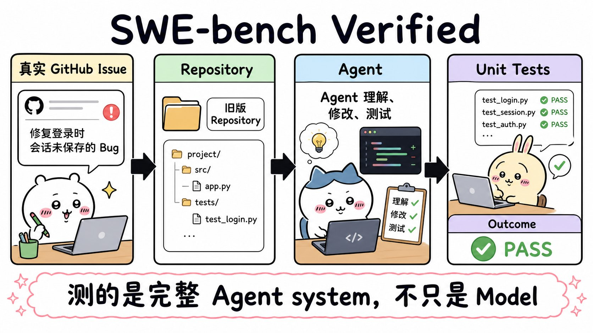
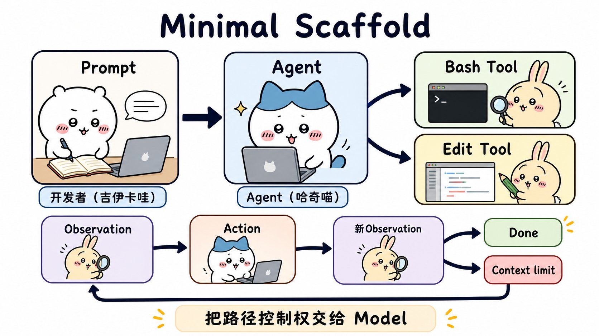
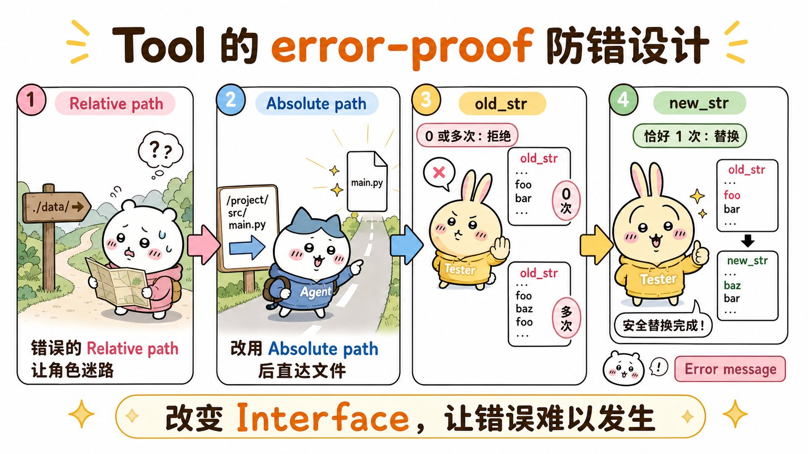
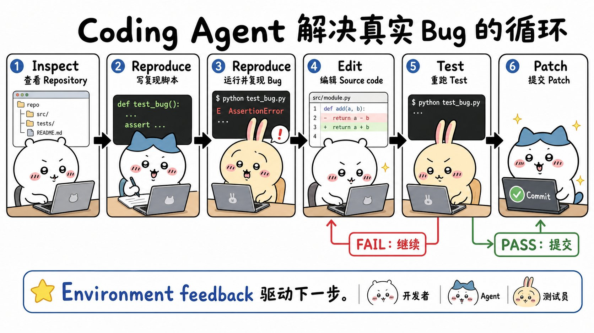
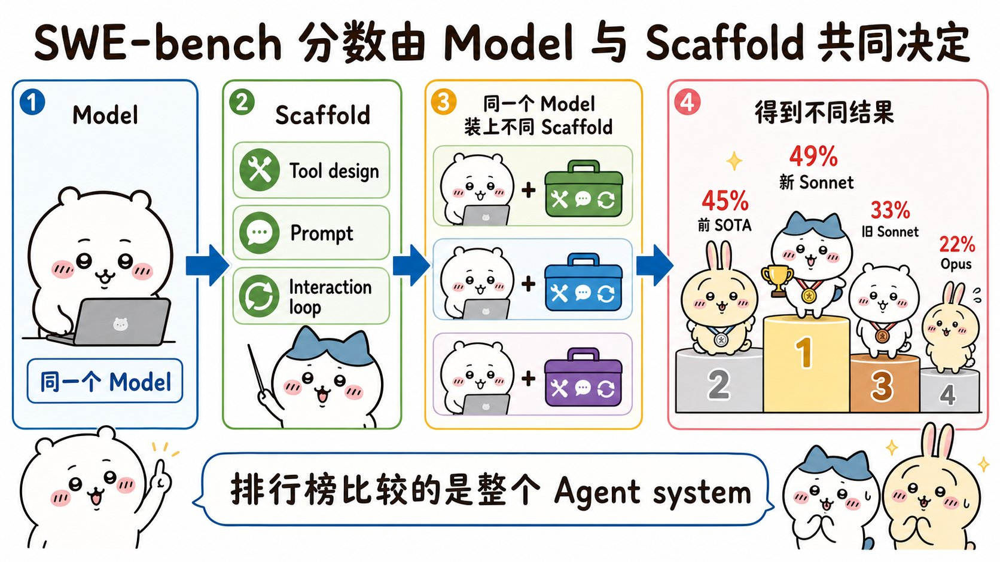

# Raising the bar on SWE-bench Verified with Claude 3.5 Sonnet：面试速记

> Anthropic Engineering · 2025-01-06 · [官方原文](https://www.anthropic.com/engineering/swe-bench-sonnet) · [本地逐句对照](03_swe-bench-sonnet_逐句对照.md)

## 一句话讲明白

**升级版 Claude 3.5 Sonnet 在 SWE-bench Verified 上拿到 49%（此前业界最好成绩 45%），靠的不是复杂的流程编排，而是「一段提示词 + 一个执行命令的 `bash` 工具 + 一个字符串替换式的编辑工具」这套极简脚手架（scaffolding）——把控制权全部交给模型，把工程投入全部押在工具描述与工具接口的防错设计上。**

## 为什么值得读 / 能用在哪

- 这是 Anthropic「极简脚手架 + 精心打磨工具」哲学的**源头文档**，文中公开的两个工具规格（`bash` 和 `str_replace_editor`）就是后来 Claude Code 的雏形。面试聊智能体架构、聊工具设计，这篇是绕不开的引用来源。
- 真实痛点：很多团队一上来就写复杂状态机、硬编码工作流，结果模型能力越强反而被框住。这篇给出的反向答案是——**少写编排，多写工具描述**。
- 自己项目里能直接抄的：绝对路径强制、唯一匹配才替换、工具描述里预先写清所有坑（不能联网、状态跨调用保留、大输出会被截断），这三条几乎可以直接搬到任何自研工具上。
- 附带一份「跑智能体基准会遇到什么麻烦」的诚实清单：成本、评分环境、隐藏测试、多模态缺口。

## 核心要点

### 一、SWE-bench Verified 到底怎么考

- 题目来自**热门开源 Python 仓库的真实 GitHub 议题（issue，即用户报上来的缺陷单）**。模型拿到的是一个配置好的 Python 环境，外加**该议题被解决之前那一刻的仓库副本**。
- 模型必须自己理解代码、修改代码、测试代码，然后提交方案。
- 评分用的是**当初关闭这个议题的那个合并请求（pull request，PR）里的真实单元测试**——本质是在问：你写的补丁，功能上和人类作者写的那份等价吗？
- **Verified 是 500 道题的人工审核子集**。原始 SWE-bench 里有些题不看议题之外的额外上下文根本解不出来（比如要求返回某条特定的报错文本），Verified 把这些剔掉了，所以它是对编码智能体最清晰的度量。
- SWE-bench 之所以流行，原文给了三条理由：① 用真实工程任务，不是竞赛题面试题；② **尚未饱和**——当时还没有任何模型突破 50%；③ **它测的是完整智能体，不是孤立的模型**。

> 记住这句定义：这里的「智能体（agent）」＝ AI 模型 ＋ 围绕它的软件脚手架。脚手架负责生成提示词、解析输出去执行动作、管理交互循环（把上一步动作的结果并进下一轮提示词）。**同一个底层模型，换套脚手架，成绩会有显著差异。**

### 二、极简脚手架：只有三个零件

设计哲学一句话：**把尽可能多的控制权交给语言模型本身，脚手架保持极简。**

三个零件：

1. **一段提示词**——给出建议的解题思路，但不冗长、不过分细致；
2. **`bash` 工具**——执行 bash 命令；
3. **编辑工具 `str_replace_editor`**——查看、创建、编辑文件与目录。

运行方式：**持续采样，直到模型自己认为完成，或者超出 200k 的上下文长度。** 没有硬编码的模式或工作流，模型可以自由决定从哪一步跳到哪一步，**没有严格离散的状态转换**。

提示词里那 5 步建议（值得背下来，这就是编码智能体的通用套路）：

1. 先探索仓库、熟悉结构；
2. **写一个复现脚本**，用 `bash` 工具跑 `python <filename.py>` 确认报错存在；
3. 改仓库源码解决问题；
4. **重跑复现脚本，确认报错已消失**；
5. 想清楚边界情况，确保修复也能覆盖。

提示词还额外交代两件事：测试文件的改动「我已经处理好了，你不用碰任何测试逻辑」；以及 **「你的思考应该充分，很长也没关系」**——原文明说：如果你对 token 消耗不敏感，明确鼓励模型输出长回复是有帮助的。

### 三、真正的工程量在工具描述里

两个工具一简一繁，对照着记最省事：

|        | `bash`                | `str_replace_editor`（编辑工具）                                                         |
| ------ | --------------------- | ---------------------------------------------------------------------------------- |
| 干什么    | 执行 bash 命令            | 查看、创建、编辑文件与目录                                                                      |
| 输入规格   | **只有一个 `command` 字段** | 命令枚举 + `path` + `file_text` / `old_str` / `new_str` / `insert_line` / `view_range` |
| 必填参数   | `command`             | `command` 和 `path`                                                                 |
| 描述里的重点 | 不用转义、不能联网、状态持久、长任务放后台 | 唯一匹配才替换、注意空白字符、路径必须绝对                                                              |

`bash` 工具的**输入规格（schema）简单到只有一个 `command` 字段**，但**描述（description）承担了更重要的分量**，里面预先交代了所有的坑：

- `command` 参数**不需要做 XML 转义**；
- **这个工具不能联网**，但可以通过 `apt` 和 `pip` 访问常见包的镜像；
- **状态跨命令调用持久保留**；
- 想看文件某个行区间，用 `sed -n 10,25p /path/to/the/file`；
- 避免会产生巨量输出的命令；
- **长时间运行的命令请放到后台**（例如 `sleep 10 &`）。

编辑工具复杂得多，一个工具覆盖五个命令：`view`、`create`、`str_replace`、`insert`、`undo_edit`。描述里同样把行为讲死：`view` 对文件等价于 `cat -n`，对目录则**列出两层深度内的非隐藏条目**；`create` 在路径已存在为文件时不可用；输出过长会被截断并标上 `<response clipped>`；`undo_edit` 可以回滚上一次编辑。

原文的态度非常明确：

> 我们针对各种智能体任务，在这些工具的描述和规格上投入了大量精力——**测试出模型可能误解规格的各种情形，再改描述去预先规避**。为模型设计工具接口，应当获得和为人类设计工具界面同等的重视。

**面试可用的判断**：脚手架简单 ≠ 不做设计。这里的设计从「写流程」转移到了「写接口」。

### 四、两个防错（error-proof）设计

原文把提升性能的一个办法直接称为给工具做「防错」设计，两个例子：

1. **强制绝对路径。** 智能体离开根目录之后，模型有时会把相对路径搞错。解法不是在提示词里多写一句警告，而是**让工具始终只接受绝对路径**（规格里写死：`Absolute path to file or directory, e.g. /repo/file.py or /repo`）。
2. **唯一匹配才替换。** 团队试过好几种指定编辑的策略，**可靠性最高的是字符串替换**：模型给出 `old_str`，替换为 `new_str`。**只有当 `old_str` 在文件中恰好匹配一处时替换才执行**；匹配数多于或少于一处，模型会收到对应的报错信息以便重试。描述里还提醒模型：注意空白字符，`old_str` 要带足上下文来保证唯一。

**这两条的共同点：改接口，让错误路径根本走不通，而不是把更多警告堆进提示词。** 而且失败时给的是**可恢复的报错**，模型能据此重试——这本身也是设计的一部分。

### 五、一次真实修复长什么样

运行基准时以 [SWE-Agent](https://swe-agent.com/) 框架为智能体代码的基础；日志里把模型的文本输出、工具调用、工具响应分别渲染成 THOUGHT / ACTION / OBSERVATION——**但并没有把模型约束在固定顺序上**。

文中那个案例是 sklearn 的 `RidgeClassifierCV` 不接受 `store_cv_values` 参数（报 `TypeError`）。模型的动线：

1. 用编辑工具 `view` 看 `/repo` 的目录结构；
2. 用 `create` 写出 `/repo/reproduce_error.py`；
3. 用 `bash` 跑这个脚本，**成功复现同一条 `TypeError`**；
4. 定位到 `RidgeClassifierCV` 的构造函数没有把 `store_cv_values` 透传给父类 `_BaseRidgeCV`；
5. 用 `str_replace` 修改 `/repo/sklearn/linear_model/ridge.py`，重跑脚本验证。

**这个案例模型工作了 12 步就判断可以提交，随后任务的测试成功通过。** 但原文也说：**有些任务要 100 多个回合（turn）**才提交；还有一些任务模型会一直试到耗尽上下文。

对比旧模型，升级版 3.5 Sonnet 的两个可观察差异：**更频繁地自我纠错**，以及**能尝试多种不同解法，而不是卡在原地反复犯同一个错**。

### 六、成绩属于整套系统 + 跑这个基准的四个坑

| 模型 | Claude 3.5 Sonnet（新版） | 此前业界最先进（SOTA） | Claude 3.5 Sonnet（旧版） | Claude 3 Opus |
| --- | --- | --- | --- | --- |
| SWE-bench Verified 得分 | **49%** | 45% | 33% | 22% |

原文的落点是：新模型在推理、编码、数学上更强，**智能体能力也更强；而工具和脚手架的作用，是让这些提升后的能力得到最充分的发挥。**

跑这个基准踩到的四个坑（面试问「评估智能体难在哪」可以直接背）：

1. **耗时长、token 成本高。** 示例是 12 步就完成的顺利案例，但**许多成功运行要数百个回合、消耗超过 10 万 token**。模型很「顽强」，给足时间往往能绕过难关，**但代价昂贵**。
2. **评分。** 检查失败任务时发现，**有些案例模型行为其实是对的**，问题出在环境配置，或者安装补丁被重复应用了两次。这类系统层面的问题不解决，就得不到对智能体性能的准确判断。
3. **隐藏测试。** 模型看不到给它打分的测试，于是经常**「以为」自己成功了而实际失败**。一部分是在错误的抽象层次上解题（打「创可贴」而不是做更深的重构）；另一部分**不太公平**——问题确实解决了，只是和原任务的单元测试对不上。
4. **多模态缺口。** 尽管模型视觉能力出色，团队**没有实现让它查看文件系统里或以链接引用的图片**。这让某些任务（尤其是 Matplotlib 相关的）调试格外困难，也**更容易诱发幻觉**。原文称这是留给开发者的「低垂果实」，并提到 SWE-bench 已推出专注多模态任务的新评估。

## 面试高频问答

**Q：为什么 Anthropic 的脚手架这么简单反而拿了最高分？是不是脚手架越简单越好？**
A：不是「越简单越好」，而是**控制权该放在能力更强的那一侧**。模型已经能自己判断先探索还是先复现，硬编码工作流只会限制它。但省下来的工程量不是消失了，而是**转移到了工具描述和工具接口上**——他们针对各种智能体任务反复测试模型会怎么误解规格，再改描述去预防。所以准确说法是：**编排要薄，工具要厚。**

**Q：你会怎么给智能体设计工具？举个具体的防错例子。**
A：核心原则是**让错误路径在接口层面就走不通，而不是在提示词里加警告**。两个可直接引用的例子：一是**强制绝对路径**——因为智能体切换目录后容易搞错相对路径，索性让工具只接受绝对路径；二是**字符串替换只在 `old_str` 恰好匹配一处时执行**，多于或少于一处就返回可恢复的报错让模型重试，从根上避免误改多个位置。另外工具描述要提前写清「不能联网、状态跨调用保留、大输出会被截断」这类模型必然会踩的坑。

**Q：看到某个模型在 SWE-bench 上刷了高分，你会追问什么？**
A：会先追问**这个分数属于谁**。SWE-bench 测的是「模型 + 脚手架」整套智能体，同一个底层模型换套脚手架成绩可以差很多。所以我会问：用了什么工具接口？提示词里有没有夹带任务提示？智能体能不能自己跑测试并重试？上下文、回合数、token 预算是否对齐？把这些拉齐之前，排行榜名次不能直接当成模型能力的比较。

**Q：编码智能体怎么知道自己改对了？**
A：**靠环境反馈，不靠自我感觉。** 标准动线是先写复现脚本、跑一遍确认报错真实存在，改完代码再跑同一个脚本确认报错消失。这比让模型自述「我修好了」可靠得多。但要清楚这套办法的天花板——SWE-bench 的评分测试对模型是隐藏的，**模型自测通过 ≠ 任务通过**，它可能只是在错误的抽象层次上打了个补丁。

**Q：跑智能体评估和跑单轮评估的区别在哪？**
A：贵、慢、而且失败原因经常不在模型身上。成功的运行常常要数百个回合、十万 token 以上，成本很高；失败案例里有相当一部分是环境配置问题或补丁被重复应用，属于系统工程问题而非模型问题。**所以做智能体评估必须先保证评分环境本身是干净可信的**，否则拿到的数字没有意义。

## 必须记住的 10 句话

1. **升级版 Claude 3.5 Sonnet 在 SWE-bench Verified 上取得 49%，超过此前最先进的 45%；旧版 3.5 Sonnet 33%，Claude 3 Opus 22%。**
2. SWE-bench Verified 是 **500 道**经人工审核确保可解的题，用真实仓库、真实 issue、真实单元测试评分。
3. 智能体 ＝ **模型 ＋ 脚手架**；同一个模型换套脚手架，成绩显著不同。
4. 这套脚手架只有三样东西：**一段提示词、`bash` 工具、编辑工具**；持续采样直到模型自称完成或超出 **200k 上下文**。
5. 设计哲学是**把控制权交给模型**，不把它硬编码进固定工作流。
6. `bash` 工具的输入规格只有一个 `command`，**真正的分量在工具描述里**。
7. 两个招牌防错设计：**强制绝对路径**、**`old_str` 唯一匹配才替换**。
8. 标准修复循环：探索仓库 → 写复现脚本确认报错 → 改源码 → 重跑验证 → 想边界情况。
9. 案例中模型 **12 步**完成；**有些任务超过 100 个回合，成功运行常消耗 10 万 token 以上**。
10. 四个挑战：**成本、评分环境、隐藏测试、多模态缺口**——隐藏测试导致模型经常「以为」自己成功了。

## 30 秒口述版

> 这篇是 Anthropic 极简脚手架哲学的源头。升级版 Claude 3.5 Sonnet 在 SWE-bench Verified 上拿了 49%，超过此前最好的 45%，而它用的智能体只有三个零件：一段提示词、一个执行命令的 `bash` 工具、一个字符串替换式的编辑工具，然后持续采样直到模型自己说完成或者撑满 200k 上下文。关键不在于「简单」，而在于**工程投入从编排流程转移到了工具接口**——他们反复测试模型会怎么误解工具规格，再改描述去预防；典型的防错设计是强制绝对路径，以及只有 `old_str` 在文件里恰好匹配一处时才执行替换，否则返回可恢复的报错让模型重试。模型的实际动线是探索仓库、写复现脚本确认报错、改源码、再重跑验证，靠环境反馈而不是自我感觉推进。文章最后也很诚实地列了跑这个基准的坑：成本高（常常数百回合、十万 token 以上）、评分环境本身会出问题、隐藏测试让模型误判成功、以及没做多模态导致 Matplotlib 类任务难调试。我从这篇拿走的结论是：**编排要薄，工具要厚；而看排行榜时要记住那个分数属于整套系统，不是纯模型能力。**

## 自测

- [ ] 能说清 SWE-bench Verified 的出题与评分流程，以及为什么它是 500 道题的子集。
- [ ] 能解释为什么同一个模型换一套脚手架分数会变，以及「智能体」在这里的准确定义。
- [ ] 能背出脚手架的三个零件，以及采样在什么条件下停止（200k 上下文）。
- [ ] 能举出两个防错工具接口的例子，并说明它们为什么优于在提示词里加警告。
- [ ] 能复述提示词建议的 5 步解题思路，并说明为什么「先写复现脚本」是关键一步。
- [ ] 能复述 49% / 45% / 33% / 22% 分别是谁的成绩。
- [ ] 能说出跑这个基准的四个挑战，尤其是隐藏测试为什么让模型高估自己。
- [ ] 能解释为什么 `bash` 工具的输入规格极简、描述却很长。

> 插图为学习用途的非官方同人式教学图，角色与文章版权归各自权利人。
