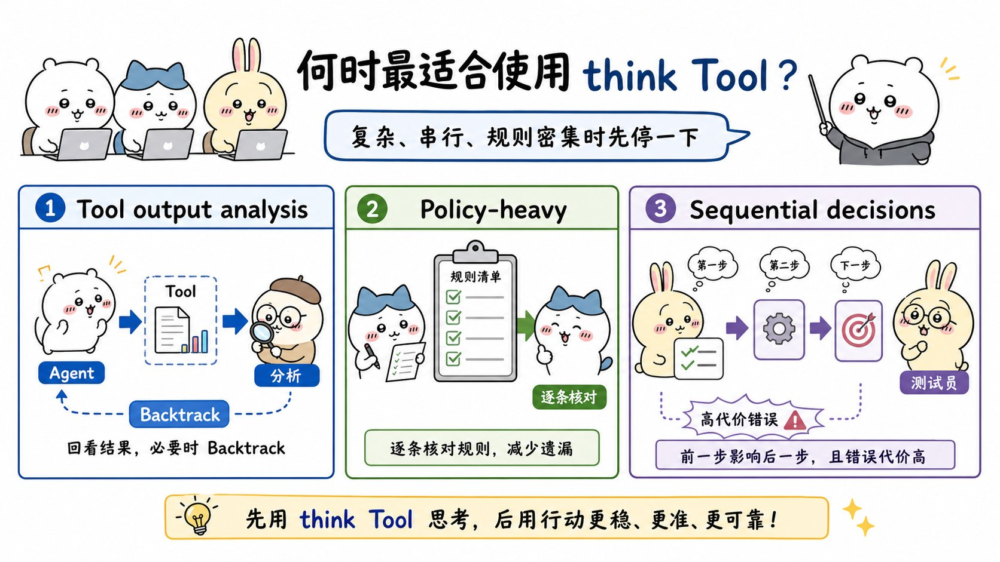
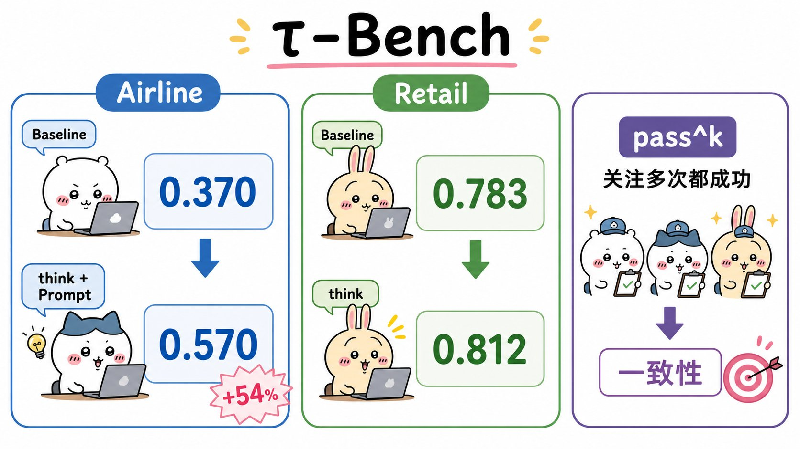

# The "think" tool: Enabling Claude to stop and think in complex tool use situations：面试速记

> Anthropic Engineering · 2025-03-20 · [官方原文](https://www.anthropic.com/engineering/claude-think-tool) · [本地逐句对照](04_claude-think-tool_逐句对照.md)

> ## ⚠️ 先看这条：官方已在原文顶部加了更新说明（2025-12-15）
>
> **自扩展思考（extended thinking）首次发布以来，该能力已有提升，因此官方建议在大多数场景下改用扩展思考，而不是专门的 `think` 工具。** 扩展思考能带来类似的收益——给模型一块空间去推理复杂问题——同时集成度与性能都更好。
>
> **面试时怎么说才不掉分**：先讲这篇文章的方法论（在工具调用之间开一块结构化思考空间，什么场景有用、为什么有用、数字是多少），**然后主动补一句「不过官方 2025-12-15 已经更新了立场，现在多数场景推荐直接用扩展思考，专用 `think` 工具更多是一种在没有扩展思考时可复用的设计思路」**。既证明你读过原文，也证明你在跟进版本变化。下面的全部结论，都要放在这个前提下理解。

## 一句话讲明白

**`think` 是一个「什么也不干」的工具：它不查数据、不改数据库、不动文件，只把模型写的一段思考追加到日志里。它的全部价值在于给智能体（agent）在两次工具调用之间强行插入一次停顿——把刚拿到的工具输出捋一遍、把要遵守的规则逐条列一遍、把下一步计划一遍再动手。在 τ-bench 航空领域，它搭配优化提示词把 `pass^1` 从基线 0.370 拉到 0.570（相对提升 54%）；在 SWE-bench 上单独引入平均提升 1.6%。**

## 为什么值得读 / 能用在哪

- 这是「几乎零实现成本换可靠性」的经典案例：一个工具定义、一个 `thought` 字段，代码量小到可以忽略，却能显著改善长工具链场景的一致性。面试里问「你怎么让智能体少犯低级错误」，这是标准答案之一。
- 真实痛点：智能体拿到工具返回结果后**直接就往下走**——没核对规则、没检查信息是否齐全、发现路走错了也不回头，错误一路累积到最后才爆。
- 自己项目里能直接用：任何**规则细密 + 步骤环环相扣 + 出错代价高**的流程（退改签、风控审批、权限变更、多步部署），都可以在「拿到工具结果之后、执行动作之前」加一道显式的自检。
- 更通用的一课：**光给思考空间不够，还得用领域示例告诉它「该想什么」。** 这条结论在今天用扩展思考、用系统提示词做规划模板时同样成立。

## 核心要点

### 一、`think` 工具是什么：一块不接外部世界的工作台

原文给的工具定义只有一个入参 `thought`（字符串），描述大意是：「用这个工具来思考某件事。它不会获取新信息，也不会改变数据库，只是把这段思考追加到日志里。当需要复杂推理或需要一块临时记忆时使用。」

三个特征要记牢：

- **不获取新信息**——不是搜索、不是检索。
- **不改变环境**——不写库、不改仓库、不产生任何外部状态。
- **除非模型自己决定调用，否则不改变任何外部行为**，也不干扰你已有的工具和工作流。所以原文说它「在性能结果层面几乎没有负面影响」。

SWE-bench 版本的定义改写了描述，更贴合编码场景：探索仓库、定位到缺陷（bug）根因后，用它头脑风暴几种修法并评估哪种最简单有效；或者拿到测试结果后，用它想怎么修掉失败的测试。**这说明工具描述是要按领域改写的，不是照抄。**

### 二、和扩展思考的分工：一个在开口前，一个在开口后

这是这篇最容易被追问的点，两句话说清：

- **扩展思考（extended thinking）发生在生成响应之前**——先深入想、反复打磨计划，再开始行动。
- **`think` 工具发生在已经开始生成响应之后**——插入一步「我是否已经掌握继续推进所需的全部信息」，聚焦模型在过程中**新发现**的信息（尤其是工具返回的结果）。

因此 `think` 的推理**全面程度不如扩展思考**，但时机更靠后、更贴近现场。原文当时给的分工建议：

| 情形 | 用什么 |
| --- | --- |
| 非串行工具调用、直截了当的指令遵循 | 扩展思考 |
| 不需要调用工具的编程 / 数学 / 物理 | 扩展思考 |
| 调用复杂工具、长工具链里要仔细分析工具输出 | `think` 工具 |
| 规则细密的策略密集型环境、出错代价高的串行决策 | `think` 工具 |

**再提醒一次：这张分工表是 2025-03 的结论；按 2025-12-15 的官方更新，多数场景现在直接倒向扩展思考。**

### 三、哪三类场景收益最大

1. **工具输出分析**——需要在行动前仔细处理上一轮工具调用的输出，并且**可能需要回退（backtrack）**调整思路。
2. **策略密集型环境（policy-heavy）**——需要逐条遵循详细指引并核验合规性（客服、金融、权限这类）。
3. **串行决策（sequential decision making）**——每一步都建立在前面各步之上，出错代价高昂，多步骤领域里很常见。

共同特征不是「任务难」这么笼统，而是**智能体必须在两次行动之间做一次结构化检查**。

### 四、τ-bench 的数字：记住这几个就够用

τ-bench（tau-bench）是模拟真实客服场景的基准测试，考三件事：与模拟用户对话、始终如一遵循复杂的客服坐席策略指引、用多种工具访问并操作环境数据库。它的主指标是 `pass^k`——**对给定任务，k 次独立试验全部成功的概率，再在所有任务上取平均**。这和常见的 `pass@k`（k 次里至少成功一次）方向相反，衡量的是**一致性与可靠性**，正是客服场景最看重的品质。

**航空领域（策略复杂）**——`think` + 优化提示词的 `pass^1` 达到 **0.570**，基线只有 **0.370**，**相对提升 54%**。四种配置的逐 k 明细：

| 配置 | k=1 | k=2 | k=3 | k=4 | k=5 |
| --- | --- | --- | --- | --- | --- |
| `think` + 提示词 | 0.584 | 0.444 | 0.384 | 0.356 | 0.340 |
| 仅 `think` | 0.404 | 0.254 | 0.186 | 0.140 | 0.100 |
| 扩展思考 | 0.412 | 0.290 | 0.232 | 0.192 | 0.160 |
| 基线 | 0.332 | 0.206 | 0.148 | 0.116 | 0.100 |

**零售领域（策略明显更简单）**——**只加 `think`、一个字提示词都不加**，`pass^1` 就到 **0.812**，基线 **0.783**；对照组扩展思考是 0.770。

| 配置 | k=1 | k=2 | k=3 | k=4 | k=5 |
| --- | --- | --- | --- | --- | --- |
| `think` + 无提示词 | 0.812 | 0.735 | 0.685 | 0.650 | 0.626 |
| 扩展思考 | 0.770 | 0.681 | 0.623 | 0.581 | 0.548 |
| 基线 | 0.783 | 0.695 | 0.643 | 0.607 | 0.583 |

三条读数要背下来：

- **难领域靠提示词，简单领域靠空间。** 航空领域里「仅 `think`」（0.404）和扩展思考（0.412）差不多，只有加了优化提示词才拉开明显差距；零售领域裸用 `think` 就够。
- **收益一直保持到 k=5**，说明它改善的不只是平均分，还有**边界情况（edge case）和不寻常场景的一致性**。
- **不限于客服。** SWE-bench 上加入类似的 `think` 工具，为 Claude 3.7 Sonnet 拿下 **0.623** 的业界最佳成绩出了力；单独测量该工具的效应为**平均提升 1.6%**（含工具 n=30 个样本，不含 n=144；Welch t 检验：t(38.89)=6.71，p<.001，d=1.47）。
- 脚注还提到：Claude 3.5 Sonnet（新版）在相同配置下同样有增益，说明**这个改进能泛化到其他 Claude 模型**。

### 五、给空间还不够，得教它「怎么想」

原文的两条实现最佳实践：

**1. 用领域特定示例做有策略的提示。** 航空领域那份优化提示词的骨架就四句话：拿到工具结果后、在行动或回复之前，把 `think` 当草稿纸用来——列出适用于当前请求的**具体规则**、检查**必要信息是否收集齐全**、核验计划中的动作**是否符合全部策略**、把**工具结果再过一遍**看对不对。然后配上两个完整的领域示例（取消航班要查哪几条规则、订三张票带行李怎么按会员等级算费用与支付方式限制）。

示例要传达的是这四件事：

- 推理过程期望达到的**细致程度**；
- 如何把复杂指令拆解为**可执行的步骤**；
- 处理常见场景的**决策树（decision tree）**；
- 如何检查**必要信息是否已收集齐全**。

**2. 长而复杂的指引放系统提示词，不要塞进工具描述。** 原文明确说：当指示较长和/或较复杂时，写进**系统提示词（system prompt）**比放在**工具描述（tool description）**里更有效——因为系统提示词提供了更宽广的上下文，能帮模型把思考过程融进整体行为，而不是只在调用那一刻临时看一眼。

### 六、什么时候别用，以及怎么上手

**明确不会带来提升的两类情况：**

1. **非串行工具调用**——只需一次调用，或多次可并行的调用就能完成任务。
2. **简单指令遵循**——需要遵守的约束不多，默认行为已经够好。

**代价是实打实的**：提示词变长、输出 token 增多。所以正确做法不是给所有任务无脑加，而是**在真实评估（eval）里验证它是否改善了结果与一致性**。

**上手三步（对应原文的「快速上手」一节）：**

1. **拿有挑战性的智能体式工具调用场景做测试**——挑那些目前在策略合规、或长工具链复杂推理上表现吃力的用例。
2. **加上按你领域定制的工具定义**，并在系统提示词里写清何时、如何使用，附上领域相关示例。
3. **监控并打磨**——观察它实际怎么用这个工具，反过来调提示词，引导出更有效的思考模式。

## 面试高频问答

**Q：`think` 工具和扩展思考到底该怎么选？**
A：分界线是**时机**：扩展思考在生成响应**之前**深入规划，`think` 在响应已经开始、拿到工具输出**之后**插一步复盘，因此更聚焦新发现的信息，但推理不如扩展思考全面。原文当时的建议是简单/非串行/不调工具的场景用扩展思考，长工具链、策略密集、串行决策用 `think`。**但要补一句：官方 2025-12-15 更新说扩展思考能力已经提升，多数场景现在直接推荐用扩展思考，不必再单开一个 `think` 工具。**

**Q：一个什么都不做的工具，为什么能让分数涨这么多？**
A：因为它把「思考」变成了一个**必须显式发生的步骤**，而不是指望模型自觉。智能体的典型失败是拿到工具结果后立刻行动，没核对规则、没检查信息是否齐全、走错也不回头。停一拍把规则列出来、把信息缺口标出来，就消掉了一大类低级错误。数字上：航空领域 `pass^1` 从 0.370 到 0.570，相对提升 54%。

**Q：`pass^k` 和 `pass@k` 有什么区别，为什么这篇用 `pass^k`？**
A：`pass@k` 是 k 次试验里**至少成功一次**，k 越大越好看；`pass^k` 是 k 次**全部成功**，k 越大越低。客服这类场景要求的是**每一次都遵守策略**，所以必须看 `pass^k`。这篇的关键佐证是：`think` 带来的提升**一直保持到 k=5**，说明它改善的是一致性，不只是平均分。

**Q：我给智能体加了思考空间，效果却没变，可能是什么原因？**
A：大概率是**只给了空间没教它想什么**，而你的领域又偏难。τ-bench 里航空领域仅开 `think` 只有 0.404，和扩展思考的 0.412 差不多，加了带领域示例的优化提示词才到 0.584。而零售领域策略简单，裸用就到 0.812。所以：**领域越复杂，示例越关键**；另外确认指引是写在系统提示词里，而不是全挤在工具描述里。

**Q：什么情况下你会明确否掉这个方案？**
A：单次工具调用能搞定、多次调用彼此独立可以并行、或者约束很少默认行为已经够好——这三类原文明确说没有提升。而它的成本是确定的：提示词变长、输出 token 增多。所以决定权交给评估：在自己的任务集上跑一遍，看结果和一致性有没有真的变好，而不是凭直觉加。

## 必须记住的 8 句话

1. **官方 2025-12-15 更新：多数场景改用扩展思考，不必再单开 `think` 工具**——讲这篇必须带上这句。
2. `think` 只接收一个 `thought` 字段，**不获取新信息、不改变环境**，只往日志里追加一段思考。
3. 时机是关键分界：扩展思考在**生成响应之前**，`think` 在**拿到工具输出之后**，更聚焦新发现的信息。
4. 三类最该用的场景：**工具输出分析、策略密集型环境、串行决策**。
5. 航空领域 `pass^1`：基线 **0.370** → `think` + 优化提示词 **0.570**，**相对提升 54%**；零售领域裸用 `think` 就从 **0.783** 到 **0.812**。
6. **难领域靠提示词，简单领域靠空间**；收益保持到 **k=5**，说明改善的是一致性和边界情况。
7. 长而复杂的指引放**系统提示词**，不要全挤进**工具描述**；示例要覆盖细致程度、步骤拆解、决策树、信息齐全性检查。
8. 不适用：**单次调用、可并行的独立调用、约束很少的简单指令**；代价是提示词变长 + 输出 token 增多，**该不该加由评估说了算**。

## 30 秒口述版

> 这篇讲的是一个极简技巧：给智能体加一个叫 `think` 的工具，它不查数据也不改环境，只把一段思考写进日志——本质是在两次工具调用之间强行插一次停顿，让模型把工具结果捋清楚、把规则逐条核对、把信息缺口找出来，再决定下一步。它和扩展思考的区别是时机：扩展思考在开口前规划，`think` 在拿到工具输出后复盘。最适合三类场景：要仔细分析工具输出并可能回退、策略密集要逐条合规、以及出错代价高的串行决策。数字上，τ-bench 航空领域基线 `pass^1` 是 0.370，配上带领域示例的优化提示词后到 0.570，相对提升 54%；零售领域策略简单，只加工具不加提示词就从 0.783 到 0.812；SWE-bench 上单独引入平均提升 1.6%。两条落地经验：难领域必须给「怎么想」的领域示例，复杂指引要放系统提示词而不是工具描述。不适用的是单次或可并行的调用和约束很少的简单任务，因为它会增加提示词长度和输出 token。**最后必须补一句：官方 2025-12-15 已更新说明，扩展思考能力提升后，多数场景建议直接用扩展思考替代专用的 `think` 工具——这篇的价值现在更多是那套「在行动前做结构化自检」的设计思路。**

## 自测

- [ ] 能一句话说清 `think` 工具和普通动作类工具的区别（不取新信息、不改环境）。
- [ ] 能用「时机」讲清 `think` 与扩展思考的分工，并说出官方 2025-12-15 的更新立场。
- [ ] 能不看笔记列出三类最适合的场景，以及两类明确不适合的场景。
- [ ] 能说出航空领域 0.370 → 0.570（相对 54%）、零售领域 0.783 → 0.812、SWE-bench 平均 1.6% 这几个数。
- [ ] 能解释 `pass^k` 和 `pass@k` 的区别，以及为什么客服场景看 `pass^k`。
- [ ] 能解释为什么复杂指引该放系统提示词而不是工具描述。
- [ ] 能说清「难领域靠提示词、简单领域靠空间」这条结论背后的两组数字。
- [ ] 能给出一个自己项目里值得加这道结构化自检的具体流程，并说明怎么用评估验证它。

> 插图为学习用途的非官方同人式教学图，角色与文章版权归各自权利人。
