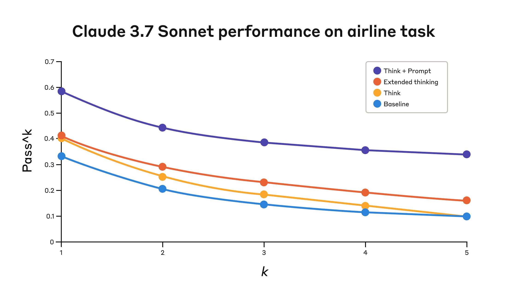
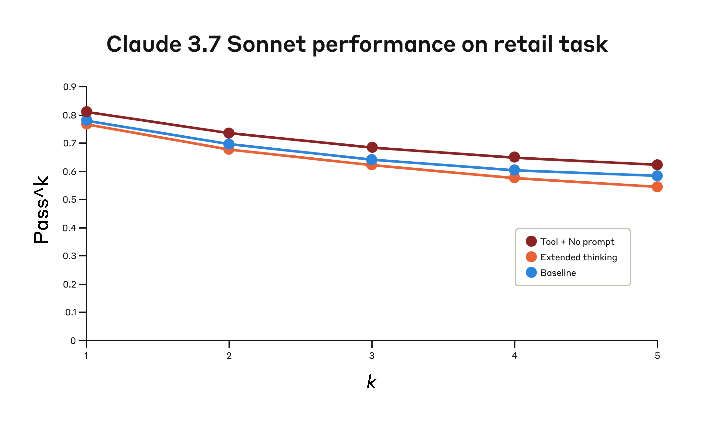

# 04_The "think" tool: Enabling Claude to stop and think in complex tool use situations_"think" 工具：让 Claude 在复杂工具调用场景中停下来思考

> 原文：https://www.anthropic.com/engineering/claude-think-tool
> 作者：Anthropic Engineering｜发布日期：2025-03-20

## 📌 本篇速览

- 📅 2025-03-20　｜　⏱ 约 20 分钟　｜　📄 3,438 词 / 2 图
- ⭐ ★★★★☆ **强烈推荐** —— 以极低实现成本显著提升智能体在长工具链和策略密集场景下的可靠性，是 Agent 工程师常用且面试常考的经典技巧。
- 🏷 think 工具、工具调用、τ-bench、扩展思考、提示词工程
- 🗂 [返回总目录](00_目录与阅读进度.md)

文章介绍了一种极简却有效的 "think" 工具：在长链条工具调用过程中给 Claude 一块专门的结构化思考空间，与生成响应前的扩展思考（extended thinking）互补。在 τ-bench 客服基准上，该工具搭配优化提示词使航空领域 pass^1 相对提升 54%，在 SWE-bench 上也带来平均 1.6% 的显著增益。文章还给出了适用/不适用场景判断与实现最佳实践（如把复杂指引放进系统提示词、提供领域特定思考示例）。

---

> **[更新 2025-12-15] Extended thinking update**
>
> Extended thinking capabilities have improved since its initial release, such that we recommend using that feature instead of a dedicated think tool in most cases. Extended thinking provides similar benefits—giving Claude space to reason through complex problems—with better integration and performance. See our extended thinking documentation for implementation details.

> **[更新 2025-12-15] 关于扩展思考的更新说明**
>
> 自扩展思考（extended thinking）首次发布以来，该能力已有提升，因此在大多数场景下，我们建议改用扩展思考，而不是专门的 think 工具。扩展思考能带来类似的收益——给 Claude 一块空间去推理复杂问题——同时集成度与性能都更好。实现细节请参见我们的扩展思考文档。

As we continue to enhance Claude's complex problem-solving abilities, we've discovered a particularly effective approach: a "think" tool that creates dedicated space for structured thinking during complex tasks.

在持续增强 Claude 复杂问题求解能力的过程中，我们发现了一种特别有效的方法："think" 工具——它为 Claude 在执行复杂任务时开辟出一块专门用于结构化思考（structured thinking）的空间。

This simple yet powerful technique—which, as we'll explain below, is different from Claude's new "[extended thinking](https://www.anthropic.com/research/visible-extended-thinking)" capability (see here for [extended thinking implementation details](https://platform.claude.com/docs/en/build-with-claude/extended-thinking))—has resulted in remarkable improvements in Claude's agentic tool use ability.

这个简单却强大的技巧——正如下文将要解释的，它不同于 Claude 新推出的"扩展思考（extended thinking）"能力（实现细节参见文档）——为 Claude 的智能体式工具调用（agentic tool use）能力带来了显著提升。

This includes following policies, making consistent decisions, and handling multi-step problems, all with minimal implementation overhead.

这些提升涵盖遵循策略（policy）、做出一致的决策、处理多步骤问题，而且实现开销极小。

In this post, we'll explore how to implement the "think" tool on different applications, sharing practical guidance for developers based on verified benchmark results.

在本文中，我们将探讨如何在不同应用中实现 "think" 工具，并基于经过验证的基准测试（benchmark）结果，为开发者分享实用指导。

### What is the "think" tool?｜什么是 "think" 工具？

With the "think" tool, we're giving Claude the ability to include an additional thinking step—complete with its own designated space—as part of getting to its final answer.

通过 "think" 工具，我们让 Claude 能够在得出最终答案的过程中，插入一个额外的思考步骤——而且这个步骤拥有自己专属的空间。

While it sounds similar to extended thinking, it's a different concept.

虽然它听起来和扩展思考很像，但两者是不同的概念。

Extended thinking is all about what Claude does before it starts generating a response.

扩展思考关注的是 Claude 在开始生成响应之前所做的事情。

With extended thinking, Claude deeply considers and iterates on its plan before taking action.

借助扩展思考，Claude 会在采取行动之前深入考虑并反复打磨自己的计划。

The "think" tool is for Claude, once it starts generating a response, to add a step to stop and think about whether it has all the information it needs to move forward.

而 "think" 工具则是让 Claude 在已经开始生成响应之后，加入一个步骤，停下来想一想：自己是否已经掌握了继续推进所需的全部信息。

This is particularly helpful when performing long chains of tool calls or in long multi-step conversations with the user.

这在执行长链条的工具调用、或与用户进行冗长的多步骤对话时尤其有用。

This makes the "think" tool more suitable for cases where Claude does not have all the information needed to formulate its response from the user query alone, and where it needs to process external information (e.g. information in tool call results).

因此，"think" 工具更适合这样的场景：仅凭用户查询本身，Claude 尚不具备组织响应所需的全部信息，而是需要处理外部信息（例如工具调用结果中的信息）。

The reasoning Claude performs with the "think" tool is less comprehensive than what can be obtained with extended thinking, and is more focused on *new* information that the model discovers.

Claude 借助 "think" 工具进行的推理，其全面程度不如扩展思考所能达到的水平，而是更聚焦于模型在过程中发现的*新*信息。

We recommend using extended thinking for simpler tool use scenarios like non-sequential tool calls or straightforward instruction following.

我们建议在较简单的工具使用场景中采用扩展思考，比如非串行的工具调用（non-sequential tool calls）或直截了当的指令遵循。

Extended thinking is also useful for use cases, like coding, math, and physics, when you don't need Claude to call tools.

在不需要 Claude 调用工具的用例中——比如编程、数学和物理——扩展思考同样很有用。

The "think" tool is better suited for when Claude needs to call complex tools, analyze tool outputs carefully in long chains of tool calls, navigate policy-heavy environments with detailed guidelines, or make sequential decisions where each step builds on previous ones and mistakes are costly.

而 "think" 工具更适合以下情形：Claude 需要调用复杂的工具、需要在长链条工具调用中仔细分析工具输出、需要在规则细密的策略密集型（policy-heavy）环境中行事，或者需要做出环环相扣的串行决策（sequential decisions）——每一步都建立在前面各步之上，出错代价高昂。

Here's a sample implementation using the standard tool specification format that comes from [τ-Bench](https://arxiv.org/abs/2406.12045):

下面是一个示例实现，采用了来自 τ-Bench 的标准工具规格（tool specification）格式：

```
{
  "name": "think",
  "description": "Use the tool to think about something. It will not obtain new information or change the database, but just append the thought to the log. Use it when complex reasoning or some cache memory is needed.",
  "input_schema": {
    "type": "object",
    "properties": {
      "thought": {
        "type": "string",
        "description": "A thought to think about."
      }
    },
    "required": ["thought"]
  }
}
```

### Performance on τ-Bench｜在 τ-Bench 上的性能

We evaluated the "think" tool using τ-bench (tau-bench), a comprehensive benchmark designed to test a model's ability to use tools in realistic customer service scenarios, where the "think" tool is part of the evaluation's standard environment.

我们使用 τ-bench（tau-bench）评估了 "think" 工具。τ-bench 是一个全面的基准测试，旨在测试模型在贴近真实的客服场景中使用工具的能力，而 "think" 工具本身就是该评估标准环境的一部分。

τ-bench evaluates Claude's ability to:

τ-bench 评估 Claude 的以下能力：

- Navigate realistic conversations with simulated users

- 与模拟用户展开贴近真实的对话

- Follow complex customer service agent policy guidelines consistently

- 始终如一地遵循复杂的客服坐席策略指引

- Use a variety of tools to access and manipulate the environment database

- 使用多种工具访问并操作环境数据库

The primary evaluation metric used in τ-bench is pass^*k*, which measures the probability that all *k* independent task trials are successful for a given task, averaged across all tasks.

τ-bench 使用的主要评估指标是 pass^*k*：它衡量对于给定任务，全部 *k* 次独立任务试验都成功的概率，并在所有任务上取平均。

Unlike the pass@*k* metric that is common for other LLM evaluations (which measures if at least one of *k* trials succeeds), pass^*k* evaluates consistency and reliability—critical qualities for customer service applications where consistent adherence to policies is essential.

与其他 LLM 评估中常见的 pass@*k* 指标（衡量 *k* 次试验中是否至少有一次成功）不同，pass^*k* 评估的是一致性与可靠性——对于必须始终如一遵守策略的客服应用而言，这是至关重要的品质。

#### Performance Analysis｜性能分析

Our evaluation compared several different configurations:

我们的评估比较了几种不同的配置：

1. Baseline (no "think" tool, no extended thinking mode)

1. 基线（Baseline，无 "think" 工具，也不开扩展思考模式）

2. Extended thinking mode alone

2. 仅扩展思考模式

3. "Think" tool alone

3. 仅 "think" 工具

4. "Think" tool with optimized prompt (for airline domain)

4. "think" 工具搭配优化提示词（针对航空领域）

The results showed dramatic improvements when Claude 3.7 effectively used the "think" tool in both the "airline" and "retail" customer service domains of the benchmark:

结果显示，在该基准的"航空（airline）"与"零售（retail）"两个客服领域中，当 Claude 3.7 有效使用 "think" 工具时都取得了显著提升：

- **Airline domain**: The "think" tool with an optimized prompt achieved 0.570 on the pass^1 metric, compared to just 0.370 for the baseline—a 54% relative improvement;

- **航空领域**："think" 工具搭配优化提示词在 pass^1 指标上达到 0.570，而基线仅为 0.370——相对提升 54%；

- **Retail domain**: The "think" tool alone achieves 0.812, compared to 0.783 for the baseline.

- **零售领域**：仅使用 "think" 工具即可达到 0.812，基线则为 0.783。



*Claude 3.7 Sonnet's performance on the "airline" domain of the Tau-Bench eval under four different configurations.*

*图注：Claude 3.7 Sonnet 在 Tau-Bench 评估"airline"（航空）领域中、四种不同配置下的性能表现。*

| Configuration | *k*=1 | *k*=2 | *k*=3 | *k*=4 | *k*=5 |
|---|---|---|---|---|---|
| "Think" + Prompt | 0.584 | 0.444 | 0.384 | 0.356 | 0.340 |
| "Think" | 0.404 | 0.254 | 0.186 | 0.140 | 0.100 |
| Extended thinking | 0.412 | 0.290 | 0.232 | 0.192 | 0.160 |
| Baseline | 0.332 | 0.206 | 0.148 | 0.116 | 0.100 |

| 配置 | *k*=1 | *k*=2 | *k*=3 | *k*=4 | *k*=5 |
|---|---|---|---|---|---|
| "Think" + 提示词 | 0.584 | 0.444 | 0.384 | 0.356 | 0.340 |
| 仅 "Think" | 0.404 | 0.254 | 0.186 | 0.140 | 0.100 |
| 扩展思考 | 0.412 | 0.290 | 0.232 | 0.192 | 0.160 |
| 基线 | 0.332 | 0.206 | 0.148 | 0.116 | 0.100 |

The best performance in the airline domain was achieved by pairing the "think" tool with an optimized prompt that gives examples of the type of reasoning approaches to use when analyzing customer requests.

在航空领域，最佳性能来自把 "think" 工具与一个优化过的提示词搭配使用——该提示词给出了在分析客户请求时应采用哪类推理方式的示例。

Below is an example of the optimized prompt:

下面是该优化提示词的一个示例：

```
## Using the think tool

Before taking any action or responding to the user after receiving tool results, use the think tool as a scratchpad to:
- List the specific rules that apply to the current request
- Check if all required information is collected
- Verify that the planned action complies with all policies
- Iterate over tool results for correctness 

Here are some examples of what to iterate over inside the think tool:
<think_tool_example_1>
User wants to cancel flight ABC123
- Need to verify: user ID, reservation ID, reason
- Check cancellation rules:
  * Is it within 24h of booking?
  * If not, check ticket class and insurance
- Verify no segments flown or are in the past
- Plan: collect missing info, verify rules, get confirmation
</think_tool_example_1>

<think_tool_example_2>
User wants to book 3 tickets to NYC with 2 checked bags each
- Need user ID to check:
  * Membership tier for baggage allowance
  * Which payments methods exist in profile
- Baggage calculation:
  * Economy class × 3 passengers
  * If regular member: 1 free bag each → 3 extra bags = $150
  * If silver member: 2 free bags each → 0 extra bags = $0
  * If gold member: 3 free bags each → 0 extra bags = $0
- Payment rules to verify:
  * Max 1 travel certificate, 1 credit card, 3 gift cards
  * All payment methods must be in profile
  * Travel certificate remainder goes to waste
- Plan:
1. Get user ID
2. Verify membership level for bag fees
3. Check which payment methods in profile and if their combination is allowed
4. Calculate total: ticket price + any bag fees
5. Get explicit confirmation for booking
</think_tool_example_2>
```

What's particularly interesting is how the different approaches compared.

特别有意思的是各种方法之间的对比。

Using the "think" tool with the optimized prompt achieved significantly better results over extended thinking mode (which showed similar performance to the unprompted "think" tool).

"think" 工具搭配优化提示词的效果显著优于扩展思考模式（后者的表现与不加提示词的 "think" 工具相近）。

Using the "think" tool alone (without prompting) improved performance over baseline, but still fell short of the optimized approach.

仅使用 "think" 工具（不加提示词）虽然比基线有所提升，但仍不及优化后的方案。

The combination of the "think" tool with optimized prompting delivered the strongest performance by a significant margin, likely due to the high complexity of the [airline policy](https://github.com/sierra-research/tau-bench/blob/main/tau_bench/envs/airline/wiki.md) part of the benchmark, where the model benefitted the most from being given examples of how to "think."

"think" 工具与优化提示词的组合以明显优势取得了最强性能，这很可能是因为该基准中的航空策略（airline policy）部分复杂度很高——在这样的场景里，给模型提供"如何思考"的示例带来的收益最大。

In the retail domain, we also tested various configurations to understand the specific impact of each approach

在零售领域，我们同样测试了多种配置，以了解每种方法的具体影响。



*Performance of Claude 3.7 Sonnet on the "retail" domain of the Tau-Bench eval under three different configurations.*

*图注：Claude 3.7 Sonnet 在 Tau-Bench 评估"retail"（零售）领域中、三种不同配置下的性能表现。*

| Configuration | *k*=1 | *k*=2 | *k*=3 | *k*=4 | *k*=5 |
|---|---|---|---|---|---|
| "Think" + no prompt | 0.812 | 0.735 | 0.685 | 0.650 | 0.626 |
| Extended thinking | 0.770 | 0.681 | 0.623 | 0.581 | 0.548 |
| Baseline | 0.783 | 0.695 | 0.643 | 0.607 | 0.583 |

| 配置 | *k*=1 | *k*=2 | *k*=3 | *k*=4 | *k*=5 |
|---|---|---|---|---|---|
| "Think" + 无提示词 | 0.812 | 0.735 | 0.685 | 0.650 | 0.626 |
| 扩展思考 | 0.770 | 0.681 | 0.623 | 0.581 | 0.548 |
| 基线 | 0.783 | 0.695 | 0.643 | 0.607 | 0.583 |

The "think" tool achieved the highest pass^1 score of 0.812 even without additional prompting.

即便没有额外的提示词，"think" 工具也取得了 0.812 的最高 pass^1 分数。

The [retail policy](https://github.com/sierra-research/tau-bench/blob/main/tau_bench/envs/retail/wiki.md) is noticeably easier to navigate compared to the airline domain, and Claude was able to improve just by having a space to think without further guidance.

与航空领域相比，零售策略（retail policy）明显更容易应对，Claude 只要拥有一块思考空间、无需更多指导就能获得提升。

#### Key Insights from τ-Bench Analysis｜来自 τ-Bench 分析的关键洞察

Our detailed analysis revealed several patterns that can help you implement the "think" tool effectively:

我们的详细分析揭示了几条模式，可以帮助你更有效地落地 "think" 工具：

1. **Prompting matters significantly on difficult domains**. Simply making the "think" tool available might improve performance somewhat, but pairing it with optimized prompting yielded dramatically better results for difficult domains. However, easier domains may benefit from simply having access to "think."

1. **在困难领域，提示词的作用举足轻重**。仅仅让 "think" 工具可用或许能带来一定提升，但在困难领域，把它与优化提示词搭配使用能取得好得多的结果。不过，较简单的领域可能只需要能用上 "think" 就足以受益。

2. **Improved consistency across trials**. The improvements from using "think" were maintained for pass^k up to k=5, indicating that the tool helped Claude handle edge cases and unusual scenarios more effectively.

2. **多次试验间的一致性得到改善**。使用 "think" 带来的提升在 pass^k 指标上一直保持到 k=5，表明该工具帮助 Claude 更有效地处理了边界情况（edge case）和不寻常的场景。

### Performance on SWE-Bench｜在 SWE-Bench 上的性能

A similar "think" tool was added to our SWE-bench setup when evaluating Claude 3.7 Sonnet, contributing to the achieved state-of-the-art score of 0.623.

在评估 Claude 3.7 Sonnet 时，我们在 SWE-bench 环境中也加入了一个类似的 "think" 工具，为最终取得 0.623 的业界最佳（state-of-the-art）成绩出了一份力。

The adapted "think" tool definition is given below:

适配后的 "think" 工具定义如下：

```
{
  "name": "think",
  "description": "Use the tool to think about something. It will not obtain new information or make any changes to the repository, but just log the thought. Use it when complex reasoning or brainstorming is needed. For example, if you explore the repo and discover the source of a bug, call this tool to brainstorm several unique ways of fixing the bug, and assess which change(s) are likely to be simplest and most effective. Alternatively, if you receive some test results, call this tool to brainstorm ways to fix the failing tests.",
  "input_schema": {
    "type": "object",
    "properties": {
      "thought": {
        "type": "string",
        "description": "Your thoughts."
      }
    },
    "required": ["thought"]
  }
}
```

Our experiments (*n*=30 samples with "think" tool, *n*=144 samples without) showed the isolated effects of including this tool improved performance by 1.6% on average (Welch's *t*-test: *t*(38.89) = 6.71, *p* < .001, *d* = 1.47).

我们的实验（含 "think" 工具 *n*=30 个样本，不含该工具 *n*=144 个样本）表明，单独引入这一工具平均带来 1.6% 的性能提升（Welch *t* 检验：*t*(38.89) = 6.71，*p* < .001，*d* = 1.47）。

### When to use the "think" tool｜何时该使用 "think" 工具

Based on these evaluation results, we've identified specific scenarios where Claude benefits most from the "think" tool:

基于这些评估结果，我们总结出 Claude 从 "think" 工具中获益最大的几类具体场景：

1. **Tool output analysis.** When Claude needs to carefully process the output of previous tool calls before acting and might need to backtrack in its approach;

1. **工具输出分析。**当 Claude 需要在行动之前仔细处理先前工具调用的输出、并且可能需要回退（backtrack）调整思路时；

2. **Policy-heavy environments**. When Claude needs to follow detailed guidelines and verify compliance; and

2. **策略密集型环境**。当 Claude 需要遵循详细的指引并核验合规性时；以及

3. **Sequential decision making**. When each action builds on previous ones and mistakes are costly (often found in multi-step domains).

3. **串行决策**。当每一步行动都建立在之前的行动之上、出错代价高昂时（这在多步骤领域中很常见）。

## Implementation best practices｜实现最佳实践

To get the most out of the "think" tool with Claude, we recommend the following implementation practices based on our τ-bench experiments.

为了让 Claude 把 "think" 工具的价值发挥到最大，我们基于 τ-bench 实验推荐以下实现做法。

#### 1. Strategic prompting with domain-specific examples｜1. 用领域特定示例做有策略的提示

The most effective approach is to provide clear instructions on when and how to use the "think" tool, such as the one used for the τ-bench airline domain.

最有效的方法是就何时、如何使用 "think" 工具给出清晰的指示，比如 τ-bench 航空领域所用的那份提示词。

Providing examples tailored to your specific use case significantly improves how effectively the model uses the "think" tool:

提供针对你具体用例量身定制的示例，能显著改善模型使用 "think" 工具的效果：

- The level of detail expected in the reasoning process;

- 推理过程中期望达到的细致程度；

- How to break down complex instructions into actionable steps;

- 如何把复杂指令拆解为可执行的步骤；

- Decision trees for handling common scenarios; and

- 处理常见场景的决策树（decision tree）；以及

- How to check if all necessary information has been collected.

- 如何检查是否已收集齐所有必要信息。

#### 2. Place complex guidance in the system prompt｜2. 把复杂指引放进系统提示词

We found that, when they were long and/or complex, including instructions about the "think" tool in the system prompt was more effective than placing them in the tool description itself.

我们发现，当关于 "think" 工具的指示较长和/或较复杂时，把它们写进系统提示词（system prompt）比放在工具描述（tool description）里更有效。

This approach provides broader context and helps the model better integrate the thinking process into its overall behavior.

这种做法提供了更宽广的上下文，有助于模型把思考过程更好地融入其整体行为之中。

### When *not* to use the "think" tool｜何时*不该*使用 "think" 工具

Whereas the "think" tool can offer substantial improvements, it is not applicable to all tool use use cases, and does come at the cost of increased prompt length and output tokens.

尽管 "think" 工具能带来可观的提升，但它并不适用于所有工具使用场景，而且确实要付出提示词变长、输出 token 增多的代价。

Specifically, we have found the "think" tool does not offer any improvements in the following use cases:

具体来说，我们发现 "think" 工具在以下用例中不会带来任何提升：

1. **Non-sequential tool calls**. If Claude only needs to make a single tool call or multiple parallel calls to complete a task, there is unlikely to be any improvements from adding in "think."

1. **非串行工具调用**。如果 Claude 只需一次工具调用、或多次并行调用就能完成任务，那么加入 "think" 大概率不会带来任何提升。

2. **Simple instruction following**. When there are not many constraints to which Claude needs to adhere, and its default behaviour is good enough, there are unlikely to be gains from additional "think"-ing.

2. **简单指令遵循**。当 Claude 需要遵守的约束不多、其默认行为已经足够好时，额外的 "think" 式思考也不太可能带来收益。

### Getting started｜快速上手

The "think" tool is a straightforward addition to your Claude implementation that can yield meaningful improvements in just a few steps:

"think" 工具是对你的 Claude 实现的一个简单直接的补充，只需几步就能带来实实在在的提升：

1. **Test with agentic tool use scenarios.** Start with challenging use cases—ones where Claude currently struggles with policy compliance or complex reasoning in long tool call chains.

1. **用智能体式工具调用场景做测试。**从有挑战性的用例入手——即 Claude 目前在策略合规、或长工具调用链中的复杂推理上表现吃力的那些场景。

2. **Add the tool definition**. Implement a "think" tool customized to your domain. It requires minimal code but enables more structured reasoning. Also consider including instructions on when and how to use the tool, with examples relevant to your domain to the system prompt.

2. **添加工具定义**。实现一个针对你所在领域定制的 "think" 工具。它需要的代码极少，却能启用更结构化的推理。另外可以考虑在系统提示词中加入关于何时、如何使用该工具的指示，并附上与你领域相关的示例。

3. **Monitor and refine**. Watch how Claude uses the tool in practice, and adjust your prompts to encourage more effective thinking patterns.

3. **监控并打磨**。观察 Claude 在实践中如何使用该工具，并调整你的提示词，引导出更有效的思考模式。

The best part is that adding this tool has minimal downside in terms of performance outcomes.

最妙的是，添加这个工具在性能结果层面几乎没有负面影响。

It doesn't change external behavior unless Claude decides to use it, and doesn't interfere with your existing tools or workflows.

除非 Claude 决定使用它，否则它不会改变外部行为，也不会干扰你现有的工具或工作流。

### Conclusion｜结语

Our research has demonstrated that the "think" tool can significantly enhance Claude 3.7 Sonnet's performance[^1] on complex tasks requiring policy adherence and reasoning in long chains of tool calls.

我们的研究表明，在需要遵循策略、并在长链条工具调用中进行推理的复杂任务上，"think" 工具能显著增强 Claude 3.7 Sonnet 的性能[^1]。

"Think" is not a one-size-fits-all solution, but it offers substantial benefits for the correct use cases, all with minimal implementation complexity.

"think" 并非放之四海而皆准的方案，但在对的用例上，它能以极低的实现复杂度带来可观的收益。

We look forward to seeing how you'll use the "think" tool to build more capable, reliable, and transparent AI systems with Claude.

我们期待看到你如何借助 "think" 工具，用 Claude 构建更强大、更可靠、更透明的 AI 系统。

[^1]: While our τ-Bench results focused on the improvement of Claude 3.7 Sonnet with the "think" tool, our experiments show Claude 3.5 Sonnet (New) is also able to achieve performance gains with the same configuration as 3.7 Sonnet, indicating that this improvement generalizes to other Claude models as well.

    脚注：尽管我们的 τ-Bench 结果聚焦于 "think" 工具给 Claude 3.7 Sonnet 带来的提升，但我们的实验显示，Claude 3.5 Sonnet（新版）在与 3.7 Sonnet 相同的配置下同样能获得性能增益，这表明该改进也能泛化到其他 Claude 模型。
