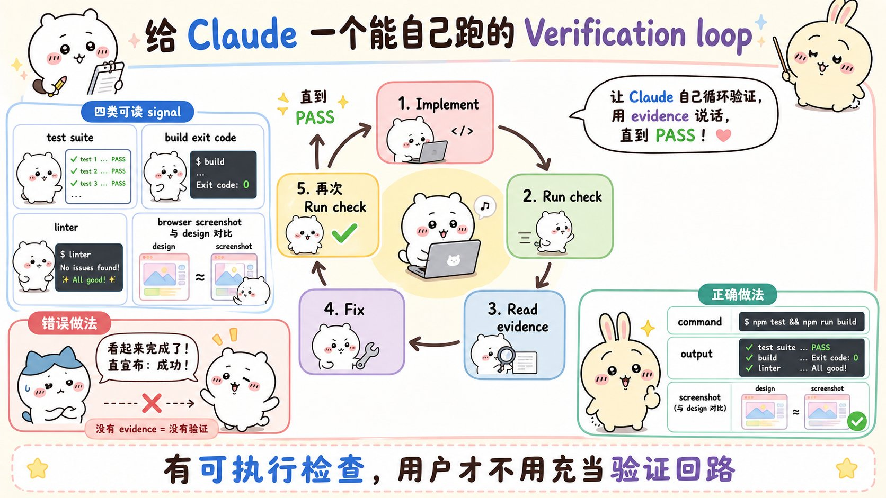

# Claude Code: Best practices for agentic coding：面试速记

> 2025-04-18 · Anthropic Engineering · [官方原文](https://www.anthropic.com/engineering/claude-code-best-practices) · [本地逐句对照](05_claude-code-best-practices_逐句对照.md)
> （原博客已并入 Claude Code 官方文档并持续更新，本地对照版为 2026-08 抓取的最新版）

## 一句话讲明白

**这篇文章的所有建议，都只从一条约束里长出来：Claude 的上下文窗口（context window）填得很快，而它越满，模型表现越差。所以真正的功夫不在"把提示词写长"，而在四件事——省着用上下文、给它一个自己能跑的检查、先探索再规划最后编码、把读文件这种脏活扔给子智能体（subagent）。**

## 为什么值得读 / 能用在哪

- 这是 Anthropic 内部团队跨多种代码库、语言、环境验证过的实操模式，不是宣传稿。面试里问"你怎么用编码智能体"，答不到"上下文预算"和"验证闭环"这两层，就是外行话。
- 文章里的每一条其实都能平移到你自己写的智能体上：上下文预算管理、可执行的验收信号、探索与执行分离、把调研隔离到子上下文——这四条是通用的智能体工程原则，不是 Claude Code 专属技巧。
- 最后一节"常见失败模式"是面试里最好用的素材：能说出自己踩过哪个坑、怎么修的，比背概念可信得多。

## 核心要点

### 1. 它是智能体式编码环境，不是聊天机器人

聊天机器人回答完就干等着；Claude Code 会**读你的文件、运行命令、修改代码、自主推进问题的解决**——你可以在旁边看着、随时纠偏，也可以完全走开。

这件事改变了协作方式：你不再是自己写代码、再让它来审查，而是**描述你想要什么，由它去探索、规划并实现**。

代价是有一条学习曲线：它是在一组你必须了解的约束下工作的。原文的原话是——大多数最佳实践都源自同一个约束。

### 2. 一切的源头：上下文窗口是有限预算

上下文窗口里装着**整段对话**：每一条消息、它读过的每一个文件、每一条命令的输出。

- **一次调试会话或一次代码库探索，就可能消耗数万 token。**
- 大语言模型的表现会随上下文被填满而下降：**接近饱和时，它开始"忘记"先前的指令，或者犯更多错误。**
- 结论：**上下文窗口是最需要用心管理的资源。** 这是质量问题，不只是成本问题。

实用手段：用自定义状态栏（status line）持续盯 token 用量；不相关任务之间 `/clear`；接近上限时自动压缩（compact）会保留代码模式、文件状态和关键决策；想更可控就 `/compact <指令>`，比如 `/compact Focus on the API changes`；临时小问题用 `/btw`，答案显示在可关闭的浮层里，**永远不进对话历史**。

### 3. 给它一个自己能跑的检查（本文最值钱的一条）

**Claude 会在工作"看起来完成了"的时候停下来。** 如果没有一个它自己能运行的检查，"看起来完成了"就是唯一信号——**那个验证环节就变成了你**，每个错误都得等你亲自发现。

给它一个能产出"通过/失败"的东西，循环就自行闭合：**干活 → 跑检查 → 读结果 → 迭代，直到通过。**

检查可以是任何能在对话里返回可读信号的东西：一套测试、构建的退出码、一个静态检查器（linter）、一个把输出与基准数据（fixture）做差异比对（diff）的脚本，或一张与设计稿比对的浏览器截图。

原文给的三组"改写前 / 改写后"：

| 策略 | 改写前 | 改写后 |
| --- | --- | --- |
| 提供验证标准 | 「实现一个校验邮箱地址的函数」 | 「写一个 `validateEmail` 函数。示例用例：`user@example.com` 为真，`invalid` 为假，`user@.com` 为假。**实现完成后把这些测试跑一遍**」 |
| 用可视化方式验证界面改动 | 「把仪表盘弄好看点」 | 「[粘贴截图] 实现这个设计。**对结果截图并与原图比对，列出差异并修复**」 |
| 解决根因而非症状 | 「构建失败了」 | 「构建失败并报出这个错误：[粘贴错误]。修复它并**验证构建成功。要解决根本原因，不要把错误压掉**」 |

还有一条纪律：**让它出示证据，而不是口头宣称成功**——测试输出、它跑的命令及返回、结果截图。审查证据比你自己把验证重跑一遍更快，而且**对你没盯着的会话同样有效**。

### 4. 检查有四级强度：用配置成本换人工盯守

检查一旦就位，接下来定"它对何时停止把关有多严"。从轻到重：

1. **写在单条提示词里** —— 同一条消息里要求它跑检查并迭代。今天就能用在任何任务上。
2. **`/goal` 条件** —— 贯穿整个会话。**每个回合结束后由一个独立评估器重新校验**，条件不成立就继续干。
3. **Stop hook** —— 确定性闸门，把检查当脚本跑，不通过就阻止回合结束。**注意上限：连续被阻塞 8 次后，Claude Code 会越过该 hook 并结束回合。**
4. **第二意见** —— 用验证子智能体或会复核自身结论的动态工作流，**让一个全新的模型尝试推翻结果**，这样干活的智能体就不是给自己打分的那一个。

**每往上一级，都是在用更多前期配置换取更少的人工盯守。** 提示词版本随手可用；`/goal` 和 Stop hook 才是让**无人值守的运行在没有你的情况下也能正确收尾**的关键。

### 5. 先探索 → 再规划 → 然后写代码 → 提交

直接上手写代码，容易产出"**解错了题**"的代码。用规划模式（plan mode）把探索与执行分开，四个阶段：

- **探索（Explore）**：进规划模式，**只读不改**。例如"读 `/src/auth`，搞清楚我们怎么处理会话和登录，另外看看密钥的环境变量是怎么管的"。
- **规划（Plan）**：让它出一份详细实现计划——要改哪些文件、会话流程是什么。**按 `Ctrl+G` 可以把计划在你的编辑器里打开，动手改完再让它继续。**
- **实现（Implement）**：退出规划模式，对照计划写代码，**写测试、跑测试套件、修掉失败**。
- **提交（Commit）**：用一条描述清晰的提交信息完成提交，并开 PR（pull request）。

**但规划模式本身也有开销。** 范围明确、改动很小的（改拼写、加一行日志、重命名变量）直接让它做。规划最有用的三种时候：**你对方案没把握、改动涉及多个文件、你对要改的代码不熟**。原文给了一句可以直接背的判据：

> **如果你能用一句话把这个 diff 描述清楚，那就跳过规划。**

### 6. 提示词要具体：四种把话说清楚的方式

**它能推断意图，但读不了你的心。** 要引用具体文件、说明约束、指出可参照的范例。

- **框定范围**：不是"给 `foo.py` 加测试"，而是"给 `foo.py` 写测试，**覆盖用户已登出这个边界情况，不要用替身桩（mock）**"。
- **指向信息来源**：不是"这个 api 为什么这么奇怪"，而是"**翻一遍 `ExecutionFactory` 的 git 历史**，总结它的 api 是怎么演变的"。
- **参照已有模式**：不是"加个日历组件"，而是"看看首页现有组件怎么实现的，`HotDogWidget.php` 是个好例子，**按同样的模式**实现……**除了代码库已用到的库不要引入其他库**"。
- **描述症状**：给出症状 + 可能位置 + "修好了"长什么样，并要求"**先写一个能复现问题的失败测试，然后修**"。

反过来说，**模糊提示词在探索阶段是有用的**——"这个文件里你会改进什么？"能挖出你根本想不到要问的东西。

喂料的几种方式：用 `@` 引用文件（它会先读再答）、直接粘贴图片、给文档 URL（用 `/permissions` 把常用域名加白名单）、用管道灌数据（`cat error.log | claude`）、或者干脆让它自己用命令、MCP 工具、读文件去取。

### 7. CLAUDE.md：每次会话都加载，所以只放普遍适用的东西

`CLAUDE.md` 是一个特殊文件，**Claude 在每次对话开始时都会读**。里面放 Bash 命令、代码风格、工作流规则——**这些是它光看代码推断不出来的持久上下文**。

- 用 `/init` 生成初始版本（它会分析代码库、识别构建系统、测试框架和代码模式），之后逐步打磨；用 `/context` 确认确实加载了。
- **没有强制格式，但必须短、必须人能读。** 精简的判据是对每一行问：**"删掉这条会不会导致 Claude 犯错？"不会就删。**
- **臃肿的 `CLAUDE.md` 会导致 Claude 忽略你真正要它遵守的指令。**

| ✅ 该写 | ❌ 不该写 |
| --- | --- |
| 它猜不出来的 Bash 命令 | 读代码就能搞清楚的东西 |
| 与默认约定不同的代码风格 | 它早就知道的标准语言惯例 |
| 测试说明、偏好的测试运行器 | 详尽的 API 文档（放链接就行） |
| 仓库礼仪（分支命名、PR 规范） | 经常变动的信息 |
| 项目特有的架构决策 | 冗长的解释或教程 |
| 开发环境的特殊之处（必需环境变量） | 逐个文件描述整个代码库 |
| 常见的坑、不显而易见的行为 | 「写干净的代码」这类老生常谈 |

两条诊断信号：**明明写了规则它却照犯，多半是文件太长、规则被淹没了**；**它问的问题在文件里明明有答案，那是措辞有歧义**。

把它当代码对待：出问题时审查、定期修剪、改完观察行为是否真的变了。加强语气（`IMPORTANT`、`YOU MUST`）能提高遵守率。提交进 git 让团队一起贡献，**这个文件的价值会随时间复利增长**。

可以用 `@path/to/import` 语法导入别的文件。存放位置有五处：主目录 `~/.claude/CLAUDE.md`（对所有会话生效）、项目根 `./CLAUDE.md`（进 git 共享）、项目根 `./CLAUDE.local.md`（个人笔记，记得加 `.gitignore`）、父级目录（适合 monorepo，父子会一起加载）、子目录（读到该目录下的文件时按需拉取）。

**只是偶尔才用得上的领域知识或工作流，别塞 `CLAUDE.md`，改用技能（skills）**——技能是按需加载的，不会让每次对话都臃肿。

### 8. 权限：默认很安全，但也很烦

默认情况下，写文件、Bash 命令、MCP 工具这些可能改动系统的操作都要请求授权。原文对这件事的判断很到位：**批到第十次的时候，你其实已经不是在审查了，只是在无脑点确认。**

三种减少打断的办法：

- **auto 模式**：**一个独立的分类器模型**在命令执行前审查，只拦三类——**越权扩大范围、未知的基础设施、由恶意内容驱动的操作**。适合你信任大方向但不想每步点确认。
- **权限白名单**（`/permissions`）：放行你确定安全的特定命令，如 `npm run lint`、`git commit`。
- **沙箱**（`/sandbox`）：操作系统级隔离，限制文件系统与网络访问，让它在划定边界内更自由地干活。

无人值守时还有一条：`claude -p` 非交互运行下，**如果分类器反复拦截，auto 模式会直接中止**——因为此时没有用户可以回退询问。

### 9. 扩展能力四件套：技能、hook、子智能体、MCP

- **技能（skills）**：在 `.claude/skills/` 下建目录放 `SKILL.md`，写领域知识或可复用工作流。相关时自动调用，也可以 `/技能名` 直接触发。**有副作用、你只想手动触发的，加 `disable-model-invocation: true`。**
- **hook**：在工作流特定节点自动跑脚本。**关键差别——`CLAUDE.md` 里的指令只是建议性的，hook 是确定性的，能保证动作一定发生。** 用于"必须每次都执行、不容例外"的操作。可以让 Claude 帮你写（"写一个 hook，禁止写入 migrations 目录"），也可以直接编辑 `.claude/settings.json`，用 `/hooks` 查看已配置的。
- **子智能体（subagents）**：在 `.claude/agents/` 里定义，**跑在各自独立的上下文里，有各自的可用工具集**。
- **MCP 服务器**：`claude mcp add` 接入 Notion、Figma、数据库等，让它照着缺陷跟踪条目实现功能、查数据库、分析监控数据。
- **命令行工具是与外部服务交互时最省上下文的方式**。用 GitHub 就装 `gh`——没有它虽然还能调 API，但**未认证请求经常撞限流**。它也很擅长现学新工具：`Use 'foo-cli-tool --help' to learn about foo tool, then use it to solve A, B, C.`
- **插件（plugins）**：把技能、hook、子智能体、MCP 服务器打包成一个可安装单元，`/plugin` 浏览市场。

### 10. 会话管理：纠偏、回退、子智能体

**最好的结果来自紧凑的反馈闭环**，一发现跑偏立刻纠正：

- **`Esc`**：执行到一半叫停，**上下文保留**，可以重新指路。
- **`Esc + Esc` 或 `/rewind`**：打开回退菜单。**你发的每一条提示词都是一个检查点（checkpoint）**，可以只恢复对话、只恢复代码、两者都恢复，或从某条消息开始做摘要。
- **`/clear`**：不相关任务之间重置上下文。

一条硬规则：**同一个会话里为同一个问题纠正超过两次，就说明上下文已经被失败的尝试塞满了**——`/clear`，用一条吸收了刚学到经验的、更具体的提示词重来。**干净会话配好提示词，几乎总是胜过堆满纠错记录的长会话。**

检查点让你敢于冒险：与其小心翼翼谋划每一步，不如让它去试有风险的做法，不行就回退换路。检查点随对话保存，关掉终端之后恢复会话仍能回退。**但要记住一条限制：检查点只跟踪通过文件编辑工具做的改动，Bash 命令或外部进程改的东西不会被记录——它不能替代 git。**

**既然上下文是最根本的约束，子智能体就是最强大的工具之一。** 调研代码库要读大量文件，全都在烧你的上下文；子智能体**跑在独立的上下文窗口里，只把摘要汇报回来**，主对话保持干净、专注于实现。用法就一句话：`use subagents to investigate ...`，或者实现完之后 `use a subagent to review this code for edge cases`。

面对较大的功能，还有一招**反过来让 Claude 访谈你**：用极简提示词开场，要求它用 `AskUserQuestion` 工具就技术实现、界面交互、边界情况和取舍来问你，写出 `SPEC.md`，**然后另开一个全新会话去执行**——新会话上下文干净、完全聚焦实现。原文的判断：**花时间把规格写精确，比花时间盯着实现过程回报更高。**

### 11. 自动化与并行：横向扩展

- **非交互模式**：`claude -p "提示词"`，用来接入持续集成（CI）流水线、pre-commit hook 或任何自动化流程。输出格式可以是纯文本、`json`（返回一个带 `result` 字段的对象）、`stream-json`（每行一个 JSON 对象，以 init 事件开头）。**开发调试用 `--verbose`，上生产关掉。**
- **并行会话**：按你愿意承担多少协调工作来选——git 工作树（`worktrees`，即互相隔离的检出目录，编辑不会撞车）、桌面应用（可视化管理多个本地会话，每个会话各有一棵工作树）、Claude Code on the web（Anthropic 托管云上的隔离虚拟机）、智能体团队（自动协调多会话，有共享任务、消息传递和一个团队负责人）。
- **作者／审查者模式**：会话 A 实现限流器，会话 B 在**全新上下文**里审查它，A 再照着反馈修。**全新上下文能提升审查质量，因为它不会偏袒自己刚写的代码。** 测试也一样：一个 Claude 写测试，另一个写代码去通过。
- **跨文件扇出（fan out）**：先让它列出所有要迁移的文件，再写脚本对每个文件调一次 `claude -p`，用 `--allowedTools "Edit,Bash(git commit *)"` 限定权限范围。**先拿 2—3 个文件试跑、根据暴露的问题打磨提示词，再放开全量。**
- **对抗式审查**：**它无人值守工作得越久，认定完成前的一次独立检查就越重要。** 审查者跑在全新子智能体上下文里，**只看得到 diff 和你给的判定标准，看不到产生这些改动的推理过程**，所以会独立评判结果本身。内置 `/code-review` 技能做正确性检查；想对照计划核查就自己写提示词，点明「要检查什么、对照哪份计划、什么才算一条发现」。
  - **反面提醒**：被要求去找缺口的审查者，**即便工作本身没问题也总会报出一些**，因为这正是它被要求做的事。追着每一条改会导致**过度设计**——多余的抽象层、防御性代码、为不可能发生的情况写的测试。所以要**明确告诉它只标记影响正确性或明示需求的缺口，其余当可选项**。

### 12. 五种常见失败模式（面试最好用的一节）

| 失败模式 | 症状 | 解法 |
| --- | --- | --- |
| **大杂烩会话** | 做着任务 A，插问一件不相干的事，又回到 A；上下文塞满无关信息 | 不相关任务之间 `/clear` |
| **反复纠错** | 错 → 纠 → 还错 → 再纠，上下文被失败尝试污染 | **两次纠正都失败就 `/clear`**，把学到的融进去重写初始提示词 |
| **过度堆砌的 `CLAUDE.md`** | 文件太长，重要规则淹没在噪声里，它忽略掉一半 | 狠心修剪；**没有那条指令它本来就做得对，就删掉或改成 hook** |
| **先信任、后验证的落差** | 产出看上去像模像样、却没处理边界情况的实现 | 永远提供验证手段（测试、脚本、截图）。**验证不了就别发出去** |
| **无止境的探索** | 让它"调查"某事却不限范围，它读几百个文件把上下文填满 | 把范围收窄，或改用子智能体，别烧主上下文 |

### 13. 最后一层：别把这些当教条

原文自己结尾说得很清楚——这些模式**不是一成不变的**，是通常有效的起点。**有时候你就该让上下文累积**，因为你正深陷一个复杂问题、这段历史本身有价值；**有时候该跳过规划**，因为任务本来就是探索性的；**有时候一条模糊提示词恰恰正合适**，因为你想先看它怎么理解问题再加约束。

产出很棒时回想你做了什么（提示词结构、给的上下文、当时所处的模式）；它卡住时问为什么（上下文太嘈杂？提示词太笼统？任务大到一次做不完？）。

## 面试高频问答

**Q：用编码智能体时，你觉得最该管的资源是什么？为什么？**
A：上下文窗口，而且这是质量问题不只是成本问题。它装着整段对话——每条消息、读过的每个文件、每条命令输出，一次调试或一次代码库探索就能烧掉数万 token。大模型的表现随上下文填满而下降，接近饱和时会开始忘记先前的指令、犯更多错误。我的做法是不相关任务之间 `/clear`、把调研扔给子智能体、临时小问题用 `/btw` 不进历史。

**Q：怎么让一个智能体能"无人值守"地跑对？**
A：核心是给它一个自己能运行的检查——测试、构建退出码、静态检查器、和基准数据做差异比对的脚本、或者与设计稿比对的截图。没有检查，"看起来完成了"就是唯一信号，验证环节就变成了人。有了检查它就能自己闭环：干活、跑检查、读结果、迭代到通过。要真做到无人值守，得往上走到 `/goal` 条件或 Stop hook 这种确定性闸门，另外注意 Stop hook 连续被阻塞 8 次后会被越过。

**Q：什么时候该进规划模式，什么时候直接干？**
A：判据很简单——**能用一句话把 diff 描述清楚就跳过规划**。改拼写、加日志、重命名变量直接做。规划在三种情况最值：你对方案没把握、改动涉及多个文件、你对要改的代码不熟。规划模式本身有开销，不该无差别地用。

**Q：子智能体解决的到底是什么问题？**
A：上下文隔离。调研要读大量文件，这些全在烧主会话的上下文；子智能体跑在独立上下文窗口里，只汇报摘要回来。它还有第二个用途——独立验证：审查者在全新上下文里只看得到 diff 和判定标准，看不到产生改动的推理，所以干活的和打分的不是同一个。但要限定它"只报影响正确性或明示需求的缺口"，否则它总会为了交差找出一堆问题，你追着改就变成过度设计。

**Q：`CLAUDE.md` 该写什么、不该写什么？写多了会怎样？**
A：只写普遍适用、且模型光看代码推断不出来的东西：猜不出的命令、与默认不同的风格规则、测试运行器、仓库礼仪、架构决策、环境特殊之处、常见的坑。不写读代码就能知道的、标准语言惯例、详尽 API 文档、频繁变动的信息。判据是逐行问"删掉这条会不会导致它犯错"。写多了后果很具体：**臃肿的文件会让它忽略你真正要它遵守的指令**——如果明明写了规则它还照犯，多半就是文件太长把规则淹没了。偶尔才用的知识改用技能，按需加载。

**Q：hook 和 `CLAUDE.md` 里的规则有什么区别？**
A：`CLAUDE.md` 里的指令是建议性的，模型可以不照做；hook 是确定性的脚本，在工作流特定节点自动运行，能保证动作一定发生。所以"必须每次都执行、不容例外"的事情用 hook。一个实用推论是：如果某条 `CLAUDE.md` 规则总是被忽略，与其加粗加感叹号，不如直接把它改写成 hook。

## 必须记住的 8 句话

1. 大多数最佳实践都源自同一个约束：**上下文窗口填得很快，性能随它被填满而下降**。
2. 上下文窗口是**最需要用心管理的资源**；一次调试或一次探索就可能烧掉数万 token。
3. **Claude 会在工作"看起来完成了"的时候停下来**——没有可运行的检查，你就是那个验证环节。
4. 检查的四级强度（单条提示词 → `/goal` → Stop hook → 第二意见）**本质是用配置成本换人工盯守**；Stop hook 连续 8 次阻塞后会被越过。
5. **让它出示证据，而不是口头宣称成功**：测试输出、跑过的命令及返回、截图。
6. **能用一句话把 diff 描述清楚，就跳过规划**；方案没把握、多文件、代码不熟时才规划。
7. **臃肿的 `CLAUDE.md` 会让它忽略你真正要它遵守的指令**；判据是"删掉这条会不会导致它犯错"。
8. **同一个问题纠正超过两次，就 `/clear` 重来**——干净会话配好提示词几乎总是胜过堆满纠错记录的长会话。

## 30 秒口述版

> 这篇的所有建议都挂在一条约束上：上下文窗口填得很快，越满模型越差，所以它是最该被管理的资源。由此派生出四件事。第一，给 Claude 一个它自己能跑的检查——测试、构建退出码、静态检查器、截图比对，循环才能闭合，否则"看起来完成了"是唯一信号，你自己变成验证环节；检查有四级强度，从写在提示词里，到 `/goal` 条件、Stop hook 这种确定性闸门，再到让全新模型来推翻结果，越往上是用配置成本换人工盯守。第二，先探索再规划最后编码，避免"代码写对了却解错了题"；但规划有开销，能一句话说清 diff 就直接做。第三，把持久规则写进 `CLAUDE.md`，只放普遍适用的，写臃肿了它反而会忽略你真正的指令；偶尔用的知识改成技能按需加载，必须每次执行的用 hook 做成确定性的。第四，把读大量文件的调研和独立审查扔给子智能体，它们跑在独立上下文里只回报摘要。最后记住五个坑：大杂烩会话、反复纠错、`CLAUDE.md` 过度堆砌、信任但不验证、无边界的探索。

## 自测

- [ ] 能说出"大多数最佳实践源自哪一条约束"，并解释它为什么是质量问题而不只是成本问题。
- [ ] 能举出至少四种可执行的检查信号，并说明"给它检查"和"你自己验证"差在哪。
- [ ] 能按顺序说出验证门禁的四级强度，以及 Stop hook 的 8 次连续阻塞上限。
- [ ] 能用一句话说出"这个任务该不该进规划模式"的判据。
- [ ] 能各列三条 `CLAUDE.md` 该写和不该写的内容，并说出文件臃肿的两个诊断信号。
- [ ] 能解释 hook 与 `CLAUDE.md` 指令、技能与 `CLAUDE.md` 的分工差别。
- [ ] 能说出子智能体的两个用途（上下文隔离的调研 / 无偏见的独立审查），以及"审查者总会找出问题"这个反面风险。
- [ ] 能复述五种常见失败模式及各自的解法。

> 插图为学习用途的非官方同人式教学图，角色与文章版权归各自权利人。
