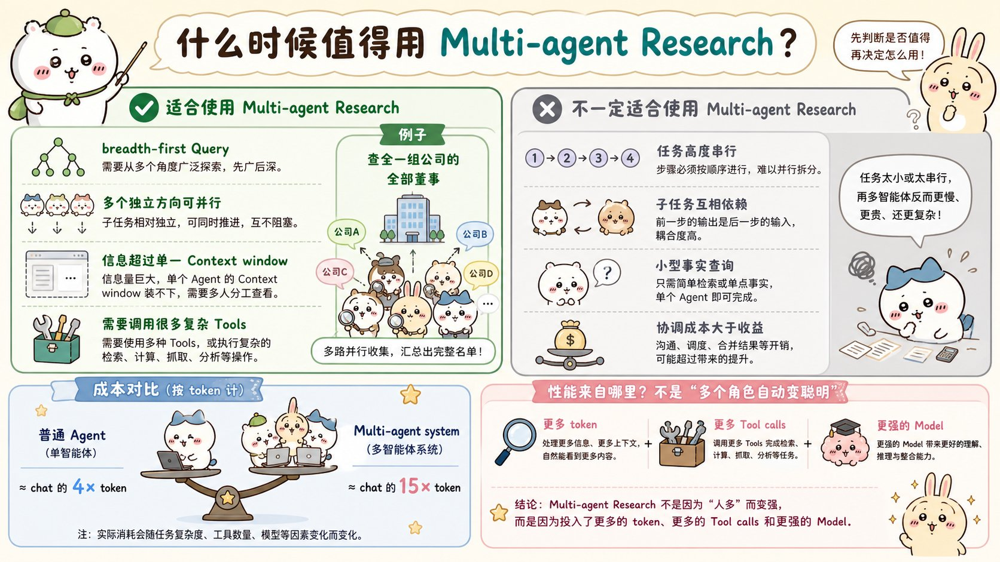
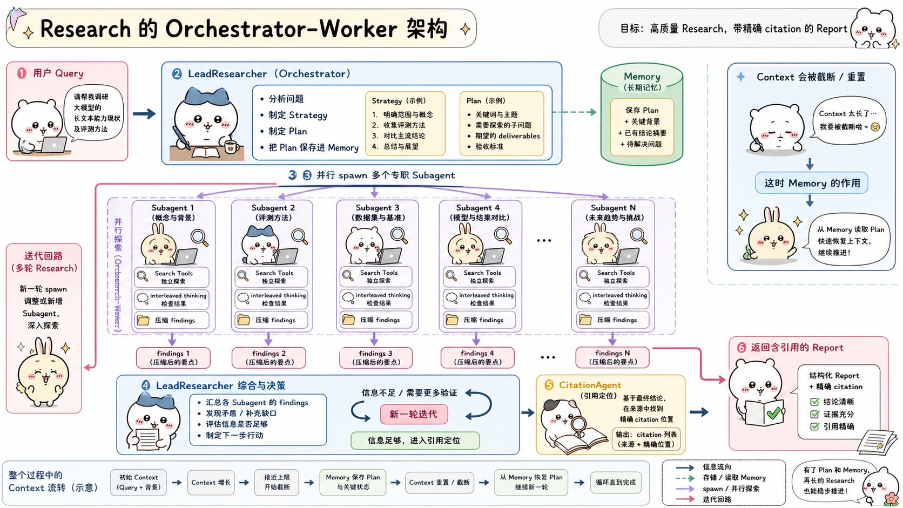
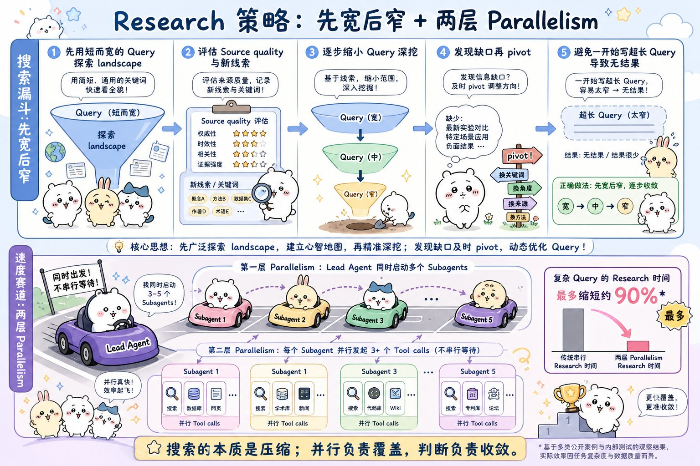
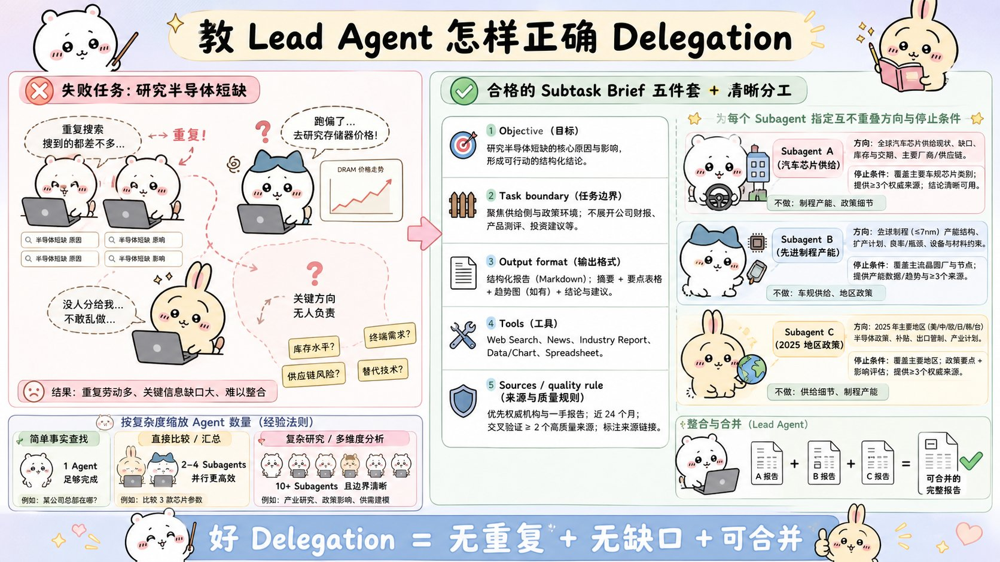
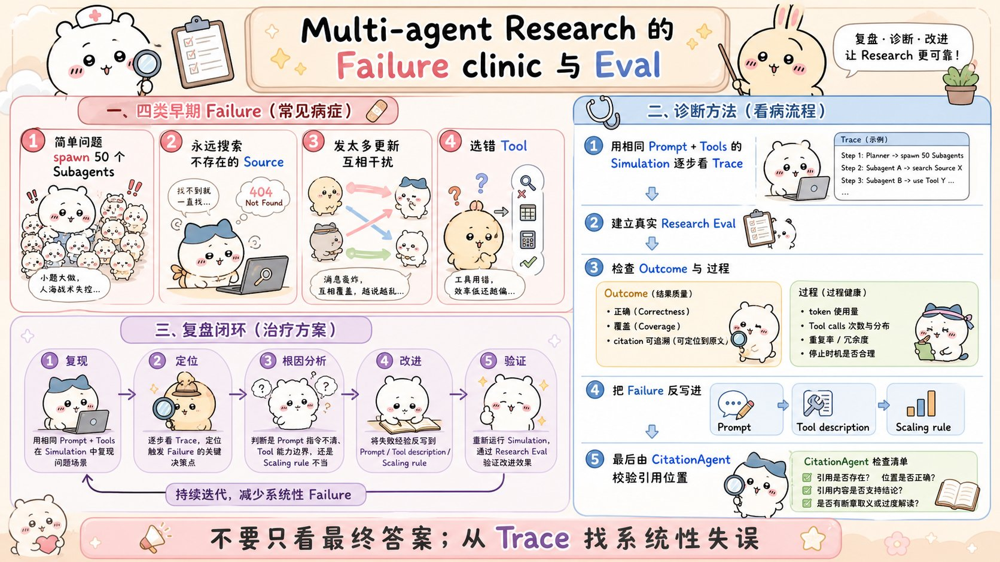

# How we built our multi-agent research system：面试速记

> Anthropic Engineering · 2025-06-13 · [官方原文](https://www.anthropic.com/engineering/multi-agent-research-system) · [本地逐句对照](06_multi-agent-research-system_逐句对照.md)

## 一句话讲明白

**多智能体系统之所以更强，不是因为「角色多所以更聪明」，而是因为它能把更多的 token 和更多次工具调用铺开到并行的搜索上——Anthropic 的研究（Research）功能用主智能体加并行子智能体的架构，在内部研究评估上比单智能体高出 90.2%，代价是 token 用量约为普通聊天的 15 倍。所以判断题永远是：这个任务值不值这笔钱。**

## 为什么值得读 / 能用在哪

- 这是目前**唯一一篇把多智能体的收益和成本都摆出数字**的官方工程文章，面试里聊「多智能体」几乎绕不开它。
- 它给的不是概念，而是可以直接抄进自己项目的三样东西：**编排者-工作者（orchestrator-worker）架构模板、8 条提示词原则、以及长跑智能体的容错与发布策略**。
- 反面价值同样大：文章明确说了哪些场景**不该**上多智能体（需要共享同一份上下文、子任务互相依赖、大多数写代码的任务），这在面试中是加分的判断力。
- 落到自己项目：任何「广度优先」的任务——批量调研、批量核对、多来源比价、全库扫描——都可以套这套架构；反过来，串行流水线别硬拆。
- 顺带一个可以用来佐证「这类系统真有人用」的数据：Anthropic 用 Clio 做的使用分布显示，研究功能最常见的用途是各专业领域的软件系统开发（10%）、创作与优化专业及技术内容（8%）、制定业务增长与营收策略（8%）、辅助学术研究与教学材料（7%）、调研核实人物地点组织的信息（5%）。

## 核心要点

### 1. 什么时候值得上多智能体：收益 90.2%，成本约 15 倍 token

**先说清「为什么研究类任务适合智能体」**——这是整篇文章的前提，面试时先讲这一层会显得思路完整：

- 研究是开放式问题，**很难提前预测需要哪些步骤**，也就没法为它硬编码一条固定路径——这个过程本质上是动态且**路径依赖**的。
- 人做研究时会根据新发现不断调整方向、追着冒出来的线索走。模型也必须能自主跑很多轮，根据中间结果决定下一步查哪儿。
- 结论：**线性的一次性（one-shot）流水线做不了这类任务。**
- 而搜索的本质是**压缩**——从庞大语料里提炼洞见。子智能体各自带着独立上下文窗口并行探索问题的不同侧面，再把最重要的 token 浓缩后交给主智能体，压缩就是这么发生的。
- 文章给的类比很好用：过去十万年人类个体并没有变聪明多少，但信息时代人类社会的能力却是**指数级**提升的——靠的是**集体智能和协调能力**。智能一旦越过某个阈值，多智能体就成了扩展性能的重要途径。

**适合的三个特征**（原文原话）：任务涉及大规模并行、信息量超出单个上下文窗口、需要对接大量复杂工具。

**不适合的三种情况**：所有智能体必须共享同一份上下文、智能体之间存在大量依赖、真正可并行的部分很少（原文点名了大多数编码任务）。原因很实在——大语言模型智能体目前还不擅长实时地互相协调、互相委派。

**必背的数字：**

- 主智能体用 Claude Opus 4、子智能体用 Claude Sonnet 4 的组合，在内部研究评估中比单智能体的 Claude Opus 4 **高出 90.2%**。
- 典型例子：找出标普 500 信息技术板块所有公司的董事会成员。多智能体拆解后做对了，单智能体用缓慢的串行搜索没做出来。
- 在 BrowseComp 评估上做归因分析：**三个因素解释了 95% 的性能方差**，其中**光 token 用量本身就解释了 80%**，另外两个是工具调用次数和模型选择。
- 成本侧：智能体大约用掉普通聊天 **4 倍**的 token，多智能体系统大约是聊天的 **15 倍**。

**面试可以直接抛的结论**：多智能体的性能提升，很大一部分就是「花钱买来的」——所以它只在**任务价值高到足以覆盖这笔成本**时才成立。

### 2. 编排者-工作者架构：一主、多子、一个引用智能体

数据流一共五步，面试时能画出来就够了：

1. 用户提交查询，系统创建 `LeadResearcher`（主研究智能体）。
2. 主智能体先想清楚思路，**把计划写进记忆（Memory）持久化**——因为上下文窗口一旦超过 **200,000 token 就会被截断**，计划必须保住。
3. 主智能体创建带具体任务的专职子智能体（`Subagent`），**并行**执行。
4. 每个子智能体独立做网络搜索，用**交错思考（interleaved thinking）** 评估工具返回的结果，压缩后把发现回传给主智能体。
5. 主智能体综合结果并判断信息够不够：不够就再开一轮或调整策略；够了就退出研究循环，交给 `CitationAgent`（引用智能体）为报告里的每条论断定位到具体出处，最后带引用返回给用户。

**为什么子智能体有效**：各自独立的上下文窗口既扩了容量，又带来**关注点分离（separation of concerns）**——不同的工具、提示词、探索轨迹，降低了所有搜索都沿同一条路走下去的**路径依赖（path dependency）**。

**子智能体到底扮演什么角色**：一层**智能过滤器**。原文配图里的例子是查「2025 年的 AI 智能体公司」——子智能体迭代地调用搜索工具收集信息，最后只把一份公司列表交回主智能体，由主智能体汇总成最终答案。脏活、量大的活留在子智能体的上下文里，主智能体只拿结论。

**和传统检索增强生成（RAG）的区别**：RAG 是静态检索——取回与查询最相似的一批文本块就生成答案，路径固定；这套架构是**多步动态搜索**，边找边根据新发现调整方向，并对结果做分析后才形成答案。这也是它能扛住开放式问题、而 RAG 扛不住的原因。

### 3. 八条提示词原则（面试最容易被追问的一节）

每个智能体都由提示词驱动，所以**提示词工程是改进多智能体行为的主要抓手**。这八条建议整段背下来：

1. **像你的智能体一样思考**。用完全一致的提示词和工具搭一个模拟环境，一步一步看智能体怎么干活。失败模式立刻现形：已经拿到足够结果还在继续搜、搜索词写得又长又啰嗦、选错工具。
2. **教会编排者怎么委派**。每个子任务描述必须包含四件事：**目标、输出格式、用哪些工具和信息来源、清晰的任务边界**。
3. **让投入随查询复杂度伸缩**。把伸缩规则直接写进提示词——简单事实查找 1 个智能体、3-10 次工具调用；直接对比 2-4 个子智能体、每个 10-15 次调用；复杂研究可以超过 10 个子智能体，但职责必须划分清楚。早期最常见的失败模式就是在简单问题上过度投入。
4. **工具的设计和选择至关重要**。智能体-工具接口和人机界面一样关键。经典反例：某段上下文只存在于 Slack 里，却让智能体去全网搜，从一开始就注定失败。接入 MCP 之后问题更严重——智能体会碰到大量没见过、描述质量参差不齐的工具。对策是给出明确的**启发式规则（heuristics）**：先看完所有可用工具、让工具匹配用户意图、广泛探索用网络搜索、有专用工具就别用通用的。
5. **让智能体自我改进**。给 Claude 4 一段提示词加一个失败模式，它能诊断原因并提改进建议。他们甚至做了一个「工具测试智能体」：拿到一个有缺陷的 MCP 工具，反复试用几十次，然后重写工具描述。结果——后续智能体用新描述后，**任务完成时间下降 40%**。
6. **先宽后窄**。智能体天然爱写又长又具体的查询，结果什么也搜不到。正确做法是模仿人类专家：先用简短宽泛的查询看清全局，评估有什么可用信息，再逐步收窄。
7. **引导思考过程**。扩展思考模式（extended thinking）相当于一块**可控的草稿板**：主智能体用它规划方案、判断复杂度和该开几个子智能体、定义每个子智能体的角色；子智能体则在拿到工具结果后用交错思考评估质量、找缺口、打磨下一次查询。测试显示扩展思考改善了指令遵循、推理和效率。
8. **并行工具调用彻底改变速度**。两层并行：主智能体一次并行拉起 **3-5 个**子智能体；每个子智能体内部再**并行调用 3 个以上**工具。复杂查询的研究时间**最多缩短 90%**。

**贯穿全部八条的一句总结**：提示词策略是**灌输好的启发式方法，而不是写死板规则**——最好的智能体提示词不是严格指令，而是一套**协作框架**，定义分工、解决问题的方法和投入预算。

这些启发式方法是从**观察擅长研究的人怎么干活**里提炼出来的：把难题拆成小任务、仔细评估来源质量、根据新信息调整搜索方式、分辨什么时候该做深度（深挖一个主题）什么时候该做广度（并行铺开多个主题）。此外还有两件配套的事——**设明确的护栏（guardrail）** 防止智能体螺旋式失控，以及打造一个**带可观测性和测试用例的快速迭代循环**。示例提示词在 Anthropic 的 Cookbook 里是开源的。

### 4. 委派写不清楚，并行就是重复劳动

**反面案例（值得背下来）**：主智能体只下达一句「研究一下半导体短缺」。结果一个子智能体去查 2021 年汽车芯片危机，另外 2 个在重复调查 2025 年的当前供应链——完全没有形成有效分工。

一份合格的子任务简报至少要写清：**目标 / 任务边界 / 输出格式 / 用哪些工具 / 来源与质量要求**。缺了详细描述，智能体就会重复劳动、留下空白、或者干脆找不到必要信息。

**配套的伸缩规则**（同样写进提示词，别指望智能体自己判断该花多少力气）：

| 查询复杂度 | 子智能体数量 | 每个的工具调用次数 |
| --- | --- | --- |
| 简单事实查找 | 1 个 | 3-10 次 |
| 直接对比 | 2-4 个 | 各 10-15 次 |
| 复杂多维研究 | 10 个以上 | 职责必须划分清晰 |

早期版本最常见的失败模式，就是**在简单查询上过度投入**——明确的准则就是用来堵这个洞的。

**这一节的口诀**：并行负责覆盖，委派负责不重叠，判断负责收敛。

### 5. 评估：既看结果，也看过程

**先记住早期踩过的三个坑**（面试问「你们遇到过什么问题」时可以直接引用）：为一个简单查询派生 **50 个**子智能体、为根本不存在的来源无休止地翻遍全网、用过多的状态更新互相干扰。协调复杂度的膨胀速度，是多智能体和单智能体最大的差别。

多智能体评估的难点在于：**同样的起点，智能体可能走完全不同但同样有效的路径**——一个查三个来源，另一个查十个，也可能用不同工具得到同一答案。所以不能简单检查「有没有按我们预设的正确步骤执行」。

三条可落地的做法：

- **立刻用小样本开始评估**。早期改动效果极大——一次提示词微调可能把成功率从 **30% 提到 80%**，效应这么大，几个用例就能看出来。他们起步只用了**约 20 个**代表真实使用模式的查询。别等攒够几百个用例再开始。
- **用大模型当评判者（LLM-as-judge）**。研究类输出是自由文本、没有唯一答案，程序判不了。评分量表（rubric）五个维度：事实准确性、引用准确性、完整性、来源质量、工具效率。**关键经验：单次调用、单个提示词，输出 0.0-1.0 的分数加一个通过/不通过，比拆成多个评判者更稳定、也更贴合人的判断。**
- **人工评估能抓住自动化漏掉的东西**。人工测试者发现早期智能体总是偏好经过搜索引擎优化的内容农场，而不是学术 PDF、个人博客这类权威但排名不高的来源——在提示词里加入来源质量的启发式规则才解决。

**一句话记住评估要看两条线**：**结果**——答案对不对、要求的方面覆盖全没全、引用能不能追溯回来源、用的是不是一手来源；**过程**——工具选得对不对、调用次数合不合理。这两条恰好就是那五个评分维度的分组方式。

**还要记住**：多智能体系统有**涌现行为（emergent behavior）**——对主智能体做一点小改动，就可能以难以预测的方式改变子智能体的行为。所以要理解的是**交互模式**，不只是单个智能体的行为。

### 6. 生产环境：有状态智能体的容错与彩虹部署

**核心矛盾**：传统软件里一个 bug 弄坏一个功能；智能体系统里，微小改动会**级联放大成巨大的行为变化**，而且这个进程要长时间运行并维持状态。

- **智能体是有状态的，错误会复利式累积**。出错不能从头重来（重启贵、用户体验差），要能**从出错的那个位置恢复继续**。手段是两条腿走路：一边利用模型自身的智能（比如直接告诉智能体「这个工具正在失败」，让它自己适应，效果出奇地好），一边配上确定性保障——**重试逻辑 + 定期检查点（checkpoint）**。
- **调试需要新方法**。同样的提示词，不同次运行结果也不确定。用户只会反馈「找不到显而易见的信息」，你根本看不出是搜索词烂、来源选得差、还是撞上工具故障。解法是**完整的生产环境链路追踪（tracing）**。在标准可观测性之外，他们监控的是**智能体的决策模式和交互结构，而不监控具体对话内容**，以此保护用户隐私。
- **部署需要谨慎协调**。智能体系统是高度有状态、几乎持续运行的网络，你部署更新时，智能体可能正卡在流程的任意位置，没法把所有智能体同时切到新版本。方案是**彩虹部署（rainbow deployment）**：新旧版本同时在线，把流量逐步从旧版迁到新版，不打断正在跑的智能体。
- **同步执行是当前瓶颈**。主智能体现在是同步等每一批子智能体全部完成才继续。好处是协调简单，坏处是主智能体没法中途引导子智能体、子智能体之间无法协同、整个系统可能被某一个慢的子智能体阻塞。异步能带来更多并行度，但会带来结果协调、状态一致性、错误跨子智能体传播三类新问题。

**附录里三条容易被问到的补充经验：**

- **终态评估**：对会修改持久化状态的多轮智能体，评估「最终状态对不对」，而不是逐轮校验流程；复杂工作流拆成若干离散检查点。
- **长周期对话管理**：生产环境的对话可以跨数百轮。做法是——阶段性总结并把关键信息写入外部记忆，接近上下文上限时派生上下文干净的新子智能体并做好交接，之后从记忆里取回研究计划等内容，而不是丢掉之前的成果。
- **子智能体把输出写到文件系统**，减少「传话游戏」式的信息损耗：产物独立持久化，只把轻量引用回传给协调者。既避免多阶段处理中的信息丢失，也省掉了大段输出在对话历史里来回复制的 token 开销。对代码、报告、数据可视化这类结构化输出尤其有效。

**文章结语里最值得引用的一句判断**：构建 AI 智能体时，**最后一公里往往会变成整段旅程的绝大部分**。开发者机器上能跑通的代码，要变成可靠的生产系统还得投入大量工程。因为错误会复利累积，对传统软件无关痛痒的小问题，可能让智能体彻底跑偏——某一步失败就可能让它走上完全不同的轨迹。所以原型和生产之间的鸿沟，通常比预想的宽。

## 面试高频问答

**Q：多智能体什么时候值得用？什么时候不该用？**
A：三个正向信号——任务能大规模并行、信息量超出单个上下文窗口、要对接很多复杂工具。三个反向信号——所有智能体得共享同一份上下文、子任务之间强依赖、可并行部分本来就少（比如大多数编码任务）。定量地讲：Anthropic 的数据是效果 +90.2%、token 约为聊天的 15 倍，所以本质是一道经济账，任务价值必须撑得起这个成本。

**Q：为什么多智能体会更强？是「群体智慧」吗？**
A：主要不是。文章的归因分析很直白：在 BrowseComp 上，三个因素解释了 95% 的性能方差，其中光 token 用量就占 80%，另外两个是工具调用次数和模型选择。所以多智能体的本质是**给一个问题铺开更多 token 和更多次工具调用的容量**，独立上下文窗口顺带带来了关注点分离和路径多样性。

**Q：编排者-工作者架构讲一下，主智能体具体干什么？**
A：主智能体分析查询、制定策略，并把计划写入记忆持久化——因为上下文超过 20 万 token 会被截断。然后它并行派生专职子智能体，每个子智能体独立搜索、用交错思考评估工具结果、压缩后回传。主智能体综合结果，判断够不够：不够就再开一轮或调整策略，够了就交给引用智能体逐条定位出处。子智能体本质上是一层**智能过滤器**。

**Q：怎么防止子智能体重复劳动？**
A：靠委派的质量。反例是主智能体只说「研究一下半导体短缺」，结果一个去查 2021 年汽车芯片危机、两个在重复查 2025 年供应链。合格的子任务简报必须写清目标、任务边界、输出格式、用哪些工具和来源。另外要在提示词里嵌入伸缩规则：简单事实 1 个智能体 3-10 次调用，直接对比 2-4 个子智能体各 10-15 次，复杂研究才超过 10 个。

**Q：这种长跑的、有状态的智能体，线上怎么保证可靠？**
A：三件事。第一，错误会复利累积，所以要能从出错点恢复而不是从头重来，配重试逻辑和定期检查点，同时也可以直接告诉模型「这个工具挂了」让它自适应。第二，加完整的生产链路追踪，监控决策模式和交互结构而不看对话内容，兼顾可调试和隐私。第三，发布用彩虹部署——新旧版本同时在线、流量逐步迁移，避免打断正跑到一半的智能体。

## 必须记住的 10 句话

1. 多智能体最适合**广度优先**、可并行的查询；串行强依赖的任务别硬拆。
2. 主智能体 Opus 4 + 子智能体 Sonnet 4，比单智能体 Opus 4 **高 90.2%**。
3. 智能体约用聊天 4 倍 token，多智能体约 **15 倍**——收益是花钱买来的。
4. BrowseComp 归因：三因素解释 95% 方差，**token 用量单独占 80%**。
5. 主智能体必须把计划写入记忆——上下文超 **20 万 token** 会被截断。
6. 委派要写清**目标、边界、输出格式、工具与来源**，否则并行等于重复劳动。
7. 伸缩规则要写进提示词：1 个 / 2-4 个 / 10 个以上，对应三档复杂度。
8. 两层并行：主智能体并行开 **3-5 个**子智能体，子智能体并行调 **3 个以上**工具，复杂查询提速最多 **90%**。
9. 有状态智能体靠**断点恢复 + 检查点 + 链路追踪 + 彩虹部署**活在生产环境里。
10. 评估要同时看**结果**（准确、完整、引用对得上）和**过程**（工具用得对不对、该停时停没停）；小样本约 20 个查询就该开跑。

## 30 秒口述版

> Anthropic 的研究功能用的是编排者-工作者架构：主智能体分析查询、把计划存进记忆防止上下文截断，然后并行派生子智能体，每个子智能体带着明确的目标、边界和输出格式独立搜索并压缩结果，主智能体综合后再决定要不要加一轮，最后由引用智能体把每条论断对回出处。它的收益是内部评估上比单智能体高 90.2%，代价是 token 用量约为普通聊天的 15 倍——归因分析显示 token 用量本身就解释了 80% 的性能差异，所以这套架构本质是给问题铺开更多搜索容量，只在任务价值够高时才划算。工程上最难的不是原型而是最后一公里：错误会复利累积，所以要能从断点恢复、加检查点和完整链路追踪，发布用彩虹部署避免打断正在运行的智能体。

## 自测

- [ ] 能说出三类适合、三类不适合多智能体的任务，并各举一个例子。
- [ ] 能报出 90.2%、15 倍、80% 方差、20 万 token 这四个数字并解释含义。
- [ ] 能画出主智能体、子智能体、引用智能体之间的完整数据流。
- [ ] 能背出八条提示词原则中的至少六条。
- [ ] 能写出一份合格的子任务简报包含哪几个要素。
- [ ] 能说出三档复杂度对应的智能体数量与工具调用次数。
- [ ] 能解释两层并行分别发生在哪里，以及提速幅度。
- [ ] 能讲清彩虹部署解决的是什么问题，为什么智能体系统特别需要它。

> 插图为学习用途的非官方同人式教学图，角色与文章版权归各自权利人。
