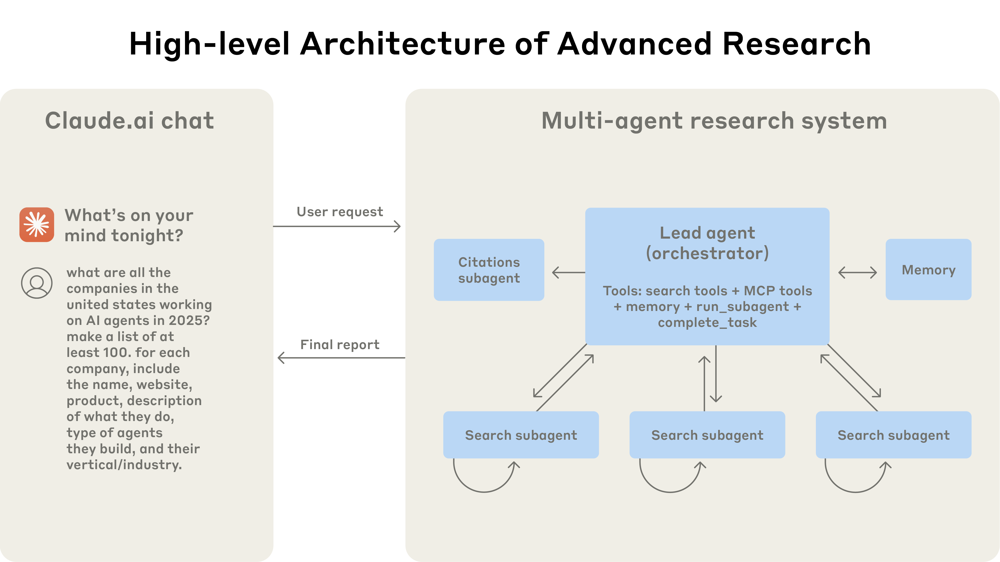
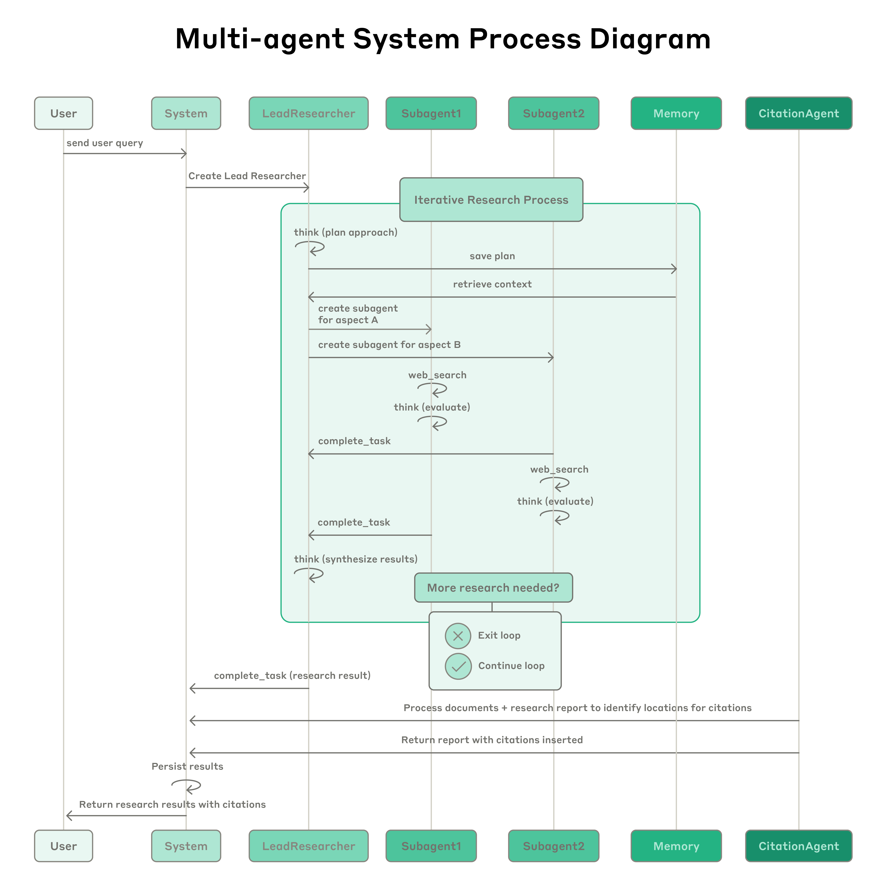
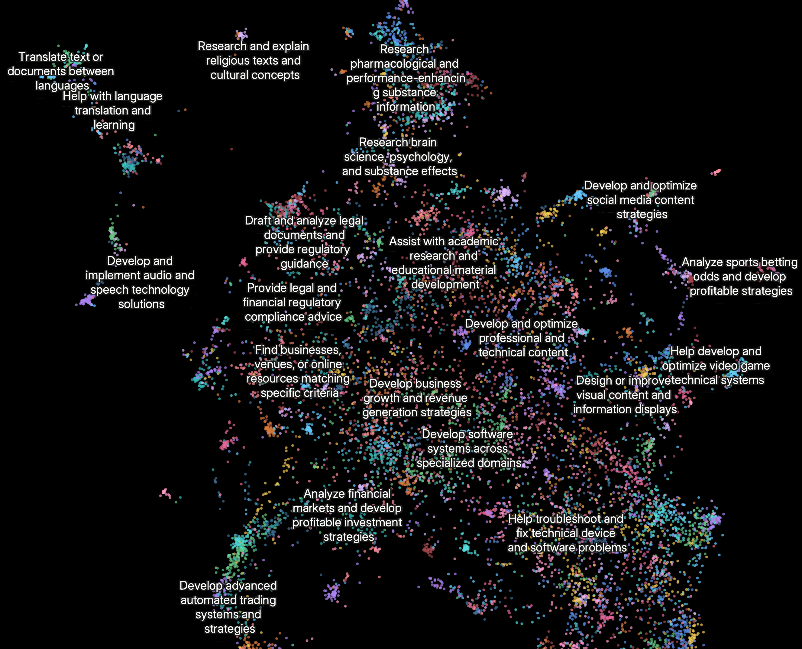

# 06_How we built our multi-agent research system_我们如何构建多智能体研究系统

> 原文：https://www.anthropic.com/engineering/multi-agent-research-system
> 作者：Anthropic Engineering｜发布日期：2025-06-13

## 📌 本篇速览

- 📅 2025-06-13　｜　⏱ 约 20 分钟　｜　📄 3,775 词 / 3 图
- ⭐ ★★★★★ **必读** —— 业界引用最广的多智能体系统工程实践文章之一，架构模式、token 经济性分析与评估方法论对构建 Agent 系统有直接指导价值。
- 🏷 多智能体系统、编排者-工作者架构、提示词工程、智能体评估、生产可靠性
- 🖼 [图解笔记（面试速记）](06_multi-agent-research-system_直观图解与学习笔记.md)　·　🗂 [返回总目录](00_目录与阅读进度.md)

Anthropic 工程团队复盘 Claude Research 功能从原型到生产的经验：采用「编排者-工作者」多智能体架构，主智能体拆解查询并并行派生子智能体检索，内部评估比单智能体 Opus 4 高出 90.2%，但 token 消耗约为普通对话的 15 倍。文章系统总结了 8 条智能体提示词工程原则、LLM 充当评判者与人工评估相结合的评估方法，以及有状态智能体的容错恢复、链路追踪、彩虹部署等生产可靠性工程实践。

---

Claude now has [Research capabilities](https://www.anthropic.com/news/research) that allow it to search across the web, Google Workspace, and any integrations to accomplish complex tasks.

Claude 现在具备了[研究（Research）能力](https://www.anthropic.com/news/research)，可以在网络、Google Workspace 以及各类集成（integration）中进行搜索，完成复杂任务。

The journey of this multi-agent system from prototype to production taught us critical lessons about system architecture, tool design, and prompt engineering.

这个多智能体（multi-agent）系统从原型走向生产的历程，教会了我们关于系统架构、工具设计和提示词工程（prompt engineering）的关键经验。

A multi-agent system consists of multiple agents (LLMs autonomously using tools in a loop) working together.

多智能体系统由多个智能体（agent，即在循环中自主使用工具的 LLM）协同工作而成。

Our Research feature involves an agent that plans a research process based on user queries, and then uses tools to create parallel agents that search for information simultaneously.

在我们的 Research 功能中，一个智能体会根据用户查询规划研究流程，然后使用工具创建并行的智能体来同时搜索信息。

Systems with multiple agents introduce new challenges in agent coordination, evaluation, and reliability.

由多个智能体组成的系统，会在智能体协调、评估（evaluation）和可靠性方面引入新的挑战。

This post breaks down the principles that worked for us—we hope you'll find them useful to apply when building your own multi-agent systems.

本文拆解了对我们行之有效的那些原则——希望你在构建自己的多智能体系统时能用得上。

### Benefits of a multi-agent system｜多智能体系统的优势

Research work involves open-ended problems where it’s very difficult to predict the required steps in advance.

研究工作涉及开放式问题，很难提前预测需要哪些步骤。

You can’t hardcode a fixed path for exploring complex topics, as the process is inherently dynamic and path-dependent.

你无法为探索复杂主题硬编码一条固定路径，因为这个过程本质上是动态且路径依赖（path-dependent）的。

When people conduct research, they tend to continuously update their approach based on discoveries, following leads that emerge during investigation.

人在做研究时，往往会根据新发现不断调整方法，追踪调查过程中冒出来的线索。

This unpredictability makes AI agents particularly well-suited for research tasks.

这种不可预测性使得 AI 智能体特别适合研究类任务。

Research demands the flexibility to pivot or explore tangential connections as the investigation unfolds.

研究要求具备随调查展开而灵活转向、或探索旁支关联的能力。

The model must operate autonomously for many turns, making decisions about which directions to pursue based on intermediate findings.

模型必须自主运行许多轮，根据中间发现来决定接下来追查哪些方向。

A linear, one-shot pipeline cannot handle these tasks.

线性的一次性（one-shot）流水线无法胜任这类任务。

The essence of search is compression: distilling insights from a vast corpus.

搜索的本质是压缩（compression）：从庞大的语料中提炼洞见。

Subagents facilitate compression by operating in parallel with their own context windows, exploring different aspects of the question simultaneously before condensing the most important tokens for the lead research agent.

子智能体（subagent）各自拥有独立的上下文（context）窗口并行工作，同时探索问题的不同侧面，再把最重要的 token 浓缩后交给主研究智能体（lead agent），以此促进压缩。

Each subagent also provides separation of concerns—distinct tools, prompts, and exploration trajectories—which reduces path dependency and enables thorough, independent investigations.

每个子智能体还带来了关注点分离（separation of concerns）——各自不同的工具、提示词和探索轨迹——这降低了路径依赖，使彻底而独立的调查成为可能。

Once intelligence reaches a threshold, multi-agent systems become a vital way to scale performance.

一旦智能达到某个阈值，多智能体系统就成为扩展性能的重要途径。

For instance, although individual humans have become more intelligent in the last 100,000 years, human societies have become *exponentially* more capable in the information age because of our *collective* intelligence and ability to coordinate.

举例来说，虽然在过去十万年里人类个体变得更聪明了，但进入信息时代后，人类社会的能力却因为我们的*集体*智能与协调能力而获得了*指数级*的提升。

Even generally-intelligent agents face limits when operating as individuals; groups of agents can accomplish far more.

即便是具备通用智能的智能体，单打独斗时也会遇到极限；而成群的智能体能完成的事情要多得多。

Our internal evaluations show that multi-agent research systems excel especially for breadth-first queries that involve pursuing multiple independent directions simultaneously.

我们的内部评估表明，多智能体研究系统尤其擅长广度优先（breadth-first）的查询，也就是需要同时沿多个独立方向展开调查的任务。

We found that a multi-agent system with Claude Opus 4 as the lead agent and Claude Sonnet 4 subagents outperformed single-agent Claude Opus 4 by 90.2% on our internal research eval.

我们发现，以 Claude Opus 4 作为主智能体、Claude Sonnet 4 作为子智能体的多智能体系统，在内部研究评估中比单智能体的 Claude Opus 4 高出 90.2%。

For example, when asked to identify all the board members of the companies in the Information Technology S&P 500, the multi-agent system found the correct answers by decomposing this into tasks for subagents, while the single agent system failed to find the answer with slow, sequential searches.

例如，当被要求找出标普 500 信息技术板块所有公司的董事会成员时，多智能体系统通过把任务分解给各个子智能体找到了正确答案，而单智能体系统用缓慢的串行搜索没能找到答案。

Multi-agent systems work mainly because they help spend enough tokens to solve the problem.

多智能体系统之所以有效，主要是因为它们帮助投入了足够多的 token 来解决问题。

In our analysis, three factors explained 95% of the performance variance in the [BrowseComp](https://openai.com/index/browsecomp/) evaluation (which tests the ability of browsing agents to locate hard-to-find information).

在我们的分析中，有三个因素解释了 [BrowseComp](https://openai.com/index/browsecomp/) 评估（用于测试浏览类智能体定位难找信息的能力）中 95% 的性能方差。

We found that token usage by itself explains 80% of the variance, with the number of tool calls and the model choice as the two other explanatory factors.

我们发现，仅 token 用量本身就能解释 80% 的方差，另外两个解释因素是工具调用（tool call）次数和模型选择。

This finding validates our architecture that distributes work across agents with separate context windows to add more capacity for parallel reasoning.

这一发现印证了我们的架构：把工作分派给拥有独立上下文窗口的多个智能体，为并行推理增加更多容量。

The latest Claude models act as large efficiency multipliers on token use, as upgrading to Claude Sonnet 4 is a larger performance gain than doubling the token budget on Claude Sonnet 3.7.

最新的 Claude 模型是 token 使用效率的巨大放大器：升级到 Claude Sonnet 4 带来的性能提升，比在 Claude Sonnet 3.7 上把 token 预算翻倍还要大。

Multi-agent architectures effectively scale token usage for tasks that exceed the limits of single agents.

对于超出单智能体极限的任务，多智能体架构有效地扩展了 token 用量。

There is a downside: in practice, these architectures burn through tokens fast.

但这也有代价：在实践中，这类架构烧 token 非常快。

In our data, agents typically use about 4× more tokens than chat interactions, and multi-agent systems use about 15× more tokens than chats.

在我们的数据中，智能体通常比普通聊天交互多用约 4 倍的 token，而多智能体系统比聊天多用约 15 倍的 token。

For economic viability, multi-agent systems require tasks where the value of the task is high enough to pay for the increased performance.

要在经济上可行，多智能体系统需要的是任务价值足够高、足以覆盖性能提升所需成本的场景。

Further, some domains that require all agents to share the same context or involve many dependencies between agents are not a good fit for multi-agent systems today.

此外，有些领域要求所有智能体共享同一份上下文，或者智能体之间存在大量依赖，如今还不适合多智能体系统。

For instance, most coding tasks involve fewer truly parallelizable tasks than research, and LLM agents are not yet great at coordinating and delegating to other agents in real time.

例如，大多数编码任务中真正可并行的部分比研究任务少，而且 LLM 智能体目前还不太擅长实时地与其他智能体协调、向其他智能体委派任务。

We’ve found that multi-agent systems excel at valuable tasks that involve heavy parallelization, information that exceeds single context windows, and interfacing with numerous complex tools.

我们发现，多智能体系统最擅长的高价值任务具备这些特征：涉及大规模并行、信息量超出单个上下文窗口、需要对接大量复杂工具。

### Architecture overview for Research｜Research 系统架构总览

Our Research system uses a multi-agent architecture with an orchestrator-worker pattern, where a lead agent coordinates the process while delegating to specialized subagents that operate in parallel.

我们的 Research 系统采用「编排者-工作者」（orchestrator-worker）模式的多智能体架构：一个主智能体负责协调整个流程，同时把任务委派给并行运行的专职子智能体。

*The multi-agent architecture in action: user queries flow through a lead agent that creates specialized subagents to search for different aspects in parallel.*

*图注：多智能体架构实战：用户查询先流经主智能体，由它创建专职子智能体来并行搜索问题的不同侧面。*

When a user submits a query, the lead agent analyzes it, develops a strategy, and spawns subagents to explore different aspects simultaneously.

当用户提交查询时，主智能体会先分析查询、制定策略，然后派生（spawn）子智能体同时探索不同侧面。

As shown in the diagram above, the subagents act as intelligent filters by iteratively using search tools to gather information, in this case on AI agent companies in 2025, and then returning a list of companies to the lead agent so it can compile a final answer.

如上图所示，子智能体扮演智能过滤器的角色：迭代地使用搜索工具收集信息——在这个例子里是关于 2025 年 AI 智能体公司的信息——然后把公司列表返回给主智能体，由后者汇总出最终答案。

Traditional approaches using Retrieval Augmented Generation (RAG) use static retrieval.

使用检索增强生成（Retrieval Augmented Generation，RAG）的传统方案采用的是静态检索。

That is, they fetch some set of chunks that are most similar to an input query and use these chunks to generate a response.

也就是说，它们取回与输入查询最相似的一批文本块（chunk），再用这些文本块生成回答。

In contrast, our architecture uses a multi-step search that dynamically finds relevant information, adapts to new findings, and analyzes results to formulate high-quality answers.

相比之下，我们的架构使用多步搜索：动态查找相关信息、根据新发现随时调整，并对结果进行分析，从而形成高质量答案。

*Process diagram showing the complete workflow of our multi-agent Research system.*

*图注：展示我们多智能体 Research 系统完整工作流的流程图。*

*When a user submits a query, the system creates a LeadResearcher agent that enters an iterative research process.*

*用户提交查询后，系统会创建一个 LeadResearcher 智能体，进入迭代式研究流程。*

*The LeadResearcher begins by thinking through the approach and saving its plan to Memory to persist the context, since if the context window exceeds 200,000 tokens it will be truncated and it is important to retain the plan.*

*LeadResearcher 首先把整体思路想清楚，并将计划保存到记忆（Memory）中以持久化上下文——因为上下文窗口一旦超过 200,000 token 就会被截断，保住计划非常重要。*

*It then creates specialized Subagents (two are shown here, but it can be any number) with specific research tasks.*

*接着，它创建带有具体研究任务的专职子智能体（Subagent，图中画了两个，实际可以是任意数量）。*

*Each Subagent independently performs web searches, evaluates tool results using [interleaved thinking](https://docs.anthropic.com/en/docs/build-with-claude/extended-thinking#interleaved-thinking), and returns findings to the LeadResearcher.*

*每个 Subagent 独立执行网络搜索，用[交错思考](https://docs.anthropic.com/en/docs/build-with-claude/extended-thinking#interleaved-thinking)（interleaved thinking）评估工具结果，并把发现返回给 LeadResearcher。*

*The LeadResearcher synthesizes these results and decides whether more research is needed—if so, it can create additional subagents or refine its strategy.*

*LeadResearcher 综合这些结果并判断是否还需要更多研究——如果需要，它可以创建更多子智能体，或调整自己的策略。*

*Once sufficient information is gathered, the system exits the research loop and passes all findings to a CitationAgent, which processes the documents and research report to identify specific locations for citations.*

*一旦收集到足够的信息，系统就退出研究循环，把所有发现交给 CitationAgent；后者处理文档和研究报告，确定各处引用（citation）应插入的具体位置。*

*This ensures all claims are properly attributed to their sources.*

*这确保所有论断都被正确地归属到其来源。*

*The final research results, complete with citations, are then returned to the user.*

*最后，带有完整引用的研究结果被返回给用户。*

### Prompt engineering and evaluations for research agents｜研究智能体的提示词工程与评估

Multi-agent systems have key differences from single-agent systems, including a rapid growth in coordination complexity.

多智能体系统与单智能体系统有一些关键差异，其中之一就是协调复杂度会迅速膨胀。

Early agents made errors like spawning 50 subagents for simple queries, scouring the web endlessly for nonexistent sources, and distracting each other with excessive updates.

早期的智能体会犯这样的错误：为简单查询派生 50 个子智能体、为根本不存在的来源无休止地翻遍全网、用过多的状态更新互相干扰。

Since each agent is steered by a prompt, prompt engineering was our primary lever for improving these behaviors.

由于每个智能体都由提示词来引导，提示词工程就成了我们改进这些行为的主要抓手。

Below are some principles we learned for prompting agents:

下面是我们总结出的为智能体编写提示词的一些原则：

1. **Think like your agents.** To iterate on prompts, you must understand their effects. To help us do this, we built simulations using our [Console](https://console.anthropic.com/) with the exact prompts and tools from our system, then watched agents work step-by-step. This immediately revealed failure modes: agents continuing when they already had sufficient results, using overly verbose search queries, or selecting incorrect tools. Effective prompting relies on developing an accurate mental model of the agent, which can make the most impactful changes obvious.

1. **像你的智能体一样思考。** 要迭代提示词，你必须理解它们产生的效果。为此，我们用 [Console](https://console.anthropic.com/) 搭建了模拟环境，使用与系统中完全一致的提示词和工具，然后逐步观看智能体如何工作。这立刻暴露出各种失败模式（failure mode）：已经拿到足够结果还继续搜索、使用过于冗长的搜索查询、选错工具等。有效的提示词工程依赖于对智能体建立准确的心智模型（mental model）——有了它，最有影响力的改动往往一目了然。

2. **Teach the orchestrator how to delegate.** In our system, the lead agent decomposes queries into subtasks and describes them to subagents. Each subagent needs an objective, an output format, guidance on the tools and sources to use, and clear task boundaries. Without detailed task descriptions, agents duplicate work, leave gaps, or fail to find necessary information. We started by allowing the lead agent to give simple, short instructions like 'research the semiconductor shortage,' but found these instructions often were vague enough that subagents misinterpreted the task or performed the exact same searches as other agents. For instance, one subagent explored the 2021 automotive chip crisis while 2 others duplicated work investigating current 2025 supply chains, without an effective division of labor.

2. **教会编排者如何委派任务。** 在我们的系统中，主智能体把查询分解成子任务，并向子智能体描述这些任务。每个子智能体都需要：一个目标、一种输出格式、关于该用哪些工具和信息来源的指引，以及清晰的任务边界。缺少详细的任务描述时，智能体就会重复劳动、留下空白，或找不到必要的信息。我们最初允许主智能体下达"研究一下半导体短缺"这类简短指令，但发现这些指令往往模糊到让子智能体误解任务，或执行与其他智能体一模一样的搜索。例如，一个子智能体去研究 2021 年汽车芯片危机，另外 2 个却在重复调查 2025 年当前的供应链，完全没有形成有效分工。

3. **Scale effort to query complexity.** Agents struggle to judge appropriate effort for different tasks, so we embedded scaling rules in the prompts. Simple fact-finding requires just 1 agent with 3-10 tool calls, direct comparisons might need 2-4 subagents with 10-15 calls each, and complex research might use more than 10 subagents with clearly divided responsibilities. These explicit guidelines help the lead agent allocate resources efficiently and prevent overinvestment in simple queries, which was a common failure mode in our early versions.

3. **让投入随查询复杂度伸缩。** 智能体很难自行判断不同任务该投入多少精力，所以我们在提示词里嵌入了伸缩规则：简单的事实查找只需 1 个智能体、3-10 次工具调用；直接对比可能需要 2-4 个子智能体、每个各 10-15 次调用；复杂研究则可能动用 10 个以上职责划分清晰的子智能体。这些明确的准则帮助主智能体高效分配资源，避免在简单查询上过度投入——这正是我们早期版本常见的失败模式。

4. **Tool design and selection are critical.** Agent-tool interfaces are as critical as human-computer interfaces. Using the right tool is efficient—often, it’s strictly necessary. For instance, an agent searching the web for context that only exists in Slack is doomed from the start. With [MCP servers](https://modelcontextprotocol.io/introduction) that give the model access to external tools, this problem compounds, as agents encounter unseen tools with descriptions of wildly varying quality. We gave our agents explicit heuristics: for example, examine all available tools first, match tool usage to user intent, search the web for broad external exploration, or prefer specialized tools over generic ones. Bad tool descriptions can send agents down completely wrong paths, so each tool needs a distinct purpose and a clear description.

4. **工具设计与选择至关重要。** 智能体-工具接口和人机接口一样关键。用对工具能提升效率——很多时候更是硬性必要条件。比如，某些上下文只存在于 Slack 里，让智能体去网上搜，从一开始就注定失败。有了让模型能访问外部工具的 [MCP 服务器](https://modelcontextprotocol.io/introduction)，这个问题会进一步加剧：智能体会遇到从未见过的工具，而这些工具的描述质量参差不齐。我们给智能体设定了明确的启发式规则（heuristics）：例如先检查所有可用工具、让工具使用匹配用户意图、用网络搜索做广泛的外部探索、优先使用专用工具而非通用工具。糟糕的工具描述会把智能体引上完全错误的路径，所以每个工具都需要有独特的用途和清晰的描述。

5. **Let agents improve themselves**. We found that the Claude 4 models can be excellent prompt engineers. When given a prompt and a failure mode, they are able to diagnose why the agent is failing and suggest improvements. We even created a tool-testing agent—when given a flawed MCP tool, it attempts to use the tool and then rewrites the tool description to avoid failures. By testing the tool dozens of times, this agent found key nuances and bugs. This process for improving tool ergonomics resulted in a 40% decrease in task completion time for future agents using the new description, because they were able to avoid most mistakes.

5. **让智能体自我改进。** 我们发现 Claude 4 系列模型可以是出色的提示词工程师。给它一个提示词和一种失败模式，它就能诊断出智能体失败的原因并提出改进建议。我们甚至创建了一个工具测试智能体——给它一个有缺陷的 MCP 工具，它会尝试使用该工具，然后重写工具描述来规避失败。通过对工具进行几十次测试，这个智能体发现了关键的细微差别和 bug。这个改进工具"人体工学"（ergonomics）的流程，让后续使用新描述的智能体任务完成时间缩短了 40%，因为它们得以避开大部分错误。

6. **Start wide, then narrow down.** Search strategy should mirror expert human research: explore the landscape before drilling into specifics. Agents often default to overly long, specific queries that return few results. We counteracted this tendency by prompting agents to start with short, broad queries, evaluate what’s available, then progressively narrow focus.

6. **先广后窄。** 搜索策略应当效仿人类专家的研究方式：先纵览全局，再深入细节。智能体常常默认使用过长、过于具体的查询，结果所获寥寥。我们通过提示词来对冲这种倾向：让智能体先从简短、宽泛的查询开始，评估有哪些可用信息，再逐步收窄焦点。

7. **Guide the thinking process.** [Extended thinking mode](https://docs.anthropic.com/en/docs/build-with-claude/extended-thinking), which leads Claude to output additional tokens in a visible thinking process, can serve as a controllable scratchpad. The lead agent uses thinking to plan its approach, assessing which tools fit the task, determining query complexity and subagent count, and defining each subagent’s role. Our testing showed that extended thinking improved instruction-following, reasoning, and efficiency. Subagents also plan, then use [interleaved thinking](https://docs.anthropic.com/en/docs/build-with-claude/extended-thinking#interleaved-thinking) after tool results to evaluate quality, identify gaps, and refine their next query. This makes subagents more effective in adapting to any task.

7. **引导思考过程。** [扩展思考模式](https://docs.anthropic.com/en/docs/build-with-claude/extended-thinking)（extended thinking mode）会让 Claude 以可见的思考过程输出额外的 token，可以当作一块可控的草稿板（scratchpad）。主智能体用思考来规划方案：评估哪些工具适合当前任务、判断查询复杂度和子智能体数量、定义每个子智能体的角色。我们的测试表明，扩展思考改善了指令遵循、推理能力和效率。子智能体也会先做规划，然后在拿到工具结果后使用[交错思考](https://docs.anthropic.com/en/docs/build-with-claude/extended-thinking#interleaved-thinking)来评估质量、找出缺口、并打磨下一次查询。这让子智能体在适应各种任务时更加有效。

8. **Parallel tool calling transforms speed and performance.** Complex research tasks naturally involve exploring many sources. Our early agents executed sequential searches, which was painfully slow. For speed, we introduced two kinds of parallelization: (1) the lead agent spins up 3-5 subagents in parallel rather than serially; (2) the subagents use 3+ tools in parallel. These changes cut research time by up to 90% for complex queries, allowing Research to do more work in minutes instead of hours while covering more information than other systems.

8. **并行工具调用彻底改变速度与性能。** 复杂的研究任务天然要探索大量来源。我们早期的智能体串行执行搜索，慢得让人痛苦。为了提速，我们引入了两类并行化：（1）主智能体并行拉起 3-5 个子智能体，而不是逐个创建；（2）子智能体并行使用 3 个以上的工具。这些改动让复杂查询的研究时间最多缩短了 90%，使 Research 能在几分钟而不是几小时内完成更多工作，同时覆盖的信息量也超过其他系统。

Our prompting strategy focuses on instilling good heuristics rather than rigid rules.

我们的提示词策略侧重于灌输好的启发式方法，而不是死板的规则。

We studied how skilled humans approach research tasks and encoded these strategies in our prompts—strategies like decomposing difficult questions into smaller tasks, carefully evaluating the quality of sources, adjusting search approaches based on new information, and recognizing when to focus on depth (investigating one topic in detail) vs. breadth (exploring many topics in parallel).

我们研究了擅长研究的人如何处理研究任务，并把这些策略编码进提示词——比如把难题分解成更小的任务、仔细评估信息来源的质量、根据新信息调整搜索方式，以及分辨什么时候该做深度（深入调查一个主题）、什么时候该做广度（并行探索多个主题）。

We also proactively mitigated unintended side effects by setting explicit guardrails to prevent the agents from spiraling out of control.

我们还通过设置明确的护栏（guardrail）来主动缓解意外副作用，防止智能体螺旋式失控。

Finally, we focused on a fast iteration loop with observability and test cases.

最后，我们专注于打造一个带可观测性（observability）和测试用例的快速迭代循环。

### Effective evaluation of agents｜智能体的有效评估

Good evaluations are essential for building reliable AI applications, and agents are no different.

好的评估（evaluation）是构建可靠 AI 应用的必备条件，智能体也不例外。

However, evaluating multi-agent systems presents unique challenges.

然而，评估多智能体系统会带来一些独特的挑战。

Traditional evaluations often assume that the AI follows the same steps each time: given input X, the system should follow path Y to produce output Z.

传统评估通常假设 AI 每次都走同样的步骤：给定输入 X，系统应当沿着路径 Y 产出输出 Z。

But multi-agent systems don't work this way.

但多智能体系统并不是这样运作的。

Even with identical starting points, agents might take completely different valid paths to reach their goal.

即便起点完全相同，智能体也可能走上完全不同但同样有效的路径去达成目标。

One agent might search three sources while another searches ten, or they might use different tools to find the same answer.

一个智能体可能只检索三个来源，另一个却检索十个；它们也可能使用不同的工具找到同一个答案。

Because we don’t always know what the right steps are, we usually can't just check if agents followed the “correct” steps we prescribed in advance.

因为我们并不总是知道正确的步骤是什么，所以通常没法简单地检查智能体是否照着我们事先规定的"正确"步骤执行。

Instead, we need flexible evaluation methods that judge whether agents achieved the right outcomes while also following a reasonable process.

我们需要的是灵活的评估方法：既判断智能体是否达成了正确的结果，也判断它是否遵循了合理的过程。

**Start evaluating immediately with small samples**. In early agent development, changes tend to have dramatic impacts because there is abundant low-hanging fruit.

**立刻用小样本开始评估。** 在智能体开发早期，改动往往带来立竿见影的巨大影响，因为遍地都是唾手可得的改进空间。

A prompt tweak might boost success rates from 30% to 80%.

一次提示词微调就可能把成功率从 30% 提升到 80%。

With effect sizes this large, you can spot changes with just a few test cases.

效应量这么大时，只用几个测试用例就足以察觉变化。

We started with a set of about 20 queries representing real usage patterns.

我们一开始只用了约 20 个代表真实使用模式的查询。

Testing these queries often allowed us to clearly see the impact of changes.

跑这些查询往往就能让我们清楚地看到改动带来的影响。

We often hear that AI developer teams delay creating evals because they believe that only large evals with hundreds of test cases are useful.

我们经常听说，AI 开发团队迟迟不建评估集，因为他们认为只有包含几百个测试用例的大规模评估才有用。

However, it’s best to start with small-scale testing right away with a few examples, rather than delaying until you can build more thorough evals.

但更好的做法是：马上用几个例子开始小规模测试，而不是拖到能建起更完备的评估体系再说。

**LLM-as-judge evaluation scales when done well.** Research outputs are difficult to evaluate programmatically, since they are free-form text and rarely have a single correct answer.

**用得好的话，LLM 充当评判者（LLM-as-judge）的评估方式可以规模化。** 研究类输出很难用程序自动评估，因为它们是自由格式的文本，而且很少有唯一正确答案。

LLMs are a natural fit for grading outputs.

大模型天然适合给这类输出打分。

We used an LLM judge that evaluated each output against criteria in a rubric: factual accuracy (do claims match sources?), citation accuracy (do the cited sources match the claims?), completeness (are all requested aspects covered?), source quality (did it use primary sources over lower-quality secondary sources?), and tool efficiency (did it use the right tools a reasonable number of times?).

我们用了一个 LLM 评判者，按照评分量表（rubric）中的标准来评估每份输出：事实准确性（论断与来源是否相符？）、引用准确性（引用的来源是否对得上论断？）、完整性（是否覆盖了所有被要求的方面？）、来源质量（是否优先使用一手来源而非质量较低的二手来源？）、工具效率（是否用对了工具、调用次数是否合理？）。

We experimented with multiple judges to evaluate each component, but found that a single LLM call with a single prompt outputting scores from 0.0-1.0 and a pass-fail grade was the most consistent and aligned with human judgements.

我们试过用多个评判者分别评估各个维度，但发现：用单次 LLM 调用、单个提示词，输出 0.0-1.0 的分数外加一个通过/不通过的评级，反而最稳定、也最贴合人类判断。

This method was especially effective when the eval test cases *did* have a clear answer, and we could use the LLM judge to simply check if the answer was correct (i.e. did it accurately list the pharma companies with the top 3 largest R&D budgets?).

当评估用例*确实*有明确答案时，这种方法尤其有效——我们可以直接让 LLM 评判者检查答案对不对（比如：它有没有准确列出研发预算最高的 3 家药企？）。

Using an LLM as a judge allowed us to scalably evaluate hundreds of outputs.

用 LLM 当评判者，让我们能够规模化地评估数百份输出。

**Human evaluation catches what automation misses.** People testing agents find edge cases that evals miss.

**人工评估能抓住自动化漏掉的东西。** 人去测试智能体，会发现评估集遗漏的边界情况。

These include hallucinated answers on unusual queries, system failures, or subtle source selection biases.

这些包括：在非常规查询上产生的幻觉答案、系统故障，或者微妙的来源选择偏见。

In our case, human testers noticed that our early agents consistently chose SEO-optimized content farms over authoritative but less highly-ranked sources like academic PDFs or personal blogs.

在我们的案例中，人工测试者注意到，早期的智能体总是偏好经过 SEO 优化的内容农场，而不是学术 PDF、个人博客这类权威但排名不高的来源。

Adding source quality heuristics to our prompts helped resolve this issue.

在提示词里加入来源质量的启发式规则，帮助我们解决了这个问题。

Even in a world of automated evaluations, manual testing remains essential.

即使在一个自动化评估盛行的时代，人工测试依然不可或缺。

Multi-agent systems have emergent behaviors, which arise without specific programming.

多智能体系统会产生涌现行为（emergent behavior）——这些行为并非由具体代码显式编程而来。

For instance, small changes to the lead agent can unpredictably change how subagents behave.

例如，对主智能体做一点小改动，就可能以难以预测的方式改变子智能体的行为。

Success requires understanding interaction patterns, not just individual agent behavior.

要做成这件事，需要理解交互模式，而不只是单个智能体的行为。

Therefore, the best prompts for these agents are not just strict instructions, but frameworks for collaboration that define the division of labor, problem-solving approaches, and effort budgets.

因此，这类智能体最好的提示词并不只是严格的指令，而是一套协作框架：定义分工、解决问题的方法，以及投入的预算。

Getting this right relies on careful prompting and tool design, solid heuristics, observability, and tight feedback loops.

要做对这件事，依赖于精心的提示词与工具设计、扎实的启发式规则、可观测性，以及紧凑的反馈循环。

See the [open-source prompts in our Cookbook](https://platform.claude.com/cookbook/patterns-agents-basic-workflows) for example prompts from our system.

我们系统的示例提示词可参见 [Cookbook 中的开源提示词](https://platform.claude.com/cookbook/patterns-agents-basic-workflows)。

### Production reliability and engineering challenges｜生产环境的可靠性与工程挑战

In traditional software, a bug might break a feature, degrade performance, or cause outages.

在传统软件里，一个 bug 可能弄坏某个功能、拖慢性能，或者导致服务中断。

In agentic systems, minor changes cascade into large behavioral changes, which makes it remarkably difficult to write code for complex agents that must maintain state in a long-running process.

而在智能体系统里，微小的改动会级联放大成巨大的行为变化——这让为"需要在长时间运行的进程中维持状态"的复杂智能体写代码变得异常困难。

**Agents are stateful and errors compound.** Agents can run for long periods of time, maintaining state across many tool calls.

**智能体是有状态的，错误会复利式累积。** 智能体可以运行很长时间，跨越许多次工具调用维持状态。

This means we need to durably execute code and handle errors along the way.

这意味着我们需要持久化地执行代码，并在过程中处理各种错误。

Without effective mitigations, minor system failures can be catastrophic for agents.

如果缺乏有效的缓解手段，轻微的系统故障对智能体来说也可能是灾难性的。

When errors occur, we can't just restart from the beginning: restarts are expensive and frustrating for users.

出错时我们不能简单地从头重来：重启代价高昂，对用户来说也很挫败。

Instead, we built systems that can resume from where the agent was when the errors occurred.

于是我们构建了能够从智能体出错的那个位置恢复继续的系统。

We also use the model’s intelligence to handle issues gracefully: for instance, letting the agent know when a tool is failing and letting it adapt works surprisingly well.

我们还利用模型自身的智能来优雅地处理问题：例如，告诉智能体某个工具正在失败、让它自行适应，效果出奇地好。

We combine the adaptability of AI agents built on Claude with deterministic safeguards like retry logic and regular checkpoints.

我们把基于 Claude 构建的 AI 智能体的适应能力，与重试逻辑、定期检查点（checkpoint）这类确定性保障手段结合起来。

**Debugging benefits from new approaches.** Agents make dynamic decisions and are non-deterministic between runs, even with identical prompts.

**调试需要新方法。** 智能体做的是动态决策，即使提示词完全相同，不同次运行之间也是非确定性的。

This makes debugging harder.

这让调试变得更困难。

For instance, users would report agents “not finding obvious information,” but we couldn't see why.

例如，用户会反馈智能体"找不到显而易见的信息"，但我们看不出原因。

Were the agents using bad search queries? Choosing poor sources? Hitting tool failures?

是智能体用了糟糕的搜索查询？选了差劲的来源？还是撞上了工具故障？

Adding full production tracing let us diagnose why agents failed and fix issues systematically.

加上完整的生产环境链路追踪（tracing）之后，我们才能诊断智能体失败的原因，并系统性地修复问题。

Beyond standard observability, we monitor agent decision patterns and interaction structures—all without monitoring the contents of individual conversations, to maintain user privacy.

除了标准的可观测性之外，我们还监控智能体的决策模式和交互结构——全程不监控具体对话的内容，以保护用户隐私。

This high-level observability helped us diagnose root causes, discover unexpected behaviors, and fix common failures.

这种高层级的可观测性帮助我们定位根因、发现意料之外的行为，并修复常见故障。

**Deployment needs careful coordination.** Agent systems are highly stateful webs of prompts, tools, and execution logic that run almost continuously.

**部署需要谨慎协调。** 智能体系统是由提示词、工具和执行逻辑织成的高度有状态的网络，几乎持续不断地在运行。

This means that whenever we deploy updates, agents might be anywhere in their process.

这意味着每当我们部署更新时，智能体可能正处在其流程的任意位置。

We therefore need to prevent our well-meaning code changes from breaking existing agents.

因此我们必须防止自己出于好意的代码改动搞垮正在运行的智能体。

We can’t update every agent to the new version at the same time.

我们没法把所有智能体同时切到新版本。

Instead, we use [rainbow deployments](https://brandon.dimcheff.com/2018/02/rainbow-deploys-with-kubernetes/) to avoid disrupting running agents, by gradually shifting traffic from old to new versions while keeping both running simultaneously.

我们改用[彩虹部署](https://brandon.dimcheff.com/2018/02/rainbow-deploys-with-kubernetes/)（rainbow deployment）来避免打断运行中的智能体：让新旧版本同时在线，把流量逐步从旧版本迁移到新版本。

**Synchronous execution creates bottlenecks.** Currently, our lead agents execute subagents synchronously, waiting for each set of subagents to complete before proceeding.

**同步执行会造成瓶颈。** 目前，我们的主智能体是同步执行子智能体的：要等每一批子智能体全部完成后才继续往下走。

This simplifies coordination, but creates bottlenecks in the information flow between agents.

这简化了协调，但也在智能体之间的信息流上制造了瓶颈。

For instance, the lead agent can’t steer subagents, subagents can’t coordinate, and the entire system can be blocked while waiting for a single subagent to finish searching.

例如，主智能体无法中途引导子智能体，子智能体之间也无法协同，而且整个系统可能因为等待某一个子智能体搜完而被阻塞。

Asynchronous execution would enable additional parallelism: agents working concurrently and creating new subagents when needed.

异步执行则能带来更多并行度：智能体并发工作，并在需要时创建新的子智能体。

But this asynchronicity adds challenges in result coordination, state consistency, and error propagation across the subagents.

但这种异步性也在结果协调、状态一致性，以及错误在各子智能体之间的传播等方面带来了新挑战。

As models can handle longer and more complex research tasks, we expect the performance gains will justify the complexity.

随着模型能处理更长、更复杂的研究任务，我们预计性能收益将足以抵得上这份复杂度。

### Conclusion｜结语

When building AI agents, the last mile often becomes most of the journey.

构建 AI 智能体时，最后一公里往往会变成整段旅程的绝大部分。

Codebases that work on developer machines require significant engineering to become reliable production systems.

在开发者机器上能跑通的代码库，要变成可靠的生产系统还需要大量工程投入。

The compound nature of errors in agentic systems means that minor issues for traditional software can derail agents entirely.

智能体系统中错误会复利累积，这意味着对传统软件来说无关痛痒的小问题，可能让智能体彻底跑偏。

One step failing can cause agents to explore entirely different trajectories, leading to unpredictable outcomes.

某一步失败，就可能让智能体走上完全不同的轨迹，导致不可预测的结果。

For all the reasons described in this post, the gap between prototype and production is often wider than anticipated.

出于本文所述的种种原因，原型与生产之间的鸿沟往往比预想的更宽。

Despite these challenges, multi-agent systems have proven valuable for open-ended research tasks.

尽管存在这些挑战，多智能体系统在开放式研究任务上已经证明了自己的价值。

Users have said that Claude helped them find business opportunities they hadn’t considered, navigate complex healthcare options, resolve thorny technical bugs, and save up to days of work by uncovering research connections they wouldn't have found alone.

用户表示，Claude 帮他们发现了此前未曾考虑的商业机会、理清了复杂的医疗方案选择、解决了棘手的技术 bug，还通过挖出他们独自找不到的研究关联，节省了多达数天的工作量。

Multi-agent research systems can operate reliably at scale with careful engineering, comprehensive testing, detail-oriented prompt and tool design, robust operational practices, and tight collaboration between research, product, and engineering teams who have a strong understanding of current agent capabilities.

只要有精细的工程实现、全面的测试、注重细节的提示词与工具设计、稳健的运维实践，以及深刻理解当前智能体能力的研究、产品和工程团队之间的紧密协作，多智能体研究系统就能在规模化场景下可靠运行。

We're already seeing these systems transform how people solve complex problems.

我们已经看到这些系统正在改变人们解决复杂问题的方式。

*A [Clio](https://www.anthropic.com/research/clio) embedding plot showing the most common ways people are using the Research feature today. The top use case categories are developing software systems across specialized domains (10%), develop and optimize professional and technical content (8%), develop business growth and revenue generation strategies (8%), assist with academic research and educational material development (7%), and research and verify information about people, places, or organizations (5%).*

*图注：一张 [Clio](https://www.anthropic.com/research/clio) 嵌入分布图，展示了当下人们使用 Research 功能最常见的方式。占比最高的用例类别是：在各专业领域开发软件系统（10%）、创作与优化专业及技术内容（8%）、制定业务增长与营收策略（8%）、辅助学术研究与教学材料开发（7%），以及调研并核实关于人物、地点或组织的信息（5%）。*

### Acknowlegements｜致谢

Written by Jeremy Hadfield, Barry Zhang, Kenneth Lien, Florian Scholz, Jeremy Fox, and Daniel Ford.

作者：Jeremy Hadfield、Barry Zhang、Kenneth Lien、Florian Scholz、Jeremy Fox 和 Daniel Ford。

This work reflects the collective efforts of several teams across Anthropic who made the Research feature possible.

这项工作凝聚了 Anthropic 内部多个团队的集体努力，正是他们让 Research 功能成为可能。

Special thanks go to the Anthropic apps engineering team, whose dedication brought this complex multi-agent system to production.

特别感谢 Anthropic 应用工程团队，是他们的投入把这个复杂的多智能体系统带进了生产环境。

We're also grateful to our early users for their excellent feedback.

我们同样感谢早期用户提供的出色反馈。

## Appendix｜附录

Below are some additional miscellaneous tips for multi-agent systems.

以下是关于多智能体系统的一些补充的零散经验。

**End-state evaluation of agents that mutate state over many turns.** Evaluating agents that modify persistent state across multi-turn conversations presents unique challenges.

**对跨多轮改变状态的智能体做终态评估。** 评估那些在多轮对话中会修改持久化状态的智能体，存在独特的挑战。

Unlike read-only research tasks, each action can change the environment for subsequent steps, creating dependencies that traditional evaluation methods struggle to handle.

与只读的研究任务不同，每一个动作都会改变后续步骤所处的环境，从而产生传统评估方法难以处理的依赖关系。

We found success focusing on end-state evaluation rather than turn-by-turn analysis.

我们发现，把重点放在终态（end-state）评估上、而不是逐轮分析，效果更好。

Instead of judging whether the agent followed a specific process, evaluate whether it achieved the correct final state.

与其判断智能体是否遵循了某个特定流程，不如评估它是否达到了正确的最终状态。

This approach acknowledges that agents may find alternative paths to the same goal while still ensuring they deliver the intended outcome.

这种做法承认智能体可能会用不同的路径抵达同一目标，同时仍能确保它交付了预期的结果。

For complex workflows, break evaluation into discrete checkpoints where specific state changes should have occurred, rather than attempting to validate every intermediate step.

对于复杂的工作流，应把评估拆解成若干离散的检查点（在这些点上本应发生特定的状态变化），而不是试图校验每一个中间步骤。

**Long-horizon conversation management.** Production agents often engage in conversations spanning hundreds of turns, requiring careful context management strategies.

**长周期对话管理。** 生产环境中的智能体常常要进行跨越数百轮的对话，这需要精心设计的上下文管理策略。

As conversations extend, standard context windows become insufficient, necessitating intelligent compression and memory mechanisms.

随着对话变长，标准的上下文窗口会不够用，因此必须引入智能压缩和记忆（memory）机制。

We implemented patterns where agents summarize completed work phases and store essential information in external memory before proceeding to new tasks.

我们实现了这样的模式：智能体在进入新任务之前，先总结已完成的工作阶段，并把关键信息存入外部记忆。

When context limits approach, agents can spawn fresh subagents with clean contexts while maintaining continuity through careful handoffs.

当接近上下文上限时，智能体可以派生出上下文干净的新子智能体，同时通过精心设计的交接（handoff）来保持连续性。

Further, they can retrieve stored context like the research plan from their memory rather than losing previous work when reaching the context limit.

此外，它们还能从记忆中取回诸如研究计划之类的已存上下文，而不是在触及上下文上限时丢掉之前的工作成果。

This distributed approach prevents context overflow while preserving conversation coherence across extended interactions.

这种分布式做法既能防止上下文溢出，又能在长时间交互中保持对话的连贯性。

**Subagent output to a filesystem to minimize the ‘game of telephone.’** Direct subagent outputs can bypass the main coordinator for certain types of results, improving both fidelity and performance.

**让子智能体把输出写到文件系统，尽量减少"传话游戏"（game of telephone）式的信息损耗。** 对某些类型的结果来说，子智能体的输出可以直接绕过主协调者，这样既能提高保真度，也能提升性能。

Rather than requiring subagents to communicate everything through the lead agent, implement artifact systems where specialized agents can create outputs that persist independently.

与其要求子智能体的一切信息都要经由主智能体传递，不如实现一套产物（artifact）系统，让专职智能体能够创建独立持久化的输出。

Subagents call tools to store their work in external systems, then pass lightweight references back to the coordinator.

子智能体调用工具把自己的工作成果存进外部系统，然后只把轻量的引用回传给协调者。

This prevents information loss during multi-stage processing and reduces token overhead from copying large outputs through conversation history.

这样既避免了多阶段处理中的信息丢失，也减少了把大段输出在对话历史中来回复制所带来的 token 开销。

The pattern works particularly well for structured outputs like code, reports, or data visualizations where the subagent's specialized prompt produces better results than filtering through a general coordinator.

这种模式尤其适合代码、报告、数据可视化这类结构化输出——在这些场景中，子智能体的专用提示词产出的结果，要优于经由通用协调者转手过滤后的版本。
