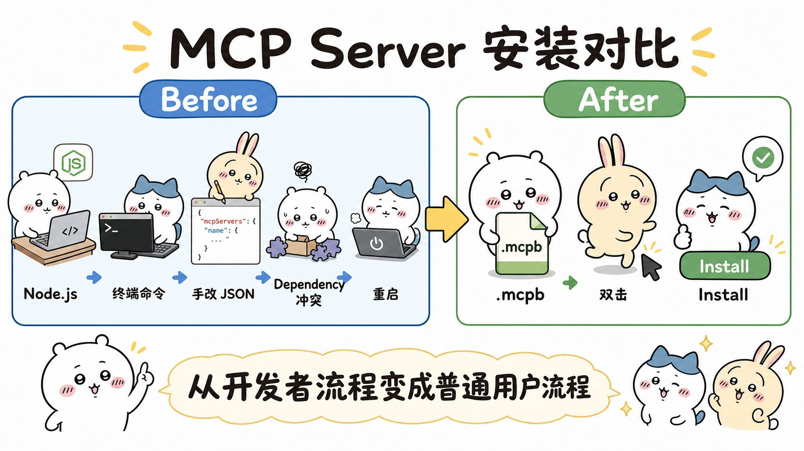
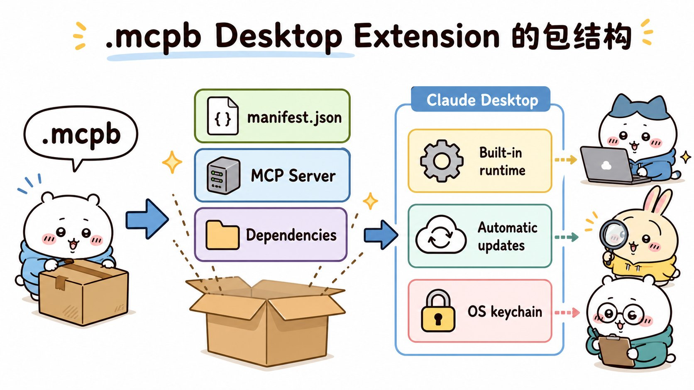
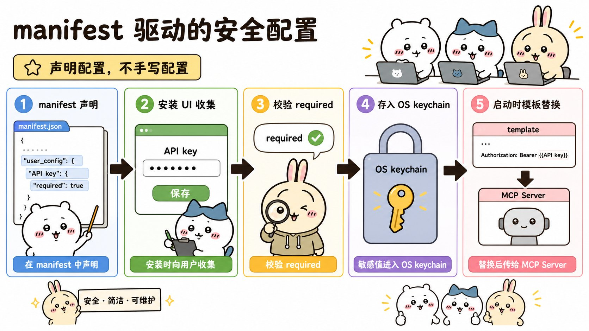
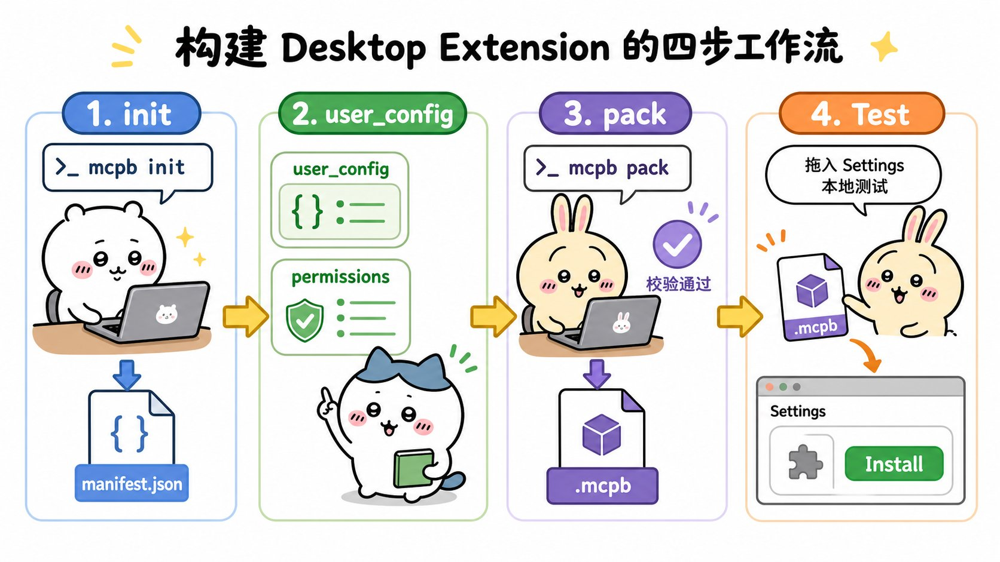
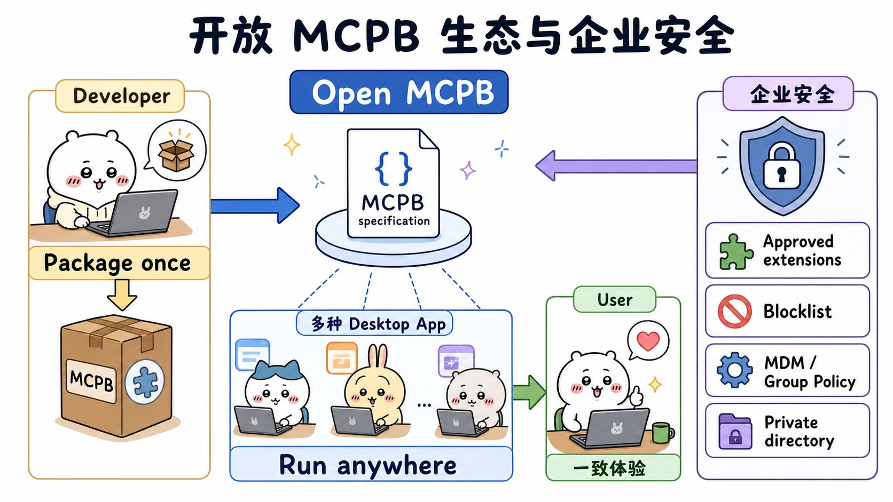

# Claude Desktop Extensions: One-click MCP server installation for Claude Desktop：面试速记

> Anthropic Engineering · 2025-06-26 · [官方原文](https://www.anthropic.com/engineering/desktop-extensions) · [本地逐句对照](07_desktop-extensions_逐句对照.md)

> ⚠️ **先记住这条后缀变更（原文 2025-09-11 官方更新说明）**：桌面扩展的文件后缀已经从 `.dxt` 改成 `.mcpb`（MCP Bundle 的缩写）。**已有的 `.dxt` 扩展仍然可以继续使用**，但官方建议新扩展一律用 `.mcpb`。功能完全没变，**这纯粹是一次命名约定上的更新**。面试里如果你说成 `.dxt`，记得补一句「后来改叫 `.mcpb` 了」——这比说对更能证明你在跟进。

## 一句话讲明白

**桌面扩展（Desktop Extensions）就是把一整个本地 MCP 服务器连同它的全部依赖，打包成一个 `.mcpb` 单文件；再配一份声明式的 `manifest.json` 说清「我是谁、怎么启动、要向用户收哪些配置、提供哪些工具」。于是本地 MCP 的安装从「装运行时 → 手改 JSON 配置文件 → 自己解依赖冲突 → 重启 → 祈祷能跑」，塌缩成「下载 → 双击 → 点安装」三步。**

## 为什么值得读 / 能用在哪

- 这篇不是 Agent 方法论，是**分发工程**：讲一个技术上已经成立的能力，怎么跨过「普通用户装不上」这道最后一公里。做工具生态、做插件体系的岗位很容易问到。
- 真实痛点：MCP 服务器再强，只要安装需要开终端，它的用户就永远只有开发者。原文的判断很硬——**这些摩擦点意味着 MCP 服务器在很大程度上对非技术用户仍然遥不可及**。
- 自己项目里能直接抄的三件事：① 用**声明式清单**替代手写配置，让宿主程序去生成安装界面；② 敏感值走**操作系统钥匙串**，绝不落到明文配置文件里；③ 用**模板占位符**（如 `${__dirname}`）把「安装时才知道的值」推迟到启动时再替换。
- 面试可用的对比锚点：这套设计和浏览器扩展、VS Code 插件是同一个思路——**清单文件 + 打包格式 + 宿主内置运行时 + 官方目录 + 企业管控**。能讲出这条类比，说明你理解的是模式而不是产品。

## 核心要点

### 一、旧安装流程到底卡在哪五处

原文列了五道门槛，**建议按序号背下来**，被问「你怎么看开发者工具的普及问题」时可以直接铺开：

1. **需要开发者工具**：用户得先装好 Node.js、Python 或别的运行时（runtime）。
2. **手动配置**：每接一个服务器，都要去编辑一次 JSON 配置文件。
3. **依赖管理**：包冲突、版本不匹配，全部甩给用户自己解。
4. **缺少发现机制**：想找一个好用的 MCP 服务器，只能去 GitHub 上搜。
5. **更新繁琐**：想保持最新，只能手动重新安装一遍。

原文用两段代码把前后差异摆得很直白。**之前**是：先装 Node.js → `npm install -g @example/mcp-server` → 手动改 `~/.claude/claude_desktop_config.json` → 重启 Claude Desktop → **"Hope it works"（祈祷它能跑）**。**之后**只有三步：下载一个 `.mcpb` 文件 → 双击用 Claude Desktop 打开 → 点「安装」。

> **一句可以直接念的结论**：不用开终端，不用改配置文件，也没有依赖冲突。

### 二、`.mcpb` 包里到底装了什么

一个桌面扩展**本质上就是一个压缩包（zip archive）**，典型结构是四块：

- `manifest.json` —— **唯一必需的文件**（这句是送分题，务必记住）；
- `server/` —— MCP 服务器的实现文件，比如 `index.js` 或 `main.py`；
- 依赖目录 —— Node.js 版是 `node_modules/`，Python 版是 `lib/`，**全部随包带走**；
- `icon.png` —— 可选的图标。

官方支持**三种扩展类型**：Node.js、Python，以及传统的**二进制文件 / 可执行文件**（binary / executable）。

复杂度全部由 Claude Desktop 这一侧吞掉，三条兜底能力：

- **内置运行时**：Node.js 直接随 Claude Desktop 一起分发，用户不必自己预装，外部依赖被消除；
- **自动更新**：有新版本时扩展自动更新，不用手工重装；
- **密钥安全**：API key 这类敏感配置存进**操作系统钥匙串（OS keychain）**。

### 三、清单文件如何驱动配置与密钥

`manifest.json` 里装四类信息：**人类可读的身份信息**（名称、描述、作者）、**功能声明**（工具、提示词）、**用户配置**、**运行时要求**。绝大多数字段可选，所以最小版本很短——必需的只有 `name`、`version`、`author` 和 `server`（里面要写清 `type` 是 `node` / `python` / `binary`、入口文件 `entry_point`、以及启动命令 `mcp_config`）。

真正的巧思在 `user_config`。开发者在这里**声明**自己想向用户收哪些输入，每一项都能标注类型、标题、说明、默认值，以及两个关键布尔值：`sensitive`（是否敏感）和 `required`（是否必填）。原文给的字段类型至少有 `string`、`directory`（可配 `multiple: true` 收多个目录）、`number`（可配 `min` / `max`，例如最大文件大小默认 10 MB、范围 1–100）。

Claude Desktop 拿到这份声明后会做四件事：

1. 自动渲染一个**用户友好的配置界面**；
2. **在启用扩展之前先校验输入**——用户没填必填项，Claude 就**不会启用**这个扩展；
3. 把敏感值**安全存入操作系统的密钥保险库**；
4. 按开发者的选择，把配置以**命令行参数或环境变量**的形式传给服务器。

启动服务器时，清单里的**模板占位符**（template literal）会被透明替换成真实值：

- `${user_config.api_key}` → 用户填入的那个 API key；
- `${__dirname}` → 扩展解包后所在目录的完整路径；
- `${HOME}`、`${TEMP}` → 系统环境变量。

**这套机制的价值一句话说完：密钥再也不用明文写进手工维护的 JSON 里。**

### 四、四步做出你的第一个扩展

原文以一个简单的文件系统服务器为例，走了四步：

1. **创建清单**：`npx @anthropic-ai/mcpb init`。交互式工具会问你服务器的情况，生成一份完整的 `manifest.json`；想直接「速通」拿到最基础版本，加 `--yes` 参数。
2. **处理用户配置**：在 `user_config` 里声明要收的东西（API key、允许访问的目录等），并在 `server.mcp_config.env` 里用占位符把它接出去。
3. **打包**：`npx @anthropic-ai/mcpb pack`。这条命令做两件事——**先校验你的清单，再生成 `.mcpb` 压缩包**。
4. **本地测试**：把 `.mcpb` 拖进 Claude Desktop 的「设置」窗口，你会看到扩展的可读信息、它需要的权限与配置，以及一个「安装」按钮。

若已有本地 MCP 服务器，全局装一次工具就能跑通：`npm install -g @anthropic-ai/mcpb`，然后 `mcpb init`、`mcpb pack`。

**三个进阶能力**（问到「跨平台怎么办」时用）：

- **跨平台覆盖**：`mcp_config.platforms` 下按 `win32` / `darwin` 分别覆盖启动命令和环境变量，例如 Windows 用 `node.exe`、临时目录取 `${TEMP}`，macOS 取 `${TMPDIR}`。
- **动态配置**：就是上面那套模板占位符。
- **功能声明**：在 `tools` 和 `prompts` 里预先写明这个扩展提供哪些工具、哪些提示词，**让用户在装之前就知道它能干什么**。

### 五、开放生态、官方目录与企业管控

**官方扩展目录**：Claude Desktop 内置一个**精选目录**，用户可以浏览、搜索、一键安装，不用再去 GitHub 上搜、也不用自己审代码。想上架要走四步：符合提交表单里的准则 → **在 Windows 和 macOS 上都测过** → 提交表单 → 官方团队做**质量与安全审核**。

**开源了什么**：完整的 MCPB 规范、打包与校验工具、参考实现（reference implementation）代码、TypeScript 类型定义与数据结构规范（schema）。目标是那句口号——**「打包一次，在任何支持 MCPB 的地方运行」**。收益分三类人：服务器开发者只打一次包；应用开发者不用从零造轮子就能支持扩展；用户在所有支持 MCP 的应用里拿到一致体验。注意**规范和工具链的版本号被刻意定为 `0.1`**，官方明说是想和社区一起演进——这是「预览版、会变」的信号。

**安全与企业治理**（这段最容易被追问）。面向用户三条：敏感数据留在操作系统钥匙串、自动更新、**能审计当前装了哪些扩展**。面向企业五条：

- 支持 **Windows 组策略（Group Policy）与 macOS 的移动设备管理（MDM）**；
- **预装经过批准的扩展**（相当于给企业一份允许名单）；
- 把特定扩展或**发布者**加进**屏蔽名单（blocklist）**；
- **完全禁用**官方扩展目录；
- **部署私有扩展目录**。

要有判断力地补一句：这些是**预览版内置的保护措施**，不是终局。扩展能访问本地数据和工具，钥匙串和自动更新只覆盖一部分风险，权限审查、对发布者的信任、以及长期的更新治理仍然要靠组织自己。

**彩蛋（可以当结尾的记忆钩子）**：Anthropic 内部用桌面扩展分享实验性 MCP 服务器，其中一个把 `PyBoy` 这个 GameBoy 模拟器打包成扩展、让 Claude 直接接管操作，思路和「Claude 玩宝可梦」研究一脉相承。

## 面试高频问答

**Q：一键安装听着像产品功能，工程上真正难的是什么？**
A：难点不在「双击」，在**把不确定性从用户侧搬到宿主侧**。要成立必须同时解决四件事：运行时得内置（所以 Claude Desktop 直接随包分发 Node.js）、依赖得随包带走（`node_modules/` 或 `lib/` 打进 zip）、安装时才知道的值要能延迟绑定（模板占位符 `${__dirname}`、`${user_config.key}`）、敏感值要有安全落点（操作系统钥匙串）。少任何一条，用户还是会掉回终端里。

**Q：为什么是「声明式清单」，而不是让扩展自己弹个配置界面？**
A：因为声明式才能被**审查和治理**。开发者只是在 `manifest.json` 里声明「我需要一个 API key、需要这些目录」，界面由 Claude Desktop 统一渲染、统一校验、统一存储。好处是三重的：用户在安装前就能看到这个扩展索要什么权限；敏感值的存储路径由平台保证而不是由扩展作者保证；企业可以在分发层面统一管控。**如果让扩展自己画界面，权限就变成不可见的黑盒了。**

**Q：`.dxt` 和 `.mcpb` 有什么区别？**
A：**没有功能区别，纯粹是改名。** 2025-09-11 的官方更新说明里讲得很清楚：后缀从 `.dxt` 换成 `.mcpb`（MCP Bundle），已有的 `.dxt` 扩展继续可用，但新扩展建议用 `.mcpb`。改名的用意是把格式和 MCP 生态绑定，而不是绑定 Claude Desktop 这一个宿主——**呼应了「打包一次，处处可运行」那句目标**。

**Q：企业要引入这套东西，你会提哪些风险和对策？**
A：核心风险是**扩展能访问本地数据和工具**，等于在终端上开了一条新的能力通道。对策照着官方五条走：用组策略或 MDM 统一下发；只预装经过批准的扩展；把不可信的扩展或发布者加进屏蔽名单；必要时直接禁掉公共扩展目录；规模大就部署私有目录。再补两条官方没细说但必须做的——**上线前审权限声明、上线后持续跟版本更新**。

**Q：这套格式和浏览器扩展、VS Code 插件相比，有什么可借鉴的？**
A：结构上几乎同构——**清单文件 + 打包格式 + 宿主内置运行时 + 官方审核目录 + 企业管控**，这是插件生态被验证过的标准形态。差异在于 MCPB 从第一天就把规范、工具链、类型定义全开源，并刻意标 `0.1` 版本，目标是让**其他 AI 桌面应用也能实现同一套格式**，而不是做成自家的私有插件体系。

## 必须记住的 8 句话

1. **后缀已从 `.dxt` 改为 `.mcpb`（MCP Bundle），旧文件仍可用，功能完全不变——纯命名更新，2025-09-11 生效。**
2. 桌面扩展 = **一个 zip 压缩包**，装着 MCP 服务器 + 全部依赖 + `manifest.json`。
3. **`manifest.json` 是唯一必需的文件**，其余（服务器文件、依赖、图标）按需。
4. 旧流程五道坎：**要装运行时、要手改 JSON、要自己解依赖、没有发现机制、更新靠重装**；新流程三步：下载 → 双击 → 安装。
5. Claude Desktop 侧兜底三件事：**内置 Node.js 运行时、自动更新、敏感值存操作系统钥匙串**。
6. `user_config` 把手工 JSON 变成**声明式安装界面**：平台负责渲染、校验、存储、传参；必填项没填，扩展**不会被启用**。
7. 模板占位符在启动时才替换：`${user_config.api_key}`、`${__dirname}`、`${HOME}` / `${TEMP}`；支持 `win32` / `darwin` 的平台专属覆盖。
8. 四步构建：**`mcpb init` → 声明 `user_config` → `mcpb pack`（先校验清单再打包）→ 拖进设置窗口本地测试**；规范与工具链开源、版本刻意标 `0.1`。

## 30 秒口述版

> 这篇解决的是 MCP 最现实的普及问题：安装太难。以前用户得先装 Node.js 或 Python、手改 JSON 配置文件、自己解依赖冲突，还只能去 GitHub 上找服务器、靠重装来更新——能力再强也只有开发者用得上。桌面扩展的做法是把整个本地 MCP 服务器连同全部依赖打成一个压缩包，后缀现在叫 `.mcpb`（原来是 `.dxt`，2025 年 9 月改名，旧文件仍可用，功能没变），用户下载、双击、点安装就行。包里唯一必需的文件是 `manifest.json`，它声明身份、启动方式、提供哪些工具和提示词，以及要向用户收哪些配置；Claude Desktop 据此自动生成安装界面、校验输入、把 API key 这类敏感值存进操作系统钥匙串，并在启动服务器时把 `${user_config.api_key}`、`${__dirname}` 这些占位符替换成真实值。运行时也由 Claude Desktop 内置，扩展还能自动更新。开发流程是四步：`mcpb init` 生成清单、声明用户配置、`mcpb pack` 校验并打包、拖进设置窗口测试。规范和工具链全部开源、版本刻意标 0.1，目标是「打包一次，在任何支持 MCPB 的地方运行」。企业侧提供组策略和 MDM、预装批准扩展、屏蔽名单、禁用公共目录、部署私有目录五种管控手段。

## 自测

- [ ] 能一口说出后缀从 `.dxt` 改成 `.mcpb` 的时间、原因，以及旧文件是否还能用。
- [ ] 能背出旧安装流程的五道门槛，和新流程的三步。
- [ ] 能说出扩展包的四个组成部分，并指出**哪一个是唯一必需的**。
- [ ] 能说出 Claude Desktop 侧兜底的三件事，以及支持的三种扩展类型。
- [ ] 能讲清一个 API key 从 `user_config` 声明 → 安装界面 → 操作系统钥匙串 → 启动时占位符替换的完整路径。
- [ ] 能复述 `mcpb init → 声明配置 → mcpb pack → 拖入设置测试` 四步，并说出 `pack` 除了打包还做了什么。
- [ ] 能列出面向企业的五项治理能力，并补充两条官方没细说但必须做的事。
- [ ] 能用浏览器扩展 / VS Code 插件做类比，说清这套格式的通用模式和它的差异点。

> 插图为学习用途的非官方同人式教学图，角色与文章版权归各自权利人。
