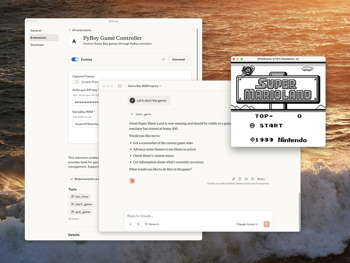

# 07_Claude Desktop Extensions: One-click MCP server installation for Claude Desktop_Claude 桌面扩展：为 Claude Desktop 实现 MCP 服务器一键安装

> 原文：https://www.anthropic.com/engineering/desktop-extensions
> 作者：Anthropic Engineering｜发布日期：2025-06-26

## 📌 本篇速览

- 📅 2025-06-26　｜　⏱ 约 10 分钟　｜　📄 1,695 词 / 1 图
- ⭐ ★★★☆☆ **按需阅读** —— 对做 MCP 服务器分发和本地智能体工具生态的工程师很实用，但偏产品发布与打包规范说明，非核心 Agent 设计方法论。
- 🏷 MCP、Desktop Extensions、MCPB 打包格式、manifest.json、Claude Desktop
- 🗂 [返回总目录](00_目录与阅读进度.md)

文章介绍了 Anthropic 推出的桌面扩展（Desktop Extensions，.mcpb 格式）：把整个本地 MCP 服务器连同全部依赖打包成单一可安装文件，用户双击即可安装，彻底消除了装运行时、手改 JSON 配置、解决依赖冲突等门槛。文中详解了 manifest.json 的架构与用户配置、密钥保管、跨平台覆盖等机制，并演示了用 mcpb CLI 四步打包扩展的流程。Anthropic 同时开源了 MCPB 规范与工具链，内置精选扩展目录，并提供面向企业的组策略/MDM 管控能力。

---

> **[Update 2025-09-11] File extension update**
>
> Claude Desktop Extensions now use the .mcpb (MCP Bundle) file extension instead of .dxt. Existing .dxt extensions will continue to work, but we recommend developers use .mcpb for new extensions going forward. All functionality remains the same - this is purely a naming convention update.

> **[更新 2025-09-11] 文件后缀更新**
>
> Claude 桌面扩展现在改用 .mcpb（MCP Bundle）文件后缀，取代原先的 .dxt。已有的 .dxt 扩展仍可继续使用，但我们建议开发者今后为新扩展采用 .mcpb。所有功能保持不变——这纯粹是一次命名约定上的更新。

—

When we released the Model Context Protocol (MCP) last year, we saw developers build amazing local servers that gave Claude access to everything from file systems to databases.

去年我们发布模型上下文协议（Model Context Protocol，MCP）之后，看到开发者们构建出了许多令人惊叹的本地服务器（local server），让 Claude 能够访问从文件系统到数据库的方方面面。

But we kept hearing the same feedback: installation was too complex.

但我们不断听到同一条反馈：安装过程太复杂了。

Users needed developer tools, had to manually edit configuration files, and often got stuck on dependency issues.

用户需要装开发者工具，得手动编辑配置文件，还经常卡在依赖（dependency）问题上。

Today, we're introducing Desktop Extensions—a new packaging format that makes installing MCP servers as simple as clicking a button.

今天，我们推出桌面扩展（Desktop Extensions）——一种新的打包格式，让安装 MCP 服务器变得像点一下按钮那么简单。

### Addressing the MCP installation problem｜解决 MCP 的安装难题

Local MCP servers unlock powerful capabilities for Claude Desktop users.

本地 MCP 服务器为 Claude Desktop 用户解锁了强大的能力。

They can interact with local applications, access private data, and integrate with development tools—all while keeping data on the user's machine.

它们可以与本地应用交互、访问私有数据、与开发工具集成——同时让数据始终留在用户自己的机器上。

However, the current installation process creates significant barriers:

然而，当前的安装流程带来了不小的门槛：

- **Developer tools required**: Users need Node.js, Python, or other runtimes installed

- **需要开发者工具**：用户必须安装 Node.js、Python 或其他运行时（runtime）

- **Manual configuration**: Each server requires editing JSON configuration files

- **手动配置**：每个服务器都需要编辑 JSON 配置文件

- **Dependency management**: Users must resolve package conflicts and version mismatches

- **依赖管理**：用户必须自行解决包冲突和版本不匹配问题

- **No discovery mechanism**: Finding useful MCP servers requires searching GitHub

- **缺少发现机制**：想找到好用的 MCP 服务器只能去 GitHub 上搜

- **Update complexity**: Keeping servers current means manual reinstallation

- **更新繁琐**：想让服务器保持最新，就得手动重新安装

These friction points meant that MCP servers, despite their power, remained largely inaccessible to non-technical users.

这些摩擦点意味着，MCP 服务器尽管功能强大，对非技术用户来说却在很大程度上仍然遥不可及。

### Introducing Desktop Extensions｜介绍桌面扩展（Desktop Extensions）

Desktop Extensions (`.mcpb` files) solve these problems by bundling an entire MCP server—including all dependencies—into a single installable package.

桌面扩展（`.mcpb` 文件）通过把整个 MCP 服务器——包括全部依赖——打包成一个可安装的单一软件包，解决了这些问题。

Here's what changes for users:

对用户来说，变化如下：

**Before:**

**之前：**

```
# Install Node.js first 
npm install -g @example/mcp-server 
# Edit ~/.claude/claude_desktop_config.json manually 
# Restart Claude Desktop 
# Hope it works
```

**After:**

**之后：**

1. Download a `.mcpb` file

1. 下载一个 `.mcpb` 文件

2. Double-click to open with Claude Desktop

2. 双击，用 Claude Desktop 打开

3. Click "Install"

3. 点击"安装（Install）"

That's it. No terminal, no configuration files, no dependency conflicts.

就这么简单。不用开终端，不用改配置文件，也没有依赖冲突。

## Architecture overview｜架构总览

A Desktop Extension is a zip archive containing the local MCP server as well as a `manifest.json`, which describes everything Claude Desktop and other apps supporting desktop extensions need to know.

一个桌面扩展就是一个 zip 压缩包，里面装着本地 MCP 服务器，外加一个 `manifest.json`——它描述了 Claude Desktop 以及其他支持桌面扩展的应用所需要知道的全部信息。

```
extension.mcpb (ZIP archive)
├── manifest.json         # Extension metadata and configuration
├── server/               # MCP server implementation
│   └── [server files]    
├── dependencies/         # All required packages/libraries
└── icon.png             # Optional: Extension icon

# Example: Node.js Extension
extension.mcpb
├── manifest.json         # Required: Extension metadata and configuration
├── server/               # Server files
│   └── index.js          # Main entry point
├── node_modules/         # Bundled dependencies
├── package.json          # Optional: NPM package definition
└── icon.png              # Optional: Extension icon

# Example: Python Extension
extension.mcpb (ZIP file)
├── manifest.json         # Required: Extension metadata and configuration
├── server/               # Server files
│   ├── main.py           # Main entry point
│   └── utils.py          # Additional modules
├── lib/                  # Bundled Python packages
├── requirements.txt      # Optional: Python dependencies list
└── icon.png              # Optional: Extension icon
```

The only required file in a Desktop Extension is a manifest.json.

桌面扩展中唯一必需的文件就是 manifest.json。

Claude Desktop handles all the complexity:

所有复杂性都由 Claude Desktop 来处理：

- **Built-in runtime**: We ship Node.js with Claude Desktop, eliminating external dependencies

- **内置运行时**：我们把 Node.js 随 Claude Desktop 一起分发，消除了外部依赖

- **Automatic updates**: Extensions update automatically when new versions are available

- **自动更新**：有新版本发布时，扩展会自动更新

- **Secure secrets**: Sensitive configuration like API keys are stored in the OS keychain

- **密钥安全**：像 API key 这样的敏感配置存储在操作系统的钥匙串（keychain）中

The manifest contains human-readable information (like the name, description, or author), a declaration of features (tools, prompts), user configuration, and runtime requirements.

manifest 包含人类可读的信息（如名称、描述、作者）、功能声明（工具、提示词）、用户配置以及运行时要求。

Most fields are optional, so the minimal version is quite short, although in practice, we expect all three supported extension types (Node.js, Python, and classic binaries/executables) to include files:

大多数字段都是可选的，所以最简版本相当短——不过在实践中，我们预计三种受支持的扩展类型（Node.js、Python 以及传统的二进制/可执行文件）都会包含文件：

```
{
  "mcpb_version": "0.1",                    // MCPB spec version this manifest conforms to
  "name": "my-extension",                   // Machine-readable name (used for CLI, APIs)
  "version": "1.0.0",                       // Semantic version of your extension
  "description": "A simple MCP extension",  // Brief description of what the extension does
  "author": {                               // Author information (required)
    "name": "Extension Author"              // Author's name (required field)
  },
  "server": {                               // Server configuration (required)
    "type": "node",                         // Server type: "node", "python", or "binary"
    "entry_point": "server/index.js",       // Path to the main server file
    "mcp_config": {                         // MCP server configuration
      "command": "node",                    // Command to run the server
      "args": [                             // Arguments passed to the command
        "${__dirname}/server/index.js"      // ${__dirname} is replaced with the extension's directory
      ]                              
    }
  }
}
```

There are a number of convenience options [available in the manifest spec](https://github.com/anthropics/dxt/blob/main/MANIFEST.md) that aim to make the installation and configuration of local MCP servers easier.

[manifest 规范中提供了](https://github.com/anthropics/dxt/blob/main/MANIFEST.md)许多便利选项，旨在让本地 MCP 服务器的安装与配置更加轻松。

The server configuration object can be defined in a way that makes room both for user-defined configuration in the form of template literals as well as platform-specific overrides.

服务器配置对象（server configuration object）在定义时，既可以通过模板字面量（template literal）的形式为用户自定义配置留出空间，也可以支持针对特定平台的覆盖（platform-specific override）。

Extension developers can define, in detail, what kind of configuration they want to collect from users.

扩展开发者可以详细定义他们想从用户那里收集哪些配置。

Let’s take a look at a concrete example of how the manifest aids with configuration.

我们来看一个具体例子，了解 manifest 是如何辅助配置的。

In the manifest below, the developer declares that the user needs to supply an `api_key`.

在下面的 manifest 中，开发者声明用户需要提供一个 `api_key`。

Claude will not enable the extension until the user has supplied that value, keep it automatically in the operating system’s secret vault, and transparently replace the `$${user_config.api_key}` with the user-supplied value when launching the server.

在用户提供该值之前，Claude 不会启用这个扩展；它会自动把该值保存在操作系统的密钥保险库（secret vault）中，并在启动服务器时透明地把 `$${user_config.api_key}` 替换成用户提供的值。

Similarly, `$${__dirname}` will be replaced with the full path to the extension’s unpacked directory.

类似地，`$${__dirname}` 会被替换成扩展解包后所在目录的完整路径。

```
{
  "mcpb_version": "0.1",
  "name": "my-extension",
  "version": "1.0.0",
  "description": "A simple MCP extension",
  "author": {
    "name": "Extension Author"
  },
  "server": {
    "type": "node",
    "entry_point": "server/index.js",
    "mcp_config": {
      "command": "node",
      "args": ["${__dirname}/server/index.js"],
      "env": {
        "API_KEY": "${user_config.api_key}"
      }
    }
  },
  "user_config": {
    "api_key": {
      "type": "string",
      "title": "API Key",
      "description": "Your API key for authentication",
      "sensitive": true,
      "required": true
    }
  }
}
```

A full `manifest.json` with most of the optional fields might look like this:

一个把大部分可选字段都填上的完整 `manifest.json` 大概长这样：

```
{
  "mcpb_version": "0.1",
  "name": "My MCP Extension",
  "display_name": "My Awesome MCP Extension",
  "version": "1.0.0",
  "description": "A brief description of what this extension does",
  "long_description": "A detailed description that can include multiple paragraphs explaining the extension's functionality, use cases, and features. It supports basic markdown.",
  "author": {
    "name": "Your Name",
    "email": "yourname@example.com",
    "url": "https://your-website.com"
  },
  "repository": {
    "type": "git",
    "url": "https://github.com/your-username/my-mcp-extension"
  },
  "homepage": "https://example.com/my-extension",
  "documentation": "https://docs.example.com/my-extension",
  "support": "https://github.com/your-username/my-extension/issues",
  "icon": "icon.png",
  "screenshots": [
    "assets/screenshots/screenshot1.png",
    "assets/screenshots/screenshot2.png"
  ],
  "server": {
    "type": "node",
    "entry_point": "server/index.js",
    "mcp_config": {
      "command": "node",
      "args": ["${__dirname}/server/index.js"],
      "env": {
        "ALLOWED_DIRECTORIES": "${user_config.allowed_directories}"
      }
    }
  },
  "tools": [
    {
      "name": "search_files",
      "description": "Search for files in a directory"
    }
  ],
  "prompts": [
    {
      "name": "poetry",
      "description": "Have the LLM write poetry",
      "arguments": ["topic"],
      "text": "Write a creative poem about the following topic: ${arguments.topic}"
    }
  ],
  "tools_generated": true,
  "keywords": ["api", "automation", "productivity"],
  "license": "MIT",
  "compatibility": {
    "claude_desktop": ">=1.0.0",
    "platforms": ["darwin", "win32", "linux"],
    "runtimes": {
      "node": ">=16.0.0"
    }
  },
  "user_config": {
    "allowed_directories": {
      "type": "directory",
      "title": "Allowed Directories",
      "description": "Directories the server can access",
      "multiple": true,
      "required": true,
      "default": ["${HOME}/Desktop"]
    },
    "api_key": {
      "type": "string",
      "title": "API Key",
      "description": "Your API key for authentication",
      "sensitive": true,
      "required": false
    },
    "max_file_size": {
      "type": "number",
      "title": "Maximum File Size (MB)",
      "description": "Maximum file size to process",
      "default": 10,
      "min": 1,
      "max": 100
    }
  }
}
```

To see an extension and manifest, please refer [to the examples in the MCPB repository](https://github.com/anthropics/dxt/tree/main/examples).

想看扩展和 manifest 的实际样例，请参考 [MCPB 仓库中的示例](https://github.com/anthropics/dxt/tree/main/examples)。

The full specification for all required and optional fields in the `manifest.json` can be found as part of our [open-source toolchain](https://github.com/anthropics/dxt/blob/main/MANIFEST.md).

`manifest.json` 中所有必需和可选字段的完整规范，可以在我们的[开源工具链](https://github.com/anthropics/dxt/blob/main/MANIFEST.md)中找到。

### Building your first extension｜构建你的第一个扩展

Let's walk through packaging an existing MCP server as a Desktop Extension.

下面我们一步步演示如何把一个现有的 MCP 服务器打包成桌面扩展。

We'll use a simple file system server as an example.

我们以一个简单的文件系统服务器为例。

#### Step 1: Create the manifest｜第 1 步：创建 manifest

First, initialize a manifest for your server:

首先，为你的服务器初始化一个 manifest：

```
npx @anthropic-ai/mcpb init
```

This interactive tool asks about your server and generates a complete manifest.json.

这个交互式工具会询问你的服务器相关信息，并生成一份完整的 manifest.json。

If you want to speed-run your way to the most basic manifest.json, you can run the command with a --yes parameter.

如果你想一路"速通"、直接得到最基础的 manifest.json，可以在运行该命令时加上 --yes 参数。

#### Step 2: Handle user configuration｜第 2 步：处理用户配置

If your server needs user input (like API keys or allowed directories), declare it in the manifest:

如果你的服务器需要用户输入（比如 API key 或允许访问的目录），就在 manifest 中声明出来：

```
"user_config": {
  "allowed_directories": {
    "type": "directory",
    "title": "Allowed Directories",
    "description": "Directories the server can access",
    "multiple": true,
    "required": true,
    "default": ["${HOME}/Documents"]
  }
}
```

Claude Desktop will:

Claude Desktop 会：

- Display a user-friendly configuration UI

- 展示一个用户友好的配置界面

- Validate inputs before enabling the extension

- 在启用扩展之前先校验输入

- Securely store sensitive values

- 安全地存储敏感值

- Pass configuration to your server either as arguments or environment variables, depending on developer configuration

- 根据开发者的配置，把这些配置以参数或环境变量的形式传给你的服务器

In the example below, we’re passing the user configuration as an environment variable, but it could also be an argument.

在下面的例子中，我们把用户配置作为环境变量传入，但它同样可以作为参数传入。

```
"server": {
   "type": "node",
   "entry_point": "server/index.js",
   "mcp_config": {
   "command": "node",
   "args": ["${__dirname}/server/index.js"],
   "env": {
      "ALLOWED_DIRECTORIES": "${user_config.allowed_directories}"
   }
   }
}
```

#### Step 3: Package the extension｜第 3 步：打包扩展

Bundle everything into a `.mcpb` file:

把所有内容打包成一个 `.mcpb` 文件：

```
npx @anthropic-ai/mcpb pack
```

This command:

这条命令会：

1. Validates your manifest

1. 校验你的 manifest

2. Generates the `.mcpb` archive

2. 生成 `.mcpb` 压缩包

#### Step 4: Test locally｜第 4 步：本地测试

Drag your `.mcpb` file into Claude Desktop's Settings window.

把你的 `.mcpb` 文件拖进 Claude Desktop 的"设置（Settings）"窗口。

You'll see:

你会看到：

- Human-readable information about your extension

- 关于你的扩展的人类可读信息

- Required permissions and configuration

- 所需的权限和配置

- A simple "Install" button

- 一个简洁的"安装（Install）"按钮

### Advanced features｜高级特性

#### Cross-platform support｜跨平台支持

Extensions can adapt to different operating systems:

扩展可以适配不同的操作系统：

```
"server": {
  "type": "node",
  "entry_point": "server/index.js",
  "mcp_config": {
    "command": "node",
    "args": ["${__dirname}/server/index.js"],
    "platforms": {
      "win32": {
        "command": "node.exe",
        "env": {
          "TEMP_DIR": "${TEMP}"
        }
      },
      "darwin": {
        "env": {
          "TEMP_DIR": "${TMPDIR}"
        }
      }
    }
  }
}
```

#### Dynamic configuration｜动态配置

Use template literals for runtime values:

用模板字面量表示运行时的值：

- `$${__dirname}`: Extension's installation directory

- `$${__dirname}`：扩展的安装目录

- `$${user_config.key}`: User-provided configuration

- `$${user_config.key}`：用户提供的配置

- `$${HOME}, ${TEMP}`: System environment variables

- `$${HOME}, ${TEMP}`：系统环境变量

#### Feature declaration｜功能声明

Help users understand capabilities upfront:

帮助用户提前了解扩展具备哪些能力：

```
"tools": [
  {
    "name": "read_file",
    "description": "Read contents of a file"
  }
],
"prompts": [
  {
    "name": "code_review",
    "description": "Review code for best practices",
    "arguments": ["file_path"]
  }
]
```

### The extension directory｜扩展目录

We're launching with a curated directory of extensions built into Claude Desktop.

我们在发布时就会提供一个内置于 Claude Desktop 的精选扩展目录（directory）。

Users can browse, search, and install with one click—no searching GitHub or vetting code.

用户可以浏览、搜索并一键安装——不用再去 GitHub 上搜，也不用自己审查代码。

While we expect both the Desktop Extension specification and the implementation in Claude for macOS and Windows to evolve over time, we look forward to seeing the many ways in which extensions can be used to expand the capabilities of Claude in creative ways.

尽管我们预计桌面扩展规范以及 macOS 和 Windows 版 Claude 中的实现都会随时间演进，但我们非常期待看到大家用扩展以各种富有创意的方式拓展 Claude 的能力。

To submit your extension:

提交你的扩展的流程：

1. Ensure it follows the guidelines found in the submission form

1. 确保它符合提交表单中列出的准则

2. Test across Windows and macOS

2. 在 Windows 和 macOS 上都完成测试

3. [Submit your extension](https://docs.google.com/forms/d/14_Dmcig4z8NeRMB_e7TOyrKzuZ88-BLYdLvS6LPhiZU/edit)

3. [提交你的扩展](https://docs.google.com/forms/d/14_Dmcig4z8NeRMB_e7TOyrKzuZ88-BLYdLvS6LPhiZU/edit)

4. Our team reviews for quality and security

4. 我们的团队会对质量与安全进行审核

### Building an open ecosystem｜构建开放生态

We are committed to the open ecosystem around MCP servers and believe that its ability to be universally adopted by multiple applications and services has benefitted the community.

我们始终致力于围绕 MCP 服务器的开放生态，并相信它能被多种应用和服务普遍采用这一特性，已经让整个社区受益。

In line with this commitment, we’re open-sourcing the Desktop Extension specification, toolchain, and the schemas and key functions used by Claude for macOS and Windows to implement its own support of Desktop Extensions.

秉持这一承诺，我们将开源桌面扩展规范、工具链，以及 macOS 和 Windows 版 Claude 用来实现自身桌面扩展支持的 schema 和关键函数。

It is our hope that the MCPB format doesn’t just make local MCP servers more portable for Claude, but other AI desktop applications, too.

我们希望 MCPB 格式不仅能让本地 MCP 服务器在 Claude 上更加便携（portable），也能惠及其他 AI 桌面应用。

We're open-sourcing:

我们开源的内容包括：

- The complete MCPB specification

- 完整的 MCPB 规范

- Packaging and validation tools

- 打包与校验工具

- Reference implementation code

- 参考实现（reference implementation）代码

- TypeScript types and schemas

- TypeScript 类型与 schema

This means:

这意味着：

- **For MCP server developers**: Package once, run anywhere that supports MCPB

- **对 MCP 服务器开发者**：打包一次，即可在任何支持 MCPB 的地方运行

- **For app developers**: Add extension support without building from scratch

- **对应用开发者**：无需从零开始，就能为自己的应用加上扩展支持

- **For users**: Consistent experience across all MCP-enabled applications

- **对用户**：在所有支持 MCP 的应用中获得一致的体验

The specification and toolchain is on purpose versioned as 0.1, as we are looking forward to working with the greater community on evolving and changing the format.

规范和工具链特意把版本号定为 0.1，因为我们期待与更广泛的社区一起演进和改进这一格式。

We look forward to hearing from you.

我们期待听到你的反馈。

### Security and enterprise considerations｜安全与企业级考量

We understand that extensions introduce new security considerations, particularly for enterprises.

我们理解，扩展会带来新的安全考量，对企业而言尤其如此。

We've built in several safeguards with the preview release of Desktop Extensions:

在桌面扩展的预览版（preview release）中，我们内置了多重保护措施：

#### For users｜面向用户

- Sensitive data stays in the OS keychain

- 敏感数据始终保存在操作系统钥匙串中

- Automatic updates

- 自动更新

- Ability to audit what extensions are installed

- 可以审计（audit）当前安装了哪些扩展

#### For enterprises｜面向企业

- Group Policy (Windows) and MDM (macOS) support

- 支持组策略（Group Policy，Windows）和 MDM（macOS）

- Ability to pre-install approved extensions

- 可以预装经过批准的扩展

- Blocklist specific extensions or publishers

- 可以把特定扩展或发布者加入屏蔽列表（blocklist）

- Disable the extension directory entirely

- 可以完全禁用扩展目录

- Deploy private extension directories

- 可以部署私有扩展目录

For more information about how to manage extensions within your organization, see our [documentation](https://support.anthropic.com/en/articles/10949351-getting-started-with-model-context-protocol-mcp-on-claude-for-desktop).

关于如何在你的组织内管理扩展的更多信息，请参阅我们的[文档](https://support.anthropic.com/en/articles/10949351-getting-started-with-model-context-protocol-mcp-on-claude-for-desktop)。

### Getting started｜快速上手

Ready to build your own extension? Here's how to start:

准备好构建你自己的扩展了吗？可以这样开始：

**For MCP server developers**: Review our [developer documentation](https://github.com/anthropics/dxt) – or dive right in by running the following commands in your local MCP servers’ directory:

**MCP 服务器开发者**：阅读我们的[开发者文档](https://github.com/anthropics/dxt)——或者直接上手，在你本地 MCP 服务器的目录里运行以下命令：

```
npm install -g @anthropic-ai/mcpb
mcpb init
mcpb pack
```

**For Claude Desktop users**: Update to the latest version and look for the Extensions section in Settings

**Claude Desktop 用户**：更新到最新版本，然后在"设置（Settings）"中找到"扩展（Extensions）"板块

**For enterprises**: Review our enterprise documentation for deployment options

**企业用户**：查阅我们的企业文档，了解各种部署选项

### Building with Claude Code｜用 Claude Code 来构建

Internally at Anthropic, we have found that Claude is great at building extensions with minimal intervention.

在 Anthropic 内部，我们发现 Claude 非常擅长在几乎无需人工干预的情况下构建扩展。

If you too want to use Claude Code, we recommend that you briefly explain what you want your extension to do and then add the following context to the prompt:

如果你也想用 Claude Code，我们建议你先简要说明你希望扩展做什么，然后在提示词中加入以下上下文：

```
I want to build this as a Desktop Extension, abbreviated as "MCPB". Please follow these steps:

1. **Read the specifications thoroughly:**
   - https://github.com/anthropics/mcpb/blob/main/README.md - MCPB architecture overview, capabilities, and integration patterns
   - https://github.com/anthropics/mcpb/blob/main/MANIFEST.md - Complete extension manifest structure and field definitions
   - https://github.com/anthropics/mcpb/tree/main/examples - Reference implementations including a "Hello World" example

2. **Create a proper extension structure:**
   - Generate a valid manifest.json following the MANIFEST.md spec
   - Implement an MCP server using @modelcontextprotocol/sdk with proper tool definitions
   - Include proper error handling and timeout management

3. **Follow best development practices:**
   - Implement proper MCP protocol communication via stdio transport
   - Structure tools with clear schemas, validation, and consistent JSON responses
   - Make use of the fact that this extension will be running locally
   - Add appropriate logging and debugging capabilities
   - Include proper documentation and setup instructions

4. **Test considerations:**
   - Validate that all tool calls return properly structured responses
   - Verify manifest loads correctly and host integration works

Generate complete, production-ready code that can be immediately tested. Focus on defensive programming, clear error messages, and following the exact
MCPB specifications to ensure compatibility with the ecosystem.
```

### Conclusion｜结语

Desktop Extensions represent a fundamental shift in how users interact with local AI tools.

桌面扩展代表了用户与本地 AI 工具交互方式的一次根本性转变。

By removing installation friction, we're making powerful MCP servers accessible to everyone—not just developers.

通过消除安装摩擦，我们让强大的 MCP 服务器变得人人可用——而不再只是开发者的专利。

Internally, we’re using desktop extensions to share highly experimental MCP servers - some fun, some useful..

在内部，我们正在用桌面扩展来分享一些高度实验性的 MCP 服务器——有的纯属好玩，有的确实有用。

One team experimented to see how far our models could make it when directly connected to a GameBoy, similar to our [“Claude plays Pokémon” research](https://www.anthropic.com/news/visible-extended-thinking).

有一个团队做了实验，想看看我们的模型在直接连上 GameBoy 后能玩到什么程度，类似于我们的[“Claude 玩宝可梦（Claude plays Pokémon）”研究](https://www.anthropic.com/news/visible-extended-thinking)。

We used Desktop Extensions to package a single extension that opens up the popular [PyBoy](https://github.com/Baekalfen/PyBoy) GameBoy emulator and lets Claude take control.

我们用桌面扩展打包了一个扩展：它会打开广受欢迎的 [PyBoy](https://github.com/Baekalfen/PyBoy) GameBoy 模拟器，并让 Claude 接管操作。

We believe that countless opportunities exist to connect the model’s capabilities to the tools, data, and applications users already have on their local machines.

我们相信，把模型的能力连接到用户本地机器上已有的工具、数据和应用，其中蕴藏着数不清的机会。



We can't wait to see what you build.

我们迫不及待想看到你会构建出什么。

The same creativity that brought us thousands of MCP servers can now reach millions of users with just one click.

曾经孕育出成千上万个 MCP 服务器的那股创造力，如今只需一次点击就能触达数以百万计的用户。

Ready to share your MCP server? [Submit your extension for review](https://forms.gle/tyiAZvch1kDADKoP9).

准备好分享你的 MCP 服务器了吗？[提交你的扩展以供审核](https://forms.gle/tyiAZvch1kDADKoP9)。
