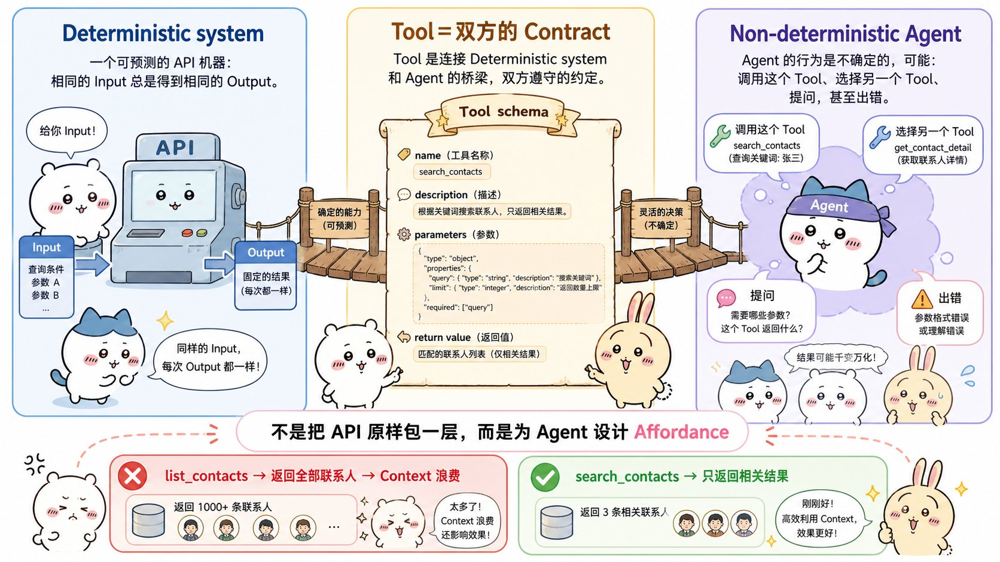
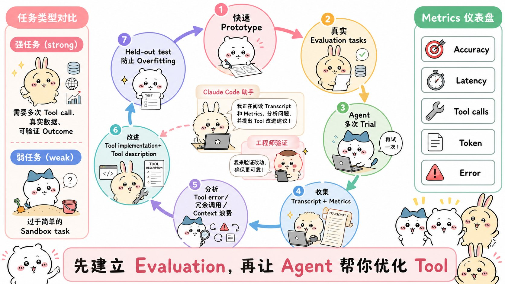
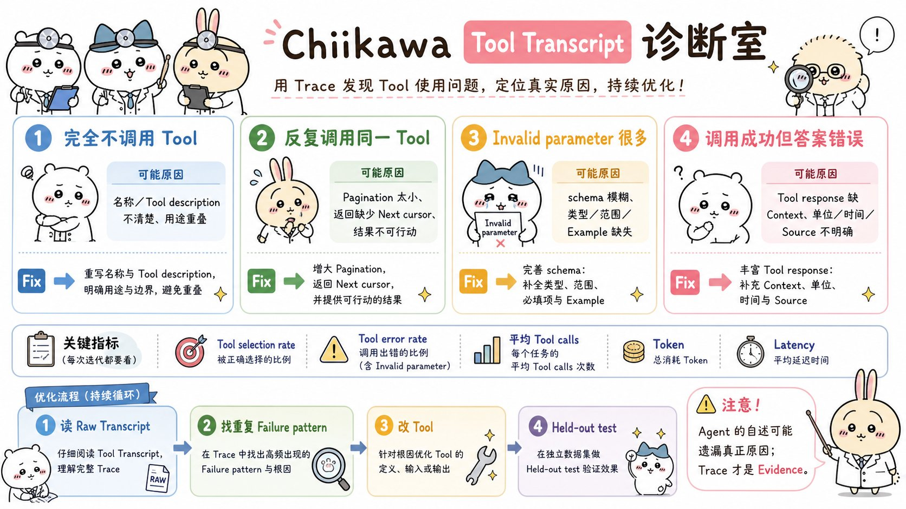
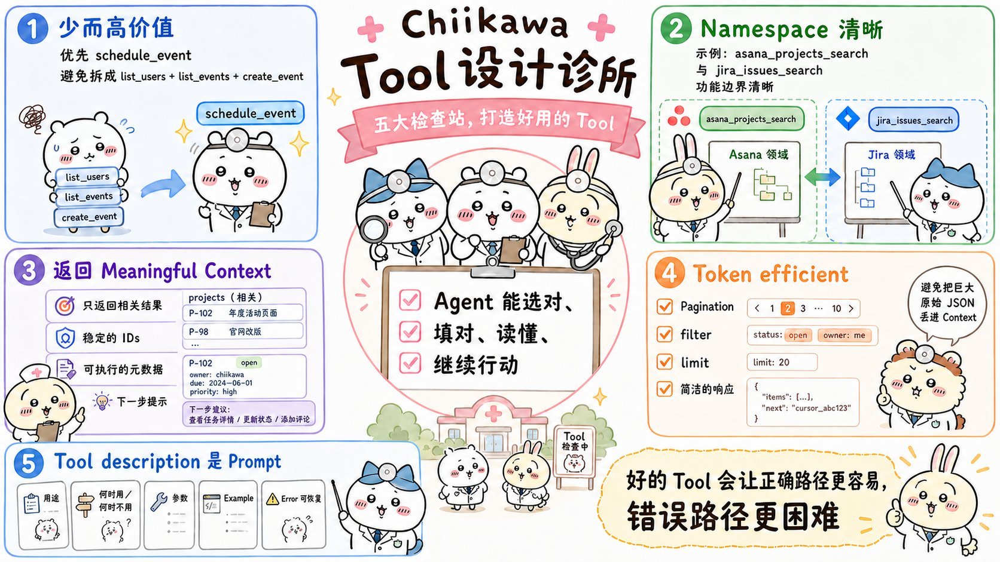
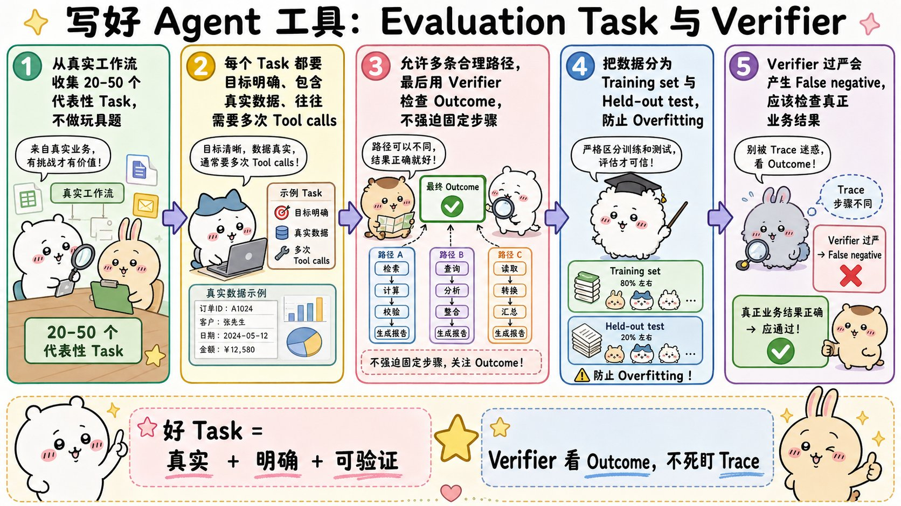

# Writing effective tools for agents — with agents：面试速记

> Anthropic Engineering · 2025-09-11 · [官方原文](https://www.anthropic.com/engineering/writing-tools-for-agents) · [本地逐句对照](08_writing-tools-for-agents_逐句对照.md)

## 一句话讲明白

**给智能体（agent）写工具，不是把现有接口原样包一层，而是要为一个"会选错、会填错、会看不懂返回值"的非确定性调用方重新设计；而唯一靠谱的改进方式是：先建一套真实任务的评估（eval），再让 Claude Code 读着评估记录帮你改工具，最后用留出测试集（held-out test set）确认改动真的能泛化。**

## 为什么值得读 / 能用在哪

- 这是目前把"工具设计"讲得最工程化的一篇：它给的不是审美建议，而是一条可度量的闭环。
- 真实痛点：接了几十个 MCP 服务器、几百个工具之后，智能体开始调错工具、重复调用、把上下文（context）撑爆——加提示词警告治标不治本。
- 能直接用在自己项目里：把内部接口按"高价值工作流"合并成少量工具、给工具名加命名空间前缀、给返回值加 `response_format` 档位、把 25,000 token 这类硬上限落地。
- 面试里这篇是"工具/MCP 设计"类问题的标准答案来源，尤其是**评估驱动**这条主线。

## 核心要点

### 1. 工具是"确定性系统 ↔ 非确定性智能体"的契约

- 传统函数是**确定性**（deterministic）契约：`getWeather("NYC")` 每次调用行为完全一致。
- 工具是**新型软件**：另一端是**非确定性**（non-deterministic）的智能体。同样问"今天要带伞吗"，它可能调天气工具、可能凭记忆直接答、可能先反问你在哪个城市，偶尔还会产生幻觉、根本没搞懂这个工具怎么用。
- 结论：**不能按"写给其他开发者的函数和接口"的思路写工具**，要专门为智能体设计。
- 核心概念是**可供性**（affordance，即"我感知到自己能用它做什么"）：智能体的可供性和传统软件不同——它的上下文有限，而计算机内存廉价充裕。
- 通讯录例子：`list_contacts` 返回全部联系人，智能体只能一个 token 一个 token 读完（等于把通讯录从头翻到尾的暴力搜索）；`search_contacts` 先过滤再返回，才是人和智能体都自然的做法。
- 目标是扩大智能体的**有效作用面**：让它能用工具走通多种可行策略。好消息是，对智能体"顺手"的工具，对人往往也直观易懂。

### 2. 评估驱动的开发闭环（本文主线，务必讲透）

闭环共五步，缺一步就退化成拍脑袋调参：

**第一步：快速做原型。**

- 不亲自上手，你根本预判不出哪些工具对智能体顺手、哪些不顺手。
- 用 Claude Code 写工具时，把依赖的软件库、接口、SDK 文档喂给它——官方文档站常有对模型友好的扁平 `llms.txt`，Anthropic 接口自己就有一份。
- 把工具封进**本地 MCP 服务器**或**桌面扩展**（Desktop extension, DXT），就能在 Claude Code 或 Claude 桌面应用里接上试用。接入命令：`claude mcp add <name> <command> [args...]`。
- 也可以直接把工具传进 Anthropic 接口调用，做程序化测试。
- 自己先用一遍找毛刺（原文叫 rough edges，即那些别扭不顺的地方），再收集用户反馈，对"我期望它支撑哪些场景和提示词"建立直觉。

**第二步：造评估任务。**

- 有了早期原型，Claude Code 能快速探索你的工具，并生成**几十组**"提示词—答案"配对。
- 提示词要取材于真实使用场景，基于真实数据源和服务（内部知识库、微服务这类）。
- 明确避开那种过于简单、流于表面的沙盒环境——复杂度不够，压不出工具的问题。
- 判别标准：

| | 高质量任务 | 弱任务 |
|---|---|---|
| 来源 | 真实工作流、真实数据源与服务 | 简单沙盒环境 |
| 复杂度 | 需要多次工具调用，可能几十次 | 一次调用就结束 |
| 例子 | "安排下周与 Jane 讨论 Acme Corp 项目的会议，附上上次项目规划会笔记并订会议室" | "安排下周与 jane@acme.corp 的会议" |
| 例子 | "客户 ID 9182 一次购买被扣三次款，找出所有相关日志并判断是否有其他客户受影响" | "在支付日志中搜索 `purchase_complete` 和 `customer_id=9182`" |
| 例子 | "客户 Sarah Chen 提交退订，准备挽留方案：为什么走、什么方案有吸引力、有哪些风险" | "查找客户 ID 45892 的退订申请" |

每条提示词都要配一个**可验证的结果**：

- 验证器（verifier）可以简单到跟标准答案做字符串精确比对，也可以高级到请 Claude 当裁判。
- 可选地还能标注"我期望它会调哪些工具"，用来衡量智能体有没有真的领会每个工具的用途。
- 但正确路径往往不止一条，所以**别把策略规定得过死**，否则就是在对某一种解法过拟合。

**第三步：跑评估。**

- 建议**用程序直接调用大模型接口**来跑，别手动点。
- 用最朴素的智能体循环（agentic loop，就是 `while` 循环里交替调模型和调工具），**每个评估任务跑一个独立循环**。
- 每个评估智能体只拿到**一条**任务提示词，外加你的工具集。
- 系统提示词里要求它输出的不只是用于验证的结构化答案块，还要有**推理块和反馈块**。
- 关键细节：要求它把推理和反馈放在工具调用块**之前**输出，可以触发思维链（chain-of-thought, CoT）行为，提升模型的有效智力。
- 用 Claude 跑的话，直接开**交错思考**（interleaved thinking）就能"开箱即用"地拿到类似效果。
- 这样做的价值：能探查它为什么调（或不调）某个工具，直接定位到工具描述与规格里该改的地方。

**第四步：看指标，更要看对话记录。**

- 除了顶层准确率，还要收集：单次工具调用与整个任务的总耗时、工具调用总次数、token 总消耗量、工具报错情况。
- 追踪工具调用还有个额外好处：能揭示智能体常走的工作流，从而发现**把多个工具合并**的机会。

**第五步：让智能体帮你改，但守住留出测试集。**

- 把评估智能体的对话记录（transcript）全部拼起来，粘进 Claude Code。
- 它极擅长分析记录并**一次性重构大批工具**，比如保证工具实现和工具描述在引入新改动后仍然自洽。
- 这不是纸上谈兵：本文的大多数建议，正是来自 Anthropic 用 Claude Code 反复优化内部工具的经历；评估就建在自己的内部工作区上，复刻内部工作流的复杂度，包含真实项目、文档和消息。
- **关键约束：靠留出测试集确保没有对"训练用"评估过拟合（overfitting）。**
- 测试集给出的结论很硬——即便对比"专家级"实现（无论是研究员手写的，还是 Claude 自己生成的），仍能再榨出额外的性能提升。

    训练用评估：发现问题、驱动优化
    留出测试集：检查改进能不能泛化
    人工复核：确认改动没有跑偏真实需求

### 3. 读对话记录，比读结论更重要

- **智能体没说的，往往比说了的更重要**——大模型并不总是"心口如一"，它嘴上给的理由未必是内部真实原因。
- 所以除了读它的推理与反馈（CoT），还要翻**原始对话记录**（含工具调用与工具响应），抓那些它没明说的行为。要读出言外之意：评估智能体自己未必知道正确答案和正确策略。
- 观察它在哪里卡壳、在哪里犯迷糊。
- 指标反推病根：**大量冗余调用** → 分页（pagination）或 token 上限参数尺寸不合适；**大量非法参数报错** → 工具描述不够清楚、示例不够好。
- 真实案例：Claude 的网页搜索工具上线时，它会画蛇添足地在 `query` 参数后面加 `2025`，导致搜索结果偏差、性能下降——**修的是工具描述，不是模型**。
- 验证器不要过严：格式、标点、合理的另一种措辞这类无关差异不该判错；也别把某一条参考路径写死成唯一正确解法，正确路径可能不止一条。

### 4. 设计原则一、二：选对工具 + 命名空间

**原则一：选对该实现的工具（以及不该实现的）。** 工具更多不等于结果更好。常见错误是不管适不适合智能体，就把现有功能或接口端点（endpoint）原样包一层。正确做法：**先精心打造少量瞄准高影响力工作流的工具，与评估任务对齐，再逐步扩展。** 工具可以在底层整合多个独立操作或多次接口调用：

- 与其 `list_users` + `list_events` + `create_event`，不如一个 `schedule_event`，内部查空档并直接安排日程。
- 与其 `read_logs`，不如 `search_logs`，只返回相关日志行和少量前后上下文。
- 与其 `get_customer_by_id` + `list_transactions` + `list_notes`，不如一个 `get_customer_context`，一次性汇总客户近期全部相关信息。

每个工具都要有清晰、独立的用途。工具要让智能体能像"拿到同样底层资源的人类"那样拆解任务，同时省掉那些原本被中间输出白白吃掉的上下文。工具过多或功能重叠会分散注意力、让它偏离高效策略。

**原则二：用命名空间划清功能边界。** 智能体可能接入几十个 MCP 服务器、几百个工具，其中还有别人写的。功能重叠或用途含糊时，它就会搞不清用哪个。命名空间（namespacing，把相关工具归到共同前缀下）能划清边界，有些 MCP 客户端默认就这么做：

- 按**服务**分：`asana_search`、`jira_search`
- 再按**资源**分：`asana_projects_search`、`asana_users_search`

注意一个容易被忽略的细节：**前缀式还是后缀式命名空间，对工具使用评估的影响不容小觑，而且因模型而异——要按你自己的评估结果来选。** 名称本身体现任务的自然切分方式，能同时做到两件事：减少加载进上下文的工具数量与描述，并把智能体的计算从上下文**卸载**回工具调用本身，整体降低犯错风险。

### 5. 设计原则三、四、五：返回什么、返回多少、怎么描述

**原则三：返回有意义的上下文（高信号）。**

- 只返回**高信号**信息，把"上下文相关性"置于"灵活性"之上。
- 避开底层技术标识符：`uuid`、`256px_image_url`、`mime_type` 这类没用；`name`、`image_url`、`file_type` 才能直接指导下一步动作。
- 智能体处理自然语言名称、术语远比处理晦涩标识符成功。**仅仅把随机字母数字 UUID 换成语义可读的文字（哪怕只是从 0 开始编号的 ID 方案），就能减少幻觉、显著提升 Claude 在检索任务上的精确率。**
- 但有时确实两者都要，比如 `search_user(name='jane')` → `send_message(id=12345)`。解法：暴露一个 `response_format` 枚举参数，让智能体自己选 `"concise"`（简洁）还是 `"detailed"`（详细）。想更灵活可以加更多档位，思路类似 GraphQL 的按需取字段。
- 连响应结构本身（XML / JSON / Markdown）都会影响评估表现，**没有一招通吃**——因为模型按"预测下一个 token"训练，在贴近训练数据的格式上表现更好。最优结构因任务和智能体差异巨大，仍然要靠自己的评估来选。

**原则四：优化 token 效率。** 质量重要，**数量**同样重要。

- 对任何可能大量吞上下文的响应，组合使用**分页、范围选择、过滤、截断**，并配上合理的默认参数值。
- **硬数字：Claude Code 默认把工具响应限制在 25,000 token 以内。**
- **硬数字：那个 Slack 例子里，详细响应 206 token，简洁响应 72 token——约为原来的 1/3。**（`thread_ts`、`channel_id`、`user_id` 这些后续调用要用的 ID 只在详细响应里给，简洁响应只给会话内容。）
- 预期智能体的有效上下文长度会随时间增长，但"上下文高效"的工具**始终是刚需**。
- 截断的时候一定要附上引导语；可以直接鼓励更省 token 的策略，比如检索任务里"做多次小而准的搜索"而不是"一次大而全的搜索"。
- **报错响应也要做提示词工程**：讲清楚具体、可执行的改进建议，而不是甩一串错误码或堆栈跟踪（traceback）。

**原则五：工具描述就是提示词。** 这是改进工具**最有效的方法之一**。

- 因为描述和规格会被加载进上下文，它们合起来就在引导智能体的调用行为。
- 心法：**像给团队新人介绍这个工具那样写**。把你自己心照不宣的背景——特殊查询格式、小众术语定义、底层资源之间的关系——全部明确写出来。
- 用清晰描述 + 严格数据模型约束输入输出，消除歧义。参数名不能含糊：**与其叫 `user`，不如叫 `user_id`**。
- **硬数字/硬案例：对工具描述做精准打磨之后，Claude Sonnet 3.5 在 `SWE-bench Verified` 上拿到了当时最先进的成绩，错误率大幅下降、任务完成度显著提高。** 哪怕小幅打磨也可能带来巨大提升——而有了评估，你才能有把握地度量这种提升。
- 写 MCP 服务器的话，用**工具注解**（tool annotations）标明哪些工具需要开放世界访问权限、哪些会做破坏性变更。

### 6. 最小可用的评估配置（可直接照抄落地）

| 组成 | 最低要求 |
|---|---|
| 任务集 | 几十条源自真实工作流、需要多次调用、结果可验证的任务 |
| 重复次数 | 同一任务多次运行（智能体是非确定性的） |
| 运行方式 | 程序化直调模型接口，每个任务一个独立的 `while` 智能体循环 |
| 输出格式 | 结构化答案块 + 推理块 + 反馈块，且推理放在工具调用之前 |
| 验证器 | 只验结果、容许合理措辞差异，不把某条路径写死 |
| 指标 | 准确率、耗时、工具调用次数、token 消耗、工具报错 |
| 调试数据 | 完整对话记录（含工具调用与工具响应） |
| 防过拟合 | 留出测试集 |
| 流程 | 智能体提议改进，人类复核确认 |

## 面试高频问答

**Q：为什么说"把接口原样包成工具"是个坏做法？**
A：因为智能体和传统软件的可供性不同——它的上下文有限，而内存廉价充裕。一个返回全部数据的接口，对程序是高效循环，对智能体就是逐 token 读完整本通讯录的暴力搜索。正确做法是围绕高价值工作流合并工具，让工具在底层替它完成多步串联，比如用一个 `schedule_event` 顶掉 `list_users`+`list_events`+`create_event`。

**Q：你怎么判断一套智能体工具做得好不好？拿什么衡量？**
A：建一套源自真实工作流的评估任务，每条都要多次工具调用且结果可验证，程序化跑、同一任务跑多次。除了准确率，还要看耗时、工具调用次数、token 消耗和报错率。最关键的是读原始对话记录——大量冗余调用说明分页或上限没调好，大量非法参数报错说明描述和示例不够。

**Q：让 Claude 自己优化工具，怎么防止它把工具优化坏了？**
A：靠留出测试集。只在用来优化的那批评估任务上测，很容易过拟合。Anthropic 的做法是训练用评估负责发现问题、留出测试集负责验证泛化、人工复核确认没跑偏。他们的测试集结果显示，即便对比研究员手写或 Claude 生成的"专家级"实现，仍能再榨出额外提升。

**Q：工具返回值该给多少信息？**
A：两个维度。质量上只给高信号字段，避开 `uuid`、`mime_type` 这类底层标识符，把随机 UUID 换成语义可读的名字就能明显减少幻觉、提升检索精确率。数量上做分页、过滤、截断，配合理默认值——Claude Code 默认上限是 25,000 token。想两者兼得就暴露 `response_format` 枚举，让智能体自己在简洁和详细之间选；那个 Slack 例子里简洁模式只花了约 1/3 的 token。

**Q：改工具描述真的比改提示词有用吗？**
A：本文把它列为改进工具最有效的方法之一，因为描述和规格本身就被加载进上下文，本质上就是提示词。最有说服力的证据是 Claude Sonnet 3.5 在精准打磨工具描述后拿到 `SWE-bench Verified` 当时最先进的成绩。另一个小案例是网页搜索工具：Claude 会自作主张给 `query` 加上 `2025`，最后是靠改描述纠正的。

## 必须记住的 8 句话

1. 工具是**确定性系统与非确定性智能体之间的契约**，不是给开发者写的函数。
2. 工具的名称、参数结构（schema）和描述都会进上下文，**它们统统是提示词**。
3. 别把每个接口端点机械包成工具；**少量瞄准高价值工作流的工具，胜过一堆功能重叠的工具**。
4. 命名空间按"服务 + 资源"划分；前缀式还是后缀式**有实测差异，按自己的评估选**。
5. 工具要返回高信号内容和语义可读的标识符；**把 UUID 换成可读文字就能减少幻觉**。
6. 分页、过滤、截断、`response_format` 都属于上下文工程；Claude Code 默认上限 **25,000 token**，简洁模式在 Slack 例子里只用约 **1/3** 的 token。
7. **先有真实评估，再谈优化工具**；对话记录比智能体主动写的反馈更诚实。
8. 用**留出测试集**防止 Claude 帮你把工具优化到过拟合。

## 30 秒口述版

> 这篇文章的核心观点是：工具是确定性系统和非确定性智能体之间的契约，所以不能按写接口的方式写工具。它给了一条评估驱动的闭环——先快速做原型自己试用，再基于真实工作流造几十条需要多次调用、结果可验证的评估任务，用程序直调模型接口、每个任务一个智能体循环跑多次，收集准确率、耗时、调用次数、token 消耗和报错，然后把完整对话记录粘给 Claude Code 让它批量重构工具，最后用留出测试集确认没有过拟合。工具设计有五条原则：选对该实现的工具而不是包接口、用命名空间划清边界、返回高信号且语义可读的上下文、用分页截断和详略档位控制 token、把工具描述当提示词来精雕。最硬的证据是 Claude Sonnet 3.5 靠打磨工具描述在 SWE-bench Verified 上拿到了当时最先进的成绩。

## 自测

- [ ] 能解释"确定性系统"与"非确定性智能体"之间的契约差别，并举出通讯录那个例子。
- [ ] 能说出高质量评估任务与弱任务的三条区别，并现场编一条高质量任务。
- [ ] 能列出至少五项评估指标。
- [ ] 能说明为什么必须读原始对话记录而不是只看最终答案。
- [ ] 能说清留出测试集防的是什么，以及训练评估 / 留出测试 / 人工复核各自的分工。
- [ ] 能背出五条设计原则，并给每条配一个具体例子。
- [ ] 能说出三个硬数字：25,000 token 上限、简洁响应约 1/3 token、SWE-bench Verified 的最先进成绩。
- [ ] 能用"能选对 / 能填对 / 能读懂 / 能继续行动"四问，现场体检自己项目里的一个工具。

---

> 插图为学习用途的非官方同人式教学图，角色与文章版权归各自权利人。
