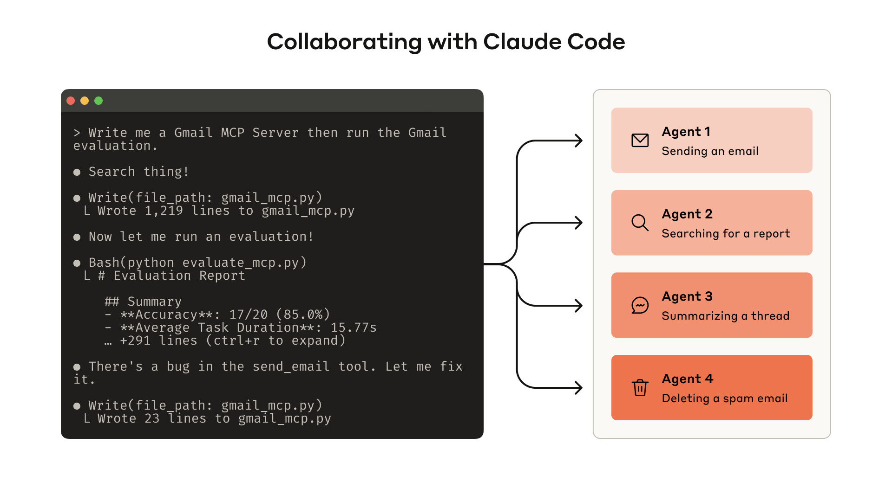
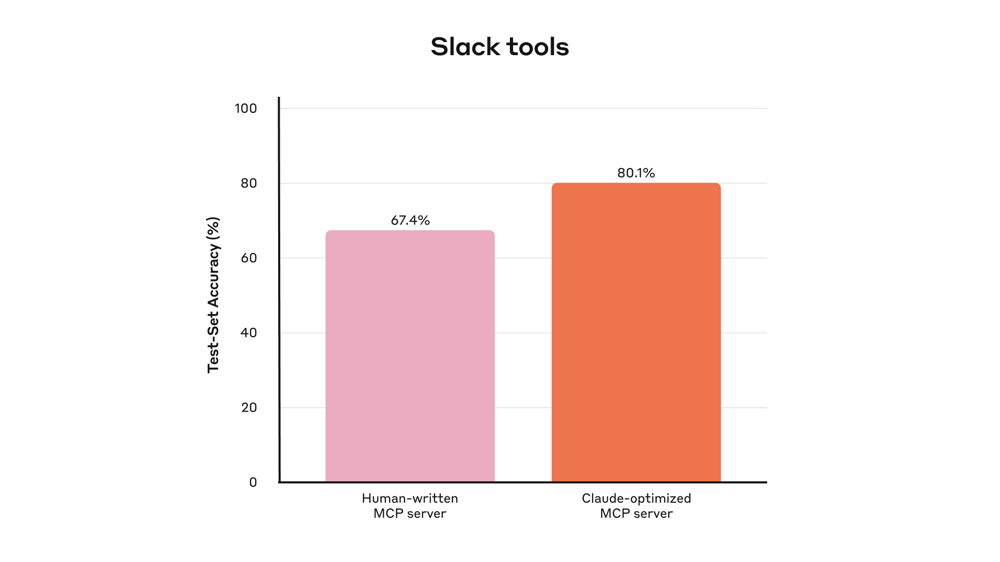
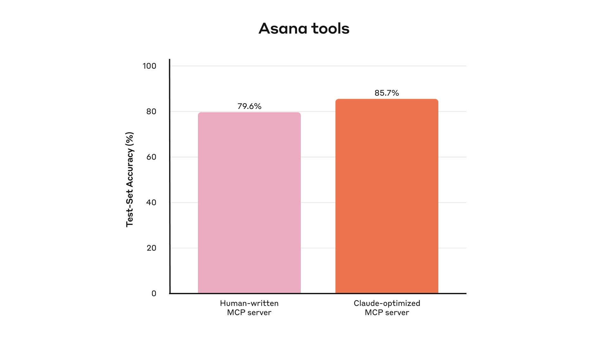
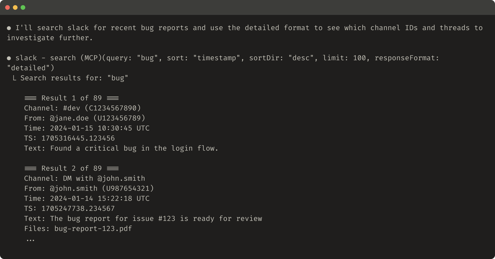
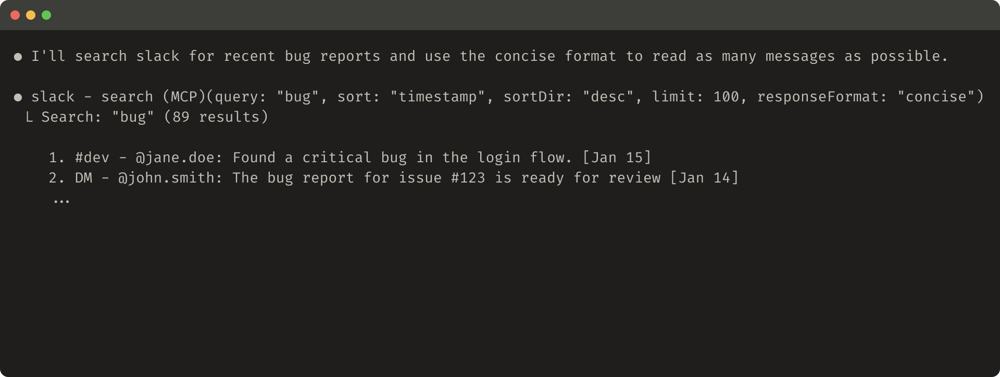
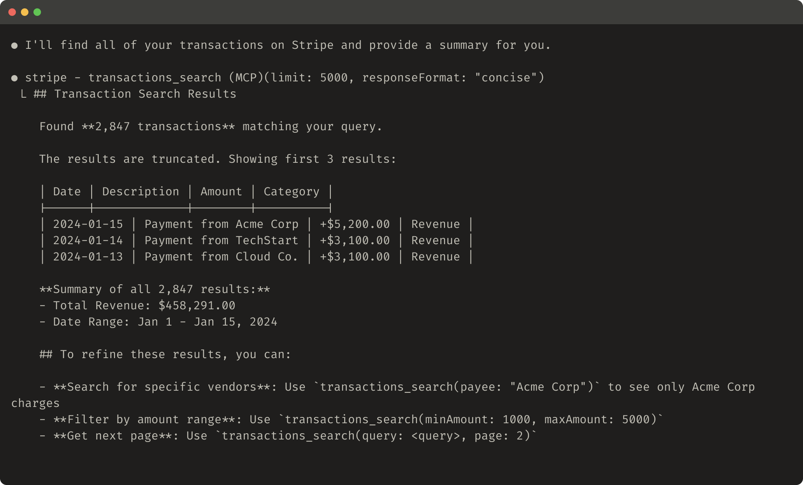

# 08_Writing effective tools for agents — with agents_为智能体编写高效工具——让智能体一起参与

> 原文：https://www.anthropic.com/engineering/writing-tools-for-agents
> 作者：Ken Aizawa（Anthropic Engineering）｜发布日期：2025-09-11

## 📌 本篇速览

- 📅 2025-09-11　｜　⏱ 约 20 分钟　｜　📄 3,276 词 / 8 图
- ⭐ ★★★★★ **必读** —— 工具质量直接决定智能体能力上限，这是 Anthropic 关于工具设计最系统的方法论，且给出可直接套用的评估闭环。
- 🏷 工具设计、评估驱动开发、MCP、命名空间、token 效率
- 🖼 [图解笔记（面试速记）](08_writing-tools-for-agents_直观图解与学习笔记.md)　·　🗂 [返回总目录](00_目录与阅读进度.md)

本文把工具视为确定性软件与非确定性智能体之间的新型契约，提出一套评估驱动的工具开发流程：先做原型、用真实任务生成评估集、跑智能体循环收集 trace，再把 transcript 丢给 Claude Code 让它批量重构工具。文末总结五条高效工具原则：选对该建的工具、用命名空间划分边界、返回高信号上下文、优化响应的 token 效率、对工具描述做提示词工程。

---

The [Model Context Protocol (MCP)](https://modelcontextprotocol.io/docs/getting-started/intro) can empower LLM agents with potentially hundreds of tools to solve real-world tasks.

模型上下文协议（Model Context Protocol，MCP）可以为 LLM 智能体（agent）配备可能多达数百个的工具，用来解决真实世界的任务。

But how do we make those tools maximally effective?

但我们该如何让这些工具发挥最大效用？

In this post, we describe our most effective techniques for improving performance in a variety of agentic AI systems[^1].

在本文中，我们将介绍我们在各类智能体 AI（agentic AI）系统中提升性能的最有效技巧[^1]。

We begin by covering how you can:

我们首先介绍你可以如何：

- Build and test prototypes of your tools

- 构建并测试你的工具原型（prototype）

- Create and run comprehensive evaluations of your tools with agents

- 借助智能体为你的工具创建并运行全面的评估（evaluation）

- Collaborate with agents like Claude Code to automatically increase the performance of your tools

- 与 Claude Code 这样的智能体协作，自动提升工具的性能

We conclude with key principles for writing high-quality tools we’ve identified along the way:

最后，我们总结一路上归纳出的编写高质量工具的关键原则：

- Choosing the right tools to implement (and not to implement)

- 选对该实现的工具（以及不该实现的工具）

- Namespacing tools to define clear boundaries in functionality

- 用命名空间（namespacing）为工具划定清晰的功能边界

- Returning meaningful context from tools back to agents

- 让工具向智能体返回有意义的上下文（context）

- Optimizing tool responses for token efficiency

- 优化工具响应（tool response）的 token 效率

- Prompt-engineering tool descriptions and specs

- 对工具描述（description）与规格（spec）做提示词工程（prompt-engineering）



*Building an evaluation allows you to systematically measure the performance of your tools. You can use Claude Code to automatically optimize your tools against this evaluation.*

*图注：构建一套评估，可以让你系统化地度量工具的性能。你可以用 Claude Code 针对这套评估自动优化你的工具。*

## What is a tool?｜什么是工具？

In computing, deterministic systems produce the same output every time given identical inputs, while *non-deterministic* systems—like agents—can generate varied responses even with the same starting conditions.

在计算领域，确定性（deterministic）系统在输入相同时每次都产生相同的输出；而**非确定性**（non-deterministic）系统——比如智能体——即使初始条件完全相同，也可能生成不同的响应。

When we traditionally write software, we’re establishing a contract between deterministic systems.

按传统方式写软件时，我们是在确定性系统之间建立一种契约（contract）。

For instance, a function call like `getWeather(“NYC”)` will always fetch the weather in New York City in the exact same manner every time it is called.

例如，`getWeather("NYC")` 这样的函数调用，每次被调用时都会以完全相同的方式获取纽约市的天气。

Tools are a new kind of software which reflects a contract between deterministic systems and non-deterministic agents.

工具则是一种新型软件，它体现的是确定性系统与非确定性智能体之间的契约。

When a user asks "Should I bring an umbrella today?,” an agent might call the weather tool, answer from general knowledge, or even ask a clarifying question about location first.

当用户问"我今天要带伞吗？"时，智能体可能去调用天气工具，可能凭通用知识直接作答，甚至可能先反问一句你在哪个城市来澄清问题。

Occasionally, an agent might hallucinate or even fail to grasp how to use a tool.

偶尔，智能体还会产生幻觉（hallucinate），甚至根本没搞懂某个工具该怎么用。

This means fundamentally rethinking our approach when writing software for agents: instead of writing tools and [MCP servers](https://modelcontextprotocol.io/) the way we’d write functions and APIs for other developers or systems, we need to design them for agents.

这意味着在为智能体编写软件时，我们要从根本上重新思考方法：不能再按照给其他开发者或系统写函数和 API 的老路子来写工具和 MCP 服务器（MCP server），而是要专门为智能体来设计它们。

Our goal is to increase the surface area over which agents can be effective in solving a wide range of tasks by using tools to pursue a variety of successful strategies.

我们的目标是扩大智能体的"有效作用面"（surface area）：让它们能借助工具采取多种可行策略，从而胜任更广泛的任务。

Fortunately, in our experience, the tools that are most “ergonomic” for agents also end up being surprisingly intuitive to grasp as humans.

幸运的是，根据我们的经验，对智能体来说最"顺手好用"（ergonomic，符合人体工学）的工具，对人类来说往往也出奇地直观易懂。

## How to write tools｜如何编写工具

In this section, we describe how you can collaborate with agents both to write and to improve the tools you give them.

在这一节中，我们介绍如何与智能体协作，来编写并改进你提供给它们的工具。

Start by standing up a quick prototype of your tools and testing them locally.

先快速搭起工具原型，并在本地测试。

Next, run a comprehensive evaluation to measure subsequent changes.

接着，运行一套全面的评估，用来度量后续每次改动的效果。

Working alongside agents, you can repeat the process of evaluating and improving your tools until your agents achieve strong performance on real-world tasks.

与智能体并肩工作，你可以不断重复"评估—改进"的循环，直到智能体在真实世界任务上取得强劲表现。

### Building a prototype｜构建原型

It can be difficult to anticipate which tools agents will find ergonomic and which tools they won’t without getting hands-on yourself.

如果不亲自上手，很难预判哪些工具对智能体来说顺手、哪些不顺手。

Start by standing up a quick prototype of your tools.

先从快速搭建一个工具原型开始。

If you’re using [Claude Code](https://www.anthropic.com/claude-code) to write your tools (potentially in one-shot), it helps to give Claude documentation for any software libraries, APIs, or SDKs (including potentially the [MCP SDK](https://modelcontextprotocol.io/docs/sdk)) your tools will rely on.

如果你用 Claude Code 来编写工具（甚至可能一把梭一次生成，one-shot），最好把工具将要依赖的软件库、API 或 SDK（可能还包括 MCP SDK）的文档提供给 Claude。

LLM-friendly documentation can commonly be found in flat `llms.txt` files on official documentation sites (here’s our [API’s](https://docs.anthropic.com/llms.txt)).

对 LLM 友好的文档通常能在官方文档站点的扁平 `llms.txt` 文件里找到（这是我们 API 的 llms.txt）。

Wrapping your tools in a [local MCP server](https://modelcontextprotocol.io/docs/develop/connect-local-servers) or [Desktop extension](https://www.anthropic.com/engineering/desktop-extensions) (DXT) will allow you to connect and test your tools in Claude Code or the Claude Desktop app.

把工具封装进本地 MCP 服务器或桌面扩展（Desktop extension，DXT），就可以在 Claude Code 或 Claude 桌面应用中接入并测试这些工具。

To connect your local MCP server to Claude Code, run `claude mcp add <name> <command> [args...]`.

要把本地 MCP 服务器接入 Claude Code，运行 `claude mcp add <name> <command> [args...]`。

To connect your local MCP server or DXT to the Claude Desktop app, navigate to `Settings > Developer` or `Settings > Extensions`, respectively.

要把本地 MCP 服务器或 DXT 接入 Claude 桌面应用，分别前往 `Settings > Developer` 或 `Settings > Extensions`。

Tools can also be passed directly into [Anthropic API](https://docs.anthropic.com/en/docs/agents-and-tools/tool-use/overview) calls for programmatic testing.

工具也可以直接传入 Anthropic API 调用，做程序化测试。

Test the tools yourself to identify any rough edges.

亲自试用这些工具，找出那些毛糙不顺的地方（rough edges）。

Collect feedback from your users to build an intuition around the use-cases and prompts you expect your tools to enable.

收集用户反馈，对你期望工具支撑的使用场景（use-case）和提示词（prompt）建立直觉。

### Running an evaluation｜运行评估

Next, you need to measure how well Claude uses your tools by running an evaluation.

接下来，你需要通过运行评估来衡量 Claude 把你的工具用得好不好。

Start by generating lots of evaluation tasks, grounded in real world uses.

先生成大量扎根于真实使用场景的评估任务。

We recommend collaborating with an agent to help analyze your results and determine how to improve your tools.

我们建议与智能体协作，让它帮你分析结果、确定改进工具的方向。

See this process end-to-end in our [tool evaluation cookbook](https://platform.claude.com/cookbook/tool-evaluation-tool-evaluation).

这一流程的端到端完整示例，见我们的工具评估 cookbook。



*Held-out test set performance of our internal Slack tools*

*图注：我们内部 Slack 工具在留出测试集（held-out test set）上的表现。*

**Generating evaluation tasks**

**生成评估任务**

With your early prototype, Claude Code can quickly explore your tools and create dozens of prompt and response pairs.

有了早期原型，Claude Code 就能快速探索你的工具，并生成几十个"提示词—响应"对（prompt-response pair）。

Prompts should be inspired by real-world uses and be based on realistic data sources and services (for example, internal knowledge bases and microservices).

提示词应当取材于真实使用场景，并基于真实的数据源和服务（例如内部知识库和微服务）。

We recommend you avoid overly simplistic or superficial “sandbox” environments that don’t stress-test your tools with sufficient complexity.

我们建议避开那种过于简单、流于表面的"沙盒"（sandbox）环境——它们的复杂度不足以对工具做压力测试。

Strong evaluation tasks might require multiple tool calls—potentially dozens.

高质量的评估任务可能需要多次工具调用——甚至几十次。

Here are some examples of strong tasks:

下面是一些高质量任务的例子：

- Schedule a meeting with Jane next week to discuss our latest Acme Corp project. Attach the notes from our last project planning meeting and reserve a conference room.

- 安排下周与 Jane 的会议，讨论我们最新的 Acme Corp 项目。附上上次项目规划会的笔记，并预订一间会议室。

- Customer ID 9182 reported that they were charged three times for a single purchase attempt. Find all relevant log entries and determine if any other customers were affected by the same issue.

- 客户 ID 9182 反馈：一次购买尝试被扣了三次款。找出所有相关日志条目，并判断是否有其他客户受到同一问题影响。

- Customer Sarah Chen just submitted a cancellation request. Prepare a retention offer. Determine: (1) why they're leaving, (2) what retention offer would be most compelling, and (3) any risk factors we should be aware of before making an offer.

- 客户 Sarah Chen 刚提交了退订申请。准备一份挽留方案（retention offer）。需要确定：(1) 客户为何离开；(2) 什么样的挽留方案最有吸引力；(3) 给出方案之前我们应注意哪些风险因素。

And here are some weaker tasks:

下面则是一些较弱的任务：

- Schedule a meeting with jane@acme.corp next week.

- 安排下周与 jane@acme.corp 的会议。

- Search the payment logs for `purchase_complete` and `customer_id=9182`.

- 在支付日志中搜索 `purchase_complete` 和 `customer_id=9182`。

- Find the cancellation request by Customer ID 45892.

- 查找客户 ID 45892 的退订申请。

Each evaluation prompt should be paired with a verifiable response or outcome.

每条评估提示词都应配有一个可验证的响应或结果。

Your verifier can be as simple as an exact string comparison between ground truth and sampled responses, or as advanced as enlisting Claude to judge the response.

验证器（verifier）可以简单到直接对标准答案（ground truth）与采样响应做字符串精确比对，也可以高级到请 Claude 来评判响应。

Avoid overly strict verifiers that reject correct responses due to spurious differences like formatting, punctuation, or valid alternative phrasings.

避免过于严苛的验证器：不要因为格式、标点或合理的另一种措辞这类无关紧要的差异，就把正确响应判为错误。

For each prompt-response pair, you can optionally also specify the tools you expect an agent to call in solving the task, to measure whether or not agents are successful in grasping each tool’s purpose during evaluation.

对每个"提示词—响应"对，你还可以（可选地）指定你预期智能体解题时会调用哪些工具，以便在评估中衡量智能体是否真正领会了每个工具的用途。

However, because there might be multiple valid paths to solving tasks correctly, try to avoid overspecifying or overfitting to strategies.

不过，正确解题的路径可能不止一条，所以尽量避免把策略规定得过死，或对某种特定策略过拟合（overfitting）。

**Running the evaluation**

**运行评估**

We recommend running your evaluation programmatically with direct LLM API calls.

我们建议以编程方式、直接调用 LLM API 来运行评估。

Use simple agentic loops (`while`-loops wrapping alternating LLM API and tool calls): one loop for each evaluation task.

使用简单的智能体循环（agentic loop，即用 `while` 循环包住交替进行的 LLM API 调用与工具调用）：每个评估任务各跑一个循环。

Each evaluation agent should be given a single task prompt and your tools.

每个评估智能体只拿到一条任务提示词，外加你的工具集。

In your evaluation agents’ system prompts, we recommend instructing agents to output not just structured response blocks (for verification), but also reasoning and feedback blocks.

在评估智能体的系统提示词（system prompt）里，我们建议要求智能体不仅输出结构化的响应块（用于验证），还要输出推理（reasoning）块和反馈（feedback）块。

Instructing agents to output these *before* tool call and response blocks may increase LLMs’ effective intelligence by triggering chain-of-thought (CoT) behaviors.

要求智能体在工具调用块和响应块**之前**先输出这些内容，可以触发思维链（chain-of-thought，CoT）行为，从而提升 LLM 的有效智力。

If you’re running your evaluation with Claude, you can turn on [interleaved thinking](https://docs.anthropic.com/en/docs/build-with-claude/extended-thinking#interleaved-thinking) for similar functionality “off-the-shelf”.

如果你用 Claude 跑评估，可以直接开启交错思考（interleaved thinking），"开箱即用"地获得类似能力。

This will help you probe why agents do or don’t call certain tools and highlight specific areas of improvement in tool descriptions and specs.

这能帮你探查智能体为什么调用（或不调用）某些工具，并凸显工具描述与规格中需要改进的具体位置。

As well as top-level accuracy, we recommend collecting other metrics like the total runtime of individual tool calls and tasks, the total number of tool calls, the total token consumption, and tool errors.

除了顶层的准确率之外，我们还建议收集其他指标：单次工具调用与整个任务的总耗时、工具调用总次数、token 总消耗量，以及工具报错情况。

Tracking tool calls can help reveal common workflows that agents pursue and offer some opportunities for tools to consolidate.

追踪工具调用有助于揭示智能体常走的工作流（workflow），也能发现一些把多个工具合并（consolidate）的机会。



*Held-out test set performance of our internal Asana tools*

*图注：我们内部 Asana 工具在留出测试集上的表现。*

**Analyzing results**

**分析结果**

Agents are your helpful partners in spotting issues and providing feedback on everything from contradictory tool descriptions to inefficient tool implementations and confusing tool schemas.

智能体是你发现问题的得力伙伴：从前后矛盾的工具描述、低效的工具实现，到令人困惑的工具 schema，它们都能给出反馈。

However, keep in mind that what agents omit in their feedback and responses can often be more important than what they include.

但请记住：智能体在反馈和响应中**没有说**的内容，往往比说了的更重要。

LLMs don’t always [say what they mean](https://www.anthropic.com/research/tracing-thoughts-language-model).

LLM 并不总是"心口如一"（它嘴上说的未必是它内部真实的原因）。

Observe where your agents get stumped or confused.

观察智能体在哪里卡壳、在哪里犯迷糊。

Read through your evaluation agents’ reasoning and feedback (or CoT) to identify rough edges.

通读评估智能体的推理与反馈（或 CoT），找出那些毛糙不顺之处。

Review the raw transcripts (including tool calls and tool responses) to catch any behavior not explicitly described in the agent’s CoT.

检查原始对话记录（transcript，含工具调用与工具响应），捕捉智能体 CoT 里没有明说的行为。

Read between the lines; remember that your evaluation agents don’t necessarily know the correct answers and strategies.

要能读出言外之意；记住，评估智能体自己未必知道正确答案和正确策略。

Analyze your tool calling metrics.

分析你的工具调用指标。

Lots of redundant tool calls might suggest some rightsizing of pagination or token limit parameters is warranted; lots of tool errors for invalid parameters might suggest tools could use clearer descriptions or better examples.

大量冗余的工具调用，可能说明分页（pagination）或 token 上限参数需要调到合适的尺寸；大量因非法参数导致的工具报错，则可能说明工具需要更清晰的描述或更好的示例。

When we launched Claude’s [web search tool](https://www.anthropic.com/news/web-search), we identified that Claude was needlessly appending `2025` to the tool’s `query` parameter, biasing search results and degrading performance (we steered Claude in the right direction by improving the tool description).

我们上线 Claude 的网页搜索工具时，发现 Claude 会画蛇添足地在工具的 `query` 参数后面加上 `2025`，导致搜索结果出现偏差、性能下降（我们通过改进工具描述把 Claude 引回了正轨）。

### Collaborating with agents｜与智能体协作

You can even let agents analyze your results and improve your tools for you.

你甚至可以让智能体替你分析结果、改进工具。

Simply concatenate the transcripts from your evaluation agents and paste them into Claude Code.

只需把评估智能体的对话记录全部拼起来，粘贴进 Claude Code。

Claude is an expert at analyzing transcripts and refactoring lots of tools all at once—for example, to ensure tool implementations and descriptions remain self-consistent when new changes are made.

Claude 非常擅长分析对话记录并一次性重构大批工具——例如，在引入新改动时确保工具实现与描述保持自洽（self-consistent）。

In fact, most of the advice in this post came from repeatedly optimizing our internal tool implementations with Claude Code.

事实上，本文的大多数建议，正是来自我们用 Claude Code 反复优化内部工具实现的经历。

Our evaluations were created on top of our internal workspace, mirroring the complexity of our internal workflows, including real projects, documents, and messages.

我们的评估建立在自己的内部工作区之上，复刻了内部工作流的复杂度，包含真实的项目、文档和消息。

We relied on held-out test sets to ensure we did not overfit to our “training” evaluations.

我们依靠留出测试集来确保自己没有对"训练用"的评估过拟合。

These test sets revealed that we could extract additional performance improvements even beyond what we achieved with "expert" tool implementations—whether those tools were manually written by our researchers or generated by Claude itself.

这些测试集表明：即便对比"专家级"工具实现——无论是研究员手写的，还是 Claude 自己生成的——我们仍能再榨出额外的性能提升。

In the next section, we’ll share some of what we learned from this process.

下一节，我们将分享从这一过程中学到的部分经验。

## Principles for writing effective tools｜编写高效工具的原则

In this section, we distill our learnings into a few guiding principles for writing effective tools.

本节将我们的经验提炼为几条编写高效工具的指导原则。

### Choosing the right tools for agents｜为智能体选对工具

More tools don’t always lead to better outcomes.

工具更多，并不总是带来更好的结果。

A common error we’ve observed is tools that merely wrap existing software functionality or API endpoints—whether or not the tools are appropriate for agents.

我们观察到的一个常见错误是：不管适不适合智能体，就把现有软件功能或 API 端点（endpoint）原样包一层做成工具。

This is because agents have distinct “affordances” to traditional software—that is, they have different ways of perceiving the potential actions they can take with those tools

这是因为智能体与传统软件的"可供性"（affordance）不同——也就是说，它们感知"用这些工具能采取哪些行动"的方式不一样。

LLM agents have limited "context" (that is, there are limits to how much information they can process at once), whereas computer memory is cheap and abundant.

LLM 智能体的"上下文"（context）是有限的（即一次能处理的信息量有上限），而计算机内存却廉价且充裕。

Consider the task of searching for a contact in an address book.

以在通讯录里查找联系人这个任务为例。

Traditional software programs can efficiently store and process a list of contacts one at a time, checking each one before moving on.

传统软件程序可以高效地逐条存储、处理联系人列表，一条查完再查下一条。

However, if an LLM agent uses a tool that returns ALL contacts and then has to read through each one token-by-token, it's wasting its limited context space on irrelevant information (imagine searching for a contact in your address book by reading each page from top-to-bottom—that is, via brute-force search).

但如果 LLM 智能体用的工具一次返回**全部**联系人，它就得一个 token 一个 token 地读完每一条，把有限的上下文空间浪费在无关信息上（想象在通讯录里找人时把每一页从头读到尾——也就是暴力搜索，brute-force search）。

The better and more natural approach (for agents and humans alike) is to skip to the relevant page first (perhaps finding it alphabetically).

更好也更自然的做法（对智能体和人类都一样）是先直接跳到相关的那一页（比如按字母顺序定位）。

We recommend building a few thoughtful tools targeting specific high-impact workflows, which match your evaluation tasks and scaling up from there.

我们建议先精心打造少量工具，瞄准高影响力的特定工作流、与你的评估任务相匹配，然后再从这里逐步扩展。

In the address book case, you might choose to implement a `search_contacts` or `message_contact` tool instead of a `list_contacts` tool.

在通讯录的例子里，你可以选择实现 `search_contacts` 或 `message_contact` 工具，而不是 `list_contacts` 工具。

Tools can consolidate functionality, handling potentially *multiple* discrete operations (or API calls) under the hood.

工具可以整合功能，在底层一次处理**多个**独立操作（或多次 API 调用）。

For example, tools can enrich tool responses with related metadata or handle frequently chained, multi-step tasks in a single tool call.

例如，工具可以在响应里附上相关元数据（metadata），或者把经常连续串联的多步任务放进一次工具调用里完成。

Here are some examples:

举几个例子：

- Instead of implementing a `list_users`, `list_events`, and `create_event` tools, consider implementing a `schedule_event` tool which finds availability and schedules an event.

- 与其实现 `list_users`、`list_events`、`create_event` 三个工具，不如考虑实现一个 `schedule_event` 工具，直接查空档并安排日程。

- Instead of implementing a `read_logs` tool, consider implementing a `search_logs` tool which only returns relevant log lines and some surrounding context.

- 与其实现 `read_logs` 工具，不如考虑实现 `search_logs` 工具，只返回相关日志行和少量前后上下文。

- Instead of implementing `get_customer_by_id`, `list_transactions`, and `list_notes` tools, implement a `get_customer_context` tool which compiles all of a customer’s recent & relevant information all at once.

- 与其实现 `get_customer_by_id`、`list_transactions`、`list_notes` 三个工具，不如实现一个 `get_customer_context` 工具，一次性汇总该客户近期的全部相关信息。

Make sure each tool you build has a clear, distinct purpose.

确保你构建的每个工具都有清晰、独立的用途。

Tools should enable agents to subdivide and solve tasks in much the same way that a human would, given access to the same underlying resources, and simultaneously reduce the context that would have otherwise been consumed by intermediate outputs.

工具应当让智能体能像"拿到同样底层资源的人类"那样去拆分和解决任务，同时减少那些原本会被中间输出白白吃掉的上下文。

Too many tools or overlapping tools can also distract agents from pursuing efficient strategies.

工具过多或功能重叠，也会分散智能体的注意力，让它偏离高效策略。

Careful, selective planning of the tools you build (or don’t build) can really pay off.

对"建什么工具、不建什么工具"做审慎而有取舍的规划，回报会非常可观。

### Namespacing your tools｜为工具划分命名空间

Your AI agents will potentially gain access to dozens of MCP servers and hundreds of different tools–including those by other developers.

你的 AI 智能体可能会接入几十个 MCP 服务器、数百个不同的工具——其中还包括其他开发者写的工具。

When tools overlap in function or have a vague purpose, agents can get confused about which ones to use.

当工具功能重叠或用途含糊时，智能体会搞不清该用哪一个。

Namespacing (grouping related tools under common prefixes) can help delineate boundaries between lots of tools; MCP clients sometimes do this by default.

命名空间（namespacing，把相关工具归到共同前缀之下）有助于在大量工具之间划清边界；有些 MCP 客户端（client）默认就会这么做。

For example, namespacing tools by service (e.g., `asana_search`, `jira_search`) and by resource (e.g., `asana_projects_search`, `asana_users_search`), can help agents select the right tools at the right time.

例如，按服务（service）划分命名空间（如 `asana_search`、`jira_search`），再按资源（resource）划分（如 `asana_projects_search`、`asana_users_search`），可以帮智能体在正确的时机选中正确的工具。

We have found selecting between prefix- and suffix-based namespacing to have non-trivial effects on our tool-use evaluations.

我们发现，选前缀式（prefix-based）还是后缀式（suffix-based）命名空间，对工具使用评估的影响不容小觑。

Effects vary by LLM and we encourage you to choose a naming scheme according to your own evaluations.

具体影响因 LLM 而异，我们建议你依据自己的评估结果来选定命名方案。

Agents might call the wrong tools, call the right tools with the wrong parameters, call too few tools, or process tool responses incorrectly.

智能体可能调错工具、用错参数去调对的工具、调用得太少，或者错误地处理工具响应。

By selectively implementing tools whose names reflect natural subdivisions of tasks, you simultaneously reduce the number of tools and tool descriptions loaded into the agent’s context and offload agentic computation from the agent’s context back into the tool calls themselves.

有选择地去实现那些名称本身就体现任务自然切分方式的工具，你能同时做到两件事：减少加载进智能体上下文的工具数量与工具描述，并把智能体的计算从上下文里卸载（offload）回工具调用本身。

This reduces an agent’s overall risk of making mistakes.

这会整体降低智能体犯错的风险。

### Returning meaningful context from your tools｜让工具返回有意义的上下文

In the same vein, tool implementations should take care to return only high signal information back to agents.

同理，工具实现应当注意：只向智能体返回高信号（high signal）的信息。

They should prioritize contextual relevance over flexibility, and eschew low-level technical identifiers (for example: `uuid`, `256px_image_url`, `mime_type`).

应当把上下文相关性置于灵活性之上，避开底层技术标识符（例如 `uuid`、`256px_image_url`、`mime_type`）。

Fields like `name`, `image_url`, and `file_type` are much more likely to directly inform agents’ downstream actions and responses.

像 `name`、`image_url`、`file_type` 这类字段，更有可能直接指导智能体的下游动作和响应。

Agents also tend to grapple with natural language names, terms, or identifiers significantly more successfully than they do with cryptic identifiers.

相比晦涩难懂的标识符，智能体处理自然语言的名称、术语或标识符时要成功得多。

We’ve found that merely resolving arbitrary alphanumeric UUIDs to more semantically meaningful and interpretable language (or even a 0-indexed ID scheme) significantly improves Claude’s precision in retrieval tasks by reducing hallucinations.

我们发现，仅仅是把任意的字母数字 UUID 解析成语义上更有意义、更可解读的文字（哪怕只是换成从 0 开始编号的 ID 方案），就能减少幻觉，从而显著提升 Claude 在检索任务中的精确率（precision）。

In some instances, agents may require the flexibility to interact with both natural language and technical identifiers outputs, if only to trigger downstream tool calls (for example, `search_user(name=’jane’)` → `send_message(id=12345)`).

某些场景下，智能体确实需要既能处理自然语言、又能处理技术标识符输出的灵活性，哪怕只是为了触发下游的工具调用（例如 `search_user(name='jane')` → `send_message(id=12345)`）。

You can enable both by exposing a simple `response_format` enum parameter in your tool, allowing your agent to control whether tools return `“concise”` or `“detailed”` responses (images below).

你可以在工具里暴露一个简单的 `response_format` 枚举（enum）参数来两者兼得，让智能体自己控制工具返回 `"concise"`（简洁）还是 `"detailed"`（详细）响应（见下图）。

You can add more formats for even greater flexibility, similar to GraphQL where you can choose exactly which pieces of information you want to receive.

你还可以加入更多格式来获得更大的灵活性，就像 GraphQL 那样，精确挑选想接收哪些信息。

Here is an example ResponseFormat enum to control tool response verbosity:

下面是一个用于控制工具响应详略程度（verbosity）的 ResponseFormat 枚举示例：

```
enum ResponseFormat {
   DETAILED = "detailed",
   CONCISE = "concise"
}
```

Here’s an example of a detailed tool response (206 tokens):

这是一个详细（detailed）工具响应的例子（206 个 token）：



Here’s an example of a concise tool response (72 tokens):

这是一个简洁（concise）工具响应的例子（72 个 token）：



*Slack threads and thread replies are identified by unique `thread_ts` which are required to fetch thread replies. `thread_ts` and other IDs (`channel_id`, `user_id`) can be retrieved from a `“detailed”` tool response to enable further tool calls that require these. `“concise”` tool responses return only thread content and exclude IDs. In this example, we use ~⅓ of the tokens with `“concise”` tool responses.*

*图注：Slack 的会话串（thread）及其回复由唯一的 `thread_ts` 标识，获取回复必须用到它。`thread_ts` 和其他 ID（`channel_id`、`user_id`）可以从 `"detailed"` 响应中取得，以支撑后续需要这些 ID 的工具调用；`"concise"` 响应只返回会话内容、不含 ID。在这个例子里，`"concise"` 响应的 token 用量约为前者的 1/3。*

Even your tool response structure—for example XML, JSON, or Markdown—can have an impact on evaluation performance: there is no one-size-fits-all solution.

甚至连工具响应的结构——比如用 XML、JSON 还是 Markdown——都会影响评估表现：没有一招通吃的方案。

This is because LLMs are trained on next-token prediction and tend to perform better with formats that match their training data.

这是因为 LLM 以"预测下一个 token"（next-token prediction）的方式训练，通常在与其训练数据相匹配的格式上表现更好。

The optimal response structure will vary widely by task and agent.

最优的响应结构会因任务和智能体的不同而差异巨大。

We encourage you to select the best response structure based on your own evaluation.

我们鼓励你基于自己的评估来选出最佳响应结构。

### Optimizing tool responses for token efficiency｜优化工具响应的 token 效率

Optimizing the quality of context is important. But so is optimizing the *quantity* of context returned back to agents in tool responses.

优化上下文的**质量**很重要，但优化工具响应返回给智能体的上下文**数量**同样重要。

We suggest implementing some combination of pagination, range selection, filtering, and/or truncation with sensible default parameter values for any tool responses that could use up lots of context.

对任何可能大量吞噬上下文的工具响应，我们建议组合使用分页（pagination）、范围选择（range selection）、过滤（filtering）和/或截断（truncation），并配上合理的默认参数值。

For Claude Code, we restrict tool responses to 25,000 tokens by default.

在 Claude Code 中，我们默认把工具响应限制在 25,000 个 token 以内。

We expect the effective context length of agents to grow over time, but the need for context-efficient tools to remain.

我们预计智能体的有效上下文长度会随时间增长，但"上下文高效"的工具将始终是刚需。

If you choose to truncate responses, be sure to steer agents with helpful instructions.

如果你选择截断响应，务必附上有用的提示语来引导智能体。

You can directly encourage agents to pursue more token-efficient strategies, like making many small and targeted searches instead of a single, broad search for a knowledge retrieval task.

你可以直接鼓励智能体采用更省 token 的策略，比如在知识检索任务中做多次小而准的搜索，而不是一次大而全的搜索。

Similarly, if a tool call raises an error (for example, during input validation), you can prompt-engineer your error responses to clearly communicate specific and actionable improvements, rather than opaque error codes or tracebacks.

类似地，如果工具调用报错（比如输入校验失败），你可以对报错响应做提示词工程，清晰传达具体、可执行的改进建议，而不是抛出一堆看不懂的错误码或堆栈跟踪（traceback）。

Here’s an example of a truncated tool response:

这是一个截断工具响应的例子：



Here’s an example of an unhelpful error response:

这是一个没有帮助的报错响应的例子：


Here’s an example of a helpful error response:

这是一个有帮助的报错响应的例子：


*Tool truncation and error responses can steer agents towards more token-efficient tool-use behaviors (using filters or pagination) or give examples of correctly formatted tool inputs.*

*图注：截断响应与报错响应可以引导智能体采取更省 token 的工具使用行为（改用过滤或分页），或直接给出格式正确的工具输入示例。*

### Prompt-engineering your tool descriptions｜对工具描述做提示词工程

We now come to one of the most effective methods for improving tools: prompt-engineering your tool descriptions and specs.

现在来到改进工具最有效的方法之一：对工具描述和规格做提示词工程。

Because these are loaded into your agents’ context, they can collectively steer agents toward effective tool-calling behaviors.

由于这些内容会被加载进智能体的上下文，它们合在一起就能引导智能体形成高效的工具调用行为。

When writing tool descriptions and specs, think of how you would describe your tool to a new hire on your team.

撰写工具描述和规格时，想象一下你会怎么向团队新人介绍这个工具。

Consider the context that you might implicitly bring—specialized query formats, definitions of niche terminology, relationships between underlying resources—and make it explicit.

想想那些你自己心照不宣的背景信息——特殊的查询格式、小众术语的定义、底层资源之间的关系——并把它们明确写出来。

Avoid ambiguity by clearly describing (and enforcing with strict data models) expected inputs and outputs.

通过清晰描述预期的输入输出（并用严格的数据模型强制约束）来消除歧义。

In particular, input parameters should be unambiguously named: instead of a parameter named `user`, try a parameter named `user_id`.

尤其是输入参数必须命名得毫无歧义：与其把参数叫 `user`，不如叫 `user_id`。

With your evaluation you can measure the impact of your prompt engineering with greater confidence.

有了评估，你就能更有把握地度量提示词工程带来的影响。

Even small refinements to tool descriptions can yield dramatic improvements.

哪怕只是对工具描述做小幅打磨，也可能带来巨大提升。

Claude Sonnet 3.5 achieved state-of-the-art performance on the [SWE-bench Verified](https://www.anthropic.com/engineering/swe-bench-sonnet) evaluation after we made precise refinements to tool descriptions, dramatically reducing error rates and improving task completion.

在我们对工具描述做了精准打磨之后，Claude Sonnet 3.5 在 SWE-bench Verified 评估上取得了当时最先进（state-of-the-art）的成绩——错误率大幅下降，任务完成度显著提高。

You can find other best practices for tool definitions in our [Developer Guide](https://docs.anthropic.com/en/docs/agents-and-tools/tool-use/implement-tool-use#best-practices-for-tool-definitions).

工具定义的其他最佳实践，可以在我们的开发者指南（Developer Guide）中找到。

If you’re building tools for Claude, we also recommend reading about how tools are dynamically loaded into Claude’s [system prompt](https://docs.anthropic.com/en/docs/agents-and-tools/tool-use/implement-tool-use#tool-use-system-prompt).

如果你在为 Claude 构建工具，我们也建议读一读工具是如何被动态加载进 Claude 系统提示词的。

Lastly, if you’re writing tools for an MCP server, [tool annotations](https://modelcontextprotocol.io/specification/2025-06-18/server/tools) help disclose which tools require open-world access or make destructive changes.

最后，如果你在为 MCP 服务器编写工具，工具注解（tool annotations）可以标明哪些工具需要开放世界（open-world）访问权限、哪些会做出破坏性（destructive）变更。

## Looking ahead｜展望

To build effective tools for agents, we need to re-orient our software development practices from predictable, deterministic patterns to non-deterministic ones.

要为智能体构建高效工具，我们需要把软件开发实践从可预测的确定性范式，转向非确定性范式。

Through the iterative, evaluation-driven process we’ve described in this post, we've identified consistent patterns in what makes tools successful: Effective tools are intentionally and clearly defined, use agent context judiciously, can be combined together in diverse workflows, and enable agents to intuitively solve real-world tasks.

通过本文描述的迭代式、评估驱动的流程，我们总结出了成功工具的共性：高效的工具，定义得刻意而清晰，审慎地使用智能体的上下文，能在多样的工作流中相互组合，并让智能体能凭直觉解决真实世界的任务。

In the future, we expect the specific mechanisms through which agents interact with the world to evolve—from updates to the MCP protocol to upgrades to the underlying LLMs themselves.

未来，我们预计智能体与世界交互的具体机制还会继续演进——从 MCP 协议的更新，到底层 LLM 自身的升级。

With a systematic, evaluation-driven approach to improving tools for agents, we can ensure that as agents become more capable, the tools they use will evolve alongside them.

只要以系统化、评估驱动的方式持续改进智能体工具，我们就能确保：随着智能体越来越强，它们所用的工具也会与之共同进化。

## Acknowledgements｜致谢

Written by Ken Aizawa with valuable contributions from colleagues across Research (Barry Zhang, Zachary Witten, Daniel Jiang, Sami Al-Sheikh, Matt Bell, Maggie Vo), MCP (Theodora Chu, John Welsh, David Soria Parra, Adam Jones), Product Engineering (Santiago Seira), Marketing (Molly Vorwerck), Design (Drew Roper), and Applied AI (Christian Ryan, Alexander Bricken).

本文由 Ken Aizawa 撰写，来自以下团队的同事做出了宝贵贡献：研究团队（Barry Zhang、Zachary Witten、Daniel Jiang、Sami Al-Sheikh、Matt Bell、Maggie Vo）、MCP 团队（Theodora Chu、John Welsh、David Soria Parra、Adam Jones）、产品工程（Santiago Seira）、市场（Molly Vorwerck）、设计（Drew Roper）以及应用 AI（Christian Ryan、Alexander Bricken）。

[^1]: Beyond training the underlying LLMs themselves.

[^1]：指除了训练底层 LLM 本身之外的手段。
