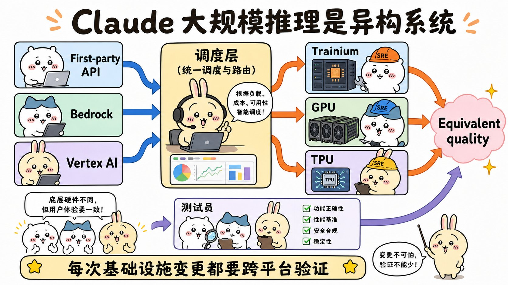
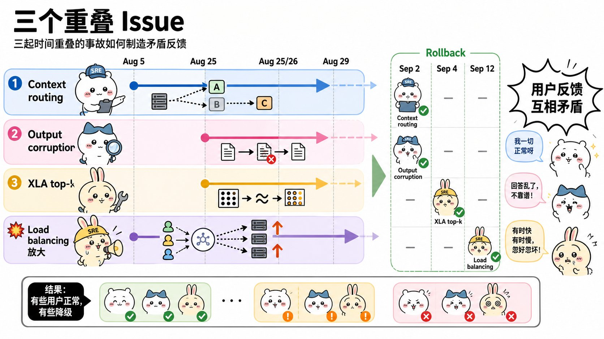
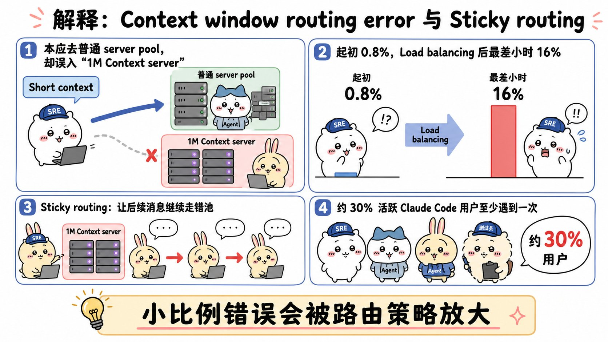
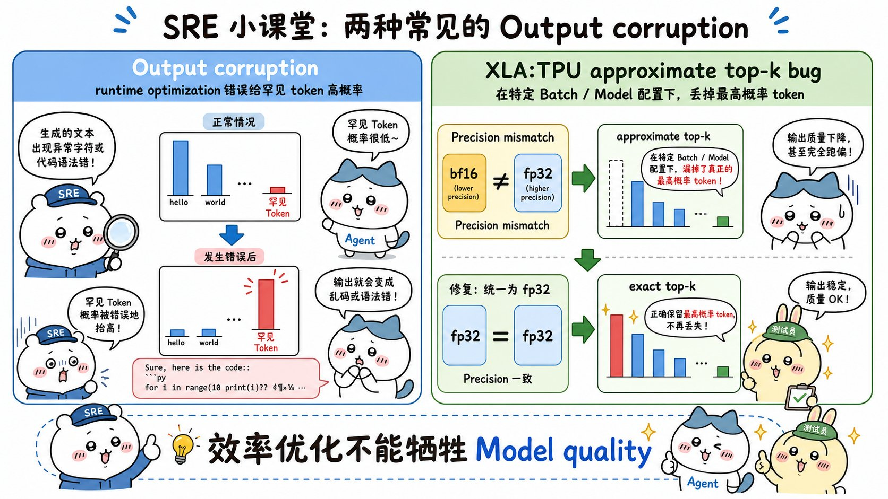
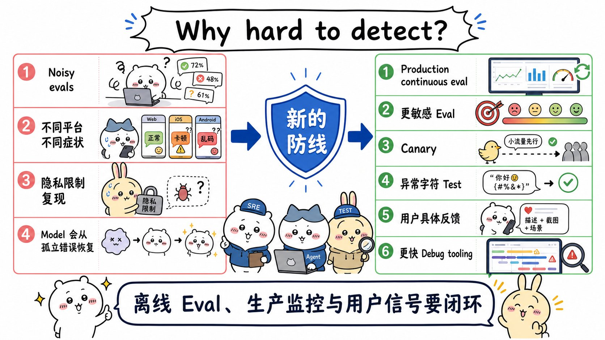

# A postmortem of three recent issues：面试速记

> Anthropic Engineering · 2025-09-17 · 作者 Sam McAllister · [官方原文](https://www.anthropic.com/engineering/a-postmortem-of-three-recent-issues) · [本地逐句对照](09_a-postmortem-of-three-recent-issues_逐句对照.md)

## 一句话讲明白

**2025 年 8 月到 9 月初，用户反馈「Claude 变笨了」，真相不是一个缺陷，而是三个时间上相互交叠的基础设施缺陷：请求被路由到错误的服务器、TPU 配置错误污染了生成内容、以及一个潜伏的编译器缺陷让「概率最高的那个 token」被丢掉。Anthropic 明确否认「按负载降级模型」，并承认真正的失败点在于——离线评估噪声太大、隐私管控挡住了排查路径、多平台症状各不相同，导致检测和定位比应有的慢得多。**

## 为什么值得读 / 能用在哪

- 这是一线大模型服务商罕见的**推理基础设施故障复盘**，把「模型质量」这件事从提示词层面拽回到硬件、编译器、路由、采样的工程层面。
- 面试里最好用的场景：被问「线上效果变差了你怎么排查」「你怎么知道是模型问题还是工程问题」——这篇给了一整套可背的反面教材。
- 自己项目能直接抄的三条：**在真实生产链路上持续跑评估**、**部署流程里加输出异常字符检测**、**把可复现的用户反馈当成监控信号的一部分**。
- 还有一个非常反直觉的教训：一个「临时规避方案」可以在一年里持续掩盖一个更深的缺陷；你以为修好了根因，其实是拆掉了掩体。

## 核心要点

### 一、先记住这句话：从不因负载降级模型

原文第一段就把话说死：**「我们从不会因为需求量、一天中的时段或服务器负载而降低模型质量。」** 用户遇到的问题**完全**由基础设施缺陷造成。

这条在面试里值钱，因为社区长期有「高峰期偷偷换小模型」的阴谋论。你能引用官方原话，且能说出真实原因是路由、配置和编译器三件事，立刻显出你读过一手材料。

另一句要记的自我批评：「我们一直以极高的标准确保基础设施变更不影响模型输出，**而在最近这几起事故中，我们没有达到这个标准。**」

### 二、大规模推理本身就是异构系统

- **三个服务入口**：第一方 API（first-party API）、Amazon Bedrock、Google Cloud Vertex AI。
- **三种硬件平台**：AWS Trainium、NVIDIA GPU、Google TPU。
- 这么做是为了拿到服务全球用户所需的**算力容量与地理分布**。
- 每种硬件特性不同、需要针对性优化，但 Anthropic 对模型实现有**严格的等价性标准（equivalence standards）**：无论请求落到哪个平台，用户都该得到同样质量的响应。

**结论：** 任何一次看似「普通」的采样、负载均衡或编译器变更，都必须跨硬件、跨模型、跨上下文配置、跨服务平台做完整验证。少验一个组合，就是这次事故的开端。

### 三、三个缺陷为什么看起来像「随机变差」

时间线（记住这四个日期就够用）：

| 日期 | 事件 |
| --- | --- |
| 8 月 5 日 | 缺陷一（上下文窗口路由错误）被引入，影响约 **0.8%** 的 Sonnet 4 请求 |
| 8 月 25 / 26 日 | 两次部署分别引入缺陷二（输出损坏）和缺陷三（近似 top-k 错误编译） |
| 8 月 29 日 | 一次**例行**负载均衡（load balancing）变更，开始扩大受影响流量 |
| 8 月 31 日 | 受影响最严重的一小时，**16%** 的 Sonnet 4 请求受波及 |

关键在于「交叠」：更多用户遇到问题，而另一批用户体验完全正常，于是社区反馈**互相矛盾**，看上去像随机的、时有时无的质量劣化，无法指向任何单一根因。

### 四、缺陷一：上下文窗口路由错误 + 粘性路由放大

- **发生了什么：** 8 月 5 日起，部分 Sonnet 4 请求被错误路由到为即将上线的 **1M token 上下文窗口**配置的服务器上。
- **放大过程：** 最初 0.8% → 8 月 29 日负载均衡变更无意间增加了被送往 1M 上下文服务器的短上下文请求 → 8 月 31 日最差一小时冲到 **16%**。
- **为什么有人感觉特别惨：** 路由是**粘性的（sticky）**——一条消息一旦被错误服务器处理，后续连续请求很可能继续落到同一台错误服务器。这段时间内发过请求的 Claude Code 用户里，约 **30%** 至少有一条消息被误路由。
- **各平台影响面差异巨大**（这组数字很能加分）：
  - Amazon Bedrock：自 8 月 12 日起，误路由流量峰值为全部 Sonnet 4 请求的 **0.18%**；
  - Google Cloud Vertex AI：8 月 27 日至 9 月 16 日期间，受影响请求**不足 0.0004%**。
- **修复：** 修正路由逻辑，把短上下文与长上下文请求分别导向正确的服务器池（server pool）。9 月 4 日部署；第一方平台与 Vertex AI 于 9 月 16 日全量完成，AWS Bedrock 于 9 月 18 日完成。

**面试可用的一句话：** 这个缺陷完全不是提示词或模型的问题，修复动作是改路由逻辑——但用户感知到的却是「模型变笨了」。

### 五、缺陷二与缺陷三：输出损坏，以及那个丢掉最高概率 token 的编译器缺陷

**缺陷二：输出内容损坏（Output corruption）**

- 8 月 25 日，向 Claude API 的 TPU 服务器部署了一个错误配置，导致 token 生成过程出错。
- 根源是一个**运行时性能优化**：它偶尔会给那些在当前上下文中本应极少出现的 token 赋予很高的概率。
- 典型症状：英文提问的响应中间冒出泰文或中文字符（原文例子是 "สวัสดี"），或者代码里出现明显语法错误。
- 影响范围：Opus 4.1 与 Opus 4（8 月 25–28 日）、Sonnet 4（8 月 25 日–9 月 2 日）。**第三方平台未受影响。**
- 修复：9 月 2 日回滚该变更，并在**部署流程中新增异常字符输出的检测测试**。

**缺陷三：近似 top-k 的 XLA:TPU 错误编译**

- 8 月 25 日部署了一段用于改进 token 选择方式的代码，无意间触发了 XLA:TPU 编译器中的一个**潜伏缺陷（latent bug）**。
- 已确认影响 Claude Haiku 3.5；判断可能还影响了 Claude API 上一部分 Sonnet 4 和 Opus 3。第三方平台未受影响。
- 回滚节奏：Haiku 3.5 于 9 月 4 日回滚；随后发现 Opus 3 的用户反馈与该缺陷表现吻合，9 月 12 日回滚；Sonnet 4 经大量调查**未能复现**，但出于万分谨慎同样回滚。
- 同时两手：与 XLA:TPU 团队合作修复编译器缺陷，并上线改用**精确 top-k（exact top-k）**、提升计算精度的方案。

### 六、深入剖析：一个「修好根因」反而炸出更深的坑

采样机制先讲清楚：Claude 生成文本时为每个可能的下一个词算概率，再从分布中随机采样；用 **top-p 采样（top-p sampling）** 避免不合理输出，只考虑累积概率达到阈值（通常 **0.99 或 0.999**）以内的词。在 TPU 上模型跨多块芯片运行，概率计算分散在不同位置，排序因此是一次**分布式排序**。

事件链（这条链是本文技术含量最高的部分，值得完整背下来）：

1. **2024 年 12 月**：发现温度（temperature）为零时，TPU 实现偶尔会丢掉概率最高的那个 token，于是部署了一个**临时规避方案（workaround）**。
2. **真正的根因是混合精度运算（mixed precision arithmetic）**：模型用 bf16（16 位浮点）计算下一个 token 的概率，但向量处理器原生是 fp32，TPU 编译器（XLA）会把某些运算转成 fp32 来优化性能——这个优化受 `xla_allow_excess_precision` 标志控制，**默认为 true**。结果是本应就「谁概率最高」达成一致的运算跑在不同精度上，产生分歧，最高概率的 token 有时**彻底从候选中消失**。
3. **8 月 26 日**：重写采样代码，修复精度问题并改进对恰好触及 top-p 阈值的临界概率的处理。由于认定根因已解决，**顺手移除了 12 月的临时规避方案**。
4. **坑就此暴露**：**近似 top-k（approximate top-k）**——一个用于快速找出最高概率 token 的性能优化——本身有更深的缺陷，只在**特定批次大小（batch size）与模型配置**下才会返回完全错误的结果。12 月那个临时规避方案，一直在无意间**掩盖**着它。
5. **这个缺陷反复无常到令人抓狂**：行为会随毫不相干的因素改变，比如它前后运行的是什么操作、排查工具是否开启；同一个提示词这次请求完全正常，下一次就出错。
6. **收尾**：调查中顺便发现精确 top-k 已不再有过去那种令人却步的性能开销，于是从近似切换到精确，并把另外一些运算统一到 fp32。**「模型质量没有讨价还价的余地，所以我们接受了这一点小小的效率损失。」**

两条脚注也值得记：近似 top-k 的原理是**容忍最低概率 token 上的不精确**，这本不该影响质量——偏偏缺陷让它丢掉的是最高概率 token；而修正后的 top-k 会让 top-p 阈值附近的 token 是否被纳入产生细微差异，极少数用户可能需要**重新调一下自己的 top-p 取值**。

### 七、为什么这类问题极难检测（本篇最大看点）

常规验证流程是：基准测试（benchmark）+ 安全评估 + 性能指标，工程团队做抽查（spot check），并先部署到小规模**灰度组（canary）**。这套流程这次全线失守，原因有五条：

1. **评估根本没捕捉到用户说的那种劣化**——部分原因是 **Claude 往往能很好地从孤立错误中恢复**，一次采样失误被后文自动圆回来，指标上看不出来。
2. **隐私管控挡住了排查路径**：内部隐私与安全管控限制工程师访问用户与 Claude 的交互记录，尤其是那些**没有作为反馈上报**的交互。保护了隐私，但工程师因此拿不到定位和复现缺陷所必需的问题样本。
3. **多平台症状不一**：每个缺陷在不同平台上以不同发生率产生不同症状，反馈混乱到不指向任何单一原因，看起来就像随机劣化。
4. **过度依赖噪声很大的评估**——原文用词是「more fundamentally（更根本地）」，这是他们自己认定的头号根因。
5. **缺少把反馈关联到变更的手段**：8 月 29 日负面反馈激增时，团队没有立刻把它和一次「原本再普通不过的」负载均衡变更联系起来。

事后补上的三道防线：

- **更灵敏的评估**：开发能更可靠**区分正常实现与故障实现**的评估，并持续改进。
- **在更多环节做质量评估**：从「定期跑」升级为**在真正的生产系统上持续运行**，专门用来抓上下文窗口负载均衡这类问题。
- **更快的排查工具**：在**不牺牲用户隐私**的前提下调试社区反馈；这次开发的定制工具将用于缩短未来类似事故的修复时间。

还有第四条，是留给用户的：评估与监控固然重要，但事故表明**还需要来自用户的持续信号**。用户报告的具体变化、异常行为示例、跨使用场景呈现的规律，都帮助定位了问题。反馈入口是 Claude Code 里的 `/bug` 命令、Claude 应用里的「差评」按钮，以及 feedback@anthropic.com。

## 面试高频问答

**Q：线上有人反馈「模型效果变差了」，你会怎么排查？**
A：先别改提示词。按这篇的路径走：把反馈按时间、平台、模型、流量切片切开看，确认是全局劣化还是某个切片劣化；再把时间点和最近的每一次基础设施变更（路由、负载均衡、编译器、采样配置）对齐。这次事故的教训就是「负面反馈激增」和「一次例行负载均衡变更」隔了好几天才被联系起来。

**Q：为什么离线评估没抓到这次质量劣化？**
A：三个叠加原因。一是评估本身噪声大，真实劣化淹没在波动里；二是模型能从孤立错误中自行恢复，单点采样失误在最终指标上被抹平；三是缺陷只在特定批次大小、特定平台、特定配置下触发，离线评估的组合覆盖不到。所以他们的整改是「更灵敏的评估 + 在真实生产链路上持续跑」，而不是「多跑几次基准测试」。

**Q：粘性路由（sticky routing）为什么会把 0.8% 的问题放大成灾难级体验？**
A：因为它把「随机中招」变成了「持续中招」。请求一旦落到错误服务器，后续连续请求很可能继续落在同一台上。所以虽然整体误路由峰值是 16%，但那段时间发过请求的 Claude Code 用户里约 30% 至少中过一次，而中招的人往往整段会话都在劣化状态——平均值好看，个体体验极差。

**Q：「临时规避方案掩盖了更深的缺陷」这件事，工程上怎么防？**
A：把每个规避方案登记成待偿还的技术债，写清它规避的是什么现象、根因是否已确认。移除规避方案时必须当作一次独立的高风险变更来验证——这次就是相信根因已解决而顺手删掉 2024 年 12 月的规避方案，结果炸出了被它掩盖了大半年的近似 top-k 缺陷。

**Q：Anthropic 会不会在高峰期偷偷降级模型？**
A：官方在这篇里明确否认——从不因需求量、一天中的时段或服务器负载而降低模型质量，用户遇到的问题完全由基础设施缺陷造成。真实原因是上下文窗口路由错误、TPU 错误配置导致的输出损坏，以及近似 top-k 的 XLA:TPU 错误编译。

## 必须记住的 9 句话

1. 官方明确否认按需求量、时段或服务器负载降级模型质量。
2. 推理服务是硬件、编译器、路由、采样的联合系统，任何一环都能改变输出质量。
3. 三个缺陷在时间上交叠，制造出看似随机、彼此矛盾的用户反馈。
4. 路由错误从 0.8% 被一次例行负载均衡变更放大到最差一小时 16%。
5. 粘性路由让约 30% 的 Claude Code 用户至少有一条消息被误送到错误服务器。
6. 运行时性能优化配置错误，能直接让生成内容混入异常语言字符和语法错误。
7. 混合精度（bf16 算概率、fp32 优化）让「谁概率最高」出现分歧，最高概率 token 可能整个消失。
8. 2024 年 12 月的临时规避方案掩盖了近似 top-k 的深层缺陷，移除它才把坑炸出来。
9. 噪声大的离线评估替代不了生产环境的持续评估，可复现的用户反馈本身就是监控信号。

## 30 秒口述版

> 这篇复盘讲的不是一个缺陷，而是三个时间交叠的问题：8 月 5 日起部分短上下文请求被误路由到 1M 上下文服务器；8 月 25 日 TPU 服务器的一个错误配置导致输出损坏，英文回答里混进泰文字符；同期一次采样代码变更触发了 XLA:TPU 编译器里潜伏的近似 top-k 缺陷，会丢掉概率最高的 token。8 月 29 日一次例行负载均衡变更把路由问题从 0.8% 放大到最差一小时 16%，加上路由是粘性的，导致有人完全正常、有人持续变差，反馈互相矛盾。之所以难检测，是因为评估噪声大、模型能从孤立错误里自行恢复、隐私管控让工程师拿不到问题交互、各平台症状还不一样。整改方向是更灵敏的评估、在真实生产系统上持续评估、部署流程加异常字符检测，以及在不牺牲隐私的前提下做更快的排查工具。顺带，官方明确否认按负载降级模型。

## 自测

- [ ] 能说出三个缺陷分别是什么、各自影响了哪些模型和平台。
- [ ] 能解释 0.8% 是怎样被放大到 16% 的，以及那 30% 指的是什么。
- [ ] 能解释粘性路由为什么让个体体验远差于平均值。
- [ ] 能讲清混合精度与 `xla_allow_excess_precision` 如何导致最高概率 token 消失。
- [ ] 能说明 2024 年 12 月的临时规避方案为什么反而是个隐患。
- [ ] 能列出检测困难的至少四个原因。
- [ ] 能说出事后补上的三道防线，以及用户侧的反馈入口。

> 插图为学习用途的非官方同人式教学图，角色与文章版权归各自权利人。
