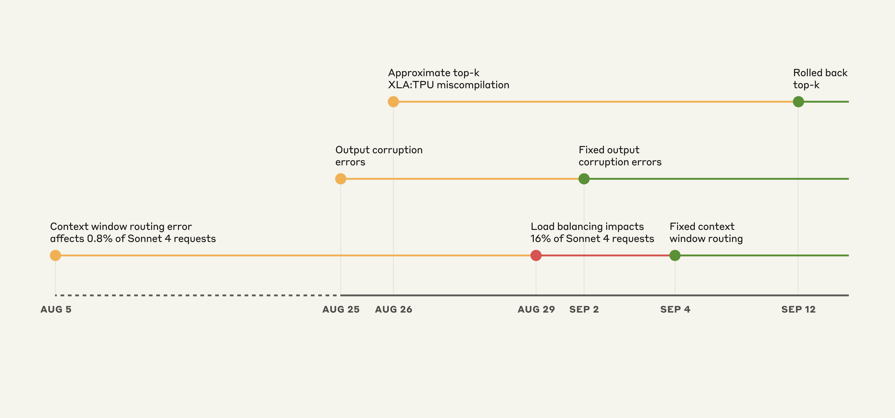
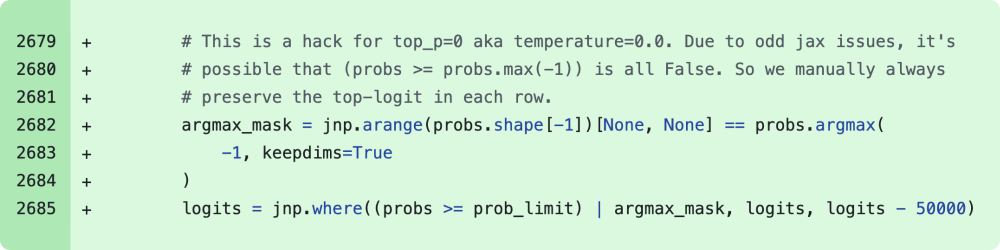
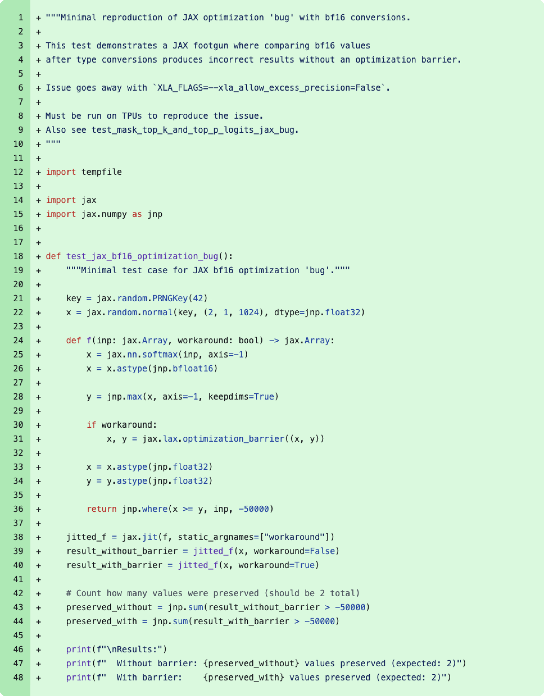
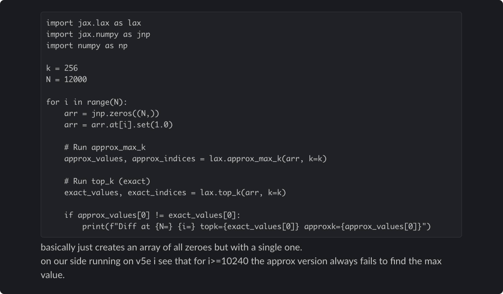

# 09_A postmortem of three recent issues_近期三起问题的事后复盘

> 原文：https://www.anthropic.com/engineering/a-postmortem-of-three-recent-issues
> 作者：Sam McAllister（Anthropic Engineering）｜发布日期：2025-09-17

## 📌 本篇速览

- 📅 2025-09-17　｜　⏱ 约 10 分钟　｜　📄 2,103 词 / 4 图
- ⭐ ★★★☆☆ **按需阅读** —— 对需要在生产环境运行 LLM 服务的 Agent 工程师而言，这是罕见的一线推理基础设施故障复盘，展示了采样精度、路由与评估监控如何影响模型输出质量。
- 🏷 事后复盘（postmortem）、推理基础设施、top-p/top-k 采样、XLA:TPU 编译器、模型质量评估
- 🗂 [返回总目录](00_目录与阅读进度.md)

Anthropic 复盘了 2025 年 8 月至 9 月初导致 Claude 响应质量间歇性下降的三个基础设施 bug：上下文窗口路由错误、TPU 服务器错误配置导致的输出损坏，以及近似 top-k 的 XLA:TPU 编译器错误编译。文章明确否认因负载降级模型质量，深入剖析了混合精度与近似 top-k bug 的技术细节，并说明了检测困难的原因（评估噪声大、隐私管控限制排查、多平台症状不一）与后续改进措施（更灵敏的评估、生产环境持续评估、更快的调试工具）。

---

Between August and early September, three infrastructure bugs intermittently degraded Claude's response quality.

在 8 月至 9 月初期间，三个基础设施（infrastructure）bug 断断续续地降低了 Claude 的响应质量。

We've now resolved these issues and want to explain what happened.

目前我们已经解决了这些问题，并希望向大家解释到底发生了什么。

In early August, a number of users began reporting degraded responses from Claude.

8 月初，一部分用户开始反馈 Claude 的响应质量下降。

These initial reports were difficult to distinguish from normal variation in user feedback.

这些早期反馈很难与用户反馈中的正常波动区分开来。

By late August, the increasing frequency and persistence of these reports prompted us to open an investigation that led us to uncover three separate infrastructure bugs.

到 8 月下旬，这类反馈的频率越来越高、持续不断，促使我们启动了一次调查，并最终发现了三个彼此独立的基础设施 bug。

To state it plainly: We never reduce model quality due to demand, time of day, or server load.

先把话说明白：我们从不会因为需求量、一天中的时段或服务器负载而降低模型质量。

The problems our users reported were due to infrastructure bugs alone.

用户反馈的这些问题，完全是由基础设施 bug 引起的。

We recognize users expect consistent quality from Claude, and we maintain an extremely high bar for ensuring infrastructure changes don't affect model outputs.

我们深知用户期望 Claude 保持稳定一致的质量，我们也一直以极高的标准来确保基础设施变更不会影响模型输出。

In these recent incidents, we didn't meet that bar.

而在最近这几起事故中，我们没有达到这个标准。

The following postmortem explains what went wrong, why detection and resolution took longer than we would have wanted, and what we're changing to prevent similar future incidents.

下面这份事后复盘（postmortem）会解释哪里出了问题、为什么检测和修复所花的时间超出了我们的预期，以及我们正在做出哪些改变来防止类似事故再次发生。

We don't typically share this level of technical detail about our infrastructure, but the scope and complexity of these issues justified a more comprehensive explanation.

我们通常不会公开基础设施层面如此细致的技术细节，但这几起问题的影响范围和复杂程度，值得我们给出一份更完整的说明。

## How we serve Claude at scale｜我们如何大规模地提供 Claude 服务

We serve Claude to millions of users via our first-party API, Amazon Bedrock, and Google Cloud's Vertex AI.

我们通过第一方 API（first-party API）、Amazon Bedrock 以及 Google Cloud 的 Vertex AI，为数百万用户提供 Claude 服务。

We deploy Claude across multiple hardware platforms, namely AWS Trainium, NVIDIA GPUs, and Google TPUs.

我们将 Claude 部署在多种硬件平台上，具体包括 AWS Trainium、NVIDIA GPU 和 Google TPU。

This approach provides the capacity and geographic distribution necessary to serve users worldwide.

这种做法提供了服务全球用户所必需的算力容量与地理分布。

Each hardware platform has different characteristics and requires specific optimizations.

每种硬件平台各有特性，需要做针对性的优化。

Despite these variations, we have strict equivalence standards for model implementations.

尽管存在这些差异，我们对模型实现有严格的等价性标准（equivalence standards）。

Our aim is that users should get the same quality responses regardless of which platform serves their request.

我们的目标是：无论用户的请求由哪个平台来处理，都应该得到同样质量的响应。

This complexity means that any infrastructure change requires careful validation across all platforms and configurations.

这种复杂性意味着，任何基础设施变更都需要在所有平台和配置上进行细致的验证。

## Timeline of events｜事件时间线

*Illustrative timeline of events on the **Claude API**. Yellow: issue detected, Red: degradation worsened, Green: fix deployed.*

*图注：**Claude API** 上事件的示意时间线。黄色：发现问题；红色：劣化加剧；绿色：修复上线。*

The overlapping nature of these bugs made diagnosis particularly challenging.

这几个 bug 在时间上相互交叠，使得诊断格外困难。

The first bug was introduced on August 5, affecting approximately 0.8% of requests made to Sonnet 4.

第一个 bug 于 8 月 5 日被引入，影响了发往 Sonnet 4 的约 0.8% 的请求。

Two more bugs arose from deployments on August 25 and 26.

另外两个 bug 则来自 8 月 25 日和 26 日的两次部署。

Although initial impacts were limited, a load balancing change on August 29 started to increase affected traffic.

虽然最初的影响范围有限，但 8 月 29 日的一次负载均衡（load balancing）变更开始扩大受影响的流量。

This caused many more users to experience issues while others continued to see normal performance, creating confusing and contradictory reports.

这导致更多用户遇到了问题，而另一些用户看到的表现依然正常，由此产生了大量令人困惑、相互矛盾的反馈。

## Three overlapping issues｜三个相互交叠的问题

Below we describe the three bugs that caused the degradation, when they occurred, and how we resolved them:

下面我们逐一说明导致质量劣化的三个 bug：它们发生的时间，以及我们是如何解决的：

### 1. Context window routing error｜上下文窗口路由错误

On August 5, some Sonnet 4 requests were misrouted to servers configured for the upcoming [1M token](https://docs.claude.com/en/docs/build-with-claude/context-windows#1m-token-context-window) [context window](https://docs.claude.com/en/docs/build-with-claude/context-windows).

8 月 5 日，一部分 Sonnet 4 请求被错误地路由到了为即将上线的 [1M token](https://docs.claude.com/en/docs/build-with-claude/context-windows#1m-token-context-window) [上下文窗口（context window）](https://docs.claude.com/en/docs/build-with-claude/context-windows)配置的服务器上。

This bug initially affected 0.8% of requests.

这个 bug 最初影响了 0.8% 的请求。

On August 29, a routine load balancing change unintentionally increased the number of short-context requests routed to the 1M context servers.

8 月 29 日，一次例行的负载均衡变更在无意间增加了被路由到 1M 上下文服务器的短上下文请求数量。

At the worst impacted hour on August 31, 16% of Sonnet 4 requests were affected.

在 8 月 31 日受影响最严重的那一个小时里，16% 的 Sonnet 4 请求受到了波及。

Approximately 30% of Claude Code users who made requests during this period had at least one message routed to the wrong server type, resulting in degraded responses.

在这段时间内发出过请求的 Claude Code 用户中，约有 30% 至少有一条消息被路由到了错误的服务器类型上，从而得到了质量劣化的响应。

On Amazon Bedrock, misrouted traffic peaked at 0.18% of all Sonnet 4 requests from August 12.

在 Amazon Bedrock 上，自 8 月 12 日起，被错误路由的流量峰值达到全部 Sonnet 4 请求的 0.18%。

Incorrect routing affected less than 0.0004% of requests on Google Cloud's Vertex AI between August 27 and September 16.

在 8 月 27 日至 9 月 16 日期间，Google Cloud Vertex AI 上受错误路由影响的请求不足 0.0004%。

However, some users were affected more severely, as our routing is "sticky".

不过，由于我们的路由是「粘性的」（sticky），一部分用户受到的影响要严重得多。

This meant that once a request was served by the incorrect server, subsequent follow-ups were likely to be served by the same incorrect server.

这意味着一旦某个请求被错误的服务器处理过，后续的连续请求也很可能继续由同一台错误的服务器来处理。

**Resolution:** We fixed the routing logic to ensure short- and long-context requests were directed to the correct server pools.

**解决方案：**我们修复了路由逻辑，确保短上下文和长上下文请求分别被导向正确的服务器池（server pool）。

We deployed the fix on September 4.

我们于 9 月 4 日部署了这一修复。

Rollout to our first-party platform and Google Cloud's Vertex AI was completed by September 16, and to AWS Bedrock by September 18.

在第一方平台和 Google Cloud Vertex AI 上的全量发布于 9 月 16 日完成，AWS Bedrock 上则于 9 月 18 日完成。

### 2. Output corruption｜输出内容损坏

On August 25, we deployed a misconfiguration to the Claude API TPU servers that caused an error during token generation.

8 月 25 日，我们向 Claude API 的 TPU 服务器部署了一个错误配置（misconfiguration），导致 token 生成过程中出现错误。

An issue caused by a runtime performance optimization occasionally assigned a high probability to tokens that should rarely be produced given the context, for example producing Thai or Chinese characters in response to English prompts, or producing obvious syntax errors in code.

一个由运行时性能优化引发的问题，偶尔会给那些在当前上下文中本应极少出现的 token 赋予很高的概率——例如在回答英文提示词时输出泰文或中文字符，或者在代码中产生明显的语法错误。

A small subset of users that asked a question in English might have seen "สวัสดี" in the middle of the response, for example.

举个例子，一小部分用英文提问的用户，可能会在响应中间看到 "สวัสดี"（泰语「你好」）这样的字符。

This corruption affected requests made to Opus 4.1 and Opus 4 on August 25-28, and requests to Sonnet 4 August 25–September 2.

这一输出损坏问题影响了 8 月 25 日至 28 日期间发往 Opus 4.1 和 Opus 4 的请求，以及 8 月 25 日至 9 月 2 日期间发往 Sonnet 4 的请求。

Third-party platforms were not affected by this issue.

第三方平台未受此问题影响。

**Resolution:** We identified the issue and rolled back the change on September 2.

**解决方案：**我们定位到了问题，并于 9 月 2 日回滚（roll back）了该变更。

We've added detection tests for unexpected character outputs to our deployment process.

我们还在部署流程中新增了针对异常字符输出的检测测试。

### 3. Approximate top-k XLA:TPU miscompilation｜近似 top-k 的 XLA:TPU 错误编译

On August 25, we deployed code to improve how Claude selects tokens during text generation.

8 月 25 日，我们部署了一段代码，用于改进 Claude 在文本生成过程中选择 token 的方式。

This change inadvertently triggered a latent bug in the XLA:TPU[1] compiler, which has been confirmed to affect requests to Claude Haiku 3.5.

这次变更无意间触发了 XLA:TPU[1] 编译器中的一个潜伏 bug（latent bug），目前已确认它影响了发往 Claude Haiku 3.5 的请求。

We also believe this could have impacted a subset of Sonnet 4 and Opus 3 on the Claude API.

我们还认为，它可能影响了 Claude API 上一部分 Sonnet 4 和 Opus 3 的请求。

Third-party platforms were not affected by this issue.

第三方平台未受此问题影响。

**Resolution:** We first observed the bug affecting Haiku 3.5 and rolled it back on September 4.

**解决方案：**我们最先观察到该 bug 影响了 Haiku 3.5，并于 9 月 4 日回滚了变更。

We later noticed user reports of problems with Opus 3 that were compatible with this bug, and rolled it back on September 12.

随后我们注意到用户反馈的 Opus 3 问题与这个 bug 的表现吻合，于是在 9 月 12 日也对其做了回滚。

After extensive investigation we were unable to reproduce this bug on Sonnet 4 but decided to also roll it back out of an abundance of caution.

经过大量调查，我们未能在 Sonnet 4 上复现这个 bug，但出于万分谨慎，还是决定同样进行回滚。

Simultaneously, we have (a) been working with the XLA:TPU team on a fix for the compiler bug and (b) rolled out a fix to use exact top-k with enhanced precision.

与此同时，我们（a）一直在与 XLA:TPU 团队合作修复这个编译器 bug，并且（b）上线了一个修复方案，改用精确 top-k（exact top-k）并提升了计算精度。

For details, see the deep dive below.

详情请见下文的深入剖析。

## A closer look at the XLA compiler bug｜深入剖析 XLA 编译器 bug

To illustrate the complexity of these issues, here's how the XLA compiler bug manifested and why it proved particularly challenging to diagnose.

为了说明这类问题有多复杂，下面讲讲这个 XLA 编译器 bug 是如何表现出来的，以及为什么它的诊断格外困难。

When Claude generates text, it calculates probabilities for each possible next word, then randomly chooses a sample from this probability distribution.

Claude 生成文本时，会为每一个可能的下一个词计算概率，然后从这个概率分布中随机采样。

We use "top-p sampling" to avoid nonsensical outputs—only considering words whose cumulative probability reaches a threshold (typically 0.99 or 0.999).

我们使用「top-p 采样」（top-p sampling）来避免不合理的输出——只考虑累积概率达到某个阈值（通常为 0.99 或 0.999）以内的词。

On TPUs, our models run across multiple chips, with probability calculations happening in different locations.

在 TPU 上，我们的模型跨多块芯片运行，概率计算发生在不同的位置。

To sort these probabilities, we need to coordinate data between chips, which is complex.[2]

要对这些概率进行排序，我们需要在芯片之间协调数据，这非常复杂。[2]

In December 2024, we discovered our TPU implementation would occasionally drop the most probable token when [temperature](https://docs.claude.com/en/docs/about-claude/glossary#temperature) was zero.

2024 年 12 月，我们发现当[温度（temperature）](https://docs.claude.com/en/docs/about-claude/glossary#temperature)为零时，我们的 TPU 实现偶尔会丢掉概率最高的那个 token。

We deployed a workaround to fix this case.

我们为这种情况部署了一个临时规避方案（workaround）。

*Code snippet of a December 2024 patch to work around the unexpected dropped token bug when temperature = 0.*

*图注：2024 年 12 月的补丁代码片段，用于规避 temperature = 0 时 token 意外丢失的 bug。*

The root cause involved mixed precision arithmetic.

问题的根因涉及混合精度运算（mixed precision arithmetic）。

Our models compute next-token probabilities in [bf16](https://github.com/tensorflow/tensorflow/blob/f41959ccb2d9d4c722fe8fc3351401d53bcf4900/tensorflow/core/framework/bfloat16.h) (16-bit floating point).

我们的模型使用 [bf16](https://github.com/tensorflow/tensorflow/blob/f41959ccb2d9d4c722fe8fc3351401d53bcf4900/tensorflow/core/framework/bfloat16.h)（16 位浮点数）来计算下一个 token 的概率。

However, the vector processor is [fp32-native](https://dl.acm.org/doi/pdf/10.1145/3360307), so the TPU compiler (XLA) can optimize runtime by converting some operations to fp32 (32-bit).

然而，向量处理器原生支持的是 [fp32](https://dl.acm.org/doi/pdf/10.1145/3360307)，因此 TPU 编译器（XLA）可以把某些运算转换为 fp32（32 位）来优化运行时性能。

This optimization pass is guarded by the `xla_allow_excess_precision` flag which defaults to true.

这个优化 pass 由 `xla_allow_excess_precision` 标志控制，其默认值为 true。

This caused a mismatch: operations that should have agreed on the highest probability token were running at different precision levels.

这就造成了不一致：那些本应就「哪个 token 概率最高」达成一致的运算，实际却运行在不同的精度级别上。

The precision mismatch meant they didn't agree on which token had the highest probability.

精度上的不匹配意味着，它们对哪个 token 的概率最高产生了分歧。

This caused the highest probability token to sometimes disappear from consideration entirely.

结果就是，概率最高的那个 token 有时会完全从候选范围中消失。

On August 26, we deployed a rewrite of our sampling code to fix the precision issues and improve how we handled probabilities at the limit that reach the top-p threshold.

8 月 26 日，我们部署了一版重写的采样（sampling）代码，来修复精度问题，并改进对恰好达到 top-p 阈值的临界概率的处理方式。

But in fixing these problems, we exposed a trickier one.

但在修复这些问题的同时，我们暴露出了一个更棘手的问题。

*Code snippet showing a minimized reproducer merged as part of the August 11 change that root-caused the "bug" being worked around in December 2024. In reality, it’s expected behavior of the `xla_allow_excess_precision` flag.*

*图注：作为 8 月 11 日变更的一部分合入的最小化复现用例（minimized reproducer）代码片段，它找到了 2024 年 12 月被临时规避的那个「bug」的根因。实际上，那是 `xla_allow_excess_precision` 标志的预期行为。*

Our fix removed the December workaround because we believed we'd solved the root cause.

由于我们相信已经解决了根因，这次修复移除了 12 月的那个临时规避方案。

This led to a deeper bug in the [approximate top-k](https://docs.jax.dev/en/latest/_autosummary/jax.lax.approx_max_k.html) operation—a performance optimization that quickly finds the highest probability tokens.[3]

这引出了[近似 top-k（approximate top-k）](https://docs.jax.dev/en/latest/_autosummary/jax.lax.approx_max_k.html)操作中一个更深层的 bug——近似 top-k 是一种用于快速找出最高概率 token 的性能优化。[3]

This approximation sometimes returned completely wrong results, but only for certain batch sizes and model configurations.

这种近似有时会返回完全错误的结果，但只在特定的批大小（batch size）和模型配置下才会发生。

The December workaround had been inadvertently masking this problem.

而 12 月的那个临时规避方案，一直在无意间掩盖着这个问题。

*Reproducer of the underlying approximate top-k bug shared with the XLA:TPU engineers who [developed the algorithm](https://arxiv.org/pdf/2206.14286). The code returns correct results when run on CPUs.*

*图注：分享给 XLA:TPU 工程师（该[算法的开发者](https://arxiv.org/pdf/2206.14286)）的底层近似 top-k bug 复现用例。这段代码在 CPU 上运行时会返回正确结果。*

The bug's behavior was frustratingly inconsistent.

这个 bug 的行为反复无常，令人抓狂。

It changed depending on unrelated factors such as what operations ran before or after it, and whether debugging tools were enabled.

它会随着一些毫不相干的因素而改变——比如它前后运行的是什么操作、调试工具是否开启。

The same prompt might work perfectly on one request and fail on the next.

同一个提示词，可能这一次请求完全正常，下一次请求就出错。

While investigating, we also discovered that the exact top-k operation no longer had the prohibitive performance penalty it once did.

在调查过程中，我们还发现精确 top-k 操作已经不再像过去那样存在令人却步的性能开销。

We switched from approximate to exact top-k and standardized some additional operations on fp32 precision.[4]

于是我们从近似 top-k 切换到精确 top-k，并将另外一些操作统一到 fp32 精度上。[4]

Model quality is non-negotiable, so we accepted the minor efficiency impact.

模型质量没有讨价还价的余地，所以我们接受了这一点小小的效率损失。

## Why detection was difficult｜为什么检测如此困难

Our validation process ordinarily relies on benchmarks alongside safety evaluations and performance metrics.

我们的验证流程通常依赖基准测试（benchmark），并辅以安全评估和性能指标。

Engineering teams perform spot checks and deploy to small "canary" groups first.

工程团队会做抽查（spot check），并先部署到小规模的「金丝雀」（canary）灰度组。

These issues exposed critical gaps that we should have identified earlier.

这几起问题暴露出了一些我们本应更早发现的关键缺口。

The evaluations we ran simply didn't capture the degradation users were reporting, in part because Claude often recovers well from isolated mistakes.

我们所运行的评估根本没能捕捉到用户反馈的那种质量劣化，部分原因在于 Claude 往往能很好地从孤立的错误中恢复过来。

Our own privacy practices also created challenges in investigating reports.

我们自身的隐私实践也给调查这些反馈带来了挑战。

Our internal privacy and security controls limit how and when engineers can access user interactions with Claude, in particular when those interactions are not reported to us as feedback.

我们内部的隐私与安全管控限制了工程师访问用户与 Claude 交互记录的方式和时机，尤其是当这些交互并未作为反馈上报给我们时。

This protects user privacy but prevents engineers from examining the problematic interactions needed to identify or reproduce bugs.

这保护了用户隐私，但也使工程师无法检查那些定位或复现 bug 所必需的问题交互记录。

Each bug produced different symptoms on different platforms at different rates.

每个 bug 在不同平台上以不同的发生率产生了不同的症状。

This created a confusing mix of reports that didn't point to any single cause.

这造成了一堆混乱的反馈，无法指向任何单一原因。

It looked like random, inconsistent degradation.

它看起来就像是随机的、时有时无的质量劣化。

More fundamentally, we relied too heavily on noisy evaluations.

更根本的问题在于，我们过度依赖了噪声很大的评估。

Although we were aware of an increase in reports online, we lacked a clear way to connect these to each of our recent changes.

虽然我们注意到了网上反馈的增多，但缺少一种清晰的手段把这些反馈与我们最近的每一次变更关联起来。

When negative reports spiked on August 29, we didn't immediately make the connection to an otherwise standard load balancing change.

当 8 月 29 日负面反馈激增时，我们没有立刻把它与一次原本再普通不过的负载均衡变更联系起来。

## What we're changing｜我们正在做出哪些改变

As we continue to improve our infrastructure, we're also improving the way we evaluate and prevent bugs like those discussed above across all platforms where we serve Claude.

在持续改进基础设施的同时，我们也在改进评估和预防上述这类 bug 的方式，覆盖我们提供 Claude 服务的所有平台。

Here's what we're changing:

以下是我们正在做的改变：

- **More sensitive evaluations:** To help discover the root cause of any given issue, we’ve developed evaluations that can more reliably differentiate between working and broken implementations. We’ll keep improving these evaluations to keep a closer eye on model quality.

- **更灵敏的评估：**为了帮助找出任何给定问题的根因，我们开发了能够更可靠地区分正常实现与故障实现的评估。我们会持续改进这些评估，更严密地盯住模型质量。

- **Quality evaluations in more places:** Although we run regular evaluations on our systems, we will run them continuously on true production systems to catch issues such as the context window load balancing error.

- **在更多环节做质量评估：**虽然我们已经在系统上定期运行评估，但今后我们会在真正的生产系统上持续运行评估，以捕捉类似上下文窗口负载均衡错误这样的问题。

- **Faster debugging tooling:** We'll develop infrastructure and tooling to better debug community-sourced feedback without sacrificing user privacy. Additionally, some bespoke tools developed here will be used to reduce the remediation time in future similar incidents, if those should occur.

- **更快的调试工具：**我们将开发相应的基础设施和工具，在不牺牲用户隐私的前提下更好地调试来自社区的反馈。此外，这次开发的一些定制工具也将用于缩短未来类似事故（如果再次发生）的修复时间。

Evals and monitoring are important.

评估与监控固然重要。

But these incidents have shown that we also need continuous signal from users when responses from Claude aren't up to the usual standard.

但这几起事故表明，当 Claude 的响应达不到平时的水准时，我们还需要来自用户的持续信号。

Reports of specific changes observed, examples of unexpected behavior encountered, and patterns across different use cases all helped us isolate the issues.

用户报告的具体变化、遇到的异常行为示例，以及在不同使用场景之间呈现的规律，都帮助我们定位并隔离了这些问题。

It remains particularly helpful for users to continue to send us their feedback directly.

用户继续直接向我们发送反馈，仍然特别有帮助。

You can use the `/bug` command in Claude Code or you can use the "thumbs down" button in the Claude apps to do so.

你可以在 Claude Code 中使用 `/bug` 命令，也可以在 Claude 应用里点击「差评」（thumbs down）按钮来提交反馈。

Developers and researchers often create new and interesting ways to evaluate model quality that complement our internal testing.

开发者和研究者们经常创造出新颖有趣的模型质量评估方法，与我们的内部测试形成互补。

If you'd like to share yours, reach out to [feedback@anthropic.com](mailto:feedback@anthropic.com).

如果你愿意分享你的方法，请联系 [feedback@anthropic.com](mailto:feedback@anthropic.com)。

We remain grateful to our community for these contributions.

我们始终感激社区做出的这些贡献。

#### Acknowledgments｜致谢

Written by Sam McAllister, with thanks to Stuart Ritchie, Jonathan Gray, Kashyap Murali, Brennan Saeta, Oliver Rausch, Alex Palcuie, and many others.

本文由 Sam McAllister 撰写，感谢 Stuart Ritchie、Jonathan Gray、Kashyap Murali、Brennan Saeta、Oliver Rausch、Alex Palcuie 以及其他许多同事。

[1] XLA:TPU is the optimizing compiler that translates [XLA](https://openxla.org/xla/architecture) High Level Optimizing language—often written using [JAX](https://docs.jax.dev/en/latest)—to TPU machine instructions.

[1] XLA:TPU 是一个优化编译器，负责把 [XLA](https://openxla.org/xla/architecture) 高级优化语言（High Level Optimizing language，通常用 [JAX](https://docs.jax.dev/en/latest) 编写）翻译成 TPU 机器指令。

[2] Our models are too large for single chips and are partitioned across tens of chips or more, making our sorting operation a distributed sort. TPUs (just like GPUs and Trainium) also have different performance characteristics than CPUs, requiring different implementation techniques using vectorized operations instead of serial algorithms.

[2] 我们的模型太大，单块芯片装不下，需要切分到数十块甚至更多芯片上，这使得我们的排序操作成了分布式排序（distributed sort）。此外，TPU（和 GPU、Trainium 一样）与 CPU 的性能特性不同，需要采用不同的实现技术——用向量化操作（vectorized operations）替代串行算法。

[3] We had been using this approximate operation because it yielded substantial performance improvements. The approximation works by accepting potential inaccuracies in the lowest probability tokens, which shouldn't affect quality—except when the bug caused it to drop the highest probability token instead.

[3] 我们此前一直使用这个近似操作，因为它能带来可观的性能提升。这种近似的原理是容忍最低概率 token 上可能存在的不精确，这本不应影响质量——但这个 bug 却导致它反而丢掉了概率最高的 token。

[4] Note that the now-correct top-k implementation may result in slight differences in the inclusion of tokens near the top-p threshold, and in rare cases users may benefit from re-tuning their choice of top-p.

[4] 需要注意，如今已经正确的 top-k 实现，可能会让处于 top-p 阈值附近的 token 是否被纳入产生细微差异；在极少数情况下，用户重新调整自己的 top-p 取值可能会有帮助。
