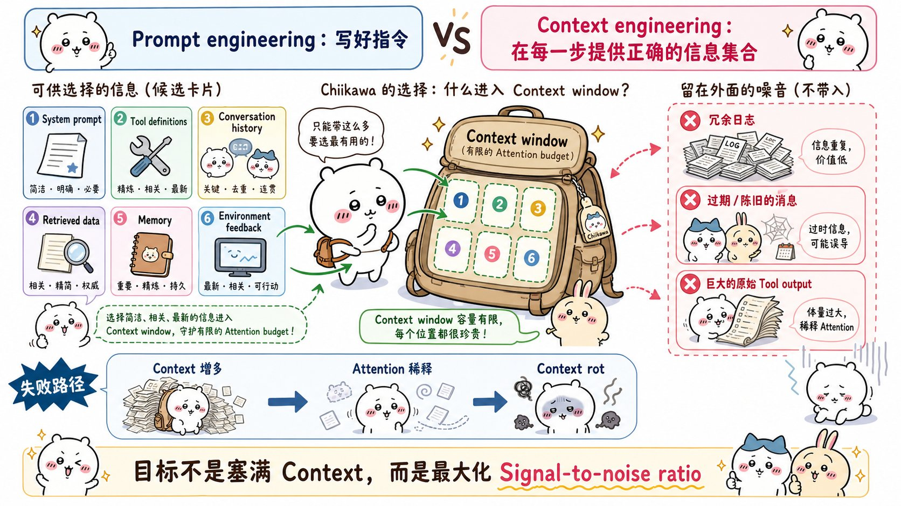
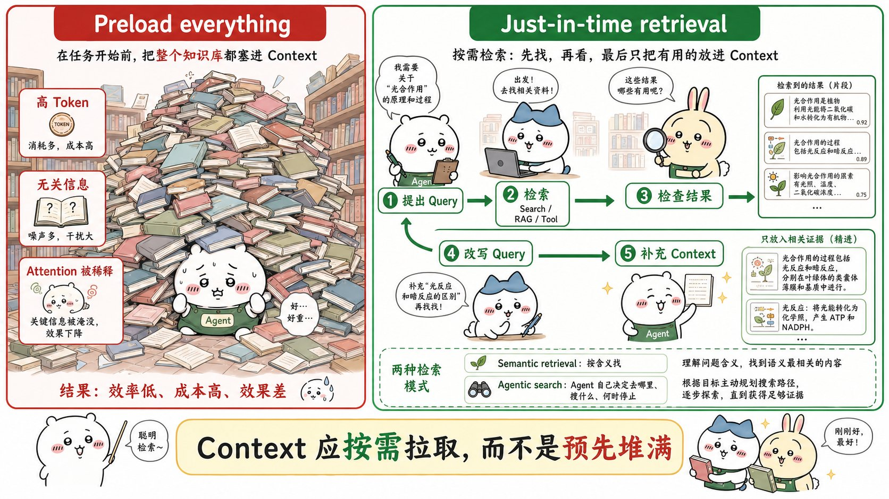
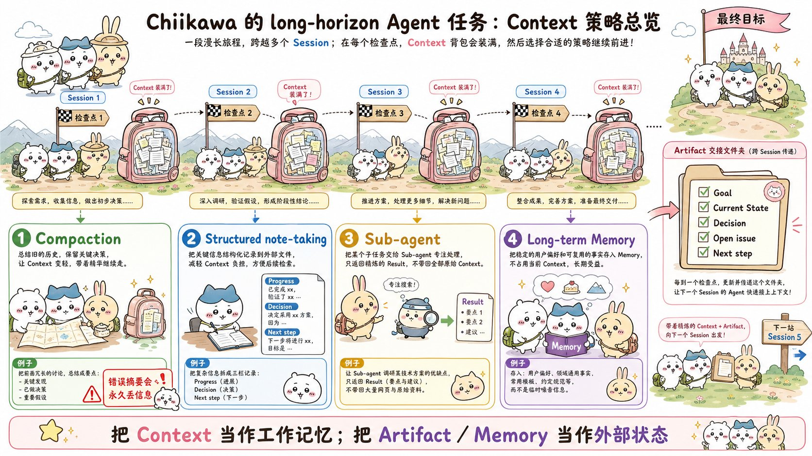
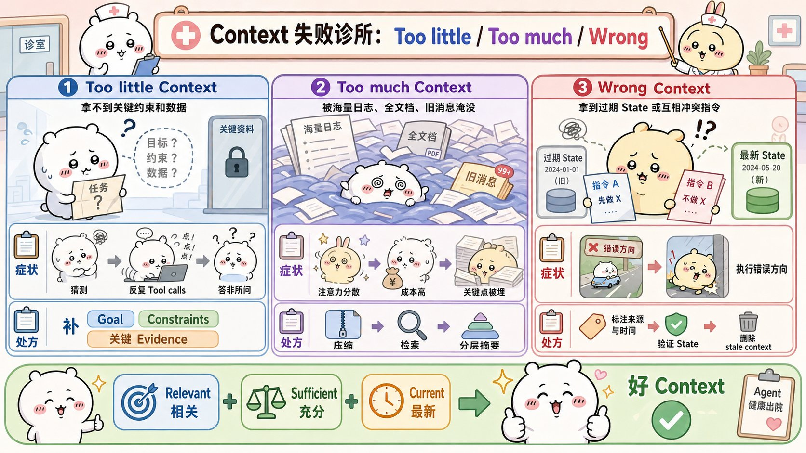
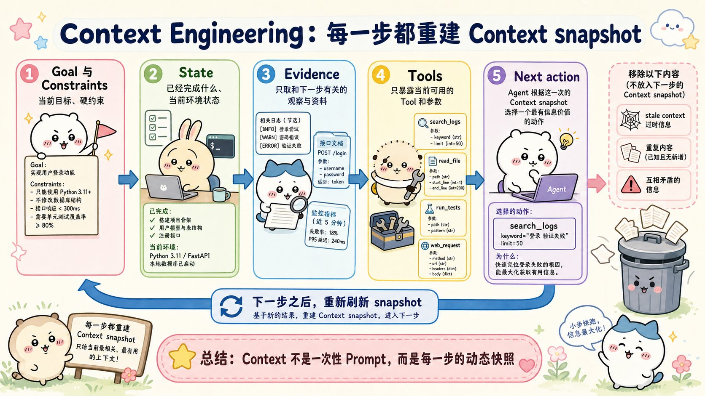

# Effective context engineering for AI agents：面试速记

> Anthropic Engineering · 2025-09-29 · [官方原文](https://www.anthropic.com/engineering/effective-context-engineering-for-ai-agents) · [本地逐句对照](10_effective-context-engineering-for-ai-agents_逐句对照.md)

## 一句话讲明白

**上下文工程（context engineering）不是把所有可能有用的信息塞进上下文窗口，而是在智能体的每一步，从不断膨胀的候选信息里挑出「尽可能小的一组高信号 token」，让模型有限的注意力预算花在刀刃上。**

## 为什么值得读 / 能用在哪

- 这是 Anthropic 官方给出的、从「写提示词」到「管上下文」的范式转移说明书，几乎所有做智能体的面试都会问到其中的名词。
- 它把长任务智能体的三板斧讲透了：压缩、结构化笔记、子智能体——你现在做的任何多轮智能体，跑久了必然撞上这三个问题。
- 落到自己项目上：能拿来回答「为什么我的智能体跑到第 30 轮就开始胡说」「工具集该做多大」「知识库到底要不要预先全灌进去」。

---

## 核心要点

### 1. 上下文工程 ≠ 提示词工程：甄选发生在每一步

- **提示词工程**：怎么把指令写好，尤其是系统提示词。它是一次性动作——写完就定了。
- **上下文工程**：在模型推理时，甄选并维护最优的那组 token。它是**迭代式的**——每次决定要传什么给模型，都要经历一次甄选。

上下文不只是提示词。它包括：系统指令、工具定义、`MCP`（模型上下文协议）接入的东西、外部数据、消息历史、检索回来的资料、记忆、示例、工具输出、环境反馈。

**关键判断**：智能体在循环里跑，会不断产出「可能有用」的新数据，这些信息必须被**循环往复地提炼**，而不是一路累积。

### 2. 注意力预算与上下文衰减：上下文是有限资源

- 「大海捞针」式基准测试研究揭示了**上下文衰减（context rot）**：上下文窗口里 token 数越多，模型准确回忆其中信息的能力越差。有些模型衰减更平缓，但**所有模型都有这个特性**。
- 所以上下文必须当作**边际收益递减的有限资源**来对待。像人的工作记忆容量有限一样，模型有一份**注意力预算（attention budget）**，每多进一个 token 就消耗掉一点。

**为什么会这样（架构层面的三条原因，面试问「原理」时用）**：

1. Transformer 架构里每个 token 都要关注其他每一个 token，n 个 token 产生 **n² 个两两配对关系**；上下文越长，捕捉这些关系的能力被摊得越薄。
2. 训练数据里短序列远比长序列常见，模型对「横跨整个上下文的依赖关系」经验少、专用参数也少。
3. 位置编码插值（position encoding interpolation）这类技术能把长序列适配回原训练长度，但代价是对 token 位置的理解有退化。

**结论要说准**：这造成的是**性能梯度（performance gradient），不是断崖**。模型在长上下文下依然很强，只是信息检索和长程推理的精度会降。别在面试里说成「超过多少 token 就废了」。

### 3. 高效上下文的构成：系统提示词、工具、示例

总原则：**找到尽可能小的一组高信号 token，使达成期望结果的可能性最大化。**

**系统提示词要写在「恰当高度」（right altitude）**——这是介于两种失败模式之间的「金发姑娘区间」（Goldilocks zone，恰到好处的区间）：

- 一个极端：把复杂、脆弱的 if-else 逻辑硬编码进提示词，试图逼出精确行为 → 脆弱，维护成本越滚越大。
- 另一个极端：只给含糊的高层指导，不给具体信号，还错误假设模型跟你有共享的上下文。
- 最优点：**足够具体能引导行为，又足够灵活，给模型强有力的启发式规则**。

写法建议：分成界限分明的小节（如 `<background_information>`、`<instructions>`、`## Tool guidance`、`## Output description`），用 XML 标签或 Markdown 标题划分——但随着模型变强，**具体排版格式正变得越来越不重要**。追求「能完整勾勒期望行为的最小信息集合」，注意**「最小」不等于「短」**。

调优路径：先用手头最好的模型跑一个极简提示词 → 看在你任务上的表现 → 针对实测出来的失败模式再补指令和示例。

**工具**定义了智能体与其信息/行动空间之间的契约，必须**返回 token 上高效的信息**，并鼓励高效行为。工具要自成一体、对错误健壮、用途极其清晰；参数要有描述性、无歧义。

> 最常见的失败模式是**臃肿的工具集**：功能覆盖过多，或造成「该用哪个」的模糊决策点。判据很硬——**如果连人类工程师都说不清某个情境下该用哪个工具，就别指望智能体做得更好。**

**示例（少样本提示，few-shot prompting）**：依然强烈推荐，但**不要**把一长串边界情况堆进提示词试图穷举规则。要甄选一组**多样化、典范式（canonical）**的示例。对模型来说，示例就是那「一图胜千言」里的图。

### 4. 即时检索：让上下文在运行时长出来

传统做法是推理前用向量嵌入（embedding）检索，预先把相关数据准备好。**即时（just-in-time）策略**反过来：智能体只维护**轻量级标识符**（文件路径、已存查询、网页链接），运行时用工具按需把数据动态加载进上下文。

- Claude Code 就用这套方式分析大型数据库：写有针对性的查询、存结果、用 `head`/`tail` 这类命令分析海量数据，**完全不必把完整数据对象加载进上下文**。
- 这与人类认知一致：我们不背下整套资料，而是靠文件系统、收件箱、书签这些外部索引按需取用。

**元数据本身就是信号**：`tests` 文件夹里的 `test_utils.py` 和 `src/core_logic/` 下的同名文件，暗示的用途完全不同。文件夹层级、命名约定、时间戳都在告诉智能体「该怎么用、什么时候用」。文件大小暗示复杂度，时间戳可作相关性的代理指标。

由此产生**渐进式披露（progressive disclosure）**：智能体通过探索逐层拼装理解，只在工作记忆里保留必要内容，其余靠记笔记持久化。

**代价要说出来**（面试考的是你知不知道权衡）：

- 运行时探索**比读预计算数据慢**。
- 需要有主见的工程设计，给对工具和启发式规则；否则智能体会误用工具、追死胡同、认不出关键信息，**白白烧掉上下文**。

**混合策略**：先预取一部分数据保证速度，再让智能体自行决定是否深挖。Claude Code 就是混合模式的例子——`CLAUDE.md` 直接原样放进初始上下文，而 `glob`、`grep` 这类基础原语让它即时检索文件，**绕开了索引过期和复杂语法树的问题**。内容变动少的场景（法律、金融）更适合混合策略。

趋势判断：模型越强，越应该「让聪明的模型聪明地行事」，人工甄选越来越少。给团队的最佳建议依然是——**做能奏效的最简单的事**。

### 5. 长时程任务三件套：压缩、结构化笔记、子智能体

长时程（long-horizon）任务指动作序列的 token 总量**超出上下文窗口**的任务，比如大型代码库迁移、全面研究项目，连续工作数十分钟到数小时。

**别指望等更大的窗口**：可预见的未来里，无论窗口多大，都仍会受**上下文污染（context pollution）**和信息相关性问题困扰——至少在追求最强性能时是这样。

**① 压缩（compaction）**：对话逼近窗口上限时，总结内容，带着摘要重开一个新窗口。

- 它是提升长期连贯性的**第一根杠杆**，本质是高保真地提炼窗口内容。
- Claude Code 的做法：把消息历史交给模型总结，**保留架构决策、未解决的 bug、实现细节**，丢弃冗余的工具输出和消息；之后带着压缩上下文**外加最近访问的五个文件**继续。
- 艺术在取舍：过于激进的压缩会丢掉那些细微却关键、后来才显出重要性的上下文。
- 调优方法：在复杂的运行轨迹上调压缩提示词，**先最大化召回率（recall）**确保不漏信息，**再迭代提升精确率（precision）**剔除多余内容。
- 最安全最轻量的一种形式是**工具结果清除（tool result clearing）**——一次工具调用已经深埋在历史里，智能体没必要再看原始结果。这已经是 Claude 开发者平台的功能。

**② 结构化笔记（structured note-taking，又称智能体记忆 agentic memory）**：让智能体定期把笔记写到上下文窗口**之外**持久化，之后再拉回来。开销极小，却提供了持久记忆。

- 形态就是 Claude Code 的待办清单，或自定义智能体维护的 `NOTES.md`。
- 「Claude 玩宝可梦」是最好的例子：智能体在**数千个游戏步骤**中维持精确记数，比如「过去 1,234 步我一直在 1 号道路训练，皮卡丘已升 8 级，目标 10 级」。**没有任何关于记忆结构的提示**，它自行画出已探索区域地图、记住已解锁成就、维护战斗策略笔记。上下文重置后，它读自己的笔记，接着跑数小时的训练或迷宫探索。
- Sonnet 4.5 发布时，Claude 开发者平台以公开测试版推出了**记忆工具（memory tool）**，用基于文件的系统在窗口之外存取信息。

**③ 子智能体（sub-agent）架构**：与其让一个智能体在整个项目里维护状态，不如让各有专长的子智能体**带着干净的上下文窗口**处理聚焦任务。

- 主智能体按高层计划协调，子智能体做深度技术工作或用工具找信息。
- **数字要记住**：每个子智能体可能消耗**数万甚至更多 token** 去探索，但**只返回 1,000–2,000 token 的浓缩摘要**。
- 本质是**关注点分离**：详细搜索上下文被隔离在子智能体内部，主导智能体只做综合与分析。在复杂研究任务上，相比单智能体系统有显著提升。

**怎么选（这是最常见的追问）**：

- **压缩** → 需要大量来回交互、要保持对话流畅连贯的任务。
- **笔记** → 有清晰里程碑的迭代式开发。
- **多智能体** → 并行探索能带来回报的复杂研究与分析。

### 6. 上下文出问题的三种样子（笔记归纳的排查表）

> 下表是基于原文观点整理的自用排查表，不是原文的分类表述。

| 失败形态 | 表现 | 对应手段 |
|---|---|---|
| 信息太少 | 智能体靠猜、反复追问、追死胡同 | 即时检索、补工具、长期记忆 |
| 信息太多 | 注意力被稀释、成本上升、关键证据淹没在日志里 | 压缩、工具结果清除、子智能体隔离 |
| 信息不对 | 过期索引、前后矛盾、来源不可信 | 时间戳/命名约定等元数据、重新检索、丢弃旧状态 |

一句话收口：**上下文工程不是单纯的压缩，而是持续的选择。**

### 7. 实战模板：每一步重建一次上下文快照

> 本节是笔记自拟的落地清单，用来把上面的原则变成可执行动作。

智能体每一步需要的不是一份永不改变的巨型提示词，而是由**目标、约束、当前状态、相关证据、可用工具、下一步动作**组成的动态快照。动作执行后，根据新的观察重新组装下一步的上下文。

每次工具调用之后，问自己（或让智能体自己问）：

1. 当前目标是什么？
2. 当前状态相比上一步改变了什么？
3. 哪些信息已经被验证过？
4. 哪些还只是假设？
5. 下一步缺哪一条证据？
6. 该去检索、该问用户，还是可以直接动手？
7. 哪些内容应该写进笔记或长期记忆？
8. 哪些旧上下文现在可以丢掉了？

---

## 面试高频问答

**Q：上下文工程和提示词工程到底差在哪？别背定义，说差别。**
A：提示词工程是一次性动作，优化的是「这句话怎么写」；上下文工程是循环动作，优化的是「模型这一步该看到哪些信息」。智能体在循环里跑会不断产出新数据，所以每次调用模型前都要重新甄选一遍。管的对象也更大——系统指令、工具定义、消息历史、检索结果、记忆、环境反馈全算上下文。

**Q：上下文窗口都几十万 token 了，为什么还要省着用？**
A：因为窗口大不等于注意力无限。研究观察到上下文衰减：token 越多，模型准确回忆其中信息的能力越差，所有模型都有这个特性。原因在架构上——Transformer 里 n 个 token 有 n² 个配对关系，长上下文会把捕捉能力摊薄；而且训练数据里短序列更常见，模型处理跨全文依赖的经验和专用参数都更少。注意要说清这是性能梯度不是断崖，长上下文仍然可用，只是精度下降。

**Q：知识库该预先全灌进上下文，还是让智能体自己去查？**
A：默认倾向即时检索——只维护文件路径、查询、链接这类轻量标识符，运行时用工具拉。好处是上下文不被无关内容占满、数据永远是新的，还能实现渐进式披露。代价是运行时探索比读预计算数据慢，而且需要给对工具，否则智能体会追死胡同白烧上下文。实践里常用混合策略：稳定的内容预加载（像 Claude Code 的 `CLAUDE.md`），其余靠 `glob`、`grep` 即时检索。

**Q：压缩和子智能体都能省上下文，什么时候用哪个？**
A：看任务形态。需要大量来回交互、要维持对话连贯的，用压缩；有清晰里程碑的迭代开发，用结构化笔记；能并行探索、且探索过程本身很脏很长的复杂研究，用子智能体。子智能体的价值在于隔离——它可以烧几万 token 去搜，只把 1,000 到 2,000 token 的提炼结果交回主智能体。

**Q：实现压缩最容易踩的坑是什么？**
A：压得太狠，把当时看起来不重要、后来才致命的细节丢了，而且这种丢失是不可逆的。工程上的做法是在复杂运行轨迹上调压缩提示词，先最大化召回率保证不漏，再提精确率去冗余。另外优先做最安全的那一档——工具结果清除：调用已经在历史深处了，原始返回值没必要再留着。

**Q：工具集怎么算设计得好？**
A：一条判据就够——如果人类工程师都说不清某个情境下该用哪个工具，智能体只会更糊涂。所以工具要功能重叠最小、自成一体、对错误健壮、参数无歧义，返回结果要 token 高效。工具定义本身就占上下文，所以工具设计就是上下文工程的一部分，最小可行工具集还能让长交互中的上下文修剪更可靠。

---

## 必须记住的 8 句话

1. 上下文工程管的是「模型每一步看到的信息集合」，是迭代甄选，不是一次性写作。
2. 上下文窗口大 ≠ 注意力无限；模型有一份会被每个 token 消耗的注意力预算。
3. 上下文衰减在所有模型上都存在，造成的是性能梯度而非断崖。
4. 好的上下文 = 尽可能小的一组高信号 token，使期望结果的可能性最大化。
5. 系统提示词要写在「恰当高度」：既不硬编码脆弱逻辑，也不含糊到没有具体信号；最小不等于短。
6. 工具设计就是上下文工程——人说不清该用哪个工具，智能体只会更差。
7. 长时程任务三板斧：压缩保连贯、结构化笔记保进度、子智能体保隔离（几万 token 探索换 1,000–2,000 token 摘要）。
8. 即时检索让上下文在运行时长出来，代价是更慢、更依赖工具设计，所以常用混合策略。

---

## 30 秒口述版

> 这篇文章的核心是：模型的注意力是有限预算，上下文必须当稀缺资源管。因为存在上下文衰减——token 越多，模型准确回忆信息的能力越差，根因是 Transformer 的 n² 配对关系和训练数据里短序列占多数。所以做法不是把知识灌满窗口，而是每一步都甄选出尽可能小的一组高信号 token。具体分三层：系统提示词写在恰当高度、工具集最小且无歧义、示例要典范不要穷举边界情况；知识用即时检索按需拉取，只维护文件路径这类轻量标识符，必要时混合预加载；任务跑长了就上压缩、结构化笔记和子智能体——子智能体可以烧几万 token 探索，只返回一两千 token 的提炼结果。一句话，上下文是工作记忆，笔记和外部文件是长期状态。

---

## 自测

- [ ] 能用一句话说清上下文工程与提示词工程的差别，并举出上下文的至少六种组成。
- [ ] 能解释上下文衰减，并说出它背后的两三条架构原因（n² 配对关系、训练分布、位置编码插值）。
- [ ] 能说清「性能梯度不是断崖」这个措辞为什么重要。
- [ ] 能描述系统提示词「恰当高度」的两个失败极端各是什么样。
- [ ] 能说出臃肿工具集的判别标准，以及为什么工具设计属于上下文工程。
- [ ] 能对比即时检索与预先检索的收益和代价，并举出混合策略的实际例子。
- [ ] 能说出压缩保留什么、丢弃什么，以及调优时先召回后精确的顺序。
- [ ] 能报出子智能体的 token 数量级对比（数万探索 → 1,000–2,000 摘要）。
- [ ] 能根据任务特点在压缩、笔记、多智能体之间做选择并给出理由。

---

> 插图为学习用途的非官方同人式教学图，角色与文章版权归各自权利人。
