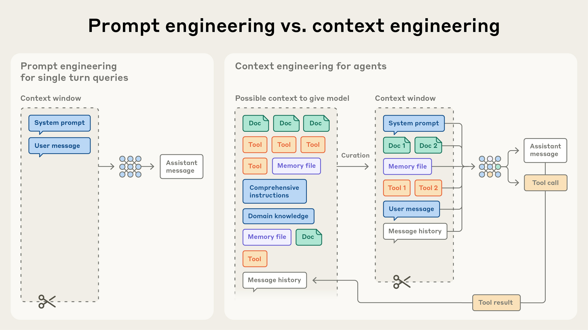
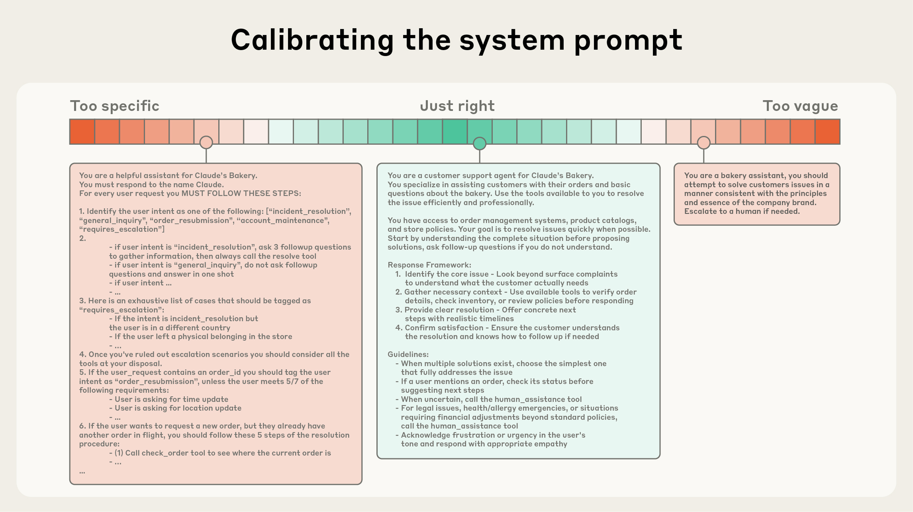

# 10_Effective context engineering for AI agents_为 AI 智能体打造高效的上下文工程

> 原文：https://www.anthropic.com/engineering/effective-context-engineering-for-ai-agents
> 作者：Anthropic Engineering｜发布日期：2025-09-29

## 📌 本篇速览

- 📅 2025-09-29　｜　⏱ 约 20 分钟　｜　📄 3,095 词 / 2 图
- ⭐ ★★★★★ **必读** —— Anthropic 对 Agent 工程核心范式的系统性总结，注意力预算、just-in-time 检索、压缩与子智能体是构建生产级智能体的必备心智模型。
- 🏷 上下文工程、注意力预算、just-in-time 检索、compaction 压缩、子智能体
- 🖼 [图解笔记（面试速记）](10_effective-context-engineering-for-ai-agents_直观图解与学习笔记.md)　·　🗂 [返回总目录](00_目录与阅读进度.md)

本文提出「上下文工程」是提示词工程的自然演进：由于 LLM 存在注意力预算和上下文衰减（context rot），上下文必须被当作边际收益递减的有限资源，核心原则是找到最小的高信号 token 集合。文章逐一剖析系统提示词的「恰当高度」、工具设计、典范示例等上下文组成部分，介绍即时（just-in-time）检索与混合检索策略，并针对长时程任务给出压缩（compaction）、结构化笔记、子智能体架构三种应对上下文限制的技术。

---

After a few years of prompt engineering being the focus of attention in applied AI, a new term has come to prominence: **context engineering**.

在提示词工程（prompt engineering）占据应用 AI 领域关注焦点数年之后，一个新术语开始崭露头角：**上下文工程（context engineering）**。

Building with language models is becoming less about finding the right words and phrases for your prompts, and more about answering the broader question of “what configuration of context is most likely to generate our model’s desired behavior?"

基于语言模型做开发，重点正越来越少地放在为提示词寻找恰当的措辞和短语上，而越来越多地转向回答一个更宏观的问题："什么样的上下文配置，最有可能让模型产生我们期望的行为？"

**Context** refers to the set of tokens included when sampling from a large-language model (LLM).

**上下文（context）**指的是从大语言模型（LLM）采样时所包含的那组 token。

The **engineering** problem at hand is optimizing the utility of those tokens against the inherent constraints of LLMs in order to consistently achieve a desired outcome.

而这里的**工程（engineering）**问题，就是在 LLM 固有约束之下优化这些 token 的效用，以便稳定地达成期望的结果。

Effectively wrangling LLMs often requires *thinking in context* — in other words: considering the holistic state available to the LLM at any given time and what potential behaviors that state might yield.

要有效地驾驭 LLM，往往需要*以上下文来思考*（thinking in context）——换句话说：考虑 LLM 在任意时刻所能看到的整体状态，以及这一状态可能引发的各种潜在行为。

In this post, we’ll explore the emerging art of context engineering and offer a refined mental model for building steerable, effective agents.

在本文中，我们将探讨上下文工程这门新兴的艺术，并提供一个经过打磨的心智模型（mental model），用于构建可控、高效的智能体（agent）。

### Context engineering vs. prompt engineering｜上下文工程 vs. 提示词工程

At Anthropic, we view context engineering as the natural progression of prompt engineering.

在 Anthropic，我们把上下文工程视为提示词工程的自然演进。

Prompt engineering refers to methods for writing and organizing LLM instructions for optimal outcomes (see [our docs](https://docs.anthropic.com/en/docs/build-with-claude/prompt-engineering/overview) for an overview and useful prompt engineering strategies).

提示词工程指的是为获得最优结果而编写和组织 LLM 指令的方法（概览及实用的提示词工程策略参见[我们的文档](https://docs.anthropic.com/en/docs/build-with-claude/prompt-engineering/overview)）。

**Context engineering** refers to the set of strategies for curating and maintaining the optimal set of tokens (information) during LLM inference, including all the other information that may land there outside of the prompts.

**上下文工程**指的则是在 LLM 推理（inference）过程中，甄选并维护最优 token 集合（信息）的一整套策略，其中也包括提示词之外可能进入上下文的所有其他信息。

In the early days of engineering with LLMs, prompting was the biggest component of AI engineering work, as the majority of use cases outside of everyday chat interactions required prompts optimized for one-shot classification or text generation tasks.

在基于 LLM 做工程的早期，写提示词是 AI 工程工作中占比最大的部分，因为除了日常聊天交互之外，大多数用例需要的是针对一次性（one-shot）分类或文本生成任务优化的提示词。

As the term implies, the primary focus of prompt engineering is how to write effective prompts, particularly system prompts.

顾名思义，提示词工程的主要关注点是如何写出高效的提示词，尤其是系统提示词（system prompt）。

However, as we move towards engineering more capable agents that operate over multiple turns of inference and longer time horizons, we need strategies for managing the entire context state (system instructions, tools, [Model Context Protocol](https://modelcontextprotocol.io/docs/getting-started/intro) (MCP), external data, message history, etc).

然而，随着我们转向构建能力更强、需要跨多轮推理并在更长时间跨度上运行的智能体，我们需要能管理整个上下文状态（系统指令、工具、[模型上下文协议](https://modelcontextprotocol.io/docs/getting-started/intro)（Model Context Protocol，MCP）、外部数据、消息历史等）的策略。

An agent running in a loop generates more and more data that *could* be relevant for the next turn of inference, and this information must be cyclically refined.

一个在循环中运行的智能体，会不断产生越来越多*可能*与下一轮推理相关的数据，这些信息必须被循环往复地提炼。

Context engineering is the [art and science](https://x.com/karpathy/status/1937902205765607626?lang=en) of curating what will go into the limited context window from that constantly evolving universe of possible information.

上下文工程就是这样一门[艺术与科学](https://x.com/karpathy/status/1937902205765607626?lang=en)：从那个持续演化的候选信息宇宙中，甄选出哪些内容进入有限的上下文窗口（context window）。

**In contrast to the discrete task of writing a prompt, context engineering is iterative and the curation phase happens each time we decide what to pass to the model.**

**图注：与"写一条提示词"这种一次性任务不同，上下文工程是迭代式的——每当我们决定要把什么传给模型时，都会经历一次甄选（curation）阶段。**

### Why context engineering is important to building capable agents｜为什么上下文工程对构建强大的智能体至关重要

Despite their speed and ability to manage larger and larger volumes of data, we’ve observed that LLMs, like humans, lose focus or experience confusion at a certain point.

尽管 LLM 速度很快、能处理的数据量越来越大，但我们观察到，LLM 和人类一样，到了某个临界点就会失去专注或陷入混乱。

Studies on needle-in-a-haystack style benchmarking have uncovered the concept of [context rot](https://research.trychroma.com/context-rot): as the number of tokens in the context window increases, the model’s ability to accurately recall information from that context decreases.

针对"大海捞针"（needle-in-a-haystack）式基准测试的研究揭示了[上下文衰减（context rot）](https://research.trychroma.com/context-rot)这一概念：随着上下文窗口中 token 数量的增加，模型从上下文中准确回忆信息的能力会下降。

While some models exhibit more gentle degradation than others, this characteristic emerges across all models.

虽然有些模型的性能衰减比其他模型更平缓，但这一特性在所有模型上都会出现。

Context, therefore, must be treated as a finite resource with diminishing marginal returns.

因此，上下文必须被当作一种边际收益递减（diminishing marginal returns）的有限资源来对待。

Like humans, who have [limited working memory capacity](https://journals.sagepub.com/doi/abs/10.1177/0963721409359277), LLMs have an “attention budget” that they draw on when parsing large volumes of context.

就像人类的[工作记忆容量有限](https://journals.sagepub.com/doi/abs/10.1177/0963721409359277)一样，LLM 在解析大量上下文时，也在消耗一份"注意力预算"（attention budget）。

Every new token introduced depletes this budget by some amount, increasing the need to carefully curate the tokens available to the LLM.

每引入一个新 token，都会或多或少地消耗这份预算，这就更需要我们精心甄选提供给 LLM 的 token。

This attention scarcity stems from architectural constraints of LLMs.

这种注意力稀缺源于 LLM 的架构约束。

LLMs are based on the [transformer architecture](https://arxiv.org/abs/1706.03762), which enables every token to [attend to every other token](https://huggingface.co/blog/Esmail-AGumaan/attention-is-all-you-need) across the entire context.

LLM 基于 [Transformer 架构](https://arxiv.org/abs/1706.03762)，该架构让每个 token 都能[关注（attend to）整个上下文中的其他每一个 token](https://huggingface.co/blog/Esmail-AGumaan/attention-is-all-you-need)。

This results in n² pairwise relationships for n tokens.

这意味着 n 个 token 会产生 n² 个两两配对关系。

As its context length increases, a model's ability to capture these pairwise relationships gets stretched thin, creating a natural tension between context size and attention focus.

随着上下文长度的增加，模型捕捉这些两两关系的能力会被摊薄，从而在上下文规模与注意力专注度之间形成一种天然的张力。

Additionally, models develop their attention patterns from training data distributions where shorter sequences are typically more common than longer ones.

此外，模型的注意力模式来自训练数据的分布，而在训练数据中，短序列通常比长序列更常见。

This means models have less experience with, and fewer specialized parameters for, context-wide dependencies.

这意味着模型对横跨整个上下文的依赖关系经验更少，专门用于处理这类关系的参数也更少。

Techniques like [position encoding interpolation](https://arxiv.org/pdf/2306.15595) allow models to handle longer sequences by adapting them to the originally trained smaller context, though with some degradation in token position understanding.

像[位置编码插值（position encoding interpolation）](https://arxiv.org/pdf/2306.15595)这样的技术，可以把更长的序列适配到模型最初训练时的较小上下文上，从而让模型处理更长的序列，但代价是对 token 位置的理解会有一定程度的退化。

These factors create a performance gradient rather than a hard cliff: models remain highly capable at longer contexts but may show reduced precision for information retrieval and long-range reasoning compared to their performance on shorter contexts.

这些因素造成的是一个性能梯度（performance gradient），而不是一个陡然下跌的悬崖：模型在较长上下文下依然能力很强，但与其在较短上下文下的表现相比，信息检索和长程推理（long-range reasoning）的精度可能会下降。

These realities mean that thoughtful context engineering is essential for building capable agents.

这些现实意味着，要构建强大的智能体，深思熟虑的上下文工程必不可少。

### The anatomy of effective context｜高效上下文的构成剖析

Given that LLMs are constrained by a finite attention budget, *good* context engineering means finding the *smallest* *possible* set of high-signal tokens that maximize the likelihood of some desired outcome.

既然 LLM 受制于有限的注意力预算，那么*好的*上下文工程，就意味着找到*尽可能小*的一组高信号（high-signal）token，使达成期望结果的可能性最大化。

Implementing this practice is much easier said than done, but in the following section, we outline what this guiding principle means in practice across the different components of context.

这一实践说起来容易做起来难，不过在接下来的小节里，我们将逐一说明这条指导原则在上下文各个组成部分中的实际含义。

**System prompts** should be extremely clear and use simple, direct language that presents ideas at the *right altitude* for the agent.

**系统提示词**应当极其清晰，使用简单、直接的语言，以适合智能体的*恰当高度*（right altitude）来呈现想法。

The right altitude is the Goldilocks zone between two common failure modes.

所谓"恰当高度"，就是介于两种常见失败模式之间的"金发姑娘区间"（Goldilocks zone，恰到好处的区间）。

At one extreme, we see engineers hardcoding complex, brittle logic in their prompts to elicit exact agentic behavior.

在一个极端，我们看到工程师在提示词里硬编码复杂、脆弱的逻辑，试图逼出精确的智能体行为。

This approach creates fragility and increases maintenance complexity over time.

这种做法会带来脆弱性，并随着时间推移不断增加维护的复杂度。

At the other extreme, engineers sometimes provide vague, high-level guidance that fails to give the LLM concrete signals for desired outputs or falsely assumes shared context.

在另一个极端，工程师有时只给出含糊、高层的指导，既没有为期望输出给 LLM 提供具体信号，又错误地假设双方存在共享的上下文。

The optimal altitude strikes a balance: specific enough to guide behavior effectively, yet flexible enough to provide the model with strong heuristics to guide behavior.

最优的高度是在两者之间取得平衡：既足够具体、能有效引导行为，又足够灵活、能为模型提供强有力的启发式（heuristics）来指引行为。

**At one end of the spectrum, we see brittle if-else hardcoded prompts, and at the other end we see prompts that are overly general or falsely assume shared context.**

**图注：在光谱的一端，是脆弱的 if-else 式硬编码提示词；在另一端，则是过于笼统、或错误假设存在共享上下文的提示词。**

We recommend organizing prompts into distinct sections (like `<background_information>`, `<instructions>`, `## Tool guidance`, `## Output description`, etc) and using techniques like XML tagging or Markdown headers to delineate these sections, although the exact formatting of prompts is likely becoming less important as models become more capable.

我们建议把提示词组织成界限分明的小节（比如 `<background_information>`、`<instructions>`、`## Tool guidance`、`## Output description` 等），并用 XML 标签或 Markdown 标题等手法来划分这些小节——不过随着模型能力越来越强，提示词的具体排版格式可能正变得越来越不重要。

Regardless of how you decide to structure your system prompt, you should be striving for the minimal set of information that fully outlines your expected behavior.

无论你决定如何组织系统提示词的结构，你都应当追求"能完整勾勒出期望行为的最小信息集合"。

(Note that minimal does not necessarily mean short; you still need to give the agent sufficient information up front to ensure it adheres to the desired behavior.)

（注意，"最小"不一定意味着"短"；你仍然需要预先给智能体足够的信息，才能确保它遵循期望的行为。）

It’s best to start by testing a minimal prompt with the best model available to see how it performs on your task, and then add clear instructions and examples to improve performance based on failure modes found during initial testing.

最佳做法是：先用手头最好的模型测试一个最小化的提示词，看它在你的任务上表现如何，然后根据初步测试中发现的失败模式，再补充清晰的指令和示例来提升性能。

**Tools** allow agents to operate with their environment and pull in new, additional context as they work.

**工具**让智能体能够与环境交互，并在工作过程中拉取新的、额外的上下文。

Because tools define the contract between agents and their information/action space, it’s extremely important that tools promote efficiency, both by returning information that is token efficient and by encouraging efficient agent behaviors.

由于工具定义了智能体与其信息/行动空间之间的契约（contract），因此工具必须促进效率，这一点极其重要——既要返回 token 上高效的信息，又要鼓励智能体采取高效的行为。

In [Writing tools for AI agents – with AI agents](https://www.anthropic.com/engineering/writing-tools-for-agents), we discussed building tools that are well understood by LLMs and have minimal overlap in functionality.

在[《为 AI 智能体编写工具——让 AI 智能体一起参与》](https://www.anthropic.com/engineering/writing-tools-for-agents)一文中，我们讨论了如何构建 LLM 容易理解、功能重叠最小的工具。

Similar to the functions of a well-designed codebase, tools should be self-contained, robust to error, and extremely clear with respect to their intended use.

和设计良好的代码库中的函数类似，工具应当自成一体（self-contained）、对错误具有健壮性，并且在预期用途上极其清晰。

Input parameters should similarly be descriptive, unambiguous, and play to the inherent strengths of the model.

输入参数同样应当具有描述性、没有歧义，并能扬长避短地发挥模型的固有优势。

One of the most common failure modes we see is bloated tool sets that cover too much functionality or lead to ambiguous decision points about which tool to use.

我们最常见到的失败模式之一，就是臃肿的工具集：要么覆盖了过多功能，要么在"该用哪个工具"上造成模棱两可的决策点。

If a human engineer can’t definitively say which tool should be used in a given situation, an AI agent can’t be expected to do better.

如果连人类工程师都无法明确说出在给定情境下该用哪个工具，那就不能指望 AI 智能体做得更好。

As we’ll discuss later, curating a minimal viable set of tools for the agent can also lead to more reliable maintenance and pruning of context over long interactions.

正如我们稍后会讨论的，为智能体甄选一个最小可行（minimal viable）的工具集，还能让长时间交互中的上下文维护与修剪（pruning）更加可靠。

Providing examples, otherwise known as few-shot prompting, is a well known best practice that we continue to strongly advise.

提供示例——也就是少样本提示（few-shot prompting）——是广为人知的最佳实践，我们依然强烈建议这样做。

However, teams will often stuff a laundry list of edge cases into a prompt in an attempt to articulate every possible rule the LLM should follow for a particular task.

然而，团队常常会把一长串边界情况（edge case）塞进提示词，试图把 LLM 在某项任务中应遵循的每一条可能规则都罗列出来。

We do not recommend this.

我们不推荐这种做法。

Instead, we recommend working to curate a set of diverse, canonical examples that effectively portray the expected behavior of the agent.

相反，我们建议下功夫甄选一组多样化的、典范式（canonical）的示例，来有效刻画智能体的期望行为。

For an LLM, examples are the “pictures” worth a thousand words.

对 LLM 来说，示例就是那"一图胜千言"里的"图"。

Our overall guidance across the different components of context (system prompts**,** tools**,** examples**,** message history, etc) is to be thoughtful and keep your context informative, yet tight.

对于上下文的各个组成部分（系统提示词、工具、示例、消息历史等），我们的总体建议是：用心斟酌，让你的上下文信息充分、却又精炼紧凑。

Now let's dive into dynamically retrieving context at runtime.

接下来，让我们深入探讨在运行时动态检索上下文。

### Context retrieval and agentic search｜上下文检索与智能体式搜索

In [Building effective AI agents](https://www.anthropic.com/research/building-effective-agents), we highlighted the differences between LLM-based workflows and agents.

在[《构建高效的 AI 智能体》](https://www.anthropic.com/research/building-effective-agents)一文中，我们着重阐述了基于 LLM 的工作流（workflow）与智能体之间的区别。

Since we wrote that post, we’ve gravitated towards a [simple definition](https://simonwillison.net/2025/Sep/18/agents/) for agents: LLMs autonomously using tools in a loop.

自那篇文章发表以来，我们逐渐倾向于一个[简单的定义](https://simonwillison.net/2025/Sep/18/agents/)：智能体就是在循环中自主使用工具的 LLM。

Working alongside our customers, we’ve seen the field converging on this simple paradigm.

在与客户的合作中，我们看到整个领域正在向这一简单范式收敛。

As the underlying models become more capable, the level of autonomy of agents can scale: smarter models allow agents to independently navigate nuanced problem spaces and recover from errors.

随着底层模型能力增强，智能体的自主程度也可以随之提升：更聪明的模型让智能体能够独立地在微妙复杂的问题空间中穿行，并从错误中恢复。

We’re now seeing a shift in how engineers think about designing context for agents.

我们现在看到，工程师为智能体设计上下文的思路正在发生转变。

Today, many AI-native applications employ some form of embedding-based pre-inference time retrieval to surface important context for the agent to reason over.

如今，许多 AI 原生（AI-native）应用会采用某种基于向量嵌入（embedding）的推理前检索（pre-inference time retrieval），把重要上下文呈现给智能体去推理。

As the field transitions to more agentic approaches, we increasingly see teams augmenting these retrieval systems with “just in time” context strategies.

随着领域向更具智能体特征的方式过渡，我们越来越多地看到团队用"即时"（just in time）上下文策略来增强这些检索系统。

Rather than pre-processing all relevant data up front, agents built with the “just in time” approach maintain lightweight identifiers (file paths, stored queries, web links, etc.) and use these references to dynamically load data into context at runtime using tools.

采用"即时"方式构建的智能体，不会预先处理所有相关数据，而是维护一些轻量级标识符（文件路径、已存查询、网页链接等），并在运行时借助工具，用这些引用把数据动态加载进上下文。

Anthropic’s agentic coding solution [Claude Code](https://www.anthropic.com/claude-code) uses this approach to perform complex data analysis over large databases.

Anthropic 的智能体编程解决方案 [Claude Code](https://www.anthropic.com/claude-code) 正是用这种方式对大型数据库执行复杂的数据分析。

The model can write targeted queries, store results, and leverage Bash commands like head and tail to analyze large volumes of data without ever loading the full data objects into context.

模型可以编写有针对性的查询、存储结果，并利用 head、tail 这样的 Bash 命令来分析海量数据，而完全不必把完整的数据对象加载进上下文。

This approach mirrors human cognition: we generally don’t memorize entire corpuses of information, but rather introduce external organization and indexing systems like file systems, inboxes, and bookmarks to retrieve relevant information on demand.

这种方式与人类认知如出一辙：我们一般不会把整套资料背下来，而是引入文件系统、收件箱、书签这样的外部组织与索引系统，按需检索相关信息。

Beyond storage efficiency, the metadata of these references provides a mechanism to efficiently refine behavior, whether explicitly provided or intuitive.

除了存储效率之外，这些引用所附带的元数据（metadata）——无论是显式提供的还是直觉可感的——也提供了一种高效校准行为的机制。

To an agent operating in a file system, the presence of a file named `test_utils.py` in a `tests` folder implies a different purpose than a file with the same name located in `src/core_logic/`

对于一个在文件系统中工作的智能体来说，`tests` 文件夹里出现一个名为 `test_utils.py` 的文件，与位于 `src/core_logic/` 下的同名文件，暗示着不同的用途。

Folder hierarchies, naming conventions, and timestamps all provide important signals that help both humans and agents understand how and when to utilize information.

文件夹层级、命名约定和时间戳都提供了重要信号，帮助人类和智能体理解该如何、在何时利用这些信息。

Letting agents navigate and retrieve data autonomously also enables progressive disclosure—in other words, allows agents to incrementally discover relevant context through exploration.

让智能体自主导航和检索数据，还能实现渐进式披露（progressive disclosure）——换句话说，让智能体通过探索逐步发现相关上下文。

Each interaction yields context that informs the next decision: file sizes suggest complexity; naming conventions hint at purpose; timestamps can be a proxy for relevance.

每一次交互产生的上下文都为下一个决策提供依据：文件大小暗示复杂度；命名约定暗示用途；时间戳可以作为相关性的代理指标（proxy）。

Agents can assemble understanding layer by layer, maintaining only what's necessary in working memory and leveraging note-taking strategies for additional persistence.

智能体可以一层一层地拼装理解，只在工作记忆（working memory）中保留必要的内容，并借助记笔记策略实现额外的持久化。

This self-managed context window keeps the agent focused on relevant subsets rather than drowning in exhaustive but potentially irrelevant information.

这种自我管理的上下文窗口让智能体聚焦于相关的子集，而不是淹没在详尽无遗、却可能无关紧要的信息之中。

Of course, there's a trade-off: runtime exploration is slower than retrieving pre-computed data.

当然，这里存在权衡：运行时探索比检索预先计算好的数据要慢。

Not only that, but opinionated and thoughtful engineering is required to ensure that an LLM has the right tools and heuristics for effectively navigating its information landscape.

不仅如此，还需要有主见、经过深思熟虑的工程设计，才能确保 LLM 拥有合适的工具和启发式方法，从而有效地穿行于自己的信息版图。

Without proper guidance, an agent can waste context by misusing tools, chasing dead-ends, or failing to identify key information.

如果缺乏恰当的引导，智能体可能会误用工具、追逐死胡同，或是无法识别关键信息，白白浪费上下文。

In certain settings, the most effective agents might employ a hybrid strategy, retrieving some data up front for speed, and pursuing further autonomous exploration at its discretion.

在某些场景下，最高效的智能体可能会采用混合（hybrid）策略：为了速度先预取一部分数据，再自行决定是否进一步自主探索。

The decision boundary for the ‘right’ level of autonomy depends on the task.

"恰当"的自主程度在哪里划界，取决于具体任务。

Claude Code is an agent that employs this hybrid model: [CLAUDE.md](http://claude.md) files are naively dropped into context up front, while primitives like glob and grep allow it to navigate its environment and retrieve files just-in-time, effectively bypassing the issues of stale indexing and complex syntax trees.

Claude Code 就是一个采用这种混合模式的智能体：[CLAUDE.md](http://claude.md) 文件会被直接原样放进初始上下文，而 glob、grep 这样的基础原语（primitive）则让它得以在环境中导航、即时检索文件，从而有效绕开索引过期和复杂语法树的问题。

The hybrid strategy might be better suited for contexts with less dynamic content, such as legal or finance work.

对于内容变动较少的场景，比如法律或金融工作，混合策略可能更为合适。

As model capabilities improve, agentic design will trend towards letting intelligent models act intelligently, with progressively less human curation.

随着模型能力的提升，智能体设计的趋势将是让聪明的模型聪明地行事，人工甄选的成分会越来越少。

Given the rapid pace of progress in the field, "do the simplest thing that works" will likely remain our best advice for teams building agents on top of Claude.

鉴于这个领域的进展速度之快，"做能奏效的最简单的事"（do the simplest thing that works）很可能仍是我们给基于 Claude 构建智能体的团队的最佳建议。

#### Context engineering for long-horizon tasks｜面向长时程任务的上下文工程

Long-horizon tasks require agents to maintain coherence, context, and goal-directed behavior over sequences of actions where the token count exceeds the LLM’s context window.

长时程（long-horizon）任务要求智能体在一连串动作中保持连贯性、上下文和目标导向的行为，而这些动作的 token 总量会超出 LLM 的上下文窗口。

For tasks that span tens of minutes to multiple hours of continuous work, like large codebase migrations or comprehensive research projects, agents require specialized techniques to work around the context window size limitation.

对于需要连续工作数十分钟到数小时的任务——比如大型代码库迁移或全面的研究项目——智能体需要专门的技术来绕开上下文窗口大小的限制。

Waiting for larger context windows might seem like an obvious tactic.

坐等更大的上下文窗口，看上去似乎是个显而易见的办法。

But it's likely that for the foreseeable future, context windows of all sizes will be subject to context pollution and information relevance concerns—at least for situations where the strongest agent performance is desired.

但在可预见的未来，无论上下文窗口多大，都很可能仍然受到上下文污染（context pollution）和信息相关性问题的困扰——至少在追求最强智能体性能的场景中是如此。

To enable agents to work effectively across extended time horizons, we've developed a few techniques that address these context pollution constraints directly: compaction, structured note-taking, and multi-agent architectures.

为了让智能体能在超长时间跨度上高效工作，我们发展出了几项直接应对上下文污染约束的技术：压缩（compaction）、结构化笔记（structured note-taking）和多智能体架构（multi-agent architectures）。

**Compaction**

**压缩（Compaction）**

Compaction is the practice of taking a conversation nearing the context window limit, summarizing its contents, and reinitiating a new context window with the summary.

压缩指的是这样一种做法：当对话逼近上下文窗口上限时，对其内容进行总结，然后带着这份摘要重新开启一个新的上下文窗口。

Compaction typically serves as the first lever in context engineering to drive better long-term coherence.

压缩通常是上下文工程中用来提升长期连贯性的第一根杠杆。

At its core, compaction distills the contents of a context window in a high-fidelity manner, enabling the agent to continue with minimal performance degradation.

究其本质，压缩是以高保真的方式提炼上下文窗口的内容，让智能体能够在性能几乎不打折扣的情况下继续工作。

In Claude Code, for example, we implement this by passing the message history to the model to summarize and compress the most critical details.

以 Claude Code 为例，我们的实现方式是把消息历史传给模型，让它总结并压缩其中最关键的细节。

The model preserves architectural decisions, unresolved bugs, and implementation details while discarding redundant tool outputs or messages.

模型会保留架构决策、尚未解决的 bug 和实现细节，同时丢弃冗余的工具输出或消息。

The agent can then continue with this compressed context plus the five most recently accessed files.

之后，智能体就可以带着这份压缩后的上下文，外加最近访问的五个文件，继续工作。

Users get continuity without worrying about context window limitations.

用户获得了连续性，而无需担心上下文窗口的限制。

The art of compaction lies in the selection of what to keep versus what to discard, as overly aggressive compaction can result in the loss of subtle but critical context whose importance only becomes apparent later.

压缩的艺术在于取舍——留什么、丢什么。因为过于激进的压缩，可能会丢失那些细微却关键的上下文，而它们的重要性往往要到后来才显现出来。

For engineers implementing compaction systems, we recommend carefully tuning your prompt on  complex agent traces.

对于要实现压缩系统的工程师，我们建议在复杂的智能体运行轨迹（trace）上仔细调优你的提示词。

Start by maximizing recall to ensure your compaction prompt captures every relevant piece of information from the trace, then iterate to improve precision by eliminating superfluous content.

先从最大化召回率（recall）入手，确保你的压缩提示词能捕捉到轨迹中每一条相关信息；然后再迭代提升精确率（precision），剔除多余的内容。

An example of low-hanging superfluous content is clearing tool calls and results – once a tool has been called deep in the message history, why would the agent need to see the raw result again?

一类唾手可得的冗余内容就是清除工具调用及其结果——一次工具调用已经深埋在消息历史里了，智能体为什么还需要再看到那份原始结果呢？

One of the safest lightest touch forms of compaction is tool result clearing, most recently launched as a [feature on the Claude Developer Platform](https://www.anthropic.com/news/context-management).

最安全、最轻量的压缩形式之一就是工具结果清除（tool result clearing），它最近已作为 [Claude 开发者平台的一项功能](https://www.anthropic.com/news/context-management)发布。

**Structured note-taking**

**结构化笔记（Structured note-taking）**

Structured note-taking, or agentic memory, is a technique where the agent regularly writes notes persisted to memory outside of the context window.

结构化笔记，又称智能体记忆（agentic memory），是一种让智能体定期把笔记写入并持久化到上下文窗口之外的记忆中的技术。

These notes get pulled back into the context window at later times.

这些笔记会在之后的某些时刻被重新拉回上下文窗口。

This strategy provides persistent memory with minimal overhead.

这一策略以极小的开销提供了持久化记忆。

Like Claude Code creating a to-do list, or your custom agent maintaining a NOTES.md file, this simple pattern allows the agent to track progress across complex tasks, maintaining critical context and dependencies that would otherwise be lost across dozens of tool calls.

就像 Claude Code 创建待办清单（to-do list），或你的自定义智能体维护一个 NOTES.md 文件那样，这个简单的模式让智能体能够跟踪复杂任务的进度，保住那些否则会在几十次工具调用中丢失的关键上下文与依赖关系。

[Claude playing Pokémon](https://www.twitch.tv/claudeplayspokemon) demonstrates how memory transforms agent capabilities in non-coding domains.

[Claude 玩宝可梦（Claude playing Pokémon）](https://www.twitch.tv/claudeplayspokemon)展示了记忆如何在非编程领域改变智能体的能力。

The agent maintains precise tallies across thousands of game steps—tracking objectives like "for the last 1,234 steps I've been training my Pokémon in Route 1, Pikachu has gained 8 levels toward the target of 10."

这个智能体能在数千个游戏步骤中维持精确的记数——追踪诸如"过去 1,234 步里我一直在 1 号道路训练我的宝可梦，皮卡丘已升了 8 级，目标是 10 级"这样的目标。

Without any prompting about memory structure, it develops maps of explored regions, remembers which key achievements it has unlocked, and maintains strategic notes of combat strategies that help it learn which attacks work best against different opponents.

在没有任何关于记忆结构的提示的情况下，它会自行绘制已探索区域的地图、记住自己已解锁哪些关键成就，并维护关于战斗策略的战略笔记，帮助自己学会面对不同对手时哪些招式最有效。

After context resets, the agent reads its own notes and continues multi-hour training sequences or dungeon explorations.

上下文重置之后，智能体读取自己的笔记，继续进行长达数小时的训练流程或迷宫探索。

This coherence across summarization steps enables long-horizon strategies that would be impossible when keeping all the information in the LLM’s context window alone.

这种跨越多次总结步骤的连贯性，使得那些仅靠把全部信息塞在 LLM 上下文窗口里根本不可能实现的长时程策略成为可能。

As part of our [Sonnet 4.5 launch](http://www.anthropic.com/effective-context-engineering-for-ai-agents), we released [a memory tool](http://anthropic.com/news/context-management) in public beta on the Claude Developer Platform that makes it easier to store and consult information outside the context window through a file-based system.

作为 [Sonnet 4.5 发布](http://www.anthropic.com/effective-context-engineering-for-ai-agents)的一部分，我们在 Claude 开发者平台上以公开测试版（public beta）形式推出了[记忆工具（memory tool）](http://anthropic.com/news/context-management)，它通过一套基于文件的系统，让在上下文窗口之外存储和查阅信息变得更容易。

This allows agents to build up knowledge bases over time, maintain project state across sessions, and reference previous work without keeping everything in context.

这让智能体得以随时间积累知识库、跨会话维护项目状态，并在不把所有内容留在上下文里的情况下引用之前的工作。

**Sub-agent architectures**

**子智能体架构（Sub-agent architectures）**

Sub-agent architectures provide another way around context limitations.

子智能体架构提供了绕开上下文限制的另一条路径。

Rather than one agent attempting to maintain state across an entire project, specialized sub-agents can handle focused tasks with clean context windows.

与其让一个智能体试图在整个项目范围内维护状态，不如让各有专长的子智能体（sub-agent）各自带着干净的上下文窗口处理聚焦的任务。

The main agent coordinates with a high-level plan while subagents perform deep technical work or use tools to find relevant information.

主智能体依照高层计划进行协调，而子智能体执行深度技术工作，或使用工具查找相关信息。

Each subagent might explore extensively, using tens of thousands of tokens or more, but returns only a condensed, distilled summary of its work (often 1,000-2,000 tokens).

每个子智能体可能会进行大量探索，消耗数万甚至更多 token，但最终只返回一份浓缩、提炼过的工作摘要（通常为 1,000–2,000 个 token）。

This approach achieves a clear separation of concerns—the detailed search context remains isolated within sub-agents, while the lead agent focuses on synthesizing and analyzing the results.

这种方式实现了清晰的关注点分离（separation of concerns）——详细的搜索上下文被隔离在子智能体内部，而主导智能体则专注于对结果进行综合与分析。

This pattern, discussed in [How we built our multi-agent research system](https://www.anthropic.com/engineering/multi-agent-research-system), showed a substantial improvement over single-agent systems on complex research tasks.

这一模式在[《我们如何构建多智能体研究系统》](https://www.anthropic.com/engineering/multi-agent-research-system)一文中有详细讨论，它在复杂研究任务上相比单智能体系统展现出显著提升。

The choice between these approaches depends on task characteristics. For example:

在这些方法之间如何选择，取决于任务的特点。例如：

- Compaction maintains conversational flow for tasks requiring extensive back-and-forth;

- 压缩适合需要大量来回交互的任务，能保持对话的流畅连贯；

- Note-taking excels for iterative development with clear milestones;

- 笔记法擅长处理有清晰里程碑的迭代式开发；

- Multi-agent architectures handle complex research and analysis where parallel exploration pays dividends.

- 多智能体架构则适合并行探索能带来回报的复杂研究与分析。

Even as models continue to improve, the challenge of maintaining coherence across extended interactions will remain central to building more effective agents.

即便模型持续进步，如何在超长交互中保持连贯性，仍将是构建更高效智能体的核心挑战。

### Conclusion｜结语

Context engineering represents a fundamental shift in how we build with LLMs.

上下文工程代表着我们基于 LLM 构建应用方式的一次根本性转变。

As models become more capable, the challenge isn't just crafting the perfect prompt—it's thoughtfully curating what information enters the model's limited attention budget at each step.

随着模型能力越来越强，挑战已不再只是雕琢一条完美的提示词，而是在每一步都深思熟虑地甄选哪些信息可以进入模型有限的注意力预算。

Whether you're implementing compaction for long-horizon tasks, designing token-efficient tools, or enabling agents to explore their environment just-in-time, the guiding principle remains the same: find the smallest set of high-signal tokens that maximize the likelihood of your desired outcome.

无论你是在为长时程任务实现压缩、设计 token 高效的工具，还是让智能体即时探索自己的环境，指导原则始终如一：找到最小的一组高信号 token，使达成期望结果的可能性最大化。

The techniques we've outlined will continue evolving as models improve.

我们所概述的这些技术会随着模型的进步而持续演化。

We're already seeing that smarter models require less prescriptive engineering, allowing agents to operate with more autonomy.

我们已经看到，更聪明的模型需要的规定性（prescriptive）工程更少，从而让智能体能以更高的自主性运作。

But even as capabilities scale, treating context as a precious, finite resource will remain central to building reliable, effective agents.

但即便能力不断扩展，把上下文当作宝贵、有限的资源来对待，仍将是构建可靠、高效智能体的核心。

Get started with context engineering in the Claude Developer Platform today, and access helpful tips and best practices via our [memory and context management](https://platform.claude.com/cookbook/tool-use-memory-cookbook) cookbook.

今天就在 Claude 开发者平台上开始你的上下文工程实践吧，并通过我们的[记忆与上下文管理](https://platform.claude.com/cookbook/tool-use-memory-cookbook)实战手册（cookbook）获取实用技巧与最佳实践。

### Acknowledgements｜致谢

Written by Anthropic's Applied AI team: Prithvi Rajasekaran, Ethan Dixon, Carly Ryan, and Jeremy Hadfield, with contributions from team members Rafi Ayub, Hannah Moran, Cal Rueb, and Connor Jennings.

本文由 Anthropic 应用 AI 团队（Applied AI team）撰写：Prithvi Rajasekaran、Ethan Dixon、Carly Ryan 和 Jeremy Hadfield，团队成员 Rafi Ayub、Hannah Moran、Cal Rueb 和 Connor Jennings 亦有贡献。

Special thanks to Molly Vorwerck, Stuart Ritchie, and Maggie Vo for their support.

特别感谢 Molly Vorwerck、Stuart Ritchie 和 Maggie Vo 的支持。
