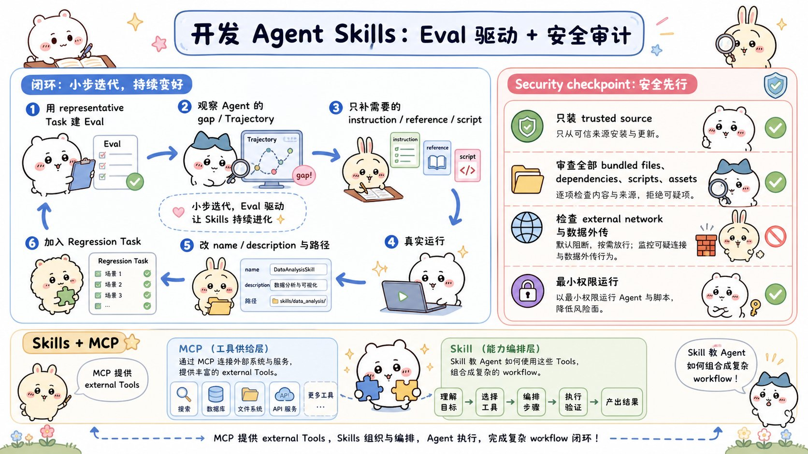

# Equipping agents for the real world with Agent Skills：面试速记

> Anthropic Engineering · 2025-10-16 · [官方原文](https://www.anthropic.com/engineering/equipping-agents-for-the-real-world-with-agent-skills) · [本地逐句对照](11_equipping-agents-for-the-real-world-with-agent-skills_逐句对照.md)

## 一句话讲明白

**智能体技能（Agent Skills）就是一个装着说明书、脚本和素材的文件夹：里面必须有一个 `SKILL.md`，开头用 `name` 和 `description` 告诉模型"什么时候用我"，正文告诉它"怎么做"，更深的细节拆到别的文件里按需再读——用这套「渐进式披露（progressive disclosure）」把通用智能体变成专用智能体，而不用把领域知识一次性塞满上下文窗口。**

## 为什么值得读 / 能用在哪

- 它回答了一个非常实际的工程问题：**领域知识怎么装进智能体**。以前的做法是给每个用例单独做一个定制智能体，或者把提示词越写越长；技能的做法是把知识做成可组合、可分享、可移植的文件夹。
- 原文有个特别好用的比喻：**做一个技能就像给新员工写入职手册**。你不会把公司全部制度一次念给新人听，而是给他目录，让他按需翻。
- 自己项目里能用在：把「团队约定的排查流程」「某个内部系统的调用姿势」「报表生成的固定步骤」沉淀成技能目录，配上确定性脚本，模型负责判断、脚本负责执行。
- 2025-12-18 更新：Agent Skills 已作为**开放标准**发布（agentskills.io），目标是跨平台可移植。目前 Claude.ai、Claude Code、Claude Agent SDK、Claude 开发者平台均已支持。

## 核心要点

### 1. 一个技能的解剖：最小形态只要一个 `SKILL.md`

- **最小形态**：一个目录 + 一个 `SKILL.md`，没了。
- `SKILL.md` **必须**以 YAML 头信息（frontmatter）开头，里面有两个必填的元数据（metadata）字段：`name` 和 `description`。
- 复杂技能可以在同一目录里**捆绑（bundle）额外文件**，在 `SKILL.md` 里按文件名引用它们——比如脚本、参考文档、模板素材。
- 原文用的真实例子是 [PDF 技能](https://github.com/anthropics/skills/tree/main/document-skills/pdf)：Claude 本来就很懂**读** PDF，但直接**操作** PDF（比如填表单）能力有限，这个技能补的就是这块。
- 该技能的 `SKILL.md` 引用了两个附加文件：`reference.md` 和 `forms.md`。把填表指令挪进 `forms.md`，核心文件就能保持精简——作者相信 Claude 只在真的要填表时才会去读它。

### 2. 三层渐进式披露（面试必背，按层说清楚）

原文明确分了三层，**"第一层/第二层/第三层"是原文的说法，不是我编的**：

| 层级 | 内容 | 什么时候进上下文 | 类比 |
|---|---|---|---|
| **第一层** | 每个已安装技能的 `name` + `description` | **启动时就预加载进系统提示词**，常驻 | 手册的**目录** |
| **第二层** | `SKILL.md` 的正文 | 模型判断这个技能跟当前任务相关时，整份读进上下文 | 具体**章节** |
| **第三层及更深** | 被 `SKILL.md` 引用的附加文件（`forms.md`、`reference.md` …） | 模型自己决定要不要去浏览、发现 | 详尽的**附录** |

- 一句话结论：**渐进式披露是让技能既灵活又可扩展的核心设计原则**（原文原话的意思）。
- 关键推论：因为有文件系统和代码执行工具的智能体**不需要把技能全文读进上下文窗口**，所以**一个技能能打包的上下文量实际上是无上限的**（effectively unbounded）。这句是面试里最有杀伤力的一句。

### 3. 一条用户消息是怎么触发技能的

原文给的四步操作顺序，照着念就行：

1. 开局：上下文窗口里有**核心系统提示词** + **每个已安装技能的元数据** + **用户的第一条消息**；
2. Claude 调用 Bash 工具读取 `pdf/SKILL.md` 的内容，**技能就此被触发**；
3. Claude 自己决定去读随技能捆绑的 `forms.md`；
4. 相关指令都加载好了，Claude 继续干用户交代的活。

**所以 `name` 和 `description` 不是装饰性字段**——它们是模型判断「要不要触发这个技能」的唯一依据。写不好，技能等于不存在。

### 4. 大模型负责判断，确定性脚本负责精确执行

- 技能里可以放**代码，供模型自行斟酌、作为工具来执行**。
- 原文给的理由有两条，都要会说：
  - **成本**：靠逐个生成 token 来给一个列表排序，比直接跑一个排序算法**昂贵得多**。
  - **可靠性**：很多应用需要**只有代码才能提供的确定性可靠性**（deterministic reliability）。
- 例子：PDF 技能里有一个预先写好的 Python 脚本，读 PDF、抽出所有表单字段。**Claude 可以直接运行它，而不用把脚本或 PDF 本身加载进上下文**——省上下文、结果稳定可重复。
- 写技能时要**明确区分「这个脚本是拿来跑的」还是「这段代码是拿来当参考读的」**。原文原话：代码既可以充当可执行工具，也可以充当文档，必须说清楚。不说清楚，模型就可能把该跑的当文档读、把该读的直接跑了。

### 5. 开发与评估技能：四条实践准则

原文给了四条指导原则，建议整段背下来，面试问「你怎么写一个好技能」直接答这个：

1. **从评估（evaluation）入手**——先让智能体在**有代表性的任务**上跑，观察它在哪里吃力、哪里缺上下文，找出**具体**短板，再循序渐进地补技能。**先有评估，后有技能**，不是反过来。
2. **为规模化组织结构**——`SKILL.md` 一臃肿就拆成独立文件并引用；如果两块上下文**互斥或很少一起用**，路径分开存能**减少 token 消耗**；同时讲清楚脚本是跑还是读。
3. **站在模型的视角思考**——在真实场景里监控它怎么用你的技能，留意**意料之外的执行轨迹（trajectory）**和**对某些上下文的过度依赖**，然后迭代。特别要盯 `name` 和 `description`，因为触发与否全靠它们。
4. **与模型一起迭代**——干活时让模型把**自己成功的做法和常犯的错误**沉淀成技能里可复用的上下文和代码；跑偏了就让它**自我反思**哪里出了问题。目的是**发现模型真正需要什么上下文，而不是事先凭空预判**。

### 6. 技能 与 MCP：互补，不是竞争（面试最常问的一题）

原文只在展望部分点了一句，但它是问答里的高频题，先把**原文说了什么**和**合理延伸**分清楚：

- **原文原话的意思**：我们还将探索技能如何与**模型上下文协议（Model Context Protocol，MCP）服务器互补**——办法是**用技能教会智能体涉及外部工具和软件的更复杂工作流**。
- 也就是说，官方定位的分工是：**MCP 负责「接上外部工具」，技能负责「教会怎么用这些工具把活干完」。**

| 维度 | MCP | 智能体技能 |
|---|---|---|
| 解决什么 | 智能体**怎么连上**外部工具、数据源 | 拿到工具后**按什么流程**把事办成 |
| 提供的东西 | 能力接口（工具、资源） | 过程性知识 + 脚本 + 素材 |
| 形态 | 一个服务（需要部署/连接） | 一个文件夹（丢进目录就能用） |
| 与上下文的关系 | 工具定义通常常驻上下文 | 靠渐进式披露，相关时才进上下文 |
| 类比 | 给智能体一双**手** | 给智能体一本**工作手册** |

> 面试落点：被问「有了 MCP 还要 Skills 干嘛」，就答**接口 ≠ 流程**。MCP 告诉模型「你可以调这些接口」，但不会告诉它「公司报销要先查这张表、再按这个格式生成、超过多少额度要走另一条路」——后者才是技能承载的东西。

### 7. 写 `SKILL.md` 的自查清单

把上面的原则压成动手时能对照的几条：

- [ ] `description` 写的是**什么时候该用我**，不是**我是什么**——它是触发的唯一依据。
- [ ] 核心 `SKILL.md` 保持精简；只在特定场景才需要的内容拆进附加文件并按文件名引用。
- [ ] 互斥或极少同时使用的上下文，**分开成不同路径**，这是省 token 的主要手段。
- [ ] 每段代码都注明：**直接运行** 还是 **读作参考**。
- [ ] 大量、重复、需要精确结果的操作交给脚本；判断、选路径、处理例外留给模型。
- [ ] 上线前拿有代表性的任务跑一遍，看执行轨迹是否符合预期，再回头改 `name`/`description`。

### 8. 供应链安全：技能要按「可执行代码」的标准审计

- 技能是**通过指令和代码**给模型新能力的——**强大**和**危险**是同一件事的两面。
- 风险原文说得很直白：恶意技能可能**在运行环境里引入漏洞**，或者**指使模型外泄数据（exfiltrate data）、执行非预期的操作**。
- 建议动作：
  - **只安装来自可信来源的技能**；
  - 来源可信度较低时，**使用前彻底审计**；
  - 审计从**通读技能里捆绑的每一个文件**开始，弄清它到底干了什么；
  - **特别留意代码依赖**，以及图片、脚本这类捆绑资源；
  - **特别留意会让模型去连接不可信外部网络源的指令或代码**。
- 记忆钩子：装一个第三方技能 ≈ 在自己机器上 `curl | bash` 一段陌生代码，只不过它还能反过来指挥模型（提示词注入，prompt injection 的现实载体）。

## 面试高频问答

**Q：Skills 和 MCP 有什么区别？该怎么选？**
A：不是二选一，是互补。MCP（模型上下文协议）解决的是**智能体怎么接上外部工具和数据源**——它提供的是能力接口；技能解决的是**拿到这些工具之后按什么流程把事办成**——它提供的是过程性知识和组织方式。原文在展望部分明确说，会探索技能如何**与 MCP 服务器互补**，办法是「教会智能体涉及外部工具和软件的更复杂工作流」。一句话：**MCP 给手，技能给工作手册。**（补充一层区别，原文未展开：MCP 工具定义通常常驻上下文，而技能靠渐进式披露只在相关时才进上下文，所以技能天然更省上下文、也更容易分享成一个文件夹。）

**Q：渐进式披露到底省了什么？为什么说技能能装的上下文"无上限"？**
A：省的是**上下文窗口**。启动时常驻的只有每个技能的名字和描述这一点点元数据；正文要等模型判断相关才读；更深的文件要等具体场景才读。因为智能体有文件系统和代码执行工具，它**根本不需要把技能全文读进上下文**，所以一个技能里能塞多少文件，跟上下文窗口大小基本脱钩——原文的说法是「实际上无上限」。

**Q：什么时候该在技能里写脚本，什么时候写自然语言指令？**
A：判断标准是**这件事是不是确定性的**。解析、计算、格式转换、重复执行这类，写脚本——原文的类比是「靠生成 token 排序远比跑排序算法昂贵」，而且很多场景需要只有代码才有的确定性可靠性。需要理解意图、选路径、处理例外的部分，留给自然语言指令。还有一条必须做的事：在 `SKILL.md` 里**写明这段代码是执行还是当参考读**。

**Q：我要新做一个技能，第一步做什么？**
A：**不是写文档，是先做评估。** 挑一批有代表性的任务让智能体裸跑，看它到底在哪一步卡住、缺哪块上下文，然后只补这一块，别一上来就写大而全的手册。接着在真实场景里观察它的执行轨迹，反复调 `name`/`description` 和文件拆分方式。还有个省力做法：让模型自己把成功做法和踩过的坑沉淀进技能。

**Q：团队要引入外部技能，你会怎么把关？**
A：按**引入第三方可执行代码**的标准来把关，因为它本来就是。原则是只从可信来源安装；非可信来源必须使用前彻底审计——逐个读完捆绑文件搞清它做什么，重点看代码依赖、图片脚本等捆绑资源，以及有没有指令或代码会让模型连到不可信的外部网络。审计不通过就不进环境。

## 必须记住的 8 句话

1. 技能是**一个目录**，不是一段巨型提示词。
2. 最小技能 = 一个 `SKILL.md`；它必须以 YAML 头信息开头，`name` 和 `description` 是必填元数据。
3. 渐进式披露分**三层**：元数据（启动时常驻）→ `SKILL.md` 正文（相关时读）→ 附加文件（按场景读）。
4. 渐进式披露是让技能**又灵活又可扩展**的核心设计原则。
5. 因为不必全文入上下文，**一个技能能打包的上下文量实际上无上限**。
6. `name` 和 `description` 决定技能会不会被触发——写不好等于没做。
7. **模型负责判断，确定性代码负责精确执行**；脚本可以直接跑，不用进上下文。
8. **先做评估再写技能**；第三方技能按可执行代码的标准审计。

## 30 秒口述版

> Agent Skills 是一个包含 `SKILL.md`、脚本、参考文档和素材的文件夹，用来把领域知识装进通用智能体。核心机制是三层渐进式披露：启动时只把每个技能的名字和描述预加载进系统提示词；模型判断相关时才把 `SKILL.md` 正文读进上下文；再深的细节拆在附加文件里，按具体场景才读。因为有文件系统和代码执行工具，技能不必全文入上下文，能打包的知识量实际上没有上限。技能里还能放确定性脚本——排序这类事让模型逐 token 生成又贵又不稳，直接跑代码更好，而且脚本和数据都不用进上下文。开发上，先用有代表性的任务做评估找出能力缺口，再增量补技能，重点打磨 `name` 和 `description`。安全上，技能能执行代码，必须只从可信来源安装，否则要逐个文件审计依赖、捆绑资源和外部网络访问。它和 MCP 是互补关系：MCP 提供外部工具，技能教智能体怎么把这些工具组合成完整工作流。

## 自测

- [ ] 能徒手画出一个技能的典型目录树，并说出哪些是必需的。
- [ ] 能按「第一层/第二层/第三层」讲清渐进式披露，并说出每层什么时候进上下文。
- [ ] 能解释为什么说技能可打包的上下文「实际上无上限」。
- [ ] 能复述用户消息触发 PDF 技能的四步顺序。
- [ ] 能说出把逻辑写成脚本而非自然语言指令的两条理由（成本、确定性可靠性）。
- [ ] 能背出开发技能的四条准则，并说清为什么「从评估入手」排第一。
- [ ] 能列出审计第三方技能的四个检查点。
- [ ] 能在 30 秒内讲清「Skills 和 MCP 有什么区别」。

> 插图为学习用途的非官方同人式教学图，角色与文章版权归各自权利人。
