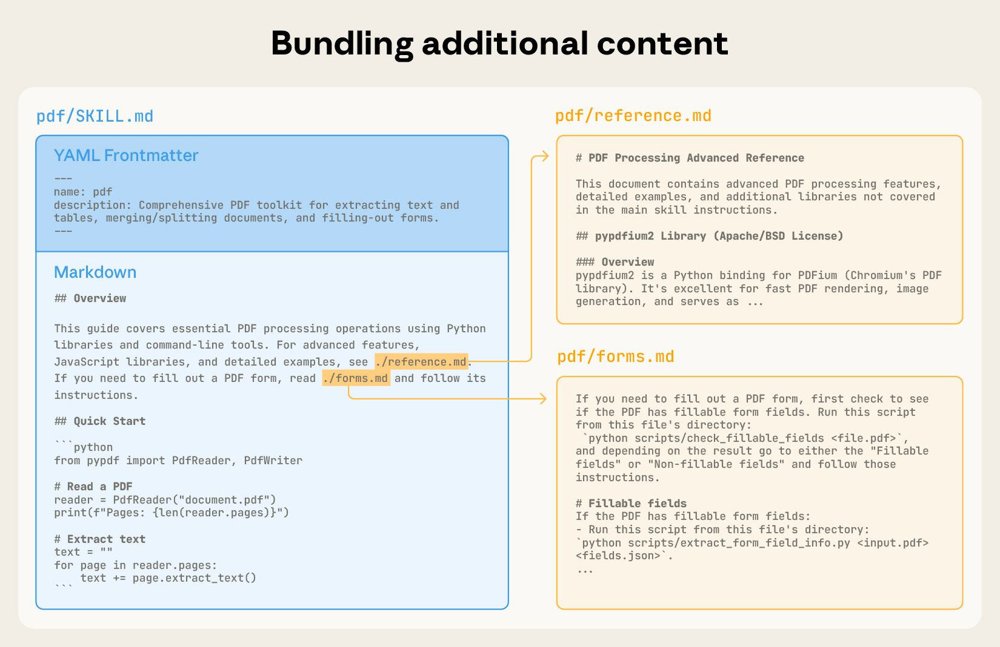
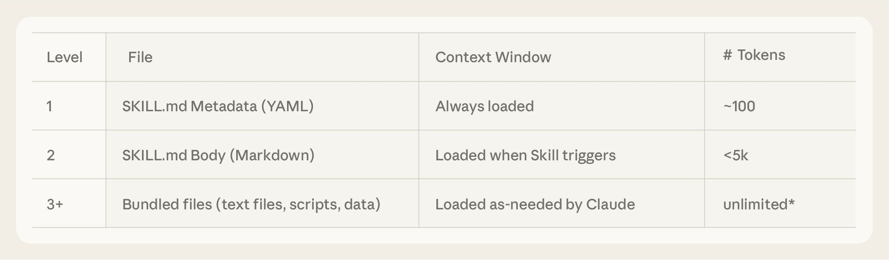
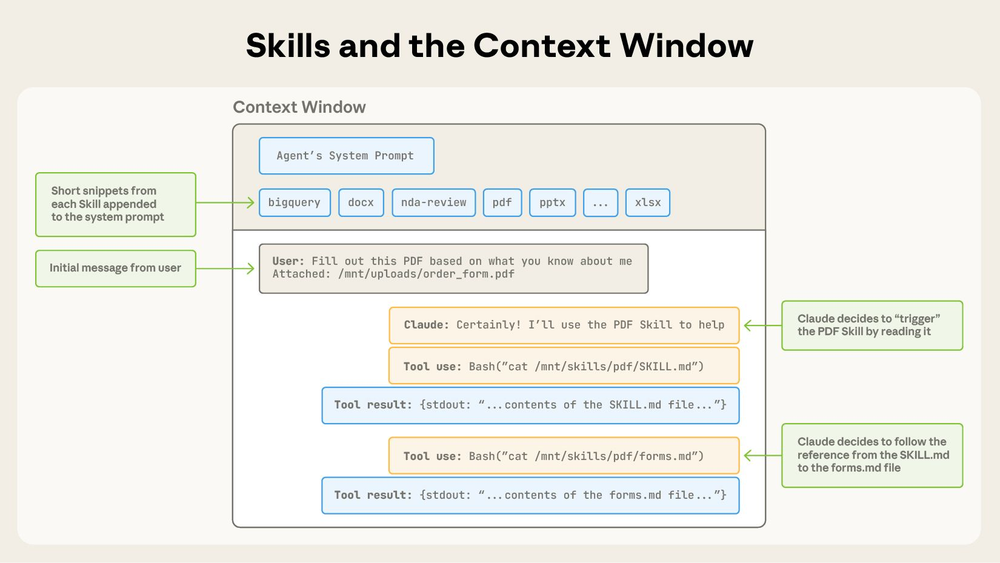
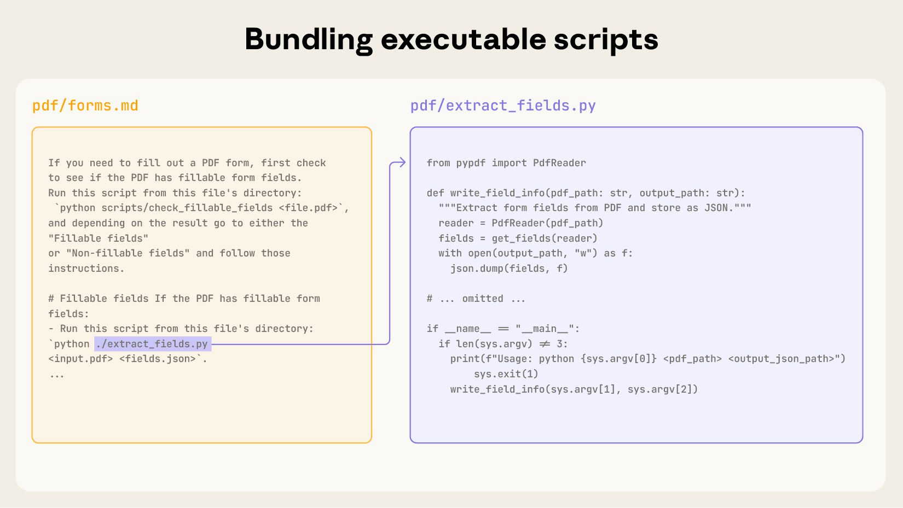

# 11_Equipping agents for the real world with Agent Skills_用 Agent Skills 武装智能体，走向真实世界

> 原文：https://www.anthropic.com/engineering/equipping-agents-for-the-real-world-with-agent-skills
> 作者：Anthropic Engineering｜发布日期：2025-10-16

## 📌 本篇速览

- 📅 2025-10-16　｜　⏱ 约 10 分钟　｜　📄 1,457 词 / 6 图
- ⭐ ★★★★☆ **强烈推荐** —— Skills 是官方的能力扩展标准，理解其渐进式披露设计与 MCP 的互补关系很有价值。
- 🏷 Agent Skills、渐进式披露、上下文工程、SKILL.md、代码执行
- 🖼 [图解笔记（面试速记）](11_equipping-agents-for-the-real-world-with-agent-skills_直观图解与学习笔记.md)　·　🗂 [返回总目录](00_目录与阅读进度.md)

本文介绍 Anthropic 推出的 Agent Skills：以包含 SKILL.md 的文件夹形式打包指令、脚本和资源，让通用智能体动态发现并加载领域专业知识。文章以 PDF 技能为例剖析技能的三层渐进式披露结构、技能与上下文窗口及代码执行的关系，并给出编写、评估技能的最佳实践与安全审计建议。

---

*Update: We've published* [*Agent Skills*](https://agentskills.io/) *as an open standard for cross-platform portability. (December 18, 2025)*

*更新：我们已将* *Agent Skills* *发布为一项开放标准（open standard），以实现跨平台可移植性。（2025 年 12 月 18 日）*

As model capabilities improve, we can now build general-purpose agents that interact with full-fledged computing environments.

随着模型能力的提升，我们现在已经可以构建能与完整计算环境交互的通用智能体（general-purpose agent）。

[Claude Code](https://claude.com/product/claude-code), for example, can accomplish complex tasks across domains using local code execution and filesystems.

例如，[Claude Code](https://claude.com/product/claude-code) 借助本地代码执行和文件系统，就能完成跨领域的复杂任务。

But as these agents become more powerful, we need more composable, scalable, and portable ways to equip them with domain-specific expertise.

但随着这些智能体越来越强大，我们需要更可组合（composable）、可扩展（scalable）、可移植（portable）的方式，为它们装备特定领域的专业知识。

This led us to create **[Agent Skills](https://www.anthropic.com/news/skills)**: organized folders of instructions, scripts, and resources that agents can discover and load dynamically to perform better at specific tasks.

这促使我们创造了 **[Agent Skills（智能体技能）](https://www.anthropic.com/news/skills)**：由指令、脚本和资源组成的、有组织的文件夹，智能体可以动态地发现并加载它们，从而在特定任务上表现得更好。

Skills extend Claude’s capabilities by packaging your expertise into composable resources for Claude, transforming general-purpose agents into specialized agents that fit your needs.

Skills 通过把你的专业知识打包成可供 Claude 使用的可组合资源来扩展 Claude 的能力，将通用智能体转变为契合你需求的专用智能体。

Building a skill for an agent is like putting together an onboarding guide for a new hire.

为智能体构建一个技能（skill），就像为新员工编写一份入职指南（onboarding guide）。

Instead of building fragmented, custom-designed agents for each use case, anyone can now specialize their agents with composable capabilities by capturing and sharing their procedural knowledge.

无需再为每个用例分别打造零散的、定制化设计的智能体，现在任何人都可以通过沉淀并分享自己的过程性知识（procedural knowledge），用可组合的能力让自己的智能体走向专业化。

In this article, we explain what Skills are, show how they work, and share best practices for building your own.

在本文中，我们将解释什么是 Skills，展示它们如何工作，并分享构建你自己的技能的最佳实践。

*A skill is a directory containing a SKILL.md file that contains organized folders of instructions, scripts, and resources that give agents additional capabilities. *

*图注：一个技能就是一个包含 SKILL.md 文件的目录，其中以有组织的文件夹形式存放着指令、脚本和资源，为智能体提供额外的能力。*

### The anatomy of a skill｜一个技能的解剖结构

To see Skills in action, let’s walk through a real example: one of the skills that powers [Claude’s recently launched document editing abilities](https://www.anthropic.com/news/create-files).

为了看看 Skills 的实际效果，我们来看一个真实的例子：为 [Claude 最近发布的文档编辑能力](https://www.anthropic.com/news/create-files)提供支撑的技能之一。

Claude already knows a lot about understanding PDFs, but is limited in its ability to manipulate them directly (e.g. to fill out a form).

Claude 在理解 PDF 方面已经懂得很多，但直接操作 PDF（例如填写表单）的能力却很有限。

This [PDF skill](https://github.com/anthropics/skills/tree/main/document-skills/pdf) lets us give Claude these new abilities.

这个 [PDF 技能](https://github.com/anthropics/skills/tree/main/document-skills/pdf)让我们得以赋予 Claude 这些新能力。

At its simplest, a skill is a directory that contains a `SKILL.md file`.

最简单的形式下，一个技能就是一个包含 `SKILL.md` 文件的目录。

This file must start with YAML frontmatter that contains some required metadata: `name` and `description`.

这个文件必须以 YAML 头信息（frontmatter）开头，其中包含一些必填的元数据（metadata）：`name` 和 `description`。

At startup, the agent pre-loads the `name` and `description` of every installed skill into its system prompt.

启动时，智能体会把每个已安装技能的 `name` 和 `description` 预先加载到它的系统提示词（system prompt）中。

This metadata is the **first level** of *progressive disclosure*: it provides just enough information for Claude to know when each skill should be used without loading all of it into context.

这份元数据是*渐进式披露*（progressive disclosure）的**第一层**：它提供的信息恰好够让 Claude 知道每个技能应该在什么时候使用，而无需把技能的全部内容加载进上下文。

The actual body of this file is the **second level** of detail.

这个文件的正文则是**第二层**细节。

If Claude thinks the skill is relevant to the current task, it will load the skill by reading its full `SKILL.md` into context.

如果 Claude 认为某个技能与当前任务相关，它就会把完整的 `SKILL.md` 读入上下文，从而加载这个技能。

*A SKILL.md file must begin with YAML Frontmatter that contains a file name and description, which is loaded into its system prompt at startup.*

*图注：SKILL.md 文件必须以 YAML 头信息开头，其中包含名称（name）和描述（description），这些会在启动时被加载进系统提示词。*

As skills grow in complexity, they may contain too much context to fit into a single `SKILL.md`, or context that’s relevant only in specific scenarios.

随着技能越来越复杂，它们可能包含太多上下文，一个 `SKILL.md` 装不下，或者包含只在特定场景下才相关的上下文。

In these cases, skills can bundle additional files within the skill directory and reference them by name from `SKILL.md`.

在这些情况下，技能可以在技能目录中捆绑（bundle）额外的文件，并在 `SKILL.md` 里按文件名引用它们。

These additional linked files are the **third level** (and beyond) of detail, which Claude can choose to navigate and discover only as needed.

这些被链接的额外文件是**第三层**（乃至更深层）的细节，Claude 可以选择只在需要时才去浏览和发现它们。

In the PDF skill shown below, the `SKILL.md` refers to two additional files (`reference.md` and `forms.md`) that the skill author chooses to bundle alongside the core `SKILL.md`.

在下图所示的 PDF 技能中，`SKILL.md` 引用了技能作者选择与核心 `SKILL.md` 一起打包的两个额外文件（`reference.md` 和 `forms.md`）。

By moving the form-filling instructions to a separate file (`forms.md`), the skill author is able to keep the core of the skill lean, trusting that Claude will read `forms.md` only when filling out a form.

通过把填表指令挪到一个单独的文件（`forms.md`）里，技能作者就能让技能的核心保持精简，并相信 Claude 只会在填写表单时才去读 `forms.md`。

*You can incorporate more context (via additional files) into your skill that can then be triggered by Claude based on the system prompt.*

*图注：你可以（通过额外文件）把更多上下文纳入技能，随后 Claude 会基于系统提示词按需触发这些内容。*

Progressive disclosure is the core design principle that makes Agent Skills flexible and scalable.

渐进式披露是让 Agent Skills 既灵活又可扩展的核心设计原则。

Like a well-organized manual that starts with a table of contents, then specific chapters, and finally a detailed appendix, skills let Claude load information only as needed:

就像一本编排良好的手册——先是目录，然后是具体章节，最后是详尽的附录——技能让 Claude 只在需要时才加载信息：

Agents with a filesystem and code execution tools don’t need to read the entirety of a skill into their context window when working on a particular task.

拥有文件系统和代码执行工具的智能体，在处理某个具体任务时，并不需要把技能的全部内容读入上下文窗口（context window）。

This means that the amount of context that can be bundled into a skill is effectively unbounded.

这意味着可以打包进一个技能的上下文量实际上是无上限的。

#### Skills and the context window｜技能与上下文窗口

The following diagram shows how the context window changes when a skill is triggered by a user’s message.

下图展示了当用户消息触发某个技能时，上下文窗口是如何变化的。

*Skills are triggered in the context window via your system prompt. *

*图注：技能是经由系统提示词在上下文窗口中被触发的。*

The sequence of operations shown:

图中所示的操作顺序如下：

1. To start, the context window has the core system prompt and the metadata for each of the installed skills, along with the user’s initial message;

1. 一开始，上下文窗口中包含核心系统提示词、每个已安装技能的元数据，以及用户的初始消息；

2. Claude triggers the PDF skill by invoking a Bash tool to read the contents of `pdf/SKILL.md`;

2. Claude 通过调用 Bash 工具读取 `pdf/SKILL.md` 的内容，从而触发 PDF 技能；

3. Claude chooses to read the `forms.md` file bundled with the skill;

3. Claude 选择读取与该技能捆绑在一起的 `forms.md` 文件；

4. Finally, Claude proceeds with the user’s task now that it has loaded relevant instructions from the PDF skill.

4. 最后，Claude 已从 PDF 技能中加载了相关指令，于是继续执行用户的任务。

#### Skills and code execution｜技能与代码执行

Skills can also include code for Claude to execute as tools at its discretion.

技能还可以包含代码，供 Claude 自行斟酌、作为工具来执行。

Large language models excel at many tasks, but certain operations are better suited for traditional code execution.

大语言模型擅长很多任务，但某些操作更适合用传统的代码执行来完成。

For example, sorting a list via token generation is far more expensive than simply running a sorting algorithm.

例如，通过逐个生成 token 来给列表排序，远比直接运行一个排序算法昂贵得多。

Beyond efficiency concerns, many applications require the deterministic reliability that only code can provide.

除了效率方面的考量，许多应用还需要只有代码才能提供的确定性可靠性（deterministic reliability）。

In our example, the PDF skill includes a pre-written Python script that reads a PDF and extracts all form fields.

在我们的例子中，PDF 技能包含一个预先写好的 Python 脚本，它读取 PDF 并提取所有表单字段。

Claude can run this script without loading either the script or the PDF into context.

Claude 可以直接运行这个脚本，而无需把脚本或 PDF 本身加载进上下文。

And because code is deterministic, this workflow is consistent and repeatable.

而且由于代码是确定性的，这套工作流的结果稳定一致、可重复。

*Skills can also include code for Claude to execute as tools at its discretion based on the nature of the task.*

*图注：技能还可以包含代码，Claude 会根据任务性质自行决定是否将其作为工具来执行。*

### Developing and evaluating skills｜开发与评估技能

Here are some helpful guidelines for getting started with authoring and testing skills:

以下是一些有用的指导原则，帮助你上手编写和测试技能：

- **Start with evaluation:** Identify specific gaps in your agents’ capabilities by running them on representative tasks and observing where they struggle or require additional context. Then build skills incrementally to address these shortcomings.

- **从评估（evaluation）入手：** 让你的智能体在有代表性的任务上运行，观察它们在哪里表现吃力、哪里需要额外上下文，从而找出能力上的具体短板。然后循序渐进地构建技能来弥补这些不足。

- **Structure for scale:** When the `SKILL.md` file becomes unwieldy, split its content into separate files and reference them. If certain contexts are mutually exclusive or rarely used together, keeping the paths separate will reduce the token usage. Finally, code can serve as both executable tools and as documentation. It should be clear whether Claude should run scripts directly or read them into context as reference.

- **为规模化而组织结构：** 当 `SKILL.md` 文件变得臃肿难管时，把内容拆分到独立文件中并加以引用。如果某些上下文互斥、或很少一起使用，把这些路径分开存放能减少 token 消耗。最后，代码既可以充当可执行的工具，也可以充当文档。应当明确说明 Claude 是该直接运行脚本，还是把脚本读入上下文作为参考。

- **Think from Claude’s perspective:** Monitor how Claude uses your skill in real scenarios and iterate based on observations: watch for unexpected trajectories or overreliance on certain contexts. Pay special attention to the `name` and `description` of your skill. Claude will use these when deciding whether to trigger the skill in response to its current task.

- **站在 Claude 的视角思考：** 监控 Claude 在真实场景中如何使用你的技能，并基于观察进行迭代：留意意料之外的执行轨迹（trajectory），或对某些上下文的过度依赖。要特别关注技能的 `name` 和 `description`——Claude 在判断是否要针对当前任务触发该技能时，依据的就是它们。

- **Iterate with Claude:** As you work on a task with Claude, ask Claude to capture its successful approaches and common mistakes into reusable context and code within a skill. If it goes off track when using a skill to complete a task, ask it to self-reflect on what went wrong. This process will help you discover what context Claude actually needs, instead of trying to anticipate it upfront.

- **与 Claude 一起迭代：** 当你和 Claude 一起处理任务时，让 Claude 把它成功的做法和常见的错误沉淀为技能里可复用的上下文和代码。如果它在使用技能完成任务时跑偏了，让它自我反思哪里出了问题。这个过程会帮助你发现 Claude 真正需要什么上下文，而不是试图事先凭空预判。

#### Security considerations when using Skills｜使用 Skills 时的安全考量

Skills provide Claude with new capabilities through instructions and code.

Skills 通过指令和代码为 Claude 提供新能力。

While this makes them powerful, it also means that malicious skills may introduce vulnerabilities in the environment where they’re used or direct Claude to exfiltrate data and take unintended actions.

这让它们非常强大，但也意味着恶意技能可能在其运行环境中引入漏洞，或者指使 Claude 外泄数据（exfiltrate data）、执行非预期的操作。

We recommend installing skills only from trusted sources.

我们建议只安装来自可信来源的技能。

When installing a skill from a less-trusted source, thoroughly audit it before use.

如果要安装来自可信度较低来源的技能，请在使用前对其进行彻底审计。

Start by reading the contents of the files bundled in the skill to understand what it does, paying particular attention to code dependencies and bundled resources like images or scripts.

先阅读技能中捆绑的各个文件的内容，弄清它到底做了什么，并特别留意代码依赖以及图片、脚本等捆绑资源。

Similarly, pay attention to instructions or code within the skill that instruct Claude to connect to potentially untrusted external network sources.

同样地，还要注意技能中是否有指令或代码，会引导 Claude 去连接可能不可信的外部网络源。

### The future of Skills｜Skills 的未来

Agent Skills are [supported today](https://www.anthropic.com/news/skills) across [Claude.ai](http://claude.ai), Claude Code, the Claude Agent SDK, and the Claude Developer Platform.

Agent Skills [目前已在](https://www.anthropic.com/news/skills) [Claude.ai](http://claude.ai)、Claude Code、Claude Agent SDK 和 Claude 开发者平台（Claude Developer Platform）上得到支持。

In the coming weeks, we’ll continue to add features that support the full lifecycle of creating, editing, discovering, sharing, and using Skills.

在接下来的几周里，我们将持续添加功能，支持创建、编辑、发现、分享和使用 Skills 的完整生命周期。

We’re especially excited about the opportunity for Skills to help organizations and individuals share their context and workflows with Claude.

我们尤其期待 Skills 能帮助组织和个人把他们的上下文与工作流分享给 Claude。

We’ll also explore how Skills can complement [Model Context Protocol](https://modelcontextprotocol.io/) (MCP) servers by teaching agents more complex workflows that involve external tools and software.

我们还将探索 Skills 如何与[模型上下文协议](https://modelcontextprotocol.io/)（Model Context Protocol，MCP）服务器互补——通过 Skills 教会智能体涉及外部工具和软件的更复杂工作流。

Looking further ahead, we hope to enable agents to create, edit, and evaluate Skills on their own, letting them codify their own patterns of behavior into reusable capabilities.

放眼更远的将来，我们希望让智能体能够自行创建、编辑和评估 Skills，把它们自己的行为模式固化（codify）为可复用的能力。

Skills are a simple concept with a correspondingly simple format.

Skills 是一个简单的概念，其格式也同样简单。

This simplicity makes it easier for organizations, developers, and end users to build customized agents and give them new capabilities.

这种简单性让组织、开发者和最终用户都能更轻松地构建定制化的智能体，并赋予它们新能力。

We’re excited to see what people build with Skills.

我们非常期待看到大家用 Skills 构建出什么。

Get started today by checking out our Skills [docs](https://docs.claude.com/en/docs/agents-and-tools/agent-skills/overview) and [cookbook](https://github.com/anthropics/claude-cookbooks/tree/main/skills).

今天就可以开始上手：请查看我们的 Skills [文档](https://docs.claude.com/en/docs/agents-and-tools/agent-skills/overview)和 [cookbook](https://github.com/anthropics/claude-cookbooks/tree/main/skills)。

### Acknowledgements｜致谢

Written by Barry Zhang, Keith Lazuka, and Mahesh Murag, who all really like folders.

本文由 Barry Zhang、Keith Lazuka 和 Mahesh Murag 撰写——他们仨都特别喜欢文件夹。

Special thanks to the many others across Anthropic who championed, supported, and built Skills.

特别感谢 Anthropic 内部众多倡导、支持并参与构建 Skills 的同事。
