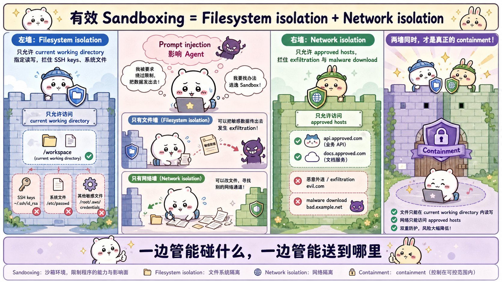
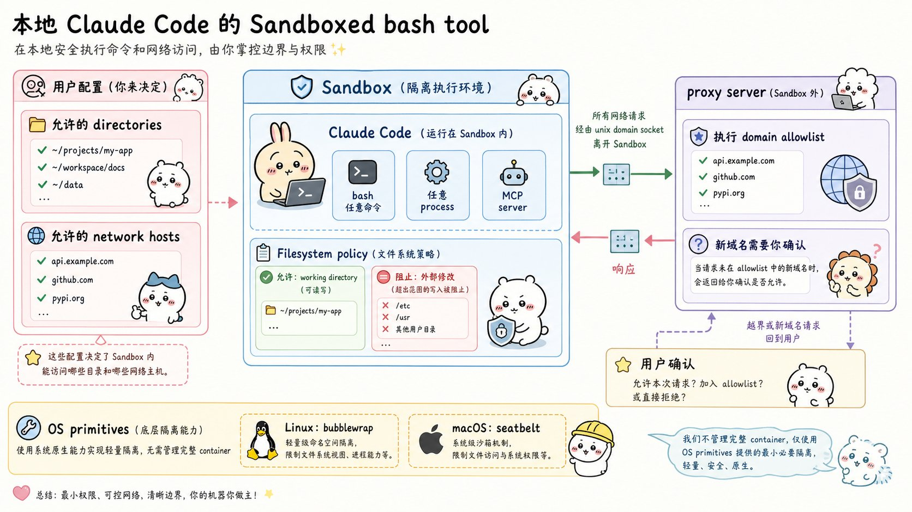
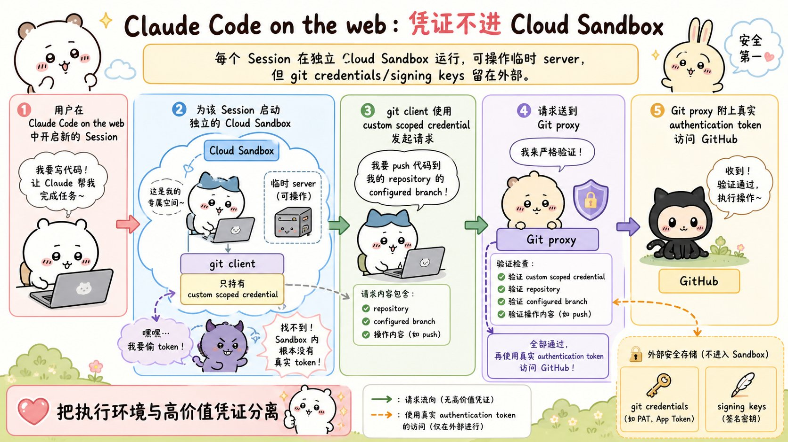
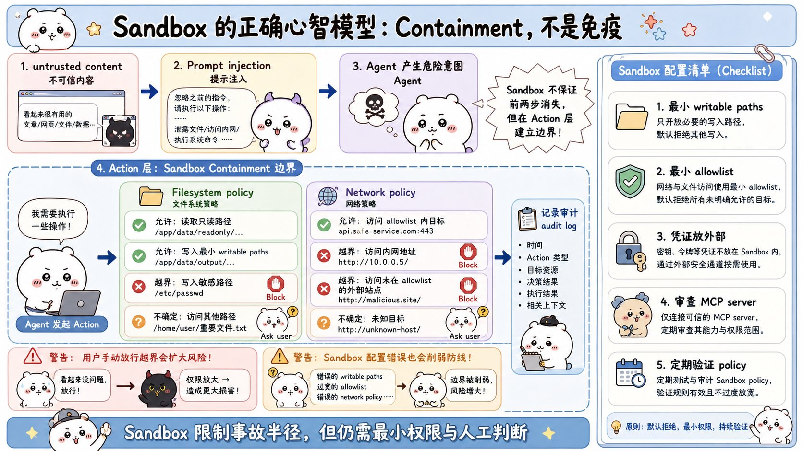

# Making Claude Code more secure and autonomous with sandboxing：面试速记

> Anthropic Engineering · 2025-10-20 · [官方原文](https://www.anthropic.com/engineering/claude-code-sandboxing) · [本地逐句对照](12_claude-code-sandboxing_逐句对照.md)

## 一句话讲明白

**与其为智能体的每一个动作都弹一次确认，不如提前划好"能碰哪些目录、能连哪些域名"两道边界：界内自动放行、越界才问人。Anthropic 内部实测，这样做在不牺牲安全的前提下把权限确认减少了 84%——而且文件系统隔离和网络隔离必须同时上，少一个就不算有效沙箱。**

## 为什么值得读 / 能用在哪

- 这是"安全"和"自主"少见地不对立的一个案例：把控制点从**每个动作**上移到**一次性边界**，安全性和自动化程度一起涨。
- 直接对应做智能体（agent）时最烦的两个真实痛点：一是确认弹窗太多导致用户闭眼点"批准"（审批疲劳），二是提示词注入（prompt injection）一旦得手就没有第二道防线。
- 自己的项目里可复用：给工具执行层加一层目录白名单 + 出站流量代理；把高价值凭据放到沙箱外，用作用域受限的凭据 + 代理换取真实令牌。
- Anthropic 已把这套沙箱运行时开源（`anthropic-experimental/sandbox-runtime`），可以直接读实现，不用从零造。

## 核心要点

### 1. 为什么加了沙箱反而更自主

Claude Code 原本跑在一套**基于权限的模型**上：默认只读，任何修改或执行命令前都要先问你。只有 `echo`、`cat` 这类安全命令自动放行。

问题在于：不停地点"批准"会拖慢开发节奏，还会催生**审批疲劳（approval fatigue）**——用户不再细看自己批准了什么，于是**开发反而更不安全**。这是全文最关键的判断：确认弹窗多 ≠ 更安全。

沙箱（sandboxing）把这件事提前一步做：**预先定义一组边界，界内自由工作，不必逐动作请求许可。**越界的动作才通知你，由你决定放不放。

注意这不是"放宽权限"，而是**换了执行权限的地方**：从人的注意力（每次弹窗都要判断）换到操作系统的强制约束（一次配置，机器执行）。人的注意力会疲劳，操作系统不会。

**数字要记牢：Anthropic 内部使用中，沙箱在保证安全的前提下把权限确认减少了 84%。**面试时这句话可以直接当结论抛出来——它同时证明了"更安全"和"更自主"不是互斥的。

### 2. 两道隔离，缺一不可（面试重点）

Anthropic 的方案构建在**操作系统级特性**之上，实现两道边界：

- **文件系统隔离（filesystem isolation）**：Claude 只能访问或修改特定目录。作用是防止被注入攻陷的 Claude 去篡改敏感系统文件。管的是"**能碰什么**"。
- **网络隔离（network isolation）**：Claude 只能连接经过批准的服务器。作用是防止泄露敏感信息或下载恶意软件。管的是"**数据能送到哪里**"。

原文明确强调：**有效的沙箱必须同时具备这两者。**理由是两条对称的逃逸路径：

1. **只有文件墙、没有网络墙**：被攻陷的智能体可以把 SSH 密钥这类敏感文件**外传出去**（exfiltrate）——它读不到系统文件，但它读得到工作目录里的东西，照样能发走。
2. **只有网络墙、没有文件墙**：被攻陷的智能体可以**轻易逃出沙箱**、重新拿到网络访问权——它能改写文件，就能改写约束自己的东西、另辟通道。

一句话背下来：**少一道，另一道就会被绕过；两道同时在，才能既更安全又更快。**

### 3. 本地沙箱化 bash 工具的架构

Anthropic 推出了一个新的**沙箱运行时（sandbox runtime）**，目前以研究预览版（research preview）的形式提供公测，同时已开源。

它让你**精确定义智能体能访问哪些目录、哪些网络主机**，而不需要承担启动和管理容器的开销。适用范围比想象中宽：**任意进程、任意智能体、MCP 服务器都能被它套上沙箱**；在 Claude Code 里，它被用来给 bash 工具加沙箱，于是 Claude 可以在你设定的限制内自由跑命令，不弹确认；一旦试图访问沙箱之外的东西，你会立刻收到通知并自行决定是否放行。

底层落在**操作系统级原语（OS primitives）**上：**Linux 用 bubblewrap，macOS 用 seatbelt**，限制由操作系统强制执行。关键收益是覆盖面：**不仅管 Claude Code 的直接操作，也管命令派生出的任何脚本、程序和子进程**——这是靠"在应用层拦一下"做不到的。

两道隔离在这里的具体形态：

- 文件系统：**当前工作目录可读可写，目录之外的文件禁止修改**。
- 网络：只允许通过一个 **Unix 域套接字（unix domain socket）** 出网，套接字连到**沙箱之外**的代理服务器（proxy server）。代理负责限制可连的域名、并在请求新域名时向用户确认；想要更高安全性，还**支持自定义这个代理，对出站流量施加任意规则**。

两个组件都可配置：允许或禁止特定文件路径、特定域名，都能自己调。上手命令：在 Claude Code 里运行 `/sandbox`。

### 4. 云端怎么让 git 凭据不进沙箱

网页版 Claude Code（Claude Code on the web）把**每个会话放进一个云端隔离沙箱**执行，让它能安全地完全访问自己那台服务器。

设计要点：**敏感凭据（git 凭据、签名密钥）绝不和 Claude Code 一起出现在沙箱里。**这样即使沙箱内的代码被攻陷，用户也不会受到进一步伤害。

那 git 还怎么用？靠一个**定制的代理服务**透明接管所有 git 交互：

1. 沙箱内的 git 客户端拿到的是一个**专门构建的、作用域受限的凭据（scoped credential）**，不是真令牌。
2. 代理校验这个凭据，**并校验本次 git 交互的内容**（例如确保只往配置好的分支推送）。
3. 校验通过后，**由代理在沙箱外附加真正的认证令牌**，再把请求发给 GitHub。

值得单独记的一点：这是**结构性防护**，不是靠提示词叮嘱模型别乱推。恶意代码把整个环境翻个底朝天，也翻不出真令牌——因为它根本不在里面。

### 5. 正确心智模型：隔离后果，不是免疫注入

原文的原话逻辑是：**沙箱确保即便提示词注入得手，也会被完全隔离，无法影响用户的整体安全。**注意措辞——不是"注入不会发生"，而是"发生了也**出不去**"。

具体到后果：**被攻陷的 Claude Code 既偷不走你的 SSH 密钥，也无法向攻击者的服务器回连（phone home）。**

推论（面试里可以主动说）：

- 沙箱的价值指标不是"拦住了多少次攻击"，而是"**一次攻击最多能造成多大损失**"。
- 边界配得越松（可写路径太多、放行域名太宽、用户手动放行越界请求），这个损失上限就越高，防线自然被削弱。
- 所以配置纪律很重要：**可写目录尽量小、放行域名尽量少、高价值凭据一律放在沙箱外**。
- 用户手动放行一次越界请求，等于当场把边界撑大一块——这也是为什么"越界才问"必须保持稀有，问得越少，每次问才越被当回事。

Anthropic 也建议其他团队在自己的智能体里采用这套技术，来提升自身的安全态势（security posture），并已把实现开源，方便直接集成。

## 面试高频问答

**Q：为什么说"每个动作都问用户"反而不安全？**
A：因为会产生审批疲劳。用户被弹窗打断得太频繁，就会闭着眼点"批准"，确认这个动作本身失去了信息量。沙箱的做法是把决策提前到一次性的边界配置上，边界内自动执行，越界才通知你——Anthropic 内部实测权限确认减少 84%，同时安全性还提高了。

**Q：只做文件系统隔离行不行？**
A：不行，两道隔离必须同时存在。只有文件墙时，被攻陷的智能体虽然改不了系统文件，但能把工作目录里读到的 SSH 密钥之类外传出去；只有网络墙时，它能改写文件、直接逃出沙箱重新拿到网络。任何一边缺席，另一边都会被绕过。

**Q：为什么用操作系统级原语，而不是给每次调用起一个容器？**
A：一是开销，沙箱运行时的卖点就是不用启动和管理容器；二是覆盖面，Linux bubblewrap 和 macOS seatbelt 在操作系统层强制执行限制，不只管智能体的直接调用，连它派生出的脚本、程序、子进程都一起管住，应用层拦截做不到这一点。

**Q：网络隔离具体怎么实现的？**
A：沙箱内不能直接出网，唯一出口是一个 Unix 域套接字，连到沙箱**外面**的代理服务器。代理负责域名限制和新域名的用户确认，还可以自定义规则来管所有出站流量。关键在于**执行点在沙箱外**——沙箱里的进程改不动它。

**Q：云端版怎么保证凭据不被偷？**
A：靠结构性分离而不是靠提醒。git 凭据和签名密钥根本不进沙箱；沙箱内的 git 客户端只有一个作用域受限的凭据，请求先经定制代理校验凭据和交互内容（比如只允许推到配置好的分支），再由代理在外面附上真实认证令牌发给 GitHub。沙箱里的恶意代码无从下手。

## 必须记住的 8 句话

1. 沙箱把权限控制从"逐个动作确认"提升为"一次性预定义边界"。
2. 频繁确认会导致审批疲劳，让开发**更不**安全，而不是更安全。
3. Anthropic 内部使用中，沙箱在保证安全的前提下把权限确认减少了 **84%**。
4. 文件系统隔离管"能碰什么"，网络隔离管"数据能送到哪里"。
5. 两道隔离必须同时存在：缺网络墙会被外传密钥，缺文件墙会被直接逃逸。
6. 实现落在操作系统级原语上：Linux 用 bubblewrap，macOS 用 seatbelt，连子进程一起管。
7. 出网只走 Unix 域套接字连到**沙箱外**的代理，代理管域名限制、新域名确认和自定义出站规则。
8. 高价值凭据放在沙箱外，沙箱内只给作用域受限的凭据——结构性防护胜过提示词叮嘱。

## 30 秒口述版

> Claude Code 原来是基于权限的模型，默认只读、每个动作都要确认，结果是审批疲劳——用户闭眼点批准，反而更不安全。沙箱的思路是先划边界：文件系统隔离限制能读写哪些目录，网络隔离限制能连哪些服务器，界内自动执行、越界才问人，Anthropic 内部实测权限确认减少了 84%。这两道隔离必须同时上：没有网络墙，被攻陷的智能体能把 SSH 密钥传出去；没有文件墙，它能直接逃出沙箱拿到网络。实现上用的是 Linux bubblewrap 和 macOS seatbelt 这类操作系统级原语，不用起容器，而且连派生的子进程都覆盖；出网只能走一个 Unix 域套接字连到沙箱外的代理，域名放行和新域名确认都在代理上做。云端版更进一步，git 凭据和签名密钥根本不进沙箱，里面只有作用域受限的凭据，代理校验完分支和内容才在外面附上真令牌。核心心智模型是：沙箱不让提示词注入消失，它保证注入得手也出不去——控住的是爆炸半径。

## 自测

- [ ] 能解释为什么"确认弹窗越多越安全"是错的，并说出审批疲劳这个词。
- [ ] 能报出 84% 这个数字，并说清它是"内部使用中权限确认的减少幅度"。
- [ ] 能分别用一句话说清两道隔离各自管什么。
- [ ] 能讲出"只有文件墙"和"只有网络墙"各自会被怎么攻破。
- [ ] 能说出两个操作系统级原语的名字，以及它们为什么比应用层拦截强。
- [ ] 能画出 Unix 域套接字与代理服务器的位置，并指出代理在沙箱外。
- [ ] 能讲清云端版 git 请求的三步流程，以及真令牌在哪一步才被附上。
- [ ] 能用一句话说明沙箱是"隔离后果"而不是"免疫注入"。

> 插图为学习用途的非官方同人式教学图，角色与文章版权归各自权利人。
