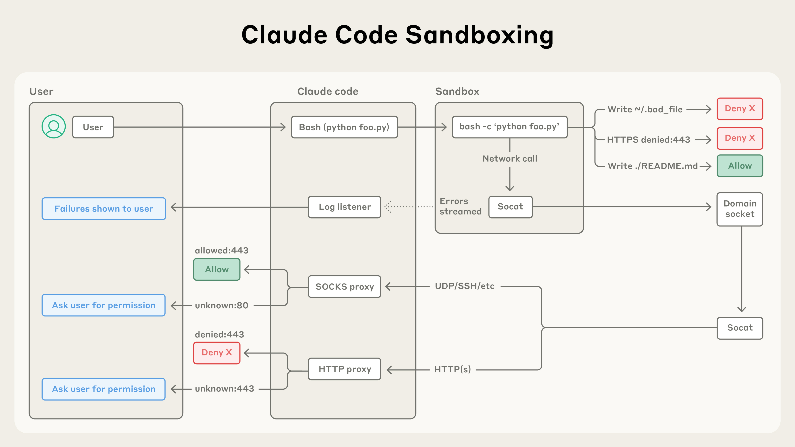
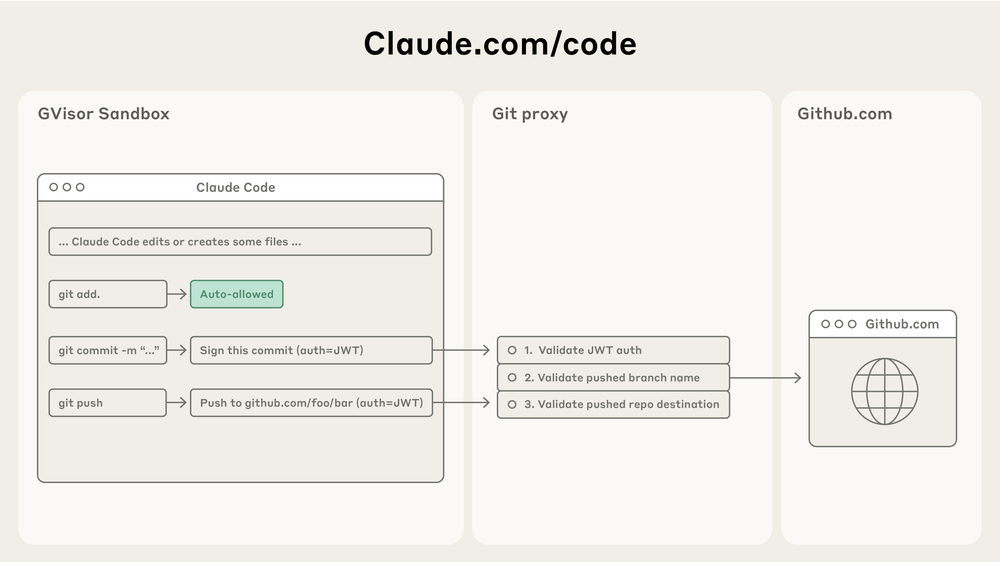

# 12_Making Claude Code more secure and autonomous with sandboxing_用沙箱让 Claude Code 更安全、更自主

> 原文：https://www.anthropic.com/engineering/claude-code-sandboxing
> 作者：Anthropic Engineering｜发布日期：2025-10-20

## 📌 本篇速览

- 📅 2025-10-20　｜　⏱ 约 10 分钟　｜　📄 1,124 词 / 2 图
- ⭐ ★★★★☆ **强烈推荐** —— 沙箱化（文件系统+网络双重隔离）是让智能体在安全前提下获得高自主性的核心工程手段，任何构建可执行代码的 Agent 的工程师都应掌握这套安全模型。
- 🏷 沙箱、Claude Code、提示词注入防御、智能体安全、权限模型
- 🖼 [图解笔记（面试速记）](12_claude-code-sandboxing_直观图解与学习笔记.md)　·　🗂 [返回总目录](00_目录与阅读进度.md)

文章介绍了 Claude Code 基于沙箱推出的两项新功能：沙箱化 bash 工具和网页版 Claude Code。前者利用 Linux bubblewrap、macOS seatbelt 等操作系统级原语实现文件系统隔离与网络隔离，使内部权限确认减少 84%；后者在云端隔离沙箱中运行会话，并通过定制 git 代理确保敏感凭据永不进入沙箱。文章强调有效沙箱必须同时具备文件系统和网络两道隔离，且该沙箱运行时已开源。

---

In [Claude Code](https://www.claude.com/product/claude-code), Claude writes, tests, and debugs code alongside you, navigating your codebase, editing multiple files, and running commands to verify its work.

在 [Claude Code](https://www.claude.com/product/claude-code) 中，Claude 与你并肩编写、测试和调试代码：它会在你的代码库里穿行，编辑多个文件，并运行命令来验证自己的工作。

Giving Claude this much access to your codebase and files can introduce risks, especially in the case of prompt injection.

让 Claude 拥有对你的代码库和文件如此大的访问权限，可能会引入风险，尤其是在提示词注入（prompt injection）的场景下。

To help address this, we’ve introduced two new features in Claude Code built on top of sandboxing, both of which are designed to provide a more secure place for developers to work, while also allowing Claude to run more autonomously and with fewer permission prompts.

为了应对这一问题，我们在 Claude Code 中推出了两项基于沙箱（sandboxing）构建的新功能，二者的设计目标都是为开发者提供一个更安全的工作环境，同时让 Claude 能够更自主地运行、减少权限确认（permission prompt）的次数。

In our internal usage, we've found that sandboxing safely reduces permission prompts by 84%.

在我们的内部使用中，我们发现沙箱可以在保证安全的前提下把权限确认减少 84%。

By defining set boundaries within which Claude can work freely, they increase security and agency.

通过划定一套边界、让 Claude 在其中自由工作，这两项功能同时提升了安全性和自主性（agency）。

### **Keeping users secure on Claude Code｜保障 Claude Code 用户的安全**

Claude Code runs on a permission-based model: by default, it's read-only, which means it asks for permission before making modifications or running any commands.

Claude Code 运行在一套基于权限的模型之上：默认情况下它是只读的，也就是说，在进行任何修改或运行任何命令之前，它都会先请求许可。

There are some exceptions to this: we auto-allow safe commands like echo or cat, but most operations still need explicit approval.

这一规则有一些例外：像 `echo`、`cat` 这类安全命令我们会自动放行，但大多数操作仍然需要显式批准。

Constantly clicking "approve" slows down development cycles and can lead to ‘approval fatigue’, where users might not pay close attention to what they're approving, and in turn making development less safe.

不停地点击"批准"会拖慢开发节奏，还可能导致"审批疲劳"（approval fatigue）——用户不再仔细留意自己批准的到底是什么，这反过来让开发变得更不安全。

To address this, we launched sandboxing for Claude Code.

为了解决这个问题，我们为 Claude Code 推出了沙箱功能。

## **Sandboxing: a safer and more autonomous approach｜沙箱：一种更安全、更自主的方案**

Sandboxing creates pre-defined boundaries within which Claude can work more freely, instead of asking for permission for each action.

沙箱会创建一组预先定义好的边界，Claude 可以在边界之内更自由地工作，而不必为每个动作都请求许可。

With sandboxing enabled, you get drastically fewer permission prompts and increased safety.

启用沙箱后，权限确认会大幅减少，安全性也随之提升。

Our approach to sandboxing is built on top of operating system-level features to enable two boundaries:

我们的沙箱方案构建在操作系统级特性之上，用来实现两道边界：

1. **Filesystem isolation**, which ensures that Claude can only access or modify specific directories. This is particularly important in preventing a prompt-injected Claude from modifying sensitive system files.

1. **文件系统隔离（filesystem isolation）**：确保 Claude 只能访问或修改特定目录。这对于防止被提示词注入攻陷的 Claude 篡改敏感系统文件尤为重要。

2. **Network isolation**, which ensures that Claude can only connect to approved servers. This prevents a prompt-injected Claude from leaking sensitive information or downloading malware.

2. **网络隔离（network isolation）**：确保 Claude 只能连接到经过批准的服务器。这可以防止被提示词注入攻陷的 Claude 泄露敏感信息或下载恶意软件。

It is worth noting that effective sandboxing requires *both* filesystem and network isolation.

值得注意的是，有效的沙箱必须*同时*具备文件系统隔离和网络隔离。

Without network isolation, a compromised agent could exfiltrate sensitive files like SSH keys; without filesystem isolation, a compromised agent could easily escape the sandbox and gain network access.

没有网络隔离，被攻陷的智能体（agent）就可能把 SSH 密钥之类的敏感文件外传（exfiltrate）；没有文件系统隔离，被攻陷的智能体则可以轻易逃出沙箱、获得网络访问权限。

It’s by using both techniques that we can provide a safer and faster agentic experience for Claude Code users.

正是通过同时使用这两种技术，我们才能为 Claude Code 用户提供既更安全又更快捷的智能体体验。

### Two new sandboxing features in Claude Code｜Claude Code 中的两项沙箱新功能

#### **Sandboxed bash tool: safe bash execution without permission prompts｜沙箱化 bash 工具：无需权限确认的安全 bash 执行**

We're introducing [a new sandbox runtime](https://docs.claude.com/en/docs/claude-code/sandboxing), available in beta as a research preview, that lets you define exactly which directories and network hosts your agent can access, without the overhead of spinning up and managing a container.

我们推出了[一个新的沙箱运行时（sandbox runtime）](https://docs.claude.com/en/docs/claude-code/sandboxing)，目前以研究预览版（research preview）的形式提供 beta 试用。它可以让你精确定义智能体能访问哪些目录和网络主机，而无需承担启动并管理容器（container）的开销。

This can be used to sandbox arbitrary processes, agents and MCP servers.

它可以用来给任意进程、智能体和 MCP 服务器加上沙箱。

It is also available as [an open source research preview](https://github.com/anthropic-experimental/sandbox-runtime).

它还以[开源研究预览版](https://github.com/anthropic-experimental/sandbox-runtime)的形式对外发布。

In Claude Code, we use this runtime to sandbox the bash tool, which allows Claude to run commands within the defined limits you set.

在 Claude Code 中，我们用这个运行时给 bash 工具加上沙箱，让 Claude 只能在你设定的限制范围内运行命令。

Inside the safe sandbox, Claude can run more autonomously and safely execute commands without permission prompts.

在这个安全沙箱内部，Claude 可以更自主地运行，在不弹出权限确认的情况下安全地执行命令。

If Claude tries to access something *outside* of the sandbox, you'll be notified immediately, and can choose whether or not to allow it.

如果 Claude 试图访问沙箱*之外*的东西，你会立即收到通知，并可以自行选择是否放行。

We’ve built this on top of OS level primitives such as [Linux bubblewrap](https://github.com/containers/bubblewrap) and MacOS seatbelt to enforce these restrictions at the OS level.

我们把这套机制构建在 [Linux bubblewrap](https://github.com/containers/bubblewrap) 和 macOS seatbelt 等操作系统级原语（primitive）之上，从而在操作系统层面强制执行这些限制。

They cover not just Claude Code's direct interactions, but also any scripts, programs, or subprocesses that are spawned by the command.

这些限制不仅覆盖 Claude Code 的直接交互，也覆盖由命令派生出的任何脚本、程序或子进程。

As described above, this sandbox enforces both:

如上所述，这个沙箱同时强制执行以下两道隔离：

1. **Filesystem isolation,** by allowing read and write access to the current working directory, but blocking the modification of any files outside of it.

1. **文件系统隔离**：允许对当前工作目录进行读写，但阻止对目录之外任何文件的修改。

2. **Network isolation,** by only allowing internet access through a unix domain socket connected to a proxy server running outside the sandbox. This proxy server enforces restrictions on the domains that a process can connect to, and handles user confirmation for newly requested domains. And if you’d like further-increased security, we also support customizing this proxy to enforce arbitrary rules on outgoing traffic.

2. **网络隔离**：只允许通过一个 Unix 域套接字（unix domain socket）访问互联网，该套接字连接到运行在沙箱之外的代理服务器（proxy server）。这个代理服务器会限制进程可以连接的域名，并在有新域名被请求时负责向用户确认。如果你想要更高的安全性，我们还支持自定义这个代理，对出站流量施加任意规则。

Both components are configurable: you can easily choose to allow or disallow specific file paths or domains.

两个组件都是可配置的：你可以轻松地选择允许或禁止特定的文件路径或域名。

*Claude Code's sandboxing architecture isolates code execution with filesystem and network controls, automatically allowing safe operations, blocking malicious ones, and asking permission only when needed.*

*图注：Claude Code 的沙箱架构通过文件系统和网络控制来隔离代码执行——自动放行安全操作，拦截恶意操作，只在必要时才请求许可。*

Sandboxing ensures that even a successful prompt injection is fully isolated, and cannot impact overall user security.

沙箱确保即便提示词注入得手，也会被完全隔离，无法影响用户的整体安全。

This way, a compromised Claude Code can't steal your SSH keys, or phone home to an attacker's server.

这样一来，被攻陷的 Claude Code 既偷不走你的 SSH 密钥，也无法向攻击者的服务器"回连"（phone home）。

To get started with this feature, run /sandbox in Claude Code and check out [more technical details](https://docs.claude.com/en/docs/claude-code/sandboxing) about our security model.

要开始使用这项功能，请在 Claude Code 中运行 `/sandbox`，并查阅关于我们安全模型的[更多技术细节](https://docs.claude.com/en/docs/claude-code/sandboxing)。

To make it easier for other teams to build safer agents, we have [open sourced](https://github.com/anthropic-experimental/sandbox-runtime) this feature.

为了让其他团队更容易构建更安全的智能体，我们已经把这项功能[开源](https://github.com/anthropic-experimental/sandbox-runtime)。

We believe that others should consider adopting this technology for their own agents in order to enhance the security posture of their agents.

我们认为，其他团队也应该考虑在自己的智能体中采用这项技术，以增强其智能体的安全态势（security posture）。

#### **Claude Code on the web: running Claude Code securely in the cloud｜网页版 Claude Code：在云端安全地运行 Claude Code**

Today, we're also releasing [Claude Code on the web](https://docs.claude.com/en/docs/claude-code/claude-code-on-the-web) enabling users to run Claude Code in an isolated sandbox in the cloud.

今天，我们还发布了[网页版 Claude Code（Claude Code on the web）](https://docs.claude.com/en/docs/claude-code/claude-code-on-the-web)，让用户可以在云端的隔离沙箱中运行 Claude Code。

Claude Code on the web executes each Claude Code session in an isolated sandbox where it has full access to its server in a safe and secure way.

网页版 Claude Code 会把每个 Claude Code 会话放在一个隔离沙箱中执行，使其能以安全可靠的方式完全访问自己所在的服务器。

We've designed this sandbox to ensure that sensitive credentials (such as git credentials or signing keys) are never inside the sandbox with Claude Code.

我们对这个沙箱的设计确保了敏感凭据（例如 git 凭据或签名密钥）绝不会与 Claude Code 一起出现在沙箱内部。

This way, even if the code running in the sandbox is compromised, the user is kept safe from further harm.

这样，即使沙箱中运行的代码被攻陷，用户也不会受到进一步的伤害。

Claude Code on the web uses a custom proxy service that transparently handles all git interactions.

网页版 Claude Code 使用一个定制的代理服务，透明地处理所有 git 交互。

Inside the sandbox, the git client authenticates to this service with a custom-built scoped credential.

在沙箱内部，git 客户端使用一个专门构建的、作用域受限的凭据（scoped credential）向该服务进行身份认证。

The proxy verifies this credential and the contents of the git interaction (e.g. ensuring it is only pushing to the configured branch), then attaches the right authentication token before sending the request to GitHub.

代理会校验这个凭据以及此次 git 交互的内容（例如确保它只向配置好的分支推送），然后附加正确的认证 token，再把请求发送给 GitHub。

*Claude Code's Git integration routes commands through a secure proxy that validates authentication tokens, branch names, and repository destinations—allowing safe version control workflows while preventing unauthorized pushes.*

*图注：Claude Code 的 Git 集成把命令路由到一个安全代理，由它校验认证 token、分支名和目标仓库——既支持安全的版本控制工作流，又能阻止未经授权的推送。*

## Getting started｜快速上手

Our new sandboxed bash tool and Claude Code on the web offer substantial improvements in both security and productivity for developers using Claude for their engineering work.

对于用 Claude 从事工程工作的开发者来说，我们全新的沙箱化 bash 工具和网页版 Claude Code 在安全性和生产力两方面都带来了显著提升。

To get started with these tools:

要开始使用这些工具：

1. Run `/sandbox` in Claude and check out [our docs](https://docs.claude.com/en/docs/claude-code/sandboxing) on how to configure this sandbox.

1. 在 Claude 中运行 `/sandbox`，并查阅[我们的文档](https://docs.claude.com/en/docs/claude-code/sandboxing)了解如何配置这个沙箱。

2. Go to [claude.com/code](http://claude.ai/code) to try out Claude Code on the web.

2. 访问 [claude.com/code](http://claude.ai/code) 试用网页版 Claude Code。

Or, if you're building your own agents, check out our [open-sourced sandboxing code](https://github.com/anthropic-experimental/sandbox-runtime), and consider integrating it into your work.

或者，如果你正在构建自己的智能体，可以看看我们的[开源沙箱代码](https://github.com/anthropic-experimental/sandbox-runtime)，并考虑把它集成到你的工作中。

We look forward to seeing what you build.

我们期待看到你构建的成果。

To learn more about Claude Code on the web, check out our [launch blog post](https://www.anthropic.com/news/claude-code-on-the-web).

想进一步了解网页版 Claude Code，请阅读我们的[发布博客文章](https://www.anthropic.com/news/claude-code-on-the-web)。

## Acknowledgements｜致谢

Article written by David Dworken and Oliver Weller-Davies, with contributions from Meaghan Choi, Catherine Wu, Molly Vorwerck, Alex Isken, Kier Bradwell, and Kevin Garcia

本文由 David Dworken 和 Oliver Weller-Davies 撰写，Meaghan Choi、Catherine Wu、Molly Vorwerck、Alex Isken、Kier Bradwell 和 Kevin Garcia 亦有贡献。
