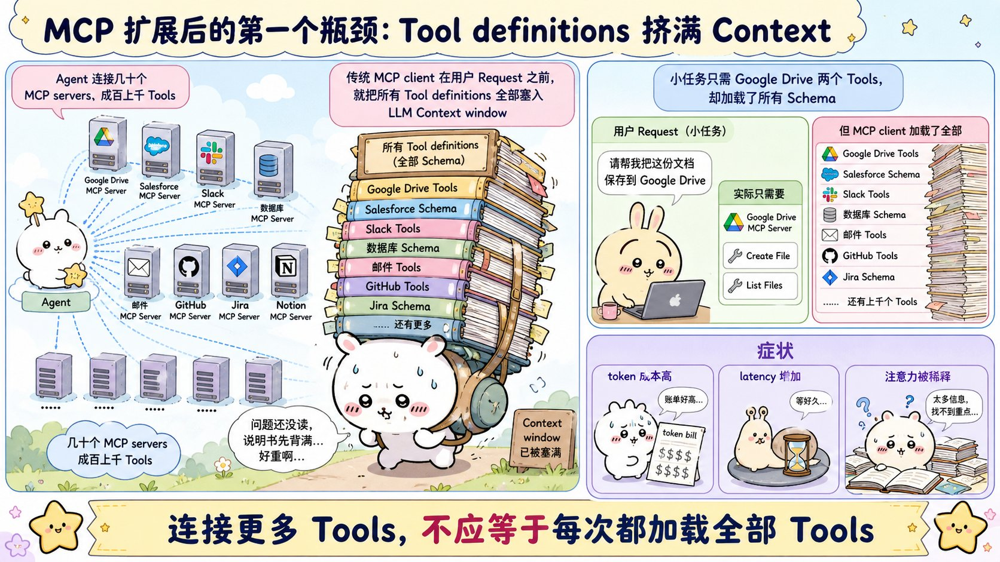
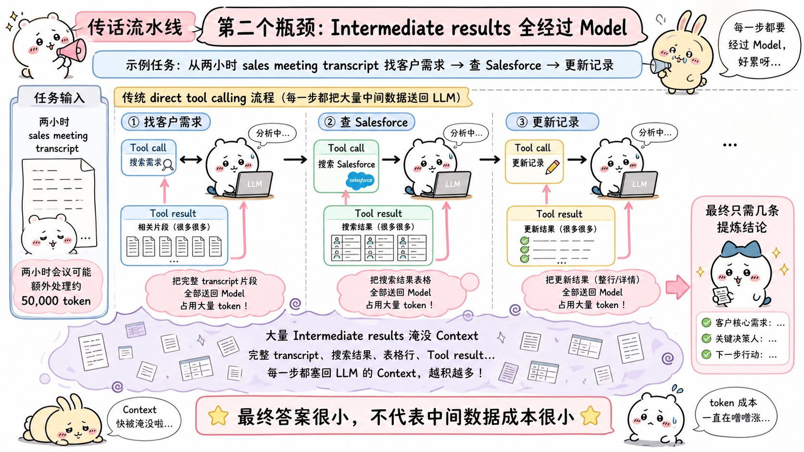
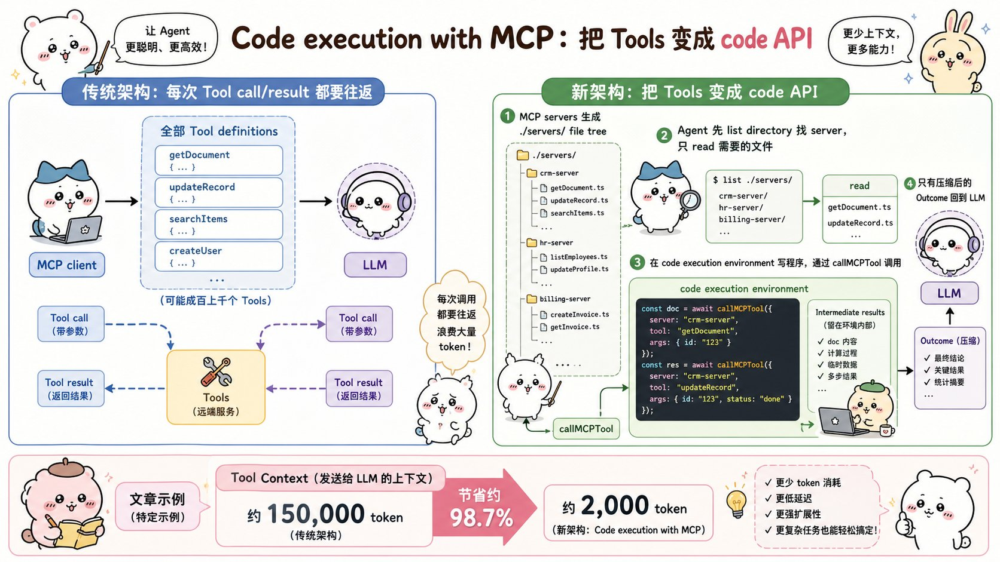
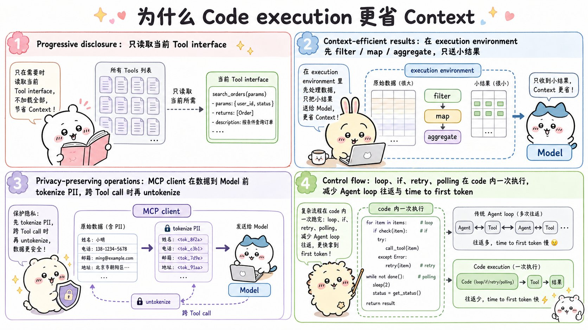
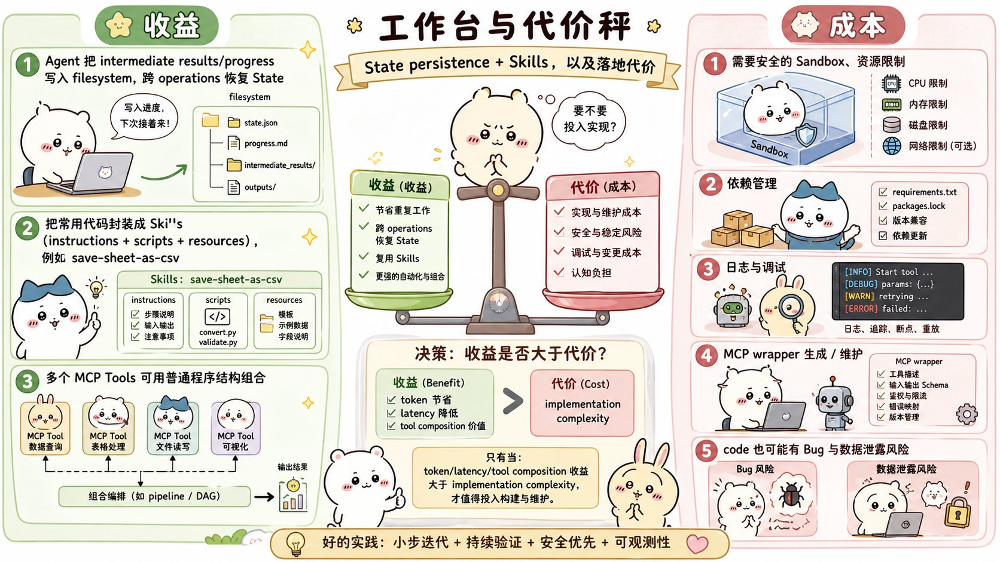

# Code execution with MCP: building more efficient AI agents：面试速记

> Anthropic Engineering · 2025-11-04 · 作者 Adam Jones、Conor Kelly
> [官方原文](https://www.anthropic.com/engineering/code-execution-with-mcp) · [本地逐句对照](13_code-execution-with-mcp_逐句对照.md)

## 一句话讲明白

**当智能体接入的 MCP 工具变多，"把全部工具说明书预先塞进上下文 + 让每一份中间数据都流经模型"这两件事会把成本和延迟拖垮；解法是别再让模型直接调工具，而是把 MCP 工具变成文件系统上的一套代码接口，让智能体自己写代码——按需读取用得上的那几个接口、在执行环境里完成过滤与拼装，只把压缩后的最终结果交回模型。文章给出的数字是：上下文占用从约 15 万 token 降到约 2 千 token，省了 98.7%。**

## 为什么值得读 / 能用在哪

- 这是"智能体接了几十个 MCP 服务器之后一定会撞上的墙"的标准答案。工具一多，模型还没看到用户那句话，就已经烧掉了几十万 token。
- 它给的不是新算法，而是**把软件工程里早就成熟的做法搬到智能体上**：按需导入、在本地处理数据、用循环和条件判断代替一次次往返。文章总结段自己就是这么说的。
- 落到自己项目里：凡是"工具数量还会继续涨"或者"单次工具返回是大文档、大表格"的场景，都该往这个方向改。反过来，工具就三五个、返回都是小 JSON，那这套东西的复杂度不值得付。
- Cloudflare 独立发表过同样的发现，把它叫做"代码模式"（Code Mode）——说明这不是 Anthropic 一家的特殊结论。

## 核心要点

### 1. 第一个瓶颈：所有工具定义被预先加载



- 大多数 MCP 客户端的默认行为：把**全部**工具定义（tool definition，也就是工具名 + 描述 + 参数结构 + 返回结构）一次性写进上下文，用直接工具调用（direct tool calling）的语法暴露给模型。
- 每个定义都不短。原文举的 `gdrive.getDocument`、`salesforce.updateRecord` 两个例子，一个就要占掉七八行的描述、参数和返回说明。
- **后果**：接入数千个工具时，智能体"在读到用户请求之前，就得先处理几十万个 token"。
- 更荒唐的是：一个只需要两个 Google Drive 工具的小任务，也得连带为 Salesforce、Slack、数据库那些完全无关的定义付 token 和延迟的钱。
- 一句话记住：**预加载的代价与工具总数成正比，与任务实际需要的工具数无关。**

### 2. 第二个瓶颈：每一份中间结果都要流经模型



原文的例子："从 Google Drive 下载我的会议纪要，附加到 Salesforce 那条潜在客户记录上。"直接工具调用下会发生什么：

1. 模型调 `gdrive.getDocument` → 完整纪要**读进模型上下文**。
2. 模型调 `salesforce.updateRecord` → 模型必须**把整篇纪要一字不差地再写一遍**当参数。

- 同一份内容**流经模型两次**。一场 2 小时的销售会议，这可能意味着额外处理 **5 万个 token**。
- 更大的文档甚至会直接**超出上下文窗口上限，工作流当场中断**。
- 还有正确性问题：面对大文档或复杂数据结构，模型在工具调用之间搬运数据**更容易抄错**。
- 面试可以直接甩这句判断：**最终答案很小，不代表中间数据的成本小。** 用户只想要"几条客户需求"，系统却搬了两趟完整纪要。

### 3. 解法：把 MCP 工具呈现成文件系统上的代码接口



核心动作是**换暴露方式**：不再把 MCP 服务器暴露成"可直接调用的工具列表"，而是暴露成一套**代码 API**，让智能体写代码去调。文章给的 TypeScript 实现是一棵文件树：

```
servers
├── google-drive
│   ├── getDocument.ts
│   └── index.ts
├── salesforce
│   ├── updateRecord.ts
│   └── index.ts
└── ...
```

每个工具对应一个文件，文件里是一层薄封装，内部转调 `callMCPTool('google_drive__get_document', input)`。

智能体的工作流程变成三步：

1. **列目录** `./servers/`，看有哪些服务器；
2. **只读**当前任务需要的那几个工具文件（比如 `getDocument.ts`、`updateRecord.ts`），理解它们的接口；
3. **写一段代码**把它们串起来，在执行环境里跑完。

于是前面那个"纪要搬家"的例子变成几行代码：取文档拿到 `content`，直接作为参数传给 `updateRecord`——**纪要全文一次都没进过模型上下文**。

> **必须记住的数字：上下文占用从约 150,000 token 降到约 2,000 token，时间和成本节省 98.7%。**（这是文章给出的具体实现下的示例数字，不是任何场景的通用保证；被追问时要主动说明这一点。）

### 4. 四项收益（面试最常被展开追问的一节）



**① 渐进式披露（progressive disclosure）**

- 模型天生擅长在文件系统里穿行导航，所以让它**按需**读取工具定义，而不是开局全读。
- 等价的另一种做法：给服务器加一个 `search_tools` 工具用来检索定义，智能体搜"salesforce"就只拿到那一批。
- 加分细节：给这个检索工具加一个**详细程度参数**——只要名称 / 名称加描述 / 带完整参数结构的全量定义。让智能体自己决定读多细，进一步省上下文。这一条面试很容易被追问"具体怎么省"，答案就在这里。

**② 上下文高效的结果（context-efficient results）**

大数据集先在代码里过滤和转换，再返回。原文的对照例子是拉一张 1 万行的表格：

```
// 不用代码执行：1 万行全部涌进上下文，让模型自己肉眼筛
TOOL CALL: gdrive.getSheet(sheetId: 'abc123')  → 返回 10,000 行

// 用代码执行：在执行环境里筛完再给模型看
const allRows = await gdrive.getSheet({ sheetId: 'abc123' });
const pendingOrders = allRows.filter(row => row["Status"] === 'pending');
console.log(`Found ${pendingOrders.length} pending orders`);
console.log(pendingOrders.slice(0, 5));  // 只打印前 5 行供审阅
```

**智能体看到的是 5 行，而不是 1 万行。** 聚合、跨多个数据源做连接、抽取特定字段，同理——全都不会让上下文膨胀。

**③ 更强的控制流（control flow）**

- 循环、条件判断、错误处理、轮询，全部用熟悉的代码写法一次执行，不必把一个个工具调用串成长链。
- 原文例子是轮询 Slack 频道等部署完成通知：一个 `while` 循环里反复拉频道历史、匹配关键字、没等到就睡 5 秒。这比在智能体循环里交替执行"调一次工具 → 睡一会儿"要高效得多，因为每一轮都不用回模型走一趟。
- 附带好处：把一棵条件树写出来交给执行环境求值，还能省掉**首 token 时间**（time to first token）的延迟——不必等模型来判断一个 if 语句。

**④ 保护隐私的操作（privacy-preserving operations）**

- 中间结果**默认留在执行环境**，智能体只能看到你显式打印或返回的东西。也就是说，你不想给模型看的数据可以流经整个工作流，却从不进入模型上下文。
- 更敏感的场景下，智能体框架可以自动**令牌化脱敏**：MCP 客户端在数据抵达模型前，把个人身份信息（PII）替换成 `[EMAIL_1]`、`[PHONE_1]`、`[NAME_1]` 这样的占位符。
- 等这批数据在**下一次** MCP 工具调用中被用到时，客户端再通过查表**还原**成真实值。于是真实的邮箱、电话、姓名从 Google Sheets 一路流到 Salesforce，**全程不经过模型**。
- 两个收益：防止智能体意外打印或处理敏感数据；以及可以基于这层拦截定义**确定性的安全规则**——明确规定数据能从哪来、能流到哪去。

### 5. 状态持久化、技能，以及必须付出的代价



**多出来的两项能力：**

- **状态持久化**：执行环境带文件系统访问权限，智能体就能把中间结果写成文件（原文例子是把查询到的潜在客户列表写成 CSV），**下一次执行接着上次的进度往下做**——断点续做、跟踪进度。
- **技能（Skills）**：智能体把自己写出来的、跑通了的代码**存成可复用函数**（例如 `./skills/save-sheet-as-csv.ts`），以后任何一次执行直接导入调用。再给这些函数配一个 `SKILL.md`，就成了模型可以引用的结构化技能。久而久之智能体攒出一个更高层能力的工具箱，**自己演化出最趁手的脚手架**。

**代价（这一半千万别漏讲）：**

- 要跑智能体自己生成的代码，就必须有**安全的执行环境**：沙箱（sandboxing）、资源限制、监控三样齐备。
- 这些基础设施带来了**直接工具调用根本不需要**的运维开销和安全顾虑。
- 原文的原话式结论：代码执行的收益——**更低的 token 成本、更低的延迟、更好的工具组合能力**——应当与这些实现成本**放在一起权衡**。不是无脑上。

### 6. 两种模式对照（背下这张表就够讲）

| 维度 | 直接工具调用 | 代码执行搭配 MCP |
| --- | --- | --- |
| 工具定义 | 全部预先加载进上下文 | 列目录 + 按需读取用得上的那几个 |
| 中间数据 | 每一份都流经模型，可能来回多趟 | 默认留在执行环境，只回传打印的部分 |
| 循环 / 条件 / 重试 | 靠智能体循环一次次往返 | 一段代码里跑完 |
| 敏感数据 | 会进模型上下文 | 可令牌化，真值从不经过模型 |
| 跨步骤状态 | 靠上下文携带 | 写文件，可断点续做 |
| 复用 | 每次重新推理 | 存成技能，下次直接导入 |
| 额外成本 | 几乎没有 | 沙箱、资源限制、监控、运维开销 |

## 面试高频问答

**Q：什么时候该从直接工具调用切到代码执行？**
A：看两个信号——工具总数会不会持续增长，以及单次工具返回是不是大对象。工具几十上百个、返回是大文档或万行表格时，收益极大；工具就三五个、返回都是小 JSON 时，沙箱和运维的复杂度不划算。判断标准就是原文那句：token 成本、延迟、工具组合能力这三项收益要盖过实现成本。

**Q：98.7% 这个数字是怎么来的？可信吗？**
A：文章的示例场景里，上下文占用从约 15 万 token 降到约 2 千 token。省下来的主要是**没被用到的那些工具定义**，其次是没进模型的中间数据。这是特定实现下的示例数字，不是通用保证——真实收益取决于你的工具总数和数据体量。原理是稳的：按需加载 + 中间结果留在环境里。

**Q：只解决"工具定义太多"，加个工具检索接口不就行了？为什么非要上代码执行？**
A：检索接口只解决第一个瓶颈——文章自己也把 `search_tools` 列为渐进式披露的一种可选做法。但第二个瓶颈是中间结果反复流经模型，检索接口对此毫无帮助。代码执行是**同时**解决两个瓶颈的方案，还顺带拿到控制流、隐私脱敏、状态持久化。

**Q：让模型写代码去调工具，安全上怎么兜底？**
A：三层。第一，执行环境必须沙箱化，配资源限制和监控——原文明说这是硬要求。第二，隐私上靠 MCP 客户端做令牌化：PII 在进模型前被替换成占位符，下次工具调用时再查表还原，模型全程看不到真值。第三，可以基于这套拦截机制定义确定性的数据流向规则，规定数据能从哪来、去哪。

**Q：这套东西和技能（Skills）是什么关系？**
A：技能是这套方案自然长出来的产物。智能体写出一段跑通的代码后可以存成可复用函数，加个 `SKILL.md` 就成了结构化技能。区别在于：代码执行解决的是**这一次**怎么省上下文，Skills 解决的是**下一次**不用重写——智能体逐步攒出自己的高层能力工具箱。

## 必须记住的 8 句话

1. 工具一多，预加载全部工具定义会在用户请求之前就吃掉几十万 token，代价与工具总数成正比、与任务需要无关。
2. 直接工具调用下，每一份中间结果都必须流经模型；一份 2 小时会议纪要流经两次约多花 5 万 token，大文档还可能直接撑爆上下文。
3. 解法是把 MCP 服务器暴露成文件系统上的代码接口，让智能体列目录、按需读接口、写代码组合。
4. 文章给的数字：上下文从约 15 万 token 降到约 2 千 token，节省 98.7%——记住这是示例数字。
5. 四项收益：渐进式披露、上下文高效的结果、更强的控制流、保护隐私的操作。
6. 原始数据尽量留在执行环境里，只把压缩后的最终结果送进模型——1 万行里只让模型看 5 行。
7. 文件系统带来状态持久化，跑通的代码可以存成技能复用，智能体逐步演化出自己的脚手架。
8. 代价是沙箱、资源限制、监控这些直接工具调用不需要的基础设施；收益要和实现成本一起权衡。

## 30 秒口述版

> 大规模接入 MCP 之后有两个成本大头：一是所有工具定义被预先塞进上下文，工具上千时模型还没看到用户请求就烧掉几十万 token；二是每一份中间结果都要流经模型，一份会议纪要来回流两趟就多花 5 万 token，文档再大点还会撑爆窗口。Anthropic 的解法是不让模型直接调工具，而是把 MCP 服务器组织成文件系统上的一棵代码接口树，智能体先列目录、只读它需要的那几个接口文件，然后写一段代码在执行环境里完成取数、过滤、循环和拼装，只把最终结果打印给模型。文章的示例数字是上下文从 15 万 token 降到 2 千，省 98.7%。附带还拿到四项好处：渐进式披露、结果先过滤再回传、控制流一次执行、以及敏感数据令牌化后全程不进模型。代价是必须做沙箱、资源限制和监控，所以要拿 token、延迟和工具组合的收益去和这套实现复杂度做权衡。核心洞察是：这些问题看着新，其实软件工程早就有成熟解法。

## 自测

- [ ] 能说出大规模 MCP 场景下的两个上下文瓶颈，并各举一个原文的例子。
- [ ] 能画出"列 `./servers/` 目录 → 读接口文件 → 写代码调 `callMCPTool`"的完整流程。
- [ ] 能说出 15 万 → 2 千 token、98.7%，并主动补一句这是示例而非通用保证。
- [ ] 能完整列出四项收益，并各配一个原文例子（表格筛选 5 行、Slack 轮询、PII 占位符）。
- [ ] 能解释为什么过滤必须在执行环境里做，而不是把数据拉回模型再筛。
- [ ] 能说清 PII 令牌化和还原分别发生在流程的哪个位置，以及为什么模型全程看不到真值。
- [ ] 能列出至少三项实施代价，并说出该在什么条件下判断这套方案不值得上。

> 插图为学习用途的非官方同人式教学图，角色与文章版权归各自权利人。
