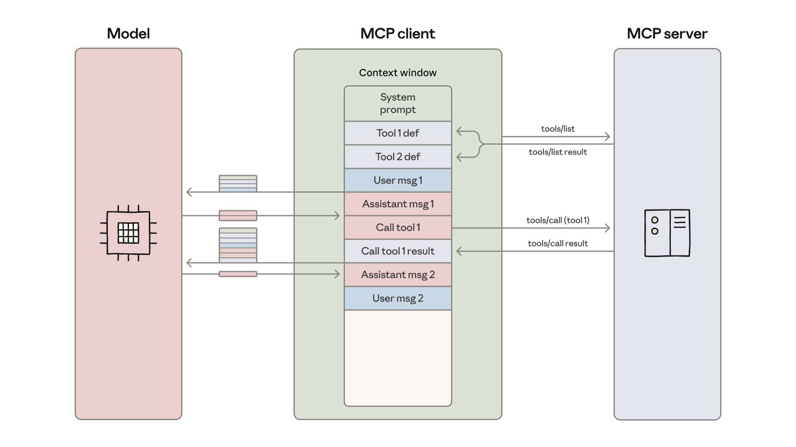

# 13_Code execution with MCP: building more efficient AI agents_用代码执行搭配 MCP：构建更高效的 AI 智能体

> 原文：https://www.anthropic.com/engineering/code-execution-with-mcp
> 作者：Adam Jones、Conor Kelly（Anthropic Engineering）｜发布日期：2025-11-04

## 📌 本篇速览

- 📅 2025-11-04　｜　⏱ 约 10 分钟　｜　📄 1,973 词 / 1 图
- ⭐ ★★★★★ **必读** —— 这是 Anthropic 对『代码执行取代直接工具调用』这一当前 Agent 架构主流范式转变的官方阐述，token 效率与工具规模化是每个 Agent 工程师都会遇到的核心问题。
- 🏷 MCP、代码执行、上下文效率、Agent 工程、Skills
- 🖼 [图解笔记（面试速记）](13_code-execution-with-mcp_直观图解与学习笔记.md)　·　🗂 [返回总目录](00_目录与阅读进度.md)

文章指出当智能体接入大量 MCP 工具时，预加载全部工具定义和让中间结果流经上下文窗口会造成过量 token 消耗。解决方案是把 MCP 服务器呈现为文件系统上的代码 API，让智能体写代码来按需发现和调用工具、在执行环境中过滤数据，某示例将 token 用量从 15 万降至 2000（节省 98.7%）。文章还讨论了渐进式披露、控制流、PII 令牌化脱敏的隐私保护、状态持久化与 Skills 等收益，以及沙箱等运维成本的权衡。

---

[The Model Context Protocol (MCP)](https://modelcontextprotocol.io/) is an open standard for connecting AI agents to external systems.

模型上下文协议（Model Context Protocol，MCP）是一个把 AI 智能体（agent）连接到外部系统的开放标准。

Connecting agents to tools and data traditionally requires a custom integration for each pairing, creating fragmentation and duplicated effort that makes it difficult to scale truly connected systems.

按传统做法，把智能体接入工具和数据，每一对组合都需要一套定制集成，这造成了碎片化和重复劳动，使得真正互联的系统难以规模化。

MCP provides a universal protocol—developers implement MCP once in their agent and it unlocks an entire ecosystem of integrations.

MCP 提供了一个通用协议——开发者只需在智能体里实现一次 MCP，就能解锁整个集成生态。

Since launching MCP in November 2024, adoption has been rapid: the community has built thousands of [MCP servers](https://github.com/modelcontextprotocol/servers), [SDKs](https://modelcontextprotocol.io/docs/sdk) are available for all major programming languages, and the industry has adopted MCP as the de-facto standard for connecting agents to tools and data.

自 2024 年 11 月 MCP 发布以来，它被采用的速度非常快：社区已经构建了数千个 MCP 服务器（MCP server），所有主流编程语言都有了对应的 SDK，业界也已把 MCP 当作连接智能体与工具、数据的事实标准（de-facto standard）。

Today developers routinely build agents with access to hundreds or thousands of tools across dozens of MCP servers.

如今，开发者构建的智能体动辄能访问横跨几十个 MCP 服务器的成百上千个工具。

However, as the number of connected tools grows, loading all tool definitions upfront and passing intermediate results through the context window slows down agents and increases costs.

然而，随着接入工具数量的增长，预先加载所有工具定义（tool definition）、并让中间结果全部经过上下文窗口（context window）传递，会拖慢智能体并推高成本。

In this blog we'll explore how code execution can enable agents to interact with MCP servers more efficiently, handling more tools while using fewer tokens.

在这篇博客中，我们将探讨代码执行（code execution）如何让智能体更高效地与 MCP 服务器交互——在处理更多工具的同时消耗更少的 token。

## **Excessive token consumption from tools makes agents less efficient**｜**工具带来的过量 token 消耗会降低智能体的效率**

As MCP usage scales, there are two common patterns that can increase agent cost and latency:

随着 MCP 使用规模的扩大，有两种常见模式会推高智能体的成本和延迟：

1. Tool definitions overload the context window;

1. 工具定义挤爆上下文窗口；

2. Intermediate tool results consume additional tokens.

2. 工具的中间结果消耗额外的 token。

### **1. Tool definitions overload the context window**｜**1. 工具定义挤爆上下文窗口**

Most MCP clients load all tool definitions upfront directly into context, exposing them to the model using a direct tool-calling syntax.

大多数 MCP 客户端会把所有工具定义预先直接加载进上下文，并用直接工具调用（tool-calling）的语法暴露给模型。

These tool definitions might look like:

这些工具定义可能长这样：

```
gdrive.getDocument
     Description: Retrieves a document from Google Drive
     Parameters:
                documentId (required, string): The ID of the document to retrieve
                fields (optional, string): Specific fields to return
     Returns: Document object with title, body content, metadata, permissions, etc.
```

```
salesforce.updateRecord
    Description: Updates a record in Salesforce
    Parameters:
               objectType (required, string): Type of Salesforce object (Lead, Contact,      Account, etc.)
               recordId (required, string): The ID of the record to update
               data (required, object): Fields to update with their new values
     Returns: Updated record object with confirmation
```

Tool descriptions occupy more context window space, increasing response time and costs.

工具描述会占据更多的上下文窗口空间，从而拉长响应时间、增加成本。

In cases where agents are connected to thousands of tools, they’ll need to process hundreds of thousands of tokens before reading a request.

在智能体接入了数千个工具的场景下，它们在读到用户请求之前，就得先处理几十万个 token。

### **2. Intermediate tool results consume additional tokens**｜**2. 工具的中间结果消耗额外的 token**

Most MCP clients allow models to directly call MCP tools.

大多数 MCP 客户端允许模型直接调用 MCP 工具。

For example, you might ask your agent: "Download my meeting transcript from Google Drive and attach it to the Salesforce lead."

例如，你可能会这样吩咐你的智能体："从 Google Drive 下载我的会议纪要，并把它附加到 Salesforce 的那条潜在客户（lead）记录上。"

The model will make calls like:

模型会发起类似这样的调用：

```
TOOL CALL: gdrive.getDocument(documentId: "abc123")
        → returns "Discussed Q4 goals...\n[full transcript text]"
           (loaded into model context)

TOOL CALL: salesforce.updateRecord(
			objectType: "SalesMeeting",
			recordId: "00Q5f000001abcXYZ",
  			data: { "Notes": "Discussed Q4 goals...\n[full transcript text written out]" }
		)
		(model needs to write entire transcript into context again)
```

Every intermediate result must pass through the model.

每一个中间结果都必须经过模型。

In this example, the full call transcript flows through twice.

在这个例子里，完整的通话记录要流经模型两次。

For a 2-hour sales meeting, that could mean processing an additional 50,000 tokens.

对于一场 2 小时的销售会议，这可能意味着额外处理 5 万个 token。

Even larger documents may exceed context window limits, breaking the workflow.

更大的文档甚至可能超出上下文窗口的上限，导致工作流直接中断。

With large documents or complex data structures, models may be more likely to make mistakes when copying data between tool calls.

面对大文档或复杂数据结构时，模型在工具调用之间复制数据也更容易出错。



*The MCP client loads tool definitions into the model's context window and orchestrates a message loop where each tool call and result passes through the model between operations.*

*图注：MCP 客户端把工具定义加载进模型的上下文窗口，并编排一个消息循环——每一次工具调用及其结果都要在各步操作之间经过模型。*

## **Code execution with MCP improves context efficiency**｜**代码执行搭配 MCP 可提升上下文效率**

With code execution environments becoming more common for agents, a solution is to present MCP servers as code APIs rather than direct tool calls.

随着代码执行环境（code execution environment）在智能体中越来越普及，一个解决方案是把 MCP 服务器呈现为代码 API，而不是直接的工具调用。

The agent can then write code to interact with MCP servers.

这样，智能体就可以通过编写代码来与 MCP 服务器交互。

This approach addresses both challenges: agents can load only the tools they need and process data in the execution environment before passing results back to the model.

这种方法同时解决了上述两个难题：智能体可以只加载它需要的工具，并在执行环境中先处理好数据，再把结果传回模型。

There are a number of ways to do this.

实现这一点有多种方式。

One approach is to generate a file tree of all available tools from connected MCP servers.

一种做法是为已连接的 MCP 服务器上所有可用工具生成一棵文件树（file tree）。

Here's an implementation using TypeScript:

下面是一个用 TypeScript 实现的例子：

```
servers
├── google-drive
│   ├── getDocument.ts
│   ├── ... (other tools)
│   └── index.ts
├── salesforce
│   ├── updateRecord.ts
│   ├── ... (other tools)
│   └── index.ts
└── ... (other servers)
```

Then each tool corresponds to a file, something like:

然后每个工具对应一个文件，大致如下：

```
// ./servers/google-drive/getDocument.ts
import { callMCPTool } from "../../../client.js";

interface GetDocumentInput {
  documentId: string;
}

interface GetDocumentResponse {
  content: string;
}

/* Read a document from Google Drive */
export async function getDocument(input: GetDocumentInput): Promise<GetDocumentResponse> {
  return callMCPTool<GetDocumentResponse>('google_drive__get_document', input);
}

```

Our Google Drive to Salesforce example above becomes the code:

于是，前面那个从 Google Drive 到 Salesforce 的例子就变成了这样的代码：

```
// Read transcript from Google Docs and add to Salesforce prospect
import * as gdrive from './servers/google-drive';
import * as salesforce from './servers/salesforce';

const transcript = (await gdrive.getDocument({ documentId: 'abc123' })).content;
await salesforce.updateRecord({
  objectType: 'SalesMeeting',
  recordId: '00Q5f000001abcXYZ',
  data: { Notes: transcript }
});

```

The agent discovers tools by exploring the filesystem: listing the `./servers/` directory to find available servers (like `google-drive` and `salesforce`), then reading the specific tool files it needs (like `getDocument.ts` and `updateRecord.ts`) to understand each tool's interface.

智能体通过探索文件系统来发现工具：先列出 `./servers/` 目录找到可用的服务器（比如 `google-drive` 和 `salesforce`），再读取它需要的具体工具文件（比如 `getDocument.ts` 和 `updateRecord.ts`）来理解每个工具的接口。

This lets the agent load only the definitions it needs for the current task.

这让智能体只需加载当前任务所需的那些定义。

This reduces the token usage from 150,000 tokens to 2,000 tokens—a time and cost saving of 98.7%.

这把 token 用量从 15 万降到了 2000——时间和成本节省了 98.7%。

Cloudflare [published similar findings](https://blog.cloudflare.com/code-mode/), referring to code execution with MCP as “Code Mode."

Cloudflare 也发表过类似的发现，并把"代码执行搭配 MCP"称为"代码模式"（Code Mode）。

The core insight is the same: LLMs are adept at writing code and developers should take advantage of this strength to build agents that interact with MCP servers more efficiently.

核心洞察是一样的：LLM 擅长写代码，开发者应当利用这一长处，构建能更高效地与 MCP 服务器交互的智能体。

## **Benefits of code execution with MCP**｜**代码执行搭配 MCP 的收益**

Code execution with MCP enables agents to use context more efficiently by loading tools on demand, filtering data before it reaches the model, and executing complex logic in a single step.

代码执行搭配 MCP 让智能体能更高效地利用上下文：按需加载工具、在数据抵达模型之前先做过滤、并在单个步骤内执行复杂逻辑。

There are also security and state management benefits to using this approach.

这种方法在安全性和状态管理（state management）方面也有好处。

### Progressive disclosure｜渐进式披露

Models are great at navigating filesystems.

模型非常擅长在文件系统里穿行导航。

Presenting tools as code on a filesystem allows models to read tool definitions on-demand, rather than reading them all up-front.

把工具以代码形式放在文件系统上，模型就可以按需（on-demand）读取工具定义，而不是一开始就全部读完。

Alternatively, a `search_tools` tool can be added to the server to find relevant definitions.

另一种做法是给服务器加一个 `search_tools` 工具，用来查找相关的定义。

For example, when working with the hypothetical Salesforce server used above, the agent searches for "salesforce" and loads only those tools that it needs for the current task.

例如，在使用前面假设的那个 Salesforce 服务器时，智能体搜索"salesforce"，只加载当前任务所需的那些工具。

Including a detail level parameter in the `search_tools` tool that allows the agent to select the level of detail required (such as name only, name and description, or the full definition with schemas) also helps the agent conserve context and find tools efficiently.

在 `search_tools` 工具里加入一个"详细程度"参数，让智能体自行选择所需的详细级别（比如只要名称、名称加描述，或带 schema 的完整定义），也能帮助智能体节省上下文、更高效地找到工具。

### Context efficient tool results｜上下文高效的工具结果

When working with large datasets, agents can filter and transform results in code before returning them.

在处理大型数据集时，智能体可以先在代码中对结果做过滤和转换，再返回它们。

Consider fetching a 10,000-row spreadsheet:

设想要获取一张 1 万行的表格：

```
// Without code execution - all rows flow through context
TOOL CALL: gdrive.getSheet(sheetId: 'abc123')
        → returns 10,000 rows in context to filter manually

// With code execution - filter in the execution environment
const allRows = await gdrive.getSheet({ sheetId: 'abc123' });
const pendingOrders = allRows.filter(row => 
  row["Status"] === 'pending'
);
console.log(`Found ${pendingOrders.length} pending orders`);
console.log(pendingOrders.slice(0, 5)); // Only log first 5 for review
```

The agent sees five rows instead of 10,000.

智能体看到的是 5 行，而不是 1 万行。

Similar patterns work for aggregations, joins across multiple data sources, or extracting specific fields—all without bloating the context window.

类似的模式同样适用于聚合（aggregation）、跨多个数据源的连接（join），或抽取特定字段——全都不会让上下文窗口膨胀。

#### **More powerful and context-efficient control flow**｜**更强大、更省上下文的控制流**

Loops, conditionals, and error handling can be done with familiar code patterns rather than chaining individual tool calls.

循环、条件判断和错误处理都可以用熟悉的代码模式完成，而不必把一个个工具调用串起来。

For example, if you need a deployment notification in Slack, the agent can write:

例如，如果你需要在 Slack 里等一条部署通知，智能体可以这样写：

```
let found = false;
while (!found) {
  const messages = await slack.getChannelHistory({ channel: 'C123456' });
  found = messages.some(m => m.text.includes('deployment complete'));
  if (!found) await new Promise(r => setTimeout(r, 5000));
}
console.log('Deployment notification received');
```

This approach is more efficient than alternating between MCP tool calls and sleep commands through the agent loop.

这种做法比在智能体循环（agent loop）里交替执行 MCP 工具调用和 sleep 命令更高效。

Additionally, being able to write out a conditional tree that gets executed also saves on “time to first token” latency: rather than having to wait for a model to evaluate an if-statement, the agent can let the code execution environment do this.

此外，能够把一棵条件树（conditional tree）写出来交给环境执行，还能节省"首 token 时间"（time to first token）的延迟：不必等模型来求值 if 语句，智能体可以把这件事交给代码执行环境。

### Privacy-preserving operations｜保护隐私的操作

When agents use code execution with MCP, intermediate results stay in the execution environment by default.

当智能体使用代码执行搭配 MCP 时，中间结果默认留在执行环境里。

This way, the agent only sees what you explicitly log or return, meaning data you don’t wish to share with the model can flow through your workflow without ever entering the model's context.

这样一来，智能体只能看到你显式打印（log）或返回的内容，也就是说，你不想分享给模型的数据可以流经你的工作流，却完全不进入模型的上下文。

For even more sensitive workloads, the agent harness can tokenize sensitive data automatically.

对于更敏感的工作负载，智能体框架（agent harness）还可以自动对敏感数据做令牌化脱敏（tokenize）。

For example, imagine you need to import customer contact details from a spreadsheet into Salesforce.

举个例子，假设你需要把客户联系方式从一张表格导入 Salesforce。

The agent writes:

智能体会这样写：

```
const sheet = await gdrive.getSheet({ sheetId: 'abc123' });
for (const row of sheet.rows) {
  await salesforce.updateRecord({
    objectType: 'Lead',
    recordId: row.salesforceId,
    data: { 
      Email: row.email,
      Phone: row.phone,
      Name: row.name
    }
  });
}
console.log(`Updated ${sheet.rows.length} leads`);
```

The MCP client intercepts the data and tokenizes PII before it reaches the model:

MCP 客户端会拦截这些数据，在它们抵达模型之前把个人身份信息（PII）替换成占位符：

```
// What the agent would see, if it logged the sheet.rows:
[
  { salesforceId: '00Q...', email: '[EMAIL_1]', phone: '[PHONE_1]', name: '[NAME_1]' },
  { salesforceId: '00Q...', email: '[EMAIL_2]', phone: '[PHONE_2]', name: '[NAME_2]' },
  ...
]
```

Then, when the data is shared in another MCP tool call, it is untokenized via a lookup in the MCP client.

随后，当这些数据在另一次 MCP 工具调用中被使用时，MCP 客户端会通过查表把占位符还原回真实数据（untokenize）。

The real email addresses, phone numbers, and names flow from Google Sheets to Salesforce, but never through the model.

真实的邮箱地址、电话号码和姓名从 Google Sheets 流向 Salesforce，但从不经过模型。

This prevents the agent from accidentally logging or processing sensitive data.

这可以防止智能体意外地打印或处理敏感数据。

You can also use this to define deterministic security rules, choosing where data can flow to and from.

你还可以借此定义确定性的安全规则，指定数据可以从哪里来、流向哪里。

### State persistence and skills｜状态持久化与技能

Code execution with filesystem access allows agents to maintain state across operations.

具备文件系统访问能力的代码执行，让智能体可以跨操作维护状态。

Agents can write intermediate results to files, enabling them to resume work and track progress:

智能体可以把中间结果写入文件，从而能够断点续做、跟踪进度：

```
const leads = await salesforce.query({ 
  query: 'SELECT Id, Email FROM Lead LIMIT 1000' 
});
const csvData = leads.map(l => `${l.Id},${l.Email}`).join('\n');
await fs.writeFile('./workspace/leads.csv', csvData);

// Later execution picks up where it left off
const saved = await fs.readFile('./workspace/leads.csv', 'utf-8');
```

Agents can also persist their own code as reusable functions.

智能体还可以把自己写的代码持久化成可复用的函数。

Once an agent develops working code for a task, it can save that implementation for future use:

一旦智能体为某个任务写出了能正常工作的代码，它就可以把这份实现保存下来供将来使用：

```
// In ./skills/save-sheet-as-csv.ts
import * as gdrive from './servers/google-drive';
export async function saveSheetAsCsv(sheetId: string) {
  const data = await gdrive.getSheet({ sheetId });
  const csv = data.map(row => row.join(',')).join('\n');
  await fs.writeFile(`./workspace/sheet-${sheetId}.csv`, csv);
  return `./workspace/sheet-${sheetId}.csv`;
}

// Later, in any agent execution:
import { saveSheetAsCsv } from './skills/save-sheet-as-csv';
const csvPath = await saveSheetAsCsv('abc123');
```

This ties in closely to the concept of [Skills](https://docs.claude.com/en/docs/agents-and-tools/agent-skills/overview), folders of reusable instructions, scripts, and resources for models to improve performance on specialized tasks.

这与技能（Skills）的概念紧密相关——Skills 是由可复用的指令、脚本和资源组成的文件夹，用来提升模型在专门任务上的表现。

Adding a SKILL.md file to these saved functions creates a structured skill that models can reference and use.

给这些保存下来的函数加上一个 SKILL.md 文件，就形成了模型可以引用和使用的结构化技能。

Over time, this allows your agent to build a toolbox of higher-level capabilities, evolving the scaffolding that it needs to work most effectively.

久而久之，你的智能体就能攒出一个由更高层能力组成的工具箱，不断演化出它最高效工作所需的脚手架（scaffolding）。

Note that code execution introduces its own complexity.

需要注意的是，代码执行本身也会引入复杂性。

Running agent-generated code requires a secure execution environment with appropriate [sandboxing](https://www.anthropic.com/engineering/claude-code-sandboxing), resource limits, and monitoring.

运行智能体生成的代码，需要一个安全的执行环境，配备恰当的沙箱（sandboxing）、资源限制和监控。

These infrastructure requirements add operational overhead and security considerations that direct tool calls avoid.

这些基础设施要求带来了直接工具调用所没有的运维开销和安全顾虑。

The benefits of code execution—reduced token costs, lower latency, and improved tool composition—should be weighed against these implementation costs.

代码执行的收益——更低的 token 成本、更低的延迟、更好的工具组合能力——应当与这些实现成本放在一起权衡。

## **Summary**｜**总结**

MCP provides a foundational protocol for agents to connect to many tools and systems.

MCP 为智能体连接大量工具和系统提供了一个基础协议。

However, once too many servers are connected, tool definitions and results can consume excessive tokens, reducing agent efficiency.

然而，一旦接入的服务器过多，工具定义和结果就可能消耗过量的 token，降低智能体的效率。

Although many of the problems here feel novel—context management, tool composition, state persistence—they have known solutions from software engineering.

尽管这里的许多问题——上下文管理、工具组合、状态持久化——看上去很新颖，但软件工程早就有成熟的解法。

Code execution applies these established patterns to agents, letting them use familiar programming constructs to interact with MCP servers more efficiently.

代码执行把这些成熟的模式应用到智能体身上，让它们能用熟悉的编程结构更高效地与 MCP 服务器交互。

If you implement this approach, we encourage you to share your findings with the [MCP community](https://modelcontextprotocol.io/community/communication).

如果你实践了这套方法，我们鼓励你把发现分享给 MCP 社区。

### Acknowledgments｜致谢

*This article was written by Adam Jones and Conor Kelly. Thanks to Jeremy Fox, Jerome Swannack, Stuart Ritchie, Molly Vorwerck, Matt Samuels, and Maggie Vo for feedback on drafts of this post.*

*本文由 Adam Jones 和 Conor Kelly 撰写。感谢 Jeremy Fox、Jerome Swannack、Stuart Ritchie、Molly Vorwerck、Matt Samuels 和 Maggie Vo 对本文草稿提出的反馈。*
