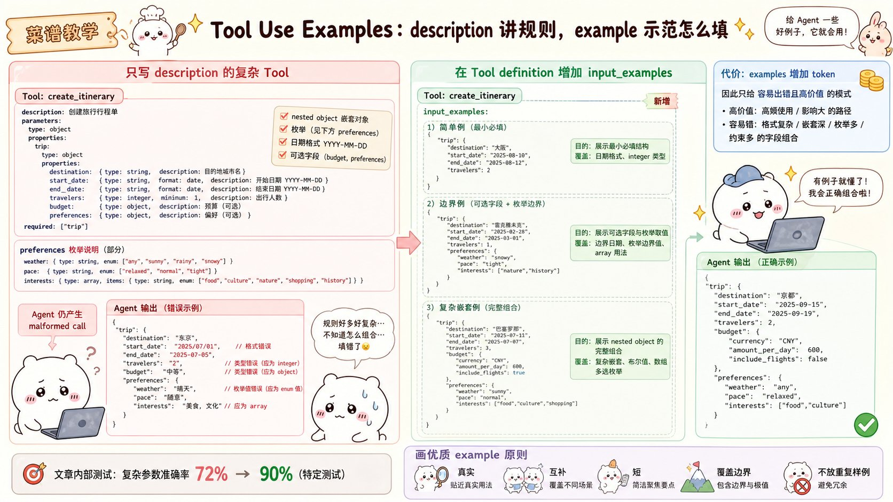

# Introducing advanced tool use on the Claude Developer Platform：面试速记

> Anthropic Engineering · 2025-11-24 · [官方原文](https://www.anthropic.com/engineering/advanced-tool-use) · [本地逐句对照](14_advanced-tool-use_逐句对照.md)

## 一句话讲明白

**当智能体（agent）要面对成百上千个工具时，会同时卡在三个地方——工具太多找不准、中间结果撑爆上下文、复杂参数填不对；Anthropic 用三项功能分别拆掉这三个瓶颈：工具搜索工具（Tool Search Tool）负责"找对"，程序化工具调用（Programmatic Tool Calling）负责"跑得省"，工具使用示例（Tool Use Examples）负责"传得准"。关键在于按自己最大的瓶颈分层启用，而不是三个一起无脑打开。**

## 为什么值得读 / 能用在哪

- 这是目前对"工具规模化"这件事讲得最具体的一篇官方文章，三个瓶颈各配了内部测试数字，面试时张口就有据可依。
- 只要你的系统接了多个 MCP 服务器，或者做过"大文件 / 多表数据分析型"的智能体，这三条路你多半踩过其中至少一条坑。
- 面试里最容易被追问的不是"这三个功能是什么"，而是**"什么时候不该用"**——文章每一节都明确写了收益较小的场景，这部分反而是差异化答案。

## 核心要点

### 一、先看清三个瓶颈分别长什么样

三条失败路径完全不同，别混为一谈：

1. **工具定义把上下文吃光** —— 工具还没开始用，定义本身先占满窗口。
2. **中间结果污染上下文** —— 结果本身有用的部分很少，但全量涌进来。
3. **参数填错、调用格式不合法** —— 结构定义（schema）合法，但用法不对。

对应关系一句话背下来：**找对工具 → 高效执行 → 正确调用**（Find right tool → Execute efficiently → Invoke correctly）。

原文一个扎心的对照：之前那篇《代码执行配合 MCP》就提过，有时智能体**还没读到用户请求**，工具结果和工具定义就已经吃掉 **50,000 以上的 token**。

### 二、工具搜索工具：把工具定义改成"按需付费"

**痛点的真实规模**（原文给的五服务器配置，数字要背）：

| 服务器 | 工具数 | 大致 token |
| --- | --- | --- |
| GitHub | 35 | 约 26K |
| Slack | 11 | 约 21K |
| Sentry | 5 | 约 3K |
| Grafana | 5 | 约 3K |
| Splunk | 2 | 约 2K |

合计 **58 个工具、约 55K token**，而对话还一个字都没开始。再加一个 Jira（单它就约 17K），很快逼近 **100K 以上**的纯开销。Anthropic 内部见过优化前工具定义吃掉 **134K token** 的情况。

而且成本不是唯一问题：**最常见的失败是选错工具和参数不对**，尤其当工具名字长得像的时候，比如 `notification-send-user` 和 `notification-send-channel`。

**做法**：你照样把所有工具定义交给 API，但给低频工具打上 `defer_loading: true`。被延迟加载的工具**一开始根本不进上下文**；Claude 最初只看得见工具搜索工具本身，加上你标了 `defer_loading: false` 的那几个核心工具。需要某种能力时，它去搜索工具的**名称和描述**，命中的工具才被展开成完整定义放进上下文。

**账要会算**（面试常问）：

- 传统方式：50 多个 MCP 工具的定义约 **72K token**，加上对话历史和系统提示词抢地方，开工前总消耗约 **77K token**。
- 用工具搜索工具：只预加载搜索工具本身约 **500 token**，按需捞出 3–5 个相关工具约 **3K token**，总消耗约 **8.7K token**，**保留 95% 的上下文窗口**。
- 结论：**token 用量减少约 85%**，同时不损失对完整工具库的访问能力。原文配图给的是保留 **191,300 token** 对比传统方式的 **122,800 token**。

**准确率也在涨**：启用后，Opus 4 从 **49% 提到 74%**，Opus 4.5 从 **79.5% 提到 88.1%**（MCP 评估、大规模工具库场景）。

**两个容易被追问的细节**：

- **不会破坏提示词缓存（prompt caching）**。因为延迟加载的工具是被**完全排除在初始提示词之外**的，它们只在搜索命中后才追加进上下文，所以系统提示词和核心工具定义仍然可缓存。
- 平台开箱提供**正则（regex）**和 **BM25** 两种搜索工具，也可以自己用嵌入向量（embeddings）实现自定义搜索。对 MCP 服务器还能整包延迟加载（`mcp_toolset` 的 `default_config`），再单独把高频工具设回常驻。

**什么时候用**：工具定义超过 10K token、已经出现选错工具的问题、接了多个 MCP 服务器、可用工具超过 10 个。
**什么时候别用**：工具库不到 10 个、每个会话里所有工具都会被频繁用到、工具定义本身就很精简。
**代价**：调用前多了一次搜索步骤，也就是**多一份延迟**——只有当省下的上下文和涨上来的准确率盖得过这份延迟，才算划算。

### 三、程序化工具调用：让中间结果压根不进上下文

**它解决的是两个问题，别只答一个**：

- **中间结果造成的上下文污染**：Claude 分析一个 10MB 日志找错误模式时，整个文件都会进上下文，可它其实只要一份错误频率摘要。跨多张表拉客户数据时，每条记录不管相不相关都在堆积，甚至会把真正重要的信息挤出窗口。
- **推理开销与"人工式"综合**：每次工具调用都要一轮完整的模型推理。拿到结果后 Claude 还得"用肉眼"看数据、拼关系、决定下一步——全靠自然语言完成。五次工具调用就是五轮推理加五次人肉解析，**又慢又容易错**。

**做法**：Claude 不再一次请求一个工具，而是**写一段 Python 代码**去编排整个流程。代码跑在沙箱化的代码执行环境里，需要你的工具返回结果时暂停；你通过 API 把结果送回来，**处理它的是脚本而不是模型**；跑完只有最终输出回到 Claude 眼前。循环、条件判断、数据变换、错误处理在代码里都是**显式**的，而不是隐含在推理过程里。

**差旅预算这个例子要能复述**（问题是"哪些人超了 Q3 差旅预算"，手上有 `get_team_members`、`get_expenses`、`get_budget_by_level` 三个工具）：

- 传统方式：拉出 20 个人 → 逐人拉报销共 **20 次工具调用**，每次 50–100 条明细 → 全量 **2,000 多条明细（50KB 以上）**涌进上下文 → Claude 手工累加、查预算、逐个比较。
- 程序化方式：一段代码里并行取预算和报销、建查找表、本地比对，**只把超预算的那两三个人 `print` 出来**。上下文消耗从 **200KB 原始数据降到约 1KB 结果**。

**三项收益的数字**：

- **省 token**：复杂研究任务上平均用量从 **43,588 降到 27,297**，减少 **37%**。
- **降延迟**：一个代码块里编排 20 多次工具调用，就省掉了 **19 轮以上的推理**（每轮推理是数百毫秒到数秒）。
- **提准确率**：内部知识检索 **25.6% → 28.5%**；GIA 基准 **46.5% → 51.2%**。

**配置上的安全要点**：在 `tools` 里加入 `code_execution`，再用 `allowed_callers` 把工具**逐个显式选择加入**（opt-in）程序化执行。这不是配置细节，是**能力边界**——默认不该把所有工具都对执行环境开放。代码调用工具时，你收到的请求里会带一个 `caller` 字段，可以据此识别来源。

**什么时候用**：只需要聚合值或摘要的大数据集、包含三次及以上相互依赖调用的多步流程、需要在 Claude 看到之前先过滤/排序/变换、中间数据本就不该影响推理、要对大量对象并行操作（比如检查 50 个端点）。
**什么时候别用**：简单的单工具调用、**任务本身要求 Claude 看到并推理所有中间结果**、响应很小的快速查询。
**落地提示**：因为 Claude 要写代码解析工具输出，**返回格式必须在描述里写清楚**（字段名、类型、取值范围）。适合开放给代码调用的，通常是可并行的独立操作和可安全重试的幂等（idempotent）操作。真实案例：Claude for Excel 就靠它读写数千行表格而不压垮上下文窗口。

### 四、工具使用示例：结构定义讲不清的，用样例讲

**为什么描述和结构定义不够**：JSON 结构定义擅长表达"什么在结构上合法"——类型、必填字段、允许的枚举值，但它**表达不了使用模式**。原文用一个工单接口 `create_ticket` 举例，留下四类没人回答的问题：

- **格式歧义**：`due_date` 到底写 `"2024-11-06"`、`"Nov 6, 2024"` 还是 `"2024-11-06T00:00:00Z"`？
- **ID 约定**：`reporter.id` 是 UUID、`"USR-12345"` 还是纯 `"12345"`？
- **嵌套结构的用法**：什么时候才该填 `reporter.contact`？
- **参数之间的关联**：`escalation.level` 和 `escalation.sla_hours` 跟优先级是什么关系？

**做法**：直接在工具定义里加 `input_examples`，给几条真实的调用样例。原文给了三条——一条严重 bug（带完整联系方式和很紧的服务等级时限）、一条功能请求（有报告人但无联系方式和升级配置）、一条只有标题的内部任务。Claude 从这三条里同时学到了三样东西：

1. **格式约定**：日期用 `YYYY-MM-DD`、用户 ID 形如 `USR-XXXXX`、标签用短横线连接（kebab-case）。
2. **嵌套结构怎么搭**：如何构造报告人 `reporter` 对象，以及它内嵌的联系方式 `contact` 对象。
3. **可选参数的关联规律**：什么级别的工单该带哪些可选块——这正是结构定义完全表达不了的部分。

**效果**：内部测试中，复杂参数处理的准确率从 **72% 提升到 90%**。

**什么时候用**：复杂嵌套结构（合法不等于用对）、可选参数很多且"带不带"很讲究、接口有结构定义写不进去的领域约定、存在容易混淆的相似工具（例如 `create_ticket` 和 `create_incident`）。
**什么时候别用**：用法一眼看得懂的单参数工具、URL 和电子邮件这类模型本来就懂的标准格式、本质上该由结构定义约束去解决的校验问题。
**怎么写才好**：用有真实感的数据（真实城市名、合理价格，别写 `"string"`、`"value"`）；覆盖最简、部分、完整三种填写模式；**每个工具 1–5 条**；只在正确用法无法从结构定义直接看出来的地方加。**样例是要占 token 的**，所以只花在歧义处。

### 五、分层策略：从你最大的瓶颈开始

原文的建议非常直接——**不是每个智能体在每个任务上都需要三件套**，从最大的瓶颈入手，再按需叠加：

- 工具定义导致上下文膨胀 → **工具搜索工具**
- 大量中间结果污染上下文 → **程序化工具调用**
- 参数错误、调用格式不合法 → **工具使用示例**

它们是互补关系：搜索确保**找到对的工具**，程序化调用确保**高效执行**，示例确保**正确调用**。

组合时的默认配置：最常用的 **3–5 个工具常驻**、其余延迟加载；只给适合代码编排的工具配 `allowed_callers`；只给真正复杂的调用加 `input_examples`。

还有两条容易被忽略但很好答的实操点：

- **工具搜索是按名称和描述匹配的**，所以描述质量直接决定发现准确率。`search_customer_orders` +"按日期范围、状态或总额搜索客户订单，返回商品、物流和支付信息"是好例子；`query_db_orders` +"执行订单查询"就是坏例子。
- **在系统提示词里告诉 Claude 有哪些大类能力可用**（例如"你可以使用 Slack 消息、Google Drive 文件管理、Jira 工单、GitHub 仓库相关的工具，用工具搜索去找具体能力"），否则它不知道该搜什么。

**每加一层，都要用评估（eval）去对比延迟、token 和准确率**——三项功能全都是有代价的交易，不是免费午餐。

**上手方式**：目前处于测试版（beta），加请求头 `betas=["advanced-tool-use-2025-11-20"]`，然后在 `tools` 里放入 `tool_search_tool_regex_20251119`、`code_execution_20250825`，以及你自己带 `defer_loading`、`allowed_callers`、`input_examples` 的工具。

## 面试高频问答

**Q：工具一多就该上工具搜索工具吗？多少算多？**
A：文章给的门槛很具体——工具定义超过 10K token、可用工具 10 个以上、接了多个 MCP 服务器，或者已经观察到选错工具。反过来，工具库不到 10 个、或者每个会话都会用到所有工具时，收益很小，反而白白多一次搜索延迟。它的本质是拿一次搜索换约 85% 的上下文。

**Q：延迟加载会不会把提示词缓存打掉？**
A：不会。延迟加载的工具是被完全排除在初始提示词之外的，不是"先放进去再删掉"，所以系统提示词和常驻工具定义那段前缀始终稳定、仍然可缓存；工具只在搜索命中后才追加到上下文尾部。

**Q：程序化工具调用省的到底是什么？**
A：省的是中间结果和推理轮次。中间结果留在沙箱的代码执行环境里，只有最终输出回到上下文——差旅那个例子从 200KB 原始数据压到约 1KB。同时一段代码里编排 20 多次调用，就少了 19 轮以上的模型推理。数字上是复杂研究任务平均 43,588 降到 27,297 token，减少 37%。

**Q：什么情况下你反而不会用程序化工具调用？**
A：当任务要求模型看到并推理所有中间结果的时候——比如需要它对原始数据做判断而不是做统计，把数据挡在上下文外面就等于把判断依据删掉了。另外简单的单次调用、响应很小的快速查询也不值得多套一层代码执行。

**Q：`allowed_callers` 为什么重要？**
A：它是能力边界而不是开关。加了代码执行之后，如果不逐个显式指定哪些工具允许被代码调用，等于把整个工具库交给了一个会自动生成代码的执行环境。默认应该只放开可并行、幂等、可安全重试的操作。

**Q：既然有工具描述了，为什么还要工具使用示例？**
A：因为结构定义只能说明"什么合法"，说不清"怎么用才对"——日期格式、ID 约定、什么时候该填嵌套的联系人、哪些可选参数该一起出现。三条覆盖最简/部分/完整的真实样例，就能把这些隐含约定传达清楚，内部测试上复杂参数准确率从 72% 提到 90%。代价是工具定义变长，所以只在有歧义的地方加，每个工具 1–5 条。

## 必须记住的 9 句话

1. 三项功能对应三个不同的失败：找不对工具、中间结果污染上下文、参数填不对。
2. 五服务器 58 个工具就要约 55K token，Anthropic 内部见过优化前 134K 的情况。
3. 工具搜索工具把开工前的约 77K token 压到约 8.7K，减少约 85%，保留 95% 的上下文窗口。
4. 延迟加载的工具不进初始上下文，因此不破坏提示词缓存。
5. 工具搜索按名称和描述匹配，描述写得烂，发现准确率就烂。
6. 程序化工具调用把中间结果留在代码执行环境，复杂研究任务平均省 37% 的 token。
7. `allowed_callers` 是能力边界：只放开可并行、幂等的操作。
8. 工具使用示例把复杂参数准确率从 72% 提到 90%，但会增加工具定义的 token，只加在歧义处。
9. 按最大瓶颈分层启用，每加一层都用评估对比延迟、token 和准确率。

## 30 秒口述版

> 这篇讲的是工具规模化之后的三个瓶颈和对应解法。第一，工具定义太占地方——五个 MCP 服务器 58 个工具就要 55K token，解法是工具搜索工具：所有定义照样给 API，但低频的标延迟加载，用的时候按名称和描述搜出来再展开，开工前从约 77K 压到 8.7K，省约 85% 且不破坏提示词缓存。第二，中间结果污染上下文——解法是程序化工具调用：Claude 写 Python 在沙箱里并行调工具、过滤聚合，只把最终结果回传，差旅例子从 200KB 压到 1KB，复杂任务平均省 37% token，同时用 `allowed_callers` 逐个授权工具，守住能力边界。第三，参数填不对——解法是工具使用示例：在定义里放 1 到 5 条真实调用样例，教清楚日期格式、ID 约定和可选参数的搭配，复杂参数准确率从 72% 到 90%。三者互补但都有代价：分别是多一次搜索延迟、多一层代码执行、多一段定义 token，所以要从自己最大的瓶颈开始分层启用，并用评估证明收益。

## 自测

- [ ] 能把三个失败场景和三项功能一一对应，并说出各自的代价。
- [ ] 能报出工具搜索工具的那组数字：77K → 8.7K、约 85%、保留 95%。
- [ ] 能解释为什么延迟加载不会破坏提示词缓存。
- [ ] 能用差旅预算的例子讲清程序化工具调用如何把 200KB 变成 1KB。
- [ ] 能说出程序化工具调用**不该**用的三种场景。
- [ ] 能说明 `allowed_callers` 的安全含义，以及哪类工具适合开放。
- [ ] 能写出一组覆盖最简/部分/完整三种模式的 `input_examples`。
- [ ] 能设计一个对比延迟、token 与准确率的评估方案来验证某一层是否值得开。

> 插图为学习用途的非官方同人式教学图，角色与文章版权归各自权利人。
