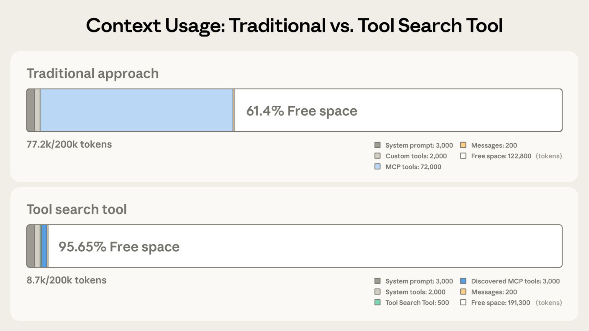
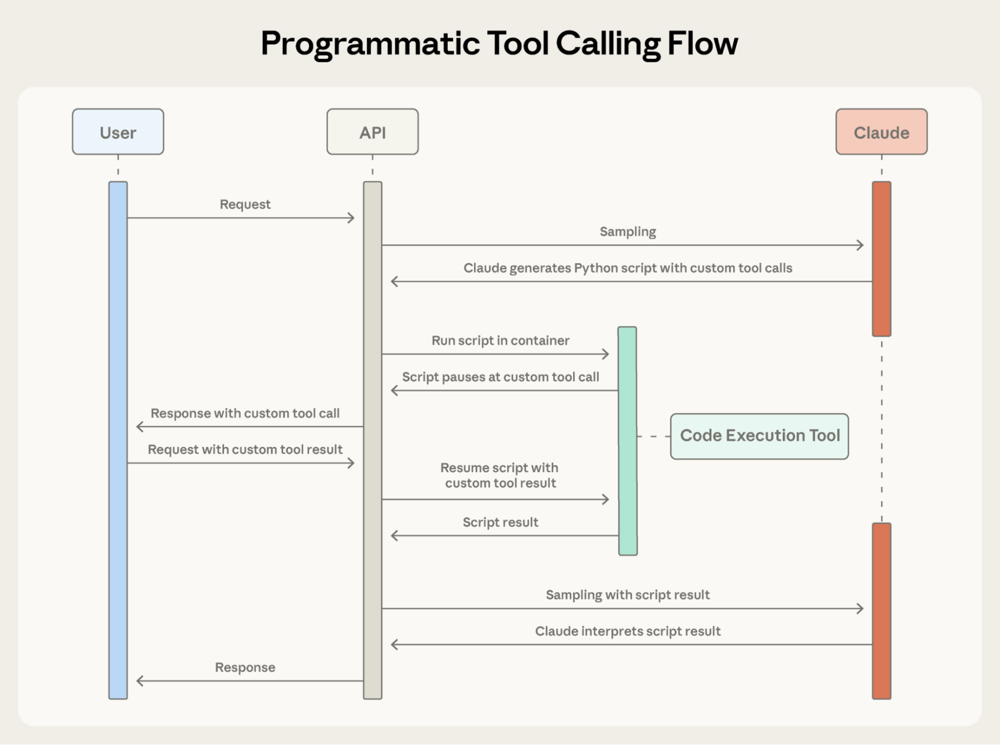

# 14_Introducing advanced tool use on the Claude Developer Platform_Claude 开发者平台推出高级工具使用能力

> 原文：https://www.anthropic.com/engineering/advanced-tool-use
> 作者：Anthropic Engineering｜发布日期：2025-11-24

## 📌 本篇速览

- 📅 2025-11-24　｜　⏱ 约 20 分钟　｜　📄 3,306 词 / 2 图
- ⭐ ★★★★☆ **强烈推荐** —— 直击工具定义膨胀、中间结果污染上下文、参数出错三大瓶颈，做大规模工具生态时必查。
- 🏷 Tool Search Tool、程序化工具调用、工具使用示例、上下文工程、MCP
- 🖼 [图解笔记（面试速记）](14_advanced-tool-use_直观图解与学习笔记.md)　·　🗂 [返回总目录](00_目录与阅读进度.md)

文章发布了 Claude 开发者平台的三项 beta 功能：工具搜索工具（按需发现工具、节省约 85% 的上下文 token）、程序化工具调用（让 Claude 用 Python 代码编排多个工具、中间结果不进上下文）、工具使用示例（在工具定义中提供样例调用以提升参数准确率）。文中给出各功能的原理、代码实现、适用与不适用场景，以及三者分层组合的最佳实践。

---

The future of AI agents is one where models work seamlessly across hundreds or thousands of tools.

AI 智能体（agent）的未来，是模型能在成百上千个工具之间无缝工作的时代。

An IDE assistant that integrates git operations, file manipulation, package managers, testing frameworks, and deployment pipelines.

比如一个集成了 git 操作、文件处理、包管理器、测试框架和部署流水线的 IDE 助手。

An operations coordinator that connects Slack, GitHub, Google Drive, Jira, company databases, and dozens of MCP servers simultaneously.

又比如一个同时连接 Slack、GitHub、Google Drive、Jira、公司数据库以及数十个 MCP 服务器（MCP server）的运营协调智能体。

To [build effective agents](https://www.anthropic.com/research/building-effective-agents), they need to work with unlimited tool libraries without stuffing every definition into context upfront.

要[构建高效的智能体](https://www.anthropic.com/research/building-effective-agents)，它们必须能够使用规模不设上限的工具库，而不是把每个工具定义都预先塞进上下文（context）。

Our blog article on using [code execution with MCP](https://www.anthropic.com/engineering/code-execution-with-mcp) discussed how tool results and definitions can sometimes consume 50,000+ tokens before an agent reads a request.

我们之前那篇关于[用代码执行配合 MCP](https://www.anthropic.com/engineering/code-execution-with-mcp) 的博客文章讨论过：有时智能体还没读到用户请求，工具结果和工具定义就已经消耗了 50,000 以上的 token。

Agents should discover and load tools on-demand, keeping only what's relevant for the current task.

智能体应该按需（on-demand）发现并加载工具，只保留与当前任务相关的部分。

Agents also need the ability to call tools from code.

智能体还需要具备从代码中调用工具的能力。

When using natural language tool calling, each invocation requires a full inference pass, and intermediate results pile up in context whether they're useful or not.

使用自然语言方式的工具调用（tool calling）时，每次调用都需要一轮完整的模型推理（inference pass），而且不管有用没用，中间结果都会在上下文里越堆越多。

Code is a natural fit for orchestration logic, such as loops, conditionals, and data transformations.

代码天然适合表达编排逻辑（orchestration logic），比如循环、条件判断和数据变换。

Agents need the flexibility to choose between code execution and inference based on the task at hand.

智能体需要能根据手头任务，灵活地在代码执行与模型推理之间做选择。

Agents also need to learn correct tool usage from examples, not just schema definitions.

此外，智能体还需要从示例（example）中学习正确的工具用法，而不能只靠 schema 定义。

JSON schemas define what's structurally valid, but can't express usage patterns: when to include optional parameters, which combinations make sense, or what conventions your API expects.

JSON schema 定义了什么在结构上是合法的，却无法表达使用模式（usage pattern）：什么时候该带上可选参数、哪些参数组合才有意义、你的 API 期望什么样的约定。

Today, we're releasing three features that make this possible:

今天，我们发布三项让这一切成为可能的功能：

- **Tool Search Tool,** which allows Claude to use search tools to access thousands of tools without consuming its context window

- **工具搜索工具（Tool Search Tool）**：让 Claude 可以借助搜索工具访问成千上万个工具，而不消耗它的上下文窗口（context window）

- **Programmatic Tool Calling**, which allows Claude to invoke tools in a code execution environment reducing the impact on the model’s context window

- **程序化工具调用（Programmatic Tool Calling）**：让 Claude 可以在代码执行环境中调用工具，减少对模型上下文窗口的影响

- **Tool Use Examples**, which provides a universal standard for demonstrating how to effectively use a given tool

- **工具使用示例（Tool Use Examples）**：提供了一个通用标准，用来演示如何高效地使用某个工具

In internal testing, we’ve found these features have helped us build things that wouldn’t have been possible with conventional tool use patterns.

在内部测试中，我们发现这些功能帮助我们构建出了一些用传统工具使用模式根本做不出来的东西。

For example, **[Claude for Excel](https://www.claude.com/claude-for-excel)** uses Programmatic Tool Calling to read and modify spreadsheets with thousands of rows without overloading the model’s context window.

例如，**[Claude for Excel](https://www.claude.com/claude-for-excel)** 就使用程序化工具调用来读取和修改包含数千行的电子表格，而不会压垮模型的上下文窗口。

Based on our experience, we believe these features open up new possibilities for what you can build with Claude.

基于我们的经验，我们相信这些功能会为你用 Claude 能构建的东西打开新的可能性。

🎬 **视频**：[在 YouTube 观看](https://youtu.be/2MJDdzSXL74)

## Tool Search Tool｜工具搜索工具

### The challenge｜挑战

MCP tool definitions provide important context, but as more servers connect, those tokens can add up.

MCP 工具定义提供了重要的上下文，但随着接入的服务器越来越多，这些 token 会不断累加。

Consider a five-server setup:

考虑一个接入五个服务器的配置：

- GitHub: 35 tools (~26K tokens)

- GitHub：35 个工具（约 26K token）

- Slack: 11 tools (~21K tokens)

- Slack：11 个工具（约 21K token）

- Sentry: 5 tools (~3K tokens)

- Sentry：5 个工具（约 3K token）

- Grafana: 5 tools (~3K tokens)

- Grafana：5 个工具（约 3K token）

- Splunk: 2 tools (~2K tokens)

- Splunk：2 个工具（约 2K token）

That's 58 tools consuming approximately 55K tokens before the conversation even starts.

也就是说，对话还没开始，58 个工具就已经消耗了大约 55K token。

Add more servers like Jira (which alone uses ~17K tokens) and you're quickly approaching 100K+ token overhead.

再接入更多服务器，比如 Jira（它一家就要用掉约 17K token），你很快就会逼近 100K 以上的 token 开销。

At Anthropic, we've seen tool definitions consume 134K tokens before optimization.

在 Anthropic 内部，我们见过优化前工具定义就消耗 134K token 的情况。

But token cost isn't the only issue.

但 token 成本还不是唯一的问题。

The most common failures are wrong tool selection and incorrect parameters, especially when tools have similar names like `notification-send-user` vs. `notification-send-channel`.

最常见的失败是选错工具和参数不正确，尤其是当工具名字很相似时，比如 `notification-send-user` 和 `notification-send-channel`。

### Our solution｜我们的解决方案

Instead of loading all tool definitions upfront, the Tool Search Tool discovers tools on-demand.

工具搜索工具不再预先加载所有工具定义，而是按需发现工具。

Claude only sees the tools it actually needs for the current task.

Claude 只会看到当前任务真正需要的那些工具。



**Tool Search Tool preserves 191,300 tokens of context compared to 122,800 with Claude’s traditional approach.**

**图注：使用工具搜索工具可保留 191,300 token 的上下文，而 Claude 传统方式只能保留 122,800 token。**

Traditional approach:

传统方式：

- All tool definitions loaded upfront (~72K tokens for 50+ MCP tools)

- 预先加载全部工具定义（50 多个 MCP 工具约占 72K token）

- Conversation history and system prompt compete for remaining space

- 对话历史和系统提示词（system prompt）只能争抢剩余空间

- Total context consumption: ~77K tokens before any work begins

- 总上下文消耗：还没开始干活就已约 77K token

With the Tool Search Tool:

使用工具搜索工具后：

- Only the Tool Search Tool loaded upfront (~500 tokens)

- 预先只加载工具搜索工具本身（约 500 token）

- Tools discovered on-demand as needed (3-5 relevant tools, ~3K tokens)

- 工具在需要时按需发现（3-5 个相关工具，约 3K token）

- Total context consumption: ~8.7K tokens, preserving 95% of context window

- 总上下文消耗：约 8.7K token，保留了 95% 的上下文窗口

This represents an 85% reduction in token usage while maintaining access to your full tool library.

这相当于在保持对完整工具库访问能力的同时，token 用量减少了 85%。

Internal testing showed significant accuracy improvements on MCP evaluations when working with large tool libraries.

内部测试表明，在使用大规模工具库时，MCP 评估（evaluation）的准确率有显著提升。

Opus 4 improved from 49% to 74%, and Opus 4.5 improved from 79.5% to 88.1% with Tool Search Tool enabled.

启用工具搜索工具后，Opus 4 从 49% 提升到 74%，Opus 4.5 从 79.5% 提升到 88.1%。

### How the Tool Search Tool works｜工具搜索工具的工作原理

The Tool Search Tool lets Claude dynamically discover tools instead of loading all definitions upfront.

工具搜索工具让 Claude 可以动态发现工具，而不是预先加载全部定义。

You provide all your tool definitions to the API, but mark tools with `defer_loading: true` to make them discoverable on-demand.

你仍然把所有工具定义都提供给 API，但用 `defer_loading: true` 标记那些希望按需发现的工具。

Deferred tools aren't loaded into Claude's context initially.

被延迟加载（deferred）的工具一开始不会加载进 Claude 的上下文。

Claude only sees the Tool Search Tool itself plus any tools with `defer_loading: false` (your most critical, frequently-used tools).

Claude 最初只能看到工具搜索工具本身，以及那些标记为 `defer_loading: false` 的工具（也就是你最关键、最常用的工具）。

When Claude needs specific capabilities, it searches for relevant tools.

当 Claude 需要某种特定能力时，它会去搜索相关工具。

The Tool Search Tool returns references to matching tools, which get expanded into full definitions in Claude's context.

工具搜索工具返回匹配工具的引用（reference），这些引用会在 Claude 的上下文中被展开成完整定义。

For example, if Claude needs to interact with GitHub, it searches for "github," and only `github.createPullRequest` and `github.listIssues` get loaded—not your other 50+ tools from Slack, Jira, and Google Drive.

例如，如果 Claude 需要和 GitHub 交互，它会搜索"github"，于是只有 `github.createPullRequest` 和 `github.listIssues` 被加载——而不是把你 Slack、Jira、Google Drive 上的其余 50 多个工具也一起加载进来。

This way, Claude has access to your full tool library while only paying the token cost for tools it actually needs.

这样一来，Claude 既能访问你的完整工具库，又只需为真正用到的工具支付 token 成本。

**Prompt caching note:** Tool Search Tool doesn't break prompt caching because deferred tools are excluded from the initial prompt entirely.

**关于提示词缓存（prompt caching）的说明：**工具搜索工具不会破坏提示词缓存，因为延迟加载的工具被完全排除在初始提示词之外。

They're only added to context after Claude searches for them, so your system prompt and core tool definitions remain cacheable.

它们只有在 Claude 搜索到之后才会被加进上下文，因此你的系统提示词和核心工具定义仍然可以被缓存。

**Implementation:**

**实现方式：**

```
{
  "tools": [
    // Include a tool search tool (regex, BM25, or custom)
    {"type": "tool_search_tool_regex_20251119", "name": "tool_search_tool_regex"},

    // Mark tools for on-demand discovery
    {
      "name": "github.createPullRequest",
      "description": "Create a pull request",
      "input_schema": {...},
      "defer_loading": true
    }
    // ... hundreds more deferred tools with defer_loading: true
  ]
}

```

For MCP servers, you can defer loading entire servers while keeping specific high-use tools loaded:

对于 MCP 服务器，你可以把整个服务器都设为延迟加载，同时让某些高频工具保持常驻：

```
{
  "type": "mcp_toolset",
  "mcp_server_name": "google-drive",
  "default_config": {"defer_loading": true}, # defer loading the entire server
  "configs": {
    "search_files": {
"defer_loading": false
    }  // Keep most used tool loaded
  }
}
```

The Claude Developer Platform provides regex-based and BM25-based search tools out of the box, but you can also implement custom search tools using embeddings or other strategies.

Claude 开发者平台开箱即用地提供了基于正则表达式（regex）和基于 BM25 的搜索工具，你也可以用嵌入向量（embeddings）或其他策略实现自定义搜索工具。

### When to use the Tool Search Tool｜何时使用工具搜索工具

Like any architectural decision, enabling the Tool Search Tool involves trade-offs.

和任何架构决策一样，启用工具搜索工具也涉及权衡（trade-off）。

The feature adds a search step before tool invocation, so it delivers the best ROI when the context savings and accuracy improvements outweigh additional latency.

这个功能在工具调用前增加了一个搜索步骤，因此只有当上下文节省和准确率提升超过额外延迟的代价时，它才能带来最佳投资回报（ROI）。

**Use it when:**

**适合使用的场景：**

- Tool definitions consuming >10K tokens

- 工具定义消耗超过 10K token

- Experiencing tool selection accuracy issues

- 正遭遇工具选择准确率的问题

- Building MCP-powered systems with multiple servers

- 正在构建接入多个服务器的 MCP 驱动系统

- 10+ tools available

- 可用工具超过 10 个

**Less beneficial when:**

**收益较小的场景：**

- Small tool library (<10 tools)

- 工具库很小（少于 10 个工具）

- All tools used frequently in every session

- 所有工具在每个会话中都被频繁使用

- Tool definitions are compact

- 工具定义本身很精简

## Programmatic Tool Calling｜程序化工具调用

### The challenge｜挑战

Traditional tool calling creates two fundamental problems as workflows become more complex:

随着工作流越来越复杂，传统工具调用会带来两个根本性问题：

- **Context pollution from intermediate results**: When Claude analyzes a 10MB log file for error patterns, the entire file enters its context window, even though Claude only needs a summary of error frequencies. When fetching customer data across multiple tables, every record accumulates in context regardless of relevance. These intermediate results consume massive token budgets and can push important information out of the context window entirely.

- **中间结果造成的上下文污染（context pollution）**：当 Claude 分析一个 10MB 的日志文件寻找错误模式时，整个文件都会进入它的上下文窗口，尽管 Claude 只需要一份错误频率的摘要。当跨多张表拉取客户数据时，每条记录不管相关与否都会在上下文里累积。这些中间结果消耗大量 token 预算，甚至可能把重要信息彻底挤出上下文窗口。

- **Inference overhead and manual synthesis**: Each tool call requires a full model inference pass. After receiving results, Claude must "eyeball" the data to extract relevant information, reason about how pieces fit together, and decide what to do next—all through natural language processing. A five tool workflow means five inference passes plus Claude parsing each result, comparing values, and synthesizing conclusions. This is both slow and error-prone.

- **推理开销与人工式综合**：每次工具调用都需要一轮完整的模型推理。收到结果后，Claude 还得"用肉眼"审视数据来提取相关信息、推理各部分如何拼在一起、并决定下一步做什么——这一切都通过自然语言处理完成。一个包含五次工具调用的工作流意味着五轮推理，外加 Claude 逐一解析每个结果、比较数值、综合出结论。这既慢又容易出错。

### Our solution｜我们的解决方案

Programmatic Tool Calling enables Claude to orchestrate tools through code rather than through individual API round-trips.

程序化工具调用让 Claude 可以通过代码来编排工具，而不是靠一次次单独的 API 往返（round-trip）。

Instead of Claude requesting tools one at a time with each result being returned to its context, Claude writes code that calls multiple tools, processes their outputs, and controls what information actually enters its context window.

Claude 不再一次请求一个工具、每个结果都返回到它的上下文里，而是编写一段代码去调用多个工具、处理它们的输出，并控制哪些信息真正进入它的上下文窗口。

Claude excels at writing code and by letting it express orchestration logic in Python rather than through natural language tool invocations, you get more reliable, precise control flow.

Claude 非常擅长写代码；让它用 Python 而不是自然语言工具调用来表达编排逻辑，你会得到更可靠、更精确的控制流。

Loops, conditionals, data transformations, and error handling are all explicit in code rather than implicit in Claude's reasoning.

循环、条件判断、数据变换和错误处理在代码里都是显式的，而不是隐含在 Claude 的推理过程中。

#### Example: Budget compliance check｜示例：预算合规检查

Consider a common business task: "Which team members exceeded their Q3 travel budget?"

考虑一个常见的业务任务："哪些团队成员超出了 Q3 差旅预算？"

You have three tools available:

你手上有三个可用工具：

- `get_team_members(department)` - Returns team member list with IDs and levels

- `get_team_members(department)`——返回团队成员列表，含 ID 和职级

- `get_expenses(user_id, quarter)` - Returns expense line items for a user

- `get_expenses(user_id, quarter)`——返回某个用户的报销明细条目

- `get_budget_by_level(level)` - Returns budget limits for an employee level

- `get_budget_by_level(level)`——返回某个员工职级的预算上限

**Traditional approach**:

**传统方式**：

- Fetch team members → 20 people

- 拉取团队成员 → 20 个人

- For each person, fetch their Q3 expenses → 20 tool calls, each returning 50-100 line items (flights, hotels, meals, receipts)

- 逐人拉取其 Q3 报销 → 20 次工具调用，每次返回 50-100 条明细（机票、酒店、餐费、发票）

- Fetch budget limits by employee level

- 按员工职级拉取预算上限

- All of this enters Claude's context: 2,000+ expense line items (50 KB+)

- 所有这些都进入 Claude 的上下文：2,000 多条报销明细（50 KB 以上）

- Claude manually sums each person's expenses, looks up their budget, compares expenses against budget limits

- Claude 手工累加每个人的开销、查出对应预算、再把开销和预算上限逐一比较

- More round-trips to the model, significant context consumption

- 更多次模型往返，上下文消耗巨大

**With Programmatic Tool Calling**:

**使用程序化工具调用**：

Instead of each tool result returning to Claude, Claude writes a Python script that orchestrates the entire workflow.

每个工具结果不再返回给 Claude，而是由 Claude 写一段 Python 脚本来编排整个工作流。

The script runs in the Code Execution tool (a sandboxed environment), pausing when it needs results from your tools.

脚本运行在代码执行工具（Code Execution tool，一个沙箱环境）中，需要你的工具返回结果时会暂停。

When you return tool results via the API, they're processed by the script rather than consumed by the model.

当你通过 API 返回工具结果时，处理它们的是脚本，而不是模型。

The script continues executing, and Claude only sees the final output.

脚本继续执行，Claude 只会看到最终输出。



*Programmatic Tool Calling enables Claude to orchestrate tools through code rather than through individual API round-trips, allowing for parallel tool execution.*

*图注：程序化工具调用让 Claude 通过代码而非一次次单独的 API 往返来编排工具，从而可以并行执行工具。*

Here's what Claude's orchestration code looks like for the budget compliance task:

下面是 Claude 为预算合规任务写出的编排代码的样子：

```
team = await get_team_members("engineering")

# Fetch budgets for each unique level
levels = list(set(m["level"] for m in team))
budget_results = await asyncio.gather(*[
    get_budget_by_level(level) for level in levels
])

# Create a lookup dictionary: {"junior": budget1, "senior": budget2, ...}
budgets = {level: budget for level, budget in zip(levels, budget_results)}

# Fetch all expenses in parallel
expenses = await asyncio.gather(*[
    get_expenses(m["id"], "Q3") for m in team
])

# Find employees who exceeded their travel budget
exceeded = []
for member, exp in zip(team, expenses):
    budget = budgets[member["level"]]
    total = sum(e["amount"] for e in exp)
    if total > budget["travel_limit"]:
        exceeded.append({
            "name": member["name"],
            "spent": total,
            "limit": budget["travel_limit"]
        })

print(json.dumps(exceeded))
```

Claude's context receives only the final result: the two to three people who exceeded their budget.

Claude 的上下文只会收到最终结果：那两三个超预算的人。

The 2,000+ line items, the intermediate sums, and the budget lookups do not affect Claude’s context, reducing consumption from 200KB of raw expense data to just 1KB of results.

那 2,000 多条明细、中间的求和过程和预算查询都不会影响 Claude 的上下文，消耗从 200KB 的原始报销数据降到了仅 1KB 的结果。

The efficiency gains are substantial:

效率收益非常可观：

- **Token savings**: By keeping intermediate results out of Claude's context, PTC dramatically reduces token consumption. Average usage dropped from 43,588 to 27,297 tokens, a 37% reduction on complex research tasks.

- **节省 token**：通过把中间结果挡在 Claude 的上下文之外，程序化工具调用（PTC）大幅降低了 token 消耗。在复杂研究任务上，平均用量从 43,588 token 降到 27,297 token，减少了 37%。

- **Reduced latency**: Each API round-trip requires model inference (hundreds of milliseconds to seconds). When Claude orchestrates 20+ tool calls in a single code block, you eliminate 19+ inference passes. The API handles tool execution without returning to the model each time.

- **降低延迟**：每次 API 往返都需要模型推理（数百毫秒到数秒）。当 Claude 在单个代码块里编排 20 多次工具调用时，你就省掉了 19 轮以上的推理。API 直接处理工具执行，不必每次都回到模型。

- **Improved accuracy**: By writing explicit orchestration logic, Claude makes fewer errors than when juggling multiple tool results in natural language. Internal knowledge retrieval improved from 25.6% to 28.5%; [GIA benchmarks](https://arxiv.org/abs/2311.12983) from 46.5% to 51.2%.

- **提升准确率**：靠写出显式的编排逻辑，Claude 比用自然语言同时应付多个工具结果时犯错更少。内部知识检索从 25.6% 提升到 28.5%；[GIA 基准测试](https://arxiv.org/abs/2311.12983)从 46.5% 提升到 51.2%。

Production workflows involve messy data, conditional logic, and operations that need to scale.

生产环境的工作流总是充满杂乱数据、条件逻辑，以及需要规模化的操作。

Programmatic Tool Calling lets Claude handle that complexity programmatically while keeping its focus on actionable results rather than raw data processing.

程序化工具调用让 Claude 以编程方式应对这些复杂性，同时把注意力放在可执行的结果上，而不是原始数据处理上。

### How Programmatic Tool Calling works｜程序化工具调用的工作原理

#### 1. Mark tools as callable from code｜1. 把工具标记为可从代码调用

Add code_execution to tools, and set allowed_callers to opt-in tools for programmatic execution:

把 code_execution 加入 tools，并通过设置 allowed_callers 让工具选择加入（opt-in）程序化执行：

```
{
  "tools": [
    {
      "type": "code_execution_20250825",
      "name": "code_execution"
    },
    {
      "name": "get_team_members",
      "description": "Get all members of a department...",
      "input_schema": {...},
      "allowed_callers": ["code_execution_20250825"] # opt-in to programmatic tool calling
    },
    {
      "name": "get_expenses",
 	...
    },
    {
      "name": "get_budget_by_level",
	...
    }
  ]
}
```

The API converts these tool definitions into Python functions that Claude can call.

API 会把这些工具定义转换成 Claude 可以调用的 Python 函数。

#### 2. Claude writes orchestration code｜2. Claude 编写编排代码

Instead of requesting tools one at a time, Claude generates Python code:

Claude 不再一次请求一个工具，而是生成 Python 代码：

```
{
  "type": "server_tool_use",
  "id": "srvtoolu_abc",
  "name": "code_execution",
  "input": {
    "code": "team = get_team_members('engineering')\n..." # the code example above
  }
}
```

#### 3. Tools execute without hitting Claude's context｜3. 工具执行不触及 Claude 的上下文

When the code calls get_expenses(), you receive a tool request with a caller field:

当代码调用 get_expenses() 时，你会收到一个带 caller 字段的工具请求：

```
{
  "type": "tool_use",
  "id": "toolu_xyz",
  "name": "get_expenses",
  "input": {"user_id": "emp_123", "quarter": "Q3"},
  "caller": {
    "type": "code_execution_20250825",
    "tool_id": "srvtoolu_abc"
  }
}
```

You provide the result, which is processed in the Code Execution environment rather than Claude's context.

你提供结果，这个结果会在代码执行环境中被处理，而不是进入 Claude 的上下文。

This request-response cycle repeats for each tool call in the code.

代码中的每一次工具调用都会重复这个请求-响应循环。

#### 4. Only final output enters context｜4. 只有最终输出进入上下文

When the code finishes running, only the results of the code are returned to Claude:

代码运行结束后，只有代码的结果会被返回给 Claude：

```
{
  "type": "code_execution_tool_result",
  "tool_use_id": "srvtoolu_abc",
  "content": {
    "stdout": "[{\"name\": \"Alice\", \"spent\": 12500, \"limit\": 10000}...]"
  }
}
```

This is all Claude sees, not the 2000+ expense line items processed along the way.

Claude 看到的就只有这些，而不是一路上处理过的那 2000 多条报销明细。

### When to use Programmatic Tool Calling｜何时使用程序化工具调用

Programmatic Tool Calling adds a code execution step to your workflow.

程序化工具调用会给你的工作流增加一个代码执行步骤。

This extra overhead pays off when the token savings, latency improvements, and accuracy gains are substantial.

当 token 节省、延迟改善和准确率提升足够可观时，这点额外开销是值得的。

**Most beneficial when:**

**收益最大的场景：**

- Processing large datasets where you only need aggregates or summaries

- 处理大型数据集，而你只需要聚合值或摘要

- Running multi-step workflows with three or more dependent tool calls

- 运行包含三次及以上相互依赖的工具调用的多步工作流

- Filtering, sorting, or transforming tool results before Claude sees them

- 在 Claude 看到工具结果之前先做过滤、排序或变换

- Handling tasks where intermediate data shouldn't influence Claude's reasoning

- 处理那些中间数据不应影响 Claude 推理的任务

- Running parallel operations across many items (checking 50 endpoints, for example)

- 对大量对象并行执行操作（例如检查 50 个端点）

**Less beneficial when:**

**收益较小的场景：**

- Making simple single-tool invocations

- 只做简单的单工具调用

- Working on tasks where Claude should see and reason about all intermediate results

- 任务要求 Claude 看到并推理所有中间结果

- Running quick lookups with small responses

- 只是做响应很小的快速查询

## Tool Use Examples｜工具使用示例

### The challenge｜挑战

JSON Schema excels at defining structure–types, required fields, allowed enums–but it can't express usage patterns: when to include optional parameters, which combinations make sense, or what conventions your API expects.

JSON Schema 很擅长定义结构——类型、必填字段、允许的枚举值（enum）——但它无法表达使用模式：什么时候该带上可选参数、哪些组合才有意义、你的 API 期望什么样的约定。

Consider a support ticket API:

考虑一个客服工单（support ticket）API：

```
{
  "name": "create_ticket",
  "input_schema": {
    "properties": {
      "title": {"type": "string"},
      "priority": {"enum": ["low", "medium", "high", "critical"]},
      "labels": {"type": "array", "items": {"type": "string"}},
      "reporter": {
        "type": "object",
        "properties": {
          "id": {"type": "string"},
          "name": {"type": "string"},
          "contact": {
            "type": "object",
            "properties": {
              "email": {"type": "string"},
              "phone": {"type": "string"}
            }
          }
        }
      },
      "due_date": {"type": "string"},
      "escalation": {
        "type": "object",
        "properties": {
          "level": {"type": "integer"},
          "notify_manager": {"type": "boolean"},
          "sla_hours": {"type": "integer"}
        }
      }
    },
    "required": ["title"]
  }
}
```

The schema defines what's valid, but leaves critical questions unanswered:

这个 schema 定义了什么是合法的，却留下了几个关键问题没有回答：

- **Format ambiguity:** Should `due_date` use "2024-11-06", "Nov 6, 2024", or "2024-11-06T00:00:00Z"?

- **格式歧义：**`due_date` 该用 "2024-11-06"、"Nov 6, 2024" 还是 "2024-11-06T00:00:00Z"？

- **ID conventions:** Is `reporter.id` a UUID, "USR-12345", or just "12345"?

- **ID 约定：**`reporter.id` 是 UUID、"USR-12345"，还是就是 "12345"？

- **Nested structure usage:** When should Claude populate `reporter.contact`?

- **嵌套结构的用法：**Claude 什么时候应该填充 `reporter.contact`？

- **Parameter correlations:** How do `escalation.level` and `escalation.sla_hours` relate to priority?

- **参数关联：**`escalation.level` 和 `escalation.sla_hours` 与优先级之间是什么关系？

These ambiguities can lead to malformed tool calls and inconsistent parameter usage.

这些歧义可能导致格式错误的工具调用和不一致的参数用法。

### Our solution｜我们的解决方案

Tool Use Examples let you provide sample tool calls directly in your tool definitions.

工具使用示例让你可以直接在工具定义里提供工具调用的样例。

Instead of relying on schema alone, you show Claude concrete usage patterns:

你不再只依赖 schema，而是给 Claude 展示具体的使用模式：

```
{
    "name": "create_ticket",
    "input_schema": { /* same schema as above */ },
    "input_examples": [
      {
        "title": "Login page returns 500 error",
        "priority": "critical",
        "labels": ["bug", "authentication", "production"],
        "reporter": {
          "id": "USR-12345",
          "name": "Jane Smith",
          "contact": {
            "email": "jane@acme.com",
            "phone": "+1-555-0123"
          }
        },
        "due_date": "2024-11-06",
        "escalation": {
          "level": 2,
          "notify_manager": true,
          "sla_hours": 4
        }
      },
      {
        "title": "Add dark mode support",
        "labels": ["feature-request", "ui"],
        "reporter": {
          "id": "USR-67890",
          "name": "Alex Chen"
        }
      },
      {
        "title": "Update API documentation"
      }
    ]
  }
```

From these three examples, Claude learns:

从这三个示例中，Claude 学到了：

- **Format conventions**: Dates use YYYY-MM-DD, user IDs follow USR-XXXXX, labels use kebab-case

- **格式约定**：日期用 YYYY-MM-DD，用户 ID 遵循 USR-XXXXX，标签用 kebab-case（短横线连接）

- **Nested structure patterns**: How to construct the reporter object with its nested contact object

- **嵌套结构模式**：如何构造 reporter 对象及其内嵌的 contact 对象

- **Optional parameter correlations**: Critical bugs have full contact info + escalation with tight SLAs; feature requests have reporter but no contact/escalation; internal tasks have title only

- **可选参数的关联规律**：严重（critical）bug 带完整联系信息和 SLA 很紧的升级（escalation）配置；功能请求有 reporter 但没有 contact/escalation；内部任务只有标题

In our own internal testing, tool use examples improved accuracy from 72% to 90% on complex parameter handling.

在我们自己的内部测试中，工具使用示例把复杂参数处理的准确率从 72% 提升到了 90%。

### When to use Tool Use Examples｜何时使用工具使用示例

Tool Use Examples add tokens to your tool definitions, so they’re most valuable when accuracy improvements outweigh the additional cost.

工具使用示例会给工具定义增加 token，因此只有当准确率提升超过这部分额外成本时，它们才最有价值。

**Most beneficial when:**

**收益最大的场景：**

- Complex nested structures where valid JSON doesn't imply correct usage

- 复杂嵌套结构，JSON 合法并不等于用法正确

- Tools with many optional parameters and inclusion patterns matter

- 工具有很多可选参数，且哪些参数该出现很讲究

- APIs with domain-specific conventions not captured in schemas

- API 有 schema 无法表达的领域特定约定

- Similar tools where examples clarify which one to use (e.g., `create_ticket` vs `create_incident`)

- 存在相似工具，示例能帮助厘清该用哪一个（例如 `create_ticket` 和 `create_incident`）

**Less beneficial when:**

**收益较小的场景：**

- Simple single-parameter tools with obvious usage

- 用法显而易见的简单单参数工具

- Standard formats like URLs or emails that Claude already understands

- Claude 本来就理解的标准格式，比如 URL 或电子邮件

- Validation concerns better handled by JSON Schema constraints

- 更适合用 JSON Schema 约束来处理的校验问题

## Best practices｜最佳实践

Building agents that take real-world actions means handling scale, complexity, and precision simultaneously.

构建能在真实世界中采取行动的智能体，意味着要同时应对规模、复杂性和精确性。

These three features work together to solve different bottlenecks in tool use workflows.

这三项功能协同工作，分别解决工具使用工作流中的不同瓶颈。

Here's how to combine them effectively.

下面介绍如何有效地组合使用它们。

### Layer features strategically｜有策略地分层启用功能

Not every agent needs to use all three features for a given task.

并不是每个智能体在每个任务上都需要用齐这三项功能。

Start with your biggest bottleneck:

从你最大的瓶颈入手：

- Context bloat from tool definitions → Tool Search Tool

- 工具定义导致的上下文膨胀 → 工具搜索工具

- Large intermediate results polluting context → Programmatic Tool Calling

- 大量中间结果污染上下文 → 程序化工具调用

- Parameter errors and malformed calls → Tool Use Examples

- 参数错误和格式不正确的调用 → 工具使用示例

This focused approach lets you address the specific constraint limiting your agent's performance, rather than adding complexity upfront.

这种有针对性的做法让你先解决限制智能体性能的具体约束，而不是一上来就叠加复杂度。

Then layer additional features as needed.

然后再按需分层叠加其他功能。

They're complementary: Tool Search Tool ensures the right tools are found, Programmatic Tool Calling ensures efficient execution, and Tool Use Examples ensure correct invocation.

它们是互补的：工具搜索工具确保找到正确的工具，程序化工具调用确保高效执行，工具使用示例确保正确调用。

### Set up Tool Search Tool for better discovery｜配置工具搜索工具，改善工具发现

Tool search matches against names and descriptions, so clear, descriptive definitions improve discovery accuracy.

工具搜索是基于名称和描述做匹配的，所以清晰、有描述性的定义能提高发现的准确率。

```
// Good
{
    "name": "search_customer_orders",
    "description": "Search for customer orders by date range, status, or total amount. Returns order details including items, shipping, and payment info."
}

// Bad
{
    "name": "query_db_orders",
    "description": "Execute order query"
}
```

Add system prompt guidance so Claude knows what's available:

在系统提示词中加入引导，让 Claude 知道有哪些能力可用：

```
You have access to tools for Slack messaging, Google Drive file management, 
Jira ticket tracking, and GitHub repository operations. Use the tool search 
to find specific capabilities.
```

Keep your three to five most-used tools always loaded, defer the rest.

让你最常用的三到五个工具始终保持加载，其余的都设为延迟加载。

This balances immediate access for common operations with on-demand discovery for everything else.

这样就在"常用操作即取即用"和"其余一切按需发现"之间取得了平衡。

### Set up Programmatic Tool Calling for correct execution｜配置程序化工具调用，确保正确执行

Since Claude writes code to parse tool outputs, document return formats clearly.

由于 Claude 要写代码来解析工具输出，请把返回格式写清楚。

This helps Claude write correct parsing logic:

这能帮助 Claude 写出正确的解析逻辑：

```
{
    "name": "get_orders",
    "description": "Retrieve orders for a customer.
Returns:
    List of order objects, each containing:
    - id (str): Order identifier
    - total (float): Order total in USD
    - status (str): One of 'pending', 'shipped', 'delivered'
    - items (list): Array of {sku, quantity, price}
    - created_at (str): ISO 8601 timestamp"
}
```

See below for opt-in tools that benefit from programmatic orchestration:

以下几类工具适合选择加入程序化编排：

- Tools that can run in parallel (independent operations)

- 可以并行运行的工具（相互独立的操作）

- Operations safe to retry (idempotent)

- 可以安全重试的操作（幂等，idempotent）

### Set up Tool Use Examples for parameter accuracy｜配置工具使用示例，提高参数准确率

Craft examples for behavioral clarity:

精心设计示例，让行为一目了然：

- Use realistic data (real city names, plausible prices, not "string" or "value")

- 使用真实感的数据（真实的城市名、合理的价格，而不是 "string" 或 "value"）

- Show variety with minimal, partial, and full specification patterns

- 展示多样性，覆盖最简、部分和完整三种参数填写模式

- Keep it concise: 1-5 examples per tool

- 保持精简：每个工具 1-5 个示例

- Focus on ambiguity (only add examples where correct usage isn't obvious from schema)

- 聚焦歧义之处（只在正确用法无法从 schema 中直接看出来的地方加示例）

## Getting started｜快速上手

These features are available in beta.

这些功能现已开放 beta 测试。

To enable them, add the beta header and include the tools you need:

要启用它们，加上 beta 请求头（header），并包含你需要的工具：

```
client.beta.messages.create(
    betas=["advanced-tool-use-2025-11-20"],
    model="claude-sonnet-4-5-20250929",
    max_tokens=4096,
    tools=[
        {"type": "tool_search_tool_regex_20251119", "name": "tool_search_tool_regex"},
        {"type": "code_execution_20250825", "name": "code_execution"},
        # Your tools with defer_loading, allowed_callers, and input_examples
    ]
)
```

For detailed API documentation and SDK examples, see our:

详细的 API 文档和 SDK 示例请参见：

- [D](https://platform.claude.com/docs/en/agents-and-tools/tool-use/tool-search-tool)[ocumentation](https://platform.claude.com/docs/en/agents-and-tools/tool-use/tool-search-tool) and [cookbook](https://github.com/anthropics/claude-cookbooks/blob/main/tool_use/tool_search_with_embeddings.ipynb) for Tool Search Tool

- 工具搜索工具的[文档](https://platform.claude.com/docs/en/agents-and-tools/tool-use/tool-search-tool)与 [cookbook](https://github.com/anthropics/claude-cookbooks/blob/main/tool_use/tool_search_with_embeddings.ipynb)

- [Documentation](https://platform.claude.com/docs/en/agents-and-tools/tool-use/programmatic-tool-calling) and [cookbook](https://github.com/anthropics/claude-cookbooks/blob/main/tool_use/programmatic_tool_calling_ptc.ipynb) for Programmatic Tool Calling

- 程序化工具调用的[文档](https://platform.claude.com/docs/en/agents-and-tools/tool-use/programmatic-tool-calling)与 [cookbook](https://github.com/anthropics/claude-cookbooks/blob/main/tool_use/programmatic_tool_calling_ptc.ipynb)

- [Documentation](https://platform.claude.com/docs/en/agents-and-tools/tool-use/implement-tool-use#providing-tool-use-examples) for Tool Use Examples

- 工具使用示例的[文档](https://platform.claude.com/docs/en/agents-and-tools/tool-use/implement-tool-use#providing-tool-use-examples)

These features move tool use from simple function calling toward intelligent orchestration.

这些功能把工具使用从简单的函数调用推向了智能编排。

As agents tackle more complex workflows spanning dozens of tools and large datasets, dynamic discovery, efficient execution, and reliable invocation become foundational.

随着智能体开始处理横跨数十个工具和大规模数据集的更复杂工作流，动态发现、高效执行和可靠调用会成为基础能力。

We're excited to see what you build.

我们非常期待看到你会构建出什么。

## Acknowledgements｜致谢

Written by Bin Wu, with contributions from Adam Jones, Artur Renault, Henry Tay, Jake Noble, Noah Picard, Sam Jiang, and the Claude Developer Platform team.

本文由 Bin Wu 撰写，Adam Jones、Artur Renault、Henry Tay、Jake Noble、Noah Picard、Sam Jiang 以及 Claude 开发者平台团队亦有贡献。

This work builds on foundational research by Chris Gorgolewski, Daniel Jiang, Jeremy Fox and Mike Lambert.

这项工作建立在 Chris Gorgolewski、Daniel Jiang、Jeremy Fox 和 Mike Lambert 的基础研究之上。

We also drew inspiration from across the AI ecosystem, including [Joel Pobar's LLMVM](https://github.com/9600dev/llmvm), [Cloudflare's Code Mode](https://blog.cloudflare.com/code-mode/) and [Code Execution as MCP](https://www.anthropic.com/engineering/code-execution-with-mcp).

我们也从整个 AI 生态中汲取了灵感，包括 [Joel Pobar 的 LLMVM](https://github.com/9600dev/llmvm)、[Cloudflare 的 Code Mode](https://blog.cloudflare.com/code-mode/) 以及 [Code Execution as MCP](https://www.anthropic.com/engineering/code-execution-with-mcp)。

Special thanks to Andy Schumeister, Hamish Kerr, Keir Bradwell, Matt Bleifer and Molly Vorwerck for their support.

特别感谢 Andy Schumeister、Hamish Kerr、Keir Bradwell、Matt Bleifer 和 Molly Vorwerck 的支持。
