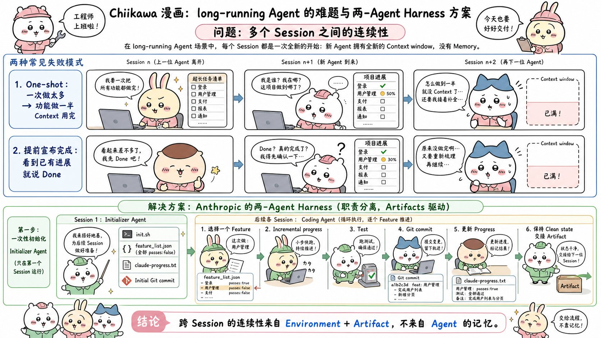
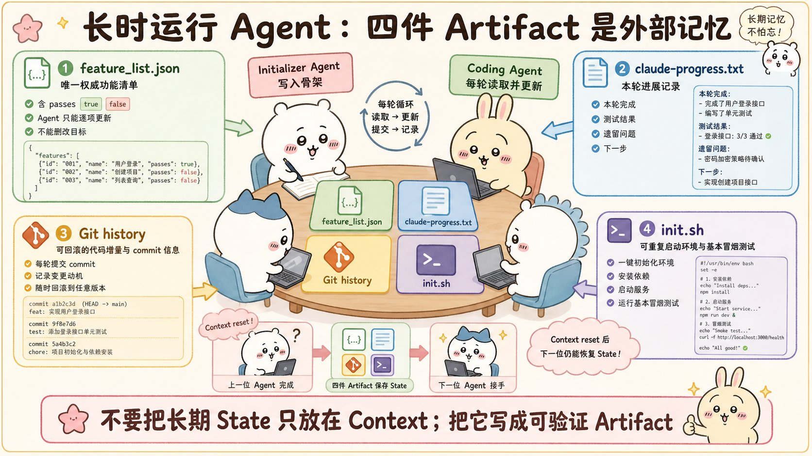
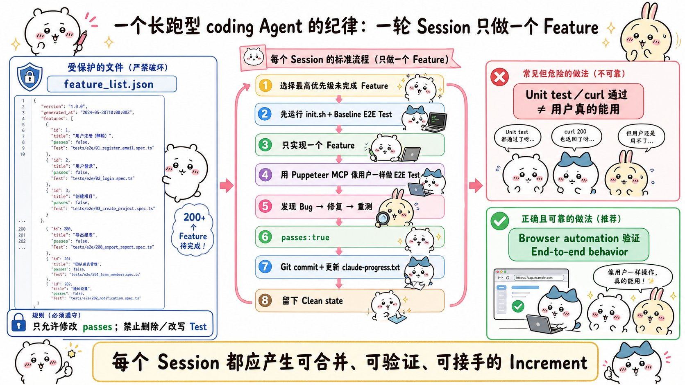
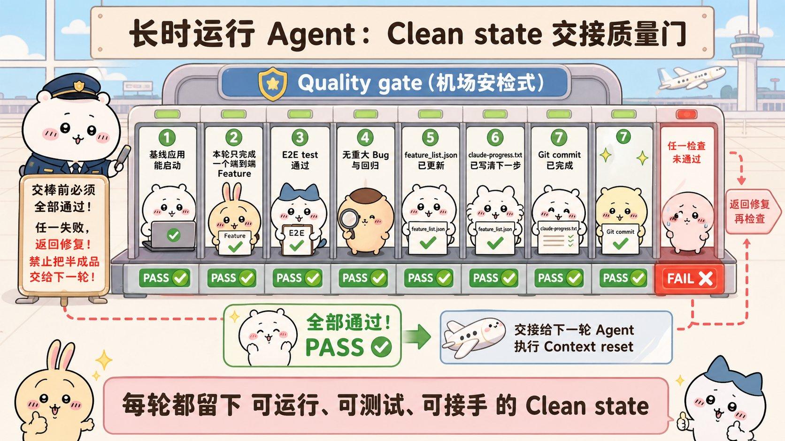
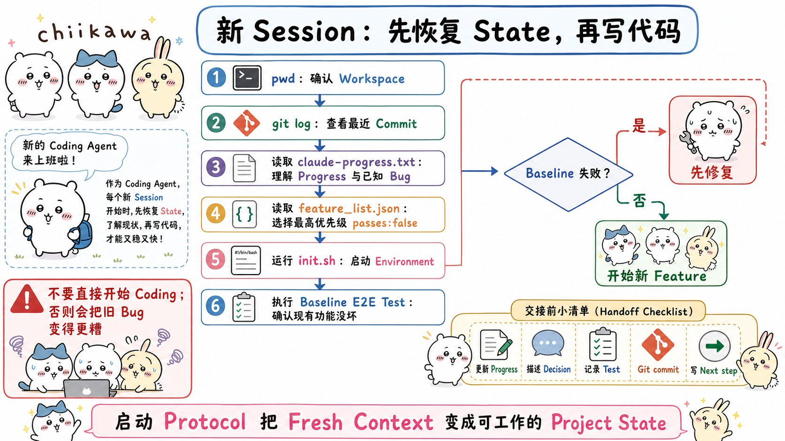

# Effective harnesses for long-running agents：面试速记

> Anthropic Engineering · Justin Young · 2025-11-26 · [官方原文](https://www.anthropic.com/engineering/effective-harnesses-for-long-running-agents) · [本地逐句对照](15_effective-harnesses-for-long-running-agents_逐句对照.md)

## 一句话讲明白

**长任务做不完，不是模型不够强，而是每个会话（session）都从零记忆开始；解法是把项目状态从易失的上下文搬到磁盘上的文件里——先用一个初始化智能体（initializer agent）把环境和完整功能清单一次性建好，之后每个编码智能体（coding agent）一次只做一个功能、真人式端到端验证、提交 git、把环境留在干净状态交给下一班。**

## 为什么值得读 / 能用在哪

- 这是 Anthropic 官方给出的**跨上下文窗口连续作业**的可落地方案，配套有开源示例（`claude-quickstarts` 的 autonomous-coding 目录），不是纯理论。
- 如果你做的是"让智能体跑几小时甚至几天"的系统（自动化建站、批量重构、长流程数据处理），这套两段式框架可以直接照抄骨架。
- 面试里它是"上下文工程 / 长程任务"这一档问题的标准答案模板：**记忆不靠模型，靠外部产物（artifact）。**

---

## 核心要点

### 一、先记住两种失败模式（问题定义）

只给一句高层提示词（比如"做一个 claude.ai 的克隆版"），让 Opus 4.5 这样的前沿模型挂在 Claude Agent SDK 上循环跑，仍然做不出生产质量的 Web 应用。失败集中在两种模式：

1. **一把梭（one-shot）——一次想做太多。**
   智能体试图一口气把整个应用做完，结果实现到一半上下文耗尽，留给下一个会话的是一个"实现了一半、又没有任何文档记录"的功能。下一班只能靠猜，还要先花大把时间把基础应用重新跑起来。
2. **过早宣布完工（premature completion）——项目后期高发。**
   已经有些功能建好了，后续某个智能体实例四处看了看，觉得"看起来差不多"，就直接宣布任务完成。

**关键判断：压缩（compaction）解决不了这两件事。** 压缩确实能让智能体不撑爆上下文窗口，但它不保证把完全清晰的指令传给下一个智能体，而且项目真正的状态本来就不只存在于聊天记录里。

对应地，问题被拆成两半：**第一，搭一个覆盖全部功能的初始环境；第二，让每个会话取得增量进展并留下干净状态。**

### 二、两段式架构：初始化智能体 + 编码智能体



**初始化智能体**——只在最开始的第一个会话运行，用一段专门的提示词，把后续所有编码智能体需要的上下文一次性备齐：

- `init.sh`：一个能启动开发服务器的脚本；
- 功能清单文件（`feature_list.json`）：把用户的一句话提示词扩写成详尽的功能需求；
- `claude-progress.txt`：记录各智能体做过什么的进度日志；
- 一次初始 git 提交：展示新增了哪些文件，建立可恢复的基线。

**编码智能体**——之后的每个会话都用它，职责固定：取得增量进展，然后留下结构化的进度更新。

> **面试加分点（脚注里的细节）**：这两个"智能体"之所以叫不同的智能体，**仅仅是因为初始用户提示词不同**。系统提示词（system prompt）、工具集、整体执行框架（harness）完全相同。所以这不是多智能体架构，是"同一个智能体，两套开场提示词"。

原文用一张表把"问题 → 谁来解决"钉得很清楚，值得背下来：

| 问题 | 初始化智能体做什么 | 编码智能体做什么 |
|---|---|---|
| 过早宣布整个项目大功告成 | 基于输入的需求规格建功能清单：一个结构化 JSON，含一组端到端的功能描述 | 会话开始先读功能清单，**只选单个功能**开工 |
| 把环境留在带 bug 或进展没记录的状态 | 写好初始 git 仓库和进度记录文件 | 开场读进度文件 + git 提交日志，并在开发服务器上跑一次基础测试抓出没被记录的 bug；收尾写一次 git 提交和进度更新 |
| 过早把功能标记为已完成 | 建功能清单文件 | 自行验证所有功能，只有仔细测试之后才标记为"通过" |
| 花时间摸索应用怎么跑起来 | 写一个能启动开发服务器的 `init.sh` | 会话开始先读 `init.sh` |



四类产物各司其职：`feature_list.json` 是功能完成状态的权威清单，`claude-progress.txt` 记录本轮进展与下一步，git 历史保存可回滚的增量，`init.sh` 让新会话能可重复地把环境跑起来。**关键洞见就在这里：让智能体在全新上下文窗口下也能快速搞清工作现状——靠的是 `claude-progress.txt` 加 git 历史。**

灵感来源很朴素：这些就是高效软件工程师每天在做的事。

### 三、功能清单：把"完成"的定义钉死

写详尽功能清单，直接对着"一把梭"和"过早宣布完工"两个毛病开药。

- claude.ai 克隆版这个例子里，清单里有 **200 多条功能**，粒度到"用户可以打开一个新对话、输入一个问题、按下回车，并看到 AI 的回复"这种程度。
- 每条功能包含：类别（category）、描述（description）、一串可观察的测试步骤（steps）、以及一个 `passes` 字段。
- **全部初始标记为未通过（`"passes": false`）**，这样后续智能体一眼就能看到"完整功能长什么样"的全貌。

原文给的条目长这样（面试时能默写出结构就很加分）：

```json
{
  "category": "functional",
  "description": "New chat button creates a fresh conversation",
  "steps": [
    "Navigate to main interface",
    "Click the 'New Chat' button",
    "Verify a new conversation is created",
    "Check that chat area shows welcome state",
    "Verify conversation appears in sidebar"
  ],
  "passes": false
}
```

注意 `steps` 里每一步都是**人能肉眼确认的动作和结果**，不是"调用某函数返回 200"——这是后面能做端到端验证的前提。

两条硬约束：

- 编码智能体对这个文件**只允许改一种东西——`passes` 字段的状态**；
- 提示词用了措辞强硬的指令：**"删除或修改测试是不可接受的，因为这可能导致功能缺失或有 bug。"**

**为什么用 JSON 而不是 Markdown？** 经过实验发现，相比 Markdown 文件，**模型更不容易不当地修改或覆盖 JSON 文件**。这是个很好用的面试细节——它说明"文件格式本身也是一种约束手段"。

### 四、一次只做一个功能，会话结束留下干净状态



有了初始脚手架（scaffolding）之后，编码智能体被要求**一次只做一个功能**。事实证明，这种增量式做法对纠正"一次做太多"的倾向**至关重要**。

但光是增量还不够，**改完代码必须把环境留在干净状态**。原文对"干净状态（clean state）"的定义很具体：**那种适合合并到主分支（main branch）的代码——没有重大 bug，代码井然有序、文档完善；下一个开发者可以直接着手新功能，不必先去收拾一堆无关的烂摊子。**

引出这种行为的最佳方式（实验结论）只有两条：

1. 把进展用**描述清晰的提交信息（commit message）提交到 git**；
2. 把**进度摘要写进进度文件**。

git 在这里带来的直接收益：可以回滚（revert）糟糕的代码改动、恢复代码库的可用状态。间接收益同样重要——智能体不必再猜之前发生了什么，也不必花时间让基础应用重新跑起来，**效率因此提高**。



交班前的自查闸门：应用能启动、本轮功能端到端跑通、没有留下重大 bug、两个状态文件（进度文件与功能清单）已更新、git 提交已落盘。任何一项不过，**先修复，再重置上下文**。

### 五、端到端验证：单元测试通过 ≠ 用户能用

第三个主要失败模式：**Claude 倾向于在没有充分测试的情况下就把功能标记为已完成。**

在没有明确提示词引导时，Claude 会老实做代码改动，甚至会跑单元测试、对开发服务器执行 `curl` 命令——**但意识不到这个功能在端到端（end-to-end）层面根本用不了**。典型断层：后端接口是好的，但按钮没接上；状态更新了，但页面不刷新。

解法：**明确要求它使用浏览器自动化（browser automation）工具，像人类用户那样完成所有测试。** 文中用的是 Puppeteer MCP 服务器，让 Claude 真的去浏览、点击、输入、看结果。一旦这样提示，它在端到端验证上大体做得不错，而且**能发现并修复那些仅从代码本身看不出来的 bug，性能大幅提升**。

诚实的局限（面试时说出来显得读得细）：**Claude 的视觉能力和浏览器自动化工具都有局限，识别不了所有类型的 bug。举的具体例子是——Claude 看不到浏览器原生的 `alert` 弹窗（modal），依赖这类弹窗的功能因此往往 bug 更多。**

### 六、新会话的开场协议，以及这套方案的边界



每个编码智能体开场都被要求先"确认处境（get its bearings）"，有些步骤基础到近乎啰嗦，但确实有用：

1. 运行 `pwd`，确认自己在哪个目录——只能改这个目录下的文件；
2. 读 git 日志和进度文件，搞清最近在做什么；
3. 读功能清单文件，**选一个尚未完成的最高优先级功能**开工；
4. 跑 `init.sh` 启动开发服务器，**在实现新功能之前先跑一遍基础的端到端测试**（克隆版例子里就是：新建对话 → 发一条消息 → 收到回复）。

第 4 步的价值：**快速判断应用是不是被上一班留在了损坏状态，并立即修掉已有 bug。如果直接开始实现新功能，问题只会更糟。** 顺带还省 token——智能体不必每次自己摸索该怎么测。

**边界与未解问题（原文自己承认的）：**

- 目前仍不清楚**单个通用编码智能体是不是最优解**，还是多智能体架构（multi-agent architecture）能更好；合理的推测是：测试智能体、质量保证智能体、代码清理智能体这类专职角色，可能在各子任务上做得更好。
- 这个演示是**针对全栈 Web 应用开发优化的**；推广到科学研究、金融建模等长程任务是未来方向，还没验证。
- 浏览器自动化 + 模型视觉覆盖不了所有 bug（见上一节）。

---

## 面试高频问答

**Q：既然 Agent SDK 已经有上下文压缩，为什么还需要这一整套框架？**
A：压缩解决的是"不撑爆上下文窗口"，不解决"状态传递"。压缩产出的摘要不保证把清晰指令传给下一个智能体，而且项目真正的状态——哪些功能验过了、代码是不是可运行、当初为什么这么设计——本来就不在聊天记录里。所以要把状态外部化成文件：功能清单、进度文件、git 历史、启动脚本。

**Q：为什么功能清单要用 JSON，而不是更好写的 Markdown？**
A：这是实验结论，不是审美偏好——相比 Markdown，模型更不容易不当地修改或覆盖 JSON 文件。再配上"只允许改 `passes` 字段"和"删改测试不可接受"的强指令，就把"删掉测试来伪造完成"这条捷径堵死了。格式本身是一种约束手段。

**Q：怎么防止智能体"看起来差不多就宣布完工"？**
A：三重防线。第一，初始化阶段把完整范围写死成 200 多条带可观察测试步骤的功能，全部初始为 `passes: false`，"完成"有客观定义；第二，只有仔细测试通过后才允许翻成 `passes: true`，且禁止删改测试；第三，验证必须是浏览器端到端的真人操作，不是单元测试或 `curl` 过了就算。

**Q：为什么规定一个会话只做一个功能？不是更慢吗？**
A：慢的是单会话吞吐，快的是整体收敛。一次做太多的直接后果是上下文耗尽在实现中途，留下半成品加零文档，下一班要花大量时间猜测和救火，净产出是负的。一次一个功能能保证每个会话结束时都是一个可运行、可验证、可回滚、能被立刻接手的增量。

**Q：git 在这套框架里到底扮演什么角色？**
A：它是跨会话记忆的一半（另一半是进度文件）。描述清晰的提交信息让新会话读 git 日志就能恢复现场；提交本身是稳定检查点，坏改动可以直接回滚到可用状态；这直接消除了"猜上一班干了什么 + 把基础应用重新跑起来"这块纯浪费的开销。

---

## 必须记住的 10 句话

1. 长时运行智能体的核心挑战：工作被切成离散会话，每个新会话对之前发生的事毫无记忆——就像每班都换一个没有交接的工程师。
2. 压缩不够用：它不保证传递清晰指令，而项目状态本来就不只在聊天记录里。
3. 两种失败模式必须张口就来：一把梭（做太多、半途耗尽上下文）和过早宣布完工。
4. 方案是两段式：初始化智能体建环境，编码智能体做增量。二者只是初始提示词不同，系统提示词、工具、框架完全相同。
5. 初始化智能体产出四件套：`init.sh`、功能清单 JSON、`claude-progress.txt`、初始 git 提交。
6. claude.ai 克隆版的功能清单有 200 多条，每条带可观察测试步骤，全部从 `"passes": false` 开始。
7. 用 JSON 不用 Markdown，是因为模型更不容易乱改 JSON；再加上"删改测试不可接受"的强指令。
8. 一次只做一个功能，是纠正"一次做太多"的关键。
9. 干净状态 = 可以合并到主分支的状态：没有重大 bug、代码有序、文档完善、下一班不用先收拾烂摊子。
10. 单元测试或 `curl` 通过不等于端到端能用；要用浏览器自动化（Puppeteer MCP）像真人一样点，但它看不到浏览器原生弹窗。

---

## 30 秒口述版

> 这篇文章解决的是智能体跨多个上下文窗口开发大型应用时的连续性问题。只给一句高层提示词时，即便是前沿模型也会犯两类错：一是一把梭想一次做完，上下文耗尽后留下半成品；二是项目后期看到有进展就宣布完工。Anthropic 的方案是两段式框架：第一个会话跑初始化智能体，产出 `init.sh`、200 多条功能的 JSON 清单（全部初始为未通过）、进度文件和初始 git 提交；之后每个会话跑编码智能体，开场先 `pwd`、读 git 日志和进度文件、读功能清单、跑起服务并做一次基线端到端测试，然后**只挑一个未完成功能**去做，用 Puppeteer MCP 像真人一样验证，提交 git、更新进度，把环境留在可合并到主分支的干净状态。一句话总结：**连续性来自环境和产物，不来自智能体自己的记忆。** 局限也讲清楚：浏览器自动化看不到原生弹窗，单智能体还是多智能体更优仍是开放问题，方案目前只在全栈 Web 场景验证过。

---

## 自测

- [ ] 能说清为什么"有压缩就够了"是错的。
- [ ] 能不看笔记说出两种失败模式的名字和各自的症状。
- [ ] 能列出初始化智能体产出的四件套，并说明每件解决什么问题。
- [ ] 能解释功能清单为什么全部从 `passes: false` 开始、为什么禁止删改测试。
- [ ] 能说出选 JSON 不选 Markdown 的真实原因。
- [ ] 能复述新会话开场协议的四步，并说明跳过基线测试的后果。
- [ ] 能给出原文对"干净状态"的完整定义（四个特征）。
- [ ] 能举出端到端验证仍然抓不到的那类 bug（浏览器原生弹窗）。

---

> 插图为学习用途的非官方同人式教学图，角色与文章版权归各自权利人。
