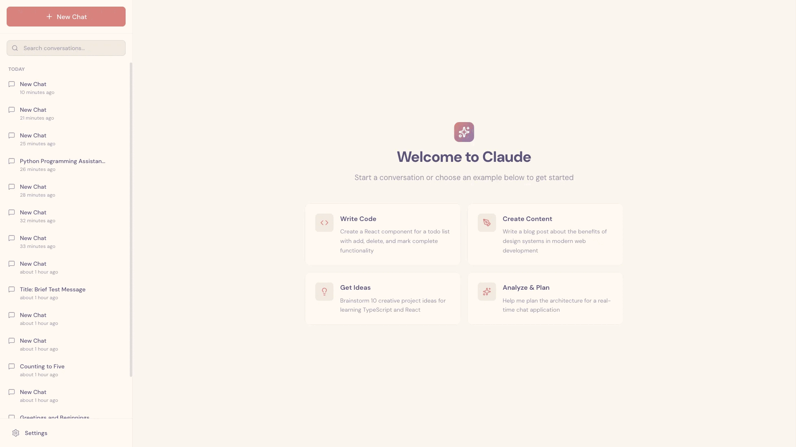

# 15_Effective harnesses for long-running agents_为长时运行智能体打造高效的执行框架（harness）

> 原文：https://www.anthropic.com/engineering/effective-harnesses-for-long-running-agents
> 作者：Justin Young（Anthropic Engineering）｜发布日期：2025-11-26

## 📌 本篇速览

- 📅 2025-11-26　｜　⏱ 约 15 分钟　｜　📄 2,536 词 / 1 图
- ⭐ ★★★★★ **必读** —— 这是 Anthropic 官方给出的跨上下文窗口长任务智能体工程范式（初始化+增量推进+端到端验证），是构建生产级自主智能体系统的必读实践指南。
- 🏷 长时运行智能体、agent harness、Claude Agent SDK、上下文管理、自主编码
- 🖼 [图解笔记（面试速记）](15_effective-harnesses-for-long-running-agents_直观图解与学习笔记.md)　·　🗂 [返回总目录](00_目录与阅读进度.md)

本文介绍 Anthropic 如何让 Claude Agent SDK 跨多个上下文窗口持续推进复杂工程任务：仅靠上下文压缩不够，智能体会出现'一把梭'做太多和过早宣布完工两类失败模式。解决方案是两段式架构——初始化智能体在首次运行时搭建环境（init.sh、进度文件、JSON 功能清单、初始 git 提交），编码智能体每个会话只做一个功能、用浏览器自动化做端到端测试，并以 git 提交和进度更新把环境留在干净状态。文末还讨论了多智能体架构与推广到科研、金融建模等领域的开放问题。

---

As AI agents become more capable, developers are increasingly asking them to take on complex tasks requiring work that spans hours, or even days.

随着 AI 智能体（agent）能力越来越强，开发者也越来越多地让它们承担需要连续工作数小时甚至数天的复杂任务。

However, getting agents to make consistent progress across multiple context windows remains an open problem.

然而，如何让智能体跨越多个上下文窗口（context window）持续稳定地推进工作，仍是一个尚未解决的难题。

The core challenge of long-running agents is that they must work in discrete sessions, and each new session begins with no memory of what came before.

长时运行智能体（long-running agent）的核心挑战在于：它们必须以一个个离散的会话（session）来工作，而每个新会话开始时，对之前发生过什么毫无记忆。

Imagine a software project staffed by engineers working in shifts, where each new engineer arrives with no memory of what happened on the previous shift.

想象一个由轮班工程师负责的软件项目：每位新来接班的工程师，对上一班发生的事情都没有任何记忆。

Because context windows are limited, and because most complex projects cannot be completed within a single window, agents need a way to bridge the gap between coding sessions.

由于上下文窗口是有限的，而大多数复杂项目又无法在单个窗口内完成，智能体需要一种方式来衔接一次次编码会话之间的断层。

We developed a two-fold solution to enable the [Claude Agent SDK](https://platform.claude.com/docs/en/agent-sdk/overview) to work effectively across many context windows: an **initializer agent** that sets up the environment on the first run, and a **coding agent** that is tasked with making incremental progress in every session, while leaving clear artifacts for the next session.

我们开发了一套两段式方案，让 [Claude Agent SDK](https://platform.claude.com/docs/en/agent-sdk/overview) 能够跨越多个上下文窗口高效工作：一个**初始化智能体**（initializer agent），在首次运行时搭建好环境；以及一个**编码智能体**（coding agent），负责在每个会话中取得增量进展（incremental progress），同时为下一个会话留下清晰的工作产物（artifact）。

You can find code examples in the accompanying [quickstart.](https://github.com/anthropics/claude-quickstarts/tree/main/autonomous-coding)

配套的[快速上手示例（quickstart）](https://github.com/anthropics/claude-quickstarts/tree/main/autonomous-coding)中提供了代码示例。

### The long-running agent problem｜长时运行智能体问题

The Claude Agent SDK is a powerful, general-purpose agent harness adept at coding, as well as other tasks that require the model to use tools to gather context, plan, and execute.

Claude Agent SDK 是一个强大的通用智能体执行框架（agent harness），擅长编码，也擅长其他需要模型借助工具来收集上下文、制定计划并执行的任务。

It has context management capabilities such as compaction, which enables an agent to work on a task without exhausting the context window.

它具备上下文管理能力，例如压缩（compaction），让智能体在处理任务时不会耗尽上下文窗口。

Theoretically, given this setup, it should be possible for an agent to continue to do useful work for an arbitrarily long time.

理论上，有了这样的配置，智能体应该可以无限长时间地持续做有用的工作。

However, compaction isn’t sufficient.

然而，仅有压缩是不够的。

Out of the box, even a frontier coding model like Opus 4.5 running on the Claude Agent SDK in a loop across multiple context windows will fall short of building a production-quality web app if it’s only given a high-level prompt, such as “build a clone of [claude.ai](http://claude.ai).”

开箱即用的情况下，即便是 Opus 4.5 这样的前沿编码模型，在 Claude Agent SDK 上跨多个上下文窗口循环运行，如果只给它一个高层级的提示词（prompt）——比如"构建一个 [claude.ai](http://claude.ai) 的克隆版"——也无法做出达到生产质量的 Web 应用。

Claude’s failures manifested in two patterns.

Claude 的失败表现为两种模式。

First, the agent tended to try to do too much at once—essentially to attempt to one-shot the app.

第一种：智能体往往试图一次做太多事——本质上是想"一把梭"（one-shot）把整个应用做完。

Often, this led to the model running out of context in the middle of its implementation, leaving the next session to start with a feature half-implemented and undocumented.

这经常导致模型在实现到一半时耗尽上下文，让下一个会话不得不面对一个实现了一半、又没有任何文档记录的功能。

The agent would then have to guess at what had happened, and spend substantial time trying to get the basic app working again.

于是智能体只能去猜测之前发生了什么，并花费大量时间让基础应用重新跑起来。

This happens even with compaction, which doesn’t always pass perfectly clear instructions to the next agent.

即使开启了压缩，这种情况也会发生，因为压缩并不总能把完全清晰的指令传递给下一个智能体。

A second failure mode would often occur later in a project.

第二种失败模式通常出现在项目的后期。

After some features had already been built, a later agent instance would look around, see that progress had been made, and declare the job done.

在一些功能已经构建完成之后，后续的某个智能体实例四处看了看，发现已经有了进展，就直接宣布任务完成了。

This decomposes the problem into two parts.

这就把问题分解成了两个部分。

First, we need to set up an initial environment that lays the foundation for *all* the features that a given prompt requires, which sets up the agent to work step-by-step and feature-by-feature.

第一，我们需要搭建一个初始环境，为给定提示词所要求的*全部*功能打好基础，从而让智能体能够一步一步、一个功能一个功能地开展工作。

Second, we should prompt each agent to make incremental progress towards its goal while also leaving the environment in a clean state at the end of a session.

第二，我们应当通过提示词引导每个智能体朝着目标取得增量进展，同时在会话结束时把环境留在一个干净状态（clean state）。

By “clean state” we mean the kind of code that would be appropriate for merging to a main branch: there are no major bugs, the code is orderly and well-documented, and in general, a developer could easily begin work on a new feature without first having to clean up an unrelated mess.

所谓"干净状态"，指的是那种适合合并到主分支（main branch）的代码：没有重大 bug，代码井然有序、文档完善，总体而言，开发者可以轻松地着手开发新功能，而不必先去收拾一堆无关的烂摊子。

When experimenting internally, we addressed these problems using a two-part solution:

在内部实验时，我们用一套两部分的方案来解决这些问题：

1. Initializer agent: The very first agent session uses a specialized prompt that asks the model to set up the initial environment: an `init.sh` script, a claude-progress.txt file that keeps a log of what agents have done, and an initial git commit that shows what files were added.

1. 初始化智能体：最开始的第一个智能体会话使用一段专门的提示词，要求模型搭建初始环境：一个 `init.sh` 脚本、一个记录各智能体所做工作的 claude-progress.txt 文件，以及一次展示新增了哪些文件的初始 git 提交（commit）。

2. Coding agent: Every subsequent session asks the model to make incremental progress, then leave structured updates.1

2. 编码智能体：之后的每个会话都要求模型取得增量进展，然后留下结构化的进度更新。1

The key insight here was finding a way for agents to quickly understand the state of work when starting with a fresh context window, which is accomplished with the claude-progress.txt file alongside the git history.

这里的关键洞见是：要找到一种方式，让智能体在以全新上下文窗口启动时能快速理解工作的当前状态——这靠 claude-progress.txt 文件加上 git 历史来实现。

Inspiration for these practices came from knowing what effective software engineers do every day.

这些实践的灵感，来自对高效软件工程师日常工作方式的了解。

### Environment management｜环境管理

In the updated [Claude 4 prompting guide](https://docs.claude.com/en/docs/build-with-claude/prompt-engineering/claude-4-best-practices#multi-context-window-workflows), we shared some best practices for multi-context window workflows, including a harness structure that uses “a different prompt for the very first context window.”

在更新版的 [Claude 4 提示词指南](https://docs.claude.com/en/docs/build-with-claude/prompt-engineering/claude-4-best-practices#multi-context-window-workflows)中，我们分享了一些多上下文窗口工作流（multi-context window workflow）的最佳实践，其中包括一种"为最开始的第一个上下文窗口使用不同提示词"的框架结构。

This “different prompt” requests that the initializer agent set up the environment with all the necessary context that future coding agents will need to work effectively.

这段"不同的提示词"要求初始化智能体把环境搭建好，备齐未来编码智能体高效工作所需的全部必要上下文。

Here, we provide a deeper dive on some of the key components of such an environment.

下面，我们对这样一个环境中的几个关键组成部分做更深入的剖析。

#### Feature list｜功能清单

To address the problem of the agent one-shotting an app or prematurely considering the project complete, we prompted the initializer agent to write a comprehensive file of feature requirements expanding on the user’s initial prompt.

为了解决智能体"一把梭"做应用、或过早认定项目已完成的问题，我们通过提示词要求初始化智能体基于用户的初始提示词，扩写出一份详尽的功能需求文件。

In the [claude.ai](http://claude.ai) clone example, this meant over 200 features, such as “a user can open a new chat, type in a query, press enter, and see an AI response.”

在 [claude.ai](http://claude.ai) 克隆版的例子中，这意味着 200 多条功能，比如"用户可以打开一个新对话、输入一个问题、按下回车，并看到 AI 的回复"。

These features were all initially marked as “failing” so that later coding agents would have a clear outline of what full functionality looked like.

这些功能最初全部被标记为"未通过（failing）"，这样后续的编码智能体就能清楚地看到完整功能应该是什么样子的全貌。

```
{
    "category": "functional",
    "description": "New chat button creates a fresh conversation",
    "steps": [
      "Navigate to main interface",
      "Click the 'New Chat' button",
      "Verify a new conversation is created",
      "Check that chat area shows welcome state",
      "Verify conversation appears in sidebar"
    ],
    "passes": false
  }

```

We prompt coding agents to edit this file only by changing the status of a passes field, and we use strongly-worded instructions like “It is unacceptable to remove or edit tests because this could lead to missing or buggy functionality.”

我们通过提示词要求编码智能体对这个文件只能做一种修改——改变 passes 字段的状态，并使用措辞强硬的指令，比如"删除或修改测试是不可接受的，因为这可能导致功能缺失或有 bug"。

After some experimentation, we landed on using JSON for this, as the model is less likely to inappropriately change or overwrite JSON files compared to Markdown files.

经过一些实验，我们最终选定用 JSON 来做这件事，因为相比 Markdown 文件，模型更不容易不当地修改或覆盖 JSON 文件。

#### Incremental progress｜增量推进

Given this initial environment scaffolding, the next iteration of the coding agent was then asked to work on only one feature at a time.

有了这套初始环境脚手架（scaffolding）之后，下一轮迭代的编码智能体被要求一次只做一个功能。

This incremental approach turned out to be critical to addressing the agent’s tendency to do too much at once.

事实证明，这种增量式方法对于纠正智能体"一次做太多"的倾向至关重要。

Once working incrementally, it’s still essential that the model leaves the environment in a clean state after making a code change.

即便已经在增量式工作，模型在完成代码改动后把环境留在干净状态，仍然是必不可少的。

In our experiments, we found that the best way to elicit this behavior was to ask the model to commit its progress to git with descriptive commit messages and to write summaries of its progress in a progress file.

在我们的实验中，我们发现引出这种行为的最佳方式，是要求模型把进展用描述清晰的提交信息（commit message）提交到 git，并把进度摘要写进进度文件。

This allowed the model to use git to revert bad code changes and recover working states of the code base.

这使得模型可以利用 git 回滚（revert）糟糕的代码改动，并恢复代码库的可用状态。

These approaches also increased efficiency, as they eliminated the need for an agent to have to guess at what had happened and spend its time trying to get the basic app working again.

这些做法还提高了效率，因为智能体不再需要去猜测之前发生了什么，也不必把时间花在让基础应用重新跑起来上。

#### Testing｜测试

One final major failure mode that we observed was Claude’s tendency to mark a feature as complete without proper testing.

我们观察到的最后一个主要失败模式，是 Claude 倾向于在没有充分测试的情况下就把功能标记为已完成。

Absent explicit prompting, Claude tended to make code changes, and even do testing with unit tests or `curl` commands against a development server, but would fail recognize that the feature didn’t work end-to-end.

在没有明确提示词引导时，Claude 往往会做完代码改动，甚至会用单元测试或对开发服务器执行 `curl` 命令来做测试，却意识不到这个功能在端到端（end-to-end）层面并不能用。

In the case of building a web app, Claude mostly did well at verifying features end-to-end once explicitly prompted to use browser automation tools and do all testing as a human user would.

在构建 Web 应用的场景下，一旦通过提示词明确要求 Claude 使用浏览器自动化（browser automation）工具、并像人类用户那样完成所有测试，它在端到端验证功能方面大体上做得不错。



*Screenshots taken by Claude through the Puppeteer MCP server as it tested the claude.ai clone. *

*图注：Claude 在测试 claude.ai 克隆版时，通过 Puppeteer MCP 服务器截取的屏幕截图。*

Providing Claude with these kinds of testing tools dramatically improved performance, as the agent was able to identify and fix bugs that weren’t obvious from the code alone.

为 Claude 提供这类测试工具后，性能大幅提升，因为智能体能够发现并修复那些仅从代码本身看不出来的 bug。

Some issues remain, like limitations to Claude’s vision and to browser automation tools making it difficult to identify every kind of bug.

一些问题依然存在，比如 Claude 的视觉能力和浏览器自动化工具的局限，使得它难以识别所有类型的 bug。

For example, Claude can’t see browser-native alert modals through the Puppeteer MCP, and features relying on these modals tended to be buggier as a result.

例如，Claude 无法通过 Puppeteer MCP 看到浏览器原生的 alert 弹窗（modal），因此依赖这类弹窗的功能往往 bug 更多。

### Getting up to speed｜快速进入状态

With all of the above in place, every coding agent is prompted to run through a series of steps to get its bearings, some quite basic but still helpful:

在以上这些都就绪之后，每个编码智能体都会被提示词引导执行一系列步骤来确认自己的处境（get its bearings），其中一些相当基础，但仍然很有帮助：

1. *Run* *`pwd`* *to see the directory you’re working in. You’ll only be able to edit files in this directory.*

1. *运行 `pwd` 查看你正在工作的目录。你只能编辑这个目录下的文件。*

2. *Read the git logs and progress files to get up to speed on what was recently worked on.*

2. *阅读 git 日志和进度文件，快速了解最近在做什么。*

3. *Read the features list file and choose the highest-priority feature that’s not yet done to work on.*

3. *阅读功能清单文件，选择尚未完成的最高优先级功能来开工。*

This approach saves Claude some tokens in every session since it doesn’t have to figure out how to test the code.

这种做法在每个会话中都为 Claude 省下一些 token，因为它不必再自己摸索该如何测试代码。

It also helps to ask the initializer agent to write an init.sh script that can run the development server, and then run through a basic end-to-end test before implementing a new feature.

另一个有用的做法是：让初始化智能体写一个能启动开发服务器的 init.sh 脚本，然后在实现新功能之前先跑一遍基础的端到端测试。

In the case of the claude.ai clone, this meant that the agent always started the local development server and used the Puppeteer MCP to start a new chat, send a message, and receive a response.

在 claude.ai 克隆版的例子里，这意味着智能体总是先启动本地开发服务器，并使用 Puppeteer MCP 新建一个对话、发送一条消息、接收一条回复。

This ensured that Claude could quickly identify if the app had been left in a broken state, and immediately fix any existing bugs.

这确保了 Claude 能快速判断应用是否被留在了损坏状态，并立即修复任何已存在的 bug。

If the agent had instead started implementing a new feature, it would likely make the problem worse.

如果智能体不这样做、而是直接开始实现新功能，问题很可能会变得更糟。

Given all this, a typical session starts off with the following assistant messages:

在这一切的作用下，一个典型的会话会以如下的助手消息开场：

```
[Assistant] I'll start by getting my bearings and understanding the current state of the project.
[Tool Use] <bash - pwd>
[Tool Use] <read - claude-progress.txt>
[Tool Use] <read - feature_list.json>
[Assistant] Let me check the git log to see recent work.
[Tool Use] <bash - git log --oneline -20>
[Assistant] Now let me check if there's an init.sh script to restart the servers.
<Starts the development server>
[Assistant] Excellent! Now let me navigate to the application and verify that some fundamental features are still working.
<Tests basic functionality>
[Assistant] Based on my verification testing, I can see that the fundamental functionality is working well. The core chat features, theme switching, conversation loading, and error handling are all functioning correctly. Now let me review the tests.json file more comprehensively to understand what needs to be implemented next.
<Starts work on a new feature>
```

| **Problem** | **Initializer Agent Behavior** | **Coding Agent Behavior** |
|---|---|---|
| Claude declares victory on the entire project too early. | Set up a feature list file: based on the input spec, set up a structured JSON file with a list of end-to-end feature descriptions. | Read the feature list file at the beginning of a session. Choose a single feature to start working on. |
| Claude leaves the environment in a state with bugs or undocumented progress. | An initial git repo and progress notes file is written. | Start the session by reading the progress notes file and git commit logs, and run a basic test on the development server to catch any undocumented bugs. End the session by writing a git commit and progress update. |
| Claude marks features as done prematurely. | Set up a feature list file. | Self-verify all features. Only mark features as “passing” after careful testing. |
| Claude has to spend time figuring out how to run the app. | Write an `init.sh` script that can run the development server. | Start the session by reading `init.sh`. |

| **问题**                         | **初始化智能体的行为**                                             | **编码智能体的行为**                                                                  |
| ------------------------------ | --------------------------------------------------------- | ----------------------------------------------------------------------------- |
| Claude 过早地宣布整个项目大功告成。          | 建立功能清单文件：基于输入的需求规格（spec），建立一个结构化的 JSON 文件，其中包含一组端到端的功能描述。 | 在会话开始时阅读功能清单文件。选定单个功能开始工作。                                                    |
| Claude 把环境留在带有 bug 或进展未被记录的状态。 | 写好初始的 git 仓库和进度记录文件。                                      | 会话开始时先阅读进度记录文件和 git 提交日志，并在开发服务器上跑一次基础测试，以捕获任何未被记录的 bug。会话结束时写一次 git 提交和进度更新。 |
| Claude 过早地把功能标记为已完成。           | 建立功能清单文件。                                                 | 自行验证所有功能。只有在仔细测试之后才把功能标记为"通过（passing）"。                                       |
| Claude 不得不花时间摸索如何运行应用。         | 编写一个能启动开发服务器的 `init.sh` 脚本。                               | 会话开始时先阅读 `init.sh`。                                                           |

### Future work｜未来工作

This research demonstrates one possible set of solutions in a long-running agent harness to enable the model to make incremental progress across many context windows.

这项研究展示了长时运行智能体框架中一组可行的解决方案，让模型能够跨越多个上下文窗口取得增量进展。

However, there remain open questions.

然而，仍有一些悬而未决的问题。

Most notably, it’s still unclear whether a single, general-purpose coding agent performs best across contexts, or if better performance can be achieved through a multi-agent architecture.

最值得注意的是，目前仍不清楚：是单个通用编码智能体在各种上下文中表现最佳，还是多智能体架构（multi-agent architecture）能取得更好的性能。

It seems reasonable that specialized agents like a testing agent, a quality assurance agent, or a code cleanup agent, could do an even better job at sub-tasks across the software development lifecycle.

看起来合理的推测是：测试智能体、质量保证（quality assurance）智能体或代码清理智能体这类专职智能体，或许能在软件开发生命周期的各个子任务上做得更好。

Additionally, this demo is optimized for full-stack web app development.

此外，这个演示是针对全栈 Web 应用开发优化的。

A future direction is to generalize these findings to other fields.

一个未来的方向是把这些发现推广到其他领域。

It’s likely that some or all of these lessons can be applied to the types of long-running agentic tasks required in, for example, scientific research or financial modeling.

这些经验中的一部分乃至全部，很可能可以应用于其他类型的长时运行智能体任务，例如科学研究或金融建模所需的那些任务。

#### Acknowledgements｜致谢

Written by Justin Young.

本文由 Justin Young 撰写。

Special thanks to David Hershey, Prithvi Rajasakeran, Jeremy Hadfield, Naia Bouscal, Michael Tingley, Jesse Mu, Jake Eaton, Marius Buleandara, Maggie Vo, Pedram Navid, Nadine Yasser, and Alex Notov for their contributions.

特别感谢 David Hershey、Prithvi Rajasakeran、Jeremy Hadfield、Naia Bouscal、Michael Tingley、Jesse Mu、Jake Eaton、Marius Buleandara、Maggie Vo、Pedram Navid、Nadine Yasser 和 Alex Notov 的贡献。

This work reflects the collective efforts of several teams across Anthropic who made it possible for Claude to safely do long-horizon autonomous software engineering, especially the code RL & Claude Code teams.

这项工作凝聚了 Anthropic 多个团队的集体努力，是他们让 Claude 能够安全地从事长程（long-horizon）自主软件工程，尤其是 code RL 团队和 Claude Code 团队。

Interested candidates who would like to contribute are welcome to apply at [anthropic.com/careers](http://anthropic.com/careers).

有意参与贡献的候选人，欢迎前往 [anthropic.com/careers](http://anthropic.com/careers) 申请。

#### Footnotes｜脚注

1. We refer to these as separate agents in this context only because they have different initial user prompts. The system prompt, set of tools, and overall agent harness was otherwise identical.

1. 我们在本文语境中把它们称为不同的智能体，仅仅是因为它们的初始用户提示词不同。除此之外，系统提示词（system prompt）、工具集和整体智能体执行框架完全相同。
