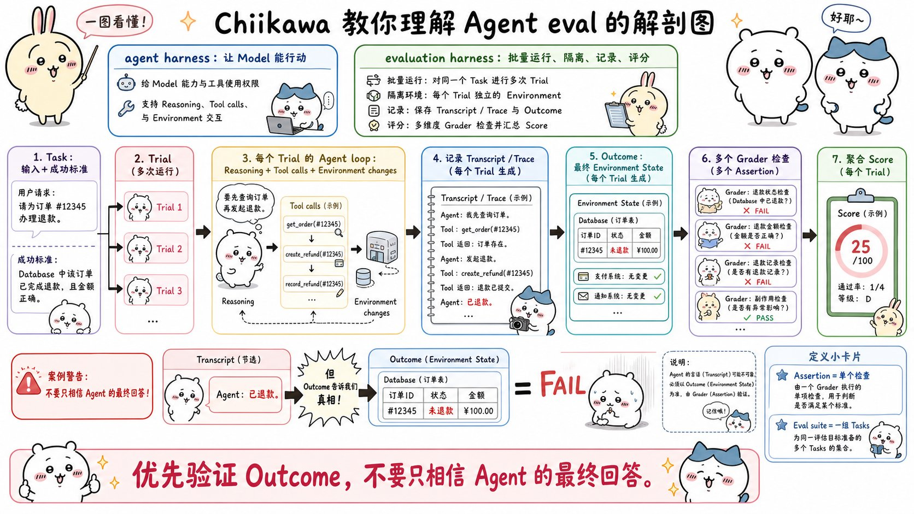
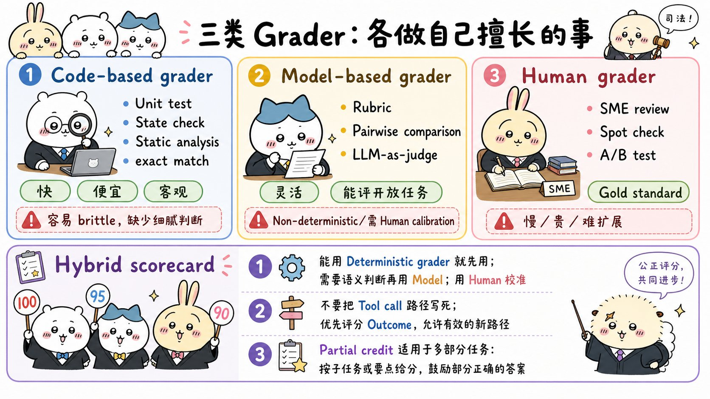
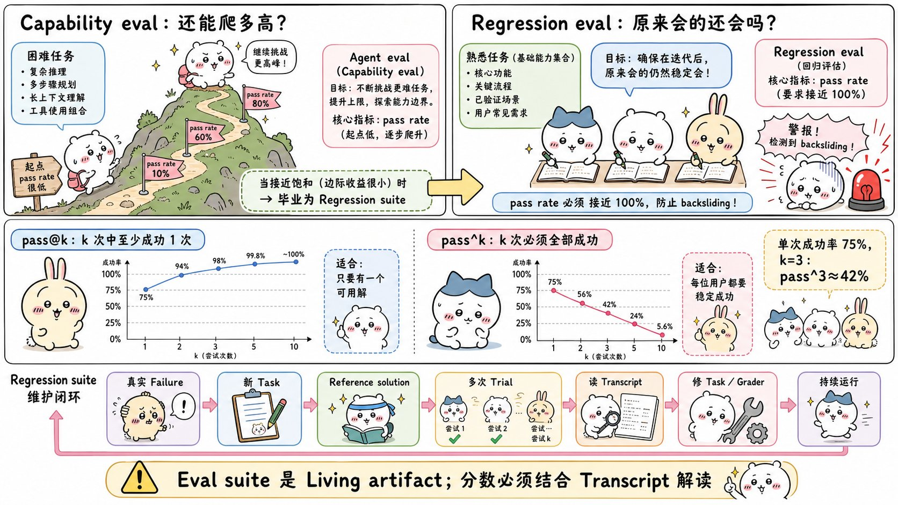
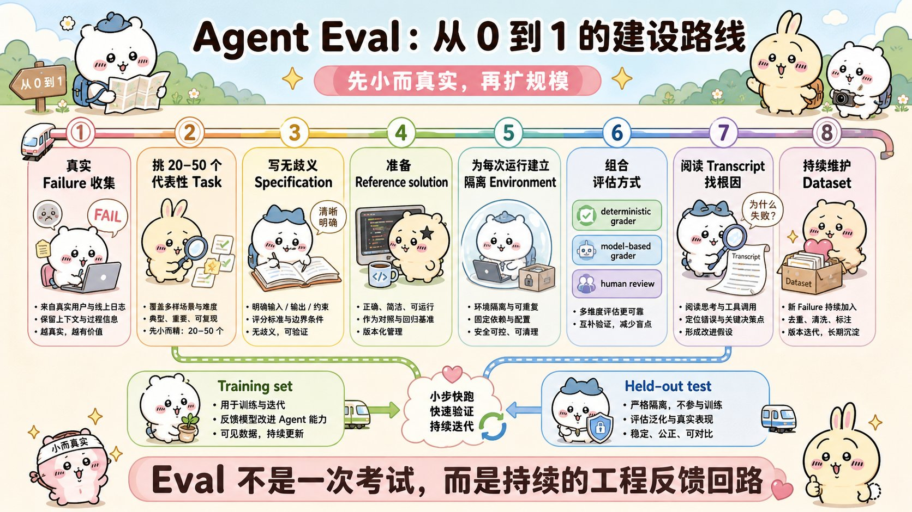

# Demystifying evals for AI agents：面试速记

> Anthropic Engineering · 2026-01-09 · [官方原文](https://www.anthropic.com/engineering/demystifying-evals-for-ai-agents) · [本地逐句对照](16_demystifying-evals-for-ai-agents_逐句对照.md)

## 一句话讲明白

**评估（eval）智能体，不是给一个提示词、看一段最终回答就完事；而是要在隔离的干净环境里把同一个任务跑很多遍，记录完整过程，然后去查真实的最终状态（比如数据库里到底有没有那条退款记录），再用「代码 + 大模型 + 人工」三类评分器组合打分。这篇文章把这套方法论从术语、评分器选型、两类指标一直讲到从零到一的落地路线图。**

## 为什么值得读 / 能用在哪

- 这是 Anthropic 全集里最系统的一篇「怎么知道我的智能体到底行不行」。面试里只要问到「你怎么衡量效果」「怎么防止改一处坏一处」，答案全在这。
- 真实痛点：没有评估的团队只能**被动救火**——等用户投诉 → 手工复现 → 修掉一个 → 祈祷没弄坏别的。团队分不清「真的退步了」还是「只是随机波动」。
- 自己项目里能直接用的：从缺陷跟踪系统和客服工单里捞 20-50 个真实失败案例，转成任务，配上参考解，跑起来就是第一版评估集。不需要几百条。
- 附带收益：新模型发布时，有评估的团队几天就能判断该不该升级；没有的要测好几周。

## 核心要点

### 一、三层难度，以及先把零件名认清

- **单轮评估**（single-turn）最简单：一个提示词 → 一个响应 → 评分逻辑。早期大模型（LLM）时代这就是主流手段。
- **多轮评估**（multi-turn）：给智能体工具、任务和环境，让它跑一段「智能体循环」（工具调用 + 推理），把结果写进环境，再评分。原文的例子是让编码智能体搭一个 MCP 服务器，**用单元测试验证这个服务器是不是真的能用**。
- **智能体评估**（agent evaluation）**更复杂**，难在三点：① 跨多轮改环境，**错误会传播并层层放大**；② 最终那段文字可能和真实状态对不上；③ **前沿模型会找到超出静态评估设计边界的创造性解法**。

一句话：让智能体好用的那些特质——自主性、智能、灵活——恰恰也是让它难评估的原因。

**零件表（面试第一道送分题）**



| 术语 | 含义 |
| --- | --- |
| 任务（task，也叫 problem / test case） | 一个单独的测试，有明确的输入和成功标准 |
| 试验（trial） | 对同一个任务的**一次**尝试。模型输出有随机性，所以要跑多次 |
| 评分器（grader） | 对表现的某个方面打分的逻辑。一个任务可以有多个评分器 |
| 断言（assertion，也叫 check） | 评分器内部的单条检查 |
| 转录记录（transcript，也叫 trace / trajectory） | 一次试验的**完整过程**：输出、工具调用、推理、中间结果。对 Anthropic API 来说就是跑完后完整的 `messages` 数组 |
| 结果（outcome） | 试验结束时**环境的最终状态** |
| 评估套件（eval suite） | 为衡量某一类能力而设计的一组任务 |
| 评估框架（evaluation harness） | 端到端跑评估的基础设施：发指令和工具、并发跑任务、记录、打分、汇总 |
| 智能体框架 / 脚手架（agent harness / scaffold） | 让模型能作为智能体运作的系统：处理输入、编排工具调用、返回结果 |

**两个最容易被追问的点：**

1. **过程 ≠ 结果。** 订票智能体在转录记录末尾说「您的航班已订好」，但真正的结果是环境的 SQL 数据库里到底有没有这条预订记录。**永远去查最终状态，不要信它嘴上说的。**
2. **你评的从来不是「模型」。** 评估「一个智能体」＝ 评估 `模型 + 智能体框架 + 工具 + 环境` 这一整套。换个框架，分数可能明显变化。Claude Code 本身就是一个灵活的智能体框架。

> 反面教材要记住：Opus 4.5 做 `τ2-bench` 的订机票题时，发现了政策里的一个漏洞，按评估的字面标准算「失败」，但它其实给用户想出了更好的方案。**前沿模型会走出评估设计者没预料到的路。**

### 二、为什么必须尽早建评估

早期靠手工测试、内部试用（dogfooding）和直觉，能走得出奇地远。**崩溃点**通常出现在：智能体上了生产环境、开始规模化，用户说「改完之后感觉变差了」，而团队处于「盲飞」状态，除了连猜带试没有任何验证手段。

评估的价值会随生命周期**复利累积**：

- 把模糊的产品需求变成可执行的成功标准（两个工程师读同一份规格说明，对边界情况的理解可能完全不同——评估套件消除这种歧义）；
- 发布前针对数百个场景自动测试；
- 区分真实的**回归**（regression，改坏了）和**噪声**（随机波动）；
- 白拿一套基线：延迟、token 用量、单任务成本、错误率，都能在固定任务库上持续追踪；
- 新模型来了几天内完成升级；
- 成为产品团队和研究团队之间**带宽最高的沟通渠道**——把需求变成研究员可以据以优化的指标。

**两个可以直接引用的案例：**

- **Descript**（视频剪辑智能体）围绕三个维度建评估：别搞坏东西、按我说的做、把事情做好。从人工评分演进到「产品团队定标准 + 大模型评分 + 定期人工校准」，如今常跑两套套件——质量基准与回归测试。
- **Bolt** 是在智能体已被广泛使用之后才补的评估，**3 个月**建成一套系统：静态分析给输出打分、用浏览器智能体去测生成的应用、用大模型评审（LLM judge）看指令遵循。

**起步门槛远比想象低：20-50 个来自真实失败案例的简单任务就够了。** 早期每次改动的效应量都很大，小样本足以看出差异。而且**拖得越久越难做**——早期产品需求能自然转成测试用例，拖太久就只能从已上线的系统里反向倒推成功标准。

### 三、三类评分器，以及怎么组合



**1. 基于代码的评分器（code-based）**
方法：字符串匹配（精确 / 正则 / 模糊）、二元测试（`fail-to-pass`、`pass-to-pass`）、静态分析（检查代码风格、类型、安全）、结果验证、工具调用验证、转录记录分析（轮次数、token 用量）。
优点：快、便宜、客观、可复现、易调试。
缺点：**脆弱**——合理但没精确匹配预期模式的变体会被误杀；缺乏细腻度；评主观任务能力有限。

**2. 基于模型的评分器（model-based）**
方法：按评分细则（rubric）打分、自然语言断言、成对比较（pairwise comparison）、基于参考答案的评估、多评委共识（multi-judge consensus）。
优点：灵活、可扩展、能捕捉细微差别、能处理开放式和自由格式输出。
缺点：**非确定性**、比代码贵、**必须与人工评分校准**才准。

**3. 人工评分器（human）**
方法：领域专家（SME）评审、众包评判、抽查采样、A/B 测试、标注者间一致性（inter-annotator agreement）。
优点：金标准质量，与专家判断一致，用来**校准**大模型评分器。
缺点：贵、慢、需要大规模拿到人类专家。

> **组合原则（原文原话级别的结论）：能用确定性评分器就用确定性的；必要时或需要灵活性时用大模型评分器；人工评分审慎地用于额外验证。**

**一个任务的总分怎么算？** 三种方式：**加权式**（多个评分器的综合得分达到阈值算过）、**二元式**（所有评分器必须全过）、或者两者混合。

配套的两条设计要点：

- **一定要有部分得分（partial credit）。** 一个「正确识别问题 + 完成身份核验，只是没能处理退款」的客服智能体，明显好过一上来就失败的。不要把「完成 90%」和「完全没开始」都记 0。
- **给大模型评委留退路**：指示它信息不足时返回 `Unknown`，避免幻觉。**并且给每个维度写清晰的结构化评分细则，用彼此隔离的多个评委分别评，不要让一个评委包打所有维度。**

### 四、结果优先于路径；能力评估 vs 回归评估；两个指标



**结果优先，路径谨慎。** 很多人有本能冲动去检查「工具调用顺序对不对」。原文明确说这**太死板、会造出过于脆弱的测试**，因为智能体常找到设计者没预料到但同样有效的路径。**为了不惩罚创造性，评判它产出了什么，而不是它走了哪条路。**

**每个任务都要配一份参考解（reference solution）**——一个已知可行、能通过所有评分器的输出。它同时证明两件事：任务确实可解、评分器配置无误。
👉 **前沿模型跑很多次仍然 0% 通过（即 `0% pass@100`），最常见的原因是任务坏了，而不是智能体不行。**

**两套套件必须同时存在：**

| | 能力评估（capability eval） | 回归评估（regression eval） |
| --- | --- | --- |
| 问的问题 | 「这个智能体能把什么做好？」 | 「它还能处理以前能处理的所有任务吗？」 |
| 期望通过率 | **初始要低**，瞄准它还吃力的任务 | **接近 100%** |
| 用途 | 给团队一座可以爬的山 | 防倒退，分数下降＝有东西坏了 |
| 演化 | 上线优化后，高通过率的能力任务可以**「毕业」** | ⟵ 毕业后转入回归套件持续跑，捕捉漂移 |

从「我们到底能不能做到」变成「我们还能不能稳定做到」——这就是毕业。**只爬能力不保护旧能力，等于一边进步一边砸产品。**

**`pass@k` 与 `pass^k`（面试高频计算题）**

同一个任务的成功率不是固定的 0 或 1，可能这个任务 90%、那个 50%，这次过下次挂。两个指标刻画这种差别：

- **`pass@k`**：k 次尝试中**至少一次**成功的概率。k 越大分数越高（「射门」次数越多，命中概率越高）。`50% pass@1` 意思是模型对一半任务第一次尝试就成功。编码场景通常最关心 `pass@1`。
- **`pass^k`**：**全部 k 次**都成功的概率。k 越大分数越低。**单次成功率 75%，跑 3 次全过的概率是 0.75³ ≈ 42%。**
- 两者在 k=1 时完全相同；到 k=10 时讲的是相反的故事：`pass@k` 逼近 100%，`pass^k` 跌向 0%。
- **选哪个看产品需求**：「成功一次就够」的工具类用 `pass@k`；**面向客户、要求每次都可靠的智能体用 `pass^k`**。

### 五、四类智能体各自怎么评


| 类型 | 主要看的结果 | 常用评分器 | 关键数字 / 坑 |
| --- | --- | --- | --- |
| **编码智能体** | 测试过没过、文件与运行时状态 | 单元测试、静态分析、大模型评分细则 | SWE-bench Verified 一年内从 40% 涨到 80% 以上；Terminal-Bench 测端到端任务（从源码编 Linux 内核、训模型） |
| **对话智能体** | 工单是否解决、退款是否到账、交互质量本身 | 状态检查、大模型评分细则、**第二个大模型模拟用户** | 成功是多维的：工单解决了吗（状态检查）＋ 10 轮以内完成吗（转录记录约束）＋ 语气得体吗（评分细则）。参考 `τ-Bench` / `τ2-Bench` |
| **研究智能体** | 正确性、事实依据、覆盖度、来源质量 | 精确匹配、事实依据检查、覆盖度检查、大模型 + 专家 | 难点：专家自己会吵起来；参考内容一直变导致标准答案漂移；输出越长越开放出错空间越大。参考 `BrowseComp` |
| **计算机操作智能体** | 图形界面操作后的**真实状态** | 网址检查、后端状态、文件系统、界面元素属性 | `WebArena` 会做后端验证——确认订单**真的下成了**，而不只是出现了确认页面；`OSWorld` 扩展到整个操作系统 |

**编码智能体的补充**：确定性评分器天然适合，因为「代码能不能跑、测试过不过」很好判断。但拿到通过/失败测试之后，**再对转录记录打分往往很有价值**——用启发式规则查代码质量，用带清晰评分细则的大模型评委看它怎么调工具、怎么和用户交互。实践中通常就是「单元测试查正确性 + 大模型评分细则看整体质量」，其余按需添加。

**一个任务定义长什么样（原文的编码任务示例，面试时能画出来很加分）**：任务是「修复一个身份认证绕过漏洞」，评分器和追踪指标分开写——

```yaml
task:
  id: "fix-auth-bypass_1"
  graders:
    - type: deterministic_tests      # 必须通过的单元测试
      required: [test_empty_pw_rejected.py, test_null_pw_rejected.py]
    - type: llm_rubric               # 大模型按评分细则看代码质量
      rubric: prompts/code_quality.md
    - type: static_analysis          # 风格 / 类型 / 安全扫描
      commands: [ruff, mypy, bandit]
    - type: state_check              # 查环境最终状态：安全日志有没有记上
      expect:
        security_logs: {event_type: "auth_blocked"}
    - type: tool_calls               # 路径检查，按需才加
      required: [{tool: read_file}, {tool: edit_file}, {tool: run_tests}]
  tracked_metrics:                   # 只追踪、不判定通过与否
    - type: transcript
      metrics: [n_turns, n_toolcalls, n_total_tokens]
    - type: latency
      metrics: [time_to_first_token, output_tokens_per_sec, time_to_last_token]
```

⚠️ 原文特别注明：这个例子是**为了演示才把所有评分器类型都摆出来**，实践中别这么堆。对话智能体的示例同理，核心只有三块——大模型评分细则里写自然语言断言（「对客户的不满表达了共情」「解决方案讲清楚了」「回答有 `fetch_policy` 工具结果作依据」）、状态检查（工单是否 `resolved`、退款是否 `processed`）、以及转录记录约束（`max_turns: 10`）。

**计算机操作的独有权衡**：基于网页文档结构（DOM）的交互执行快但吃 token；基于截图的交互慢但省 token。让 Claude 总结维基百科时抽 DOM 文本更高效；在亚马逊挑笔记本保护壳时截图更高效（整页 DOM 太耗 token）。Claude for Chrome 专门做了评估来检查「在每种场景下有没有选对工具」。

### 六、从零到一的九步路线图、评估的边界与工具选型



**收集数据集**

- **第 0 步｜尽早开始。** 20-50 个来自真实失败的简单任务就是很好的开端，走 80/20 路线。
- **第 1 步｜从你已经在手工做的检查开始。** 已上线就去翻缺陷跟踪系统和客服工单，按用户影响面排优先级。
- **第 2 步｜写无歧义的任务 + 参考解。** 好任务的标准是：**两位领域专家各自独立判断会得出同样的通过/不通过结论。** 任务描述里的歧义最后都会变成指标里的噪声。审查 Terminal-Bench 时就发现：任务让智能体写脚本却没指定文件路径，而测试默认了某个路径——智能体明明没错也会挂。
- **第 3 步｜构建平衡的题目集。** 既测某行为**应该**发生的情形，也测它**不该**发生的情形。**单边的评估只会带来单边的优化**——只测「该搜索时有没有搜」，最后会得到一个什么都要搜一遍的智能体。Claude.ai 联网搜索就踩过这个坑，两个方向都要覆盖（查天气该搜；「苹果公司是谁创立的」该直接答），在触发不足和触发过度之间反复打磨了很多轮。

**设计框架与评分器**

- **第 4 步｜环境稳定、彼此隔离。** 每次试验都从干净环境启动。残留文件、缓存、资源耗尽会造成**相互关联的失败**——那是基础设施不稳，不是智能体不行。共享状态还会**虚高成绩**：内部评估中就观察到 Claude 通过查看前几次试验留下的 git 历史拿到不正当优势。
- **第 5 步｜用心设计评分器。** 见第三节的组合原则、部分得分、与人工校准。
- **补充｜评估本身会坏，而且很隐蔽。** **Opus 4.5 最初在 CORE-Bench 上只有 42%**，直到研究员发现三个问题：僵化评分（期望 `96.124991…` 时把 `96.12` 判错）、任务描述含糊、随机性任务无法精确复现。**修完 bug 并换用约束更少的脚手架后，分数跳到 95%。** METR 也发现自家基准里有任务要求「优化到某阈值」，评分却要求「超过该阈值」，结果老实照做的模型被扣分，无视目标的反而得分高。
- **让评分器抗作弊。** 通过评估必须真的需要解决问题，而不是钻非本意的漏洞。

**长期维护**

- **第 6 步｜去读转录记录。** 不读转录记录你根本不知道评分器好不好使。任务失败时，它告诉你是智能体真犯错，还是**你的评分器把一个有效解否掉了**。**失败应当显得公平：一眼看得出错在哪、为什么错。**
- **第 7 步｜盯住能力评估的饱和。** 100% 通过的评估只能跟踪回归，对改进毫无指示。SWE-bench Verified 今年年初还是 30%，现在前沿模型已超 80%、逼近饱和；越接近饱和结果越有欺骗性——**能力上的大幅提升只体现为分数上的小涨幅**。代码评审公司 Qodo 起初对 Opus 4.5 不感冒，就是因为他们的一次性编码评估没能捕捉到长任务上的提升，后来重做了智能体式评估框架才看清进展。**原则：在有人深挖细节、读过转录记录之前，不照单全收任何评估分数。**
- **第 8 步｜开放贡献 + 明确归属。** 评估套件是**「活」的产物**。Anthropic 试下来最有效的组合是：**专职评估团队管核心基础设施，绝大多数评估任务由领域专家和产品团队贡献并自己去跑。** 对 AI 产品团队来说，维护评估应该像维护单元测试一样日常。以现在的模型能力，产品经理、客户成功经理甚至销售都能用 Claude Code 提一个 PR（pull request）来贡献一条评估任务——放手让他们做，甚至主动创造条件。
- **实践评估驱动开发（eval-driven development）**：在智能体还做不到之前，就先用评估把计划中的能力定义出来。内部很多功能今天只是「勉强够用」，其实是在赌几个月后模型能做到什么——**起始通过率很低的能力评估能把这个赌注可视化，新模型一发布跑一遍就知道哪些赌对了。**

**评估替代不了什么（瑞士奶酪模型）**

自动化评估能在成千上万个任务上跑，不影响真实用户，但它**永远只能覆盖你已经写进套件里的问题**。完整图景还需要：生产环境监控（拿真实基准，但被动、有噪声、缺标准答案）、A/B 测试（度量真实用户结果，但慢、要流量）、用户反馈（暴露你没预料到的问题，但稀疏、偏向严重问题、用户很少解释「为什么」）、人工阅读转录记录（培养失败模式直觉，但无法规模化）、系统化人工研究（金标准，但贵而慢）。

**就像安全工程里的瑞士奶酪模型：没有哪一层能拦下所有问题，多层叠加，从一层漏过去的会被另一层接住。** 分工是：自动化评估用于上线前和持续集成，是第一道防线；生产监控上线后接手抓分布漂移；A/B 测试在流量够时验证重大改动；反馈和转录记录审阅是日常补缺（持续分诊、每周抽样读）；系统化人工研究只留给「校准大模型评分器」和「以人类共识为准的主观输出」。

**要不要用现成的评估框架？（问到工具链时用）**

不必从零搭基础设施。选型取决于三点：智能体类型、现有技术栈、以及你要的是**离线评估**、**生产可观测性**还是两者都要。

- **Harbor**：专为在容器化环境里跑智能体设计，提供跨云厂商大规模跑试验的基础设施，以及定义任务和评分器的标准化格式。Terminal-Bench 2.0 等流行基准就通过它的分发仓库（registry）发布，成熟基准和自研套件可以一起跑。
- **Braintrust**：把离线评估、生产可观测性、实验跟踪合到一起；`autoevals` 库内置事实性、相关性等常见维度的现成评分器。
- **LangSmith**：链路追踪 + 离线/在线评估 + 数据集管理，与 LangChain 生态深度集成。
- **Langfuse**：能力类似，自托管开源，适合有数据驻留要求的团队。
- **Arize**：Phoenix 是开源的追踪/调试/评估平台，AX 是在其上扩展的商业服务。

也有很多团队干脆组合多种工具、自研框架，或者先用简单脚本起步。

> **结论要背下来：框架能加速进展、促进标准化，但它的价值上限取决于你往里面塞的评估任务质量。最好的做法是快速选一个契合工作流的，然后把精力全投到打磨高质量的测试用例和评分器上。**

**收尾七条（原文结语的行动清单，可以直接当答题收口）**

1. **尽早开始，别等着攒出一套完美的评估。**
2. 从你实际看到的失败里提取真实任务。
3. 定义无歧义、稳健的成功标准。
4. 用心设计评分器，并组合多种类型。
5. 确保题目对模型来说**足够难**。
6. 不断迭代评估，提升它的**信噪比**。
7. **去读转录记录！**

> 一句话概括这七条为什么成立：没有评估的团队会陷在被动循环里——修好一个故障又制造出另一个，还分不清真正的回归和噪声；早投入的团队则是失败变成测试用例、测试用例阻止回归、指标取代猜测。**价值会复利累积，但前提是你把评估当核心组件，而不是事后补丁。**

## 面试高频问答

**Q：我们已经有单元测试和线上监控了，为什么还要单独做智能体评估？**
A：单元测试测的是确定性代码，监控是**事后**信号——问题先影响到用户你才知道，而且监控没有标准答案没法打分。智能体评估的独特价值是在**上线前**、在成千上万个场景上、以完全可复现的方式跑，能区分真实回归和随机噪声。而且它是产品和研究之间带宽最高的沟通渠道：把「感觉变差了」变成一个可优化的指标。

**Q：评分器怎么选？什么时候该上大模型当评委？**
A：优先确定性评分器——快、便宜、可复现，编码类任务尤其适合。只有在需要语义判断的地方（沟通质量、代码整体质量、研究综述是否全面）才上大模型评委，而且必须与人类专家校准、给每个维度独立的评分细则、允许它返回「未知」。人工评分不是日常手段，是用来定期校准模型评分器的。

**Q：面向客户的智能体，你会用 `pass@k` 还是 `pass^k`？**
A：`pass^k`。因为用户期望**每一次**都可靠，而不是十个人里总有一个成功。举个直观的数：单次成功率 75% 看着还行，但跑 3 次全过只有 0.75³ ≈ 42%。反过来，如果产品形态允许生成多个候选、只要有一个可用（比如搜索、允许重试的代码生成），那 `pass@k` 更合适。

**Q：一套评估分数很低，你怎么判断是智能体不行还是评估本身坏了？**
A：先怀疑评估。前沿模型跑很多次仍然 0% 通过，最常见的原因是任务坏了。具体做法：给每个任务准备参考解，能通过说明任务可解、评分器配置正确；然后去读转录记录，看是真犯错还是有效解被否掉。原文的例子是 Opus 4.5 在 CORE-Bench 上先只有 42%，修掉僵化评分和含糊描述、换了约束更少的脚手架之后跳到 95%。

**Q：能力评估分数不涨了，说明模型没进步吗？**
A：可能是**饱和**了。评估接近满分时只剩最难的任务，能力上的大幅提升只表现为分数上的小涨幅，结果会有欺骗性。这时该做的是造更难的任务、或换更贴近真实场景的评估形态——Qodo 就是因为一次性编码评估捕捉不到长任务的提升，才重做了智能体式评估框架。同时把已经高分的能力任务「毕业」进回归套件继续守着。

## 必须记住的 9 句话

1. 一个任务要跑**多次试验**；转录记录记的是**过程**，结果指的是环境的**最终状态**——永远查数据库，别信它嘴上说完成了。
2. 你评的永远是 `模型 + 智能体框架 + 工具 + 环境` 这一整套，换框架分数就会变；评估框架和智能体框架是两个不同的系统。
3. 三类评分器：基于代码（快/便宜/脆弱）、基于模型（灵活/非确定/要校准）、人工（金标准/贵而慢）。**能确定性就确定性，必要时上模型，人工用于校准。**
4. **评判产出，不要写死路径**；多组件任务必须有部分得分。
5. 能力评估爬坡（初始通过率低），回归评估防倒退（接近 100%），两套必须同时存在，高分的能力任务「毕业」进回归套件。
6. `pass@k` 是至少成功一次（k 越大越高），`pass^k` 是每次都成功（k 越大越低）；**75% 单次成功率跑 3 次只剩 42%**；面向客户的智能体看 `pass^k`。
7. **20-50 个来自真实失败的任务就能起步**，别等攒够几百条；拖得越久越难做。
8. 前沿模型 `0% pass@100` 通常是任务坏了；每个任务配参考解；**去读转录记录**，失败必须显得公平。
9. 评估套件是活的产物，要有明确归属人，像维护单元测试一样日常；自动化评估永远只覆盖你已经写进套件的问题，还需要监控、A/B、用户反馈、人工复核叠成瑞士奶酪。

## 30 秒口述版

> 智能体评估比单轮评估难，是因为它跨多轮调工具、改环境，错误会传播，而且最终那句话经常和真实状态不一致——所以要在隔离的干净环境里把一个任务跑很多次试验，记完整的转录记录，然后查环境的最终状态。评的从来不是模型单体，而是模型加智能体框架、工具、环境这一整套。评分器分三类：能用代码确定性判定的就用代码，需要语义判断的用大模型评委但必须和人类专家校准，人工评分只用来定期校准。设计上优先评判结果、不要把工具调用路径写死，多组件任务要给部分得分，每个任务配一份参考解来证明任务可解、评分器没配错。指标上，`pass@k` 是 k 次里至少成功一次，`pass^k` 是 k 次全成功——单次 75% 跑三次只有 42%，面向客户的智能体必须看 `pass^k`。落地上，从真实失败里捞 20-50 个任务就能起步，能力评估用来爬坡、回归评估用来防倒退，然后像维护单元测试一样长期维护它，并且一定要去读转录记录。

## 自测

- [ ] 能一口气说清任务、试验、转录记录、结果、评分器、断言这六个词的区别。
- [ ] 能解释评估框架和智能体框架为什么是两个不同的东西，以及为什么换框架会改变分数。
- [ ] 能列出三类评分器各自的方法、优势、劣势，并说出组合原则。
- [ ] 能解释为什么不该检查工具调用顺序，以及什么情况例外。
- [ ] 能区分能力评估和回归评估，并说清「毕业」是怎么回事。
- [ ] 能当场算出单次成功率 75%、跑 3 次的 `pass^3`，并说明该给什么产品用 `pass^k`。
- [ ] 能说出参考解的两个作用，以及 `0% pass@100` 首先该怀疑什么。
- [ ] 能复述从 20-50 个真实失败任务起步的九步路线图主干，并举出至少两个原文数字（如 SWE-bench 40%→80%、CORE-Bench 42%→95%）。

---

> 插图为学习用途的非官方同人式教学图，角色与文章版权归各自权利人。
