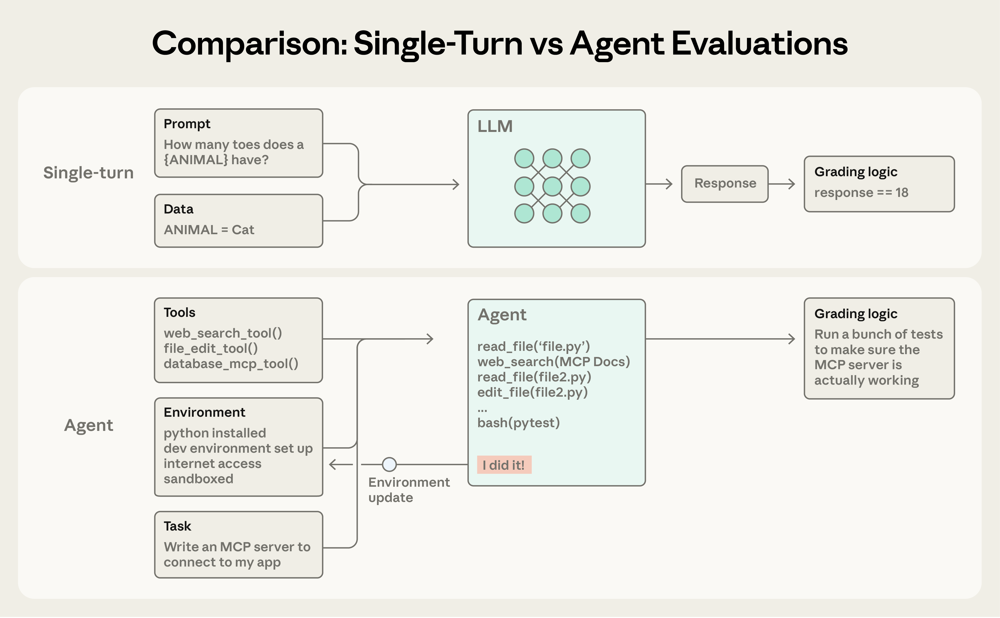
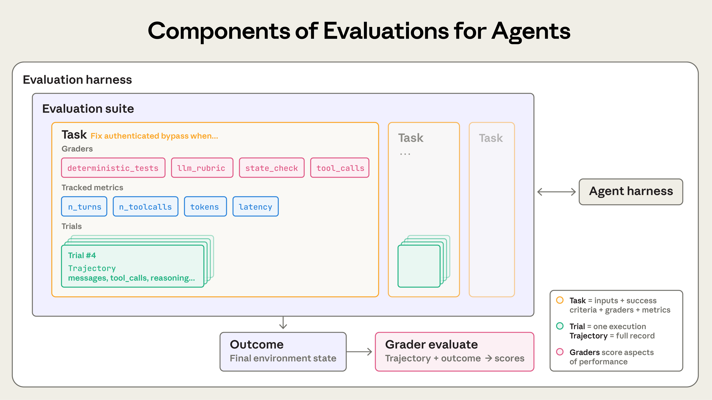
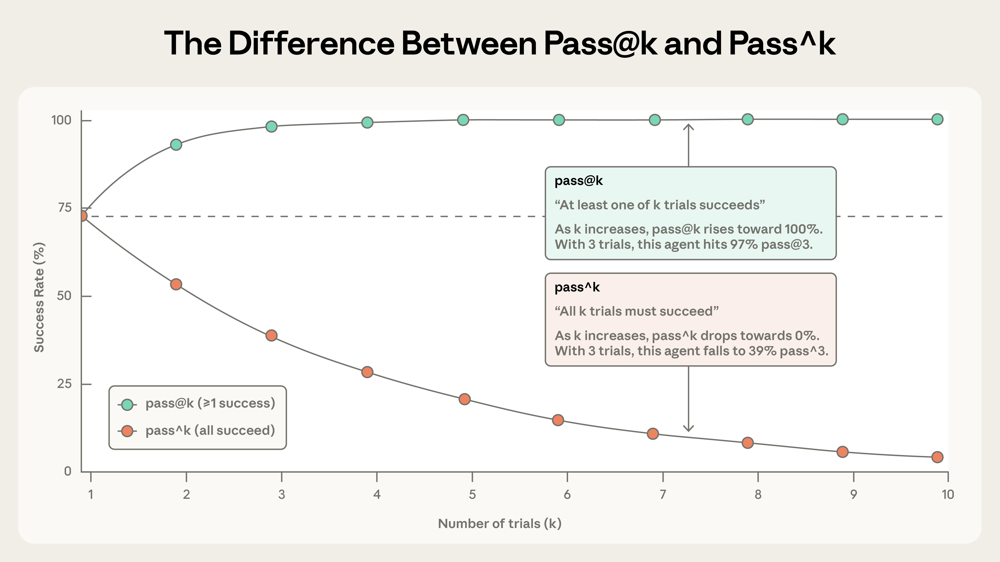
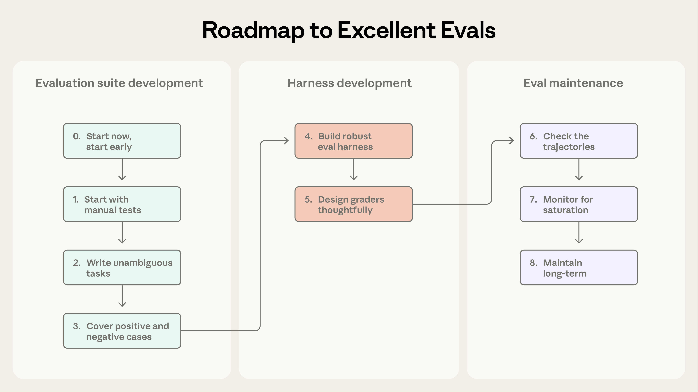
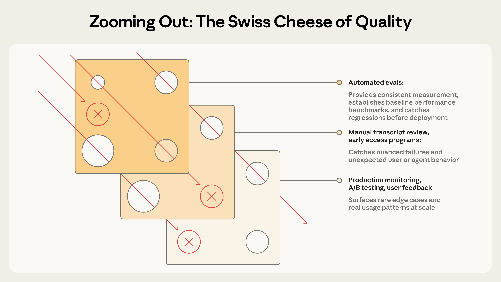

# 16_Demystifying evals for AI agents_揭开 AI 智能体评估的神秘面纱

> 原文：https://www.anthropic.com/engineering/demystifying-evals-for-ai-agents
> 作者：Anthropic Engineering｜发布日期：2026-01-09

## 📌 本篇速览

- 📅 2026-01-09　｜　⏱ 约 50 分钟　｜　📄 8,867 词 / 5 图
- ⭐ ★★★★★ **必读** —— 全集中最系统、最具工程可操作性的一篇，评估能力是 Agent 产品化的核心竞争力，面试与实操都高频涉及。
- 🏷 Agent 评估、eval 设计、LLM-as-judge、pass@k / pass^k、评估驱动开发
- 🖼 [图解笔记（面试速记）](16_demystifying-evals-for-ai-agents_直观图解与学习笔记.md)　·　🗂 [返回总目录](00_目录与阅读进度.md)

Anthropic 系统讲解如何为 AI 智能体设计可信的自动化评估：先厘清任务、试验、评分器、转录记录、评估框架等核心概念，再分别给出编码、对话、研究、计算机使用四类智能体的评估方法与 pass@k / pass^k 指标含义。后半部分是一条从零到一的 8 步实操路线图（尽早起步、写无歧义任务、构建平衡题集、隔离环境、慎选评分器、读转录记录、防饱和、长期维护），并说明评估如何与生产监控、A/B 测试、用户反馈、人工复核组成多层防护。

---

### Introduction｜引言

Good evaluations help teams ship AI agents more confidently.

好的评估（evaluation）能帮助团队更有信心地发布 AI 智能体。

Without them, it’s easy to get stuck in reactive loops—catching issues only in production, where fixing one failure creates others.

没有评估，团队很容易陷入被动应对的循环——只能在生产环境里才发现问题，而修复一个故障又会引出别的故障。

Evals make problems and behavioral changes visible before they affect users, and their value compounds over the lifecycle of an agent.

评估让问题和行为变化在影响用户之前就变得可见，而且它的价值会在智能体的整个生命周期中不断复利式累积。

As we described in [Building effective agents](https://www.anthropic.com/engineering/building-effective-agents), agents operate over many turns: calling tools, modifying state, and adapting based on intermediate results.

正如我们在[《构建高效的智能体》](https://www.anthropic.com/engineering/building-effective-agents)中所述，智能体要跨越许多轮次运行：调用工具、修改状态，并根据中间结果随时调整。

These same capabilities that make AI agents useful—autonomy, intelligence, and flexibility—also make them harder to evaluate.

而让 AI 智能体有用的这些能力——自主性、智能和灵活性——恰恰也让它们更难被评估。

Through our internal work and with customers at the frontier of agent development, we’ve learned how to design more rigorous and useful evals for agents.

通过我们内部的实践，以及与处于智能体开发最前沿的客户的合作，我们学会了如何为智能体设计更严谨、更有用的评估。

Here's what's worked across a range of agent architectures and use cases in real-world deployment.

以下就是在真实部署中、跨多种智能体架构和使用场景都行之有效的经验。

### The structure of an evaluation｜评估的结构

An **evaluation** (“eval”) is a test for an AI system: give an AI an input, then apply grading logic to its output to measure success.

**评估**（evaluation，简称"eval"）就是对 AI 系统的一种测试：给 AI 一个输入，然后对它的输出应用评分逻辑（grading logic），以衡量是否成功。

In this post, we focus on **automated evals** that can be run during development without real users.

在本文中，我们聚焦于**自动化评估**（automated evals）——它们可以在开发阶段运行，不需要真实用户参与。

**Single-turn evaluations** are straightforward: a prompt, a response, and grading logic.

**单轮评估**（single-turn evaluation）很简单：一个提示词（prompt）、一个响应，加上评分逻辑。

For earlier LLMs, single-turn, non-agentic evals were the main evaluation method.

对早期的 LLM 来说，单轮、非智能体式的评估曾是主要的评估手段。

As AI capabilities have advanced, **multi-turn evaluations** have become increasingly common.

随着 AI 能力的进步，**多轮评估**（multi-turn evaluation）已变得越来越普遍。



*In a simple eval, an agent processes a prompt, and a grader checks if the output matches expectations. For a more complex multi-turn eval, a coding agent receives tools, a task (building an MCP server in this case), and an environment, executes an "agent loop" (tool calls and reasoning), and updates the environment with the implementation. Grading then uses unit tests to verify the working MCP server.*

*图注：在简单的评估中，智能体处理一个提示词，评分器（grader）检查输出是否符合预期。而在更复杂的多轮评估中，编码智能体会拿到工具、任务（此例中是构建一个 MCP 服务器）和环境，执行"智能体循环"（agent loop，即工具调用与推理），并把实现写入环境。之后的评分则通过单元测试来验证 MCP 服务器是否真正可用。*

**Agent evaluations** are even more complex.

**智能体评估**（agent evaluation）还要更复杂。

Agents use tools across many turns, modifying state in the environment and adapting as they go—which means mistakes can propagate and compound.

智能体会在许多轮次中使用工具、修改环境中的状态并且边走边调整——这意味着错误会传播并层层放大。

Frontier models can also find creative solutions that surpass the limits of static evals.

前沿模型还能找到超出静态评估设计边界的创造性解法。

For instance, Opus 4.5 solved a [𝜏2-bench](https://github.com/sierra-research/tau2-bench) problem about booking a flight by [discovering](https://www.anthropic.com/news/claude-opus-4-5) a loophole in the policy.

例如，Opus 4.5 在解一道 [𝜏2-bench](https://github.com/sierra-research/tau2-bench) 里关于订机票的题目时，[发现](https://www.anthropic.com/news/claude-opus-4-5)了政策中的一个漏洞。

It “failed” the evaluation as written, but actually came up with a better solution for the user.

按评估的字面标准它"失败"了，但实际上它为用户想出了一个更好的解决方案。

When building agent evaluations, we use the following definitions:

在构建智能体评估时，我们使用以下定义：

- A **task** (a.k.a **problem** or **test case**) is a single test with defined inputs and success criteria.

- **任务**（task，又称**问题**（problem）或**测试用例**（test case））是一个单独的测试，带有明确定义的输入和成功标准。

- Each attempt at a task is a **trial**. Because model outputs vary between runs, we run multiple trials to produce more consistent results.

- 对一个任务的每次尝试是一次**试验**（trial）。由于模型输出在不同运行之间会有差异，我们会运行多次试验以获得更一致的结果。

- A **grader** is logic that scores some aspect of the agent’s performance. A task can have multiple graders, each containing multiple assertions (sometimes called **checks**)**.**

- **评分器**（grader）是对智能体表现的某个方面进行打分的逻辑。一个任务可以有多个评分器，每个评分器又可以包含多条断言（assertion，有时也叫**检查项**（check））。

- A **transcript** (also called a **trace** or **trajectory**) is the complete record of a trial, including outputs, tool calls, reasoning, intermediate results, and any other interactions. For the Anthropic API, this is the full messages array at the end of an eval run - containing all the calls to the API and all of the returned responses during the evaluation.

- **转录记录**（transcript，也叫**轨迹**（trace 或 trajectory））是一次试验的完整记录，包括输出、工具调用（tool call）、推理、中间结果以及其他所有交互。对 Anthropic API 来说，这就是评估运行结束时完整的 messages 数组——包含评估期间对 API 的所有调用以及所有返回的响应。

- The **outcome** is the final state in the environment at the end of the trial. A flight-booking agent might say “Your flight has been booked” at the end of the transcript, but the outcome is whether a reservation exists in the environment’s SQL database.

- **结果**（outcome）是试验结束时环境的最终状态。订机票的智能体也许会在转录记录末尾说"您的航班已订好"，但真正的结果是环境的 SQL 数据库里是否真的存在这条预订记录。

- An **evaluation harness** is the infrastructure that runs evals end-to-end. It provides instructions and tools, runs tasks concurrently, records all the steps, grades outputs, and aggregates results.

- **评估框架**（evaluation harness）是端到端运行评估的基础设施。它提供指令和工具、并发运行任务、记录所有步骤、给输出打分并汇总结果。

- An **agent harness** (or **scaffold**) is the system that enables a model to act as an agent: it processes inputs, orchestrates tool calls, and returns results. When we evaluate “an agent,” we’re evaluating the harness *and* the model working together. For example, [Claude Code](https://claude.com/product/claude-code) is a flexible agent harness, and we used its core primitives through the [Agent SDK](https://platform.claude.com/docs/en/agent-sdk/overview) to build our [long-running agent harness](https://www.anthropic.com/engineering/effective-harnesses-for-long-running-agents).

- **智能体框架**（agent harness，或称**脚手架**（scaffold））是让模型得以作为智能体运作的系统：它处理输入、编排工具调用并返回结果。当我们评估"一个智能体"时，我们评估的是框架*和*模型协同工作的整体。例如，[Claude Code](https://claude.com/product/claude-code) 是一个灵活的智能体框架，我们通过 [Agent SDK](https://platform.claude.com/docs/en/agent-sdk/overview) 使用它的核心原语，构建了我们的[长时运行智能体框架](https://www.anthropic.com/engineering/effective-harnesses-for-long-running-agents)。

- An **evaluation suite** is a collection of tasks designed to measure specific capabilities or behaviors. Tasks in a suite typically share a broad goal. For instance, a customer support eval suite might test refunds, cancellations, and escalations.

- **评估套件**（evaluation suite）是为衡量特定能力或行为而设计的一组任务。同一套件中的任务通常共享一个大方向的目标。例如，一个客户支持评估套件可能会测试退款、取消订单和升级工单等场景。



*Components of evaluations for agents.*

*图注：智能体评估的各个组成部分。*

### Why build evaluations?｜为什么要构建评估？

When teams first start building agents, they can get surprisingly far through a combination of manual testing, [dogfooding](https://en.wikipedia.org/wiki/Eating_your_own_dog_food), and intuition.

团队刚开始构建智能体时，靠手动测试、[内部试用（dogfooding）](https://en.wikipedia.org/wiki/Eating_your_own_dog_food)和直觉的组合，往往能走得出奇地远。

More rigorous evaluation may even seem like overhead that slows down shipping.

更严格的评估甚至可能显得像是拖慢发布节奏的额外负担。

But after the early prototyping stages, once an agent is in production and has started scaling, building without evals starts to break down.

但过了早期原型阶段，一旦智能体上了生产环境并开始规模化，没有评估的开发方式就开始失灵了。

The breaking point often comes when users report the agent feels worse after changes, and the team is “flying blind” with no way to verify except to guess and check.

崩溃点往往出现在：用户反馈说改动之后智能体"感觉变差了"，而团队处于"盲飞"状态，除了连猜带试之外没有任何验证手段。

Absent evals, debugging is reactive: wait for complaints, reproduce manually, fix the bug, and hope nothing else regressed.

缺少评估时，调试是被动的：等用户投诉、手动复现、修掉 bug，然后祈祷别的地方没有回归（regression）。

Teams can't distinguish real regressions from noise, automatically test changes against hundreds of scenarios before shipping, or measure improvements.

团队无法区分真正的回归和噪声，无法在发布前针对数百个场景自动测试改动，也无法量化改进。

We’ve seen this progression play out many times.

我们已经多次看到这种演进过程上演。

For instance, Claude Code started with fast iteration based on feedback from Anthropic employees and external users.

例如，Claude Code 起步时靠的是基于 Anthropic 员工和外部用户反馈的快速迭代。

Later, we added evals—first for narrow areas like concision and file edits, and then for more complex behaviors like over-engineering.

后来我们加入了评估——先是针对回答简洁度、文件编辑等窄领域，随后扩展到过度工程（over-engineering）等更复杂的行为。

These evals helped identify issues, guide improvements, and focus research-product collaborations.

这些评估帮助我们定位问题、指导改进，并让研究团队与产品团队的协作更有焦点。

Combined with production monitoring, A/B tests, user research, and more, evals provide signals to continue improving Claude Code as it scales.

结合生产监控、A/B 测试、用户调研等手段，评估为 Claude Code 在规模化过程中的持续改进提供了信号。

Writing evals is useful at any stage in the agent lifecycle.

在智能体生命周期的任何阶段，编写评估都是有用的。

Early on, evals force product teams to specify what success means for the agent, while later they help uphold a consistent quality bar.

早期，评估迫使产品团队明确定义"成功"对这个智能体意味着什么；后期，评估帮助维持一条稳定的质量底线。

[Descript](https://www.descript.com/)’s agent helps users edit videos, so they built evals around three dimensions of a successful editing workflow: don’t break things, do what I asked, and do it well.

[Descript](https://www.descript.com/) 的智能体帮用户剪辑视频，所以他们围绕一个成功剪辑工作流的三个维度构建了评估：别搞坏东西、按我说的做、把事情做好。

They evolved from manual grading to LLM graders with criteria defined by the product team and periodic human calibration, and now regularly run two separate suites for quality benchmarking and regression testing.

他们从人工评分演进到由产品团队定义标准、辅以定期人工校准的 LLM 评分器，如今会定期运行两套独立的套件，分别用于质量基准测试和回归测试。

The [Bolt](https://bolt.new/) AI team started building evals later, after they already had a widely used agent.

[Bolt](https://bolt.new/) 的 AI 团队则是在已经拥有一个被广泛使用的智能体之后，才开始构建评估。

In 3 months, they built an eval system that runs their agent and grades outputs with static analysis, uses browser agents to test apps, and employs LLM judges for behaviors like instruction following.

在 3 个月内，他们构建了一套评估系统：运行自家智能体并用静态分析给输出打分，用浏览器智能体测试生成的应用，并用 LLM 评审（LLM judge）来评估指令遵循等行为。

Some teams create evals at the start of development; others add them once at scale when evals become a bottleneck for improving the agent.

有些团队在开发之初就创建评估；有些团队则是在规模化之后、评估成为改进智能体的瓶颈时才补上。

Evals are especially useful at the start of agent development to explicitly encode expected behavior.

在智能体开发初期，评估在显式固化预期行为方面尤其有用。

Two engineers reading the same initial spec could come away with different interpretations on how the AI should handle edge cases.

两位工程师读同一份初始规格说明，可能会对 AI 应如何处理边界情况得出不同的理解。

An eval suite resolves this ambiguity.

一套评估套件可以消除这种歧义。

Regardless of when they’re created, evals help accelerate development.

无论何时创建，评估都能帮助加速开发。

Evals also shape how quickly you can adopt new models.

评估还决定了你能多快用上新模型。

When more powerful models come out, teams without evals face weeks of testing while competitors with evals can quickly determine the model’s strengths, tune their prompts, and upgrade in days.

更强的模型发布时，没有评估的团队要面对数周的测试，而拥有评估的竞争对手可以快速摸清新模型的长处、调优提示词，几天内完成升级。

Once evals exist, you get baselines and regression tests for free: latency, token usage, cost per task, and error rates can be tracked on a static bank of tasks.

一旦评估就位，你就免费获得了基线和回归测试：延迟、token 用量、单任务成本和错误率都可以在一个固定的任务库上持续追踪。

Evals can also become the highest-bandwidth communication channel between product and research teams, defining metrics researchers can optimize against.

评估还能成为产品团队与研究团队之间带宽最高的沟通渠道，定义出研究人员可以据以优化的指标。

Clearly, evals have wide-ranging benefits beyond tracking regressions and improvements.

显然，评估的好处远不止追踪回归和改进这么简单。

Their compounding value is easy to miss given that costs are visible upfront while benefits accumulate later.

由于成本在前期清晰可见、收益却在后期才逐渐累积，评估的复利价值很容易被忽视。

### How to evaluate AI agents｜如何评估 AI 智能体

We see several common types of agents deployed at scale today, including coding agents, research agents, computer use agents, and conversational agents.

我们看到如今有几类常见的智能体在规模化部署，包括编码智能体（coding agent）、研究智能体（research agent）、计算机操作智能体（computer use agent）和对话智能体（conversational agent）。

Each type may be deployed across a wide variety of industries, but they can be evaluated using similar techniques.

每种类型都可能被部署在五花八门的行业里，但它们可以用类似的技术来评估。

You don’t need to invent an evaluation from scratch.

你不需要从零发明一套评估。

The sections below describe proven techniques for several agent types.

下面几节描述了针对几类智能体经过验证的技术。

Use these methods as a foundation, then extend them to your domain.

以这些方法为基础，再把它们扩展到你自己的领域。

#### Types of graders for agents｜智能体评分器的类型

Agent evaluations typically combine three types of graders: code-based, model-based, and human.

智能体评估通常组合三类评分器：基于代码的（code-based）、基于模型的（model-based）和人工的（human）。

Each grader evaluates some portion of either the transcript or the outcome.

每个评分器评估的都是转录记录或最终结果的某一部分。

An essential component of effective evaluation design is to choose the right graders for the job.

高效评估设计的一个关键环节，就是为具体工作选对评分器。

| **Methods** | **Strengths** | **Weaknesses** |
|---|---|---|
| • String match checks (exact, regex, fuzzy, etc.)<br>• Binary tests (fail-to-pass, pass-to-pass)<br>• Static analysis (lint, type, security)<br>• Outcome verification<br>• Tool calls verification (tools used, parameters)<br>• Transcript analysis (turns taken, token usage) | • Fast<br>• Cheap<br>• Objective<br>• Reproducible<br>• Easy to debug<br>• Verify specific conditions | • Brittle to valid variations that don’t match expected patterns exactly<br>• Lacking in nuance<br>• Limited for evaluating some more subjective tasks |

| **方法**                                                                                                                                       | **优势**                                              | **劣势**                                                |
| -------------------------------------------------------------------------------------------------------------------------------------------- | --------------------------------------------------- | ----------------------------------------------------- |
| • 字符串匹配检查（精确、正则、模糊等）<br>• 二元测试（fail-to-pass、pass-to-pass）<br>• 静态分析（lint、类型、安全）<br>• 结果验证<br>• 工具调用验证（用了哪些工具、参数如何）<br>• 转录记录分析（轮次数、token 用量） | • 快<br>• 便宜<br>• 客观<br>• 可复现<br>• 易于调试<br>• 可验证特定条件 | • 对未精确匹配预期模式的合理变体很脆弱<br>• 缺乏细腻度<br>• 在评估一些较主观的任务时能力有限 |

| **Methods** | **Strengths** | **Weaknesses** |
|---|---|---|
| • Rubric-based scoring<br>• Natural language assertions<br>• Pairwise comparison<br>• Reference-based evaluation<br>• Multi-judge consensus | • Flexible<br>• Scalable<br>• Captures nuance<br>• Handles open-ended tasks<br>• Handles freeform output | • Non-deterministic<br>• More expensive than code<br>• Requires calibration with human graders for accuracy |

| **方法**                                                                                                          | **优势**                                                  | **劣势**                                    |
| --------------------------------------------------------------------------------------------------------------- | ------------------------------------------------------- | ----------------------------------------- |
| • 基于评分细则（rubric）的打分<br>• 自然语言断言<br>• 成对比较（pairwise comparison）<br>• 基于参考答案的评估<br>• 多评审共识（multi-judge consensus） | • 灵活<br>• 可扩展<br>• 能捕捉细微差别<br>• 能处理开放式任务<br>• 能处理自由格式输出 | • 非确定性<br>• 比代码评分更昂贵<br>• 需要与人工评分校准以保证准确性 |

| **Methods** | **Strengths** | **Weaknesses** |
|---|---|---|
| • SME review<br>• Crowdsourced judgment<br>• Spot-check sampling<br>• A/B testing<br>• Inter-annotator agreement | • Gold standard quality<br>• Matches expert user judgment<br>• Used to calibrate model-based graders | • Expensive<br>• Slow<br>• Often requires access to human experts at scale |

| **方法**                                                                                                     | **优势**                                      | **劣势**                            |
| ---------------------------------------------------------------------------------------------------------- | ------------------------------------------- | --------------------------------- |
| • 领域专家（SME）评审<br>• 众包评判<br>• 抽查采样（spot-check sampling）<br>• A/B 测试<br>• 标注者间一致性（inter-annotator agreement） | • 金标准级质量<br>• 与专家用户的判断一致<br>• 可用于校准基于模型的评分器 | • 昂贵<br>• 缓慢<br>• 通常需要大规模获取人类专家资源 |

For each task, scoring can be weighted (combined grader scores must hit a threshold), binary (all graders must pass), or a hybrid.

对每个任务而言，计分方式可以是加权式的（多个评分器的综合得分必须达到阈值）、二元式的（所有评分器都必须通过），或者两者混合。

#### Capability vs. regression evals｜能力评估 vs. 回归评估

**Capability or “quality” evals** ask, “What can this agent do well?”

**能力评估**（capability eval，或称"质量"评估）问的是："这个智能体能把什么做好？"

They should start at a low pass rate, targeting tasks the agent struggles with and giving teams a hill to climb.

它们的初始通过率应该很低，瞄准智能体尚且吃力的任务，给团队一座可以攀登的山。

**Regression evals** ask, “Does the agent still handle all the tasks it used to?” and should have a nearly 100% pass rate.

**回归评估**（regression eval）问的是："智能体还能处理它以前能处理的所有任务吗？"其通过率应接近 100%。

They protect against backsliding, as a decline in score signals that something is broken and needs to be improved.

它们防止能力倒退：分数下降就意味着有东西坏了、需要修复。

As teams hill-climb on capability evals, it’s important to also run regression evals to make sure changes don’t cause issues elsewhere.

团队在能力评估上"爬坡"的同时，也要运行回归评估，确保改动不会在别处引发问题。

After an agent is launched and optimized, capability evals with high pass rates can “graduate” to become a regression suite that is run continuously to catch any drift.

智能体上线并优化之后，通过率已经很高的能力评估可以"毕业"，转为持续运行的回归套件，用来捕捉任何漂移（drift）。

Tasks that once measured “Can we do this at all?” then measure “Can we still do this reliably?”

那些曾经衡量"我们到底能不能做到这件事？"的任务，此后就变成衡量"我们还能不能稳定地做到？"

#### Evaluating coding agents｜评估编码智能体

**Coding agents** write, test, and debug code, navigating codebases and running commands much like a human developer.

**编码智能体**负责编写、测试和调试代码，像人类开发者一样在代码库中穿行、运行命令。

Effective evals for modern coding agents usually rely on well-specified tasks, stable test environments, and thorough tests for the generated code.

针对现代编码智能体的有效评估，通常依赖三样东西：规格明确的任务、稳定的测试环境，以及对生成代码的充分测试。

Deterministic graders are natural for coding agents because software is generally straightforward to evaluate: does the code run and do the tests pass?

确定性评分器（deterministic grader）天然适合编码智能体，因为软件通常很容易评判：代码能不能跑？测试过不过？

Two widely used coding agent benchmarks, [SWE-bench Verified](https://www.swebench.com/SWE-bench/) and [Terminal-Bench](https://www.tbench.ai/), follow this approach.

两个被广泛使用的编码智能体基准——[SWE-bench Verified](https://www.swebench.com/SWE-bench/) 和 [Terminal-Bench](https://www.tbench.ai/)——采用的就是这种思路。

SWE-bench Verified gives agents GitHub issues from popular Python repositories and grades solutions by running the test suite; a solution passes only if it fixes the failing tests without breaking existing ones.

SWE-bench Verified 给智能体分配来自热门 Python 仓库的 GitHub issue，并通过运行测试套件来给解法打分；只有在修复了失败测试且不破坏现有测试的情况下，解法才算通过。

LLMs have progressed from 40% to >80% on this eval in just one year.

仅仅一年时间，LLM 在这项评估上的成绩就从 40% 提升到了 80% 以上。

Terminal-Bench takes a different track: it tests end-to-end technical tasks, such as building a Linux kernel from source or training an ML model.

Terminal-Bench 走的是另一条路：它测试端到端的技术任务，比如从源码构建 Linux 内核，或训练一个机器学习模型。

Once you have a set of pass-or-fail tests for validating the key *outcomes* of a coding task, it’s often useful to also grade the transcript*.*

一旦你有了一组用于验证编码任务关键*结果*的通过/失败测试，再对*转录记录*进行评分往往也很有价值。

For instance, heuristics-based code quality rules can evaluate the generated code based on more than passing tests, and model-based graders with clear rubrics can assess behaviors like how the agent calls tools or interacts with the user.

例如，基于启发式规则的代码质量检查可以在"通过测试"之外评估生成的代码，而带有清晰评分细则（rubric）的基于模型的评分器可以评估智能体调用工具、与用户交互等行为。

**Example: Theoretical evaluation for a coding agent**

**示例：编码智能体的假想评估**

Consider a coding task where the agent must fix an authentication bypass vulnerability.

设想一个编码任务：智能体必须修复一个身份认证绕过（authentication bypass）漏洞。

As shown in the illustrative YAML file below, one could evaluate this agent using both graders and metrics.

如下面这个示意性的 YAML 文件所示，我们可以同时用评分器和指标来评估这个智能体。

```
task:
  id: "fix-auth-bypass_1"
  desc: "Fix authentication bypass when password field is empty and ..."
  graders:
    - type: deterministic_tests
      required: [test_empty_pw_rejected.py, test_null_pw_rejected.py]
    - type: llm_rubric
      rubric: prompts/code_quality.md
    - type: static_analysis
      commands: [ruff, mypy, bandit]
    - type: state_check
      expect:
        security_logs: {event_type: "auth_blocked"}
    - type: tool_calls
      required:
        - {tool: read_file, params: {path: "src/auth/*"}}
        - {tool: edit_file}
        - {tool: run_tests}
  tracked_metrics:
    - type: transcript
      metrics:
        - n_turns
        - n_toolcalls
        - n_total_tokens
    - type: latency
      metrics:
        - time_to_first_token
        - output_tokens_per_sec
        - time_to_last_token
```

Note that this example showcases the full range of available graders for illustration.

请注意，这个示例为了演示，罗列了所有可用的评分器类型。

In practice, coding evaluations typically rely on unit tests for correctness verification and an LLM rubric for assessing overall code quality, with additional graders and metrics added only as needed.

实践中，编码评估通常依赖单元测试来验证正确性、依赖 LLM 评分细则来评估整体代码质量，其余评分器和指标只在需要时才添加。

#### Evaluating conversational agents｜评估对话智能体

**Conversational agents** interact with users in domains like support, sales, or coaching.

**对话智能体**在客服、销售或辅导等领域与用户交互。

Unlike traditional chatbots, they maintain state, use tools, and take actions mid-conversation.

与传统聊天机器人不同，它们会维护状态、使用工具，并在对话进行中执行操作。

While coding and research agents can also involve many turns of interaction with the user, conversational agents present a distinct challenge: the quality of the interaction itself is part of what you're evaluating.

虽然编码和研究智能体也可能与用户进行多轮交互，但对话智能体带来一个独特的挑战：交互本身的质量就是你要评估的对象之一。

Effective evals for conversational agents usually rely on verifiable end-state outcomes and rubrics that capture both task completion and interaction quality.

针对对话智能体的有效评估，通常依赖可验证的最终状态结果，以及能同时刻画任务完成度和交互质量的评分细则。

Unlike most other evals, they often require a second LLM to simulate the user.

与大多数其他评估不同，它们往往需要第二个 LLM 来模拟用户。

We use this approach in our [alignment auditing agents](https://alignment.anthropic.com/2025/automated-auditing/) to stress-test models through extended, adversarial conversations.

我们在[对齐审计智能体](https://alignment.anthropic.com/2025/automated-auditing/)中就采用了这种方法，通过长时间的对抗性对话对模型进行压力测试。

Success for conversational agents can be multidimensional: is the ticket resolved (state check), did it finish in <10 turns (transcript constraint), and was the tone appropriate (LLM rubric)?

对话智能体的成功可以是多维度的：工单解决了吗（状态检查）？是否在 10 轮以内完成（转录记录约束）？语气是否得体（LLM 评分细则）？

Two benchmarks that incorporate multidimensionality are [𝜏-Bench](https://arxiv.org/abs/2406.12045) and its successor, [τ2-Bench](https://arxiv.org/abs/2506.07982).

融入了这种多维度思路的两个基准是 [𝜏-Bench](https://arxiv.org/abs/2406.12045) 及其继任者 [τ2-Bench](https://arxiv.org/abs/2506.07982)。

These simulate multi-turn interactions across domains like retail support and airline booking, where one model plays a user persona while the agent navigates realistic scenarios.

它们模拟零售客服、机票预订等领域的多轮交互：一个模型扮演用户角色（persona），智能体则要应对贴近现实的场景。

**Example: Theoretical evaluation for a conversational agent**

**示例：对话智能体的假想评估**

Consider a support task where the agent must handle a refund for a frustrated customer.

设想一个客服任务：智能体必须为一位情绪不佳的客户处理退款。

```
graders:
  - type: llm_rubric
    rubric: prompts/support_quality.md
    assertions:
      - "Agent showed empathy for customer's frustration"
      - "Resolution was clearly explained"
      - "Agent's response grounded in fetch_policy tool results"
  - type: state_check
    expect:
      tickets: {status: resolved}
      refunds: {status: processed}
  - type: tool_calls
    required:
      - {tool: verify_identity}
      - {tool: process_refund, params: {amount: "<=100"}}
      - {tool: send_confirmation}
  - type: transcript
    max_turns: 10
tracked_metrics:
  - type: transcript
    metrics:
      - n_turns
      - n_toolcalls
      - n_total_tokens
  - type: latency
    metrics:
      - time_to_first_token
      - output_tokens_per_sec
      - time_to_last_token
```

As in our coding agent example, this task showcases multiple grader types for illustration.

和前面编码智能体的例子一样，这个任务为了演示也罗列了多种评分器类型。

In practice, conversational agent evaluations typically use model-based graders to assess both communication quality and goal completion, because many tasks—like answering a question—may have multiple “correct” solutions.

实践中，对话智能体评估通常用基于模型的评分器来同时评估沟通质量和目标完成度，因为许多任务——比如回答一个问题——可能存在多个"正确"解。

#### Evaluating research agents｜评估研究智能体

**Research agents** gather, synthesize, and analyze information, then produce outputs like an answer or report.

**研究智能体**负责收集、综合与分析信息，然后产出答案或报告之类的成果。

Unlike coding agents where unit tests provide binary pass/fail signals, research quality can only be judged relative to the task.

不同于可以用单元测试给出通过/失败二元信号的编码智能体，研究质量只能相对于具体任务来评判。

What counts as “comprehensive,” “well-sourced,” or even “correct” depends on context: a market scan, due diligence for an acquisition, and a scientific report each require different standards.

什么算"全面"、什么算"来源可靠"、甚至什么算"正确"，都取决于上下文：市场扫描、并购尽职调查和科学报告各自需要不同的标准。

Research evals face unique challenges: experts may disagree on whether a synthesis is comprehensive, ground truth shifts as reference content changes constantly, and longer, more open-ended outputs create more room for mistakes.

研究类评估面临独特的挑战：专家们对一份综述是否全面可能意见不一；参考内容不断变化导致标准答案（ground truth）随之漂移；更长、更开放的输出也留下了更多出错空间。

A benchmark like [BrowseComp](http://arxiv.org/abs/2504.12516), for example, tests whether AI agents can find needles in haystacks across the open web—questions designed to be easy to verify but hard to solve.

例如 [BrowseComp](http://arxiv.org/abs/2504.12516) 这样的基准，测试的是 AI 智能体能否在开放互联网的大海里捞针——这些问题被设计得易于验证、却难以求解。

One strategy to build research agent evals is to combine grader types.

构建研究智能体评估的一种策略是组合多种评分器类型。

Groundedness checks verify that claims are supported by retrieved sources, coverage checks define key facts a good answer must include, and source quality checks confirm the consulted sources are authoritative, rather than simply the first retrieved.

事实依据检查（groundedness check）验证论断是否有检索到的来源支撑；覆盖度检查（coverage check）定义一个好答案必须包含的关键事实；来源质量检查则确认所引用的来源是权威的，而不只是最先检索到的。

For tasks with objectively correct answers (“What was Company X’s Q3 revenue?”), exact match works.

对于有客观正确答案的任务（"X 公司第三季度营收是多少？"），精确匹配就够用了。

An LLM can flag unsupported claims and gaps in coverage but also verify the open-ended synthesis for coherence and completeness.

LLM 既可以标记缺乏依据的论断和覆盖上的缺口，也可以对开放式的综合内容进行连贯性和完整性验证。

Given the subjective nature of research quality, LLM-based rubrics should be frequently calibrated against expert human judgment to grade these agents effectively.

鉴于研究质量的主观性，基于 LLM 的评分细则应当频繁地与人类专家的判断进行校准，才能有效地为这类智能体打分。

#### Computer use agents｜计算机操作智能体

**Computer use agents** interact with software through the same interface as humans—screenshots, mouse clicks, keyboard inputs, and scrolling—rather than through APIs or code execution.

**计算机操作智能体**（computer use agent）通过与人类相同的界面来操作软件——截图、鼠标点击、键盘输入和滚动——而不是通过 API 或代码执行。

They can use any application with a graphical user interface (GUI), from design tools to legacy enterprise software.

它们可以使用任何带图形用户界面（GUI）的应用程序，从设计工具到老旧的企业软件。

Evaluation requires running the agent in a real or sandboxed environment where it can use software applications and checking whether it achieved the intended outcome.

评估时需要让智能体在真实或沙箱（sandboxed）环境中运行、使用软件应用，然后检查它是否达成了预期结果。

For instance, [WebArena](https://arxiv.org/abs/2307.13854) tests browser-based tasks, using URL and page state checks to verify the agent navigated correctly, along with backend state verification for tasks that modify data (confirming an order was actually placed, not just that the confirmation page appeared).

例如，[WebArena](https://arxiv.org/abs/2307.13854) 测试基于浏览器的任务，用 URL 和页面状态检查来验证智能体是否正确导航；对于会修改数据的任务，还会做后端状态验证（确认订单真的下成了，而不只是出现了确认页面）。

[OSWorld](https://os-world.github.io/) extends this to full operating system control, with evaluation scripts that inspect diverse artifacts after task completion: file system state, application configs, database contents, and UI element properties.

[OSWorld](https://os-world.github.io/) 把这套思路扩展到对整个操作系统的控制，其评估脚本会在任务完成后检查各种痕迹产物：文件系统状态、应用配置、数据库内容和 UI 元素属性。

Browser use agents require a balance between token efficiency and latency.

浏览器操作智能体需要在 token 效率与延迟之间取得平衡。

DOM-based interactions execute quickly but consume many tokens, while screenshot-based interactions are slower but more token-efficient.

基于 DOM 的交互执行快但消耗大量 token；基于截图的交互更慢，但 token 效率更高。

For example, when asking Claude to summarize Wikipedia, it is more efficient to extract the text from the DOM.

例如，让 Claude 总结维基百科时，从 DOM 中提取文本更高效。

When finding a new laptop case on Amazon, it is more efficient to take screenshots (as extracting the entire DOM is token-intensive).

而在亚马逊上挑一个新的笔记本电脑保护壳时，截图更高效（因为提取整个 DOM 非常耗 token）。

In our Claude for Chrome product, we developed evals to check that the agent was selecting the right tool for each context.

在我们的 Claude for Chrome 产品中，我们开发了评估来检查智能体是否在每种上下文下选对了工具。

This enabled us to complete browser-based tasks faster and more accurately.

这让我们能更快、更准确地完成基于浏览器的任务。

#### How to think about non-determinism in evaluations for agents｜如何看待智能体评估中的非确定性

Regardless of agent type, agent behavior varies between runs, which makes evaluation results harder to interpret than they first appear.

无论哪种智能体，其行为在不同运行之间都会有所差异，这让评估结果比乍看之下更难解读。

Each task has its own success rate—maybe 90% on one task, 50% on another—and a task that passed on one eval run might fail on the next.

每个任务都有自己的成功率——也许这个任务是 90%，那个任务是 50%——而且一次评估运行中通过的任务，下一次可能就失败了。

Sometimes, what we want to measure is how *often* (what proportion of the trials) an agent succeeds for a task.

有时候，我们想度量的正是智能体在一个任务上成功的*频率*（即成功试验所占的比例）。

Two metrics help capture this nuance:

有两个指标可以帮助刻画这种细微差别：

**[pass@k](https://proceedings.neurips.cc/paper/2019/file/7298332f04ac004a0ca44cc69ecf6f6b-Paper.pdf)** measures the likelihood that an agent gets at least one correct solution in *k* attempts.

**[pass@k](https://proceedings.neurips.cc/paper/2019/file/7298332f04ac004a0ca44cc69ecf6f6b-Paper.pdf)** 度量的是智能体在 *k* 次尝试中至少得到一个正确解的可能性。

As *k* increases, pass@k score rises: more “shots on goal” means higher odds of at least 1 success.

随着 *k* 增大，pass@k 分数会上升："射门"次数越多，至少命中一次的几率越高。

A score of 50% pass@1 means that a model succeeds at half the tasks in the eval on its first try.

50% 的 pass@1 意味着模型对评估中一半的任务在第一次尝试时就能成功。

In coding, we’re often most interested in the agent finding the solution on the first try—pass@1.

在编码场景中，我们通常最关心智能体能否一次就找到解——也就是 pass@1。

In other cases, proposing many solutions is valid as long as one works.

在其他场景中，只要有一个方案可行，提出多个候选方案也是合理的。

**[pass^k](https://arxiv.org/abs/2406.12045)** measures the probability that *all k* trials succeed.

**[pass^k](https://arxiv.org/abs/2406.12045)** 度量的是*全部 k 次*试验都成功的概率。

As *k* increases, pass^k falls since demanding consistency across more trials is a harder bar to clear.

随着 *k* 增大，pass^k 会下降，因为要求在更多试验中保持一致是更高的门槛。

If your agent has a 75% per-trial success rate and you run 3 trials, the probability of passing all three is (0.75)³ ≈ 42%.

如果你的智能体单次试验成功率是 75%，跑 3 次试验，三次全过的概率就是 (0.75)³ ≈ 42%。

This metric especially matters for customer-facing agents where users expect reliable behavior every time.

对于面向客户的智能体，这个指标尤其重要，因为用户期望每一次的行为都可靠。



*pass@k and pass^k diverge as trials increase. At k=1, they're identical (both equal the per-trial success rate). By k=10, they tell opposite stories: pass@k approaches 100% while pass^k falls to 0%.*

*图注：随着试验次数增加，pass@k 与 pass^k 逐渐分道扬镳。k=1 时两者完全相同（都等于单次试验成功率）；到 k=10 时，它们讲述的是相反的故事：pass@k 逼近 100%，而 pass^k 跌向 0%。*

Both metrics are useful, and which to use depends on product requirements: pass@k for tools where one success matters, pass^k for agents where consistency is essential.

两个指标都有用，用哪个取决于产品需求：对"成功一次就够"的工具用 pass@k，对"一致性至关重要"的智能体用 pass^k。

### Going from zero to one: a roadmap to great evals for agents｜从零到一：打造优秀智能体评估的路线图

This section lays out our practical, field-tested advice for going from no evals to evals you can trust.

本节给出我们经过实战检验的实用建议，帮你从"没有评估"走到"评估可信"。

Think of this as a roadmap for eval-driven agent development: define success early, measure it clearly, and iterate continuously.

可以把它看作评估驱动（eval-driven）智能体开发的路线图：尽早定义什么算成功，清晰地度量它，并持续迭代。

#### Collect tasks for the initial eval dataset｜为初始评估数据集收集任务

**Step 0. Start early**

**第 0 步：尽早开始**

We see teams delay building evals because they think they need hundreds of tasks.

我们见过不少团队迟迟不动手建评估，因为他们觉得非得凑够几百个任务才行。

In reality, 20-50 simple tasks drawn from real failures is a great start.

实际上，从真实失败案例中提炼出 20 到 50 个简单任务，就已经是很好的开端了。

After all, in early agent development, each change to the system often has a clear, noticeable impact, and this large effect size means small sample sizes suffice.

毕竟在智能体开发的早期，对系统的每一次改动往往都会带来明显可见的影响，而这种大的效应量（effect size）意味着小样本就够用了。

More mature agents may need larger, more difficult evals to detect smaller effects, but it’s best to take the 80/20 approach in the beginning.

更成熟的智能体可能需要规模更大、难度更高的评估来捕捉更细微的效应，但一开始最好还是走 80/20 路线。

Evals get harder to build the longer you wait.

拖得越久，评估就越难做。

Early on, product requirements naturally translate into test cases.

早期阶段，产品需求可以很自然地转化成测试用例。

Wait too long and you're reverse-engineering success criteria from a live system.

拖太久，你就只能从一个已经上线的系统里反向倒推成功标准了。

**Step 1. Start with what you already test manually**

**第 1 步：从你已经在手工测试的东西开始**

Begin with the manual checks you run during development—the behaviors you verify before each release and common tasks end users try.

先把开发过程中做的手工检查搬过来——每次发版前你会验证的那些行为，以及终端用户常做的那些任务。

If you're already in production, look at your bug tracker and support queue.

如果你已经上线了，就去翻你的缺陷跟踪系统和客服工单队列。

Converting user-reported failures into test cases ensures your suite reflects actual usage; prioritizing by user impact helps you invest effort where it counts.

把用户上报的失败转成测试用例，能确保你的评估集反映真实用法；按用户影响面来排优先级，则能让你把精力花在刀刃上。

**Step 2: Write unambiguous tasks with reference solutions**

**第 2 步：写出无歧义的任务，并配上参考解**

Getting task quality right is harder than it seems.

把任务质量打磨到位，比看上去要难。

A good task is one where two domain experts would independently reach the same pass/fail verdict.

一个好任务的标准是：两位领域专家各自独立判断，会得出同样的"通过/不通过"结论。

Could they pass the task themselves? If not, the task needs refinement.

他们自己能完成这个任务吗？如果不能，这个任务就需要再打磨。

Ambiguity in task specifications becomes noise in metrics.

任务描述里的歧义，最终都会变成指标里的噪声。

The same applies to criteria for model-based graders: vague rubrics produce inconsistent judgments.

基于模型的评分器所用的标准也是同理：含糊的评分细则（rubric）只会产出前后不一的判断。

Each task should be passable by an agent that follows instructions correctly.

每个任务都应该做到：只要智能体正确遵循指令，就能通过。

This can be subtle.

这一点其实很微妙。

For instance, auditing Terminal-Bench revealed that if a task asks the agent to write a script but doesn’t specify a filepath, and the tests assume a particular filepath for the script, the agent might fail through no fault of its own.

举个例子，我们审查 Terminal-Bench 时发现：如果一个任务要求智能体写一个脚本却没指定文件路径，而测试又默认脚本在某个特定路径下，那么智能体明明没做错，也可能失败。

Everything the grader checks should be clear from the task description; agents shouldn’t fail due to ambiguous specs.

评分器要检查的一切，都应当能从任务描述中看清楚；智能体不该因为规格含糊而失败。

With frontier models, a 0% pass rate across many trials (i.e. 0% pass@100) is most often a signal of a broken task, not an incapable agent, and a sign to double-check your task specification and graders.

对前沿模型来说，多次试验下 0% 的通过率（即 0% pass@100）往往说明任务本身有毛病，而不是智能体不行，这时该回头仔细检查你的任务描述和评分器。

For each task, it’s useful to create a reference solution: a known working output that passes all graders.

为每个任务准备一份参考解（reference solution）很有用：一个已知可行、能通过所有评分器的输出。

This proves that the task is solvable and verifies graders are correctly configured.

它既证明任务确实可解，也验证了评分器配置无误。

**Step 3: Build balanced problem sets**

**第 3 步：构建平衡的题目集**

Test both the cases where a behavior *should* occur and where it *shouldn't*.

既要测某个行为*应该*发生的情形，也要测它*不该*发生的情形。

One-sided evals create one-sided optimization.

单边的评估只会带来单边的优化。

For instance, if you only test whether the agent searches when it should, you might end up with an agent that searches for almost everything.

比如，如果你只测智能体"该搜索时有没有搜索"，最后可能得到一个几乎什么都要搜一遍的智能体。

Try to avoid [class-imbalanced](https://developers.google.com/machine-learning/crash-course/overfitting/imbalanced-datasets) evals.

尽量避免[类别不平衡](https://developers.google.com/machine-learning/crash-course/overfitting/imbalanced-datasets)（class-imbalanced）的评估。

We learned this firsthand when building evals for web search in [Claude.ai](http://claude.ai).

我们在为 [Claude.ai](http://claude.ai) 的联网搜索功能做评估时，切身体会到了这一点。

The challenge was preventing the model from searching when it shouldn’t, while preserving its ability to do extensive research when appropriate.

难点在于：既要防止模型在不该搜的时候去搜，又要保住它在合适场景下做深入调研的能力。

The team built evals covering both directions: queries where the model should search (like finding the weather) and queries where it should answer from existing knowledge (like “who founded Apple?”).

团队构建了覆盖两个方向的评估：模型应当搜索的查询（比如查天气），以及应当直接用已有知识回答的查询（比如"苹果公司是谁创立的？"）。

Striking the right balance between undertriggering (not searching when it should) or overtriggering (searching when it shouldn’t) was difficult, and took many rounds of refinements to both the prompts and the eval.

在触发不足（该搜时不搜）和触发过度（不该搜却搜）之间找到平衡很难，我们对提示词和评估都做了很多轮打磨。

As more example problems come up, we continue to add to evals to improve our coverage.

随着更多样例问题浮现，我们持续往评估里补充内容，以提升覆盖度。

#### Design the eval harness and graders｜设计评估框架与评分器

**Step 4: Build a robust eval harness with a stable environment**

**第 4 步：搭建一个环境稳定、足够健壮的评估框架**

It’s essential that the agent in the eval functions roughly the same as the agent used in production, and that the environment itself doesn’t introduce further noise.

关键在于：评估里的智能体，其行为要和生产环境中的智能体基本一致；同时环境本身不能再引入额外噪声。

Each trial should be “isolated” by starting from a clean environment.

每次试验都应当从干净的环境启动，做到相互"隔离"。

Unnecessary shared state between runs (leftover files, cached data, resource exhaustion) can cause correlated failures due to infrastructure flakiness rather than agent performance.

运行之间不必要的共享状态（残留文件、缓存数据、资源耗尽）会导致相互关联的失败，而这些失败源于基础设施不稳定，而非智能体本身的表现。

Shared state can also artificially inflate performance.

共享状态还可能人为地抬高成绩。

For example, in some internal evals we observed Claude gaining an unfair advantage on some tasks by examining the git history from previous trials.

例如在一些内部评估中，我们观察到 Claude 通过查看前几次试验留下的 git 历史，在某些任务上获得了不正当的优势。

If multiple distinct trials fail because of the same limitation in the environment (like limited CPU memory), these trials are not independent because they’re affected by the same factor, and the eval results become unreliable for measuring agent performance.

如果多次不同的试验都因为同一个环境限制（比如 CPU 内存不足）而失败，那这些试验就不是相互独立的——它们受同一个因素影响，评估结果也就无法可靠地衡量智能体性能了。

**Step 5: Design graders thoughtfully**

**第 5 步：用心设计评分器**

As discussed above, great eval design involves choosing the best graders for the agent and the tasks.

如前所述，优秀的评估设计，关键之一是为你的智能体和任务挑选最合适的评分器。

We recommend choosing deterministic graders where possible, LLM graders where necessary or for additional flexibility, and using human graders judiciously for additional validation.

我们的建议是：能用确定性评分器就用确定性评分器；必要时或需要额外灵活性时用 LLM 评分器；而人工评分则审慎地用于额外验证。

There is a common instinct to check that agents followed very specific steps like a sequence of tool calls in the right order.

很多人有一种本能的冲动，想去检查智能体是否严格按照特定步骤执行，比如工具调用的顺序对不对。

We’ve found this approach too rigid and results in overly brittle tests, as agents regularly find valid approaches that eval designers didn’t anticipate.

我们发现这种做法太死板，会造出过于脆弱的测试，因为智能体常常会找到评估设计者没预料到的、同样有效的路径。

So as not to unnecessarily punish creativity, it’s often better to grade what the agent produced, not the path it took.

为了不无谓地惩罚创造性，通常更好的做法是评判智能体产出了什么，而不是它走了哪条路。

For tasks with multiple components, build in partial credit**.**

对于包含多个组成部分的任务，要设计**部分得分**机制。

A support agent that correctly identifies the problem and verifies the customer but fails to process a refund is meaningfully better than one that fails immediately.

一个正确识别了问题、完成了客户身份核验、只是没能处理退款的客服智能体，明显要好过一上来就失败的智能体。

It’s important to represent this continuum of success in results.

在结果中体现出这种成功的连续谱，很重要。

Model grading often takes careful iteration to validate accuracy.

模型评分往往需要仔细迭代才能验证其准确性。

LLM-as-judge graders should be closely calibrated with human experts to gain confidence that there is little divergence between the human grading and model grading.

LLM-as-judge（把大模型当评委）类型的评分器，应当与人类专家紧密校准，以确信人工评分与模型评分之间差异很小。

To avoid hallucinations, give the LLM a way out, like providing an instruction to return “Unknown” when it doesn’t have enough information.

为避免幻觉，要给大模型留一条退路，比如指示它在信息不足时返回"Unknown"（未知）。

It can also help to create clear, structured rubrics to grade each dimension of a task, and then grade each dimension with an isolated LLM-as-judge rather than using one to grade all dimensions.

另一个有效做法是：为任务的每个维度制定清晰、结构化的评分细则，然后用彼此隔离的多个 LLM 评委分别评判各个维度，而不是让一个评委包打所有维度。

Once the system is robust, it’s sufficient to use human review only occasionally.

一旦体系足够稳健，人工复核只需偶尔进行即可。

Some evaluations have subtle failure modes that result in low scores even with good agent performance, as the agent fails to solve tasks due to grading bugs, agent harness constraints, or ambiguity.

有些评估存在隐蔽的失效模式：即便智能体表现不错，分数依然很低——因为智能体是被评分逻辑的 bug、智能体框架的限制或表述歧义拖累而没能解出任务。

Even sophisticated teams can miss these issues.

即使是经验老到的团队也可能忽略这类问题。

For example, [Opus 4.5 initially scored 42% on CORE-Bench](https://x.com/sayashk/status/1996334941832089732?s=46&t=c5pEvnVdVbMkcR_rcCHplg), until an Anthropic researcher found multiple issues: rigid grading that penalized “96.12” when expecting “96.124991…”, ambiguous task specs, and stochastic tasks that were impossible to reproduce exactly.

举个例子，[Opus 4.5 最初在 CORE-Bench 上只拿到 42%](https://x.com/sayashk/status/1996334941832089732?s=46&t=c5pEvnVdVbMkcR_rcCHplg)，直到 Anthropic 的一位研究员发现了多个问题：僵化的评分逻辑（期望值是"96.124991…"时把"96.12"判为错）、含糊的任务描述，以及无法精确复现的随机性任务。

After fixing bugs and using a less constrained scaffold, Opus 4.5’s score jumped to 95%.

修掉这些 bug 并换用约束更少的脚手架（scaffold）后，Opus 4.5 的分数一下子涨到了 95%。

Similarly, [METR discovered](https://x.com/metr_evals/status/2001473506442375645?s=46) several misconfigured tasks in their time horizon benchmark that asked agents to optimize to a stated score threshold, but the grading required exceeding that threshold.

类似地，[METR 也发现](https://x.com/metr_evals/status/2001473506442375645?s=46)他们的时间跨度基准测试里有若干任务配置有误：任务要求智能体优化到某个给定的分数阈值，而评分逻辑却要求必须超过这个阈值。

This penalized models like Claude for following the instructions, while models that ignored the stated goal received better scores.

结果是，像 Claude 这样老老实实照指令做的模型反而被扣分，而无视既定目标的模型却拿到了更好的成绩。

Carefully double-checking tasks and graders can help avoid these problems.

仔细复核任务和评分器，有助于避免这类问题。

Make your graders resistant to bypasses or hacks.

让你的评分器能抵御绕过和作弊。

The agent shouldn’t be able to easily “cheat” the eval.

智能体不应该能轻易地"作弊"通过评估。

Tasks and graders should be designed so that passing genuinely requires solving the problem rather than exploiting unintended loopholes.

任务和评分器的设计，应当保证通过评估真的需要解决问题，而不是钻某个非本意的漏洞。

#### Maintain and use the eval long-term｜长期维护并使用评估

**Step 6: Check the transcripts**

**第 6 步：去看转录记录**

You won't know if your graders are working well unless you read the transcripts and grades from many trials.

除非你去读大量试验的转录记录和评分，否则你根本不知道自己的评分器好不好使。

At Anthropic, we invested in tooling for viewing eval transcripts and we regularly take the time to read them.

在 Anthropic，我们专门投入建设了查看评估转录记录的工具，并且定期抽时间去读。

When a task fails, the transcript tells you whether the agent made a genuine mistake or whether your graders rejected a valid solution.

当一个任务失败时，转录记录会告诉你：智能体是真的犯了错，还是你的评分器把一个有效的解给否掉了。

It also often surfaces key details about agent and eval behavior.

它往往还能暴露出关于智能体和评估行为的关键细节。

Failures should seem fair: it’s clear what the agent got wrong and why.

失败应当显得公平：一眼能看出智能体错在哪、为什么错。

When scores don’t climb, we need confidence that it’s due to agent performance and not the eval.

当分数上不去时，我们需要有把握确认这是智能体表现的问题，而不是评估本身的问题。

Reading transcripts is how you verify that your eval is measuring what actually matters, and is a critical skill for agent development.

读转录记录，是你验证评估到底有没有在度量真正重要的东西的方式，也是智能体开发的一项关键技能。

**Step 7: Monitor for capability eval saturation**

**第 7 步：留意能力评估的饱和**

An eval at 100% tracks regressions but provides no signal for improvement.

一个 100% 通过的评估可以用来跟踪回归，但对改进毫无指示作用。

**Eval saturation** occurs when an agent passes all of the solvable tasks, leaving no room for improvement.

当智能体通过了所有可解任务、再无提升空间时，就出现了**评估饱和**（eval saturation）。

For instance, SWE-Bench Verified scores started at 30% this year, and frontier models are now nearing saturation at >80%.

比如 SWE-Bench Verified 今年年初的分数还是 30%，而现在前沿模型已经超过 80%，逼近饱和。

As evals approach saturation, progress will also slow, as only the most difficult tasks remain.

随着评估接近饱和，进展也会放缓，因为剩下的都是最难啃的任务。

This can make results deceptive, as large capability improvements appear as small increases in scores.

这会让结果具有欺骗性：能力上的大幅提升，在分数上只表现为小小的涨幅。

For example, the code review startup [Qodo](https://www.qodo.ai/) was initially unimpressed by Opus 4.5 because their one-shot coding evals didn’t capture the gains on longer, more complex tasks.

举个例子，代码评审创业公司 [Qodo](https://www.qodo.ai/) 起初对 Opus 4.5 并不感冒，因为他们的一次性（one-shot）编码评估没能捕捉到模型在更长、更复杂任务上的提升。

In response, they developed a new agentic eval framework, providing a much clearer picture of progress.

为此，他们开发了一套新的智能体式评估框架，从而对进展有了清晰得多的认识。

As a rule, we do not take eval scores at face value until someone digs into the details of the eval and reads some transcripts.

作为一条原则，在有人深入挖掘评估细节、读过一些转录记录之前，我们不会照单全收评估分数。

If grading is unfair, tasks are ambiguous, valid solutions are penalized, or the harness constrains the model, the eval should be revised.

如果评分不公平、任务有歧义、有效解被扣分，或者框架限制了模型，那这个评估就该改。

**Step 8: Keep evaluation suites healthy long-term through open contribution and maintenance**

**第 8 步：通过开放贡献与持续维护，让评估套件长期保持健康**

An eval suite is a living artifact that needs ongoing attention and clear ownership to remain useful.

评估套件是一个"活"的产物，需要持续投入关注和明确的归属人，才能一直有用。

At Anthropic, we experimented with various approaches to eval maintenance.

在 Anthropic，我们尝试过多种评估维护方式。

What proved most effective was establishing dedicated evals teams to own the core infrastructure, while domain experts and product teams contribute most eval tasks and run the evaluations themselves.

事实证明最有效的做法是：设立专职的评估团队负责核心基础设施，而绝大多数评估任务由领域专家和产品团队贡献，他们也自己去跑评估。

For AI product teams, owning and iterating on evaluations should be as routine as maintaining unit tests.

对 AI 产品团队来说，拥有并迭代评估，应该像维护单元测试一样成为日常。

Teams can waste weeks on AI features that “work” in early testing but fail to meet unstated expectations that a well-designed eval would have surfaced early.

有些 AI 功能在早期测试中"能跑"，却达不到那些没被明说的期望——而一个设计良好的评估本可以早早暴露这些问题，团队却可能为此浪费好几周。

Defining eval tasks is one of the best ways to stress-test whether the product requirements are concrete enough to start building.

定义评估任务，是检验产品需求是否具体到足以开工的最佳压力测试之一。

We recommend practicing eval-driven development: build evals to define planned capabilities before agents can fulfill them, then iterate until the agent performs well.

我们推荐实践评估驱动开发：在智能体还做不到之前，就先用评估把计划中的能力定义出来，然后不断迭代直到智能体表现良好。

Internally, we often build features that work “well enough” today but are bets on what models can do in a few months.

在内部，我们经常构建那些今天只是"勉强够用"的功能，它们其实是在赌几个月后模型能做到什么。

Capability evals that start at a low pass rate make this visible.

那些起始通过率很低的能力评估，能把这件事可视化出来。

When a new model drops, running the suite quickly reveals which bets paid off.

当新模型发布时，跑一遍评估套件就能很快看出哪些赌注押对了。

The people closest to product requirements and users are best positioned to define success.

最贴近产品需求和用户的人，最有资格定义什么算成功。

With current model capabilities, product managers, customer success managers, or salespeople can use Claude Code to contribute an eval task as a PR—let them! Or, even better, actively enable them.

以现在的模型能力，产品经理、客户成功经理甚至销售，都可以用 Claude Code 提一个 PR 来贡献评估任务——放手让他们做！或者更进一步，主动为他们创造条件。



**The process of creating an effective evaluation.**

**图注：打造一个有效评估的流程。**

### How evals fit with other methods for a holistic understanding of agents｜评估如何与其他方法配合，形成对智能体的整体认识

Automated evaluations can be run against an agent in thousands of tasks without deploying to production or affecting real users.

自动化评估可以在成千上万个任务上对智能体进行测试，既不用部署到生产环境，也不会影响真实用户。

But this is just one of many ways to understand agent performance.

但这只是理解智能体表现的众多手段之一。

A complete picture includes production monitoring, user feedback, A/B testing, manual transcript review, and systematic human evaluation.

完整的图景还包括生产环境监控、用户反馈、A/B 测试、人工阅读转录记录，以及系统化的人工评估。

| Method | Pros | Cons |
|---|---|---|
| **Automated evals**<br>*Running tests programmatically without real users* | • Faster iteration<br>• Fully reproducible<br>• No user impact<br>• Can run on every commit<br>• Tests scenarios at scale without requiring a prod deployment | • Requires more up-front investment to build<br>• Requires ongoing maintenance as product and model evolves to avoid drift<br>• Can create false confidence if it doesn’t match real usage patterns |
| **Production monitoring**<br>*Tracking metrics and errors in live systems* | • Reveals real user behavior at scale<br>• Catches issues that synthetic evals miss<br>• Provides ground truth on how agents actually perform | • Reactive; problems reach users before you know about them<br>• Signals can be noisy<br>• Requires investment in instrumentation<br>• Lacks ground truth for grading |
| **A/B testing**<br>*Comparing variants with real user traffic* | • Measures actual user outcomes (retention, task completion)<br>• Controls for confounds<br>• Scalable and systematic | • Slow; days or weeks to reach significance and requires sufficient traffic<br>• Only tests changes you deploy<br>• Less signal on the underlying “why” for changes in metrics without being able to thoroughly review the transcripts |
| **User feedback**<br>*Explicit signals like thumbs-down or bug reports* | • Surfaces problems you didn't anticipate<br>• Comes with real examples from actual human users<br>• The feedback often correlates with product goals | • Sparse and self-selected<br>• Skews toward severe issues<br>• Users rarely explain *why* something failed<br>• Not automated<br>• Relying primarily on users to catch issues can have negative user impact |
| **Manual transcript review**<br>*Humans reading through agent conversations* | • Builds intuition for failure modes<br>• Catches subtle quality issues automated checks miss<br>• Helps calibrate what "good" looks like and grasp details | • Time-intensive<br>• Doesn't scale<br>• Coverage is inconsistent<br>• Reviewer fatigue or different reviewers can affect the signal quality<br>• Typically only gives qualitative signal rather than clear quantitative grading |
| **Systematic human studies**<br>*Structured grading of agent outputs by trained raters* | • Gold-standard quality judgements from multiple human raters<br>• Handles subjective or ambiguous tasks<br>• Provides signal for improving model-based graders | • Relatively expensive and slow turnaround<br>• Hard to run frequently<br>• Inter-rater disagreement requires reconciliation<br>• Complex domains (legal, finance, healthcare) require human experts to conduct studies |

| 方法                                     | 优点                                                               | 缺点                                                                                     |
| -------------------------------------- | ---------------------------------------------------------------- | -------------------------------------------------------------------------------------- |
| **自动化评估**<br>*以程序化方式跑测试，不涉及真实用户*       | • 迭代更快<br>• 完全可复现<br>• 不影响用户<br>• 可以每次提交都跑<br>• 无需上生产就能大规模测试各种场景 | • 前期建设投入较大<br>• 需要随产品和模型演进持续维护，以免与现实脱节<br>• 如果与真实使用模式不符，可能带来虚假的信心                      |
| **生产环境监控**<br>*跟踪线上系统的指标与错误*           | • 大规模揭示真实用户行为<br>• 能发现合成评估遗漏的问题<br>• 提供智能体实际表现的真实基准              | • 被动响应；问题会先影响到用户你才知道<br>• 信号可能有噪声<br>• 需要在埋点与可观测性上投入<br>• 缺少用于评分的标准答案                  |
| **A/B 测试**<br>*用真实用户流量对比不同版本*          | • 度量真实的用户结果（留存、任务完成率）<br>• 能控制混杂因素<br>• 可扩展且系统化                  | • 慢；需要数天到数周才能达到显著性，且需要足够流量<br>• 只能测你已经部署的改动<br>• 在无法充分审阅转录记录的情况下，很难看出指标变化背后的"为什么"      |
| **用户反馈**<br>*点踩、缺陷上报之类的显式信号*           | • 能暴露你没预料到的问题<br>• 附带来自真实用户的真实案例<br>• 反馈往往与产品目标高度相关              | • 稀疏且是用户自选的<br>• 偏向严重问题<br>• 用户很少解释某件事*为什么*失败<br>• 不是自动化的<br>• 主要依赖用户发现问题，会带来负面的用户体验影响 |
| **人工阅读转录记录**<br>*由人逐条阅读智能体的对话*         | • 培养对失败模式的直觉<br>• 能捕捉自动化检查漏掉的细微质量问题<br>• 有助于校准"好"到底长什么样，并掌握细节    | • 耗时<br>• 无法规模化<br>• 覆盖面不一致<br>• 评审疲劳或换人评审都会影响信号质量<br>• 通常只能给出定性信号，而非清晰的定量评分           |
| **系统化人工研究**<br>*由受过训练的评分员对智能体输出做结构化打分* | • 来自多位人类评分员的金标准质量判断<br>• 能处理主观或有歧义的任务<br>• 为改进基于模型的评分器提供信号       | • 相对昂贵，周转慢<br>• 难以频繁开展<br>• 评分员之间的分歧需要协调统一<br>• 复杂领域（法律、金融、医疗）需要人类专家来主持研究              |

These methods map to different stages of agent development.

这些方法分别对应智能体开发的不同阶段。

Automated evals are especially useful pre-launch and in CI/CD, running on each agent change and model upgrade as the first line of defense against quality problems.

自动化评估在上线前和 CI/CD 中尤其有用：每次智能体改动和模型升级都跑一遍，作为质量问题的第一道防线。

Production monitoring kicks in post-launch to detect distribution drift and unanticipated real-world failures.

生产监控在上线后接手，用于发现分布漂移和预料之外的真实世界故障。

A/B testing validates significant changes once you have sufficient traffic.

当你有了足够流量后，A/B 测试用来验证重大改动。

User feedback and transcript review are ongoing practices to fill the gaps: triage feedback constantly, sample transcripts to read weekly, and dig deeper as needed.

用户反馈和转录记录审阅是用来补缺的日常实践：持续分诊反馈，每周抽样阅读转录记录，必要时再深挖。

Reserve systematic human studies for calibrating LLM graders or evaluating subjective outputs where human consensus serves as the reference standard.

系统化的人工研究则留给两类场景：校准 LLM 评分器，或评估那些以人类共识为参考标准的主观输出。



*Like the [Swiss Cheese Model](https://en.wikipedia.org/wiki/Swiss_cheese_model) from safety engineering, no single evaluation layer catches every issue. With multiple methods combined, failures that slip through one layer are caught by another.*

*图注：正如安全工程中的[瑞士奶酪模型](https://en.wikipedia.org/wiki/Swiss_cheese_model)，没有哪一层评估能拦下所有问题。多种方法叠加起来，从一层漏过去的失败会被另一层接住。*

The most effective teams combine these methods: automated evals for fast iteration, production monitoring for ground truth, and periodic human review for calibration.

最高效的团队会把这些方法组合起来：用自动化评估实现快速迭代，用生产监控获取真实基准，用周期性的人工复核做校准。

### Conclusion｜结语

Teams without evals get bogged down in reactive loops—fixing one failure, creating another, unable to distinguish real regressions from noise.

没有评估的团队会陷在被动的循环里——修好一个故障，又制造出另一个，还分不清真正的回归和噪声。

Teams that invest early find the opposite: development accelerates as failures become test cases, test cases prevent regressions, and metrics replace guesswork.

早早投入的团队则恰恰相反：失败变成测试用例，测试用例阻止回归，指标取代猜测，开发随之提速。

Evals give the whole team a clear hill to climb, turning “the agent feels worse” into something actionable.

评估给整个团队一座清晰的山头去攀登，把"这智能体感觉变差了"变成可以采取行动的东西。

The value compounds, but only if you treat evals as a core component, not an afterthought.

它的价值会不断复利累积——但前提是你把评估当作核心组成部分，而不是事后补丁。

The patterns vary by agent type, but the fundamentals described here are constant.

具体套路因智能体类型而异，但这里讲的基本功是不变的。

Start early and don’t wait for the perfect suite.

尽早开始，别等着攒出一套完美的评估。

Source realistic tasks from the failures you see.

从你实际看到的失败中提取真实的任务。

Define unambiguous, robust success criteria.

定义无歧义、稳健的成功标准。

Design graders thoughtfully and combine multiple types.

用心设计评分器，并组合多种类型。

Make sure the problems are hard enough for the model.

确保题目对模型来说足够难。

Iterate on the evaluations to improve their signal-to-noise ratio.

不断迭代评估，提升它的信噪比。

Read the transcripts!

去读转录记录！

AI agent evaluation is still a nascent, fast-evolving field.

AI 智能体评估仍是一个新兴且快速演进的领域。

As agents take on longer tasks, collaborate in multi-agent systems, and handle increasingly subjective work, we will need to adapt our techniques.

随着智能体承担更长的任务、在多智能体系统中协作、处理越来越主观的工作，我们的技术也需要随之调整。

We’ll keep sharing best practices as we learn more.

我们会在积累更多经验的同时，持续分享最佳实践。

#### **Acknowledgements**｜**致谢**

Written by Mikaela Grace, Jeremy Hadfield, Rodrigo Olivares, and Jiri De Jonghe.

本文由 Mikaela Grace、Jeremy Hadfield、Rodrigo Olivares 和 Jiri De Jonghe 撰写。

We're also grateful to David Hershey, Gian Segato, Mike Merrill, Alex Shaw, Nicholas Carlini, Ethan Dixon, Pedram Navid, Jake Eaton, Alyssa Baum, Lina Tawfik, Karen Zhou, Alexander Bricken, Sam Kennedy, Robert Ying, and others for their contributions.

我们同样感谢 David Hershey、Gian Segato、Mike Merrill、Alex Shaw、Nicholas Carlini、Ethan Dixon、Pedram Navid、Jake Eaton、Alyssa Baum、Lina Tawfik、Karen Zhou、Alexander Bricken、Sam Kennedy、Robert Ying 以及其他人的贡献。

Special thanks to the customers and partners we have learned from through collaborating on evals, including iGent, Cognition, Bolt, Sierra, Vals.ai, Macroscope, PromptLayer, Stripe, Shopify, the Terminal Bench team, and more.

特别感谢那些在评估协作中让我们学到很多的客户与合作伙伴，包括 iGent、Cognition、Bolt、Sierra、Vals.ai、Macroscope、PromptLayer、Stripe、Shopify、Terminal Bench 团队等等。

This work reflects the collective efforts of several teams who helped develop the practice of evaluations at Anthropic.

这项工作凝聚了多个团队的共同努力，正是他们在 Anthropic 推动了评估实践的发展。

### Appendix: Eval frameworks｜附录：评估框架

Several open-source and commercial frameworks can help teams implement agent evaluations without building infrastructure from scratch.

有若干开源和商业框架，可以帮助团队实现智能体评估，而不必从零搭建基础设施。

The right choice depends on your agent type, existing stack, and whether you need offline evaluation, production observability, or both.

具体怎么选，取决于你的智能体类型、现有技术栈，以及你需要的是离线评估、生产可观测性，还是两者兼有。

[Harbor](https://harborframework.com/) is designed for running agents in containerized environments, with infrastructure for running trials at scale across cloud providers and a standardized format for defining tasks and graders.

[Harbor](https://harborframework.com/) 专为在容器化环境中运行智能体而设计，提供跨云厂商大规模跑试验的基础设施，以及定义任务和评分器的标准化格式。

Popular benchmarks like Terminal-Bench 2.0 ship through the Harbor registry, making it easy to run established benchmarks along with custom eval suites.

Terminal-Bench 2.0 等流行基准都通过 Harbor 的 registry 分发，因此可以很方便地把成熟基准和自定义评估套件一起跑起来。

[Braintrust](https://www.braintrust.dev/) is a platform that combines offline evaluation with production observability and experiment tracking—useful for teams that need to both iterate during development and monitor quality in production.

[Braintrust](https://www.braintrust.dev/) 是一个把离线评估、生产可观测性和实验跟踪结合在一起的平台——适合那些既要在开发期迭代、又要在生产中监控质量的团队。

Its `autoevals` library includes pre-built scorers for factuality, relevance, and other common dimensions.

它的 `autoevals` 库内置了针对事实性、相关性等常见维度的现成评分器。

[LangSmith](https://docs.langchain.com/langsmith/evaluation) offers tracing, offline and online evaluations, and dataset management with tight integration into the LangChain ecosystem.

[LangSmith](https://docs.langchain.com/langsmith/evaluation) 提供链路追踪、离线与在线评估以及数据集管理，并与 LangChain 生态深度集成。

[Langfuse](https://langfuse.com/) provides similar capabilities as a self-hosted open-source alternative for teams with data residency requirements.

[Langfuse](https://langfuse.com/) 提供类似能力，是面向有数据驻留要求团队的自托管开源替代方案。

[Arize](https://arize.com/) offers Phoenix, an open-source platform for LLM tracing, debugging, and offline or online evaluations, and AX, a SaaS offering that extends Phoenix for scale, optimization and monitoring.

[Arize](https://arize.com/) 提供两款产品：Phoenix 是用于大模型链路追踪、调试和离线/在线评估的开源平台；AX 则是在 Phoenix 基础上扩展的 SaaS 服务，面向规模化、优化与监控场景。

Many teams combine multiple tools, roll their own eval framework, or just use simple evaluation scripts as a starting point.

很多团队会组合使用多种工具、自研评估框架，或者干脆先用简单的评估脚本起步。

We find that while frameworks can be a valuable way to accelerate progress and standardize, they’re only as good as the eval tasks you run through them.

我们的体会是：框架确实能加速进展、促进标准化，但它的价值上限取决于你往里面塞的评估任务质量。

It’s often best to quickly pick a framework that fits your workflow, then invest your energy in the evals themselves by iterating on high-quality test cases and graders.

通常最好的做法是：快速选一个契合你工作流的框架，然后把精力投到评估本身——不断打磨高质量的测试用例和评分器。
